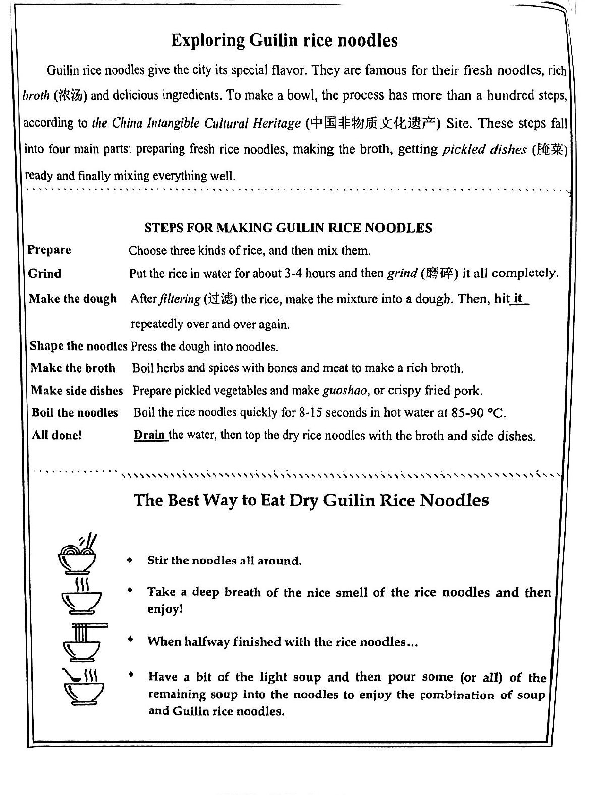
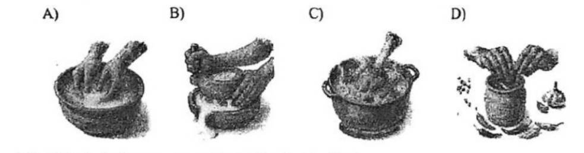
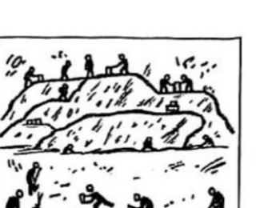
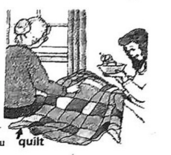

# 2026 一模精讲 · 闵行英语（下）：词句转换 + 读写（第 44–84 题）

> 本篇覆盖第 44–84 题（词形转换、句型转换、阅读四篇、作文），第 1–43 题见 [[英模26-闵行-上]]。答案来源与校正方式同上篇：卷面蓝笔手写批注版 + 页图互证。
>
> **与宝山范本卷的差异**：句型转换 52–57 每题 2 分、58 连词成句，共 14 分（与宝山一致）；阅读 A 篇为图文海报且含 61 题**看图选择题**；D 篇问答题为短篇小说（外婆的拼布被子），83 题为 3 分双理由题；作文（84 题）为**欢迎辞情境作文，卷面无海报图**。

## IV. Complete the sentences with the given words in their proper forms（词形转换，第 44–51 题，各 1 分，共 8 分；每空格限填一词）

**44.** At work, Tom always sees other people as ______ because of his selfishness. (enemy) → **enemies**
（sees…as + 名词；other people 是多人 → 敌人也用复数，enemy 以"辅音字母+y"结尾变 y 为 i 加 es）

**45.** Jerry's family has made the ______ day of each month their reunion day. (five) → **fifth**
（"每月的第五天"用序数词；the + 序数词 + day，five → fifth）

**46.** The art class students can ______ the digital drawing tools after practice. (operation) → **operate**
（can 后接动词原形；operation → operate"操作"）

**47.** Recently, more and more people are eager to learn the ______ skills. (tradition) → **traditional**
（修饰名词 skills 用形容词；tradition → traditional）

**48.** Never giving up is ______ one of the key factors for the old man's achievement. (certain) → **certainly**
（修饰整个句子/系动词表语气用副词；certain → certainly。⚠️ 易错点：is 与 one of 之间只能填副词，不能填形容词）

**49.** The headmaster of the university made a wonderful ______ in the rain. (speak) → **speech**
（a wonderful + 单数名词；make a speech"发表演讲"；speak → speech）

**50.** Once the repair is finished, I'm sure no other playground is better than ______. (we) → **ours**
（比较对象是"我们的操场"→ 名词性物主代词 ours = our playground）

**51.** She was really ______ to see her favorite vase break into pieces right in front of her. (happy) → **unhappy**
（was + 形容词作表语；最爱的花瓶当场打碎 → "不开心"。⚠️ 本题考**否定前缀 un-**，是 8 题里最易错的一题：不能照抄 happy）

## V. Rewrite the following sentences as required（句型转换，第 52–58 题，共 14 分；每题 2 分，52–57 每空限填一词）

**52.** The talented boy creates many fantastic artworks in his spare time.（改成否定句）
→ The talented boy **doesn't create** many fantastic artworks in his spare time.
（creates 为三单 → 借助 doesn't 构成否定，动词还原原形 create）

**53.** They <u>held an unforgettable ceremony</u> for the old wise man's 100th birthday.（对划线部分提问）
→ **What** did they **do** for the old wise man's 100th birthday?
（划线为"做的事"→ what + did + 主语 + do）

**54.** The young lady has written over 200 songs since she became a musician.（改成被动语态）
→ Over 200 songs **have been** written since the young lady became a musician.
（现在完成时被动 have/has been done；songs 复数 → have，注意保留 since 从句）

**55.** I'm wondering how I can buy a ferry ticket and then go home by myself now.（改为简单句）
→ I'm wondering **how to** buy a ferry ticket and then go home by myself now.
（"疑问词 + 不定式"把宾语从句简化为简单句，主谓一致不变）

**56.** Your umbrella is too small to keep both of us dry in the heavy rain.（保持句意基本不变）
→ Your umbrella isn't **big enough** to keep both of us dry in the heavy rain.
（too…to = not + adj + enough to；small 的反义 big，注意 enough 后置）

**57.** The reporter asked Martin, "Are you naturally gifted for dancing?"（改为间接引语）
→ The reporter asked Martin **whether/if** he **was** naturally gifted for dancing.
（一般疑问句 → whether/if 引导；人称 you→he；时态后移 are→was；批注两格连写 whether/if 均可）

**58.** say sorry, making a mess, should, in the classroom, they, after（连词成句）
→ **They should say sorry after making a mess in the classroom.**
（should + 动词原形 say sorry；after + 动名词 making a mess；地点状语 in the classroom 置于句末）

## VI. Reading Comprehension（阅读理解，第 59–83 题，共 50 分）

### A. Choose the best answer（阅读选择：桂林米粉海报，第 59–64 题，各 2 分，共 12 分）

文章为**应用文（图文海报）**：开头一段介绍桂林米粉之于这座城市（鲜粉、浓汤、百来道工序、四大板块），中间是 8 步制作流程表（Prepare→Grind→Make the dough→Shape the noodles→Make the broth→Make side dishes→Boil the noodles→All done!），下半是"干拌米粉最佳吃法"四步（拌匀→闻香→半程→添汤）。

**59.** The steps of making a bowl of Guilin rice noodles fall into ______ main parts. → **B) four**
（定位首段末句 These steps fall into four main parts；a hundred 是工序步数干扰项）

**60.** What does the underlined word "it" in the second part refer to? → **A) the dough**
（Make the dough 行：make the mixture into a dough. Then, hit **it** repeatedly——it 指代前句的 the dough）

**61.** Which picture shows the step of "Make the broth"?
A) 淘洗/揉搓  B) 石磨研磨  C) 带骨炖锅  D) 腌菜坛子

→ ⚠️ **卷面批注写 B**；但对照流程表，"Make the broth" 是 **C 图**（锅中带骨炖煮 = Boil herbs and spices with bones and meat），B 图（石磨研磨）对应的是 **Grind** 步骤。批注版与图意冲突，此处如实标注存疑，备考按图判断应取 C。

**62.** What is the best way to eat dry Guilin Rice Noodles? → **A) Mix—Smell—Eat—Drink**
（对照吃法四步：Stir the noodles all around=Mix → deep breath of the nice smell=Smell → 吃 → halfway 后添汤=Drink）

**63.** The underlined word "Drain" in the second part most probably means "______". → **D) Pour off**
（Drain the water"沥水"= 把水倒掉 pour off；take in 吸收 / turn into 变成 / clean out 清空均不合）

**64.** The passage is probably taken from the ______ section of a newspaper. → **D) "Culture & Tourism"**
（非遗（Intangible Cultural Heritage）+地方饮食 → 文旅版块；非本地新闻/校园/科技）

### B. Choose the best answer and complete the passage（完形选择：团队合作的艺术，第 65–70 题，各 2 分，共 12 分）

文章脉络：访谈体。公司培训师 Rita Charlesworth 就"团队合作"答三问——① 共事有何挑战：沟通不畅、工作风格冲突、个人目标与团队目标不合；② 如何人尽其才：按所长分工、各守其职，但也要随时补位；③ 如何高效沟通：尽早了解成员优势、让每人看到自己在全局中的价值、每一步都要沟通。

**65.** What ______ do people face when working with others towards a common goal? → **B) challenges**
（face challenges 搭配；下文具体列举各种困难，choices/chances/changes 语义不合）

**66.** They may have their ______ goals that don't match the team's goal. → **C) personal**
（personal goals"个人目标"与 team's goal 对照；don't match 提示两相对比）

**67.** It's important to give people jobs based on what they ______ and what they know. → **D) are good at**
（"按擅长和所知分配工作"；and 并列 what they know，are proud of / are pleased with 语义不合）

**68.** It's very important that everyone should ______ their part of the project. → **A) stick to**
（stick to their part"坚守自己那一部分"；与 But sometimes…do something different 形成转折对照）

**69.** How can team members ______ communicate and share their strong points with each other? → **D) effectively**
（修饰动词 communicate 用副词；"有效沟通"是本段主旨，regularly/politely/immediately 均偏）

**70.** If they can't see how they fit into the bigger picture, it's hard to ______. → **A) stay active**
（看不到自身在全局中的价值 → 难以"保持积极投入"；keep strict / look serious / feel relaxed 与语境不合）

### C. Fill in the blanks with proper words（首字母填空：恐龙公路，第 71–77 题，各 2 分，共 14 分）

文章脉络：英国牛津郡采石场工人 Gary Johnson 清理黏土时发现硬面上的怪异隆起 → 牛津、伯明翰两校专家 2024 年年中进驻，百余位专家/学生/工人并肩干了一周，一年后于 1 月公布：200 多个足迹、五条行迹（"恐龙公路"）→ 其中四条属 18 米长的草食巨龙 Cetiosaurus（不同年龄恐龙群同行同向），肉食的 Megalosaurus 足迹横跨其上——可能在追猎 → 学者称足迹是"窥见恐龙生活的窗口"，团队已用无人机拍 2 万多张照片、建 3D 模型，以便掩埋后继续研究。

**71.** …when he noticed the u______ bumps (隆起) in the hard surface. → **unusual**
（hard surface 上出现隆起本就"不寻常"；u 开头形容词修饰名词 bumps）

**72.** The workers, i______ many experts from various fields, students and quarry workers, worked side by side. → **including**
（列举成员构成用介词 including"包括"）

**73.** …the research team announced the d______ of their findings in January. → **details**
（announce the details of…"公布……的详情"；the + 名词，据 findings 用复数）

**74.** …there was a group of dinosaurs of different ages travelling t______. → **together**
（不同年龄的恐龙成群同向 → "一起"旅行；t 开头副词）

**75.** …the meat-eater was following and possibly h______ the Cetiosaurus. → **hunting**
（was + 现在分词；follow and hunt 并列——"跟随并可能猎捕"）

**76.** …the footprints are "a w______ into the lives of dinosaurs." → **window**
（a window into…"了解……的窗口"固定比喻）

**77.** …so they can c______ to study the tracks after the dinosaur highway is reburied. → **continue**
（can + 动词原形；continue to do"继续做"——照片与 3D 模型让研究在掩埋后仍能继续）

### D. Answer the questions（回答问题：外婆的拼布被子，第 78–83 题，共 12 分）

文章脉络：Tess 得流感卧床近一周 → 周五妈妈上班，外婆 Nonnie 来陪伴，Tess 盼着外婆带自制蜜桃冰淇淋 → 外婆一手端小蓝碗、一臂夹着一床旧被子 → 被子上每块布都有故事：这床被子是外婆小时候她的妈妈和姨妈做的，是 Tess 妈妈童年最爱的被子 → 红花布来自外婆六岁生日穿的小裙 → 另一块来自外婆母亲的围裙——弟弟跌进屋后小溪那天，母亲闻声冲出去救人撕破了围裙 → 外婆说"这床被子见过很多事"，盼 Tess 日后讲给孙辈听 → Tess 贴着脸感受到温暖，承认被子真让自己好起来了。

**78.** Tess was tired of being ill, wasn't she? (1 分)
→ **Yes, she was.**（反意疑问句先答 Yes/No；定位首句 She was tired of feeling sick and achy）

**79.** What did Grandmother bring to Tess?
→ **Some home-made peach ice cream and a quilt.**（批注原文照录；定位第二、三段两件物品）

**80.** Who made the quilt?
→ **Nonnie's mother and aunt.**（批注原文照录；定位 "my mother and my aunt made it when I was small"）

**81.** What did Nonnie mean when she said, "This quilt has seen a lot of things."?
→ **It means the quilt has witnessed many important events and family stories.**（批注原文照录；句意理解："被子见过很多事"= 每块布料承载着家庭往事）

**82.** When did Nonnie's mother tear her apron?
→ **On the day Nonnie's little brother fell in the stream beside their backyard.**（批注原文照录；定位 She tore the apron on a rock in the stream 的事件背景句）

**83.** Why did Tess say "Nonnie, you were right. This quilt did make me feel better."? (Give two reasons) (3 分)
→ 批注参考（两条缺一不可）：**First, the quilt carries warm family memories that comforted her. Second, Nonnie's love and care made her feel better emotionally.**
（3 分题按两点给分：①被子承载的温暖家庭记忆 ②外婆的关爱；用过去式/一般现在时均可，要点齐全是关键）

## VII. Writing（作文，第 84 题，共 20 分）

**题目**：Write at least 60 words according to the given situation（根据以下情境写一篇不少于 60 个词的短文，标点符号不占格）

假设你是一名花园学校（Rose Garden School）的初三学生李华，英国姊妹学校校长 Mrs. Miller 带领一批学生来你校访问，你被选为学生代表上台发言。请用英语撰写一篇欢迎辞：欢迎 Mrs. Miller 和同学们的同时，介绍你校的校园特色文化或活动，说明接待期间你所负责的具体工作、能给予的帮助，并送上你和同学们的祝福。（注意：1. 欢迎辞中不得出现姓名、校名等个人信息，否则不予评分。2. 照抄本卷语篇不得分。）

⚠️ 与宝山篇的"二选一海报邮件"不同：闵行无海报图，为纯情境应用文；**正文与落款均不可出现姓名、校名**（范文以 our school 指代，结尾不署名）。

**审题三步**：① 文体=口头欢迎辞（发言稿）：开头称呼 + 欢迎 + 主体 + 结尾感谢/祝福；② 内容四要点缺一不可：欢迎 Mrs. Miller 一行 → 校园特色文化或活动（节日、社团、传统项目）→ 我负责的具体工作与能提供的帮助 → 全体同学的祝福；③ 人称时态：第一人称 I / we，介绍现状用一般现在时，接待承诺用 will。

**参考范文（约 115 词）**：

> Good afternoon, Mrs. Miller and dear friends from the UK!
>
> On behalf of all the students, I'd like to give you a warm welcome to our school. It is a great honor for me to speak here as a student representative.
>
> Our school is well known for its colorful campus culture. Every term we hold a Reading Festival and an Art Week, where we can learn paper-cutting, Chinese calligraphy and traditional kung fu. I'm sure you will enjoy them during your visit.
>
> In the coming days, I will be responsible for showing you around the campus and introducing our club activities. If you need any help, please feel free to come to me at any time.
>
> Finally, on behalf of my classmates, I hope you will have a pleasant and unforgettable stay here. Thank you!

**评分要点**：覆盖四个内容要点（欢迎 / 文化活动 / 工作与帮助 / 祝福，共 8 分）｜语法与用词准确（6 分）｜衔接与流畅（3 分）｜格式与词数（3 分）。忌照抄本卷语篇（卷面明示不得分）；出现姓名、校名直接不予评分。

---
*本篇题干录自 150dpi 页图（闵行卷无文字层）；答案誊自卷面蓝笔手写批注版并逐题与语言规则互证；61 题批注与图意冲突已如实标注，84 题卷面未给范文（范文为精讲参考）。*
