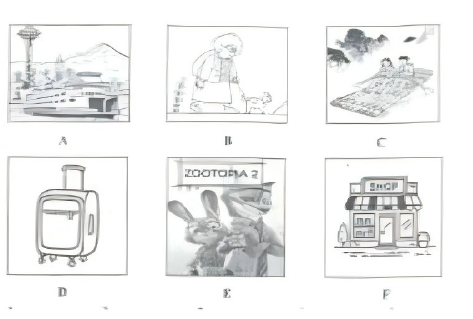

# 2026 一模精讲 · 青浦英语（上）：听力 + 语法词汇（第 1–43 题）

> 青浦卷结构：Part 1 听力 25 分（1–20）+ Part 2 语法词汇 45 分（21–58）+ Part 3 读写 70 分（59–84），共 84 小题 140 分，与宝山卷同构。本篇覆盖第 1–43 题，第 44–84 题见 [[英模26-青浦-下]]。
>
> ⚠️ **资料说明**：本区资产为**试卷+印刷参考答案合一 PDF（12 页，第 11–12 页为排版参考答案）**，卷面无手写批注，题干全部依 150dpi 页图录入校正。印刷答案**只覆盖第 21–84 题，未含听力（1–20）答案**；本区亦无听力音频，故听力部分只给卷面与方法，不给答案。与宝山范本的两处结构差异：① 听力 D（16–20）**每句设两个空格、每空限填一词**（10 空 10 分），而宝山为每句一空；② 选词填空（36–43）为**两篇独立短文各配一框**（青浦），宝山为一篇短文分两框。

## Part 1 听力（第 1–20 题，共 25 分）

### A. Listen and choose the right picture（听句选图，第 1–5 题，5 分）

六选五，卷面六图为：

- A：渡轮/游船驶过港湾，背景有太空针塔式高塔与雪山——"乘船/坐渡轮"场景
- B：一位老人弯腰照看脚边的小狗——"照顾宠物/养狗"场景
- C：水墨画风：两人立于水田中劳作（似插秧），背景群山云雾——"农作/种水稻"场景（画面较写意，听时以动词核实）
- D：一只带拉杆与滚轮的行李箱——"旅行/打包行李"场景
- E：电影《疯狂动物城 2》(Zootopia 2) 海报，兔朱迪与狐尼克——"看电影"场景
- F：一家临街小店（招牌 SHOP、遮阳棚、门口摆着货品）——"商店/购物"场景

> ⚠️ 印刷答案版未含 1–5 题答案，本区亦无听力音频，此处不臆测答案。做题方法：听前先读图、用一句话概括每图核心动词（take a ferry / look after the dog / plant rice / pack a suitcase / see a film / go shopping），听到句子后抓"动词+名词"匹配。

### B. Listen to the dialogue and choose the best answer to the question you hear（对话理解，第 6–10 题，5 分）

6. A) At 8:45 a.m.  B) At 9:15 a.m.  C) At 9:45 a.m.  D) At 10:15 a.m.（问时间）
7. A) Science fiction.  B) Detective novels.  C) Comic strips.  D) History books.（问读物类型）
8. A) On a plane.  B) On a bus.  C) In a store.  D) In a lab.（问地点）
9. A) The man is correct in four questions.  B) The man didn't begin his test on time.  C) The man corrected his mistake later.  D) The man can't change his answer now.（问事实细节）
10. A) The results of their science project.  B) Team skills for their science project.  C) Team members of their science project.  D) Materials needed for their science project.（问谈论话题）

> ⚠️ 同上，无答案无音频。考点预判：6 题听清时刻数字并区分 quarter/half；8 题抓场景词（boarding / get on / price / experiment）；9 题注意对话中的转折与"现在能不能改"的规则陈述；10 题抓对话核心名词（what are they mainly talking about）。

### C. Listen to the dialogue and tell whether the following statements are true or false（短文判断，第 11–15 题，5 分）

11. Nisha Claire returned the armchair to the company because of the chair type.
12. The company promises to return the money on the day it receives the returned item.
13. Nisha Claire fails to receive the money because her new bank card is not working.
14. To get the money back, Nisha must correct her bank card details on the website first.
15. The two speakers are dealing with a complaint about customer service.

> 短文主旨可从判断句反推：顾客 Nisha Claire 退回扶手椅申请退款，因银行卡信息问题未到账，通话中处理退款流程。⚠️ 印刷答案版未给 T/F 答案。方法：判断句与原文的**原因、时间、承诺**最常被偷换（如 11 题退货原因、12 题退款到账时间）。

### D. Listen to the passage and complete the following sentences（听短文填空，第 16–20 题，10 分；每空格限填一词，每句两空）

16. As a native, Fusun is ______ ______ the Guilin noodle-making skill.
17. Fusun learned how to make Guilin rice noodles in a ______ ______ in 1983.
18. Many ingredients are needed for the soup and everything has to be measured ______ ______.
19. Fusun teams up with colleges in the local area ______ ______ more people.
20. Fusun's ______ ______ is to let the world taste the flavor of Guilin rice noodles.

> ⚠️ 印刷答案版未给答案。可注意到：听力 D 短文讲桂林米粉技艺传承人 Fusun（1983 年学艺、与本地高校合作、让世界品尝桂林米粉），与 Part 3 C 篇首字母填空（安徽六安鹅毛做羽毛球、传统技艺+现代生产）**同属"传统手艺+产业"题材**——正式考试中两篇可互相借词（spread / skill / dream 等高频听写词）。

## Part 2 语法和词汇（第 21–43 题）

### II. Choose the best answer（语法单项选择，第 21–35 题，各 1 分，共 15 分）

**21.** For most people, surfing ______ Internet has become a daily habit.
A) a  B) an  C) the  D) /

**答案 C**。surf the Internet（上网）固定搭配，定冠词 the 不可省。

**22.** Three masked man broke ______ the Louvre Museum and stole some jewelry.（原卷印作 masked man，应为 men）
A) out  B) into  C) through  D) down

**答案 B**。break into…（闯入……）固定搭配；break out 爆发、break down 出故障，均不接地点宾语。

**23.** The public can get much ______ about the election online or on TV.
A) news  B) clues  C) suggestions  D) instructions

**答案 A**。much 修饰不可数名词，四个选项中只有 news 不可数。

**24.** Only Tom was selected for the national team, while ______ remained in the club.
A) other  B) another  C) others  D) the others

**答案 D**。全体分两部分：Tom 之外"其余所有人"用 the others。

**25.** The little boy felt ______ during the first month abroad, but soon he made new friends.
A) sadly  B) lonely  C) angrily  D) excitedly

**答案 B**。felt 为系动词，接形容词作表语（四个选项只有 lonely 是形容词）；but 后"交到新朋友"反推前文"孤单"。

**26.** The hit cartoon Nezha has become one of ______ popular cartoons in the world.
A) more  B) the more  C) most  D) the most

**答案 D**。one of the + 最高级 + 复数名词。

**27.** Will it come true that computers ______ take the place of human beings?
A) must  B) may  C) need  D) should

**答案 B**。句意问"将来是否**可能**实现"→ may 表可能性；must/need/should 语气不符。

**28.** Our school is considering ______ a fun fair to welcome the new year.
A) holding  B) to hold  C) held  D) hold

**答案 A**。consider doing sth 固定接动名词。

**29.** The doctor advised the young man ______ eating unhealthy food in his daily life.
A) stop  B) to stop  C) stopping  D) stopped

**答案 B**。advise sb to do sth 固定搭配。

**30.** Professor Wu's son ______ from the medical university in three years' time.
A) has graduated  B) is graduating  C) graduates  D) will graduate

**答案 D**。in three years' time（三年后）表将来 → 一般将来时 will graduate。

**31.** "Look, boys and girls. If we heat the water, it ______ steam," said the teacher.
A) had become  B) became  C) becomes  D) has become

**答案 C**。if 引导的真实条件句陈述客观规律（水加热变水蒸气），从句、主句都用一般现在时（零条件句）。

**32.** Sam set off early this morning, ______ he was still late because of the traffic jam.
A) but  B) so  C) and  D) or

**答案 A**。"早出发"与"仍迟到"语义转折 → but。

**33.** Few young people are interested in sending postcards to each other, ______?
A) aren't they  B) are they  C) don't they  D) do they

**答案 B**。few 表否定 → 前否后肯；陈述部分谓语是 are → are they。

**34.** All the players held the rope tightly to the last moment ______ they were tired out.
A) since  B) unless  C) although  D) because

**答案 C**。"坚持到最后"与"筋疲力尽"是让步关系 → although。

**35.** —Did you see the table tennis match between Fan Zhendong and Wang Chuqin last night?  —Of course. ______ exciting match!
A) How  B) What  C) What a  D) What an

**答案 D**。感叹句核心是名词 match → What + (a/an) + adj + n；exciting 元音开头 → What an。

### III. Choose the proper words in the box to complete the following passage. Each can be used only once（选词填空，第 36–43 题，各 1 分，共 8 分；每空限填一词，每词只能填一次，两框各 5 选 4）

**首框**：A. especially  B. emergencies  C. limits  D. caused  E. likely
主题：儿童电话手表的隐忧（smartwatches）

**36.** However, these devices have also ______ many problems. → **D) caused**（have caused many problems"引发许多问题"，have 后接过去分词）

**37.** Besides, smartwatches have also made children more ______ to be bullied(霸凌). → **E) likely**（make sb more likely to do"更有可能……"固定结构）

**38.** To help, experts suggest that the government should set ______ on the features of these watches. → **C) limits**（set limits on…"对……设限"固定搭配）

**39.** In ______, students can use school landline phones. → **B) emergencies**（in emergencies"紧急情况下"，与后文 landline phones / ask teachers for help 呼应；A especially 是副词，不能作介词宾语，为本框干扰项）

**次框**：A. seems  B. events  C. major  D. interest  E. ordinary
主题：好新闻的要素（newspaper story）

**40.** Well—it also has to be dramatic. People don't want to read about ______, everyday life. → **E) ordinary**（ordinary everyday life"平凡日常"，与 dramatic 戏剧性相对；C major 未用，为本框干扰项）

**41.** This is one reason why so much news ______ to be exciting news. → **A) seems**（news 不可数 → 三单 seems to be"显得/似乎是"）

**42.** Next, there's human ______. People are attracted by other people—particularly in the rich, famous and powerful. → **D) interest**（human interest"人情味/人物趣味"为新闻术语，由下句"人们关注他人"解释）

**43.** They prefer stories about people, places and ______ which their readers know. → **B) events**（people, places and events 名词并列，which 从句修饰）

> 小结：本区选词填空是"**一框一短文**"：先判词性（36 have 后要过去分词、38 动词 set 后宾语用名词、39 介词 in 后用名词、41 主语 news 后要谓语动词），再用**上下文复现**（40 的 dramatic、42 的 People are attracted by other people）锁定；每框剩下的那个词（especially / major）就是干扰项。

---
*本篇题干依"试卷+答案合一 PDF"150dpi 页图逐题录入校正（原卷 22 题 masked man、B 篇语病等原样保留并注明）；答案誊自第 11–12 页印刷参考答案并逐题与语法规则互证。听力部分（1–20）印刷答案未覆盖、本区无音频，已如实标注。*
