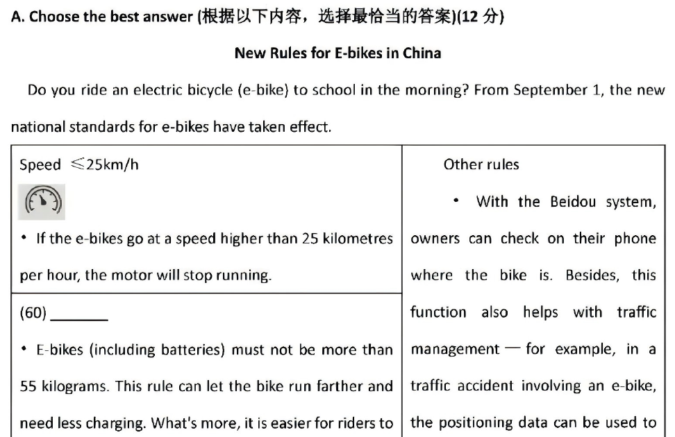
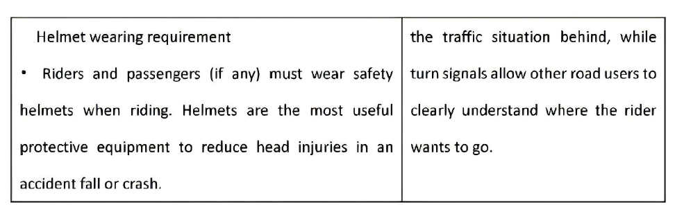
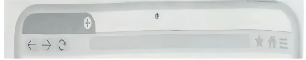

# 2026 一模精讲 · 青浦英语（下）：词句转换 + 读写（第 44–84 题）

> 本篇覆盖第 44–84 题（词形转换、句型转换、阅读四篇、作文），第 1–43 题见 [[英模26-青浦-上]]。答案来源与校正方式同上篇：第 11–12 页**印刷参考答案**逐题誊录 + 页图互证。与宝山范本的主要差异：阅读 A 篇为**图表文**（电动自行车新规，表格跨第 5–6 两页，此处裁两图）；作文为**四选一报名邮件**（非海报推荐）。

## IV. Complete the sentences with the given words in their proper forms（词形转换，第 44–51 题，各 1 分，共 8 分；每空格限填一词）

**44.** My grandpa is in his ______ but still very strong and healthy. (seventy) → **seventies**
（in one's + 整十数复数"七十多岁"固定结构）

**45.** Because of the strong wind, a large number of ______ fell to the ground. (leaf) → **leaves**
（a large number of + 可数名词复数；leaf 变 f 为 v 加 es）

**46.** This restaurant provides customers with ______ food choices. (vary) → **various**
（修饰名词 choices 用形容词；vary → various"各种各样的"）

**47.** Henry, think over your major choice before making your ______. (decide) → **decision**
（your 后接名词；make a decision"做决定"固定搭配）

**48.** Tim spoke so quietly that he was asked to repeat ______ in the maths class. (he) → **himself**
（repeat oneself"重复自己说过的话"用反身代词）

**49.** We must ______ this problem like detectives studying clues. (solution) → **solve**
（must 后接动词原形；solution 名词 → solve 动词"解决"）

**50.** My little brother is learning to be ______ by tidying his room on his own. (dependent) → **independent**
（"自己整理房间"→ 学会"独立"；本句考**否定前缀 in-**，最易错：不能照抄 dependent）

**51.** In the end, Tom ______ fixed his bicycle without the help of his father. (successful) → **successfully**
（修饰动词 fixed 用副词）

## V. Rewrite the following sentences as required（句型转换，第 52–58 题，共 14 分；52–57 每空限填一词）

**52.** The little girl hid herself behind the door to surprise her parents.（改为一般疑问句）
→ **Did** the little girl **hide** herself behind the door to surprise her parents?
（hid 为实义动词过去式 → 借助 did 提问，hid 还原为 hide）

**53.** Doris and Tina have been in the Science Club <u>for nearly two years</u>.（对划线部分提问）
→ **How long** have Doris and Tina been in the Science Club?
（划线为时间段 → how long，谓语 have been 照抄）

**54.** This program aims to teach students how they can stay safe online.（改为简单句）
→ This program aims to teach students **how to** stay safe online.
（"疑问词 + 从句"可缩略为"疑问词 + to do"）

**55.** Tom is tall. He can reach the books on the top of the bookshelf.（合并为一句）
→ Tom is **tall enough** to reach the books on the top of the bookshelf.
（adj + enough to do"足够……能做"合并两句）

**56.** Pansy wrote an article for the school newspaper last month.（改为被动语态）
→ An article **was written** for the school newspaper last month.
（一般过去时被动 was/were + 过去分词；wrote → written）

**57.** "Is your necklace made of fresh water pearls?" Mrs White asked me.（改为宾语从句）
→ Mrs White asked **if/whether my** necklace was made of fresh water pearls.
（一般疑问句 → if/whether 引导；人称 your→my；语序改陈述；时态后移）

**58.** to understand, this story, of, really hard, the plot, is, for students（连词成句）
→ **The plot of this story is really hard for students to understand.**
（be + adj + for sb + to do 句型；主语 the plot，of this story 作后置定语）

## VI. Reading Comprehension（阅读理解，第 59–83 题，共 50 分）

### A. Choose the best answer（阅读选择：电动自行车新规图表文，第 59–64 题，各 2 分，共 12 分）

文章为**图表应用文**：9 月 1 日起电动自行车新国标生效，表格分列 Speed（≤25km/h，超速电机停转）、(60) 整车重量（含电池不超 55 千克，跑得更远、更省充电、易控制）、Age rule（16 岁以下禁骑上路、12 岁以下不可被载人）、Helmet wearing requirement（骑乘人员须戴头盔）、Other rules（北斗定位可查车、事故数据可溯源、禁改电池/限速器、鼓励用后视镜与转向灯）。

**59.** What's the speed limit for e-bikes? → **C) 25 kilometres per hour.**
（定位表格第一栏 Speed ≤25km/h；D 的 55 是重量数字的干扰）

**60.** Which of the following is the best to be filled in the blank? → **B) E-bike total weight**
（空格为该栏小标题，下文"不超 55 kilograms、更省充电、易控制"全部围绕"重量"）

**61.** Why mustn't kids under 16 ride e-bikes on public roads? → **B) Because they aren't prepared to deal with busy traffic.**
（定位 Age rule：They don't have enough skills and experiences to deal with busy traffic——B 是同义改写）

**62.** The underlined word "equipment" means ______. → **A) tools used for a certain purpose**
（helmets are the most useful protective equipment——头盔是"防护装备/用具"）

**63.** The Beidou system can help e-riders ______. → **D) find the location of the e-bikes**
（定位 Other rules：owners can check on their phone where the bike is——"查位置"）

**64.** What's the purpose of these rules? → **C) To improve riding safety for e-riders.**
（全文各栏——限速、限重、年龄、头盔、禁改装——共同指向"骑行安全"）

### B. Choose the best answer and complete the passage（完形选择：美术馆该不该禁拍，第 65–70 题，各 2 分，共 12 分）

文章脉络：纽约 Frick 美术馆近日决定禁止拍照 → 正方"Yes—it spoils the experience"（拍照使人错过专注欣赏；类比剧院用黑暗聚焦注意力；可减少名作前排长队拍照的人群；游客改买纪念品，礼品店受益）→ 反方"No—taking photos is part of modern life"（照片可分享给亲友、留住体验；真正看懂艺术本来就需要时间；离开后可翻看回味；画廊 App 与二维码提供更多信息，是更 educational 的体验）。（⚠️ 原卷首句印作 "The Frick Collection is famous galleries in New York"，有语病，应为 is a famous gallery，不影响答题。）

**65.** Recently, the gallery decided to make a (an) ______: it decided to ban(禁止) photography in its galleries. → **D) change**
（冒号后"决定禁拍"即做出的"改变"；make a change 固定搭配）

**66.** Galleries can help us ______ with art and awaken our senses. → **D) connect**
（connect with art"与艺术产生联结"；agree/match/deal 均不与 with art 搭配此义）

**67.** Getting the most from art takes full attention—theaters, ______, use darkness to focus the audience's attention. → **B) for example**
（剧院是"全神贯注"的举例，且 theaters 后有逗号插入语结构）

**68.** A no-photo rule might also ______ the crowds around the most famous artworks, where people wait to get the perfect photo. → **C) reduce**
（禁拍 → 名作前排队拍照的人"减少"；attract 与文意相反）

**69.** Also, it requires ______ to truly understand the piece of art. → **A) time**
（"真正看懂一件作品需要时间"；require time to do）

**70.** Besides, smartphones can offer a chance to get the ______ experience through gallery apps and QR codes, which provide more information about artworks and artists. → **C) educational**
（定语从句"提供更多作品与艺术家信息"→ 这样的体验是"有教育意义的"）

### C. Fill in the blanks with proper words（首字母填空：六安鹅毛与羽毛球，第 71–77 题，各 2 分，共 14 分）

文章脉络：羽毛球运动流行，但羽毛球（shuttlecock）从哪来？→ 安徽六安养鹅史可溯至明朝，如今是全球羽毛供应商 → 本地白鹅羽毛更大更厚、羽轴更软 → 羽毛经分拣、清洗、晾晒等步骤再组装 → 白鹅要养 200 多天才能 fully 长成、供应仍供不应求 → 为增产，家庭小场扩成大型饲养基地，靠科技控温、AI 分拣机一天分拣 25 万根羽毛（人工约 2 万），效率远高于人工 → 现代生产线带来商业成功：六安镇与大公司合作，年产 360 万筒羽毛球，销往印尼、泰国等 10 多个国家和地区。

**71.** Lu'an in Anhui province is known for its l______ history of raising geese, which dates back to the Ming Dynasty (1368-1644). → **long**
（dates back to the Ming Dynasty 反推"悠久历史"；its 后接形容词）

**72.** After the feathers are collected, they go through many s______, including sorting(分类), washing and drying before being put together into shuttlecocks that fly smoothly. → **steps**
（including 后三项即为"步骤"；many 后接复数名词）

**73.** The local white goose often takes over 200 days to f______ grow. → **fully**
（200 多天才"完全"长成；修饰动词 grow 用副词，印刷答案 fully）

**74.** To i______ production, local businesses have grown from small family-run farms to large breeding(饲养) bases. → **increase**
（目的状语"为了增加产量"；to 后接动词原形）

**75.** With the help of t______, they manage to control the temperature of goose houses. AI also helps. → **technology**
（下句 AI also helps 呼应"科技"；of 后接名词）

**76.** A person sorts about 20,000 feathers each day, but a machine can sort 250,000. Clearly, it is far more e______ than humans. → **efficient**
（20000 vs 250000 → 机器"高效得多"；far more 后接多音节形容词原级）

**77.** For example, Lu'an town w______ with big companies and makes 3.6 million tubes of shuttlecocks a year. → **works**
（work with big companies"与……合作"；主语 town 三单 +s，与 makes 并列）

### D. Answer the questions（回答问题：口吃少年 Tom 的科学博览会演讲，第 78–83 题，共 12 分）

文章脉络：Tom 有口吃，三年前课上发言发出怪声被全班嘲笑，从此没在课上开过口 → 今天他要在科学博览会做"吃塑料的细菌"演讲（一个大日子）→ 早晨不假思索接了 Luke Williams 的电话，想说 hello 却发不出声（第二个坏主意），误以为笑他的声音来自 Ryan Colby，挂断 → 正想放弃时收到爸爸的鼓励短信，决定不让 Ryan 再让自己难堪 → 上台前紧张中选错音乐，耳机里放的是舞曲集，说话不自觉跟着节奏，听起来像说唱 → 全场大笑，但他不在乎，讲完全场起立欢呼 → 下午 Luke 解释：早晨来电是祝他好运，"笑声"其实是 Luke 家的狗叫 → 两人聊了三小时；道别时 Luke 又说"Guess what?"，**And I said, "What?"**（划线句：这次他流畅地说了出来）。

**78.** In Tom's opinion, what was the second bad idea about taking the phone?
→ **Trying to say "hello" on the phone.**（定位第二段原句：Trying to say 'hello' was my second bad idea.）

**79.** How was Tom's speech three years ago?
→ **It didn't go well. He made a strange sound and everyone laughed at him.**（定位第三段：I tried to say the letter 'W' and made that strange sound. Everyone laughed at me.）

**80.** What was Tom going to do on his big day?
→ **He was going to give a talk about bacteria to eat plastic at the science fair.**（定位第一/二段：the talk which is about bacteria to eat plastic + agreed to talk at the science fair）

**81.** Why did Tom's talking sound like he was rapping?
→ **Because he chose the wrong dance music and talked in the same rhythm as the music.**（定位第六段：I couldn't stop myself talking in the same rhythm as the music. So it just sounded like I was rapping!）

**82.** What can you infer(推断) from the last sentence?
→ **Tom has become more confident and no longer fears speaking (or: Tom has overcome his stuttering problem in this situation).**（划线句 And I said, "What?" 与三年前说不出 W 对照——他敢开口、说得出，印刷答案给了两种等价表述）

**83.** What can you learn from the writer's experiences? (List two points)
→ **1. We should not give up when facing difficulties. 2. Sometimes mistakes can lead to unexpected good results.**（两点缺一不可：坚持不放弃 + "错误"带来意外好结果——选错音乐反而成就演讲）

## VII. Writing（作文，第 84 题，共 20 分）

**题目**：学校劳动实践课程提供了四门短时课供学生选择，假设你是初三学生李华，请写一封邮件给教导处王老师报名。邮件必须包括：① 你选择的课程名称；② 你选择该课程的理由；③ 你期待的学习收获。课程选项：花卉种植（planting flowers）、点心制作（making Dim Sum）、收纳整理（tidying up）、职业体验（trying out career）。不少于 60 词（标点符号不占格）；文中不得出现姓名、校名等个人信息，否则不予评分；照抄试卷中内容不得分。

**审题三步**：邮件格式（Dear Mr. Wang 开头 / Yours sincerely, Li Hua 落款）+ 三个内容要点缺一不可（课程名称、理由、期待收获）+ 四选一只写**一门**课程（课程选项已给英文名，直接使用）。理由可从"兴趣 / 生活技能 / 传统文化 / 减压"展开，收获要与课程对应。

**参考范文一（誊自印刷答案，选 making Dim Sum）**：

> Dear Mr./Ms. Wang,
>
> I am Li Hua, a Grade 9 student. I am writing to apply for the labor practice course on making Dim Sum.
>
> I chose this course for two reasons. First, I have always been interested in traditional Chinese food culture, and Dim Sum represents the wisdom of our ancestors. Second, as a "foodie", I hope to learn practical cooking skills that can help me prepare breakfast for my family.
>
> Through this course, I expect to master basic Dim Sum making techniques and understand the cultural stories behind different pastries. I also hope to develop patience and attention to detail, which are essential for both cooking and my future study.
>
> Thank you for considering my application. I am looking forward to your reply.
>
> Yours sincerely,
> Li Hua

**参考范文二（誊自印刷答案，选 planting flowers，约 80 词、贴近 60 词底线）**：

> Dear Mr. Wang,
>
> I am Li Hua from Class 3, Grade 9. I am writing to apply for the "Planting Flowers" course.
>
> I choose it because I love nature and want to learn how to care for plants. I also think it will help me relax during busy study time.
>
> I hope to learn about different flowers and how to grow them. I believe this skill will make me more patient and responsible.
>
> Thank you for your consideration.
>
> Yours sincerely,
> Li Hua

**评分要点**：覆盖三个要点（课程名称 + 理由 + 期待收获）｜邮件格式完整（称呼、落款）｜语法与用词准确、衔接流畅｜不少于 60 词、无个人信息。印刷版提供两篇示范：范文一详写（理由两条 + 收获两层），范文二为 60 词底线的极简版——考场按目标分数选结构。

---
*本篇题干依"试卷+答案合一 PDF"150dpi 页图逐题录入校正；答案誊自第 11–12 页印刷参考答案（21–84 题全覆盖）并逐题与语言规则互证；原卷个别语病（B 篇首句、C 篇 production line have led）按卷面原样保留，不影响答题。*
