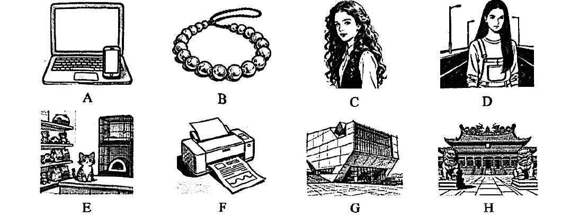

# 2026 一模精讲 · 静安英语（上）：听力 + 语音词汇语法（第 1–53 题）

> 静安卷结构：Part 1 听力 30 分（1–25）+ Part 2 语音词汇语法 28 分（26–53）+ Part 3 读写 92 分（54–94），共 7 大题 94 小题 150 分。本篇覆盖第 1–53 题，第 54–94 题见 [[英模26-静安-下]]。
>
> **与宝山卷（范本）的结构差异**：宝山 84 题/140 分/90 分钟；静安 94 题/150 分/100 分钟。听力 A 静安为**八图选六**（1–6，宝山六图选五）；B 为 **8 道短对话**（7–14，宝山 5 题）；C 为 **6 句判断**（15–20，宝山 5 题）；D 每题**两个空格**（21–25，宝山单空）；语法选择静安 **20 题**（26–45）且含**语音辨析题**（26）与**情景交际题**（44–45），均为宝山卷没有的题型。
>
> ⚠️ **资料说明**：本卷为纯扫描版、无文字层（题干据 150dpi 页图逐题录入）。**答案来源为卷面红笔手写批注版**（非官方排版答案），26 题起已逐题辨认誊录；**听力部分（1–25）批注版未作答**，本区虽有听力 mp3 原件存于归档区，本篇不做音频转写，故听力只给卷面与方法，不给答案。

## Part 1 听力（第 1–25 题，共 30 分）

### A. Listen and choose the right picture（听句选图，第 1–6 题，6 分）

八选六，卷面八图为：

- A：笔记本电脑旁放着一部智能手机——"电子设备"场景
- B：一串圆珠手串（带绳扣）——"首饰/礼物"场景
- C：一位长卷发女孩的肖像——"人物外貌"场景
- D：女孩站在马路路口（背景有路灯）——"过马路/街景"场景
- E：书架与壁炉前的一只小猫——"宠物/家居"场景
- F：一台打印机正在输出文件——"打印/办公"场景
- G：一座几何造型的现代公共建筑——"美术馆/新地标"场景
- H：中式传统庙宇（门前有石狮）——"古建筑/景点"场景

> ⚠️ 卷面批注版**未给出 1–6 题答案**（本区音频不作转写），此处不臆测答案。做题方法：听前用一词概括每图核心（computer / bracelet / girl / street / cat / printer / building / temple），听句后抓"名词+场景"匹配；八选六有 2 幅干扰图，注意区分近义场景（如 C 与 D 都是人物）。

### B. Listen to the short conversations and choose the best answer to each question you hear（短对话理解，第 7–14 题，8 分）

7. A) Sunny.  B) Rainy.  C) Windy.  D) Cloudy.（问天气）
8. A) To a library.  B) To a bookstore.  C) To his home.  D) To a restaurant.（问地点）
9. A) 6:15.  B) 6:45.  C) 7:30.  D) 8:15.（问时间）
10. A) $12.  B) $16.  C) $20.  D) $24.（问价格）
11. A) For taking away her baby's toy.  B) For visiting her too late.  C) For playing the music too loud.  D) For breaking the window.（问道歉/责备的原因）
12. A) To report a lost item.  B) To buy clothes for her friend.  C) To introduce her friend to the man.  D) To ask the man to help find her friend.（问目的）
13. A) Catching a cold at night.  B) Not having enough time to study.  C) Getting too tired to go to school.  D) Not being able to finish the test.（问困难/担忧）
14. A) Jasmine accepts John's help.  B) Jasmine is confident about her work.  C) Jasmine offers to help John.  D) Jasmine is good at AI searching.（问事实/态度）

> ⚠️ 同上，无批注答案。考点预判：9 题时间题注意"几点差几分"与约时间的换算；10 题价格题抓折扣/单价数量；11–13 题抓 because/so 前后的因果句；14 题注意 but 后的真实态度。

### C. Listen to the passage and tell whether the following statements are true or false（短文判断，第 15–20 题，6 分）

15. The internet café used to be a place for playing games and chatting online.
16. Mr. Tan, the owner of the café, was once a computer teacher.
17. The café offers free lessons every evening from 6 to 7.
18. Mrs. Wong joined the program to learn how to video-call her grandchildren.
19. Leo, a teenager, learned how to create posters for school projects.
20. The café is mainly described as a learning and helping community.

> 短文主旨可从判断句反推：一家由网吧（internet café）转型的社区学习空间，店主 Mr. Tan 曾任电脑教师，为居民（Wong 太太学视频通话）和青少年（Leo 学做海报）开设免费课程，被描绘为"学习与互助社区"。⚠️ 批注版未给 T/F 答案。方法：15/17/20 的**时间、用途、评价**最常被偷换，判断句与原文逐一比对数字与程度词（used to / every evening / mainly）。

### D. Listen to the passage and complete the following sentences（听短文填空，第 21–25 题，10 分；每空格限填一词，每题两空）

21. When reading stories as children, many of us pretended to have ______ ______.
22. When a character is threatened by a monster, our hearts ______ ______.
23. While reading, we can enjoy being scared without any ______ ______.
24. When we read the stories, we can ______ ______ homework and other problems.
25. Stories about supernatural beings offer a ______ ______ into amazing new worlds.

> 短文主题可从句面反推：我们为什么喜欢读"吓人"的故事（恐怖/惊险小说）。⚠️ 批注版未给答案。方法：**每题两空、每空一词**——21 空 have 后接名词短语、22 空 hearts 后接谓语（大概率 beat faster 类搭配）、23 空 without any 后接名词、24 空 can 后接动词+介词、25 空 offer a ___ into 中间为名词短语；听时按词性分组记录两连词块。

## Part 2 语音、词汇和语法（第 26–53 题）

### II. Choose the best answer（语法单项选择，第 26–45 题，各 1 分，共 20 分）

**26.** Which of the following underlined parts is different in pronunciation from others?
A) ba​​sic  B) sal​​ary  C) late  D) shake

**答案 B**。四词划线均为字母 a：basic /eɪ/、late /eɪ/、shake /eɪ/，salary /ˈsæləri/ 读 /æ/，故选 B。本卷特色语音题：按音标记词，不按拼写。

**27.** In the VR game, the characters almost come to ______ life.
A) a  B) an  C) the  D) /

**答案 D**。come to life（活起来/栩栩如生）为固定短语，零冠词。

**28.** ______ of the two girls shows great interest in talking about online games.
A) All  B) Both  C) None  D) Neither

**答案 D**。谓语 shows 三单 → 只能选单数意义的代词；"two girls"两者都不 → neither（none 用于三者以上）。

**29.** If you have a problem, don't just complain ______ it – try to find a solution.
A) about  B) to  C) in  D) for

**答案 A**。固定搭配 complain about sth（抱怨某事）。

**30.** I left my dictionary at home and Jenny shared ______ with me in class.
A) her  B) she  C) hers  D) herself

**答案 C**。shared 后缺宾语且指"她的词典"→ 名词性物主代词 hers。

**31.** The team was made ______ scientists in different fields.
A) of  B) from  C) for  D) up of

**答案 D**。be made up of（由……组成）；be made of 表"由……制成"，此处讲团队成员构成。

**32.** We need ______ two volunteers to help clean the park this Saturday.
A) another  B) other  C) the other  D) others

**答案 A**。another + 数词 + 复数名词（再要两个）固定用法。

**33.** Keeping a lovely garden needs a certain amount of daily ______.
A) care  B) plant  C) tool  D) skill

**答案 A**。a certain amount of（一定量的）+ 不可数名词；照看花园需要日常"照料"。

**34.** ______ exciting plan for the winter holidays! I can hardly wait.
A) What  B) What a  C) What an  D) How

**答案 C**。感叹句核心为可数名词 plan（单数）→ What + an + adj + n。

**35.** Don't feel ______, Jim. We are all here to support you.
A) sadly  B) lonely  C) angrily  D) unluckily

**答案 B**。feel 为系动词后接形容词；"我们都在支持你"→ 别 feel lonely（孤单）。A/C/D 均为副词。

**36.** The movie was quite interesting, ______ the ending was a little disappointing.
A) for  B) but  C) or  D) so

**答案 B**。前褒后贬 → but 表转折。

**37.** ______ it was raining heavily, the football match continued as planned.
A) Since  B) If  C) Because  D) Although

**答案 D**。雨大与"比赛照常"语义相反 → Although 引导让步状语从句。

**38.** The voice assistant ______ control smart home devices after hearing your commands.
A) can  B) must  C) should  D) need

**答案 A**。陈述语音助手的功能能力 → can（能够）。

**39.** – ______ can this electric car go from 0 to 100 km/h?
– Super fast! In just 3.5 seconds.
A) How long  B) How far  C) How soon  D) How fast

**答案 C**。答语 In just 3.5 seconds 为"in + 时间段"→ 问"多久（之后）"用 how soon；how fast 需用速度作答。

**40.** Eating too much fast food ______ her health since she entered junior middle school.
A) affects  B) is affecting  C) has affected  D) will affect

**答案 C**。since 引导时间状语 → 主句现在完成时；动名词主语接三单 has affected。

**41.** The decorations ______ in the classroom for the New Year party just now.
A) hang  B) will hang  C) were hung  D) will be hung

**答案 C**。just now（刚才）→ 一般过去时；decorations 是"被挂"→ 被动 were hung。

**42.** You had better ______ late for the exam tomorrow.
A) don't be  B) not be  C) not to be  D) not being

**答案 B**。had better not do sth 固定否定式，not 直接接动词原形。

**43.** I turned off the laptop after I finished ______ the notes.
A) write  B) to write  C) writing  D) writes

**答案 C**。finish doing sth 固定接动名词。

**44.** – In my opinion, we should help the old in our neighbourhood as often as possible.
– ______
A) I think so, too.  B) Never mind.  C) That's all right.  D) Yes, please.

**答案 A**。上句发表观点 → 附和用 I think so, too；B/C 回应道歉致谢，D 回应请求，均不合语境。情景交际题。

**45.** – We'll contact you about the final result within three days.
– ______
A) Can I start working tomorrow?  B) I don't really want this job.  C) Thank you. I'm looking forward to hearing from you.  D) Please tell me the answer now.

**答案 C**。求职面试语境（三天内通知结果）→ 礼貌致谢并期待回复；A/D 索答无礼，B 直接拒聘不合语境。

### III. Complete the following passage with the words in the box. Each can only be used once（选词填空，第 46–53 题，各 1 分，共 8 分；每空格限填一词，每词只能填一次，两框各 5 选 4）

主题：四格漫画（comic strips）是怎样诞生的——编剧、画师、上色师、编辑四步流水线。

**首框**：A) accident  B) arranges  C) requires  D) extremely  E) carefully

**46.** They may look simple at first sight, but creating them ______ many steps and close teamwork. → **C) requires**（creating them 作动名词主语接三单谓语；"创作需要多步与紧密合作"）

**47.** First, the writer ______ thinks of an idea. → **E) carefully**（修饰 thinks of 用副词；与下文"It might come from daily life"呼应——细心观察才有灵感）

**48.** …or a school ______ that turns into a joke. → **A) accident**（a school + 单数名词"校园趣事/小意外"，后文 that turns into a joke 定语从句）

**49.** The artist also decides how many panels each page should have and ______ them so the story flows smoothly. → **B) arranges**（and 并列 decides / arranges 三单谓语；"安排画面使故事流畅"）

**次框**：A) follow  B) confuse  C) planning  D) serious  E) joyful

**50.** Bright colours are usually used for happy or funny scenes, while darker colours help create ______, dramatic, or mysterious moments. → **D) serious**（与 dramatic / mysterious 并列的三个形容词，语义一致取"严肃的"）

**51.** Even a single missing or misplaced panel can suddenly ______ readers, so the editor's job is very important. → **B) confuse**（can 后接动词原形；"画面错乱会让读者困惑"，下文编辑重要正是为了防此）

**52.** They often spend hours redrawing lines, rewriting jokes, or adjusting colours to make the final comic both funny and easy to ______. → **A) follow**（easy to follow"易于看懂/跟上"，固定搭配）

**53.** Comic strips may be short, but they take creativity, ______ and teamwork to bring smiles to readers around the world. → **C) planning**（creativity, ______ and teamwork 三名词并列；take 后接抽象名词"统筹规划"）

> 小结：本篇选词先判词性（46/49/51 动词位、47 副词位、48/50/53 名词/形容词位），再用**搭配锁词**（requires teamwork / arrange panels / easy to follow / a school accident）；两框各余一词（D extremely / E joyful）为干扰项。

---
*本篇题干据 150dpi 页图逐题录入（静安卷无文字层）；答案誊自卷面红笔手写批注版并逐题与语法规则互证。听力部分（1–25）批注版未作答、本区音频未作转写，已如实标注。*
