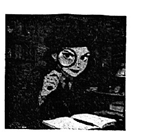
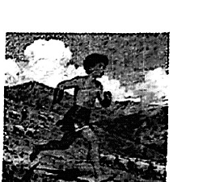

# 2026 一模精讲 · 静安英语（下）：词句转换 + 读写（第 54–94 题）

> 本篇覆盖第 54–94 题（词形转换、句型转换、阅读四篇、作文），第 1–53 题见 [[英模26-静安-上]]。答案来源与校正方式同上篇：卷面红笔手写批注版 + 页图互证（静安卷无文字层）。

## IV. Complete the sentences with the given words in their proper forms（词形转换，第 54–61 题，各 1 分，共 8 分）

**54.** After winning the game, the team felt very proud of ______. (they) → **themselves**
（team 为集体名词，指全体队员；主语与介词 of 的宾语同指 → 反身代词 themselves）

**55.** How did you celebrate your ______ birthday? (fourteen) → **fourteenth**
（"第十四个生日"用序数词；前有 your 限定，不加冠词）

**56.** She looks ______ today, and she has been very quiet since this morning. (happy) → **unhappy**
（look + 形容词作表语；后句"从早上起一直很安静"提示语义相反 → 否定前缀 un-。本卷易错点：不能照抄 happy）

**57.** Regular exercise is an ______ way to stay healthy and reduce stress. (effect) → **effective**
（an 后接元音开头的形容词；effect 名词 → effective"有效的"）

**58.** The new law aims to protect the rights of every ______. (city) → **citizen**
（every + 单数名词；city → citizen"市民"，属派生词特例，不是常规词形变化，最易失分）

**59.** In our debate club, we practise writing and giving short ______ every week. (speech) → **speeches**
（giving short + 复数名词；speech 以 s 音结尾 → 加 es）

**60.** He finds it easier to ______ information by turning it into a song. (memory) → **memorize**
（to + 动词原形；memory → memorize"记住"，it 作形式宾语）

**61.** They have been friends for years and have ______ argued. (rare) → **rarely**
（修饰动词 argued 用副词；have rarely argued 现在完成时中频度副词置于 have 之后）

## V. Rewrite the following sentences as required（句型转换，第 62–68 题，共 14 分；62–67 每空格限填一词）

**62.** They seem interested in joining the club.（改为否定句）
→ They **don't seem** interested in joining the club.
（seem 为实义动词 → 借助 don't 构成否定，seem 用原形）

**63.** The first computers were built **in the 1940s**.（对划线部分提问）
→ **When were** the first computers built?
（划线为时间点 → when；were 提至主语前构成疑问语序）

**64.** Children who lived long ago were lucky.（改为反意疑问句）
→ Children who lived long ago were lucky, **weren't they**?
（前肯后否；陈述部分 were → weren't；主语 children 用 they 替代）

**65.** She's considering whether she will visit the robot exhibition.（改为简单句）
→ She's considering **whether to** visit the robot exhibition.
（"疑问词 + to do"结构简化宾语从句，主从句主语一致时可用）

**66.** A computer system controls the speed of the car.（改为被动语态）
→ The speed of the car **is controlled** by a computer system.
（一般现在时被动 is/are + 过去分词；controls → is controlled）

**67.** The whole project will be delayed if we don't finish our parts.（保持句意基本不变）
→ The whole project will be delayed **unless** we **finish** our parts.
（if…not = unless；unless 从句谓语用肯定式，时态照抄一般现在时）

**68.** so that, don't make, check your work, any careless mistakes, you（连词成句）
→ **Check your work so that you don't make any careless mistakes.**
（so that 引导目的状语从句；祈使句开头，Check 首字母大写——卷面特别提示第 68 题注意句首大写）

## VI. Reading Comprehension（阅读理解，第 69–93 题，共 50 分）

### A. Choose the best answer（阅读选择：《地心游记》节选，第 69–74 题，各 2 分，共 12 分）

文章脉络：节选自 Jules Verne《To the Centre of the Earth》（Axel 第一人称叙述，第 14 章抵达地心入口）。日出前登上火山口 → Axel 俯身下望头晕腿软、险些跌入大洞，向导 Hans 一把拉住 → 教授 Lidenbrock 用绳把易碎品吊下洞，再把非易碎物品装袋**直接扔下洞**，连衣服绳梯也"自己下去" → Axel 紧张自嘲"我们若是山羊就好了"。

**69.** *To the Centre of the Earth* is probably a(n) ______. → **B) adventure novel**
（火山探险、向导、绳索下洞——典型冒险小说情节；非科普文/旅行日记/历史教材）

**70.** Why did Hans take hold of Axel's arm at the beginning of the extract? → **A) Axel almost fell into the hole.**
（定位 "I was about to fall in when I felt a firm hand holding me back"）

**71.** How did Professor Lidenbrock send the non-fragile items down? → **C) He threw them down the hole in a bag.**
（定位 "He put all the non-fragile things into a bag and simply threw it down the hole"）

**72.** Which of the following BEST shows how Professor Lidenbrock handled problems? → **C) He made quick decisions and acted at once.**
（原文 He liked to do things quickly + 直接扔袋——果断行动型；A/B 的"仔细研究地图/核对细节"与人物性格相反，D"都让 Hans 决定"无据。⚠️ 卷面此题 A、B 选项尾部各有一小"✗"状墨点，卷面页与答案页同位出现，疑为原卷扫描杂点，不影响作答）

**73.** Which of the following BEST matches each speech bubble with the most suitable character? → **B) Professor Lidenbrock; Axel; Hans**
（i)"Come on, everyone! Time to go into the big hole!"催促者=急性子教授；ii)"Are you sure it's safe...?"担心安全=叙述者 Axel；iii)"Be careful! Don't stand too close to the edge!"提醒谨慎=向导 Hans）

**74.** Which of the following BEST describes the mood of the story? → **D) Exciting.**
（火山口探险、扔行李下洞，节奏紧张刺激；Funny/Relaxing/Touching 与场景不符）

### B. Choose the words or expressions and complete the passage（完形选择：侦探破案，第 75–80 题，各 2 分，共 12 分）

文章脉络：《A Careful Look at the Truth》——侦探 Lina Park 以冷静细致著称，小城案件多不复杂但她件件认真 → 面包店钱包失窃，店主确信少年 Kevin 所为 → Lina 见 Kevin 神色惊恐仍坚持"先听后判"，Kevin 说只为祖母买面包 → 监控显示 Kevin 离开时双手空空，但钱包确实不见了 → 她询问其他顾客，得知一名蓝夹克男子仓皇离开、水果贩见过那人捡起钱包又逃走 → 最终在公交站找到该男子，他承认拿钱包但惊慌而逃 → Kevin 洗清嫌疑、店主道歉，Lina 相信"找到真相比找到嫌疑人更重要"。

**75.** She worked in a small city where most cases were ______, but she treated every case seriously. → **B) simple**
（but 转折 → 前句"案件大多简单"，与 seriously 对照）

**76.** One afternoon, Lina received a(n) ______ from a bakery. → **C) report**
（receive a report from a bakery"接到面包店报案"；award/invitation/reply 与失窃案语境不合）

**77.** When Lina arrived, Kevin looked ______. "I didn't steal anything," he said softly. → **A) frightened**
（轻声辩解"我没偷"——心虚害怕；hopeful/confident/angry 与 said softly 矛盾）

**78.** She began questioning other ______. → **D) customers**
（下文"a woman""a fruit seller"都是店内外顾客；suspects 指嫌疑人，此处问的是知情人）

**79.** ______, Lina found the man waiting at a bus stop. → **B) Finally**
（顺线索追查后"最终"找到真凶；However 表转折、In conclusion 用于总结议论文）

**80.** Kevin was ______. The shop owner apologized, and Kevin left smiling with his bag of bread. → **A) cleared**
（店主道歉、少年微笑离开 → 被洗清嫌疑；arrested/control/hidden 与语境相反）

### C. Read the passage and fill in the blanks with proper words（首字母填空：古希腊少年信使，第 81–87 题，各 2 分，共 14 分）

文章脉络：《The Young Runner of Ancient Greece》——古希腊靠跑者传信，少年 Lycos 每天山间训练，梦想成为正式信使 → 某夏森林起火、邻村告急，需要有人去雅典搬救兵 → 士兵嫌他年轻，但情势紧急 → 长途炎热、腿酸喉干仍不停步 → 直奔城卫队报信，援兵及时赶到、村庄平安 → 故事传开，他成为村里勇气与责任的象征——英雄不一定是战斗，也可以是迅速勇敢地助人。

**81.** He lived in a village near Athens and t______ every morning by running up and down the hills. → **trained**
（and 并列过去式谓语 lived / trained；"每天晨跑训练"）

**82.** A fire had broken out, and the villagers were trying to e______. → **escape**
（try to do sth；"大火燃起，村民试图逃生"）

**83.** The j______ to Athens was long and hot. → **journey**
（The + 名词 + to Athens"去雅典的旅程"；下文 long and hot 作后置解释）

**84.** His legs burned, and his throat felt d______, but he did not stop. → **dry**
（feel + 形容词；legs burned 与 throat dry 并列写途中之苦，but 转折不停步）

**85.** When he finally reached Athens, he went s______ to the city guard and delivered the message. → **straight**
（went straight to"径直前往"固定搭配；s 开头副词）

**86.** As the story of the brave messenger boy s______, people began to cheer for Lycos. → **spread**
（"随着故事传开"；spread 的过去式与原形同形）

**87.** He didn't become famous like the legendary heroes, but in his village, he became a symbol of courage and r______. → **responsibility**
（courage and r____ 并列名词；"勇气与责任的象征"，呼应末段主旨句）

### D. Answer the questions（回答问题：Secret Recipe Project，第 88–93 题，共 12 分）

文章脉络：Mayfield School 每年举办 Family Tradition Week，今年 Ms. Patel 班开展 Secret Recipe Project——每人带一道家传菜，不讲完整做法、只讲菜背后的故事，目标是"通过食物理解历史" → 周一 Marco 分享祖母冬天为全家取暖常做的番茄汤，全班仿佛闻到了香味 → 周二 Amina 分享父亲从祖辈学来的甜米饭，"那是庆典的味道" → 到周三，大家发现许多食谱都来自"舒适时刻"（雨天、节日、家庭聚会） → 期末全班把食谱按家族来源贴上世界地图，做成缤纷的 Recipe Map → Ms. Patel 收尾："我们的食谱各不相同，但 ______（92 空开放补全）。"

**88.** The Secret Recipe Project was part of Mayfield School's Family Tradition Week, wasn't it?
→ **Yes, it was.**（反意疑问句先答 Yes/No；定位首段 was part of Family Tradition Week）

**89.** How did the class feel when Marco shared his tomato soup story?
→ **They felt like they could almost smell the soup and felt interested.**（定位第三段 the whole class said they could almost smell the soup；批注手写即此两句要点）

**90.** Why did Amina say her sweet rice recipe was special?
→ **Because it was the taste of celebrations and her father learned it from his grandparents.**（定位第四段 Amina 的话，因果由 because 引出）

**91.** What did the students discover about their recipes by Wednesday?
→ **They discovered similarities between the recipes. Many recipes came from moments of comfort — rainy days, holidays and family gatherings.**（定位 By Wednesday 段）

**92.** What can be filled in the blank?
→ 开放补全，批注示例：**We all share the same love for food. / Food carries memories and connects us. / We are all connected through food.**（须与 but 形成语义转折呼应、句子完整、语法正确）

**93.** Is the Secret Recipe Project meaningful? Why or why not? (Give 2 reasons)
→ 开放题，批注示例：**Yes, it is. ① It helps students understand history through food. ② It reminds students that food carries memories and connects people from different cultures.**（2 分题必须给出两条理由：要点合理 + 表述正确）

## VII. Writing（作文，第 94 题，共 20 分）

**题目**：假设你是 Mayfield School 的一名学生。在即将到来的 Family Tradition Week 上，你需要向同学们做一次简短的介绍性演讲，分享你家的一个老物件（如生活用品、家具、衣物、饰品、文物、工具等），以及它背后的故事。写一篇不少于 60 词的演讲稿。注意：① 短文中不得出现考生姓名、校名等个人信息，否则不予评分；② 照抄阅读语篇不得分。

**审题三步**：演讲稿格式（开场 greeting + 收尾 Thank you）+ 两个内容要点缺一不可（① 老物件是什么、外观/用途；② 背后的故事：谁传下来的、经历过什么、为何珍贵）+ 时态分工（介绍物件用一般现在时，讲往事用一般过去时）。

**参考范文（约 105 词，自拟供参考；批注版未附范文）**：

> Good morning, everyone! Today I'd like to introduce an old object from my family — my grandma's sewing machine.
>
> The machine is nearly forty years old, with a dark wooden cover and a shiny metal wheel. When my grandma was young, she used it to make clothes for the whole family. Every Spring Festival, she stayed up late sewing new coats for us. Although it works slowly now, my family still keeps it in the living room, because it carries Grandma's love and her hard-working spirit.
>
> To me, this old machine is not just a tool but a bridge to sweet family memories. Thank you for listening!

**评分要点**：覆盖两个要点（8 分）｜语法与用词准确（6 分）｜衔接与流畅（3 分）｜格式与词数（3 分）。忌照抄阅读语篇（卷面明示不得分）。

---
*本篇题干据 150dpi 页图逐题录入（静安卷无文字层）；答案誊自卷面红笔手写批注版并逐题与语言规则互证；92/93 为开放题，批注版给出多种示例已择要誊录。*
