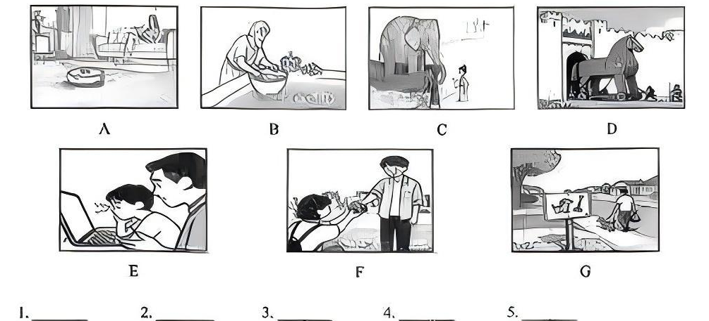

# 2026 一模精讲 · 黄浦英语（上）：听力 + 语法词汇（第 1–43 题）

> 黄浦卷结构：Part 1 听力 25 分（1–20）+ Part 2 词汇和语法 45 分（21–58）+ Part 3 读写 70 分（59–84），共 84 小题 140 分。本篇覆盖第 1–43 题，第 44–84 题见 [[英模26-黄浦-下]]。
>
> ⚠️ **资料说明**：本卷为扫描版+原生文字层（两路拼合录入，OCR 错词已对照页图校正）。**答案来源为卷面蓝笔手写批注版**（非官方排版答案），已逐题辨认誊录；听力部分（1–20）批注版未作答、且本区无听力音频，故听力只给卷面与方法，不给答案。

## Part 1 听力（第 1–20 题，共 25 分）

### A. Listen and choose the right picture（听句选图，第 1–5 题，5 分）

注意：黄浦卷为**七图（A–G）选五**，比常见的六图多一个干扰项。卷面七图为：

- A：客厅里扫地机器人自动清扫，有人躺在沙发上休息——"做家务/扫地机器人"场景
- B：户外水池边一位妇女弯腰洗刷衣物，旁边蹲着一只狗——"洗衣/家务"场景
- C：大象低头与身旁的小孩互动——"大象/动物"场景
- D：城门前的巨大特洛伊木马，有人向里推——"特洛伊木马/历史故事"场景
- E：男孩和父亲一起看笔记本电脑——"父子用电脑/学习"场景
- F：男孩把手里的物品递给一位成年男子——"递送/帮忙"场景
- G：路边立着画有小狗的指示牌，一人骑车经过——"指示牌/骑行"场景

> ⚠️ 卷面批注版**未给出 1–5 题答案**，本区亦无听力音频，此处不臆测答案。做题方法：七图选五先给每图写一个核心动词短语（do housework / wash clothes / see an elephant / push the horse / use the computer / hand sth to sb / ride past a sign），听句抓"动词+名词"匹配，多余的两图通常是"主语/动作近似"的干扰图。

### B. Listen to the dialogue and choose the best answer（对话理解，第 6–10 题，5 分）

**6.**（问地点）
- A) In a boat.
- B) At a village.
- C) Under a bridge.
- D) On a mountain.

**7.**（问话题/节目类型）
- A) News.
- B) Weather.
- C) Clothes.
- D) Future.

**8.**（问人物关系）
- A) Doctor and patient.
- B) Teacher and student.
- C) Husband and wife.
- D) Customer and servant.

**9.**（问目的）
- A) To order food.
- B) To check out.
- C) To complain.
- D) To book a room.

**10.**（问打算/行动）
- A) Take a walk.
- B) Go shopping.
- C) Buy a hamburger.
- D) Eat in a restaurant.

> ⚠️ 同上，无音频无批注答案。考点预判：6 题抓介词地点短语；9 题抓酒店/餐厅场景词（order / check out / book a room 都可能在同一对话里出现，听"办的是哪件事"）；10 题注意 but 后的最终决定才是答案。

### C. Listen to the passage and tell whether the following statements are true or false（短文判断，第 11–15 题，5 分）

**11.** Henry joined a charity trip in India to raise money for people in need.

**12.** Henry and his team drove across the east of India in about thirty days.

**13.** Every night, Henry and his friends shared their experiences with each other.

**14.** Henry was thankful because the local people were friendly during the trip.

**15.** From the trip, Henry learned about teamwork and how to communicate well.

> 短文主旨可从判断句反推：Henry 参加印度慈善之旅（charity trip）为需要帮助的人筹款，一路开车穿越、与队友同甘共苦，感悟团队合作与沟通。⚠️ 批注版未给 T/F 答案。方法：判断句与原文的**数字、时间、地点、原因**最常被偷换（如 12 题 east / thirty days、11 题目的）。

### D. Listen to the dialogue and complete the following sentences（听对话填空，第 16–20 题，10 分；每空格一词，每题两空）

**Jack's Roommate**

**16.** Bob moved in from Britain ＿＿＿＿＿＿＿＿ ＿＿＿＿＿＿＿＿.

**17.** He is a nice and easygoing guy, except for some of ＿＿＿＿＿＿＿＿ ＿＿＿＿＿＿＿＿.

**18.** He ＿＿＿＿＿＿＿＿ ＿＿＿＿＿＿＿＿ really late at night and sleeps until late morning.

**19.** He is messy and ＿＿＿＿＿＿＿＿ ＿＿＿＿＿＿＿＿ all over the kitchen and the living room.

**20.** He is ＿＿＿＿＿＿＿＿ ＿＿＿＿＿＿＿＿ when he talks on the phone with his friends.

> ⚠️ 批注版未给答案。可预判词性降低难度：16 题填时间短语（ ago 类）；18 题填谓语（stays up / plays games 类"熬夜"动词短语）；19 题填名词复数（dirty dishes / his things 类）；20 题填形容词（quite noisy 类）。注意标题是 Jack's Roommate，被介绍的人叫 Bob——人指代不可混。

## Part 2 词汇和语法（第 21–43 题）

### II. Choose the best answer（语法单项选择，第 21–35 题，各 1 分，共 15 分）

**21.** In China, children over the age of six are required to go to ______ school.
- A) a
- B) an
- C) the
- D) /

> [!tip]- 💡 思路导航
> go to school（上学）表目的而非场所——零冠词。

> [!success]- ✅ 详解 · 评分点 · 易错 · 关联
> **答案 D**。go to school（上学）为固定搭配，表目的而非场所，零冠词。

**22.** Although the traffic was heavy, I arrived home ______ time for dinner.
- A) in
- B) with
- C) at
- D) by

> [!tip]- 💡 思路导航
> in time for…（及时赶上……）固定搭配；although 让步不影响搭配。

> [!success]- ✅ 详解 · 评分点 · 易错 · 关联
> **答案 A**。in time for…（及时赶上……）固定搭配；although 让步不影响搭配。

**23.** The poor old lady praised John for ______ help and kindness.
- A) he
- B) him
- C) his
- D) himself

> [!tip]- 💡 思路导航
> praise sb for one's + 名词——空后是名词 help，用形容词性物主代词。

> [!success]- ✅ 详解 · 评分点 · 易错 · 关联
> **答案 C**。praise sb for one's + 名词，空后是名词 help，用形容词性物主代词 his。

**24.** My father walked around his car to see if there was ______ wrong.
- A) anything
- B) nothing
- C) something
- D) everything

> [!tip]- 💡 思路导航
> if 引导的宾语从句（是否）按一般疑问句处理用 anything；anything wrong 固定语序。

> [!success]- ✅ 详解 · 评分点 · 易错 · 关联
> **答案 A**。if 引导的宾语从句（是否）按一般疑问句处理，用 anything； anything wrong 固定语序。

**25.** Something needs to be done about the wound before it gets even ______.
- A) bad
- B) worse
- C) worst
- D) the worst

> [!tip]- 💡 思路导航
> even/much/far 修饰比较级；伤口"变得更糟"。

> [!success]- ✅ 详解 · 评分点 · 易错 · 关联
> **答案 B**。even/much/far + 比较级；伤口"变得更糟"用 worse。

**26.** The shop assistant welcomed the customers with a ______ smile.
- A) happily
- B) carefully
- C) warmly
- D) friendly

> [!tip]- 💡 思路导航
> 空后有名词 smile——需要形容词；A/B/C 三个 -ly 词都是副词（friendly 是形容词是经典陷阱）。

> [!success]- ✅ 详解 · 评分点 · 易错 · 关联
> **答案 D**。空后有名词 smile，用形容词；A/B/C 三个 -ly 词均为副词（friendly 是形容词是经典陷阱）。

**27.** The Green Great Wall along the desert protects people ______ the sandstorms.
- A) for
- B) from
- C) between
- D) through

> [!tip]- 💡 思路导航
> protect…from…（保护……免受……）固定搭配。

> [!success]- ✅ 详解 · 评分点 · 易错 · 关联
> **答案 B**。protect…from…（保护……免受……）固定搭配。

**28.** He refused ______ the paper because the terms were unfair to his country.
- A) sign
- B) signing
- C) to sign
- D) to signing

> [!tip]- 💡 思路导航
> refuse 后固定接不定式 to do。

> [!success]- ✅ 详解 · 评分点 · 易错 · 关联
> **答案 C**。refuse to do sth 固定接不定式。

**29.** Look! The cow ______ to a big tree, so it can only eat the grass nearby.
- A) ties
- B) tied
- C) is tied
- D) was tied

> [!tip]- 💡 思路导航
> Look! 提示此刻发生——现在时；牛是"被拴"——被动。

> [!success]- ✅ 详解 · 评分点 · 易错 · 关联
> **答案 C**。Look! 提示此刻发生 → 现在时；牛是"被拴"→ 一般现在时被动 is tied。

**30.** On November 30, Milkesa ______ first at the 2025 Shanghai Marathon with a time of 2:06:25.
- A) finishes
- B) finished
- C) has finished
- D) had finished

> [!tip]- 💡 思路导航
> on November 30 是具体过去日期（2025 比赛已发生）——一般过去时。

> [!success]- ✅ 详解 · 评分点 · 易错 · 关联
> **答案 B**。on November 30 为具体过去日期（2025 比赛已发生）→ 一般过去时。

**31.** The team worked on the project for many years ______ they made a breakthrough.
- A) if
- B) until
- C) because
- D) although

> [!tip]- 💡 思路导航
> "干了很多年直到取得突破"——表时间延续的连词。

> [!success]- ✅ 详解 · 评分点 · 易错 · 关联
> **答案 B**。"干了很多年**直到**取得突破"→ until 时间状语从句。

**32.** Follow the instructions strictly, ______ you will damage the engine system.
- A) so
- B) or
- C) and
- D) but

> [!tip]- 💡 思路导航
> "祈使句 + or"＝否则（不照做就会损坏发动机）。

> [!success]- ✅ 详解 · 评分点 · 易错 · 关联
> **答案 B**。"祈使句 + or"＝否则（不照做就会损坏发动机）；表后果用 or。

**33.** Pelé spent his early years ______ soccer barefoot with a ball made of socks.
- A) play
- B) to play
- C) playing
- D) to playing

> [!tip]- 💡 思路导航
> spend + 时间 + doing sth 固定搭配。

> [!success]- ✅ 详解 · 评分点 · 易错 · 关联
> **答案 C**。spend + 时间 + doing sth 固定搭配。

**34.** It is said that the elderly ______ be out of touch with what is happening in the world.
- A) can
- B) must
- C) need
- D) should

> [!tip]- 💡 思路导航
> can 表"（有时）可能会"：老年人有时会与外界脱节；must/should 语气过强，need 后须接 to do。

> [!success]- ✅ 详解 · 评分点 · 易错 · 关联
> **答案 A**。can 表"（有时）可能会"：老年人有时会与外界脱节；must/should 语气过强，need 后须接 to do。

**35.** Look at this! ______ mess you are making with your schoolbag!
- A) How
- B) How a
- C) What
- D) What a

> [!tip]- 💡 思路导航
> 感叹句核心是名词 mess（单数可数）——What a。

> [!success]- ✅ 详解 · 评分点 · 易错 · 关联
> **答案 D**。感叹句核心是名词 mess（单数可数）→ What a + adj + 名词 + 主谓。

### III. Complete the following passage with the words or phrases in the box（选词填空，第 36–43 题，各 1 分，共 8 分；每词限用一次，两框各 5 选 4）

**首框**：A) influence  B) suits  C) set off  D) skills  E) grow up
主题：做家务（chores 让家庭像团队）

**36.** Doing chores at home is a great way to help out and learn important life ＿＿＿＿＿＿＿＿.

> [!tip]- 💡 思路导航
> help out and learn 并列——"生活技能"名词短语。

> [!success]- ✅ 详解 · 评分点 · 易错 · 关联
> **答案 D) skills**（生活技能 life skills 名词短语，help out and learn 并列）

**37.** Studies show that children who do chores are more likely to be successful when they ＿＿＿＿＿＿＿＿.

> [!tip]- 💡 思路导航
> "长大以后"更可能成功——when 引导的时间状语从句。

> [!success]- ✅ 详解 · 评分点 · 易错 · 关联
> **答案 E) grow up**（"长大以后"更可能成功；when they grow up 时间状语从句）

**38.** However, you can think about chores in a positive way because they have a strong ＿＿＿＿＿＿＿＿ on family life.

> [!tip]- 💡 思路导航
> have a strong ___ on family life——固定搭配"对……有强大影响"。

> [!success]- ✅ 详解 · 评分点 · 易错 · 关联
> **答案 A) influence**（have a strong influence on… 对……有强大影响，固定搭配）

**39.** It is best to start with something small, choose a job that ＿＿＿＿＿＿＿＿ you.

> [!tip]- 💡 思路导航
> a job that ___ you——that 从句缺谓语动词，主语 job 是第三人称单数。

> [!success]- ✅ 详解 · 评分点 · 易错 · 关联
> **答案 B) suits**（a job that suits you"适合你的活"；that 从句缺谓语动词，主语 job 三单 → suits；C) set off 全框唯一未用）

**次框**：A) achievement  B) calm  C) lose  D) build  E) memory
主题：2022 年研究——做家务的诸多好处

**40.** A 2022 study found that doing chores does good to people in many ways. It can help you focus better and improve your ＿＿＿＿＿＿＿＿.

> [!tip]- 💡 思路导航
> focus better and improve your ___——名词并列；"专注力和记忆力"。

> [!success]- ✅ 详解 · 评分点 · 易错 · 关联
> **答案 E) memory**（focus better and improve your memory"专注力和记忆力"，名词并列）

**41.** Helping out at home is also a good way to ＿＿＿＿＿＿＿＿ confidence.

> [!tip]- 💡 思路导航
> build confidence 建立自信——way to do。

> [!success]- ✅ 详解 · 评分点 · 易错 · 关联
> **答案 D) build**（build confidence 建立自信，way to do）

**42.** Having a regular routine can ＿＿＿＿＿＿＿＿ your mind when things feel boring or stressful.

> [!tip]- 💡 思路导航
> can 后接动词原形；"让心静下来"，与"lose"语义相反。

> [!success]- ✅ 详解 · 评分点 · 易错 · 关联
> **答案 B) calm**（calm your mind"让心静下来"；can 后接动词原形，与 C) lose 语义相反取 calm）

**43.** Just taking a few minutes each day to help at home can give you a real sense of ＿＿＿＿＿＿＿＿.

> [!tip]- 💡 思路导航
> a sense of ___ 成就感——固定名词短语。

> [!success]- ✅ 详解 · 评分点 · 易错 · 关联
> **答案 A) achievement**（a sense of achievement 成就感，固定名词短语）

> 小结：选词填空先判词性（36/40 形容词后填名词、39 从句缺谓语、41/42 情态动词或 to 后填动词原形），再靠**固定搭配**锁定（a strong influence on / build confidence / a sense of achievement 都是高频词块）。两框未用词（set off / lose）恰是语义反向干扰。

---
*本篇题干经"原生文字层 + 150dpi 页图"两路拼合校正；答案誊自卷面蓝笔手写批注版并逐题与语法规则互证。听力部分无音频与批注答案，已如实标注。*
