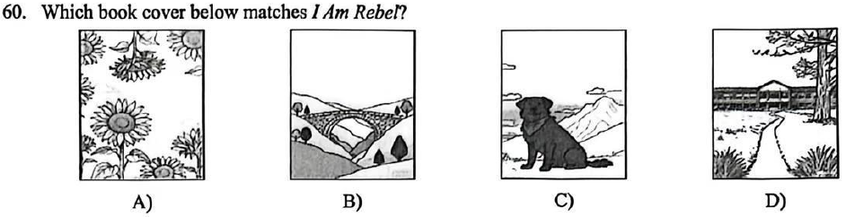
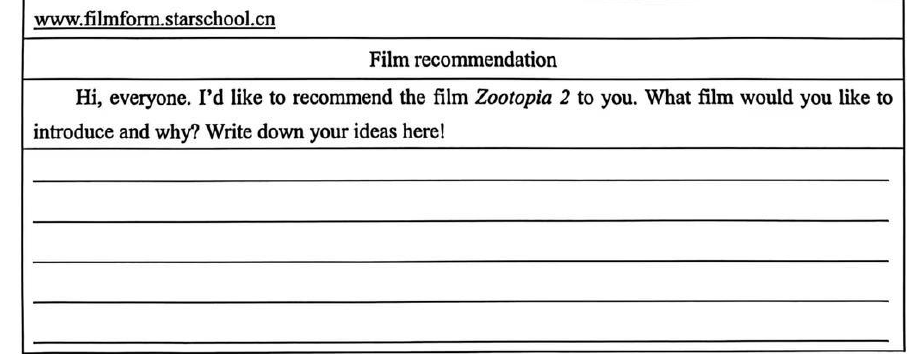

# 2026 一模精讲 · 黄浦英语（下）：词句转换 + 读写（第 44–84 题）

> 本篇覆盖第 44–84 题（词形转换、句型转换、阅读四篇、作文），第 1–43 题见 [[英模26-黄浦-上]]。答案来源与校正方式同上篇：卷面蓝笔手写批注版 + 页图互证。

## IV. Complete the sentences with the given words in their proper forms（词形转换，第 44–51 题，各 1 分，共 8 分）

**44.** Do you believe in the saying that ______ is the best policy? (honest) → **honesty**
（"诚实为上策"Honesty is the best policy 谚语固定；that 从句缺主语 → honest 变名词 honesty）

**45.** This restaurant is famous for serving ______ in a romantic way. (dish) → **dishes**
（上菜 serving dishes；dish（菜肴）可数名词，泛指用复数）

**46.** When the baby touched the hot pot, he was ______ of the danger. (aware) → **unaware**
（be unaware of 没意识到；婴儿碰热锅自然是"没意识到危险"→ aware 加否定前缀 un-，本题考**否定前缀**）

**47.** Our English teacher, a kind lady in her early forties, is of average ______. (high) → **height**
（of average height 身高中等；high 的名词是 height，注意拼法 th）

**48.** The charity called for immediate ______ to help homeless pets. (act) → **action**
（immediate + 名词；call for immediate action 呼吁立即行动；act → action 名词）

**49.** You'd better eat a healthy diet, and more ______, do exercise regularly. (important) → **importantly**
（more importantly 更重要的是，副词独立成分修饰整句，对前句补充递进）

**50.** In the early morning, Jerry woke up to the ______ smell of the food on the table. (please) → **pleasant**
（修饰名词 smell 用形容词；please → pleasant 令人愉快的，勿与 pleased（人感到满意）混淆）

**51.** It's difficult to ______ which way to take in a dark and thick forest. (decision) → **decide**
（to + 动词原形；which 从句缺谓语动词；decision → decide）

## V. Rewrite the following sentences as required（句型转换，第 52–58 题，共 14 分；每空格限填一词）

**52.** Ken read his report carefully before handing it in.（改为一般疑问句）
→ ______ Ken ______ his report carefully before handing it in? 填 **Did / read**
（read 过去式与原形同形；实义动词过去时提问借 did，read 还原为原形）

**53.** They made it to the final round through effort and teamwork.（对划线部分提问）
→ ______ ______ they make it to the final round? 填 **How / did**
（划线 through effort and teamwork 表方式 → how）

**54.** Teachers are using AI devices to improve language learning in the classroom.（改为被动语态）
→ AI devices are ______ ______ to improve language learning in the classroom. 填 **being / used**
（现在进行时被动：are being + 过去分词，进行时的被动是易错点）

**55.** Respect the rules, and traffic can flow safely and smoothly.（保持句意基本不变）
→ ______ ______ respect the rules, traffic can flow safely and smoothly. 填 **If / you**
（"祈使句 + and"＝ if 条件句：如果你遵守规则，……）

**56.** "I'm sorry for taking up your time," said Mary to her father.（改为间接引语）
→ Mary ______ ______ her father for taking up his time. 填 **apologized / to**
（be sorry for doing = apologize to sb for sth 道歉句型；said Mary to her father 合并为 Mary apologized to her father）

**57.** Jack seemed to know every single detail of the case.（保持句意基本不变）
→ ______ ______ that Jack knew every single detail of the case. 填 **It / seemed**
（sb seemed to do = It seemed that + 从句，固定句型转换）

**58.** before bedtime, avoid, a good night's sleep, should, we, to get, screens and caffeine（连词成句）
→ **To get a good night's sleep, we should avoid screens and caffeine before bedtime.**
（目的状语 to get 提句首更通顺；avoid + 名词"避免接触屏幕和咖啡因"；avoid 后接名词或 doing，不接 to do）

## VI. Reading Comprehension（阅读理解，第 59–83 题，共 50 分）

### A. Choose the best answer（阅读选择：2025 年度童书推荐帖，第 59–64 题，各 2 分，共 12 分）

文章脉络：一篇"年度最佳童书"推荐——A Wild Walk to School（上学路变成大冒险的图画书）、I Am Rebel（忠犬 Rebel 视角的暖心故事）、Seven Million Sunflowers（战争女孩 Nancy 赴英格兰重新开始的长篇小说）、The Bridges（用"桥"写联结与理解的图画书），末尾附儿童阅读四条小贴士。

**59.** The text above suggests ______. → **B) giving these books as presents**
（定位首段：perfect for young readers and also **a great choice for gifts**；A/C/D 的网购/收藏/借书均无据）

**60.** Which book cover below matches *I Am Rebel*? → **C**
（I Am Rebel 的主角是忠犬 Rebel → 黑狗封面；A 向日葵是 Seven Million Sunflowers、B 拱桥是 The Bridges，均为"内容对号"干扰项）

**61.** Both *A Wild Walk to School* and *The Bridges* are ______. → **D) picture books**
（两书介绍首句均自述 picture book；Seven Million Sunflowers 是 novel）

**62.** The underlined word "resilience" means ______ in Chinese. → **A) 坚韧**
（原词后紧跟释义：which means **staying strong and hopeful** even when life is hard）

**63.** Which book encourages children to view everyday life in a creative way? → **A) A Wild Walk to School**
（定位该书段末：encourages children to see everyday routines **in a creative and joyful way**）

**64.** When you ask the question "If I were Nancy, what would I do?", you are ______. → **D) linking the story to real life**
（把自己代入人物 = Tips 第 4 条 Link the story to real life；A/B/C 为其余三条贴士的干扰）

### B. Choose the words to complete the passage（完形选择：国际志愿者日话志愿服务，第 65–70 题，各 2 分，共 12 分）

文章脉络：12 月 5 日国际志愿者日引出话题——什么是志愿服务（无偿付出时间帮助他人）→ 为什么要做（心理健康"内心在微笑"/身体锻炼/结识新朋友甚至找到职业方向）→ 怎么开始（先与父母商量、大家放心，并结伴同行）。

**65.** Volunteering means giving up your time for ______ to help someone else. → **B) free**
（for free 无偿；volunteering 的定义就是"不拿钱"）

**66.** Volunteering has many ______ for both the people being helped and the person who volunteers. → **A) benefits**
（对被帮助者和志愿者双方都有"益处"，下文通篇在分说好处）

**67.** It is good for our ______ health too. → **C) physical**
（上段讲 mental health 心理健康，本段 workout/picking up litter/plant trees 讲"身体"健康）

**68.** Volunteering can help you ______ with new people, make friends, and learn something useful. → **D) connect**
（connect with new people 结识新朋友，与 make friends 并列）

**69.** How do you ______? → **B) start**
（标题问句，下段 Before you volunteer… 全在讲如何"开始"第一步）

**70.** …make sure everyone feels ______ with the people, cause, or organisation you are helping. → **D) comfortable**
（feel comfortable with… 对……感到安心踏实；先让全家放心再去做志愿）

### C. Fill in the blanks with proper words（首字母填空：英国政府停计划动物实验，第 71–77 题，各 2 分，共 14 分）

文章脉络：11 月 11 日英国政府公布停止动物实验的新计划 → 分步骤安排（2023 年起禁用动物测肤眼刺激；狗、猴等高智慧动物实验削减三分之一）→ 科学大臣 Patrick Vallance 表态"尽可能终止" → 反方科学家：生命体复杂、一些严重疾病离不开动物实验 → 政府拨款 7500 万英镑研发替代技术。

**71.** At present, some medicines and chemicals are tested on animals to c______ if they are safe for people, wildlife, and the environment. → **check**
（to + 动词原形；"检测是否安全"→ check；to c… if = to check whether）

**72.** The plan includes several important s______. → **steps**
（下文 By 2023… 分述多条安排 → 计划包含几个重要"步骤"；several + 复数）

**73.** Testing on dogs and other intelligent animals, such as monkeys, will also be r______ by one third. → **reduced**
（will be + 过去分词被动；by one third"削减三分之一"→ reduced。⚠️ 手写迹潦草，形近 educated，按首字母 r、by one third 搭配与被动语态定为 reduced）

**74.** The UK science minister, Patrick Vallance, said the goal is to e______ animal testing if possible and to use other methods as soon as they are safe and effective. → **end**
（"尽可能**终止**动物实验，改用其他方法"；goal is to + 动词原形）

**75.** However, some scientists believe it may be difficult to stop animal testing c______. → **completely**
（修饰动词 stop 用副词；"**完全**停掉动物实验很难"，与 if possible 呼应）

**76.** They say living bodies are very complex, and some s______ illnesses are hard to study without animal tests. → **serious**
（修饰名词 illnesses 用形容词；"一些**严重的**疾病"）

**77.** To s______ this problem, the Government and other organisations have set aside £75 million to develop new technologies. → **solve**
（To + 动词原形表目的；solve this problem 解决这一问题。⚠️ 手写迹潦草，按首字母 s、动宾搭配与答案版文字层三重印证定为 solve）

### D. Answer the questions（回答问题：盲人过马路，第 78–83 题，共 12 分）

文章脉络：Mike 和 Sally 每天看见一位持白色手杖的盲人在繁忙街上走 → 惊讶他为何不撞不摔、像看得见一样（红灯停绿灯行）→ 一天盲人听见孩子们的议论，主动停下解释 → 他练出了灵敏的听觉、靠手杖探路 → 他说爱阳光、花香、鸟鸣，更爱锻炼 → 孩子们感谢他，表示要以他为榜样。

**78.** What do Mike and Sally see every day?
→ **They see a blind man walking by with a white stick every day.**（定位首段第一句；批注版答案）

**79.** What is amazing to them when they watch the blind man walk?
→ **They think it is amazing that he can walk safely on a busy street without hitting anything.**（定位第二段"does not hit anything as he walks"）

**80.** Why did the blind man stop in front of their house?
→ **He stopped because he heard the children talking about him and how he walks.**（因果定位第三段"he heard the children talking"）

**81.** How does the blind man walk safely on the busy street?
→ **He listens carefully to sounds and uses his white stick to feel things in front of him.**（两个要点：用耳朵听 + 用手杖探路）

**82.** Is it safer for the blind man to stay indoors or to walk outdoors? (1 分)
→ **It is safer for him to stay indoors.**（选择疑问句二选一先直接回答；文中人物亦承认 it is safer to stay indoors）

**83.** What do Mike and Sally learn from the blind man? (At least two points) (3 分)
→ **They learn that the blind man is brave and independent although he is disabled. They also learn that exercise is important and that they should not be afraid to go outside and stay active.**（3 分题至少两点：① 残而不废、勇敢独立；② 锻炼重要、别怕出门）

## VII. Writing（作文，第 84 题，共 20 分）

**题目**：假如你是李华，在校园网站"电影推荐"专栏看到一位同学分享的电影（Zootopia 2）后，也想推荐一部自己喜欢的电影，在发帖区留言。内容涵盖：① 电影名字；② 电影主要内容；③ 你的收获。不少于 60 词。短文中不得出现真实姓名、校名；照抄阅读语篇不得分。

**审题三步**：① 格式是**网站留言帖**——Hi, everyone! 开头直入主题即可，无需书信落款；② 三个内容要点（片名/主要情节/收获）缺一不可，情节两三句概括即可，重点落在"收获"；③ 时态：剧情与感受用一般现在时为主，避免照抄试卷原句。

**参考范文（约 108 词，批注版未给范文，此为按评分标准自撰示例）**：

> Hi, everyone! I'd like to recommend the film Ne Zha 2 to you. It is an exciting Chinese cartoon about Ne Zha, a brave boy who was born a demon. Though the whole world is against him, he fights hard to protect his family, his friends and his hometown, and finally changes his own fate.
>
> From the film, I have learned that we don't have to let others decide who we are. Our choices, not our birth, decide our future. Whenever I have difficulty in my study, I will think of Ne Zha and never give up. If you like stories full of courage and love, don't miss it!

**评分要点**：覆盖三个问题（片名/剧情/收获）（8 分）｜语法与用词准确（6 分）｜衔接与流畅（3 分）｜格式与词数（3 分）。忌照抄阅读语篇（卷面明示不得分）。

---
*本篇题干经"原生文字层 + 150dpi 页图"两路拼合校正；答案誊自卷面蓝笔手写批注版并逐题与语言规则互证；73/77 两处手写迹潦草，已如实标注推断依据。*
