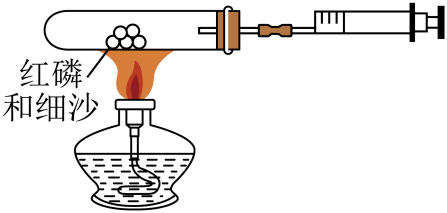
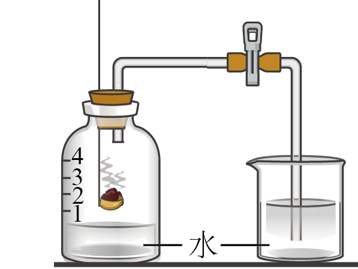

# 第2节 化学研究些什么（同步练习）

> 教材：化学·九年级上册·沪教版(上海) ｜ 来源：国家中小学智慧教育平台·在线练习 ｜ 共 21 题

## 1. 单选题

物质让我们的生活变得更加美好。下列常见的物质中前者为纯净物，后者为混合物的是

- A. 冰水混合物、碳酸饮品
- B. 糖水、过氧化氢水溶液
- C. 二氧化碳、高锰酸钾
- D. 食醋、二氧化碳

【答案】A

【解析】A、冰水混合物中只有水分子，属于纯净物，碳酸饮品中有水、碳酸等多种物质属于混合物，故选项正确；
B、糖水由蔗糖和水组成的混合物，过氧化氢水溶液是混合物，故选项不正确；
C、二氧化碳、高锰酸钾都是一种物质组成的，属于纯净物，故选项不正确；
D、食醋中含有水和醋酸等多种物质，属于混合物，二氧化碳是由一种物质组成的，属于纯净物，故选项错误。

## 2. 单选题

中华古文明，国粹尽传承。以“赏中华诗词，寻文化基因，品生活之美”为宗旨的《中国诗词大会》风靡全国，“圈粉”无数。下列诗句中，包含化学变化的是

- A. 忽如一夜春风来，千树万树梨花开
- B. 日照香炉生紫烟，遥看瀑布挂前川
- C. 千淘万漉虽辛苦，吹尽狂沙始到金
- D. 春蚕到死丝方尽，蜡炬成灰泪始干

【答案】D

【解析】A、忽如一夜春风来，千树万树梨花开描述的是降雪的场景，没有新物质生成，是物理变化；
B、日照香炉生紫烟，遥看瀑布挂前川是光的折射等，没有新物质生成，是物理变化；
C、千淘万漉虽辛苦，吹尽狂沙始到金是从沙中获得黄金，没有新物质生成，是物理变化；
D、春蚕到死丝方尽，蜡炬成灰泪始干涉及春蚕吐丝与蜡烛燃烧，有新物质生成，是化学变化。

## 3. 单选题（难度：简单）

“神箭冲碧宇，天和傲苍穹”。近期，神舟十四号航天员乘组已完成既定任务，成功返回地球。下列研究不属于化学范畴的是

- A. 研制火箭的燃料
- B. 计算返回舱落点
- C. 空间站内氧气的制取
- D. 返回舱外层耐高温涂料的制造

【答案】B

【解析】A、研制火箭的燃料如氢气、肼等属于化学物质的制备，属于化学范畴，不符合题意；
B、计算返回舱落点需要物理知识，不涉及物质的性质和用途，不属于化学范畴，符合题意；
C、空间站内氧气的制取属于化学物质的制备，属于化学范畴，不符合题意；
D、返回舱外层耐高温涂料的制造属于化学物质的制备，属于化学范畴，不符合题意。

## 4. 单选题（难度：简单）

下列物质中，属于混合物的是

- A. 洁净空气
- B. 液态氧
- C. 二氧化锰
- D. 高锰酸钾

【答案】A

【解析】A、洁净的空气中含有氮气、氧气、二氧化碳等物质，属于混合物，故选项正确；
B、液态氧是由一种物质组成的，属于纯净物，故选项错误；
C、二氧化锰是由一种物质组成的，属于纯净物，故选项错误；
D、高锰酸钾是由一种物质组成的，属于纯净物，故选项错误。

## 5. 单选题（难度：简单）

下列物质的用途与该物质的化学性质有关的是

- A. 用铜丝作导电线
- B. 金刚石用于制造切割工具
- C. 活性炭用于冰箱除臭
- D. 食品包装中充氮气以防腐

【答案】D

【解析】A、用铜丝作导电线，导电性属于物理性质；故选项错误；
B、金刚石用于制造切割工具，硬度属于物理性质；故选项错误；
C、活性炭用于冰箱除臭，吸附性属于物理性质；故选项错误；
D、食品包装中充氮气化学性质稳定，可以用来防腐，稳定性属于化学性质；故选项正确；

## 6. 单选题（难度：适中）

下列描述都属于化学变化的是

- A. 水的蒸发 水的凝固
- B. 海水制碱 海水晒盐
- C. 葡萄酿酒 葡萄腐烂
- D. 火药爆炸 车胎爆炸

【答案】C

【解析】A、水的蒸发和水的凝固是物质状态的变化，没有新物质生成，属于物理变化，故A不正确；
B、海水制碱生成新物质，属于化学变化，海水晒盐没有生成新物质，属于物理变化，故B不正确；
C、葡萄酿酒生成新物质乙醇，属于化学变化，葡萄腐烂生成新物质，属于化学变化，故C正确；
D、火药爆炸生成新物质，属于化学变化，车胎爆炸是体积膨胀所致，没有生成新物质，属于物理变化，故D不正确。

## 7. 单选题（难度：简单）

某化学兴趣小组设计了如图所示的实验装置，用于“测定空气中氧气的含量”（装置气密性良好，部分固定装置已略去，容器内红磷足量，导管中的空气可忽略。试管的容积为50mL，注射器的活塞实验前停在25mL处），用消精灯加热装置中的红磷，充分反应直至燃烧结束，试管冷却至室温。关于该实验有下列说法：①细沙能防止试管炸裂；②红磷燃烧会放出大量的烟雾；③该实验可能会导致胶塞或活塞弹出；④实验中可观察到，注射器的活塞先向右移动，后向左移动；⑤实验结束冷却至室温，活塞停止在15mL附近，其中正确的是

- A. ①③⑤
- B. ③④⑤
- C. ①③④
- D. ②④⑤

【答案】C

【解析】逐项分析对于该实验及其装置的说法：
①细沙可以防止试管炸裂，这是因为红磷受热燃烧时会放出大量的热量，试管受热不均则容易炸裂，故①正确；
②红磷燃烧产生的是五氧化二磷白色固体小颗粒，观察时是白烟，而不是烟雾，故②错误；
③该实验中，红磷燃烧放热，气压会变大，可能导致胶塞或者活塞弹出，故③正确；
④实验中可以观察到，燃烧放热时，气压变大，活塞先向右移，冷却后，由于红磷燃烧消耗了氧气，试管内气压减小，活塞又向左移，故④正确；
⑤冷却至室温，氧气约占原空气的1/5，即（50+25）×1/5=15，所以活塞应该停止在25ml-15ml=10ml处，故⑤错误

## 8. 单选题（难度：简单）

用下图装置可验证空气中O₂的含量。下列现象能表明O₂约占空气体积1/5的是

- A. 集气瓶中红磷燃烧，产生大量白烟
- B. 红磷燃烧一段时间后熄灭
- C. 烧杯中的水倒吸进入集气瓶
- D. 集气瓶中水面最终上升至1处

【答案】D

【解析】红磷燃烧集气瓶中产生大量白烟，红磷燃烧一段时间后熄灭，待冷却到室温后，烧杯中的水倒吸进入集气瓶，集气瓶中水面最终上升至1处，说明空气中氧气体积约占五分之一，能表明O₂含量的是集气瓶中水面最终上升至1处。

## 9. 单选题（难度：简单）

物质的下列性质中，属于化学性质的是

- A. 密度
- B. 硬度
- C. 可燃性
- D. 颜色

【答案】C

【解析】A、密度不需要通过化学变化就能表现出来，属于物理性质，该选项不符合题意；
B、硬度不需要通过化学变化就能表现出来，属于物理性质，该选项不符合题意；
C、可燃性需要通过化学变化才能表现出来，属于化学性质，该选项符合题意；
D、颜色不需要通过化学变化就能表现出来，属于物理性质，该选项不符合题意。

## 10. 单选题

在科学史上，中国有许多重大发明，为世界现代物质文明奠定了基础。以下发明属于化学史上中国对世界的重大贡献的是
①造纸②印刷技术③火药和中药学④指南针⑤炼铜、炼铁、炼钢⑥陶瓷⑦合成有机高分子材料⑧首次人工合成结晶牛胰岛素

- A. ①②③④⑥
- B. ①③⑤⑥⑦
- C. ①③⑤⑦⑧
- D. ①③⑤⑥⑧

【答案】D

【解析】①造纸是中国的四大发明之一，属于化学史上中国对世界的重大贡献，正确；
②印刷技术是中国的四大发明之一，但是印刷技术不属于化学工艺，不属于化学史上中国对世界的重大贡献，错误；
③火药和中药学属于我国古代的发明，属于化学史上中国对世界的重大贡献，正确；
④指南针是中国的四大发明之一，但是指南针是物理学的贡献，不属于化学史上中国对世界的重大贡献，错误；
⑤我国首先开展了炼铜、炼铁、炼钢等技术，用来制作大量的青铜器、铁器等，故炼铜、炼铁、炼钢属于化学史上中国对世界的重大贡献，正确；
⑥陶瓷属于化学工艺，属于化学史上中国对世界的重大贡献，正确；
⑦合成有机高分子材料是全球范围内的科学和工程领域的共同努力，不属于化学史上中国对世界的重大贡献，错误；
⑧1965年，我国在世界上首先人工合成了结晶牛胰岛素，属于化学史上中国对世界的重大贡献，正确。
故正确的是①③⑤⑥⑧。

## 11. 单选题（难度：适中）

复印机复印资料时，常能闻到—股特殊的气味，这种气味就是臭氧的气味。氧气在放电的条件下可以转化为臭氧。下列与此相关的说法中不正确的是

- A. 氧气在放电的条件下转化为臭氧的过程是物理变化
- B. 氧气在放电的条件下转化为臭氧的过程是化学变化
- C. 臭氧的特殊的气味属于臭氧的物理性质
- D. 氧气在放电的条件下可以转化为臭氧，属于臭氧的化学性质

【答案】A

【解析】A、氧气在放电的条件下转化为臭氧的过程，生成了新物质，属于化学变化，故选项错误；
B、氧气在放电的条件下转化为臭氧的反应，生成了新物质，属于化学变化，故选项正确；
C、根据味道属于物理性质，所以臭氧的特殊的气味，是臭氧的物理性质，故选项正确；
D、氧气和臭氧是不同的物质，氧气能在放电的情况下转化为臭氧，所以属于氧气的化学性质，故选项正确；

## 12. 单选题（难度：适中）

10．如图是测定空气中氧气含量的实验，下列有关空气的说法正确的是（    ）

​

​​​

- A. 空气中氮气的质量分数约为78%
- B. 氮气的化学性质稳定，故超导材料可利用液氮显示超导性能
- C. 在实验中，红磷熄灭后应立刻打开弹簧夹
- D. 实验发现进入集气瓶中水小于五分之一，可能是红磷的量不足

【答案】D

【解析】A、空气中氮气的体积分数约为78%，而不是质量分数，该选项说法不正确；B、液氮的沸点低，在液氮中超导材料的电阻会迅速降低，甚至变为零，与氮气的化学性质稳定无关，该选项说法不正确；C、测定空气中氧气含量时，应待装置冷却到室温后再打开弹簧夹，该选项说法不正确；D、红磷量不足，则氧气没有完全耗尽，会使进入的水的体积少于五分之一，该选项说法正确。

## 13. 单选题（难度：简单）

2．下列变化属于化学变化的是（    ）​​​

- A. 铁锻造成铁锅
- B. 二氧化碳气体使澄清石灰水变浑浊
- C. 石蜡熔化
- D. 锅炉爆炸

【答案】B

## 14. 单选题（难度：简单）

1．物理变化和化学变化的本质区别是（    ）​

- A. 有无气体逸出​
- B. 有无放热、发光现象
- C. 有无状态、颜色发生了变化
- D. 有无其他物质生成

【答案】D

【解析】化学变化和物理变化的本质区别是有无新物质生成。​

## 15. 单选题（难度：简单）

3．在蜡烛燃烧的变化中，能说明该变化是化学变化的是（    ）

- A. 放出大量热
- B. 蜡烛变短
- C. 蜡烛受热熔化，冷却后又凝固
- D. 生成水和二氧化碳

【答案】D

【解析】化学变化的本质是有新物质生成。

## 16. 单选题（难度：简单）

4．下列前者为物理性质，后者为化学性质的是（    ）

- A. 汽油易挥发，碘能溶于酒精
- B. 碳酸氢铵受热易分解，氧气具有氧化性
- C. 金属铁能导电，钢铁易生锈
- D. 酒精能燃烧，金刚石很硬

【答案】C

【解析】A选项前后两者均为物理性质，B选项两者均为化学性质，D选项前者为化学性质，后者为物理性质

## 17. 单选题（难度：简单）

6．分类是化学学科的基本思想方法之一，下列属于纯净物的是（    ）

- A. 液态氮
- B. 加碘盐
- C. 食用醋
- D. 高钙奶

【答案】A

【解析】A、液态氮只含氮气这一种物质，属于纯净物，A选项正确；B、加碘盐含有氯化钠、含碘物质等物质，不属于纯净物，B选项错误；C、食用醋含有醋酸、水等物质，不属于纯净物，C选项错误；D、高钙奶含有水、蛋白质、油脂、含钙物质等物质，不属于纯净物，D选项错误。

## 18. 单选题（难度：简单）

7．干燥空气中体积分数约占78%且化学性质不活泼的气体是（    ）

- A. 氧气
- B. 氮气
- C. 二氧化碳
- D. 水蒸气

【答案】B

【解析】A、氧气大约占21%，化学性质比较活泼，故A错误；B、氮气大约占78%，且化学性质不活泼，故B正确；C、二氧化碳大约占0.03%含量较少，故C错误；D、干燥空气中水蒸气的含量很少，故D错误。

## 19. 单选题（难度：简单）

8．物质的性质决定物质的用途。下列对应关系不正确的是（    ）

- A. 石墨具有导电性，可用做电极
- B. 酒精具有可燃性，可作燃料
- C. 氮气常温下无色无味，可用作粮食、瓜果的保护气
- D. 红磷燃烧能产生大量白烟，可用于制作烟幕弹

【答案】C

【解析】A、石墨具有优良的导电性，在工业上常用来作电极，故该性质与用途有对应关系；B、酒精具有可燃性，可作燃料，故该性质与用途有对应关系；C、氮气常温下化学性质不活泼，可用作粮食、瓜果的保护气，故该性质与用途没有对应关系；D、红磷燃烧能产生大量白烟，所以可用于制作烟幕弹，故该性质与用途有对应关系。

## 20. 单选题（难度：简单）

9．观察下图，下列叙述​​都正确的一组是（    ）​​

​

①碳元素可以组成多种纯净物；

②以上都是只含碳元素的纯净物，它们的物理性质都相同；​​

③金刚石、石墨、C₆₀结构不同，它们完全燃烧的产物一定不同；

④石墨与金刚石结构不同，但石墨在一定条件下可以转化为金刚石。

- A. ①②
- B. ②③
- C. ①④
- D. ③④

【答案】C

【解析】①同种元素能组成不同种纯净物，如：上述物质都是碳元素组成纯净物，叙述正确；②物质的组成和结构决定物质的性质，由于上述物质中碳原子的排列方式不同，故这些物质的物理性质存在差异，叙述错误；③化学变化前后元素种类不变，金刚石、石墨、C₆₀都含有碳元素，燃烧均可以产生二氧化碳，叙述错误；④石墨与金刚石都是由碳元素组成的，所以存在石墨转化为金刚石的可能，叙述正确。以上①④正确。

## 21. 单选题（难度：简单）

5．下列著名诗句所反映的物质变化主要与化学变化相关的是（    ）

- A. 忽如一夜春风来，千树万树梨花开
- B. 落红不是无情物，化作春泥更护花
- C. 夜来风雨声，花落知多少
- D. 日照香炉生紫烟，遥看瀑布挂前川

【答案】B

【解析】A选项“梨花”比喻雪花积在树枝上，像梨花开了一样，无新物质生成。C选项“风雨声”、“花落”这些常见的自然现象中，没有新物质的产生，所以不是化学变化。D选项“香炉”指香炉峰，“紫烟”指日光透过云雾，远望如紫色的烟云，紫烟的产生只是香炉峰的水受热在液态和气态间的两态变化，并没产生新物质，所以是物理变化。
