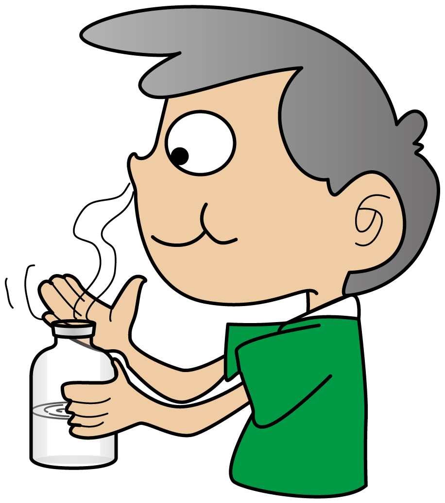
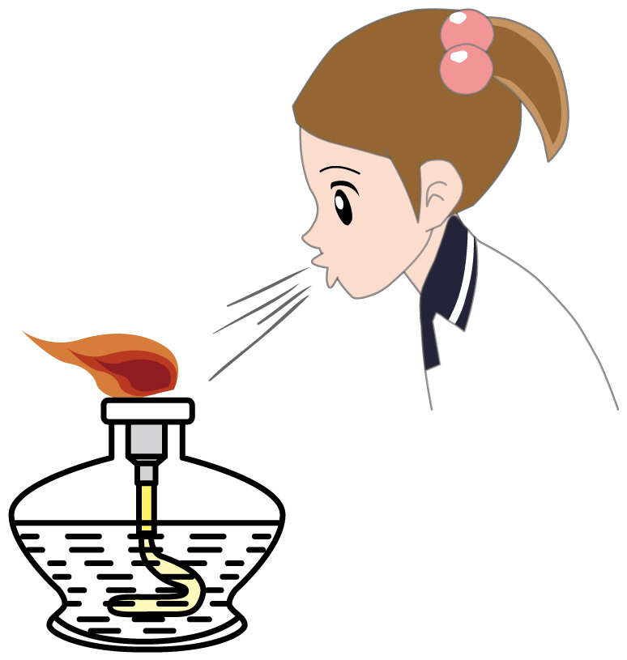
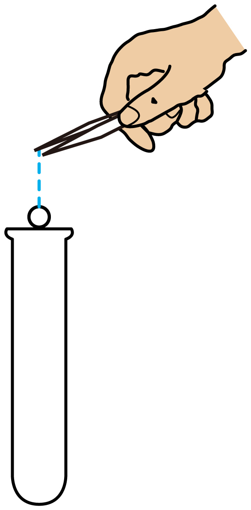
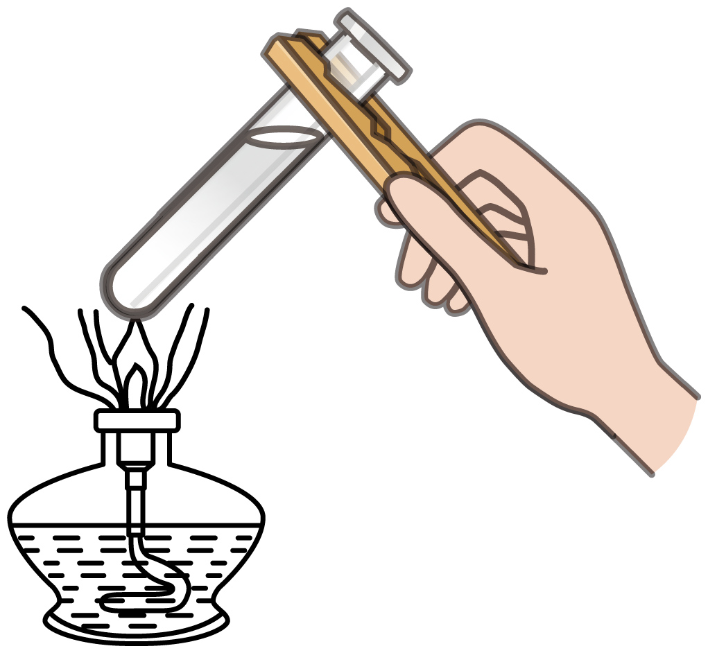

# 第3节 怎样学习和研究化学（同步练习）

> 教材：化学·九年级上册·沪教版(上海) ｜ 来源：国家中小学智慧教育平台·在线练习 ｜ 共 8 题

## 1. 单选题（难度：简单）

下列元素名称与其对应的元素符号完全正确的是

- A. 氯cl
- B. 氖 Na
- C. 镁Mg
- D. 铜Ca

【答案】C

【解析】A、氯cl，错误，第一个字母没有大写，应该是Cl；
B、氖Na，错误，和钠的元素符号混淆了，氖的元素符号是Ne；
C、镁Mg，正确，符合元素符号书写规律；
D、铜Ca，错误，和钙的元素符号混淆了。

## 2. 单选题（难度：简单）

下列实验操作符合规范要求的是（ ）

- A. 闻气体气味

- B. 熄灭酒精灯

- C. 取用固体 

- D. 给液体加热

【答案】A

【解析】A、闻气体气味时，应用手在瓶口轻轻扇动，使少量气味飘进鼻孔中，图中操作正确，故A符合题意；
B、熄灭酒精灯，应用灯帽盖灭，不能用嘴吹灭，图中操作错误，故B不符合题意；
C、将块状药品或金属颗粒放入玻璃容器时，应该先把容器横放，把药品或金属颗粒放入容器口后，再把容器慢慢地竖起来，使药品或金属颗粒滑到容器底部，以免打破容器。图中操作错误，故C不符合题意；
D、给试管里的液体加热时，应用酒精的外焰加热，试管里的液体不能超过试管容积的1/3，图中操作错误，故D不符合题意；

## 3. 单选题（难度：适中）

在一次用量筒做实验时，某同学如下操作：量筒放平稳，面对刻度，仰视读数时为40毫升，倒出一部分液体后又俯视读数为30毫升，这个同学取出的液体的体积是

- A. 大于10毫升
- B. 小于10毫升
- C. 等于10毫升
- D. 无法判断

【答案】A

【解析】仰视读数时为40mL，实际量取液体的体积偏大，可以假设为41mL，倒出一部分液体后又俯视读数为30mL，实际量取的液体的体积偏小，可以假设为29mL，所以倒出的液体的体积为41mL-29mL=12mL>10mL。

## 4. 单选题（难度：简单）

1．下列能用于加热的仪器是（    ）

- A. 量筒
- B. 试管
- C. 滴瓶
- D. 漏斗

【答案】B

【解析】量筒、滴瓶、漏斗等仪器不能被加热。该题选B。

## 5. 单选题（难度：简单）

下列实验操作正确的是（    ）

- A. 
​​取用锌粒
- B. 
​​连接仪器
- C. 
​​量取液体
- D. 
​​过滤

【答案】B

【解析】A、加入块状固体应先平放试管，用镊子将固体药品放置于试管口，缓缓倾斜试管使固体滑落至试管底部，不能直接从试管口丢下，防止试管底部被砸碎。C、量取液体药品时视线应与凹液面最低点保持水平。D、过滤时应用玻璃棒引流。该题选B。

## 6. 单选题（难度：简单）

下列图示的“不符合题意操作”，与相对应选项的“可能产生后果”不一致的是（    ）

- A. 
​​打破容器
- B. 
​灯内酒精燃烧​
- C. 
​​实际量取液体偏少
- D. 
​液体洒出​

【答案】A

【解析】A、会导致试管内壁沾上较多药品。本题选A。

## 7. 单选题（难度：简单）

给下列仪器加热时，需要垫上石棉网的是（    ）

- A. 试管
- B. 锥形瓶
- C. 蒸发皿
- D. 燃烧匙

【答案】B

【解析】上列仪器均可受热，但锥形瓶在受热时需要垫上石棉网，该题选B。

## 8. 单选题（难度：适中）

某学生欲量取8毫升的水，把水倒入量筒后，仰视液面的最低处读数为8毫升，则实际量取的水是（　　）

- A. 大于8毫升
- B. 等于8毫升
- C. 小于8毫升
- D. 以上都不对

【答案】A

【解析】仰视量取液体会导致液体偏多，该题选A。
