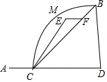
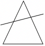
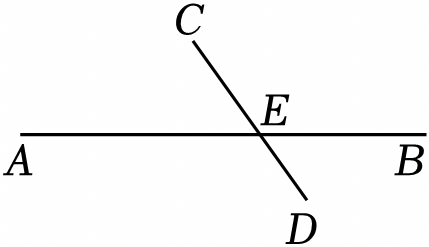
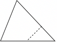
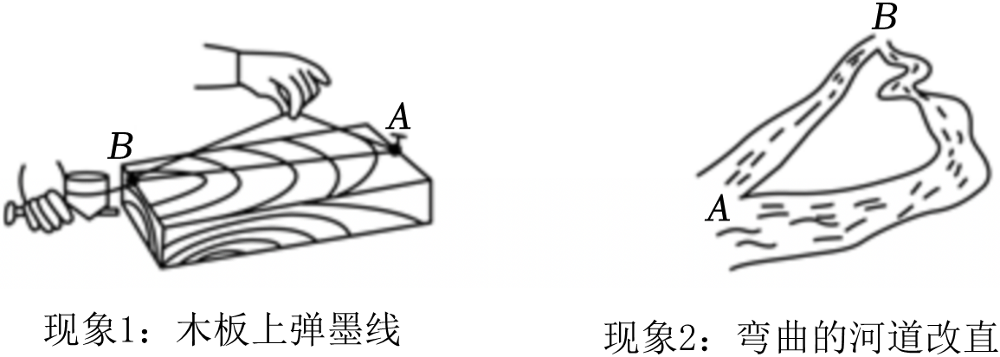
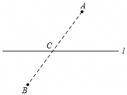
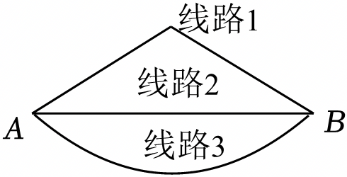
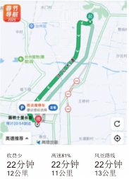

# 知识点·两点之间线段最短（同步练习）

> 教材：数学·七年级上册·沪科技版2024新教材 ｜ 来源：国家中小学智慧教育平台·在线练习 ｜ 共 49 题

## 1. 单选题

为了让一队学生站成一条直线，先让两名学生站好不动，其他学生依次往后站，要求目视前方只能看到各自前面的那名学生，这种做法依据的几何知识应是（　　）

【答案】A

## 2. 单选题（难度：非常简单）

下列说法正确的是（　　）

【答案】A

## 3. 单选题（难度：非常简单）

下列四个生活、生产现象：
①用两个钉子就可以把木条固定在墙上；
②建筑工人砌墙时，经常先在两端立桩拉线，然后沿着线砌墙；
③从A地到B地架设电线，总是尽可能沿着线段AB架设；
④把弯曲的公路改直，就能缩短路程．其中可用“两点之间，线段最短”来解释的现象有（　　）

- A. ①②
- B. ③④
- C. ①③
- D. ②④

【答案】B

【解析】解：①用两个钉子就可以把木条固定在墙上，是利用两点确定一条直线；
②建筑工人砌墙时，经常先在两端立桩拉线，然后沿着线砌墙，是利用两点确定一条直线；
③从A地到B地架设电线，总是尽可能沿着线段AB架设，是利用两点之间，线段最短；
④把弯曲的公路改直，就能缩短路程，是利用两点之间，线段最短．
故选：B．

## 4. 单选题（难度：非常简单）

下列生活、生产现象：
①用两个钉子就可以把木条固定在墙上．
②从A地到B地架设电线，总是尽可能沿着线段AB架设．
③木匠师傅锯木料时，一般先在木板上画出两个点，然后过这两点弹出一条墨线．
④高速公路在建设过程中，通常要从大山中开挖隧道穿过，把道路取直，就能缩短路程．
其中能用“两点之间，线段最短”来解释的现象有（　　）

- A. ①②
- B. ①③
- C. ②④
- D. ③④

【答案】C

【解析】解：①③是根据两点确定一条直线，②④是根据两点之间，线段最短，
故选：C．
23．下列四个生产生活现象，可以用“两点之间线段最短”来解释的是（　　）
A．用两颗钉子可以把木条固定在墙上  
B．把弯曲的公路改直，就能缩短路程  
C．植树时，只要定出两棵树的位置，就能使同一行树坑在一条直线上  
D．打靶的时候，眼睛要与枪上的准星、靶心在同一直线上
【答案】B
【解析】解：A．用两颗钉子可以把木条固定在墙上，是利用两点确定一条直线来解释，故A不符合题意；
B．把弯曲的公路改直，就能缩短路程，是利用两点之间线段最短来解释，故B符合题意；
C．植树时，只要定出两棵树的位置，就能使同一行树坑在一条直线上，是利用两点确定一条直线来解释，故C不符合题意；
D．打靶的时候，眼睛要与枪上的准星、靶心在同一直线上，是利用两点确定一条直线来解释，故D不符合题意；
故选：B．

## 5. 单选题（难度：非常简单）

下列四个现象中，可以用基本事实“两点之间，线段最短”来解释的是（　　）

【答案】A

## 6. 单选题（难度：非常简单）

生活中有下列现象，其中能用“两点之间线段最短”来解释的现象是（　　）

【答案】A

## 7. 单选题（难度：非常简单）

要整齐地栽一行树，只要确定两端树坑的位置，就能确定这一行树坑所在的直线，这里面包含的数学事实是（　　）

【答案】A

## 8. 单选题（难度：非常简单）

下列4个生产、生活现象中，可用“两点之间线段最短”来解释的是（　　）

- A. 用两根钉子就可以把木条固定在墙上
- B. 植树时，只要选出两棵树的位置，就能确定同一行树所在的直线
- C. 把弯曲的公路改直，就能缩短路程
- D. 砌墙时，经常在两个墙角的位置分别插一根木桩拉一条直的参照线

【答案】C

【解析】解：A、用两根钉子就可以把木条固定在墙上，利用的是两点确定一条直线，故此选项不合题意；
B、植树时，只要选出两棵树的位置，就能确定同一行树所在的直线，利用的是两点确定一条直线，故此选项不合题意；
C、把弯曲的公路改直，就能缩短路程，可用“两点之间线段最短”来解释，符合题意；
D、砌墙时，经常在两个墙角的位置分别插一根木桩拉一条直的参照线，利用的是两点确定一条直线，故此选项不合题意；
故选：C．

## 9. 单选题（难度：非常简单）

把弯曲的公路改直，能够缩短行程，这样的道理是（　　）

- A. 两点确定一条直线
- B. 两点确定一条线段
- C. 两点之间线段最短
- D. 两点之间直线最短

【答案】C

【解析】解：把弯曲的公路改直，能够缩短行程，这样的道理是两点之间线段最短，
故选：C．

## 10. 单选题（难度：非常简单）

下列四个生活、生产现象：①用两个钉子就可以把木条固定在墙上；②植树时，只要定出两棵树的位置，就能确定同一行树所在的直线；③从A地到B地架设电线，总是尽可能沿着线段AB架设；④把弯曲的公路改直，就能缩短路程，其中可用公理“两点之间，线段最短”来解释的现象有（　　）

【答案】A

## 11. 单选题（难度：非常简单）

把弯曲的河道改直，能够缩短航程，这样做的道理是（　　）

- A. 两点确定一条直线
- B. 两点之间，直线最短
- C. 两点之间，线段最短
- D. 连接两点间线段的长度是两点间的距离

【答案】C

【解析】解：由两点之间线段最短可知，把弯曲的河道改直，能够缩短航程，这样做根据的道理是两点之间线段最短，
故选：C．

## 12. 单选题

数学源于生活，并用于生活，要把一根木条固定在墙上至少需要钉两颗钉子，其中的数学原理是（　　）

- A. 过一点有无数条直线
- B. 线段中点的定义
- C. 两点之间线段最短
- D. 两点确定一条直线

【答案】D

【解析】解：要把一根木条固定在墙上至少需要钉两颗钉子，其中的数学原理是两点确定一条直线，
故选：D．

## 13. 单选题（难度：非常简单）

将一根木条固定在墙上，至少需要在木条上钉2枚钉子，这样做的数学依据是（　　）

- A. 两点确定一条直线
- B. 两点之间，线段最短
- C. 两点之间，直线最短
- D. 以上说法都不对

【答案】A

【解析】解：把一根木条固定在墙上，至少需要在木条上钉2枚钉子，这样做的数学依据是两点确定一条直线．
故选：A．

## 14. 单选题（难度：非常简单）

下列结论错误的是（　　）

- A. 倒数等于其本身的有理数有±1
- B. 两点之间，直线最短
- C. x²+2x﹣4＝0不是一元一次方程
- D. 过两点有且只有一条直线

【答案】B

【解析】解：A、倒数等于其本身的有理数有±1，结论正确，不符合题意；
B、两点之间，线段最短，故本选项结论错误，符合题意；
C、x²+2x﹣4＝0，未知数的最高次数是2，不是一元一次方程，结论正确，不符合题意；
D、过两点有且只有一条直线，结论正确，不符合题意；
故选：B．

## 15. 单选题（难度：非常简单）

某同学用剪刀沿直线将一片平整的银杏叶剪掉一部分（如图），发现剩下的银杏叶的周长比原银杏叶的周长要小，能正确解释这一现象的数学知识是（　　）

- A. 两点确定一条直线
- B. 点动成线
- C. 直线是向两方无限延伸的
- D. 两点之间线段最短

【答案】D

【解析】解：某同学用剪刀沿直线将一片平整的银杏叶剪掉一部分（如图），发现剩下的银杏叶的周长比原银杏叶的周长要小，能正确解释这一现象的数学知识是：两点之间所有连线中，线段最短，
故选：D．

## 16. 单选题（难度：非常简单）

如图，某同学家在A处，现在该同学要去位于B处的同学家去玩，请帮助他选择一条最近的路线（　　）

- A. A→C→D→B
- B. A→C→F→B
- C. A→C→E→F→B
- D. A→C→M→B

【答案】B

【解析】解：根据两点之间的线段最短，
可得C、B两点之间的最短距离是线段CB的长度，
所以想尽快赶到同学家玩，一条最近的路线是：A→C→F→B．
故选：B．

## 17. 单选题（难度：非常简单）

如图，把三角形剪去一个角，所得四边形的周长比原三角形的周长小，能正确解释这一现象的数学知识是（　　）

- A. 四边形周长小于三角形周长
- B. 两点确定一条直线
- C. 两点之间，线段最短
- D. 经过一点有无数条直线

【答案】C

【解析】解：如图，把三角形剪去一个角，所得四边形的周长比原三角形的周长小，能正确解释这一现象的数学知识是：两点之间，线段最短．
故选：C．

## 18. 单选题（难度：非常简单）

如图所示，一条笔直的公路AB，在这条公路两旁各有两个村庄C和D，现在要在公路AB边建一加油站E，使它到两村庄的距离之和最短，则这个加油站E应建在AB与CD的交点处，这种做法用数学知识解释是（　　）

- A. 两点确定一条直线
- B. 射线只有一个端点
- C. 两点之间，线段最短
- D. 两直线相交只有一个交点

【答案】C

【解析】解：用数学知识解释是：两点之间，线段最短．
故选：C．

## 19. 单选题（难度：非常简单）

如图，某同学用剪刀沿虚线将三角形剪掉一个角，发现四边形的周长比原三角形的周长要小，能正确解释这一现象的数学知识是（　　）

- A. 两点之间，线段最短
- B. 经过一点，有无数条直线
- C. 垂线段最短
- D. 经过两点，有且只有一条直线

【答案】A

【解析】解：某同学用剪刀沿虚线将三角形剪掉一个角，发现四边形的周长比原三角形的周长要小，能正确解释这一现象的数学知识是：两点之间，线段最短．
故选：A．

## 20. 单选题（难度：适中）

如图，某同学从地图上得知A地与B地之间的距离是20公里，但导航提供的路线长分别是22公里，24.5公里，26公里，其数学道理是（　　）

【答案】A

## 21. 单选题（难度：适中）

校园中常常看到“在草坪上斜踩出一条小路”，请用数学知识解释图中这一不文明现象，其原因为（　　）

【答案】A

## 22. 单选题（难度：非常简单）

生活中，有下列两个现象，对于这两个现象的解释，正确的是（　　）
 

- A. 均用两点之间线段最短来解释
- B. 均用经过两点有且只有一条直线来解释
- C. 现象1用两点之间线段最短来解释，现象2用经过两点有且只有一条直线来解释
- D. 现象1用经过两点有且只有一条直线来解释，现象2用两点之间线段最短来解释

【答案】D

【解析】解：现象1：木板上弹墨线，可用“两点确定一条直线”来解释；
现象2：把弯曲的河道改直，可以缩短航程可用“两点之间线段最短”来解释，
故选：D．

## 23. 单选题（难度：非常简单）

高速公路的建设带动我国经济的快速发展．在高速公路的建设中，通常要从大山中开挖隧道穿过，把道路取直，以缩短路程．这样做包含的数学道理是（　　）

【答案】A

## 24. 单选题（难度：非常简单）

下列现象：其中能用“两点确定一条直线”来解释的现象是（　　）①用两个钉子就可以把木条固定在墙上；②从A地到B地架设电线，总是尽可能沿着线段AB架设；③植树时，只要确定两棵树的位置，就能确定同一行树所在的直线；④把弯曲的公路改直，就能缩短路程．

【答案】A

## 25. 单选题（难度：非常简单）

下列说法：①下雨天打开雨刷器，雨刷器在运动时形成一个扇面，其运用的数学原理是线动成面；②将一根木条固定在遍上至少需要两枚钉子，运用的数学原理是两点之间线段最短；③在正常情况下，射击时要保证瞄准的一只眼在准星和目标确定的直线上才能射中目标，其运用的数学原理是两点确定一条直线．其中说法正确的有（　　）

【答案】A

## 26. 单选题（难度：非常简单）

在三角形中，任意两边之和大于第三边，其依据为（　　）

- A. 两点确定一条直线
- B. 任意两边之差小于第三边
- C. 两点之间线段最短
- D. 直线外一点与直线上各点的连线中垂线段最短

【答案】C

【解析】解：在三角形中，任意两边之和大于第三边，其依据为两点之间线段最短，
故选：C．

## 27. 单选题（难度：非常简单）

下列生活、生产现象中，可以用基本事实“两点之间，线段最短”来解释的是（　　）

- A. 把弯曲的公路改直，就能缩短路程
- B. 用两个钉子就可以把木条固定在墙上
- C. 利用圆规可以比较两条线段的大小关系
- D. 测量运动员的跳远成绩时，皮尺与起跳线保持垂直

【答案】A

【解析】解：A、把弯曲的公路改直，就能缩短路程根据两点之间，线段最短，故此选项正确；
B、用两个钉子就可以把木条固定在墙上，根据两点确定一条直线，故此选项错误；
C、利用圆规可以比较两条线段的大小关系，根据线段的和差，故此选项错误；
D、测量运动员的跳远成绩时，皮尺与起跳线保持垂直，根据垂线段最短；
故选：A．

## 28. 单选题（难度：非常简单）

在下列生活、生产现象中，可以用基本事实“两点之间，线段最短”来解释的是（　　）①用两颗钉子就可以把木条固定在墙上；②在A、B两地之间架设电线时，总是尽可能沿线段AB架设；③植树时，只要栽下两棵树，就可以把同一行树栽在同一条直线上；④把弯曲的公路改直，就能缩短路程．

【答案】A

## 29. 单选题（难度：非常简单）

在下列生活、生产现象中，可以用基本事实“两点确定一条直线”来解释的是（　　）

【答案】A

## 30. 单选题（难度：非常简单）

下列三个生活、生产现象：①用两个钉子就可以把木条固定在墙上；②植树时，只要定出两棵树的位置，就能确定同一行树所在的直线；③把弯曲的公路改直，就能缩短路程．其中可用基本事实“两点确定一条直线”来解释的现象有（　　）

【答案】A

## 31. 单选题（难度：非常简单）

把弯曲的河道改直，能够缩短航程，这样做的道理是（　　）

【答案】A

## 32. 单选题（难度：非常简单）

下列四个生产生活现象，可以用“两点之间，线段最短”来解释的是（　　）

【答案】A

## 33. 单选题（难度：非常简单）

金秋十月，我校校园内色彩斑斓．小明同学捡到一片沿直线被折断了的银杏叶（如图），他发现剩下的银杏叶的周长比原银杏叶的周长要小，能正确解释这一现象的数学知识是（　　）

【答案】A

## 34. 单选题（难度：非常简单）

小华准备从A地去往B地，打开导航显示两地距离为39.6km，但导航提供的三条可选路线长却分别为52km，53km，56km（如图）．能解释这一现象的数学知识是（　　）

【答案】A

## 35. 单选题（难度：非常简单）

秦岭终南山公路隧道是我国自主设计最长的双洞单向高速公路隧道，隧道线形为直线，被誉为“天下第一隧”，建成后通行里程大大缩短，其路程缩短的原因是（　　）

【答案】A

## 36. 单选题（难度：非常简单）

小雅准备从A地去往B地，手机显示两地的直线距离为60.5km，但手机导航提供的三条可选路线长分别为65km，68km，62km，能解释这一现象的数学结论是（　　）

【答案】A

## 37. 单选题（难度：非常简单）

射击是一项用枪支对准目标打靶的竞技项目，在正常情况下，射击时要保证瞄准点在准星和缺口确定的直线上（如图所示），才能射中目标，这样做的数学依据是（　　）

【答案】A

## 38. 单选题（难度：非常简单）

如图所示，A、B两个村庄在公路l（不计公路的宽度）的两侧，现要在公路l旁建一个货物中转站，使它到A、B两个村庄的距离之和最小．如图中所示的C点（l与AB的交点）即为所建的货物中转站的位置，则这样做的理由是（　　）

- A. 两直线相交只有一个交点
- B. 两点确定一条直线
- C. 两点之间，线段最短
- D. 经过一点有无数条直线

【答案】C

【解析】解：如图所示，A、B两个村庄在公路l（不计公路的宽度）的两侧，现要在公路l旁建一个货物中转站，使它到A、B两个村庄的距离之和最小．如图中所示的C点（l与AB的交点）即为所建的货物中转站的位置，则这样做的理由是两点之间线段最短．
故选：C．

## 39. 单选题（难度：非常简单）

如图，为了尽快从A地走到B地，人们通常选择线路2，其中的数学原理是（　　）

- A. 两点确定一条直线
- B. 垂线段最短
- C. 两点之间线段最短
- D. 经过一点有无数条直线

【答案】C

【解析】解：如图，为了尽快从A地走到B地，人们通常选择线路2，其中的数学原理是两点之间线段最短，
故选：C．

## 40. 单选题（难度：非常简单）

如图1，A，B两个村庄在一条河l（不计河的宽度）的两侧，现要建一座码头，使它到A、B两个村庄的距离之和最小，图2中所示的C点即为所求的码头的位置，那么这样做的理由是（　　）

【答案】A

## 41. 单选题（难度：非常简单）

如图，经过刨平的木板上的A，B两个点，能弹出一条笔直的墨线，而且只能弹出一条墨线，能解释这一实际应用的数学知识是（　　）

【答案】A

## 42. 单选题（难度：非常简单）

如图，经过刨平的木板上的A，B两个点，能弹出一条笔直的墨线，而且只能弹出一条墨线，能解释这一实际应用的数学知识是（　　）

【答案】A

## 43. 单选题（难度：非常简单）

小宇一家三口准备从家出发去路桥十里长街，打开导航，显示两地的直线距离为8.4km，但导航提供的三条可选路线长却分别为11km，12km，13km（如图），能解释这一现象最合理的数学知识是（　　）

- A. 两点之间线段最短
- B. 两点之间直线最短
- C. 两点确定一条直线
- D. 连结两点的线段的长度叫作这两点间的距离

【答案】A

【解析】解：能解释这一现象最合理的数学知识是两点之间线段最短．
故选：A．

## 44. 单选题（难度：非常简单）

如图，小胡一家准备从A地自驾到B地玩，导航提供了几条驾车路线，AB两地的实际距离只有2.2千米，但是提供的几条路线实际路程均大于2.2千米，这是因为（　　）

【答案】A

## 45. 单选题（难度：非常简单）

如图，轩轩同学用剪刀沿直线将一片平整的树叶剪掉一部分，发现剩下树叶的周长比原树叶的周长要小，能正确解释这一现象的数学知识是（　　）

【答案】A

## 46. 单选题（难度：非常简单）

在下列生活、生产现象中，可以用基本事实“两点之间线段最短”来解释的是（　　）①用两颗钉子可以把木条固定在墙上；②建筑工人砌墙时，经常用细绳在墙的两端之间拉一条参考线，使砌的每一层砖都在一条直线上；③在王家村到李家店之间的公路上修建一个公交停车点，当停车点位于这段公路的中点时，公交车行驶的路程最短；④把弯曲的河道改直就能够缩短河道长度．

【答案】A

## 47. 单选题（难度：非常简单）

下列说法正确的是（　　）

【答案】A

## 48. 单选题（难度：非常简单）

如图，这是嘉嘉绘制的从A地到B地的路线图，这两地之间的最短距离为8km，从上到下分别为路线M，N，P，Q，其中某条路线所标的数据错误，则数据错误的是（　　）

【答案】A

## 49. 单选题（难度：非常简单）

高速公路在建设过程中，有时要从大山中开挖隧道穿过，把道路取直以缩短路程，其中的数学原理是（　　）

【答案】A
