# 知识点·两点间距离（同步练习）

> 教材：数学·七年级上册·沪科技版2024新教材 ｜ 来源：国家中小学智慧教育平台·在线练习 ｜ 共 50 题

## 1. 单选题（难度：非常简单）

如果线段AB＝5cm，线段BC＝4cm，那么A，C两点之间的距离是（　　）

- A. 9cm
- B. 1cm
- C. 1cm或9cm
- D. 以上答案都不对

【答案】D

【解析】解：（1）当A，B，C三点在一条直线上时，分点B在A、C之间和点C在A、B之间两种情况讨论．
①点B在A、C之间时，AC＝AB+BC＝5+4＝9cm；
②点C在A、B之间时，AC＝AB﹣BC＝5﹣4＝1cm．
所以A、C两点间的距离是9cm或1cm．
（2）当A，B，C三点不在一条直线上时，A，C两点之间的距离有多种可能；
故选：D．

## 2. 单选题（难度：非常简单）

线段AB＝5厘米，BC＝4厘米，那么A，C两点的距离是（　　）

- A. 1厘米
- B. 9厘米
- C. 1厘米或9厘米
- D. 无法确定

【答案】D

【解析】解：点C在线段AB上时，AC＝5﹣4＝1cm，
点C在线段AB的延长线上时，AC＝5+4＝9cm，
点C不在直线AB上时，1＜AC＜9，
所以，A、C两点间的距离为1≤AC≤9，故无法确定．
故选：D．

## 3. 单选题（难度：非常简单）

在直线l上顺次取A、B、C三点，使得AB＝5cm，BC＝3cm，如果O是线段AC的中点，那么线段OB的长度是（　　）

【答案】A

## 4. 单选题（难度：非常简单）

A，B，C三点在同一直线上，线段AB＝5cm，BC＝4cm，那么A，C两点的距离是（　　）

- A. 1cm
- B. 9cm
- C. 1cm或9cm
- D. 以上答案都不对

【答案】C

【解析】解：第一种情况：C点在AB之间上，故AC＝AB﹣BC＝1cm；
第二种情况：当C点在AB的延长线上时，AC＝AB+BC＝9cm．
故选：C．

## 5. 单选题（难度：非常简单）

如果A、B、C在同一条直线上，线段AB＝6cm，BC＝2cm，则A、C两点间的距离是（　　）

- A. 8cm
- B. 4cm
- C. 8cm或4cm
- D. 无法确定

【答案】C

【解析】解：（1）点B在A、C之间时，AC＝AB+BC＝6+2＝8cm；
（2）点C在A、B之间时，AC＝AB﹣BC＝6﹣2＝4cm．
所以A、C两点间的距离是8cm或4cm．
故选：C．

## 6. 单选题（难度：非常简单）

已知点C在线段AB上，则下列条件中，不能确定点C是线段AB中点的是（　　）

【答案】A

## 7. 多选题（难度：非常简单）

已知点A、B、C都是直线l上的点，且AB＝5cm，BC＝3cm，那么点A与点C之间的距离是（　　）

【答案】A

## 8. 单选题（难度：适中）

数轴上A、B、C三点所表示的数分别为a、b、c，且C在AB上．若|a|＝|b|，AC：CB＝1：3，则下列b、c的关系式，何者正确？（　　）

【答案】A

## 9. 单选题（难度：非常简单）

如图，点P是线段AB上的点，其中不能说明点P是线段AB中点的是（　　）

【答案】A

## 10. 单选题

如果线段AB＝5cm，BC＝4cm，且A、B、C在同一条直线上，那么A、C两点的距离是（　　）

- A. 1cm
- B. 9cm
- C. 1cm或9cm
- D. 以上答案都不正确

【答案】C

【解析】解：当点C在AB之间时，AC＝AB﹣BC＝5﹣4＝1（cm）；
当点C在点B的右侧时，AC＝AB+BC＝5+4＝9（cm）．
故选：C．   

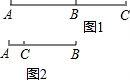

## 11. 单选题

如图，AB＝12cm，C为AB的中点，点D在线段AC上，且AD：CB＝1：3，则DB的长度是（　　）

【答案】A

## 12. 单选题（难度：非常简单）

点C是线段AB的中点，点D是线段AC的三等分点．若线段AB＝12cm，则线段BD的长为（　　）

【答案】A

## 13. 单选题（难度：非常简单）

如图，C是线段AB上的一点，M是线段AC的中点，若AB＝8cm，BC＝2cm，则MC的长是（　　） 

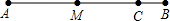

- A. 2cm
- B. 3cm
- C. 4cm
- D. 6cm

【答案】B

【解析】解：由图形可知AC＝AB﹣BC＝8﹣2＝6cm，
∵M是线段AC的中点，
∴MC\( =\frac{1}{2}\)AC＝3cm．
故MC的长为3cm．
故选：B．

## 14. 单选题（难度：适中）

已知点A、B、P在一条直线上，则下列等式中，能判断点P是线段AB的中点的个数有（　　）
①AP＝BP；②BP\( =\frac{1}{2}\)AB；③AB＝2AP；④AP+PB＝AB．

- A. 1个
- B. 2个
- C. 3个
- D. 4个

【答案】A

【解析】解：如图所示：
①∵AP＝BP，∴点P是线段AB的中点，故本小题正确；
②点P可能在AB的延长线上时不成立，故本小题错误；
③P可能在BA的延长线上时不成立，故本小题错误；
④∵AP+PB＝AB，∴点P在线段AB上，不能说明点P是中点，故本小题错误．
故选：A．

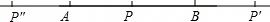

## 15. 单选题（难度：非常简单）

如图，已知线段AB＝10cm，M是AB中点，点N在AB上，NB＝2cm，那么线段MN的长为（　　）

【答案】A

## 16. 单选题（难度：非常简单）

如图，C，D是线段AB上两点．若CB＝4cm，DB＝7cm，且D是AC的中点，则AC的长等于（　　）

- A. 3cm
- B. 6cm
- C. 11cm
- D. 14cm

【答案】B

【解析】解：∵C，D是线段AB上两点，CB＝4cm，DB＝7cm，
∴CD＝DB﹣BC＝7﹣4＝3cm，
∵D是AC的中点，
∴AC＝2CD＝2×3＝6cm．
故选：B．

## 17. 单选题（难度：非常简单）

如图，C为线段AB上一点，D为线段BC的中点，AB＝20，AD＝14，则AC的长为（　　）

【答案】A

## 18. 单选题（难度：非常简单）

已知线段AB＝4，在直线AB上作线段BC，使得BC＝2，若D是线段AC的中点，则线段AD的长为（　　）

- A. 1
- B. 3
- C. 1或3
- D. 2或3

【答案】C

【解析】解：根据题意分两种情况，
①如图1，
∵AB＝4，BC＝2，
∴AC＝AB﹣BC＝2，
∵D是线段AC的中点，
∴AD\( =\frac{1}{2}AC=\frac{1}{2}\times 2=1\)；
②如图2，
∵AB＝4，BC＝2，
∴AC＝AB+BC＝6，
∵D是线段AC的中点，
∴AD\( =\frac{1}{2}AC=\frac{1}{2}\times \)6＝3．
∴线段AD的长为1或3．
故选：C．

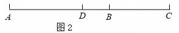

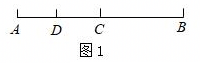

## 19. 单选题（难度：非常简单）

已知线段AB＝5cm，在直线AB上画线段BC＝2cm，则AC的长是（　　）

【答案】A

## 20. 单选题（难度：非常简单）

点A、B、C在同一条数轴上，其中点A、B表示的数分别为﹣3、1，若BC＝2，则AC等于（　　）

【答案】A

## 21. 单选题（难度：非常简单）

如图，C、D是线段AB上的两点，且D是线段AC的中点．若AB＝10cm，BC＝4cm，则AD的长为（　　）

【答案】A

## 22. 单选题（难度：非常简单）

互不重合的A、B、C三点在同一直线上，已知AC＝2a+1，BC＝a+4，AB＝3a，这三点的位置关系是（　　）

【答案】A

## 23. 单选题（难度：非常简单）

不相等的有理数a，b，c在数轴上的对应点分别是A、B、C，如果|a﹣b|+|b﹣c|＝|a﹣c|，那么点B（　　）

【答案】A

## 24. 单选题（难度：非常简单）

已知点C是线段AB上的一点，不能确定点C是AB中点的条件是（　　）

【答案】A

## 25. 单选题（难度：非常简单）

下列说法中，正确的有（　　）
①过两点有且只有一条直线，②连接两点的线段叫做两点的距离，
③两点之间，线段最短，④AB＝BC，则点B是线段AC的中点．

- A. 4个
- B. 3个
- C. 2个
- D. 1个

【答案】C

【解析】解：①过两点有且只有一条直线，故①符合题意；
②连接两点的线段的长度叫做两点的距离，故②不符合题意；
③两点之间，线段最短，故③符合题意；
④AB＝BC，B在线段AC上，则点B是线段AC的中点，故④不符合题意；
故选：C．

## 26. 单选题（难度：非常简单）

已知AB＝21cm，BC＝9cm，A，B，C三点在同一直线上，那么AC等于（　　）

【答案】A

## 27. 单选题（难度：非常简单）

点E在线段CD上，下面的等式：①CE＝DE；②DE\( =\frac{1}{2}\)CD；③CD＝2CE；④CD\( =\frac{1}{2}\)DE．其中能表示E是CD中点的有（　　）

- A. 1个
- B. 2个
- C. 3个
- D. 4个

【答案】C

【解析】解：假设点E是线段CD的中点，则CE＝DE，故①正确；
当DE\( =\frac{1}{2}\)CD时，则CE\( =\frac{1}{2}\)CD，点E是线段CD的中点，故②正确；
当CD＝2CE，则DE＝2CE﹣CE＝CE，点E是线段CD的中点，故③正确；
④CD\( =\frac{1}{2}\)DE，点E不是线段CD的中点，故④不正确；
综上所述：①、②、③正确，只有④是错误的．
故选：C．

## 28. 单选题（难度：非常简单）

如图：A、B、C、D四点在一条直线上，若AB＝CD，下列各式表示线段AC错误的是（　　）

【答案】A

## 29. 单选题（难度：非常简单）

已知：点A，B，C在同一条直线上，点M、N分别是AB、AC的中点，如果AB＝10cm，AC＝8cm，那么线段MN的长度为（　　）

【答案】A

## 30. 单选题（难度：非常简单）

已知线段AB＝10cm，点C在直线AB上，且AC＝2cm，则线段BC的长为（　　）

- A. 12cm
- B. 8cm
- C. 12cm或8cm
- D. 以上均不对

【答案】C

【解析】解：（1）点C在A、B中间时，
BC＝AB﹣AC＝10﹣2＝8（cm）．
（2）点C在点A的左边时，
BC＝AB+AC＝10+2＝12（cm）．
∴线段BC的长为12cm或8cm．
故选：C．

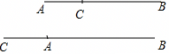

## 31. 单选题（难度：非常简单）

下列说法正确的是（　　）

- A. 直线的一半是射线
- B. 直线上两点间的部分叫做线段
- C. 线段AB的长度就是A，B两点间的距离
- D. 若点P使PA＝AB，则P是AB的中点

【答案】C

【解析】解：A、直线和射线都无限长；
B、直线上两个点和它们之间的部分叫做线段，这两个点叫做线段的端点；
C、线段AB的长度就是A，B两点间的距离；
D、若点P使PA＝AB，且A，B，P在同一条直线上，则A是PB的中点．
故选：C．

## 32. 单选题（难度：非常简单）

如图，C为线段AD上一点，点B为CD的中点，且AD＝9，BD＝2．若点E在直线AD上，且EA＝1，则BE的长为（　　）

【答案】A

## 33. 单选题（难度：非常简单）

平面上A、B两点间的距离是指（　　）

【答案】A

## 34. 单选题（难度：非常简单）

两根木条，一根长20cm，另一根长24cm，将它们一端重合且放在同一条直线上，此时两根木条的中点之间的距离为（　　）

【答案】A

## 35. 单选题（难度：非常简单）

如图，点C，D在线段AB上．则下列表述或结论错误的是（　　）

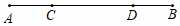

- A. 若AC＝BD，则AD＝BC
- B. AC＝AD+DB﹣BC
- C. AD＝AB+CD﹣BC
- D. 图中共有线段12条

【答案】D

【解析】解：A、若AC＝BD，则AD＝BC，正确，不符合题意；
B、AC＝AD+DB﹣BC，正确，不符合题意；
C、AD＝AB+CD﹣BC，正确，不符合题意；
D、图中共有线段6条，符合题意，
故选：D．

## 36. 单选题（难度：非常简单）

如果线段AB＝6cm，BC＝4cm，且点A、B、C在同一直线上，那么A、C间的距离是（　　）

【答案】A

## 37. 单选题（难度：非常简单）

如图，点C、D是线段AB上的两点，点D是线段AC的中点．若AB＝10cm，BC＝4cm，则线段DB的长等于（　　）

【答案】A

## 38. 单选题（难度：非常简单）

如图，点C是AB的中点，点D是BC的中点，现给出下列等式：①CD＝AC﹣DB，②CD\( =\frac{1}{4}\)AB，③CD＝AD﹣BC，④BD＝2AD﹣AB．其中正确的等式编号是（　　）

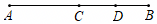

- A. ①②③④
- B. ①②③
- C. ②③④
- D. ②③

【答案】B

【解析】解：①点C是AB的中点，AC＝CB．
②点C是AB的中点，∴\( BC=\frac{1}{2}AB\)，又∵点D是BC的中点，∴CD\( =\frac{1}{4}AB\)．故②正确；
③点C是AB的中点，AC＝CB．
CD＝AD﹣AC＝AD﹣BC，故③正确；
④2AD﹣AB＝2AC+2CD﹣AB＝2CD＝BC，故④错误．
故正确的有①②③．
故选：B．

## 39. 单选题（难度：非常简单）

如图，C、D是线段AB上两点，M、N分别是线段AD，BC的中点，下列结论：①若AD＝BM，则AB＝3BD；②AC＝BD，则AM＝BN；③AC﹣BD＝2（MC﹣DN）；④2MN＝AB﹣CD．其中正确的结论是（　　）

【答案】A

## 40. 单选题（难度：非常简单）

已知点A，B，C在同一条直线上，若线段AB＝3，BC＝2，AC＝1，则下列判断正确的是（　　）

- A. 点A在线段BC上
- B. 点B在线段AC上
- C. 点C在线段AB上
- D. 点A在线段CB的延长线上

【答案】C

【解析】解：如图，∵点A，B，C在同一条直线上，线段AB＝3，BC＝2，AC＝1，
∴点A在线段BC的延长线上，故A错误；
点B在线段AC延长线上，故B错误；
点C在线段AB上，故C正确；
点A在线段CB的反向延长线上，故D错误；
故选：C．

## 41. 单选题（难度：非常简单）

如图，C、D是线段AB上两点，若BC＝3cm，BD＝5cm，且D是AC的中点，则AC的长为（　　）

【答案】A

## 42. 单选题（难度：非常简单）

如图，已知线段AB＝12cm，M是AB中点，点N在AB上，NB＝2cm，那么线段MN的长为（　　）

【答案】A

## 43. 单选题（难度：非常简单）

如图，点M在线段AB上，则下列条件不能确定M是AB中点的是（　　）

【答案】A

## 44. 单选题（难度：非常简单）

如果A、B、C三点在同一直线上，且线段AB＝6cm，BC＝4cm，若M，N分别为AB，BC的中点，那么M，N两点之间的距离为（　　）

- A. 5 cm
- B. 1 cm
- C. 5cm或1cm
- D. 无法确定

【答案】C

【解析】解：如图1，当点B在线段AC上时，
∵AB＝6cm，BC＝4cm，M，N分别为AB，BC的中点，
∴MB\( =\frac{1}{2}\)AB＝3，BN\( =\frac{1}{2}\)BC＝2，
∴MN＝MB+NB＝5cm，
如图2，当点C在线段AB上时，
∵AB＝6cm，BC＝4cm，M，N分别为AB，BC的中点，
∴MB\( =\frac{1}{2}\)AB＝3，BN\( =\frac{1}{2}\)BC＝2，
∴MN＝MB﹣NB＝1cm，
故选：C．

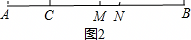

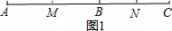

## 45. 单选题（难度：非常简单）

如图，已知点C在线段AB上，点M、N分别是AC、BC的中点，且AB＝8cm，则MN的长度为（　　）cm．

【答案】A

## 46. 单选题（难度：非常简单）

已知线段AB＝8cm，点C是直线AB上一点，BC＝2cm，若M是AB的中点，N是BC的中点，则线段MN的长度为（　　）

- A. 5cm
- B. 5cm或3cm
- C. 7cm或3cm
- D. 7cm

【答案】B

【解析】解：如图1
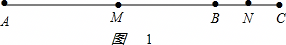
，
由M是AB的中点，N是BC的中点，得
MB\( =\frac{1}{2}\)AB＝4cm，BN\( =\frac{1}{2}\)BC＝1cm，
由线段的和差，得
MN＝MB+BN＝4+1＝5cm；
如图2
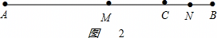
，
由M是AB的中点，N是BC的中点，得
MB\( =\frac{1}{2}\)AB＝4cm，BN\( =\frac{1}{2}\)BC＝1cm，
由线段的和差，得
MN＝MB﹣BN＝4﹣1＝3cm；
故选：B．

## 47. 单选题（难度：非常简单）

如图，点C是线段AB上一点，D为BC的中点，且AB＝12cm，BD＝5cm．若点E在直线AB上，且AE＝3cm，则DE的长为（　　）

【答案】A

## 48. 单选题（难度：非常简单）

线段AB＝10cm，C为直线AB上的点，且BC＝2cm，M、N分别是AC、BC的中点，则MN的长度是（　　）

【答案】A

## 49. 单选题（难度：非常简单）

如图，下列关于图中线段之间的关系一定正确的是（　　）

【答案】A

## 50. 单选题（难度：非常简单）

如图，C，D是线段AB上的两点，M，N分别是线段AC，BD的中点，若AB＝10，CD＝4，则线段MN的长为（　　）

【答案】A
