# 知识点·二元一次方程（同步练习）

> 教材：数学·七年级上册·沪科技版2024新教材 ｜ 来源：国家中小学智慧教育平台·在线练习 ｜ 共 54 题

## 1. 单选题（难度：简单）

下列方程中，是二元一次方程的是（    ）

- A. \({x^2} + x = 4\)
- B. \(\frac{1}{x} + y = 2\)
- C. 
- D. \(x = y - 3\)

【答案】D

【解析】本题考查了二元一次方程的定义：含有两个未知数，并且所含未知数的项的最高次数是1的整式方程，叫二元一次方程．根据二元一次方程的定义逐个判断即可．

## 2. 单选题（难度：非常简单）

下列方程中，属于二元一次方程的是（   ）

- A. \(xy + 1 = - 4\)
- B. 
- C. \(3{x^2} + y = 8\)
- D. \(x + y - 2 = 0\)

【答案】D

【解析】此题考查二元一次方程定义，关键是根据二元一次方程必须符合以下三个条件：（1）方程中只含有2个未知数；（2）含未知数项的最高次数为一次；（3）方程是整式方程．根据二元一次方程的定义，从二元一次方程的未知数的个数和次数方面辨别．

## 3. 单选题（难度：非常简单）

下列方程是二元一次方程的是（    ）

- A. \(x + 2y = 3\)
- B. \({x^2} + y = 1\)
- C. 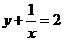
- D. \(2x - 1 = 5\)

【答案】A

【解析】本题考查二元一次方程的定义，含有2个未知数，且含有未知数的项的次数均为1的整式方程叫做二元一次方程，据此进行判断即可，掌握该知识点是解题的关键．

## 4. 单选题（难度：非常简单）

若

是关于x，y的二元一次方程，则m，n的值为（    ）

- A. \(m = 0,n = 2\)
- B. \(m = 0,n = - 2\)
- C. \(m = 2,n = - 2\)
- D. \(m = - 2,n = 1\)

【答案】A

【解析】本题考查二元一次方程的定义，根据二元一次方程的定义得到\(m + 1 = 1,2n - 3 = 1\)，进行求解即可．

## 5. 单选题（难度：非常简单）

下列方程是二元一次方程的是（   ）

- A. 
- B. \(x - 1 = 3\)
- C. \({x^2} + 2y = 8\)
- D. \(x - \frac{1}{y} = 3\)

【答案】A

【解析】本题考查了二元一次方程的定义：含有两个未知数，且含未知数的项的次数为1次的方程；根据二元一次方程的定义进行判断即可．

## 6. 单选题（难度：非常简单）

下列方程中，是二元一次方程的是（   ）

- A. \(x + 5y = 6\)
- B. \(\frac{2}{x} + y = 1\)
- C. \(x + {y^2} = 0\)
- D. 

【答案】A

【解析】本题考查了二元一次方程的定义，满足下列条件的方程组是二元一次方程：①方程组中的方程都是整式方程，②共含有两个未知数，③方程组含有未知数的项的最高次数是1．根据二元一次方程的定义逐个判断即可．

## 7. 单选题（难度：非常简单）

下列方程是二元一次方程的是（   ）

- A. \({x^2} - x + 1 = 0\)
- B. \(x + xy = 1\)
- C. \(x = y - 1\)
- D. 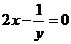

【答案】C

【解析】本题考查了二元一次方程的定义，熟练掌握二元一次方程的定义是解题的关键．
根据二元一次方程的定义判断逐项分析即可，方程的两边都是整式，含有两个未知数，并且未知数的项的次数是

次的方程叫做二元一次方程．

## 8. 单选题（难度：非常简单）

下列方程是二元一次方程的是（   ）

- A. \(x - 1 = 0\)
- B. 
- C. \(\frac{{x - y}}{2} = 0\)
- D. \({x^2} - y = 1\)

【答案】C

【解析】本题主要考查二元一次方程．两边都是整式，含有两个未知数，并且含未知数的项都是一次的方程，叫做二元一次方程．

## 9. 单选题（难度：适中）

若

是关于x，y的二元一次方程，则m的值是（　　）

- A. 1
- B. 任何数
- C. 2
- D. 1或2

【答案】A

【解析】本题考查了二元一次方程的定义，熟练掌握二元一次方程的定义是解题的关键：

、定义：含有两个未知数，并且所含未知数的项的次数都是

的方程叫做二元一次方程．根据二元一次方程的定义可得\(\left| {2m - 3} \right| = 1\)且\(m - 2 \ne 0\)，解方程或不等式即可求出m的值．

## 10. 单选题（难度：非常简单）

下列式子中，是二元一次方程的是（　　）

- A. \(x + y = 1\)
- B. 
- C. 
- D. \(y = 2{x^2}\)

【答案】A

【解析】此题主要考查了二元一次方程的定义，解题的关键是掌握二元一次方程，需满足三个条件：①首先是整式方程．②方程中共含有两个未知数．③所有未知项的次数都是一次．根据二元一次方程组的定义即可求解．

## 11. 单选题（难度：非常简单）

下列方程中，哪个是二元一次方程？（   ）

- A. 
- B. \(2{x^2} - y = 9\)
- C. 
- D. 

【答案】D

【解析】本题主要考查二元一次方程的定义，解题的关键是熟悉二元一次方程的定义：“含有两个未知数，且含未知数的项的次数为1的整式方程叫做二元一次方程”．根据二元一次方程的定义进行判断即可．

## 12. 单选题（难度：非常简单）

下面是关于x，y的二元一次方程的是（   ）

- A. 
- B. \(x + \frac{1}{y} = 2\)
- C. \(2x + y = z\)
- D. 

【答案】A

【解析】本题主要考查了二元一次方程的定义，正确把握相关定义是解题关键．二元一次方程：含有两个未知数，且含未知数的项的最高次数是1， 这样的整式方程是二元一次方程，据此对各个选项逐一判断即可解答．

## 13. 单选题（难度：非常简单）

下列是二元一次方程的是（   ）

- A. 
- B. \(xy + 2x - y = 1\)
- C. 
- D. \(x + \frac{1}{y} = 1\)

【答案】A

【解析】本题考查了二元一次方程的定义，熟练掌握二元一次方程的定义是解题的关键；
根据含有两个未知数，并且所含未知数的项的次数都是1的整式方程叫做二元一次方程，逐项判断即可，

## 14. 单选题（难度：非常简单）

下列各方程中，是二元一次方程的是（   ）

- A. 
- B. 
- C. 
- D. \(3x + 1 = 2xy\)

【答案】B

【解析】本题考查了二元一次方程的定义，二元一次方程的定义是：含有两个未知数，并且含未知数的项的次数都是

的方程．
根据二元一次方程的定义逐项判断即可．

## 15. 单选题（难度：非常简单）

已知方程

是关于x，y的二元一次方程，则m，n的取值范围分别是（   ）

- A. \(m \ne 0,n \ne 0\)
- B. 
- C. \(m \ne 5,n \ne 5\)
- D. \(m \ne 5,n \ne - 5\)

【答案】D

【解析】本题考查二元一次方程的概念，理解含有两个未知数，含未知数的项的次数最高为1的整式方程为二元一次方程是解题关键．
根据二元一次方程的定义进行解答即可．

## 16. 单选题（难度：非常简单）

下列选项是二元一次方程的是（   ）

- A. \(5y - 3x\)
- B. \(3x - 6 = y\)
- C. 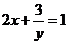
- D. \(3x + 7y = xy\)

【答案】B

【解析】本题考查二元一次方程的定义．根据二元一次方程的定义：含有两个未知数，并且未知数的项的最高次数是1的整式方程叫做二元一次方程，据此逐项判断即可．

## 17. 单选题（难度：非常简单）

下列是二元一次方程的是(   )

- A. \({x^2} + y = 0\)
- B. \(\frac{{x + y}}{3} - 2y = 0\)
- C. \(y = \frac{1}{x} + 2\)
- D. \(y + \frac{1}{2}x\)

【答案】B

【解析】本题考查二元一次方程的判定，根据二元一次方程的定义：含有两个未知数的方程并且所含数的最高次数为1，这样的整式方程叫做二元一次方程，再对各选项进行逐一判定即可求得．

## 18. 单选题（难度：非常简单）

下列选项是二元一次方程的是（   ）

- A. 
- B. 
- C. 
- D. 

【答案】D

【解析】本题考查了二元一次方程的定义，熟练掌握二元一次方程组的定义是解答本题的关键．根据二元一次方程组的定义判断逐项分析即可，方程的两边都是整式，含有两个未知数，并且未知数的项的次数都是1次的方程叫做二元一次方程．

## 19. 单选题（难度：非常简单）

下列各式中，为二元一次方程的是（      ）

- A. \(4x + 3y - 9 = 0\)
- B. 
- C. 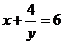
- D. 

【答案】A

【解析】本题考查二元一次方程的定义，根据含有2个未知数，且含有未知数的项的次数为1的整式方程，叫做二元一次方程，进行判断即可．

## 20. 单选题（难度：非常简单）

下列各式中属于二元一次方程的有（   ）
①\(x - 2y = 1\)；②
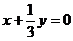
；③

；④

；⑤\(5x - 3y\)；⑥\(\frac{1}{x} - \frac{1}{y} = 0\)；⑦
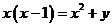

- A. 2个
- B. 3个
- C. 4个
- D. 5个

【答案】C

【解析】此题考查了二元一次方程的定义，二元一次方程的形式及其特点：含有2个未知数，未知数的最高次项的次数是1的整式方程．根据二元一次方程的定义判断即可．

## 21. 单选题（难度：非常简单）

下列方程中属于二元一次方程的是（   ）

- A. \(x + \frac{2}{y} = - 4\)
- B. \(3{x^2} + y = 8\)
- C. \(x + y - 2 = 0\)
- D. 

【答案】C

【解析】此题考查二元一次方程定义，二元一次方程必须符合以下三个条件：（1）方程中只含有2个未知数；（2）含未知数项的最高次数为一次；（3）方程是整式方程．根据二元一次方程的定义即可判断．

## 22. 单选题（难度：非常简单）

下列方程：①\(x + y = 1\)；②\(2x - \frac{2}{y} = 1\)；③\({x^2} + 2x = - 1\)；④

；⑤\(x - \frac{1}{3}y = 2\)，是二元一次方程的是（   ）

- A. ①⑤
- B. ①②
- C. ①④
- D. ①②④

【答案】A

【解析】本题考查了二元一次方程，含有两个未知数，且两个未知数的次数都为

的整式方程叫二元一次方程，据此逐一判断即可求解，掌握二元一次方程的定义是解题的关键．

## 23. 单选题（难度：非常简单）

下列方程中，是二元一次方程的是 （      ）

- A. \(2x + 3y = 5\)
- B. 
- C. 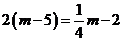
- D. \(1 - \frac{2}{{3m}} = n\)

【答案】A

【解析】本题考查了二元一次方程的定义，二元一次方程是含有

两个未知数，含有未知数的项的次数为

的整式方程，解决本题的关键是根据二元一次方程的定义进行判断即可．

## 24. 单选题（难度：非常简单）

将方程\(2x - y = 16\)改写成用含x的代数式表示y的形式正确的是（    ）

- A. \(y = \frac{x}{2} - 8\)
- B. \(y = 16 - 2x\)
- C. \(x = 16 + 2y\)
- D. \(y = 2x - 16\)

【答案】D

【解析】本题主要考查了二元一次方程，
先移项，再两边都除以

，可得用含x的代数式表示y的形式即可．

## 25. 单选题（难度：非常简单）

下列是二元一次方程的是（   ）

- A. \(x + 2y = 3\)
- B. \({x^2} + y = 1\)
- C. 
- D. \(2xy - 1 = 5\)

【答案】A

【解析】本题考查二元一次方程的定义，含有2个未知数，且含有未知数的项的次数均为1的整式方程叫做二元一次方程，据此进行判断即可．

## 26. 单选题（难度：非常简单）

下列是二元一次方程的是（    ）

- A. \(x + 2y = 3\)
- B. 
- C. \(x + \frac{1}{y} = 2\)
- D. \(2x - 1 = 3\)

【答案】A

【解析】本题主要考查了二元一次方程的定义，掌握二元一次方程的定义是解题的关键．根据二元一次方程的定义“含有两个未知数，并且含有未知数的项的次数都是1的整式方程叫做二元一次方程”，即可解答．

## 27. 单选题（难度：非常简单）

下列是二元一次方程的是（    ）

- A. 
- B. \({x^2} + y = 1\)
- C. \(x + 2y = 3\)
- D. \(2x - 1 = 5\)

【答案】C

【解析】本题考查了二元一次方程的定义，二元一次方程需满足三个条件：①首先是整式方程．②方程中共含有两个未知数．③所有未知项的次数都是一次．不符合上述任何一个条件的都不叫二元一次方程．根据二元一次方程的定义逐个判断即可．

## 28. 单选题（难度：非常简单）

下列方程中，是二元一次方程的是（    ）

- A. \(x + y + z = 0\)
- B. \({x^2} + y = 0\)
- C. \(x + y = 0\)
- D. 

【答案】C

【解析】本题主要考查了二元一次方程组的定义，根据二元一次方程的定义：一个含有两个未知数，并且未知数的都指数是1的整式方程，叫二元一次方程，即可进行解答．

## 29. 单选题（难度：非常简单）

下列方程中，属于二元一次方程的是（    ）

- A. \(x + xy = 6\)
- B. 
- C. \(x + \frac{1}{x} = 2\)
- D. \(x - 2y\)

【答案】B

【解析】本题考查二元一次方程，根据二元一次方程的定义判断即可．

## 30. 单选题（难度：非常简单）

下列各式是二元一次方程的是（   ）

- A. \(2x - 4 = x\)
- B. \(x + \frac{1}{y} = 1\)
- C. 
- D. 

【答案】C

【解析】本题考查的是二元一次方程的概念，关键是熟记二元一次方程要含有两个未知数，且未知数的次数为1的整式方程．根据二元一次方程的定义即可判断．

## 31. 单选题（难度：非常简单）

下列算式中，是二元一次方程的是（   ）

- A. \(x + 17 = y\)
- B. 
- C. 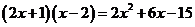
- D. 

【答案】A

【解析】本题主要考查了二元一次方程的定义，解题的关键是熟练掌握二元一次方程的定义含有两个未知数，未知数的最高次数为1的整式方程是二元一次方程．根据二元一次方程的定义：含有两个未知数，未知数的最高次数为1的整式方程是二元一次方程；即可进行解答．

## 32. 单选题（难度：适中）

小江去商店购买签字笔和笔记本（签字笔的单价相同，笔记本的单价相同）．若购买20支签字笔和15本笔记本，则他身上的钱会不足，差25元；若购买19支签字笔和13本笔记本，则他身上的钱会剩下15元．若小江购买 17 支签字笔和9本笔记本，则（   ）

- A. 他身上的钱会不足，差 95 元
- B. 他身上的钱会剩下 95 元
- C. 他身上的钱会不足，差 105 元
- D. 他身上的钱会剩下 105元

【答案】B

【解析】本题考查二元一次方程的应用，设签字笔的单价为x 元，笔记本的单价为 y 元，根据题意，得到

，进而得到\(x + 2y = 40\)，根据小江购买 17 支签字笔和9本笔记本的钱为\(\left( {17x + 9y} \right)\)元，进而得到剩余的费用为
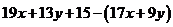
，整体代入法，求值即可．

## 33. 单选题（难度：适中）

若
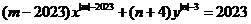
是关于x，y的二元一次方程，则（   ）

- A. \(m = \pm 2024\)，

- B. \(m = - 2024\)，

- C. \(m = \pm 2024\)，

- D. \(m = - 2024\)，

【答案】C

【解析】此题主要考查了二元一次方程的定义，关键是掌握二元一次方程需满足三个条件：①首先是整式方程．②方程中共含有两个未知数．③所有未知项的次数都是一次．不符合上述任何一个条件的都不叫二元一次方程．根据二元一次方程的定义解答即可．

## 34. 单选题（难度：适中）

若方程\(ax - 2y = 1 - x\)是关于

，

的二元一次方程，则

的取值范围为（   ）

- A. 
- B. 
- C. 
- D. 

【答案】B

【解析】本题考查二元一次方程的定义：含有两个未知数且未知数的次数是1的整式方程，根据二元一次方程的定义即可求出答案．

## 35. 单选题（难度：非常简单）

下列方程：

\(3x + \frac{1}{3} = 8\)；

；\(③3x + \frac{3}{y} = 1\)；

\({x^2} = 5y + 1\)；

．其中是二元一次方程的有（    ）

- A. 
个
- B. 
个
- C. 
个
- D. 
个

【答案】B

【解析】本题考查二元一次方程的定义，熟练掌握二元一次方程的定义是解答本题的关键．
根据二元一次方程的定义逐个判断即可．

## 36. 单选题（难度：非常简单）

已知方程

，下列变形正确的是（  ）

- A. 
- B. 
- C. 
- D. \(y = 1 + x\)

【答案】D

【解析】此题主要考查了解二元一次方程，熟练掌握解二元一次方程组时，用一个未知数的代数式表示另一个未知数是解决问题的关键．
对于方程

，用含

的代数式表示

，得\(x = y - 1\)，由此可对选项A，B进行判断；用含

的代数式表示

，得\(y = 1 + x\)，由此可对选项C、D进行判断，综上所述即可得出答案．

## 37. 单选题（难度：适中）

若
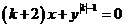
是关于

的二元一次方程，则

（　　）

- A. 1
- B. 
- C. 2
- D. 

【答案】C

【解析】本题考查二元一次方程，根据二元一次方程的定义，得到\(\left| k \right| - 1 = 1\)且

，进行求解即可．

## 38. 单选题（难度：适中）

足球联赛积分规则如下：每胜一场得

分，平一场得

分，负一场得

分．第

轮后（即每队均比了

场），甲球队的积分为

分，若设甲队胜了

场，负了

场，则

与

应满足的关系是（    ）

- A. \(x + y = 19\)
- B. \(2x - y = 5\)
- C. \(y - x = 3\)
- D. \(3x + y = 25\)

【答案】B

【解析】本题考查由实际问题抽象出二元一次方程，解题的关键是明确题意，找出等量关系，列出方程．设甲队胜了

场，负了

场，则平了\(\left( {20 - x - y} \right)\)场，根据题意列出方程求解即可．

## 39. 单选题（难度：适中）

若​​​\({x}^\left | {a-1} \right |-(a-2)y+3=2\)​是关于​​​\(x\)​，\(y\)​的二元一次方程，则​​​\(a\)​的值为（    ）

- A. \(\pm 2\)​
- B. 2
- C. 0
- D. ​​​\(-2\)​

【答案】D

【解析】此题主要考查了二元一次方程的定义，关键是掌握二元一次方程需满足三个条件：①首先是整式方程．②方程中共含有两个未知数．③所有未知项的次数都是一次．不符合上述任何一个条件的都不叫二元一次方程．
根据二元一次方程的定义：含有两个未知数，并且含有未知数的项的次数都是1，像这样的整式方程叫做二元一次方程可得
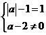
，然后求解即可．

## 40. 单选题（难度：非常简单）

下列方程中，是二元一次方程的是（    ）

【答案】A

## 41. 单选题（难度：适中）

已知二元一次方程

，则用关于x的代数式表示y正确的是（    ）

- A. \(2x = 10 + y\)
- B. \(x = \frac{{10 + y}}{2}\)
- C. \(y = 2x - 10\)
- D. \(y = 2x + 10\)

【答案】C

【解析】本题考查二元一次方程的定义，通过移项求解即可．

## 42. 单选题（难度：适中）

下列方程中是二元一次方程的是（    ）

- A. \(3xy - 2 = 0\)
- B. \(x-3y=2\)​
- C. \(\frac{1}{x} + 2y = 1\)
- D. \(x² - 5x = 0\)

【答案】B

【解析】本题考查的是二元一次方程的定义，含有两个未知数，并且含有未知数的项的次数都是1，根据二元一次方程的定义对各选项进行逐一分析即可．

## 43. 单选题（难度：非常简单）

下列方程中是二元一次方程的为（    ）

- A. \(x + \frac{y}{3} = 1\)
- B. 
- C. \(2{x^2} - 1 = 0\)
- D. \(2x + \frac{2}{y} = 1\)

【答案】A

## 44. 单选题（难度：非常简单）

下列方程中，是二元一次方程的是（    ）

- A. \(\frac{1}{x} + \frac{2}{x} = 1\)
- B. \(2x - 1 = 0\)
- C. 
- D. 

【答案】C

【解析】根据二元一次方程的定义依次判断即可．
本题主要考查了二元一次方程的定义：含有两个未知数，并且所含未知数的项的次数都是1的方程叫做二元一次方程．熟练掌握二元一次方程的定义是解题的关键．

## 45. 单选题（难度：非常简单）

方程​\(x-{y}^{(m-3)}=1\)​是关于x，​y的二元一次方程，则​m值为（    ）

- A. -2
- B. 4
- C. 2
- D. 4或2

【答案】B

【解析】根据二元一次方程的定义计算即可．本题考查了二元一次方程的定义，掌握二元一次方程的定义是解题的关键，含有两个未知数，并且含有未知数的项的次数都是1，像这样的方程叫做二元一次方程，注意

前面的系数不等于0．

## 46. 单选题（难度：简单）

下列方程不是二元一次方程的是（   ）

- A. \(x+y=10\)​
- B. \(2x + y = 16\)
- C. \(6x - 2y = 10\)
- D. ​​​\(xy=8\)​

【答案】D

【解析】本题主要考查二元一次方程，解题关键是掌握二元一次方程需满足三个条件：首先是整式方程，其次方程中共含有两个未知数，最后所有未知项的次数都是一次，不符合上述任何一个条件的都不叫二元一次方程．

## 47. 单选题（难度：简单）

下列方程中是二元一次方程的是（   ）

- A. \( xy=9\)
- B. \( 3x+2y=19\)
- C. \( x-2y=z\)  ​​
- D. \( \frac{2y}{x}+x=y\)

【答案】B

【解析】根据二元一次方程满足的条件：只含有2个未知数，最高次项的次数是1的整式方程，直接进行判断．

## 48. 单选题（难度：简单）

下列方程中，是二元一次方程的是（    ）

- A. \( x-3=6\)
- B. \( 2x-1=y\)
- C. \( x+2y+3z=4\)
- D. \( xy=1\)

【答案】B

【解析】二元一次方程满足的条件：含有2个未知数，未知数的项的次数是1的整式方程．

## 49. 单选题（难度：简单）

下列是二元一次方程的是（    ）

- A. 3x﹣5＝x
- B. 2x﹣5y＝x²
- C. 2x＋\( \frac{2}{y}=1\)
- D. 2x＝3y

【答案】D

【解析】根据二元一次方程的定义：含有两个未知数，且未知数的次数是1的等式；直接判断即可．

## 50. 单选题（难度：简单）

下列各方程是二元一次方程的是（    ）

- A. \( 3x-6=x\)
- B. \( 3x=2y\)
- C. \( x-\frac{1}{y}=0\)
- D. \( 2xy=5\)

【答案】B

【解析】根据二元一次方程的定义，从二元一次方程的未知数的个数和次数方面辨别．

## 51. 单选题（难度：简单）

在下列方程中，是二元一次方程的只有（    ）

- A. \( x+\frac{y}{3}=0\)
- B. \( 2x-4=0\)
- C. \( x-\frac{1}{y}=0\)  
D．\( {x}^{2}-2x-3=0\)

【答案】A

【解析】根据二元一次方程的定义：含有两个未知数，并且含有未知数的项的次数都是1，可得答案．

## 52. 单选题（难度：简单）

下列各式中是二元一次方程的是（　　）

- A. 2x＝y
- B. xy+5＝4
- C. y+2＝3y
- D. x²+y＝2

【答案】A

【解析】根据二元一次方程的定义逐个判断即可．

## 53. 单选题（难度：简单）

下列是二元一次方程的是（    ）

- A. \( 3x=10\)
- B. \( 2{x}^{2}=y\)
- C. \( y+\frac{1}{x}=2\)
- D. \( x+8y=0\)

【答案】D

【解析】根据二元一次方程的形式及其特点：含有2个未知数，未知数的项的次数是1的整式方程解答即可．

## 54. 单选题（难度：简单）

若（a﹣1）x|a|-1＋3y＝1是关于x、y的二元一次方程，则a＝（    ）

- A. 1
- B. 2
- C. ﹣2
- D. 2和﹣2

【答案】D

【解析】利用二元一次方程定义可得答案．
