# 知识点·二元一次方程组的解（同步练习）

> 教材：数学·七年级上册·沪科技版2024新教材 ｜ 来源：国家中小学智慧教育平台·在线练习 ｜ 共 39 题

## 1. 单选题（难度：简单）

已知方程组
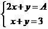
的解为\(\left\{ {\begin{array}{*{20}{c}}
 {x = 2} \\ 
 {y = B} 
\end{array}} \right.\)，则A，B的值分别为（   ）

- A. 2，3
- B. 1，3
- C. 5，1
- D. 2，4

【答案】C

【解析】解：∵方程组

的解为\(\left\{ {\begin{array}{*{20}{l}}
 {x = 2} \\ 
 {y = B} 
\end{array}} \right.\)，
∴\(2 + y = 3\)，解得：

，
∴

，
把\(\begin{cases}
 x = 2 \\
 y = 1 \\ 
\end{cases}\)代入①得：\(4 + 1 = 5 = A\)，
故选：C．

## 2. 单选题（难度：简单）

已知\(\left\{ {\begin{array}{*{20}{l}}
 {x = 1} \\ 
 {y = 2} 
\end{array}} \right.\)是二元一次方程\(3x - ay = 1\)的一个解，则

的值为（   ）

- A. 
- B. 1
- C. 
- D. 2

【答案】B

【解析】解：把\(\left\{ {\begin{array}{*{20}{c}}
 {x = 1} \\ 
 {y = 2} 
\end{array}} \right.\)代入方程\(3x - ay = 1\)，得

，
解得

．
故选：B．

## 3. 单选题（难度：简单）

若关于x，y的方程\(ax - 3y = 2\)有一组解是

，则a的值是（    ）．

- A. 
- B. 8
- C. 
- D. 2

【答案】A

【解析】解：把

代入方程\(ax - 3y = 2\)得，
\( - a - 3 \times 2 = 2\)，
解得：

，
故选：A．

## 4. 单选题（难度：简单）

已知\(\left\{ {\begin{array}{*{20}{l}}
 {x = 2} \\ 
 {y = 1} 
\end{array}} \right.\)是方程\(2x - ay = 3\)的一个解，那么

的值是（   ）

- A. 
- B. 
- C. 1
- D. 3

【答案】C

【解析】解：把\(\left\{ {\begin{array}{*{20}{l}}
 {x = 2} \\ 
 {y = 1} 
\end{array}} \right.\)代入方程\(2x - ay = 3\)得：\(4 - a = 3\)，
解得：

，
故选：C．

## 5. 单选题（难度：简单）

是方程\(x + 3y = 14\)的解的是（    ）

- A. \(\left\{ {\begin{array}{*{20}{l}}
 {x = 2} \\ 
 {y = 4} 
\end{array}} \right.\)
- B. \(\left\{ {\begin{array}{*{20}{l}}
 {x = 3} \\ 
 {y = 4} 
\end{array}} \right.\)
- C. \(\left\{ {\begin{array}{*{20}{l}}
 {x = 5} \\ 
 {y = 2} 
\end{array}} \right.\)
- D. \(\left\{ {\begin{array}{*{20}{l}}
 {x = 5} \\ 
 {y = 4} 
\end{array}} \right.\)

【答案】A

【解析】A，将\(\left\{ {\begin{array}{*{20}{l}}
 {x = 2} \\ 
 {y = 4} 
\end{array}} \right.\)代入方程\(x + 3y = 14\)中，得\(2 + 3 \times 4 = 14\)，是方程的解，故符合题意；
B，将\(\left\{ {\begin{array}{*{20}{l}}
 {x = 3} \\ 
 {y = 4} 
\end{array}} \right.\)代入方程\(x + 3y = 14\)中，得\(3 + 3 \times 4 = 15 \ne 14\)，不是方程的解，故不符合题意；
C，将\(\left\{ {\begin{array}{*{20}{l}}
 {x = 5} \\ 
 {y = 2} 
\end{array}} \right.\)代入方程\(x + 3y = 14\)中，得\(5 + 3 \times 2 = 11 \ne 14\)，不是方程的解，故不符合题意；
D，将\(\left\{ {\begin{array}{*{20}{l}}
 {x = 5} \\ 
 {y = 4} 
\end{array}} \right.\)代入方程\(x + 3y = 14\)中，得\(5 + 3 \times 4 = 17 \ne 14\)，不是方程的解，故不符合题意；
故选：A．

## 6. 单选题（难度：简单）

下列方程组中，解为\(\left\{ {\begin{array}{*{20}{l}}
 {x = 1} \\ 
 {y = 2} 
\end{array}} \right.\)的是（    ）

- A. 
- B. 
- C. 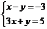
- D. 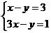

【答案】B

【解析】解：A、\(\left\{ {\begin{array}{*{20}{l}}
 {x = 1} \\ 
 {y = 2} 
\end{array}} \right.\)不是方程组\(x - y = 3\)的解，故该选项不符合题意；
B、\(\left\{ {\begin{array}{*{20}{l}}
 {x = 1} \\ 
 {y = 2} 
\end{array}} \right.\)是方程组

的解，故该选项符合题意；
C、\(\left\{ {\begin{array}{*{20}{l}}
 {x = 1} \\ 
 {y = 2} 
\end{array}} \right.\)不是方程\(x - y = - 3\)的解，故该选项不符合题意；
D、\(\left\{ {\begin{array}{*{20}{l}}
 {x = 1} \\ 
 {y = 2} 
\end{array}} \right.\)不是方程

的解，故该选项不符合题意．
故选：B．

## 7. 单选题（难度：简单）

已知$\left\{ {\begin{array}{*{20}{l}} {x = 1} \\ {y = 2} \end{array}} \right.$是方程$3x - my = 1$的一个解，则的值为（   ）

【答案】A

## 8. 单选题（难度：简单）

若方程

有两个解

和
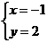
，则

的值为（   ）

- A. 4
- B. 5
- C. 6
- D. 7

【答案】C

【解析】解：由题意可得：
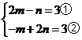
，

，得

，
故选：C．

## 9. 单选题（难度：简单）

下列4组数值中，二元一次方程\(x + 2y = 5\)的解是（    ）

- A. \(\left\{ {\begin{array}{*{20}{l}}
 {x = 2} \\ 
 {y = 1} 
\end{array}} \right.\)
- B. \(\left\{ {\begin{array}{*{20}{l}}
 {x = 1} \\ 
 {y = 1} 
\end{array}} \right.\)
- C. \(\left\{ {\begin{array}{*{20}{l}}
 {x = 1} \\ 
 {y = 2} 
\end{array}} \right.\)
- D. \(\left\{ {\begin{array}{*{20}{l}}
 {x = 2} \\ 
 {y = 2} 
\end{array}} \right.\)

【答案】C

【解析】A选项：将\(\left\{ {\begin{array}{*{20}{l}}
 {x = 2} \\ 
 {y = 1} 
\end{array}} \right.\)代入方程，左边\( = 2 + 2 \times 1 = 4 \ne \)右边，所以\(\left\{ {\begin{array}{*{20}{l}}
 {x = 2} \\ 
 {y = 1} 
\end{array}} \right.\)不是方程的解；
B选项：将\(\left\{ {\begin{array}{*{20}{l}}
 {x = 1} \\ 
 {y = 1} 
\end{array}} \right.\)代入方程，左边\( = 1 + 2 \times 1 = 3 \ne \)右边，所以\(\left\{ {\begin{array}{*{20}{l}}
 {x = 1} \\ 
 {y = 1} 
\end{array}} \right.\)不是方程的解；
C选项：将\(\left\{ {\begin{array}{*{20}{l}}
 {x = 1} \\ 
 {y = 2} 
\end{array}} \right.\)代入方程，左边\( = 1 + 2 \times 2 = 5 = \)右边，所以\(\left\{ {\begin{array}{*{20}{l}}
 {x = 1} \\ 
 {y = 2} 
\end{array}} \right.\)是方程的解；
D选项：将\(\left\{ {\begin{array}{*{20}{l}}
 {x = 2} \\ 
 {y = 2} 
\end{array}} \right.\)代入方程，左边\( = 2 + 2 \times 2 = 6 \ne \)右边，所以\(\left\{ {\begin{array}{*{20}{l}}
 {x = 2} \\ 
 {y = 2} 
\end{array}} \right.\)不是方程的解．
故选：C

## 10. 单选题（难度：简单）

下列方程组中，以\(\left\{ {\begin{array}{*{20}{l}}
 {x = 1} \\ 
 {y = 2} 
\end{array}} \right.\)为解的是（    ）

- A. 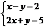
- B. 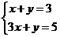
- C. 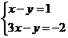
- D. 

【答案】B

【解析】略

## 11. 单选题（难度：简单）

已知一个二元一次方程组的解是

，则这个方程组是（　　）

- A. 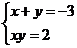
- B. 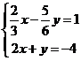
- C. 
- D. 

【答案】B

【解析】解：把

代入方程组
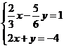
，
可知满足方程组中的每一个方程，
故是此方程组的解，
故选：B．

## 12. 单选题（难度：简单）

方程组
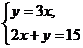
的解为（    ）

- A. 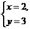
- B. 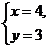
- C. 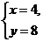
- D. 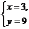

【答案】D

【解析】略

## 13. 单选题（难度：简单）

下列四组数中，不是二元一次方程

的解的是（    ）

- A. \(\left\{ {\begin{array}{*{20}{l}}
 {x = 1} \\ 
 {y = 2} 
\end{array}} \right.\)
- B. \(\left\{ {\begin{array}{*{20}{l}}
 {x = 2} \\ 
 {y = 0} 
\end{array}} \right.\)
- C. 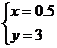
- D. 

【答案】D

【解析】A、把\(x = 1,y = 2\)代入方程，左边\( = 2 + 2 = \)右边，所以是方程的解，不符合题意；
B、把\(x = 2,y = 0\)代入方程，左边＝右边

，所以是方程的解，不符合题意；
C、把\(x = 0.5,y = 3\)代入方程，左边\( = 4 = \)右边，所以是方程的解，不符合题意；
D、把\(x = - 1,y = 4\)代入方程，左边

右边，所以不是方程的解，符合题意．
故选：D．

## 14. 单选题（难度：简单）

下列各组数中，是二元一次方程组
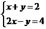
的解的是（    ）

- A. \(\left\{ {\begin{array}{*{20}{l}}
 {x = 0} \\ 
 {y = 1} 
\end{array}} \right.\)
- B. \(\left\{ {\begin{array}{*{20}{l}}
 {x = 2} \\ 
 {y = 0} 
\end{array}} \right.\)
- C. 
- D. \(\left\{ {\begin{array}{*{20}{l}}
 {x = 1} \\ 
 {y = 1} 
\end{array}} \right.\)

【答案】B

【解析】解：
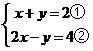
，
①+②得：

，即

，
把

代入①得：

，
则方程组的解为\(\left\{ {\begin{array}{*{20}{c}}
 {x = 2} \\ 
 {y = 0} 
\end{array}} \right.\)，
故答案选B．

## 15. 单选题（难度：简单）

下列方程组中，解为\(\left\{ {\begin{array}{*{20}{l}}
 {x = 8} \\ 
 {y = 2} 
\end{array}} \right.\)的方程组是（    ）

- A. 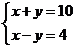
- B. 
- C. 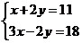
- D. 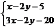

【答案】B

【解析】解：A、把\(\left\{ {\begin{array}{*{20}{l}}
 {x = 8} \\ 
 {y = 2} 
\end{array}} \right.\)代入方程

，左边

，故不是方程组的解，故选项错误；
B、把\(\left\{ {\begin{array}{*{20}{l}}
 {x = 8} \\ 
 {y = 2} 
\end{array}} \right.\)满足
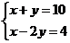
中的两个方程，故是方程组的解，故选项正确；
C、把\(\left\{ {\begin{array}{*{20}{l}}
 {x = 8} \\ 
 {y = 2} 
\end{array}} \right.\)代入方程\(x + 2y = 11\)，左边\( = 12 \ne 11\)，故不是方程组的解，故选项错误；
D、把\(\left\{ {\begin{array}{*{20}{l}}
 {x = 8} \\ 
 {y = 2} 
\end{array}} \right.\)代入方程

，左边

，故不是方程组的解，故选项错误．
故选B．

## 16. 单选题（难度：简单）

已知关于

，

的二元一次方程组
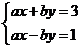
的解为

，则\(a - 2b\)的值是（    ）

- A. 1
- B. 2
- C. 3
- D. 4

【答案】D

【解析】解：把

代入

，得：
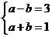
，
解得：
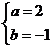
，
∴

；
故选D．

## 17. 单选题（难度：简单）

方程组
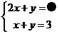
的解为\(\left\{ {\begin{array}{*{20}{l}}
 {x = 2} \\ 
 {y = \blacktriangle } 
\end{array}} \right.\)，则被●和▲遮盖的两个数分别为（    ）

- A. 5，1
- B. 1，3
- C. 2，3
- D. 2，4

【答案】A

【解析】解：由题意得：
把

代入

，得：

，
∴得到\(2x + y = 2 \times 2 + 1 = 5\)；
∴被●和▲遮盖的两个数分别为5，1．
故选：A．

## 18. 单选题（难度：简单）

方程组
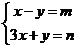
的解是\(\left\{ {\begin{array}{*{20}{c}}
 {x = 1} \\ 
 {y = 3} 
\end{array}} \right.\)，则方程组
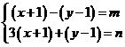
的解是（　　）

- A. \(\left\{ {\begin{array}{*{20}{c}}
 {x = 0} \\ 
 {y = 4} 
\end{array}} \right.\)
- B. \(\left\{ {\begin{array}{*{20}{c}}
 {x = 2} \\ 
 {y = 2} 
\end{array}} \right.\)
- C. 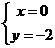
- D. \(\left\{ {\begin{array}{*{20}{c}}
 {x = 3} \\ 
 {y = 1} 
\end{array}} \right.\)

【答案】A

【解析】解：由题意，得
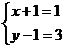
，解得\(\left\{ {\begin{array}{*{20}{l}}
 {x = 0} \\ 
 {y = 4} 
\end{array}} \right.\)，
故选：A
【点睛】本题考查二元一次方程组解的定义；运用整体的思想是解题的关键．

## 19. 单选题（难度：简单）

已知二元一次方程组

的解为\(\left\{ {\begin{array}{*{20}{l}}
 {x = 1} \\ 
 {y = 5} 
\end{array}} \right.\)，则\(10b - 5 + 2a\)的值为（    ）

- A. 
- B. 
- C. 
- D. 

【答案】C

【解析】解：将\(\left\{ {\begin{array}{*{20}{l}}
 {x = 1} \\ 
 {y = 5} 
\end{array}} \right.\)代入
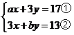
中，得：
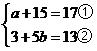

根据\(a + 15 = 17\)，解得

根据\(3 + 5b = 13\)，解得：

故选：C．

## 20. 单选题（难度：简单）

如果$\left\{ {\begin{array}{*{20}{l}} {x = 2} \\ {y = 1} \end{array}} \right.$是方程组的解，则的值是（    ）．

【答案】A

## 21. 单选题（难度：适中）

下表是一次函数 \(y = {k_1}x + b\)和\(y = {k_2}x\)的图象上一部分点的坐标：
x
…
0
1
2
3
 

\(y = {k_1}x + b\)
…

2
5
 

x
…

1
2
3
 

\(y = {k_2}x\)
…
4

 

则方程组  

的解为（   ）

- A. \(\left\{ {\begin{array}{*{20}{c}}
 {x = 0} \\ 
 {y = 4} 
\end{array}} \right.\)
- B. 
- C. 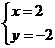
- D. 

【答案】B

【解析】解：从表格中可以看出：
\(\begin{cases}
 x = 1 \\
 y = - 1 \\ 
\end{cases}\)是二元一次方程组的两个方程的公共解，因此它也是二元一次方程组的解，
故选：

．

## 22. 单选题（难度：适中）

若关于

、

的方程组
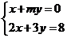
的解为\(\left\{ {\begin{array}{*{20}{c}}
 {x = 1} \\ 
 {y = █} 
\end{array}} \right.\)，其中

的值被盖住了，不过仍能求出

，则

的值为（   ）

- A. 
- B. 
- C. \( - \frac{1}{4}\)
- D. \(\frac{1}{4}\)

【答案】A

【解析】解：把

代入\(2x + 3y = 8\)得：\(2 + 3y = 8\)，
解得：

，
把

，

代入\(x + my = 0\)得：\(1 + 2m = 0\)，
解得：

，
故选：A．

## 23. 单选题（难度：简单）

已知

，\(\left\{ {\begin{array}{*{20}{l}}
 {x = 1} \\ 
 {y = 2} 
\end{array}} \right.\)，\(\left\{ {\begin{array}{*{20}{l}}
 {x = 3} \\ 
 {y = 1} 
\end{array}} \right.\)是二元一次方程\(x + 2y = 5\)的三个解，

，\(\left\{ {\begin{array}{*{20}{l}}
 {x = 1} \\ 
 {y = 2} 
\end{array}} \right.\)，\(\left\{ {\begin{array}{*{20}{l}}
 {x = 3} \\ 
 {y = 6} 
\end{array}} \right.\)是二元一次方程

的三个解，则二元一次方程组
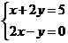
的解是（    ）

- A. 
- B. 
- C. \(\left\{ {\begin{array}{*{20}{l}}
 {x = 3} \\ 
 {y = 6} 
\end{array}} \right.\)
- D. \(\left\{ {\begin{array}{*{20}{l}}
 {x = 1} \\ 
 {y = 2} 
\end{array}} \right.\)

【答案】D

【解析】解：

 

，\(\left\{ {\begin{array}{*{20}{l}}
 {x = 1} \\ 
 {y = 2} 
\end{array}} \right.\)，\(\left\{ {\begin{array}{*{20}{l}}
 {x = 3} \\ 
 {y = 1} 
\end{array}} \right.\)满足方程\(x + 2y = 5\)，

，\(\left\{ {\begin{array}{*{20}{l}}
 {x = 1} \\ 
 {y = 2} 
\end{array}} \right.\)，\(\left\{ {\begin{array}{*{20}{l}}
 {x = 3} \\ 
 {y = 6} 
\end{array}} \right.\)满足方程

，其中\(\left\{ {\begin{array}{*{20}{l}}
 {x = 1} \\ 
 {y = 2} 
\end{array}} \right.\)同时满足\(x + 2y = 5\)和

，

 二元一次方程组

的解是\(\left\{ {\begin{array}{*{20}{l}}
 {x = 1} \\ 
 {y = 2} 
\end{array}} \right.\)．
故选：D．

## 24. 单选题（难度：简单）

解是

的方程组可能是（    ）

- A. 
- B. 
- C. 
- D. 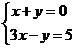

【答案】B

【解析】解：A、把

代入方程组得：
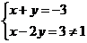
，不符合题意；
B、把

代入方程组得：

，符合题意；
C、把

代入方程组得：
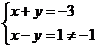
，不符合题意；
D、把

代入方程组得：
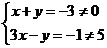
，不符合题意；
故选：B．

## 25. 单选题（难度：简单）

方程组
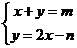
的解为\(\left\{ {\begin{array}{*{20}{l}}
 {x = 4} \\ 
 {y = 5} 
\end{array}} \right.\)，则m、n的值分别为（    ）

- A. 4、5
- B. 9、3
- C. 9、-3
- D. 
、5

【答案】B

【解析】解：把\(\left\{ {\begin{array}{*{20}{l}}
 {x = 4} \\ 
 {y = 5} 
\end{array}} \right.\)代入方程组

，
可得：
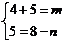
，
解得：

，

，
故选：B．

## 26. 单选题（难度：简单）

如果方程组

的解为\(\left\{ {\begin{array}{*{20}{l}}
 {x = 6} \\ 
 {y = \square } 
\end{array}} \right.\)，那么被“

”遮住的数是（    ）

- A. 4
- B. 
- C. 7
- D. 1

【答案】C

【解析】解：将

代入\(x - y = 5\)中得：\(6 - y = 5\)，
解得：

，
∴\(\vartriangle = 6 + 1 = 7\)．
故选：C．

## 27. 单选题（难度：简单）

观察下表可知关于

，

的二元一次方程组

的解为（    ）

的解

的解

0
1
…

1
5
…

6
4
2
…

3
2
0
…

- A. \(\left\{ {\begin{array}{*{20}{l}}
 {x = 1} \\ 
 {y = 2} 
\end{array}} \right.\)
- B. \(\left\{ {\begin{array}{*{20}{l}}
 {x = 4} \\ 
 {y = 5} 
\end{array}} \right.\)
- C. 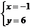
- D. 

【答案】A

【解析】解：通过观察表格知，

与

有一组公共解为\(\left\{ {\begin{array}{*{20}{l}}
 {x = 1} \\ 
 {y = 2} 
\end{array}} \right.\)，
故二元一次方程组
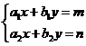
的解为\(\left\{ {\begin{array}{*{20}{l}}
 {x = 1} \\ 
 {y = 2} 
\end{array}} \right.\)，
故选：A．

## 28. 单选题（难度：简单）

下列各组数，是方程\(2x + 3y = 8\)的解的是（　　）

- A. \(\left\{ {\begin{array}{*{20}{l}}
 {x = 4} \\ 
 {y = 1} 
\end{array}} \right.\)
- B. \(\left\{ {\begin{array}{*{20}{l}}
 {x = 2} \\ 
 {y = 1} 
\end{array}} \right.\)
- C. \(\left\{ {\begin{array}{*{20}{l}}
 {x = 1} \\ 
 {y = 2} 
\end{array}} \right.\)
- D. \(\left\{ {\begin{array}{*{20}{l}}
 {x = 1} \\ 
 {y = 3} 
\end{array}} \right.\)

【答案】C

【解析】A、当 \(x = 4,y = 1\) 时，方程左边 

 

，方程右边 

，
∴方程左边 

 方程右边，选项A不符合题意；
B、当 \(x = 2,y = 1\) 时， 方程左边 

， 方程右边 \( = 8,7 \ne 8\)，    
∴方程左边 

 方程右边，选项B不符合题意；
C、当 \(x = 1,y = 2\) 时， 方程左边 

，方程右边 \( = 8,8 = 8\)，
∴方程左边=方程右边，选项C符合题意；
D、当 \(x = 1,y = 3\) 时， 方程左边 \( = 2 \times 1 + 3 \times 3 = 11\) ,方程右边 

，
∴方程左边 

 方程右边， 选项D不符合题意；
故选：C

## 29. 单选题（难度：简单）

已知一个二元一次方程组的解是

则这个方程组可以是（   ）

- A. 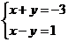
- B. 
- C. 
- D. 

【答案】A

【解析】解：A.把

代入得：

，

，故该选项符合题意；
B. 把

代入得：

，

，故该选项不合题意；
C. 把

代入得：

，故该选项不合题意；
D. 把

代入得：

，故该选项不合题意．
故选：A．

## 30. 单选题（难度：简单）

关于，的方程组的解是$\left\{ {\begin{array}{*{20}{l}} {x = 1} \\ {y = \blacksquare } \end{array}} \right.$，其中的值被盖住了．不过仍能求出，则的值是（    ）

【答案】A

## 31. 单选题（难度：简单）

若关于

和

的方程组

无解，则（    ）

- A. \(5a = 4c\)
- B. 
- C. 
- D. 

【答案】B

【解析】∵关于

和

的方程组
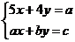
无解，
∴\(\frac{5}{a} = \frac{4}{b}\)，
∴

，
故选：

．

## 32. 单选题（难度：简单）

如果​\(\left \{ \begin{gathered} {x=3} \\ {y=2} \end{gathered} \right .\)​是方程组​\(\left \{ \begin{gathered} {ax+by=1} \\ {ax-by=5} \end{gathered} \right .\)​的解，则​a+b的值为（    ）

- A. 1
- B. 2
- C. 3
- D. 4

【答案】B

【解析】解：将

代入

，

得：
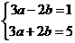
，

解得\(\left\{ {\begin{array}{*{20}{c}} {a = 1} \\ {b = 1} \end{array}} \right.\)，

所以\(a + b = 2\)，

故选：B．

## 33. 单选题（难度：简单）

两位同学在解方程组时，甲同学由
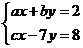
正确地解出

，乙同学因把c写错了解得
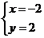
，那么a、b、c的正确的值应为（    ）

- A. \(a = 4\)，

，

- B. \(a = 4\)，

，\(c = - 2\)
- C. 
，

，

- D. 
，

，\(c = - 2\)

【答案】B

【解析】解：根据题意，将

代入

中，得

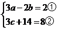
，
解②式，得\(c = - 2\)，
将

代入\(ax + by = 2\)，得\( - 2a + 2b = 2\)，
即

，
解得，\(\left\{ {\begin{array}{*{20}{c}}
 {a = 4} \\ 
 {b = 5} 
\end{array}} \right.\)，
故选：B．

## 34. 单选题（难度：简单）

如果

是方程组

的解，则​​​\({a}^{2024}{b}^{2023}\)​的值为（    ）

- A. 1
- B. ​-1
- C. 2
- D. ​-2

【答案】D

【解析】解：∵

是方程组

的解，
∴

①

②得\(6a = 12\)，解得

，
把

代入①得\(3a + 2b = 5\)，解得\(b = - \frac{1}{2}\)，
∴

，
故选：D．

## 35. 单选题（难度：简单）

方程组

的解为\(\left\{ {\begin{array}{*{20}{c}}
 {x = 1} \\ 
 {y = \diamondsuit } 
\end{array}} \right.\)，则“

”“

”代表的两个数分别为（    ）

- A. 4，2
- B. 1，3
- C. 0,

- D. 2，3

【答案】C

【解析】解：∵方程组

的解为\(\left\{ {\begin{array}{*{20}{c}}
 {x = 1} \\ 
 {y = \diamondsuit } 
\end{array}} \right.\)，
∴

，
∴\(y = - 2\)，
∴\(2x + y = 2 - 2 = 0\)，
∴“

”“

”代表的两个数分别为0，

，
故选：C．

## 36. 单选题（难度：适中）

已知关于x，y的方程组

有下列几种说法：①一定有唯一解；②可能有无数多解；③当​​​\(a=2\)​时方程组无解；④若方程组的一个解中y的值为0，则​​​\(a=0\)​．其中正确的说法有（    ）

- A. 0种
- B. 1种
- C. 2种
- D. 3种

【答案】C

【解析】解：

，
由②得\(x = \frac{{3 - 2y}}{2}\)，
把\(x = \frac{{3 - 2y}}{2}\)代入①得

，
整理得

，
当

时，方程组无解；
当

时，方程组有唯一解；
如果

，则

，解得

，
观察四种说法，①②错误，③④正确，
故选：C．

## 37. 单选题（难度：适中）

已知关于

，

的方程组

，其中\( - 3 \leqslant a \leqslant 1\)，下列结论：①当\(a = - 2\)时，

，

的值互为相反数；②

是方程组的解；③当

时，方程组的解也是方程\(x + y = 1\)的解，其中正确的是（    ）

- A. 
- B. 
- C. 
- D. 

【答案】A

【解析】解：

，
解得：\(\left\{ {\begin{array}{*{20}{l}}
 {x = 1 + 2a} \\ 
 {y = 1 - a} 
\end{array}} \right.\)，
\(\because - 3 \leqslant a \leqslant 1\)，
\(\therefore - 5 \leqslant x \leqslant 3\)，\(0 \leqslant y \leqslant 4\)，
①当\(a = - 2\)时，

，

，
\(\therefore x\)，

的值互为相反数，
故结论①正确；
②

不符合

，\(0 \leqslant y \leqslant 4\)，

不是方程组的解，
故结论②错误；
③当

时，

，

，
\(x + y = - 1 + 2 = 1\)，
方程\(x + y = 1\)两边相等，

方程组的解也是方程\(x + y = 1\)的解，
故结论③正确；
综上，正确的结论有：

，
故选：

．

## 38. 单选题（难度：简单）

已知方程组

和方程组有

相同的解，则m和n的值分别是（    ）

- A. \(m=1,n=2\)​
- B. \(m = - 1\)，​​​\(n=-2\)​
- C. \(m=2,n=-1\)​
- D. \(m=2,n=1\)​

【答案】D

【解析】解：∵程组

和方程组有

相同的解，
∴

，
①-②得，

，
将

代入②，得

，
∴方程组的解为

，
将

代入\(2x + my = 2\)，得\(4 - m = 2\)，
解得

，
将

代入\(nx + y = 1\)，得

，
解得

，
故选：D．

## 39. 单选题（难度：简单）

已知一个二元一次方程组的解是

，则这个方程组可以是（    ）

- A. 
- B. 
- C. 
- D. 

【答案】D

【解析】解：A、将

代入方程组

，
可得：

，
即

不是方程组

的解，不符合题意；
B、将

代入方程组

，
可得：

，
即

不是方程组

的解，不符合题意；
C、将

代入方程组

，
可得：

，
即

不是方程组

的解，不符合题意；
D、将

代入方程组

，
可得：

，
即

是方程组

的解，符合题意；
故选：D．
