# 知识点·会比较线段的长短（同步练习）

> 教材：数学·七年级上册·沪科技版2024新教材 ｜ 来源：国家中小学智慧教育平台·在线练习 ｜ 共 47 题

## 1. 单选题（难度：适中）

已知点A，B是数轴上的两点，点A表示的数为﹣7，点B在原点右侧，到原点的距离为2，则线段AB的长度等于（　　）

- A. 7
- B. 5
- C. 9
- D. 2

【答案】C

【解析】解：由条件可知B表示的数为2，
∴线段AB的长度等于2﹣（﹣7）＝9，
故选：C．

## 2. 单选题（难度：非常简单）

已知线段AB＝8，延长线段AB至C，使得 \( BC=\frac{1}{2}AB\)，延长线段BA至D，使得\( AD=\frac{1}{4}AB\)，则CD的长为（　　）

- A. 10
- B. 12
- C. 14
- D. 16

【答案】C

【解析】解：∵AB＝8，
∴\( BC=\frac{1}{2}AB=4\)，\( AD=\frac{1}{4}AB=2\)，
∴CD＝DB+DA+BA＝14；
则CD的长为14．
故选：C．

## 3. 单选题

在直线m上顺次取A，B，C三点，使AB＝4cm，BC＝3cm，如果O是线段AC的中点，则线段OB的长度为（　　）

- A. 0.5cm
- B. 3.5cm
- C. 2cm
- D. 0.5cm或3.5cm

【答案】A

【解析】解：∵AB＝4cm，BC＝3cm，
∴AC＝AB+BC＝7cm，
∵O是线段AC的中点，
∴\( OA=\frac{1}{2}AC=3.5cm\)，
∴OB＝AB﹣OA＝0.5cm，
故选：A．

## 4. 单选题（难度：非常简单）

直线l上有A，B，C三点，AB＝4cm，BC＝3AB，则AC的长度为（　　）

【答案】A

## 5. 单选题（难度：非常简单）

下列说法正确的个数是（　　）①x的指数是0；②一个数的绝对值一定不是负数；③任何数都不等于它的相反数；④连接两间点的线段叫做这两点的距离；⑤多项式3x2﹣2x+1的一次项系数是2；⑥射线AB和射线BA是同一条射线．

【答案】A

## 6. 单选题（难度：非常简单）

从A地到C地有四条道路，某同学认为第③条路线最近，解释其中的道理是（　　）

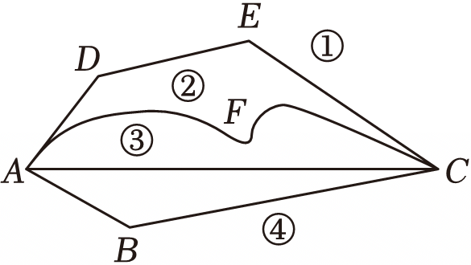

- A. 两点之间，直线最短
- B. 两点确定一条直线
- C. 两点之间，线段最短
- D. 三角形具有稳定性

【答案】C

【解析】解：从A地到C地有四条道路，某同学认为第③条路线最近，其中的道理是两点之间，线段最短．
故选：C．

## 7. 单选题（难度：非常简单）

下列说法正确的是（　　）

- A. 连接两点的线段叫作两点间的距离
- B. 线段的中点到线段两个端点的距离相等
- C. 线段的中点可以有两个
- D. 线段的中点有若干个

【答案】B

【解析】解：A、连接两点的线段的长度叫作两点间的距离，选项说法错误，不符合题意；
B、线段的中点到线段两个端点的距离相等，选项说法正确，符合题意；
C、线段的中点只有一个，选项说法错误，不符合题意；
D、线段的中点只有一个，选项说法错误，不符合题意．
故选：B．

## 8. 单选题（难度：非常简单）

如图，点B，C在线段AD上，AC＝BD，BC＝4AB，若CD＝3，则AD的长为（　　）

【答案】A

## 9. 单选题（难度：非常简单）

如图，C为线段AB上一点，AB＝11，BC＝7，则线段AC的长为（　　）

【答案】A

## 10. 单选题（难度：非常简单）

下列说法：①经过一点有无数条直线；②两点之间直线最短；③经过两点，有且只有一条直线；④若AM＝BM，则点M是线段AB的中点；⑤已知C，D为线段AB上两点，若AC＝BD，则AD＝BC．其中正确的有（　　）

- A. 2个
- B. 3个
- C. 4个
- D. 5个

【答案】B

【解析】解：①经过一点有无数条直线，此说法正确；
②两点之间线段最短，原说法错误；
③经过两点，有且只有一条直线，此说法正确；
④若AM＝BM，点M在线段AB上，则点M是线段AB的中点，原说法错误；
⑤∵C，D为线段AB上两点，AC＝BD，
又∵AD＝AB﹣BD，BC＝AB﹣AC，
∴AD＝BC，此说法正确；

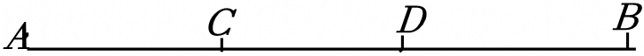
   
综上分析可知，正确的有3个，故B正确．
故选：B．

## 11. 单选题（难度：非常简单）

如图，已知线段AB＝20cm，C为线段AB上一点，且AC＝4cm，M，N分别是AC，BC的中点，则MN等于（　　）cm．

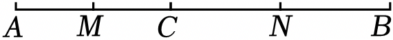

- A. 10
- B. 12
- C. 14
- D. 16

【答案】A

【解析】解：∵AB＝20cm，AC＝4cm，
∴BC＝AB﹣AC
＝20﹣4
＝16（cm），
∵点M，N分别是AC，BC的中点，
∴\( MC=\frac{1}{2}AC=\frac{1}{2}\times 4=2\)（cm），\( CN=\frac{1}{2}BC=\frac{1}{2}\times 16=8\)（cm），
∴MN＝MC+CN＝2+8＝10（cm）．
故选：A．

## 12. 单选题（难度：适中）

点C是线段AB的中点，点D是线段BC上一点，下列条件不能确定点D是线段BC的中点的是（　　）

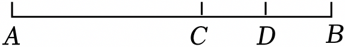

- A. \( BD=\frac{1}{2}AC\)
- B. BD＝AB﹣AD
- C. CD＝DB
- D. 2AD＝3BC

【答案】B

【解析】解：对于选项A，
∵BD\( =\frac{1}{2}\)AC，
∴设BD＝a，则AC＝2a，
∵点C是线段AB的中点，
∴BC＝AC＝2a，
∴CD＝BC﹣BD＝2a﹣a＝a，
∴BD＝CD＝a，
∴点D是BC的中点，
故选项A不符合题意；
对于选项B，
由BD＝AB﹣AD不能确定点D是线段BC的中点，
故选项B不符合题意；
对于选项C，
∵CD＝DB，
∴点D是BC的中点，
故选项C不符合题意；
对于选项D，
∵点C是线段AB的中点，
∴AC＝BC，
∵AD＝AC+CD＝BC+CD＝BD+2CD，BC＝CD+BD，
又∵2AD＝3BC，
∴2（BD+2CD）＝3（CD+BD），
整理得：CD＝BD，
∴点D是BC的中点，
故选项D不符合题意．
故选：B．

## 13. 单选题（难度：非常简单）

已知，如图，B、C两点把线段AD分成2：4：3三部分，M是AD的中点，CD＝6cm，则线段MC的长是（　　）cm．

- A. 4
- B. 3
- C. 1
- D. 2

【答案】B

【解析】解：∵AB：BC：CD＝2：4：3，
∴设AB＝2k，BC＝4k，CD＝3k，
∵CD＝6cm，
即3k＝6，
∴k＝2，
∴AD＝AB+BC+CD＝9k＝18（cm），
∵M为AD的中点，
∴\( MD=\frac{1}{2}AD=9cm\)，
∴MC＝MD﹣CD＝9cm﹣6cm＝3（cm），
故选：B．

## 14. 单选题（难度：非常简单）

如图，某同学家在A处，现在该同学要去位于B处的同学家去玩，最近的一条路线是（　　）

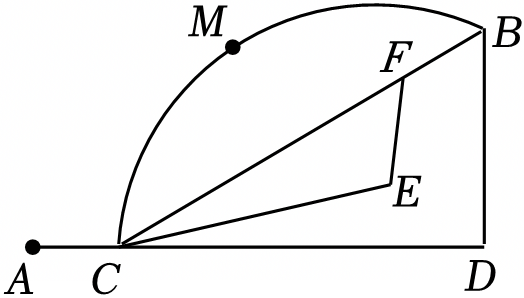

- A. A→C→D→B
- B. A→C→F→B
- C. A→C→E→F→B
- D. A→C→M→B

【答案】B

【解析】解：根据两点之间的线段最短，
可得C、B两点之间的最短距离是线段CB的长度，
所以想尽快赶到同学家玩，一条最近的路线是：A→C→F→B．
故选：B．

## 15. 单选题

如图，数轴上点A、B、D表示的数分别是﹣9，﹣1，1，且点C为线段AB的中点，点O为原点，点E在数轴上，点F为线段DE的中点．若DE＝3，则CF＝（　　）

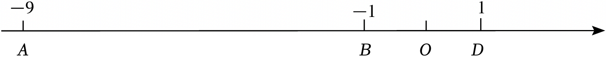

- A. 4.5或5.5
- B. 5.5或6.5
- C. 5.5或7.5
- D. 4.5或7.5

【答案】D

【解析】解：由条件可知点C表示的数为\( \frac{-9-1}{2}=-5\)，
∵点D表示的数为1，DE＝3，
∴点E表示的数为1﹣3＝﹣2或1+3＝4，
∵点F为线段DE的中点，
∴点F表示的书为\( \frac{-2+1}{2}=-0.5\)或\( \frac{1+4}{2}=2.5\)，
∴CF＝﹣0.5﹣（﹣5）＝4.5或CF＝2.5﹣（﹣5）＝7.5．
故选：D．

## 16. 单选题（难度：非常简单）

七年级同学正在举办“线段联欢会”，小明同学出示的节目是：如图，点C为线段AB上一点，AC﹣BC＝6，M是线段AC中点，AM＝8，N为线段MB的中点，则CN＝（　　）

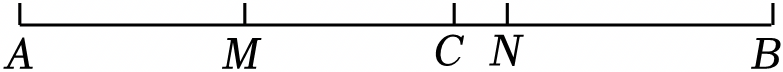

- A. 2
- B. 1
- C. 1.5
- D. 3

【答案】B

【解析】解：∵点M是线段AC的中点，AM＝8，
∴AC＝2AM＝2×8＝16，MC＝AM＝8，
∵AC﹣BC＝6，
∴BC＝AC﹣6＝16﹣6＝10．
∴MB＝MC+BC＝8+10＝18，
又∵点N是线段MB的中点，
∴\( BN=\frac{1}{2}MB=\frac{1}{2}\times 18=9\)，
∴CN＝BC﹣BN＝10﹣9＝1．
故选：B．

## 17. 单选题（难度：非常简单）

如图，建筑工人砌墙时，经常用细绳在墙的两端之间拉一条参照线，使砌的每一层砖在一条直线上，这样做的依据是（　　）

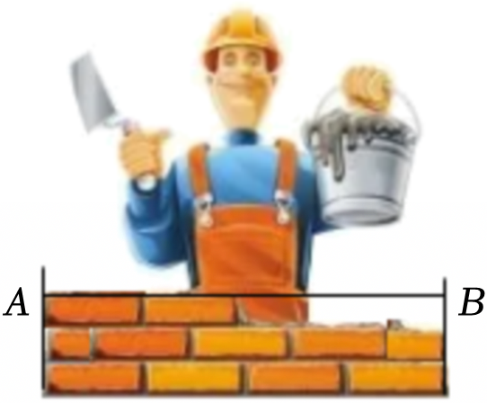

- A. 直线比曲线短
- B. 两点之间，线段最短
- C. 两点确定一条直线
- D. 两点之间，直线最短

【答案】C

【解析】解：根据两点确定一条直线，可使每一层砖在一条直线上．
故答案为：C．

## 18. 单选题（难度：非常简单）

已知线段AB，延长AB至点C，使<latex class="math-tex">\( BC=\frac{1}{3}AB\)</latex>，D是线段AC的中点，如果DC＝4，那么线段AB的长为（　　）

【答案】A

## 19. 单选题（难度：非常简单）

下列说法正确的是（　　）

【答案】A

## 20. 单选题（难度：非常简单）

如图，已知点C为线段AB上一点，AC＝12cm，CB＝8cm，D、E分别是AC、AB的中点，则DE的长度为（　　）

【答案】A

## 21. 单选题（难度：非常简单）

已知A、B、C在同一条直线上，线段AB＝12cm，BC＝4cm，则线段AC等于（　　）

- A. 16cm
- B. 8cm
- C. 16cm或8cm
- D. 不能确定

【答案】C

【解析】解：分两种情况：
①  如图所示，当点C在线段AB上时，

   
∵AB＝12cm，BC＝4cm，
∴AC＝AB﹣BC＝12﹣4＝8（cm）；
②  如图所示，当点C在线段AB的延长线上时，

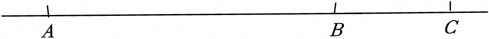
   
∵AB＝12cm，BC＝4cm，
∴AC＝AB+BC＝12+4＝16（cm），
综上所述，线段AC的长为16cm或8cm．
故选：C．

## 22. 单选题（难度：非常简单）

若互为相反数的两个数所对应的点之间的距离为6，则这两个点分别为（　　）

- A. ﹣3
- B. 3
- C. ﹣3或3
- D. ﹣6或6

【答案】C

【解析】解：因为互为相反数的两个数所对应的点之间的距离为6，
所以这两个数到原点的距离都等于3，
所以这两个数分别为3和﹣3，
故选：C．

## 23. 单选题（难度：非常简单）

下面是乐乐在整理七年级上册课本知识点时得出的一些结论，你认为正确的有（　　）
①射线AB与射线BA是同一条射线；
②连接两点间的线段叫做这两点间的距离；
③要将一根木条固定在墙上至少需要两颗钉子的原理是两点确定一条直线；
④将弯曲的河道改直，可以缩短航程，其依据是两点之间线段最短．

- A. 0个
- B. 1个
- C. 2个
- D. 3个

【答案】C

【解析】解：①射线AB与射线BA不是同一条射线，原说法错误，不符合题意；
②连接两点间的线段的长度叫做这两点间的距离，原说法错误，不符合题意；
③要将一根木条固定在墙上至少需要两颗钉子的原理是两点确定一条直线，原说法正确，符合题意；
④将弯曲的河道改直，可以缩短航程，其依据是两点之间线段最短，原说法正确，符合题意；
∴正确的有2个，
故选：C．

## 24. 单选题（难度：非常简单）

下列说法正确的是（　　）

- A. 单项式2xy和﹣xyz是同类项
- B. 多项式2a2b+4ab﹣1是二次三项式
- C. 两点之间的线段叫作这两点间的距离
- D. 两点之间线段最短

【答案】D

【解析】解：根据单项式和多项式的知识，两点间的距离，两点之间线段最短进行判断如下：
A．单项式2xy和﹣xyz的字母不相同，不是同类项，故本选项说法错误，不符合题意；
B．多项式2a2b+4ab﹣1是三次三项式，故本选项说法错误，不符合题意；
C．两点之间的线段的长度叫作这两点间的距离，故本选项说法错误，不符合题意；
D．两点之间线段最短，说法正确，符合题意．
故选：D．

## 25. 单选题（难度：非常简单）

已知点A（﹣3，4），B（3，4），则A，B两点之间的距离是（　　）

【答案】A

## 26. 单选题（难度：非常简单）

平面上有A，B，C三点，已知AB＝6cm，BC＝4cm，则AC的长是（　　）

- A. 10cm
- B. 2cm
- C. 10cm或2cm
- D. 无法确定

【答案】D

【解析】解：分类讨论：三点在一条直线上时，
AC＝6+4＝10（cm）或AC＝6﹣4＝2（cm）；
三点不在一条直线上时，
AC在2和10之间，
综合以上可知只有答案D符合要求．
故选：D．

## 27. 单选题（难度：非常简单）

在下列生活、生产现象中，可以用“两点之间，线段最短”来解释的是（　　）

【答案】A

## 28. 单选题（难度：非常简单）

已知点A（﹣2，4），B（﹣2，﹣2），P（m，2），当PA+PB最短时，m的值为（　　）

【答案】A

## 29. 单选题（难度：非常简单）

已知线段AB＝6cm，延长线段BA到点M，使得BM＝2AB，则AM＝（　　）

- A. 4cm
- B. 6cm
- C. 8cm
- D. 12cm

【答案】B

【解析】解：如图：

     
∵AB＝6cm，BM＝2AB，
∴BM＝12cm，
∴AM＝BM﹣AB＝12﹣6＝6（cm）；
故选：B．

## 30. 单选题（难度：非常简单）

如图，线段AB表示一条对折的绳子，现从P点将绳子剪断．剪断后的各段绳子中最长的一段为60cm．若\( AP=\frac{2}{3}BP\)，则原来绳长为（　　）

- A. 120cm
- B. 100cm
- C. 50cm或75cm
- D. 100cm或150cm

【答案】D

【解析】解：设AP＝2x cm，则BP＝3x cm，
∴AB＝5x cm，
∴原绳长为10x cm，
∵剪断后的各段绳子中最长的一段为60cm，
∴2AP＝60或2BP＝60，即4x＝60或6x＝60，
∴x＝15或x＝10，
∴10x＝150或10x＝100，
即原绳长为100cm或150cm，
故选：D．

## 31. 单选题（难度：非常简单）

下列说法正确的是（　　）

【答案】A

## 32. 单选题（难度：非常简单）

如图，点C是线段AB上一点，点D是线段AC的中点，则下列等式不一定成立的是（　　）

【答案】A

## 33. 单选题（难度：非常简单）

线段AB＝10，在直线AB上截取线段BC＝2，D为线段AB的中点，E为线段BC的中点，那么线段DE的长为（　　）

- A. 4
- B. 6
- C. 5或7
- D. 4或6

【答案】D

【解析】解：分两种情况：
①  如图所示，

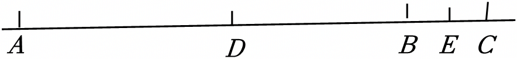
   
∵AB＝10，BC＝2，点D为线段AB的中点，点E为线段BC的中点，
∴\( DB=\frac{1}{2}AB=\frac{1}{2}\times 10=5\)，\( BE=\frac{1}{2}BC=\frac{1}{2}\times 2=1\)，
∴DE＝DB+BE＝5+1＝6；
②  如图所示，

   
∵AB＝10，BC＝2，点D为线段AB的中点，点E为线段BC的中点，
∴\( DB=\frac{1}{2}AB=\frac{1}{2}\times 10=5\)，\( BE=\frac{1}{2}BC=\frac{1}{2}\times 2=1\)，
∴DE＝DB﹣BE＝5﹣1＝4，
综上所述，线段DE的长为4或6．
故选：D．

## 34. 单选题（难度：非常简单）

如图，A，B，C，D是四个社区服务中心．B，D，C在一条直线上，BD＝DC，A，C，D之间也有道路相连，且道路AD与BC垂直，AC＝3km，AB之间隔了一个湖泊．现决定在湖泊上造一座斜拉桥EF，测得AE＝1.2km，BF＝0.7km，则建造的斜拉桥EF的长至少为（　　）

【答案】A

## 35. 单选题（难度：非常简单）

如图，点C、D在线段AB上，且D是AC的中点，若AB＝19，BC＝7，则AD的长度是（　　）

【答案】A

## 36. 单选题（难度：非常简单）

如图，F是线段AB的中点，点E在线段AF上，则下列等式不成立的是（　　）

【答案】A

## 37. 单选题（难度：非常简单）

已知线段AC＝10，点B是线段AC的中点，点D是线段AC上一点，且BD＝2，则线段CD的长为（　　）

- A. 3
- B. 3或7
- C. 8或3
- D. 8

【答案】B

【解析】解：①如图1，当点D在点B左侧时，
∵AC＝10，点B是线段AC的中点，BD＝2，
∴\( BC=\frac{1}{2}AC=\frac{1}{2}\times 10=5\)，
∴CD＝BC+BD＝5+2＝7；

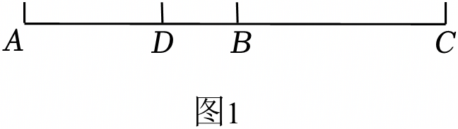
   
②如图2，当点D在点B右侧时，
∵AC＝10，点B是线段AC的中点，BD＝2，
∴\( BC=\frac{1}{2}AC=\frac{1}{2}\times 10=5\)，
∴CD＝BC﹣BD＝5﹣2＝3，

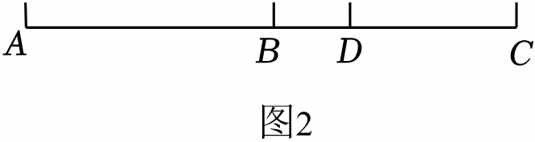
    
故选：B．

## 38. 单选题（难度：非常简单）

已知线段AB＝8，延长AB到C，使BC<latex class="math-tex">\( =\frac{1}{2}\)</latex>AB．若D为AC的中点，则BD等于（　　）

【答案】A

## 39. 单选题（难度：非常简单）

如图，已知AB＝6cm，点C是AB的中点，点D又是AC的中点，则DB＝（　　）

【答案】A

## 40. 单选题（难度：非常简单）

如图，用直尺量线段AB，可以读出AB的长度可能为（　　）

【答案】A

## 41. 单选题（难度：非常简单）

延长线段AB到D，使<latex class="math-tex">\( BD=\frac{1}{2}AB\)</latex>，那么AD：AB的值是（　　）

【答案】A

## 42. 单选题（难度：非常简单）

点M在线段AB上，给出下列四个条件，其中不能判定点M是线段AB中点的是（　　）

- A. AM＝BM
- B. AB＝2AM
- C. BM\( =\frac{1}{2}\)AB
- D. AM+BM＝AB

【答案】D

【解析】解：A、由AM＝BM可以判定点M是线段AB中点，所以此结论正确；
B、由AB＝2AM可以判定点M是线段AB中点，所以此结论正确；
C、由BM\( =\frac{1}{2}\)AB可以判定点M是线段AB中点，所以此结论正确；
D、由AM+BM＝AB不可以判定点M是线段AB中点，所以此结论不正确；
因为本题选择不能判定点M是线段AB中点的说法，
故选：D．

## 43. 单选题（难度：非常简单）

下列叙述正确的是（　　）

- A. 画直线AB＝10厘米
- B. 若AB＝6，BC＝2，那么AC＝8或4
- C. 河道改直可以缩短航程，是因为“经过两点有一条直线，并且只有一条直线”
- D. 在直线AB上任取4点，以这4点为端点的线段共有6条

【答案】D

【解析】解：A、直线没长度，故本选项错误；
B、若AB＝6，BC＝2，不能确定C在不在直线AB上，那么AC＝不一定为8或4，故本选项错误；
C、河道改直可以缩短航程，是因为“两点之间线段最短”，故本选项错误；
D、在直线AB上任取4点，以这4点为端点的线段共有6条，故本选项正确．
故选：D．
声明：试题解析著作权属菁优网所有，未经书面同意，不得复制发布日期：2025/5/17 15:38:51；用户：372402749；邮箱：372402749@qq.com；学号：19764376

## 44. 单选题（难度：非常简单）

如图，点C是线段AB的中点，点D是线段CB上任意一点，则下列表示线段关系的式子不正确的是（　　）

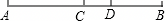

- A. AB＝2AC
- B. AC+CD+DB＝AB
- C. CD＝AD\( -\frac{1}{2}\)AB
- D. AD\( =\frac{1}{2}\)（CD+AB）

【答案】D

【解析】解：A、由点C是线段AB的中点，则AB＝2AC，正确，不符合题意；
B、AC+CD+DB＝AB，正确，不符合题意；
C、由点C是线段AB的中点，则AC\( =\frac{1}{2}\)AB，CD＝AD﹣AC＝AD\( -\frac{1}{2}\)AB，正确，不符合题意；
D、AD＝AC+CD\( =\frac{1}{2}\)AB+CD，不正确，符合题意．
故选：D．

## 45. 单选题（难度：非常简单）

如图，用圆规比较两条线段AB和A'B'的长短，其中正确的是（　　）

【答案】A

## 46. 单选题（难度：简单）

如图，点<latex class="math-tex">\( B\)</latex>在线段<latex class="math-tex">\( AC\)</latex>上，且<latex class="math-tex">\( BC=3AB\)</latex>，点<latex class="math-tex">\( D\)</latex>是线段<latex class="math-tex">\(

【答案】A

## 47. 单选题（难度：适中）

如图，点<latex class="math-tex">\( C\)</latex>是线段<latex class="math-tex">\( AB\)</latex>的中点，点<latex class="math-tex">\( D\)</latex>是线段<latex class="math-tex">\( BC\)</latex>的中点，则下列等式中正确的是（    ）    ①<latex

【答案】A
