# 知识点·余角和补角（同步练习）

> 教材：数学·七年级上册·沪科技版2024新教材 ｜ 来源：国家中小学智慧教育平台·在线练习 ｜ 共 70 题

## 1. 单选题（难度：简单）

如图，$ \angle BOD=\angle COE=\angle AOD=90°$，则图中互余的角共有（    ）

【答案】A

## 2. （难度：简单）

按如图的方法折纸，下列说法不正确的是（   ）

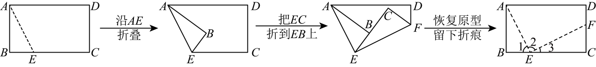

A．\( \angle 1\)与\( \angle 3\)互余  
B．\( \angle 2=90°\)
C．\( \angle 1\)与\( \angle AEC\)互补  
D．\( AE\)平分\( \angle BEF\)

【答案】

D

【解析】解：由折叠的性质可得\( 2(\angle 1+\angle 3)=180°\)，
\( \therefore \angle 1+\angle 3=90°\)，
∴\( \angle 1\)与\( \angle 3\)互余，故A正确，不符合题意；
∴\( \angle 2=180°-(\angle 1+\angle 3)=90°\)，故B正确，不符合题意；
\( \because \angle 1\ne \angle 2\)，
∴\( AE\)不平分\( \angle BEF\)，故D错误，符合题意；
\( \because \angle 1+\angle AEC=180°\)，
∴\( \angle 1\)与\( \angle AEC\)互补，故C正确，不符合题意；
故选：D．

## 3. （难度：简单）

如图所示的是某交叉路口的示意图．若\( \angle 1+\angle 2=180°,\angle 1+\angle 3=180°\)，则\( \angle 2=\angle 3\)，理由是（   ）

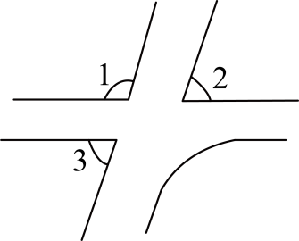

A．同角的余角相等  
B．同角的补角相等
C．等角的余角相等  
D．等角的补角相等

【答案】

B

【解析】解：\( \because \angle 1+\angle 2=180°\),
\( \therefore \) \( \angle 1\)与\( \angle 2\)互补.
\( \because \angle 1+\angle 3=180°\),
\( \therefore \) \( \angle 1\)与\( \angle 3\)互补.
\( \therefore \) \( \angle 1=\angle 3\)（同角的补角相等）。
  故选：\( \mathrm{B}\)．

## 4. （难度：适中）

如图，将一副三角板按不同的位置摆放，下列摆放方式中，\( \angle \alpha \)与\( \angle \beta \)互余的是（   ）
A．
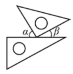
  
B．
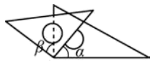
  
C．
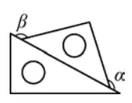
  
D．
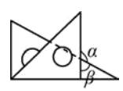

【答案】

A

【解析】解：A、\( \angle \alpha +\angle \beta =90°\)，互余，符合题意；
B、根据同角的余角相等，\( \angle \alpha =\angle \beta \)，不符合题意；
C、根据等角的补角相等，\( \angle \alpha =\angle \beta \)，不符合题意；
D、\( \angle \alpha +\angle \beta =180°\)，不符合题意．
故选：A．

## 5. （难度：适中）

下列四个角中，最有可能与$ 70°$角互余的角是（   ）A．  B．  C．  D．

## 6. （难度：简单）

将一副三角尺按下列不同的位置摆放，$ \angle \alpha $与$ \angle \beta $互余的是（   ）．A．  B．C．  D．

## 7. 单选题（难度：简单）

已知一个角的度数是50°38'，则这个角的补角的度数是（　　）

- A. 39°22'
- B. 49°22'
- C. 130°22'
- D. 129°22'

【答案】D

【解析】解：根据补角定义可知：
180°﹣50°38′＝129°22′．
故选：D．

## 8. 单选题（难度：适中）

若∠A的余角为69°35′，∠B的补角为159°44′30″，∠C＝20.25°，则有（　　）

- A. ∠A＞∠B＞∠C
- B. ∠B＞∠A＞∠C
- C. ∠A＞∠C＞∠B
- D. ∠C＞∠A＞∠B

【答案】A

【解析】解：由题意得∠A＝90°﹣69°35′＝20°25′，∠B＝180°﹣159°44′30″＝20°15′30″，
则∠C＝20.25°＝20°15′，
∵20°25′＞20°15′30″＞20°15′，
∴∠A＞∠B＞∠C，
故选：A．

## 9. 单选题（难度：适中）

若锐角α的补角度数为m，则锐角α的余角度数为（　　）

- A. m﹣90°
- B. 45°+m
- C. 180°﹣m
- D. 90°\( -\frac{1}{2}\)m

【答案】A

【解析】解：∵锐角α的补角度数为m，
∴锐角α的度数为：180°﹣m，
∴锐角α的余角是90°﹣（180°﹣m）＝m﹣90°．
故选：A．

## 10. 单选题（难度：简单）

已知∠A与∠B互余，∠A＝45°35'，则∠B等于（　　）

【答案】A

## 11. 单选题（难度：适中）

若∠α的补角是∠α的余角的三倍，则∠α是（　　）

【答案】A

## 12. 单选题（难度：简单）

下列说法正确的是（　　）

【答案】A

## 13. 单选题（难度：适中）

若∠α＝90°﹣m°，∠β＝90°+m°，则∠α与∠β（　　）

【答案】A

## 14. 单选题（难度：适中）

如果∠1与∠2互余，∠2与∠3互补，则∠3与∠1的关系是（　　）

【答案】A

## 15. 单选题（难度：简单）

已知一个角的余角等于45°20'，则这个角的补角等于（　　）

【答案】A

## 16. 单选题（难度：适中）

下列说法：（1）41.23°＝41°50′；（2）若AC＝BC，则C是线段AB的中点；（3）等角的补角相等；（4）在∠AOB的边OA的延长线上取一点P；（5）过两点有且只有一条直线；其中正确的有（　　）个

- A. 1
- B. 2
- C. 3
- D. 4

【答案】B

【解析】解：（1）41.23°＝41°13′48″，故原说法错误，不符合题意；
（2）若AC＝BC，且点A、B、C三点在同一直线上，则C是线段AB的中点，故原说法错误，不符合题意；
（3）等角的补角相等，故原说法正确，符合题意；
（4）在∠AOB的边OA的延长线上取一点P，这种说法错误，角的边是射线不能说延长；不符合题意；
（5）过两点有且只有一条直线，故原说法正确，符合题意；
∴正确的有（3）（5），共2个．
故选：B．

## 17. 单选题（难度：适中）

下列关于∠A的结论中，正确的有（　　）①若∠A＝53°，则∠A的余角度数为47°；②若∠A＝105°32′，则∠A的补角度数为74°28′；③若∠A与∠B互余，∠B与∠C互补，则∠A＝∠C﹣90°．

【答案】A

## 18. 单选题（难度：适中）

下列说法正确的是（　　）

【答案】A

## 19. 单选题（难度：简单）

一个锐角是19°30'，它的余角是（　　）

【答案】A

## 20. 单选题（难度：适中）

如图是琪琪同学的答卷，她答对的题数是（　　）琪琪同学判断题作答如下：①绝对值等于它本身的数是正数．（√）②3的倒数是﹣3．（×）③将9.20583精确到0.01为9.21．（√）④10°36'＝10.6°．（√）⑤30°的补角是60°．（×）

【答案】A

## 21. 单选题（难度：适中）

如图，在Rt△ABC中，∠BAC＝90°，AD⊥BC，垂足为D，则下列与∠B互余的角有（　　）

【答案】A

## 22. 单选题（难度：简单）

∠1＝40°，∠2是∠1的余角，则∠2的度数为（　　）

【答案】A

## 23. 单选题

如图，射线OC的端点O在直线AB上，∠AOC＝40°，点D在平面内，∠BOD与∠AOC互余，则∠DOC的度数为（　　）

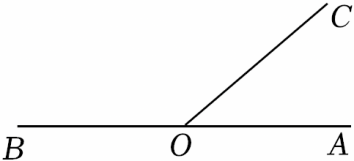

- A. 40°
- B. 50°
- C. 50°或130°
- D. 90°或170°

【答案】D

【解析】解：∵∠AOC＝40°，∠BOD与∠AOC互余，
∴∠BOD＝90°﹣∠AOC＝90°﹣40°＝50°，
当∠BOD在直线AB上方时，
∠DOC＝180°﹣∠BOD﹣∠AOC＝180°﹣50°﹣40°＝90°；
当∠BOD在直线AB下方时，
∠AOD＝180°﹣∠BOD＝180°﹣50°＝130°，
∴∠DOC＝∠AOD+∠AOC＝130°+40°＝170°；
综上，∠DOC的度数为90°或170°，
故选：D．

## 24. 单选题（难度：简单）

一副三角尺按如图所示的方式摆放，且∠1和∠2互余，且∠1比∠2大10°，则∠1的度数为（　　）

【答案】A

## 25. 单选题

如图，∠AOB＝∠COD＝∠EOF＝90°，则图中∠1，∠2，∠3三个角的数量关系为（　　）

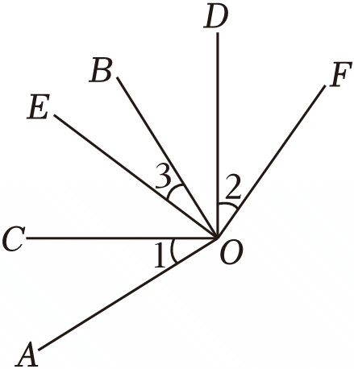

- A. ∠1+∠2+∠3＝90°
- B. ∠1+∠2﹣∠3＝90°
- C. 2∠1﹣∠2+∠3＝90°
- D. ∠1+2∠2﹣∠3＝90°

【答案】A

【解析】解：∵∠COD＝∠EOF＝90°，
∴∠COE+∠3+∠BOD＝∠3+∠BOD+∠2，
∴∠COE＝∠2，
∵∠AOB＝90°，
∴∠1+∠COE+∠3＝90°，
∴∠1+∠2+∠3＝90°．
故选：A．

## 26. 单选题（难度：适中）

如图，∠B＝∠C＝90°，点E是线段BC上一点，AE⊥DE，则与∠1相等的角是（　　）

【答案】A

## 27. 单选题（难度：简单）

如果一个角的补角是110°，则这个角的余角的度数是（　　）

【答案】A

## 28. 单选题（难度：适中）

如图，一副三角板（直角顶点重合）摆放在桌面上，若∠AOD＝143°，则∠BOC等于（　　）

【答案】A

## 29. 单选题（难度：简单）

下列说法中错误的是（　　）

【答案】A

## 30. 单选题（难度：适中）

若∠α与∠β互为余角，∠α与∠γ互为补角，$ \angle \beta =\frac{1}{3}\angle \gamma $，则∠α为（　　）

【答案】A

## 31. 单选题（难度：适中）

若∠α与∠β互补，且∠α＞∠β，则下列表示∠β的余角的式子中：①90°﹣∠β；②∠α﹣90°；③180°﹣∠α； ④$ \frac{1}{2}$（∠α﹣∠β）．正确的是（　　）

【答案】A

## 32. 单选题（难度：适中）

如果一个角的补角比这个角的2倍大30°，那么这个角的余角为（　　）

【答案】A

## 33. 单选题（难度：简单）

如图，直角三角尺ACB的直角顶点C在直线DE上，若∠ACD＝25°，则∠BCE的度数为（　　）

【答案】A

## 34. 单选题

如图，将三个大小不同的正方形的一个顶点重合放置，则α，β，γ三个角的数量关系为（　　）

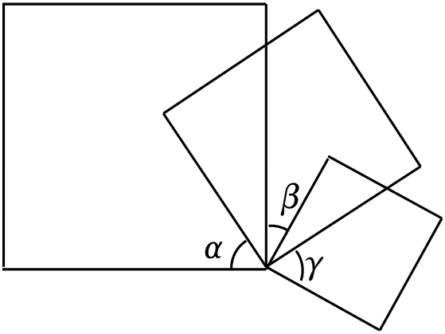

- A. α+β+γ＝90°
- B. α+β﹣γ＝90°
- C. α﹣β+γ＝90°
- D. α+2β﹣γ＝90°

【答案】C

【解析】解：如图：

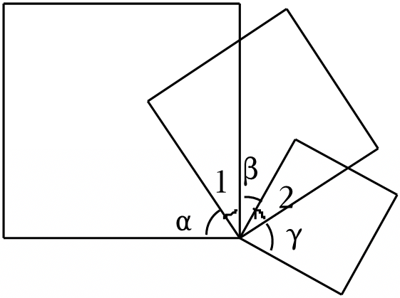

由条件可知α+∠1＝∠1+β+∠2＝∠2+γ＝90°，
∴∠1＝90°﹣α，∠2＝90°﹣γ，
∴β＝90°﹣90°+α﹣90°+γ＝α+γ﹣90°，
即α﹣β+γ＝90°，
故选：C．

## 35. 单选题（难度：适中）

将一副三角板按如图所示的位置摆放，其中∠α与∠β一定互余的是（　　）

- A. 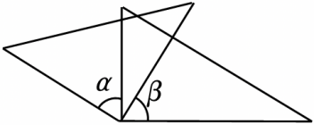
- B. 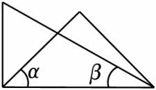
- C. 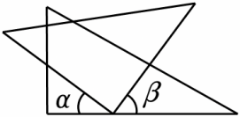
- D. 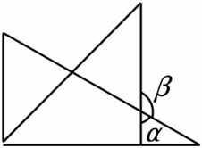

【答案】C

【解析】解：C中的α+β＝180°﹣90°＝90°，
故选：C．
 
【题干】已知∠β＝47°56′，则∠β的补角是（　　）
A．52°44′
B．132°4′
C．42°4′
D．132°44′
【答案】B
【解析】解：∵∠β＝47°56′，
∴∠β的补角＝180°﹣∠β＝180°﹣47°56'＝132°4'．
 故选：B．

## 36. 单选题（难度：适中）

将一副三角尺按照如图所示的方式摆放，其中含30°角的三角尺较短的直角边与含45°角的三角尺的斜边在同一直线上，则∠α的余角和补角的度数分别是（　　）

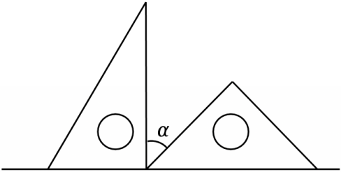

- A. 30°，120°
- B. 40°，130°
- C. 45°，135°
- D. 60°，150°

【答案】C

【解析】解：根据余角和补角的定义可得：
∠α的余角的度数是45°，
∠α的补角的度数是135°，
故选：C．

## 37. 单选题（难度：适中）

如图，将一副三角尺按不同方式摆放，其中∠α与∠β一定互余的是（　　）

- A. 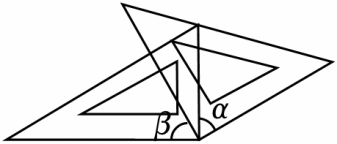
- B. 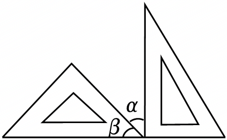
- C. 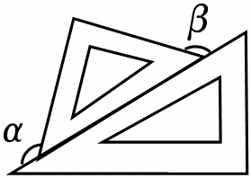
- D. 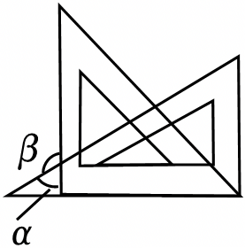

【答案】B

【解析】解：将一副三角尺按不同方式摆放，
A、根据等角的余角相等可得∠α＝∠β，但∠α与∠β不一定互余，故选项A不符合题意；
B、由图知∠α+∠β＝90°，即∠α与∠β一定互余，故选项B符合题意；
C、由图知∠α＝∠β＝180°﹣45°＝135°，∠α与∠β不互余，故选项C不符合题意；
D、由图知∠α+∠β＝180°，∠α与∠β互补，故选项D不符合题意；
故选：B．

## 38. 单选题（难度：简单）

如图，∠ACB＝90°，CD⊥AB，垂足是点D，则图中与∠B互余的角是（　　）

【答案】A

## 39. 单选题（难度：适中）

若锐角α的补角度数为m，则锐角α的余角度数为（　　）

- A. m﹣90°
- B. 45°+m
- C. 180°﹣m
- D. 90°\( -\frac{1}{2}\)m

【答案】A

【解析】解：∵锐角α的补角度数为m，
∴锐角α的度数为：180°﹣m，
∴锐角α的余角是90°﹣（180°﹣m）＝m﹣90°．
故选：A．

## 40. 单选题（难度：简单）

一个锐角是19°30'，它的余角是（　　）

- A. 18°29'
- B. 71°31'
- C. 29°18'
- D. 70°30'

【答案】D

【解析】解：锐角19°30'的余角是90°﹣19°30′＝70°30′．
故选：D．

## 41. 单选题（难度：适中）

若∠A的余角为69°35′，∠B的补角为159°44′30″，∠C＝20.25°，则有（　　）

- A. ∠A＞∠B＞∠C
- B. ∠B＞∠A＞∠C
- C. ∠A＞∠C＞∠B
- D. ∠C＞∠A＞∠B

【答案】A

【解析】解：由题意得∠A＝90°﹣69°35′＝20°25′，∠B＝180°﹣159°44′30″＝20°15′30″，
则∠C＝20.25°＝20°15′，
∵20°25′＞20°15′30″＞20°15′，
∴∠A＞∠B＞∠C，
故选：A．

## 42. 单选题（难度：适中）

若∠α＝90°﹣m°，∠β＝90°+m°，则∠α与∠β（　　）

【答案】A

## 43. 单选题（难度：简单）

已知一个角的余角等于45°20'，则这个角的补角等于（　　）

- A. 44°40'
- B. 44°80'
- C. 134°40'
- D. 135°20'

【答案】D

【解析】解：180°﹣（90°﹣45°20′）＝135°20′，
∴这个角的补角等于135°20′，
故选：D．

## 44. 单选题（难度：适中）

如图是琪琪同学的答卷，她答对的题数是（　　）
琪琪同学判断题作答如下：
①绝对值等于它本身的数是正数．（√）
②3的倒数是﹣3．（×）
③将9.20583精确到0.01为9.21．（√）
④10°36'＝10.6°．（√）
⑤30°的补角是60°．（×）

- A. 1个
- B. 2个
- C. 3个
- D. 4个

【答案】D

【解析】解：绝对值等于它本身的数是零和正数．故①琪琪答错了；
3的倒数是\( \frac{1}{3}\)，故②琪琪答对了；
将9.20583精确到0.01为9.21．故③琪琪答对了；
\( 10°36\text{'}=10°+36\times \left(\frac{1}{60}\right)°=10.6°\)，故④琪琪答对了；
30°的补角＝180°﹣30°＝150°，故⑤琪琪答对了；
综上所述：琪琪琪琪答对了②③④⑤；答对的题数是4个，
故选：D．

## 45. 单选题（难度：适中）

下列关于∠A的结论中，正确的有（　　）
①若∠A＝53°，则∠A的余角度数为47°；
②若∠A＝105°32′，则∠A的补角度数为74°28′；
③若∠A与∠B互余，∠B与∠C互补，则∠A＝∠C﹣90°．

- A. ①②
- B. ②③
- C. ①③
- D. ①②③

【答案】B

【解析】①若∵∠A＝53°，则∠A的余角为90°﹣53°＝37°，错误，选项不符合题意；
②若∠A＝105°32′，则∠A的补角为180°﹣105°32′＝179°60′﹣105°32′＝74°28′，正确，选项符合题意；
③若∠A与∠B互余，
∴∠A+∠B＝90°；
∵∠B与∠C互补，
∴∠B+∠C＝180°；
∴∠B＝180°﹣∠C，代入得：∠A+（180°﹣∠C）＝90°，
∴∠A＝∠C﹣90°，正确，选项符合题意．
故选：B．

## 46. 单选题（难度：适中）

下列说法正确的是（　　）

- A. 延长直线AB到点E，使BE＝AB
- B. 墙上固定一根木条，至少需要两根钉子，依据是“两点之间的所有连线中，线段最短”
- C. 若∠A＝38.78°，则∠A的余角的度数为51°13'12''
- D. 直线上有三点A，B，C，AB＝2cm，BC＝5cm，则AC＝7cm

【答案】C

【解析】解：A、延长线段AB到点E，使BE＝AB，故选项A不符合题意；
B、墙上固定一根木条，至少需要两根钉子，依据是“两点确定一条直线”，故选项B不符合题意；
C、若∠A＝38.78°，则∠A的余角的度数为90°﹣38.78°＝51.22°＝51°13'12''，故选项C符合题意；
D、直线上有三点A，B，C，AB＝2cm，BC＝5cm，则AC＝7cm或AC＝3cm，故选项D不符合题意；
故选：C．

## 47. 单选题（难度：适中）

若∠α的补角是∠α的余角的三倍，则∠α是（　　）

【答案】A

## 48. 单选题（难度：适中）

下列说法：（1）41.23°＝41°50′；（2）若AC＝BC，则C是线段AB的中点；（3）等角的补角相等；（4）在∠AOB的边OA的延长线上取一点P；（5）过两点有且只有一条直线；其中正确的有（　　）个

【答案】A

## 49. 单选题（难度：适中）

如果∠1与∠2互余，∠2与∠3互补，则∠3与∠1的关系是（　　）

【答案】A

## 50. 单选题（难度：简单）

已知一个角的度数是50°38'，则这个角的补角的度数是（　　）

【答案】A

## 51. 单选题（难度：简单）

∠1＝40°，∠2是∠1的余角，则∠2的度数为（　　）

- A. 40°
- B. 60°
- C. 50°
- D. 140°

【答案】C

【解析】解：∵∠1＝40°，
∠2是∠1的余角，
∴∠2＝90°﹣∠1＝90°﹣40°＝50°，
∴∠2的度数为50°．
故选：C．

## 52. 单选题（难度：简单）

下列说法正确的是（　　）

【答案】A

## 53. 单选题（难度：适中）

若∠α与∠β互为余角，∠α与∠γ互为补角，$ \angle \beta =\frac{1}{3}\angle \gamma $，则∠α为（　　）

【答案】A

## 54. 单选题（难度：简单）

已知∠A与∠B互余，∠A＝45°35'，则∠B等于（　　）

【答案】A

## 55. 单选题（难度：适中）

若∠α与∠β互补，且∠α＞∠β，则下列表示∠β的余角的式子中：①90°﹣∠β；②∠α﹣90°；③180°﹣∠α； ④$ \frac{1}{2}$（∠α﹣∠β）．正确的是（　　）

【答案】A

## 56. 单选题（难度：简单）

如果一个角的补角是110°，则这个角的余角的度数是（　　）

【答案】A

## 57. 单选题（难度：适中）

将一副三角尺按照如图所示的方式摆放，其中含30°角的三角尺较短的直角边与含45°角的三角尺的斜边在同一直线上，则∠α的余角和补角的度数分别是（　　）

【答案】A

## 58. 单选题（难度：简单）

下列说法中错误的是（　　）

【答案】A

## 59. 单选题（难度：适中）

如图，∠B＝∠C＝90°，点E是线段BC上一点，AE⊥DE，则与∠1相等的角是（　　）

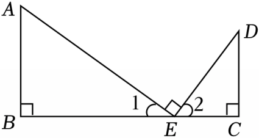

- A. ∠D
- B. ∠2
- C. ∠A
- D. ∠B

【答案】A

【解析】解：∵AE⊥DE，
∴∠1+∠2＝90°，
∵∠C＝90°，
∴∠D+∠2＝90°，
∴∠1＝∠D，
故选：A．

## 60. 单选题（难度：适中）

如果一个角的补角比这个角的2倍大30°，那么这个角的余角为（　　）

【答案】A

## 61. 单选题

如图，∠AOB＝∠COD＝∠EOF＝90°，则图中∠1，∠2，∠3三个角的数量关系为（　　）

- A. ∠1+∠2+∠3＝90°
- B. ∠1+∠2﹣∠3＝90°
- C. 2∠1﹣∠2+∠3＝90°
- D. ∠1+2∠2﹣∠3＝90°

【答案】A

【解析】解：∵∠COD＝∠EOF＝90°，
∴∠COE+∠3+∠BOD＝∠3+∠BOD+∠2，
∴∠COE＝∠2，
∵∠AOB＝90°，
∴∠1+∠COE+∠3＝90°，
∴∠1+∠2+∠3＝90°．
故选：A．

## 62. 单选题（难度：适中）

如图，一副三角板（直角顶点重合）摆放在桌面上，若∠AOD＝143°，则∠BOC等于（　　）

【答案】A

## 63. 单选题（难度：适中）

如图，在Rt△ABC中，∠BAC＝90°，AD⊥BC，垂足为D，则下列与∠B互余的角有（　　）

【答案】A

## 64. 单选题

如图，射线OC的端点O在直线AB上，∠AOC＝40°，点D在平面内，∠BOD与∠AOC互余，则∠DOC的度数为（　　）

【答案】A

## 65. 单选题（难度：简单）

如图，∠ACB＝90°，CD⊥AB，垂足是点D，则图中与∠B互余的角是（　　）

【答案】A

## 66. 单选题（难度：简单）

一副三角尺按如图所示的方式摆放，且∠1和∠2互余，且∠1比∠2大10°，则∠1的度数为（　　）

【答案】A

## 67. 单选题

如图，将三个大小不同的正方形的一个顶点重合放置，则α，β，γ三个角的数量关系为（　　）

【答案】A

## 68. 单选题（难度：简单）

如图，直角三角尺ACB的直角顶点C在直线DE上，若∠ACD＝25°，则∠BCE的度数为（　　）

【答案】A

## 69. 单选题（难度：适中）

如图，将一副三角尺按不同方式摆放，其中∠α与∠β一定互余的是（　　）

【答案】A

## 70. 单选题（难度：适中）

将一副三角板按如图所示的位置摆放，其中∠α与∠β一定互余的是（　　）

【答案】A
