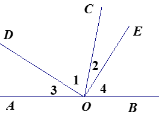
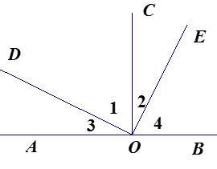
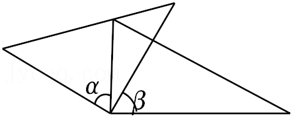
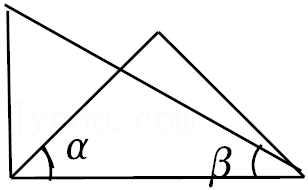
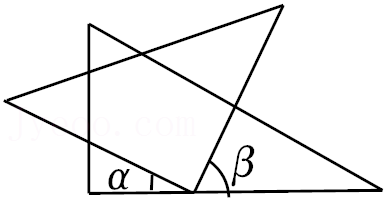
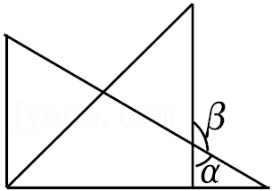

# 知识点·余角的定义（同步练习）

> 教材：数学·七年级上册·沪科技版2024新教材 ｜ 来源：国家中小学智慧教育平台·在线练习 ｜ 共 3 题

## 1. 填空题（难度：简单）

若一个角比它的余角的2倍大\(30^\circ \)，则这个角的度数是。

【答案】$70^\circ $

【解析】​

## 2. （难度：适中）

已知点\(O\)为直线​​​\(AB\)​上一点，射线\(OC\)、\(OD、OE\)．

如图1，若\(\angle DOE\) =\({90^ \circ }\)，写出图中所有互余的角；

​

​​

​                      图1

如图2，若\(OC\)平分\(\angle AOB\)，\(\angle DOE = 90^\circ \)，写出图中互余的角；

​​​

​​​

​                      图2

【答案】

$\angle 1$与$\angle 2$

$\angle 3$与$\angle 4$

，

$\angle 1$与$\angle 2$

$\angle 3$与$\angle 4$

$\angle 1$与$\angle 3$

$\angle 2$与$\angle 4$

【解析】解析视频请查看最后一题。

​

## 3. 单选题（难度：适中）

将一副直角三角尺按如图所示的不同方式摆放，则图中\(\angle \alpha \)与\(\angle \beta \)互余的是（    ）。

- A. 
- B. 
- C. 
- D. 

【答案】C

【解析】​
