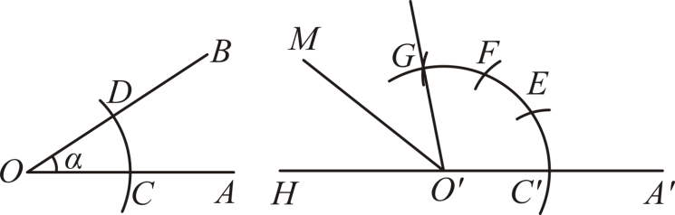
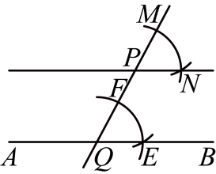
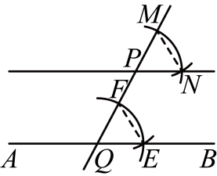
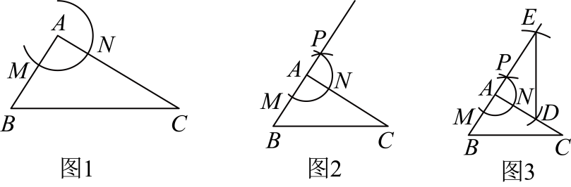
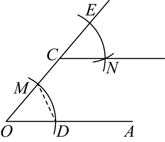
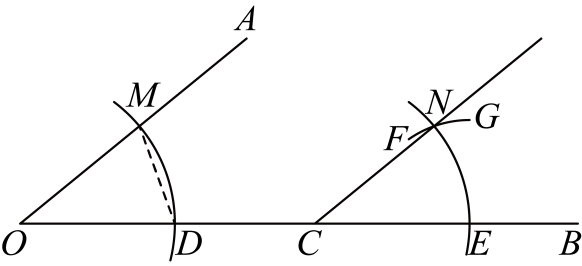
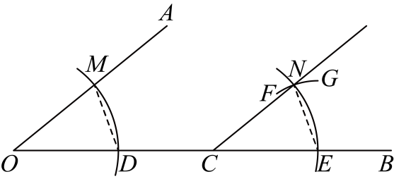
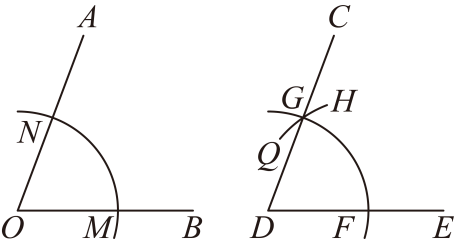
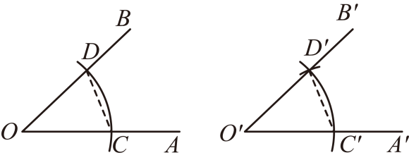

# 知识点·作角（同步练习）

> 教材：数学·七年级上册·沪科技版2024新教材 ｜ 来源：国家中小学智慧教育平台·在线练习 ｜ 共 53 题

## 1. （难度：适中）

尺规作角时，直尺的作用是（   ）．A．画弧线  B．量角度  C．画直线和连接点  D．测量长度

## 2. （难度：适中）

尺规作角时，圆规的主要作用是（        ）．A．画直线  B．截取等长线段和画弧  C．量角度  D．画垂线

## 3. （难度：适中）

用尺规作角的差时，第二个角应作在第一个角的（   ）．
A．内部  
B．外部  
C．任意位置  
D．顶点处

【答案】

A

【解析】解：∵作角的差即从第一个角中减去第二个角，
∴第二个角应作在第一个角的内部，以顶点为公共点，使第二个角的一边与第一个角的一边重合，则另一边之间的角即为差．
故选：A．

## 4. （难度：适中）

用尺规作一个角等于已知角的2倍，这实质上是作了（   ）．A．角的平分线  B．角的和  C．角的差  D．角的补角

## 5. （难度：简单）

如图，点<latex class="math-tex">\( C\)</latex>在<latex class="math-tex">\( \angle AOB\)</latex>的边<latex class="math-tex">\( OB\)</latex>上，用尺规作图：①以点<latex class="math-tex">\( O\)</latex>为圆心，以任意长为半径画弧，交<late

## 6. （难度：简单）

如图，已知<latex class="math-tex">\( \angle AOB\)</latex>与<latex class="math-tex">\( \angle E{O}^{\text{'}}F\)</latex>，分别以O，<latex class="math-tex">\( {O}^{\text{'}}\)</latex>为圆心，以同样长为半径画弧，分别交<latex class=

## 7. （难度：简单）

用直尺和圆规作一个角等于已知角的示意图如图所示，可说明<latex class="math-tex">\( △COD≌△{C}^{\text{'}}{O}^{\text{'}}{D}^{\text{'}}\)</latex>，进而得出<latex class="math-tex">\( \angle AOB=\angle {A}^{\text{'}}{O}^{\text{'}}{B}^{\text

## 8. 单选题（难度：简单）

如图，仔细观察尺规作图的痕迹，若<latex class="math-tex">\( \angle BCA=50°\)</latex>，则<latex class="math-tex">\( \angle ABC\)</latex>的度数是（   ）

【答案】A

## 9. （难度：简单）

如图，已知<latex class="math-tex">\( \angle AOB\)</latex> ，用直尺和圆规按照以下步骤作图：  ①以点<latex class="math-tex">\( O\)</latex>为圆心，任意长为半径画弧，分别交<latex class="math-tex">\( OA\)</latex> 、 <latex class="math-tex">\( OB\

## 10. （难度：适中）

同学们用不同的方式得到一个与<latex class="math-tex">\( \angle AOB\)</latex>相等的角，其中正确的（   ）齐齐：借助尺规作图，如图可得<latex class="math-tex">\( \angle AOB=\angle {A}^{\text{'}}O{B}^{\text{'}}\)</latex>；妙妙：借助两个直角，当<latex class="

## 11. 单选题（难度：适中）

如图，\( \angle AOB=35°\)，以O为圆心，任意长为半径画弧，分别交\( OA\)、\( OB\)于点C、D，画射线\( {O}^{\text{'}}{A}^{\text{'}}\)，以点\( {O}^{\text{'}}\)为圆心，\( OC\)为半径画弧交\( {O}^{\text{'}}{A}^{\text{'}}\)于点\( {C}^{\text{'}}\)，以点\( {C}^{\text{'}}\)为圆心，\( CD\)长为半径依次画弧，分别交前弧于点E、F、G，画射线\( {O}^{\text{'}}G\)，反向延长\( {O}^{\text{'}}{A}^{\text{'}}\)，画出\( \angle H{O}^{\text{'}}G\)的角平分线\( {O}^{\text{'}}M\)，则\( \angle M{O}^{\text{'}}H\)为（   ）

- A. \( 75°\)
- B. \( 47.5°\)
- C. \( 37.5°\)
- D. \( 37°\)

【答案】C

【解析】解：根据题意可知，\( \angle {A}^{\text{'}}{O}^{\text{'}}G=3\angle AOB\)，\( \angle AOB=35°\)
∴\( \angle {A}^{\text{'}}{O}^{\text{'}}G=3\angle AOB=3\times 35°=105°\)，
∴\( \angle H{O}^{\text{'}}G=180°-\angle {A}^{\text{'}}{O}^{\text{'}}G=180°-105°=75°\)，
∵\( {O}^{\text{'}}M\)是\( \angle H{O}^{\text{'}}G\)的角平分线，
∴\( \angle M{O}^{\text{'}}H=\frac{1}{2}\angle H{O}^{\text{'}}G=\frac{1}{2}\times 75°=37.5°\)，
故选：C．

## 12. （难度：适中）

尺规作<latex class="math-tex">\( \angle AOB=\angle \alpha -\angle \beta (\angle \alpha >\angle \beta )\)</latex>时，下列第一步正确的是（   ）．A．先作<latex class="math-tex">\( \angle \beta \)</latex>  B．先作<latex class="

## 13. （难度：简单）

如图①，在<latex class="math-tex">\( △ABC\)</latex>中，D是<latex class="math-tex">\( AB\)</latex>边的中点，且<latex class="math-tex">\( BC>AB\)</latex>．按照如下尺规作图的步骤进行操作（如图②所示）：①以点B为圆心，以适当长为半径画弧，交线段<latex class="math

## 14. （难度：适中）

如图，已知<latex class="math-tex">\( \angle AOB\)</latex>与<latex class="math-tex">\( \angle E{O}^{\text{'}}F\)</latex>，分别以O，<latex class="math-tex">\( {O}^{\text{'}}\)</latex>为圆心，以同样长为半径画弧，分别交<latex class=

## 15. （难度：简单）

如图，小庆用尺规过点B作<latex class="math-tex">\( OA\)</latex>的平行线<latex class="math-tex">\( BC\)</latex>，观察作图痕迹，其中弧<latex class="math-tex">\( HI\)</latex>是（    ）A．以点E为圆心，<latex class="math-tex">\( DE\)</latex>长

## 16. （难度：适中）

已知下列尺规作图：①作一个角的角平分线；②作一个角等于已知角；③作一条线段的垂直平分线．其中作法正确的是（    ）．A．①②  B．①③  C．②③D．①②③

## 17. 单选题（难度：适中）

用尺规作图作一个角等于已知角的示意图如图所示，则叙述正确的个数有（   ）①<latex class="math-tex">\( OA={O}^{\text{'}}{A}^{\text{'}}\)</latex>  ②<latex class="math-tex">\( OB={O}^{\text{'}}{B}^{\text{'}}\)</latex>  ③<latex class="math-t

【答案】A

## 18. （难度：适中）

如图，已知<latex class="math-tex">\( \angle AOB\)</latex>与<latex class="math-tex">\( \angle E{O}^{\text{'}}F\)</latex>，分别以<latex class="math-tex">\( O\)</latex>和<latex class="math-tex">\( {O}^{\text{'}}\)<

## 19. （难度：适中）

如图，下面是利用尺规作图的方式过直线外一点作已知直线平行线的方法：\( \mathrm{①}\)在直线\( AB\)上任取一点\( Q\)，过点\( P\)，\( Q\)作直线\( PQ\)；\( \mathrm{②}\)以\( Q\)为圆心，适当长度为半径画弧，交直线\( AB\)、直线\( PQ\)于点\( E\)，\( F\)，再以\( P\)为圆心，相同长度为半径画弧，交直线\( PQ\)于点\( M\)；\( \mathrm{③}\)以\( M\)为圆心，截取\( EF\)长度为半径画弧，与弧交于点\( N\)，过点\( P\)，\( N\)作直线，即为所求的直线．在这一过程中，证明\( \angle FQE=\angle MPN\)时用到的三角形全等的判定方法是（　　）

A．\( \text{SSS}\)  
B．\( \text{SAS}\)  
C．\( \text{ASA}\)  
D．\( \text{AAS}\)

【答案】

A

【解析】解：如图，连接\( EF\)，\( NM\)，

由作图可知，\( QF=QE=PM=PN\)，\( FE=MN\)，
∴\( △FQE≌△MPN\left(\text{SSS}\right)\)，
∴\( \angle FQE=\angle MPN\)，
故选：\( \text{A}\)．

## 20. 单选题（难度：简单）

如图，光线<latex class="math-tex">\( CO\)</latex>射到镜面<latex class="math-tex">\( AB\)</latex>上的点<latex class="math-tex">\( O\)</latex>处，入射光线与镜面<latex class="math-tex">\( AB\)</latex>的夹角为<latex class="math-t

【答案】A

## 21. （难度：适中）

综合实践课中，在\( △ABC\)的基础上，嘉嘉利用尺规作图作\( △ADE≌△ABC\)，图1～图3是其作图过程．在嘉嘉的作法中，可判定两个三角形全等的依据是（   ）

A． \( \text{SSS}\)   
B． \( \text{ASA}\)   
C． \( \text{AAS}\)   
D． \( \text{SAS}\)

【答案】

D

【解析】解：由作图可得，
\( \left\{\begin{array}{c}AE=AC\\ \angle EAD=\angle CAB\\ AD=AB\end{array}\right. \)，
∴\( △ADE≌△ABC\left(\text{SAS}\right)\)，
∴在嘉嘉的作法中，可直接判定\( △ADE≌△ABC\)的依据是\( \text{SAS}\)，
故选：D；

## 22. （难度：简单）

如图，四个同学用不同的方式得到一个与<latex class="math-tex">\( \angle AOB\)</latex>相等的角．其中正确的（   ）A．只有奇奇，思思  B．只有奇奇，妙妙C．只有奇奇，妙妙，想想  D．有奇奇，思思，妙妙，想想

## 23. （难度：适中）

如图，在<latex class="math-tex">\( △ABC\)</latex>中，<latex class="math-tex">\( AB>AC\)</latex>，<latex class="math-tex">\( AD\)</latex>为<latex class="math-tex">\( BA\)</latex>的延长线．①以点<latex class="math-tex"

## 24. （难度：简单）

小明在用尺规作一个角等于已知角时，具体过程是这样的：作法：（1）如图，以点O为圆心，任意长为半径画弧，分别交<latex class="math-tex">\( OA\)</latex>，<latex class="math-tex">\( OB\)</latex>于点C，D；（2）画一条射线<latex class="math-tex">\( {O}^{\text{'}}{A}^{\text{'

## 25. （难度：简单）

如图，用尺规作图“过点C作\( CN\parallel OA\)”，图中\( △ECN\text{≌}△MOD\)，这两个三角形全等的依据是（   ）

A．\( \mathrm{S}\mathrm{A}\mathrm{S}\)  
B．\( \mathrm{S}\mathrm{S}\mathrm{S}\)  
C．\( \mathrm{A}\mathrm{S}\mathrm{A}\)  
D．\( \mathrm{A}\mathrm{A}\mathrm{S}\)

【答案】

B

【解析】解：由作法可知，\( OD=OM=CE=CN,DM=EN\)，
\( \therefore △DOM≌△NCE\left(\text{SSS}\right)\)，
\( \therefore \angle DOM=\angle NCE\)，
\( \therefore CN\text{∥}OA\)，
故选：B．

## 26. 单选题（难度：简单）

如图，点\( C\)在\( \angle AOB\)的边\( OB\)上，尺规作图痕迹显示的是（   ）

- A. 作线段\( CE\)的垂直平分线
- B. 作\( \angle AOB\)的平分线
- C. 连接\( EN\)，则\( △CEN\)与\( △ODM\)不全等
- D. 作\( CN\parallel OA\)

【答案】D

【解析】解：如图，连接\( EN\),

在\( △ODM\)和\( △CEN\)中，
\( \left\{\begin{array}{c}OM=CN\\ OD=CE\\ MD=NE\end{array}\right. \)，
∴\( △ODM≌△CEN\left(\text{SSS}\right)\)，
∴\( \angle MOD=\angle NCE\)，
∴\( CN\parallel OA\)，
故选：D．

## 27. （难度：简单）

如图，作一个角<latex class="math-tex">\( \angle NCE\)</latex>等于已知角<latex class="math-tex">\( \angle MOD\)</latex>的步骤如下：①以点<latex class="math-tex">\( O\)</latex>为圆心，任意长为半径作弧，分别交<latex class="math-tex">\( OA\)

## 28. （难度：简单）

如图是用直尺和圆规作一个角等于已知角的示意图，要说明<latex class="math-tex">\( \angle AOB=\angle {A}^{\text{'}}{O}^{\text{'}}{B}^{\text{'}}\)</latex>，需要证明<latex class="math-tex">\( △COD\)</latex>和<latex class="math-tex">\( △{C

## 29. （难度：适中）

如图，小明回顾用尺规作一个角等于已知角的作图过程，连接<latex class="math-tex">\( CD\)</latex>、<latex class="math-tex">\( {C}^{\text{'}}{D}^{\text{'}}\)</latex>，得出了<latex class="math-tex">\( △OCD≌△{O}^{\text{'}}{C}^{\text{'}}{D}

## 30. （难度：简单）

如图，已知\( \angle AOB\)，求作\( \angle CDE\)，使得\( \angle CDE=\angle AOB\)．根据尺规作图的痕迹，下列结论不一定正确的是（    ）．

A．\( ON=OM\)  
B．\( ON=DF\)
C．\( ON=GF\)  
D．\( △NOM≌△GDF\)

【答案】

C

【解析】解：由作图方法可得\( ON=OM=OG=OF，MN=FG\)，
∴\( △NOM≌△GDF\left(\text{SSS}\right)\)，
∴\( \angle CDE=\angle AOB\)，
根据现有条件无法证明\( ON=GF\)，
故选：C．

## 31. 填空题（难度：适中）

嘉淇用直尺和圆规作一个角等于已知角的步骤如下：已知：<latex class="math-tex">\( \angle AOB\)</latex>．求作：<latex class="math-tex">\( \angle {A}^{\text{'}}{O}^{\text{'}}{B}^{\text{'}}\)</latex>，使<latex class="math-tex">\( \angle {

## 32. 单选题（难度：简单）

如图，在<latex class="math-tex">\( △ABC\)</latex>中，<latex class="math-tex">\( \angle B=42°\)</latex>，<latex class="math-tex">\( \angle A=78°\)</latex>，点<latex class="math-tex">\( D\)</latex>在边<latex class

【答案】A

## 33. （难度：简单）

下面是“作一个角使其等于<latex class="math-tex">\( \angle AOB\)</latex>”的尺规作图方法．（1）如图，以点<latex class="math-tex">\( O\)</latex>为圆心，任意长为半径画弧，分别交<latex class="math-tex">\( OA\)</latex>，<latex class="math-tex">\( OB\

## 34. 单选题（难度：简单）

如图，用尺规作图作出<latex class="math-tex">\( \angle OBF=\angle AOB\)</latex>，则作图痕迹的弧<latex class="math-tex">\( MN\)</latex>是（   ）

【答案】A

## 35. （难度：适中）

如图，用尺规作出了<latex class="math-tex">\( \angle NCB=\angle AOD\)</latex>，作图痕迹中弧<latex class="math-tex">\( FG\)</latex>是（   ）A．以点C为圆心，<latex class="math-tex">\( OD\)</latex>为半径的弧  B．以点C为圆心，<latex class="mat

## 36. （难度：适中）

用直尺和圆规作一个角等于已知角的示意图如下，其中说明\( △{O}^{\text{'}}{C}^{\text{'}}{D}^{\text{'}}≌△OCD\)的依据是（   ）

A．\( \text{SSS}\)  
B．\( \text{SAS}\)  
C．\( \text{ASA}\)  
D．\( \text{AAS}\)

【答案】

A

【解析】解：作图的步骤：
①以\( O\)为圆心，任意长为半径画弧，分别交\( OA\)、\( OB\)于点\( C\)、\( D\)；
②任意作一点\( {O}^{\text{'}}\)，作射线\( {O}^{\text{'}}{A}^{\text{'}}\)，以\( O\text{'}\)为圆心，\( OC\)长为半径画弧，交\( {O}^{\text{'}}{A}^{\text{'}}\)于点\( {C}^{\text{'}}\)；
③以\( {C}^{\text{'}}\)为圆心，\( CD\)长为半径画弧，交前弧于点\( {D}^{\text{'}}\)；
④过点\( {D}^{\text{'}}\)作射线\( {O}^{\text{'}}{B}^{\text{'}}\)．
在\( △OCD\)与\( △{O}^{\text{'}}{C}^{\text{'}}{D}^{\text{'}}\)，
\( \left\{\begin{array}{c}{O}^{\text{'}}{C}^{\text{'}}=OC\\ {O}^{\text{'}}{D}^{\text{'}}=OD\\ {C}^{\text{'}}{D}^{\text{'}}=CD\end{array}\right. \)，
\( \therefore △OCD≌△{O}^{\text{'}}{C}^{\text{'}}{D}^{\text{'}}\left(\text{SSS}\right)\)，
显然运用的判定方法是\( \text{SSS}\)．
故选：A．

## 37. （难度：适中）

尺规作图：作一个角等于已知角．如图①，已知：<latex class="math-tex">\( \angle AOB\)</latex>．求作：<latex class="math-tex">\( \angle {A}^{\text{'}}{O}^{\text{'}}{B}^{\text{'}}\)</latex>，使<latex class="math-tex">\( \angle {A}^{

## 38. （难度：适中）

如图用尺规作“与已知角相等的角”的过程中，作出<latex class="math-tex">\( \angle {A}^{\text{'}}{O}^{\text{'}}{B}^{\text{'}}=\angle AOB\)</latex>的依据是（   ）A．<latex class="math-tex">\( \text{SAS}\)</latex>  B．<latex class="math

## 39. （难度：适中）

如图，点<latex class="math-tex">\( C\)</latex>在<latex class="math-tex">\( \angle AOB\)</latex>的边<latex class="math-tex">\( OB\)</latex>上，尺规作图痕迹显示的是（   ）A．作等边三角形<latex class="math-tex">\( △ODM\)</latex>  B

## 40. （难度：适中）

如图，在<latex class="math-tex">\( △ABC\)</latex>中，<latex class="math-tex">\( O\)</latex>是边<latex class="math-tex">\( AB\)</latex>的中点，按下列要求作图：<latex class="math-tex">\( ①\)</latex>以点<latex class="math-tex

## 41. （难度：简单）

如图，用无刻度的直尺和圆规作一个角<latex class="math-tex">\( \angle {A}^{\text{'}}{O}^{\text{'}}{B}^{\text{'}}\)</latex>等于已知角<latex class="math-tex">\( \angle AOB\)</latex>，能得出<latex class="math-tex">\( \angle {A}^{\t

## 42. （难度：简单）

课堂上老师给出问题∶在<latex class="math-tex">\( △ABC\)</latex>中，<latex class="math-tex">\( \angle C=90°\)</latex>，使用尺规在<latex class="math-tex">\( AB\)</latex>上作出点 P，使得<latex class="math-tex">\( AC+BP=AB\)</late

## 43. 单选题（难度：简单）

如图，点C在<latex class="math-tex">\( \angle AOB\)</latex>的边<latex class="math-tex">\( OB\)</latex>上，用尺规作出了<latex class="math-tex">\( CN\parallel OA\)</latex>，作图痕迹中弧<latex class="math-tex">\( FG\)</latex>是

【答案】A

## 44. （难度：适中）

如图，点<latex class="math-tex">\( C\)</latex>在<latex class="math-tex">\( \angle AOB\)</latex>的边<latex class="math-tex">\( OB\)</latex>上，用尺规作图：<latex class="math-tex">\( ①\)</latex>以点<latex class="math-te

## 45. （难度：简单）

某班开展“用直尺和圆规作角平分线”的探究活动，其中一组同学的作法如图所示，以O为圆心，以任意长为半径画弧，交<latex class="math-tex">\( OA\)</latex>，<latex class="math-tex">\( OB\)</latex>于点C、D，点E是<latex class="math-tex">\( OA\)</latex>上任一点，以E为圆心，以同样长为半径画

## 46. （难度：简单）

如图，在<latex class="math-tex">\( △ABC\)</latex>中，<latex class="math-tex">\( AB>BC>AC\)</latex>．按下列要求作图：①以点<latex class="math-tex">\( B\)</latex>为圆心，小于线段<latex class="math-tex">\( AC\)</latex>的长为半径画弧，交线段

## 47. （难度：简单）

如图，尺规作<latex class="math-tex">\( \angle HFG=\angle ABC\)</latex>，作图痕迹中弧<latex class="math-tex">\( MN\)</latex>是（    ）A．以点F为圆心，以<latex class="math-tex">\( BE\)</latex>长为半径的弧  B．以点F为圆心，以<latex class="ma

## 48. （难度：简单）

如图，用直尺和圆规作一个角等于已知角，如图，能得出\( \angle AOB=\angle {A}^{\text{'}}{O}^{\text{'}}{B}^{\text{'}}\)的依据是（  ）

A．\( \text{SAS}\)  
B．\( \text{SSS}\)  
C．\( \text{ASA}\)  
D．\( \text{HL}\)

【答案】

B

【解析】解：如图，连接\( DC\)，\( {D}^{\text{'}}{C}^{\text{'}}\)，

由作图可得：\( DC={D}^{\text{'}}{C}^{\text{'}}\)，\( OC=O{C}^{\text{'}}\)，\( OD=O{D}^{\text{'}}\)，
\( \therefore \) \( △OCD≌△O{C}^{\text{'}}{D}^{\text{'}}\left(\text{SSS}\right)\)，
\( \therefore \) \( \angle AOB=\angle {A}^{\text{'}}{O}^{\text{'}}{B}^{\text{'}}\)，
\( \therefore \)能得出\( \angle AOB=\angle {A}^{\text{'}}{O}^{\text{'}}{B}^{\text{'}}\)的依据是\( \text{SSS}\)，
故选：B．

## 49. 单选题（难度：适中）

在探究用尺规作一个与\( \angle AOB\)相等的\( \angle {A}^{\text{'}}{O}^{\text{'}}{B}^{\text{'}}\)时，小明和小华分别提出了自己的想法，下面是他们二人的作图痕迹，则下列判断正确的是（　　）

- A. 小明和小华的作法都正确
- B. 小明的作法正确，小华的作法不正确
- C. 小明的作法不正确，小华的作法正确
- D. 小明和小华的作法都不正确

【答案】A

【解析】解：小明的做法：\( {O}^{\text{'}}{D}^{\text{'}}=OD,{O}^{\text{'}}{C}^{\text{'}}=OC,{C}^{\text{'}}{D}^{\text{'}}=CD\)，
∴\( △{O}^{\text{'}}{C}^{\text{'}}{D}^{\text{'}}≌△OCD\left(\text{SSS}\right)\)，

∴\( \angle {C}^{\text{'}}{O}^{\text{'}}{D}^{\text{'}}=\angle COD\)，即\( \angle {A}^{\text{'}}{O}^{\text{'}}{B}^{\text{'}}=\angle AOB\)，
小华的做法：\( {O}^{\text{'}}{D}^{\text{'}}=OD,{O}^{\text{'}}{C}^{\text{'}}=OC,{C}^{\text{'}}{D}^{\text{'}}=CD\)，
∴\( △{O}^{\text{'}}{C}^{\text{'}}{D}^{\text{'}}≌△OCD\left(\text{SSS}\right)\)，
∴\( \angle {C}^{\text{'}}{O}^{\text{'}}{D}^{\text{'}}=\angle COD\)，即\( \angle {A}^{\text{'}}{O}^{\text{'}}{B}^{\text{'}}=\angle AOB\)，
综上所述，小明和小华的做法都正确，
故答案为：A．

## 50. （难度：简单）

下面是黑板上出示的尺规作图题，下列各符号代表的内容正确的是（    ）如图所示，已知<latex class="math-tex">\( \angle AOB\)</latex>，求作：<latex class="math-tex">\( \angle DEF\)</latex>，使<latex class="math-tex">\( \angle DEF=\angle AOB\)</latex>

## 51. （难度：简单）

课堂上，老师出示了这样一个问题：如图①，已知<latex class="math-tex">\( \angle PAB=45°\)</latex>，请利用尺规作<latex class="math-tex">\( \angle CPA=135°\)</latex>．如图②是甲、乙两位同学的作法，其中正确的是（   ）A．甲、乙均正确  B．甲正确，乙错误C．乙正确，甲错误  D．甲、乙均错误

## 52. （难度：简单）

如图，观察图中的尺规作图痕迹，下列说法错误的是（   ）A．<latex class="math-tex">\( \angle DAE=\angle EAC\)</latex>  B．<latex class="math-tex">\( \angle C=\angle EAC\)</latex>  C．<latex class="math-tex">\( AE\text{∥}BC\)</latex

## 53. （难度：适中）

如图，在<latex class="math-tex">\( △ABC\)</latex>中，D为<latex class="math-tex">\( AC\)</latex>边上一点，现要利用尺规作图过点D作<latex class="math-tex">\( DE\text{∥}AB\)</latex>，下列作法不可行的是（   ）．A．  B．  C．  D．

