# 知识点·作角平分线（同步练习）

> 教材：数学·七年级上册·沪科技版2024新教材 ｜ 来源：国家中小学智慧教育平台·在线练习 ｜ 共 101 题

## 1. 单选题（难度：简单）

如图是用尺规作∠AOB的平分线OC的示意图，这样作图的依据是（　　）

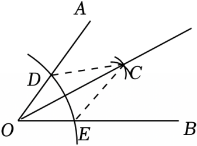

- A. SAS
- B. SSS
- C. ASA
- D. AAS

【答案】B

【解析】解：连接CE、CD，
在△OEC和△ODC中，
\( \left\{\begin{array}{l}CE=CD\\ OC=OC\\ OE=OD\end{array}\right.\)，
∴△OEC≌△ODC（SSS），
故选：B．

## 2. 单选题（难度：适中）

如图，在Rt△ABC中，∠C＝90°，若∠B＝25°，以点A为圆心，任意长为半径画弧、交AB，AC于点M，N，再分别以M，N为圆心，大于$ \frac{1}{2}MN$为半径画弧、交于点P，作射线AP交BC于点D，则∠ADC的度数为（　　）

【答案】A

## 3. 单选题（难度：适中）

如图，已知∠AOB．按照以下步骤作图：①以点O为圆心，以适当的长为半径作弧，分别交∠AOB的两边于C，D两点，连接CD．②分别以点C，D为圆心，以大于线段CD的长为半径作弧，两弧在∠AOB内交于点E，连接CE，DE．③连接OE交CD于点M．下列结论中错误的是（　　）

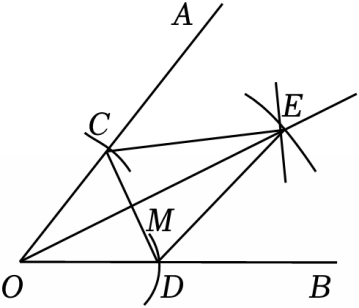

- A. ∠COE＝∠DOE
- B. CM＝DM
- C. CE＝OD
- D. EO垂直平分线段CD

【答案】C

【解析】解：由作图步骤可得：OE是∠AOB的角平分线，则∠COE＝∠DOE，
根据作图可知：OC＝OD，CE＝DE，
∴点O、E在CD的垂直平分线上，
∴EO垂直平分CD，
∴CM＝DM，
没有条件能得出CE＝OD，故C错误，符合题意．
故选：C．

## 4. 单选题（难度：适中）

如图，在Rt△ABC中，根据尺规作图的痕迹，判断以下结论错误的是（　　）

【答案】A

## 5. 单选题（难度：适中）

用两把完全相同的长方形直尺作出∠AOB的角平分线的方法：如图所示，直尺①边缘压住射线OB，直尺②边缘压住射线OA并且与直尺①交于点P，射线OP就是∠AOB的角平分线．其理论依据是（　　）

【答案】A

## 6. 单选题（难度：适中）

尺规作图：∠ABC的角平分线，如图1，图2所示、具体步骤如下：第一步：以B为圆心，以a为半径画弧，分别交射线BA，BC于点D，E；第二步：分别以D，E为圆心，以b为半径画弧，两弧在∠ABC内部交于点P；第三步：画射线BP．射线BP即为所求．下列正确的是（　　）

【答案】A

## 7. 单选题（难度：适中）

嘉嘉和琪琪两位同学给出两种画角平分线的方法：
嘉嘉：如图1，两把相同的直尺，一把直尺压住射线OB，另一把直尺压住射线OA并且与第一把直尺交于点P，小明说：“射线OP就是∠BOA的平分线．”
琪琪：按如图2所示做个仪器，其中AB＝AD，BC＝DC，将仪器上的点A与∠PRQ的顶点R重合，调整AB和AD，使它们分别落在角的两边，过点A，C画一条射线AE，AE就是∠PRQ的平分线．
对于两人的画法，下列说法正确的是（　　）

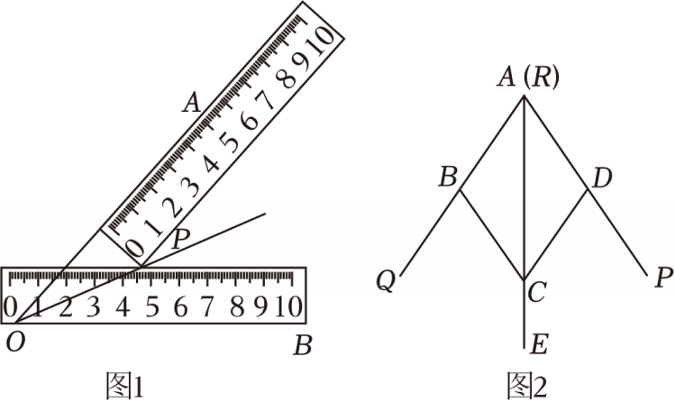

- A. 两人都对
- B. 两人都不对
- C. 嘉嘉对，琪琪不对
- D. 嘉嘉不对，琪琪对

【答案】A

【解析】解：嘉嘉的画法：
∵直尺宽度相等，即点P到OA、OB的距离等于直尺宽度，
即点P到OA、OB距离相等，
∴射线OP是∠BOA角平分线，故嘉嘉画法正确．
琪琪的画法：
在∵△ABC与△ADC中，
\( \left\{\begin{array}{l}AB=AD\\ BC=DC\\ AC=AC\end{array}\right.\)，
∴△ABC≌△ADC（SSS）
∴∠BAC＝∠DAC即AE是∠PRQ平分线，琪琪画法正确．
综上，两人都对，
故选：A．

## 8. 单选题（难度：适中）

如图，在△ABC中，∠ABC＝90°，∠C＝30°，以点A为圆心，以AB的长为半径作弧交AC于点D，连接BD，再分别以点B，D为圆心，大于$ \frac{1}{2}BD$的长为半径作弧，两弧交于点P，作射线AP交BC于点E，连接DE，则下列结论中不正确的是（　　）

【答案】A

## 9. 单选题（难度：适中）

如图，在Rt△ABC中，∠C＝90°，以点A为圆心，适当长为半径作弧，分别交AB，AC于点D，E，再分别以点D，E为圆心，大于$ \frac{1}{2}DE$长为半径作弧，两弧在∠CAB的内部相交于点F，作射线AF交BC于点G．若AB＝8，CG＝3，则△ABG的面积是（　　）

【答案】A

## 10. 单选题（难度：适中）

如图，在Rt△ABC中，∠C＝90°，以顶点A为圆心，适当长为半径画弧，分别交AC、AB于点M、N，再分别以点M、N为圆心，大于\( \frac{1}{2}MN\)的长为半径画弧，两弧交于点P，作射线P交BC于点D，若CD＝5，AB＝18，则△ABD的面积是（　　）

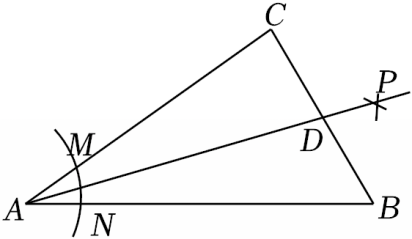

- A. 30
- B. 45
- C. 60
- D. 90

【答案】B

【解析】解：由题意可知AP为∠CAB的平分线，过点D作DH⊥AB于点H，

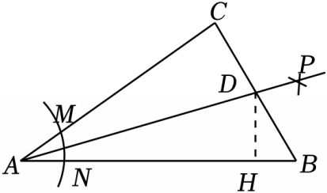
  
∵∠C＝90°，CD＝5，
∴CD＝DH＝5（角平分线的性质）．
∵AB＝18，
∴根据三角形的面积公式得，\( {S}_{△ABD}=\frac{1}{2}AB\cdot DH=\frac{1}{2}\times 18\times 5=45\)，
则△ABD的面积是45．
故选：B．

## 11. 单选题（难度：适中）

如图，在△ABC中，∠C＝90°，AB＝10．以点A为圆心，适当长为半径画弧，分别交AB，AC于点M和点N，再分别以点M，N为圆心，大于$ \frac{1}{2}$MN的长为半径画弧，两弧交于点P、连接AP并延长，交BC于点D．若CD＝3，则△ABD的面积是（　　）

【答案】A

## 12. 单选题（难度：适中）

如图，∠MON＝110°，在射线ON上任取一点A，以点O为圆心，OA长为半径画弧，交射线OM于点B，再分别以点A，B为圆心，AB长为半径画弧，两弧在∠MON内部交于点C，连接AC，则∠OAC的大小为（　　）

【答案】A

## 13. 单选题（难度：适中）

如图，在△ABC中，∠C＝90°，按以下步骤作图：①以点A为圆心，小于AC的长为半径画弧，分别交AB，AC于点E，F；②分别以点E，F为圆心，大于$ \frac{1}{2}EF$的长为半径画弧，两弧相交于点G；③作射线AG交BC边于点D．若CD＝4，AB＝10，则△ABD的面积是（　　）

【答案】A

## 14. 单选题（难度：简单）

用直尺和圆规作一个角的平分线的示意图如图所示，证明∠AOC＝∠BOC的依据是（　　）

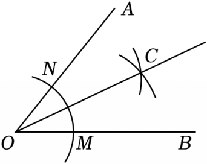

- A. AAS
- B. SAS
- C. ASA
- D. SSS

【答案】D

【解析】解：如图，连接NC，MC，

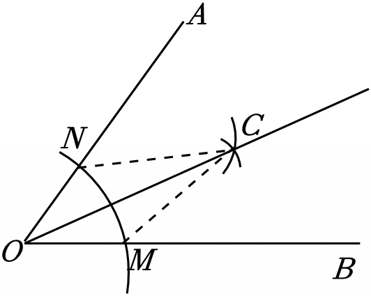
 
在△ONC和△OMC中，
\( \left\{\begin{array}{l}OM=ON\\ MC=NC\\ OC=OC\end{array}\right.\)，
∴△ONC≌△OMC（SSS），
∴∠AOC＝∠BOC，
选项D符合证明全等依据．
故选：D．

## 15. 单选题（难度：适中）

如图，用尺规作图作一个已知角的平分线，下列结论中错误的是（　　）

【答案】A

## 16. 单选题

如图，在矩形ABCD中，AB＝4，BC＝3，以B为圆心，适当的长为半径画弧，交BD，BC于M，N两点；再分别以M，N为圆心，大于$ \frac{1}{2}MN$的长为半径画弧，两弧交于点P，作射线BP交CD于点F；再以B为圆心，BD的长为半径画弧，交射线BP于点E，则EF的长为（　　）

【答案】A

## 17. 单选题（难度：适中）

某校曾开展了“喜迎二十大，争做好少年”的数学知识应用能力竞赛活动，活动中小明同学用两把完全相同的直尺就作出一个角的平分线．如图，将一把直尺的边与射线OA重合，另一把直尺的边与射线OB重合，两把直尺的另一边在角的内部交于点P，作射线OP，小明说：“射线OP就是∠AOB的角平分线．”他这样做的依据是（　　）

【答案】A

## 18. 单选题（难度：适中）

如图，∠MON＝100°，点A在射线OM上，以点O为圆心，OA长为半径画弧，交射线ON于点B．若分别以点A，B为圆心，AB长为半径画弧，两弧在∠MON内部交于点C，连接AC，则∠OAC的大小为（　　）

【答案】A

## 19. 单选题

如图，在Rt△ABC中，∠C＝90°，按以下步骤作图：①利用尺规在BC，BA上分别截取BE，BD，使BE＝BD；②分别以点D，E为圆心、以大于$ \frac{1}{2}DE$的长为半径作弧，两弧在∠CBA内交于点F；③作射线BF交AC于点G．若△BCG的面积为2，BC＝4，P为AB上一动点，则GP的最小值为（　　）

【答案】A

## 20. 单选题（难度：适中）

如图，在Rt△ABC中，∠C＝90°，以点A为圆心，适当长为半径画圆弧，分别交AC、AB于点M、N，再分别以点M、N为圆心，大于\( \frac{1}{2}MN\)的长为半径画圆弧，两弧交于点P，作射线AP交边BC于点D，点E在边AB上，连接DE．则下列结论错误的是（　　）

- A. AM＝AN
- B. CD＝BD
- C. ∠CAD＝∠BAD
- D. DE的最小值是DC的长

【答案】B

【解析】解：由作图过程可知，AM＝AN，射线AP为∠BAC的平分线，
∴∠CAD＝∠BAD，
故A，C选项正确，不符合题意；
过点D作DF⊥AB于点F，

 
∵射线AP为∠BAC的平分线，∠C＝90°，
∴CD＝DF．
∵当DE与DF重合时，DE取得最小值，
∴DE的最小值是DC的长，
故D选项正确，不符合题意；
在Rt△BDF中，BD＞DF，
∴BD＞CD，
故B选项不正确，符合题意．
故选：B．

## 21. 单选题（难度：适中）

如图，在Rt△ABC中，∠C＝90°，以点A为圆心，适当长为半径作弧，分别交AB，AC于点D，E，再分别以点D，E为圆心，以大于\( \frac{1}{2}DE\)的长度为半径作弧，两弧交于点F，作射线AF交BC于点G，若AB＝16，CG＝4，则△ABG的面积是（　　）

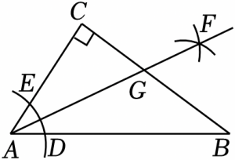

- A. 20
- B. 24
- C. 28
- D. 32

【答案】D

【解析】解：过点G作GH⊥AB交AB于点H，如图所示：
∴∠GHA＝90°，
由作图可得，AF为∠BAC的平分线，
∴GH＝CG＝4，
∴S△ABG\( =\frac{1}{2}\)AB•GH\( =\frac{1}{2}\times \)16×4＝32，
故选：D．

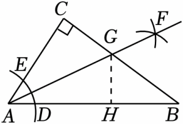

## 22. 单选题

如图，在等腰△ABC中，在AB、AC上分别截取AP、AQ，使AP＝AQ．再分别以点P，Q为圆心，以大于PQ的长为半径作弧，两弧在∠BAC内交于点R，作射线AR，交BC于点D．已知AB＝AC＝10，AD＝8，BC＝12．若点M、N分别是线段AD和线段AB上的动点，则BM+MN的最小值为（　　）

【答案】A

## 23. 单选题（难度：适中）

如图，在Rt△ABC中，∠C＝90°，∠B＝28°，根据尺规作图的痕迹，则∠ADE的度数是（　　）

【答案】A

## 24. 单选题（难度：简单）

用直尺和圆规作一个角的平分线的示意图如图所示，证明∠AOC＝∠BOC的依据是（　　）

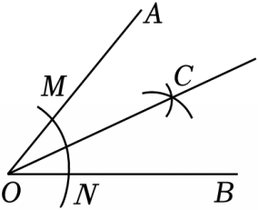

- A. AAS
- B. SAS
- C. ASA
- D. SSS

【答案】D

【解析】解：连接NC，MC，根据作图作法可知NC＝MC，

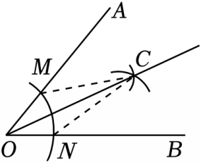
   
∵在△ONC和△OMC中，
\( \left\{\begin{array}{l}OM=ON\\ MC=NC\\ OC=OC \end{array}\right.\)，
∴△OMC≌△ONC（SSS），
∴∠AOC＝∠BOC，
选项D满足推导原理．
故选：D．

## 25. 单选题（难度：适中）

已知∠AOB，求作射线OC，使OC平分∠AOB，那么作法的合理顺序是（　　）①作射线OC；②在射线OA和OB上分别截取OD、OE，使OD＝OE；③分别以D、E为圆心，大于$ \frac{1}{2}$DE的长为半径在∠AOB内作弧，两弧交于点C．

【答案】A

## 26. 单选题（难度：适中）

如图，在射线BA，BC上，分别截取BM，BN，使BM＝BN；再分别以点M和点N为圆心、大于线段MN一半的长为半径作圆弧，在∠ABC内，两弧交于点D，作射线BD；过点D作DE∥BC交BA于点E．若∠BDE＝30°，则∠AED的度数是（　　）

【答案】A

## 27. 单选题（难度：适中）

如图，在△ABC中，∠C＝90°，∠B＝26°．洋洋按下列步骤作图：①以点A为圆心，小于AC长为半径画弧，分别交AB、AC于点E、F；②分别以点E、F为圆心，大于EF长的一半为半径画弧，两弧相交于点G；③作射线AG，交BC边于点D，则∠DAB的度数为（　　）

【答案】A

## 28. 单选题（难度：适中）

如图，在△ABC中，∠C＝90°，∠B＝30°以A为圆心，任意长为半径画弧分别交AB、AC于点M和N，再分别以M、N为圆心，大于$ \frac{1}{2}MN$的长为半径画弧，两弧交于点P，连接AP并延长交BC于点D，则下列说法中：①AD是∠BAC的平分线；②∠ADC＝60°；③△ABD的面积是△ACD面积的2倍；④BD＝2CD，

【答案】A

## 29. 单选题（难度：适中）

如图，在△ABC中，∠C＝60°，∠B＝50°．以点A为圆心，适当长为半径画弧，交AB于点D，交AC于点E；再分别以点D，E为圆心，大于$ \frac{1}{2}DE$的长为半径画弧，两弧（所在圆的半径相等）相交于点P，作射线AP，与边BC相交于点F，则∠AFB的大小为（　　）

【答案】A

## 30. 单选题（难度：适中）

在Rt△ABC中，∠C＝90°，∠A＝40°．在AB上取一点M，以点B为圆心，以BM的长为半径（BM＜BC）画弧，交BC于点N，再分别以点M，N为圆心，以BM的长为半径画弧，两弧交于点E，连接ME，NE，BE，则∠BME的度数是（　　）

【答案】A

## 31. 单选题（难度：简单）

下面是“作∠AOB的角平分线”的尺规作图方法．
（1）以点O为圆心，适当长为半径画弧，交OA于点M，交OB于点N；
（2）分别以点M，N为圆心，大于\( \frac{1}{2}MN\)的长为半径画弧，两弧在∠AOB的内部相交于点C；
（3）画射线OC．射线OC即为所求．
上述方法通过判定△MOC≌△NOC得到∠AOC＝∠BOC．其中判定△MOC≌△NOC的依据是（　　）

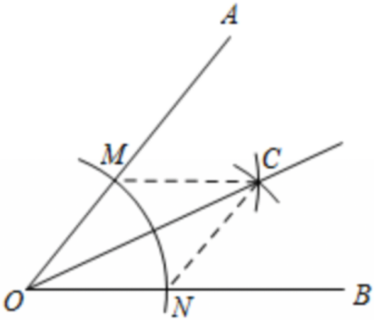

- A. SSS
- B. SAS
- C. ASA
- D. AAS

【答案】A

【解析】解：由作法可知，OM＝ON，CM＝CN，
又∵OC＝OC，
∴△MOC≌△NOC（SSS），
故判定△MOC≌△NOC的依据是SSS，
故选：A．

## 32. 单选题（难度：适中）

如图，在∠MON的两边上分别截取OA、OB，使OA＝OB；分别以点A、B为圆心，OA长为半径作弧，两弧交于点C；连接AC、BC、AB、OC．若AB＝2cm，四边形OACB的面积为6cm2，则OC＝（　　）

【答案】A

## 33. 单选题（难度：简单）

如图，在△ABC中，以点A为圆心，任意长为半径画弧，分别交AB，AC于点M，N，再分别以点M，N为圆心，以同样的长度（大于\( \frac{1}{2}MN)\)为半径画弧，两弧相交于点P，连接AP，则射线AP是∠BAC的角平分线，连接MP，NP，可以先证明△ANP≌△AMP，进而推出AP是∠BAC的角平分线，判定△ANP≌△AMP的依据（　　）

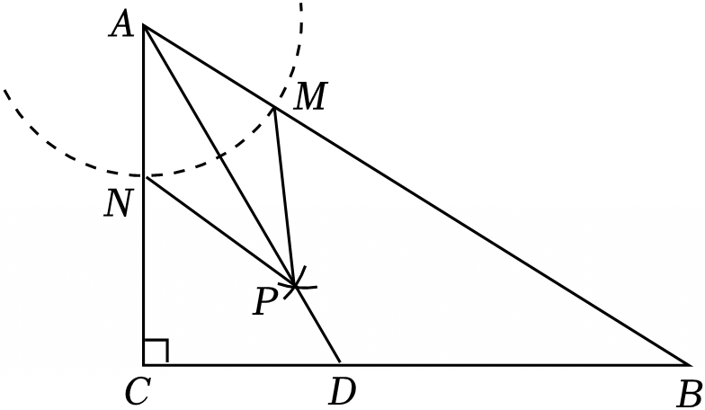

- A. ASA
- B. AAS
- C. SAS
- D. SSS

【答案】D

【解析】解：由作图过程可得，AM＝AN，NP＝MP，
∵AP＝AP，
∴△ANP≌△AMP（SSS），
∴判定△ANP≌△AMP的依据是SSS．
故选：D．

## 34. 单选题（难度：适中）

如图，Rt△ABC中，∠C＝90°，用尺规作图法作出射线AE，AE交BC于点D，AD＝25，AC＝24，P为AB上一动点，则PD的最小值为（　　）

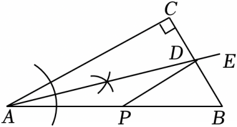

- A. 7
- B. \( 5\sqrt{2}\)
- C. \( 2\sqrt{13}\)
- D. 8

【答案】A

【解析】解：∵在Rt△ACD中，∠C＝90°，AD＝25，AC＝24，
∴\( CD=\sqrt{A{D}^{2}-A{C}^{2}}=7\)，
由尺规作图可知，射线AE是∠BAC的角平分线，
由垂线段最短可知，当PD⊥AB时，PD的值最小，最小值等于CD＝7，
故选：A．

## 35. 单选题（难度：适中）

如图，在△ABC中，AB＝AC，∠B＝72°，以点C为圆心，适当长为半径作弧，交CA于点M，交CB于点N，再分别以点M，N为圆心，大于$ \frac{1}{2}MN$的长度为半径作弧，两弧相交于点P，作射线CP交AB于点D．若BC＝2，则AD的长为（　　）

【答案】A

## 36. 单选题（难度：适中）

如图，在△ABC中，∠C＝90°，∠A＝30°，以点B为圆心，适当长为半径画弧，分别交BA，BC于点M，N；再分别以点M，N为圆心，大于$ \frac{1}{2}$MN的长为半径画弧，两弧交于点P，作射线BP交AC于点D．则下列说法中不正确的是（　　）

【答案】A

## 37. 单选题（难度：简单）

用直尺和圆规作一个角的角平分线的示意图如图所示，其中说明△COE≌△DOE的依据是（　　）

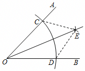

- A. SSS
- B. SAS
- C. ASA
- D. AAS

【答案】A

【解析】解：根据作图的过程可知：
OC＝OD，CE＝DE，OE＝OE
∴△OCE≌△ODE（SSS）
∴∠COE＝∠DOE
故选：A．

## 38. 单选题（难度：适中）

如图，通过在△ABC中尺规作图得到射线AM与射线BN交于点D，则点D到（　　）

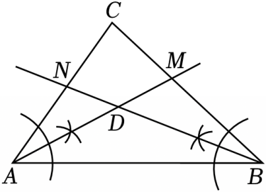

- A. 三个顶点的距离相等
- B. 三边中点的距离相等
- C. 三边高线的距离相等
- D. 三边的距离相等

【答案】D

【解析】解：点D为△ABC的内心．
根据内心的性质，内心到三角形三边的距离相等．
故选：D．

## 39. 单选题（难度：适中）

如图，在△ABC中，AB＝5，AC＝4，在AB和AC上分别截取AM，AN，使AM＝AN，分别以点M，点N为圆心，以大于$ \frac{1}{2}MN$的长为半径作弧，两弧相交于点P，连接射线AP与BC相交于点D，过点D作DE⊥AC于E．若DE＝2，则△ABC面积为（　　）

【答案】A

## 40. 单选题（难度：适中）

如图，在Rt△ABC中，∠C＝90°，以顶点A为圆心，适当长为半径画弧，分别交AC，AB于点M、N，再分别以点M、N为圆心，大于$ \frac{1}{2}MN$的长为半径画弧，两弧交于点P，作射线AP交边BC于点D，若CD＝3，AB＝8，则△ABD的面积是（　　）

【答案】A

## 41. 单选题（难度：适中）

如图，∠MON＝80°，点A在射线OM上，以点O为圆心，OA长为半径画弧，交射线ON于点B．若分别以点A，B为圆心，AB长为半径画弧，两弧在∠MON内部交于点C，连接AC，则∠OAC的大小为（　　）

【答案】A

## 42. 单选题（难度：适中）

如图，△ABC的面积为24cm2，以顶点A为圆心，适当长为半径画弧，分别交AB、AC于点M、N，再分别以点M、N为圆心，大于$ \frac{1}{2}MN$的长为半径画弧，两弧交于点P，作射线AP，过点C作CD⊥AP于点D，连接BD，则△DAB的面积是（　　）

【答案】A

## 43. 单选题（难度：适中）

如图，在Rt△ABC中，∠C＝90°，用尺规作图作出射线AP，射线AP交BC于点D，CD＝6，AD＝13，E为边AB上的一个动点，则DE的值不可能为（　　）

【答案】A

## 44. 单选题（难度：适中）

如图，在Rt△ABC中，∠C＝90°．以点A为圆心，适当的长为半径画弧，分别交AB，AC于D，E两点，再分别以点D、E为圆心，大于$ \frac{1}{2}$DE的长为半径画弧，两弧交于点F，射线BF交AC于点G，若CG＝4，AB＝8，则△ABG的面积为（　　）

【答案】A

## 45. 单选题（难度：适中）

在Rt△ABC中，∠C＝90°，以A为圆心，适当长为半径画弧，交AC，AB于D，E两点，再分别以D，E为圆心，大于$ \frac{1}{2}DE$的长为半径画弧，两弧交于点M．作射线AM交BC于点F，若BF＝5，BC＝9，则点F到AB的距离为（　　）

【答案】A

## 46. 单选题（难度：适中）

如图，已知在△ABC中，AB＝8cm，BC＝3cm，嘉淇通过尺规作图作∠ABC的角平分线BD，交AC于点D，已知△ABD的面积为16cm2，则△BCD的面积为（　　）

【答案】A

## 47. 单选题（难度：适中）

如图，在Rt△ABC中，∠C＝90°，以顶点A为圆心，适当长为半径画弧，分别交AC、AB于点M、N，再分别以点M、N为圆心，大于\( \frac{1}{2}MN\)的长为半径画弧，两弧交于点P，作射线AP交边BC于点D，若CD＝4，AB＝15，△ABC的面积为54，则AC的长度为（　　）

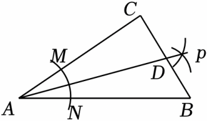

- A. 12
- B. 11
- C. 10
- D. 9

【答案】A

【解析】解：作DE⊥AB于E，如图，

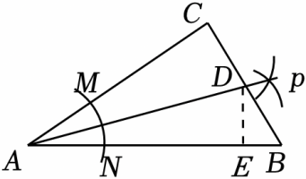
 
由题意得AP平分∠BAC，而∠C＝90°，
∴DC＝DE＝4，
∴△ABD的面积\( =\frac{1}{2}\times 15\times 4=30\)，
∵△ABC的面积是54，
∴△ACD的面积＝54﹣30＝24，
∴\( \frac{1}{2}AC\times CD=24\)，即\( \frac{1}{2}AC\times 4=24\)，
∴AC＝12，
故选：A．

## 48. 单选题（难度：适中）

如图，在∠MON中，以点O为圆心，任意长为半径作弧，交射线OM于点A，交射线ON于点B，再分别以A，B为圆心，OA的长为半径作弧，两弧在∠MON的内部交于点C，作射线OC，连接AB．若OA＝5，AB＝6，则点B到AC的距离为（　　）

【答案】A

## 49. （难度：简单）

如图，已知∠AOB，按照以下步骤画图：（1）以O为圆心，适当长为半径画弧，交OA于点M，交OB于点N．（2）分别以点M、N为圆心，大于$ \frac{1}{2}$MN的长半径画弧，两弧在∠AOB内部相交于点C．（3）作射线OC．则判断△OMC≌△ONC的依据是（　　） A．SAS  B．SSS  C．ASA  AAS

## 50. 单选题（难度：非常简单）

用尺规作图，已知三边作三角形，用到的基本作图方法是（　　）

- A. 作一个角等于已知角
- B. 作一条线段等于已知线段
- C. 作角的平分线
- D. 都没用到

【答案】B

【解析】根据作一条线段等于已知线段即可解决问题．
故选B

## 51. 单选题（难度：非常简单）

用尺规作图，已知三边作三角形，用到的基本作图方法是（　　）

【答案】A

## 52. 单选题（难度：非常简单）

用尺规作角平分线的依据是（　　）

【答案】A

## 53. 单选题（难度：非常简单）

用尺规作图，已知三边作三角形，用到的基本作图方法是（　　）

- A. 作一个角等于已知角
- B. 作一条线段等于已知线段
- C. 作角的平分线
- D. 都没用到

【答案】B

【解析】根据作一条线段等于已知线段即可解决问题．
故选B

## 54. 单选题（难度：简单）

如图，用直尺和圆规作∠MAN的角平分线，根据作图痕迹，下列结论不一定正确的是（　　）

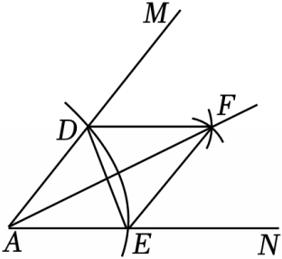

- A. AD＝AE
- B. AD＝DF
- C. DF＝EF
- D. AF⊥DE

【答案】B

【解析】利用基本作图得到AF平分∠MAN，则根据角平分线的画法可对选项进行一一判断．
故选B

## 55. 单选题（难度：简单）

如图，用直尺和圆规作一个角的平分线，是运用了“全等三角形的对应角相等”这一性质，由作图所得条件，判定三角形全等运用的方法是（　　）

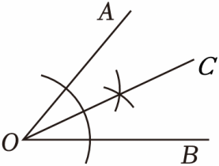

- A. SSS
- B. ASA
- C. AAS
- D. SAS

【答案】A

【解析】根据作图过程可知用到的三角形全等的判定方法是SSS．
故选A

## 56. 单选题（难度：非常简单）

如图，在综合实践课上，老师用角尺在∠AOB的两边分别截取OM＝ON，移动角尺，使角尺两边相同的刻度分别与点M，N重合，这时OC就是∠AOB的平分线，则用角尺作角平分线的过程中用到的三角形全等的依据（　　）

【答案】A

## 57. 单选题

△ABC中，BC＝10，AC﹣AB＝4．过C作∠BAC的角平分线的垂线，垂足为D，连接BD，CD，则S△BDC的最大值为（　　）

【答案】A

## 58. 单选题（难度：简单）

如图，下面是利用尺规作∠AOB的角平分线OC的作法，在用尺规作角平分线时，用到的三角形全等的判定方法是（　　）  作法：以O为圆心，任意长为半径作弧，交OA，OB于点D，E．分别以D，E为圆心，以大于$ \frac{1}{2}$DE的长为半径作弧，两弧在∠AOB内交于点C．作射线OC．则OC就是∠AOB的平分线．

【答案】A

## 59. 单选题（难度：简单）

下列尺规作图分别表示：①作一个角的平分线；②作一个角等于已知角；③作一条线段的垂直平分线．其中作法正确的是（　　）

【答案】A

## 60. 单选题（难度：非常简单）

如图，用直尺和圆规作∠AOB的角平分线，根据作图痕迹，下列结论不一定正确的是（　　）

【答案】A

## 61. 单选题（难度：非常简单）

某小组开展“用直尺和圆规作角平分线”的探究活动，作图痕迹如图．其中射线OP为∠AOB的平分线的共有（　　）

【答案】A

## 62. 单选题（难度：非常简单）

如图是尺规作∠AOB的角平分线的痕迹，这样作角平分线的根据是（　　）

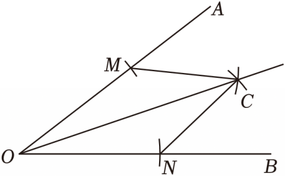

- A. SSS
- B. SAS
- C. ASA
- D. AAS

【答案】A

【解析】直接利用SSS即可判定△OMC≌△ONC．
故选A

## 63. 单选题（难度：简单）

下面是“作∠AOB的平分线”的尺规作图过程：①在OA、OB上分别截取OD、OE，使OD＝OE；②分别以点D、E为圆心，以大于$ \frac{1}{2}$DE的同一长度为半径作弧，两弧交于∠AOB内的一点C；③作射线OC．OC就是所求作的角的平分线．该尺规作图可直接利用三角形全等说明，其中三角形全等的依据是（　　）

【答案】A

## 64. 单选题（难度：简单）

如图为作一个角的角平分线的示意图，该作法的依据是全等三角形判定的基本事实，可简写为（　　）

【答案】A

## 65. 单选题（难度：非常简单）

某班开展“用直尺和圆规作角平分线”的探究活动，各组展示作图痕迹如下，其中射线OP为∠AOB的平分线的有（　　）

【答案】A

## 66. 单选题（难度：简单）

如图1，已知∠ABC，用尺规作它的角平分线．如图2，步骤如下，第一步：以B为圆心，以a为半径画弧，分别交射线BA，BC于点D，E；第二步：分别以D，E为圆心，以b为半径画弧，两弧在∠ABC内部交于点P；第三步：画射线BP．射线BP即为所求．下列正确的是（　　）

【答案】A

## 67. 单选题（难度：简单）

作∠AOB的角平分线的作图过程如下，

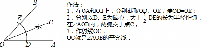

用下面的三角形全等判定法则解释其作图原理，最为恰当的是（　　）

- A. SAS
- B. ASA
- C. AAS
- D. SSS

【答案】D

【解析】根据作图步骤知OD＝OE、CD＝CE、OC＝OC，据此根据三角形全等的判定可得；
故选D

## 68. 单选题（难度：简单）

用直尺和圆规作一个角的平分线的示意图如图所示，则能说明∠AOC＝∠BOC的依据是（　　）

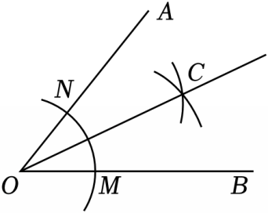

- A. AAS
- B. ASA
- C. SSS
- D. 角平分线上的点到角两边距离相等

【答案】C

【解析】连接NC，MC，根据SSS证△ONC≌△OMC，即可推出答案．
故选C

## 69. 单选题

如图，∠MON＝90°，OB＝2，点A是直线OM上的一个动点，连接AB，作∠MAB与∠ABN的角平分线AF与BF，两角平分线所在的直线交于点F，求点A在运动过程中线段BF的最小值接近于（　　）

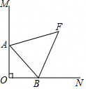

- A. 2
- B. 4
- C. \( \sqrt{2}\)
- D. \( \sqrt{3}\)

【答案】C

【解析】分情况讨论：当点A在射线OM上时，过F作FE⊥ON于E，FH⊥OM于H，FG⊥AB于G，由角平分线的性质得出FH＝FG，FG＝FE，得出FH＝FE，证出点F在∠MON的角平分线上；当点A在射线OM的反向延长线上时，同理得出点F在∠MON的角平分线上；当BF⊥OF时，BF取最小值，证出△BOF是等腰直角三角形，即可得出答案．
故选C

## 70. 单选题（难度：非常简单）

某小组开展“用直尺和圆规作角平分线”的探究活动，作图痕迹如图．

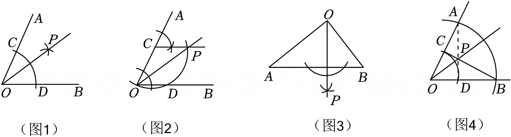

其中射线OP不一定是∠AOB的平分线的为（　　）

- A. 图1
- B. 图2
- C. 图3
- D. 图4

【答案】C

【解析】根据角平分线的定义即可得到结论．
故选C

## 71. 单选题（难度：简单）

如图是一个平分角的仪器，其中AB＝AD，BC＝DC．将点A放在角的顶点，AB和AD沿着角的两边放下，沿AC画一条射线AE，AE就是这个角的平分线．此仪器的原理是（　　）

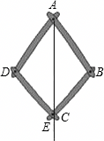

- A. SSS
- B. SAS
- C. ASA
- D. AAS

【答案】A

【解析】证明△ADC≌△ABC（SSS），得∠DAC＝∠BAC，即可得出结论．
故选A

## 72. 单选题（难度：非常简单）

如图，在综合实践课上，老师用角尺在∠AOB的两边分别截取OM＝ON，移动角尺，使角尺两边相同的刻度分别与点M，N重合，这时OC就是∠AOB的平分线，则用角尺作角平分线的过程中用到的三角形全等的依据是（　　）

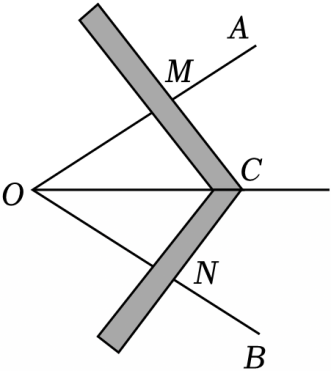

- A. HL
- B. SSS
- C. SAS
- D. ASA

【答案】B

【解析】根据题意，利用SSS证明△OCM≌△OCN，即可求解．
故选B

## 73. 单选题（难度：适中）

用直尺和圆规作一个已知角的平分线是数学中的一个基本作图．例如，用直尺和圆规作∠AOB的平分线，具体做法：①以点O为圆心，任意长为半径作弧，分别交射线OA、OB于点C、D；②分别以点C、D为圆心，大于$ \frac{1}{2}CD$的长为半径作弧，两弧在∠AOB的内部交于点M；③作射线OM，射线OM就是∠AOB的平分线．证明这种作图

【答案】A

## 74. 单选题（难度：简单）

如图，用尺规作已知角平分线，其根据是构造两个三角形全等，它所用到的判别方法是（　　）

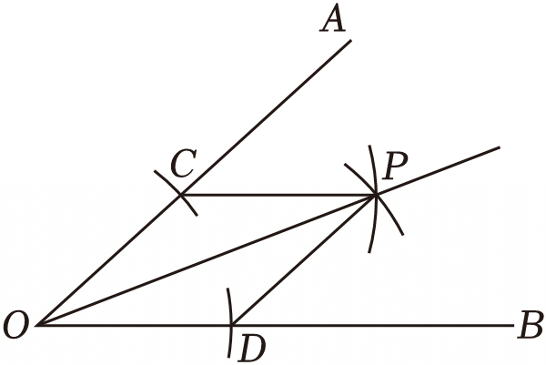

- A. SAS
- B. ASA
- C. AAS
- D. SSS

【答案】D

【解析】由画法得OC＝OD，PC＝PD，加上公共边OOP，则可根据“SSS”可判定△OCP≌△ODP，然后根据全等三角形的性质可判定OP为∠AOB的平分线．
故选D

## 75. 单选题（难度：适中）

用尺规作已知∠ABC的角平分线，步骤如下：①以B为圆心，以m为半径画弧，分别交射线BA，BC于点D，E；②分别以D，E为圆心，以n为半径画弧，两弧在∠ABC内部交于点P；③画射线BP．射线BP即为所求．对m，n的描述，正确的是（　　）

- A. m＞0，n＞0
- B. m＞0，n＜m
- C. m＞0，n\( ＞\frac{1}{2}\)DE
- D. m＞0，n\( ＜\frac{1}{2}\)DE

【答案】C

【解析】根据角平分线的画法判断即可．
故选C

## 76. 单选题

用尺规作角平分线的依据是（　　）

【答案】A

## 77. 单选题（难度：适中）

已知下列尺规作图：①作一个角的角平分线；②作一个角等于已知角；③作一条线段的垂直平分线，其中作法正确的是（　　）

【答案】A

## 78. 单选题

如图，AD∥BC，∠D＝∠ABC，点E是边DC上一点，连接AE交BC的延长线于点H．点F是边AB上一点．使得∠FBE＝∠FEB，作∠FEH的角平分线EG交BH于点G，若∠DEH＝102°，则∠BEG的度数为（　　）

【答案】A

## 79. （难度：适中）

七年级2班数学学习兴趣小组开展“用直尺和圆规作角平分线”的探究活动，作图痕迹如图：

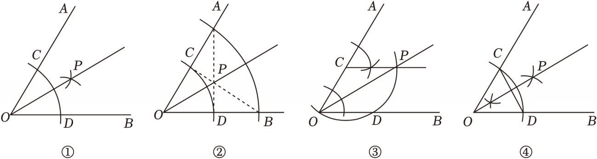

其中射线OP为∠AOB的平分线的编号为 　　 ．

【答案】

①②③④

【解析】根据角平分线的定义即可得到结论．

## 80. 单选题（难度：适中）

如图，按以下方法作一个角的平分线：（1）以O为圆心，适当长为半径画弧，分别交OA、OB于点M、N．（2）分别以点M、N为圆心，大于\( \frac{1}{2}\)MN的长为半径画弧，两弧在∠AOB的内部相交于点C．（3）画射线OC，射线OC即为所求．这种作图方法的依据是（　　）

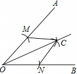

- A. AAS
- B. SAS
- C. SSS
- D. ASA

【答案】C

【解析】利用基本作图得到OM＝ON，CM＝CN，加上OC为公共边，则根据全等三角形的判定方法可判断△OMC≌△ONC．
故选C

## 81. 单选题（难度：适中）

如图，任意画一个∠BAC＝60°的△ABC，再分别作△ABC的两条角平分线BE和CD，BE和CD相交于点P，连接AP，有以下结论：①∠BPC＝120°； ②AP平分∠BAC； ③AD＝AE； ④若在线段BC上有一动点F，使得PF＝PD，则BD＝BF；其中正确的是（　　）

【答案】A

## 82. 单选题

如图，△PBC的面积为15cm²，PB为∠ABC的角平分线，作AP垂直BP于P，则△ABC的面积为（　　）

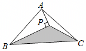

- A. 25cm²
- B. 30cm²
- C. 32.5cm²
- D. 35cm²

【答案】B

【解析】延长AP交BC于点Q，则由条件可知S△ABP＝S△BQP，S△APC＝S△PQC，则阴影部分面积为△ABC的一半，可得出答案．
故选B

## 83. 单选题（难度：适中）

某班开展“用直尺和圆规作角平分线”的探究活动，各组展示作图痕迹如下，其中射线OP为∠AOB的平分线的有（　　）

【答案】A

## 84. 单选题（难度：适中）

如图，任意画一个∠A＝60°的△ABC，再分别作△ABC的两条角平分线BE和CD，BE和CD相交于点P，连接AP，有以下结论：①∠BPC＝120°；②AP平分∠BAC；③AP＝PC；④BD+CE＝BC；⑤S△PBA：S△PCA＝AB：AC，其中正确的个数是（　　）个．

【答案】A

## 85. 单选题（难度：非常简单）

如图，∠MON＝90°，OB＝2，点A是直线OM上的一个动点，连接AB，作∠MAB与∠ABN的角平分线AF与BF，两角平分线所在的直线交于点F，求点A在运动过程中线段BF的最小值接近于（　　）

【答案】A

## 86. 填空题（难度：适中）

教材中有这样一种作角平分线的方法：已知：∠AOB．求作：∠AOB的平分线．作法：（1）以点O为圆心，适当长为半径画弧，交OA于点M，交OB于点N；（2）分别以点M，N为圆心，大于$ \frac{1}{2}MN$的长为半径画弧，两弧在∠AOB的内部相交于点C；（3）画射线OC．射线OC即为所求（如图）．请你思考这样作角平分线的依据是

## 87. 单选题（难度：适中）

如图是尺规作∠AOB的角平分线的痕迹，这样作角平分线的根据是（　　）

【答案】A

## 88. 单选题（难度：适中）

如图，在综合实践课上，老师用角尺在∠AOB的两边分别截取OM＝ON，移动角尺，使角尺两边相同的刻度分别与点M，N重合，这时OC就是∠AOB的平分线，则用角尺作角平分线的过程中用到的三角形全等的依据（　　）

【答案】A

## 89. （难度：适中）

尺规作图要求：a．过直线外一点作这条直线的垂线；b．作线段的垂直平分线：c．过直线上一点作这条直线的垂线；d．作角的平分线．其中与a、b、c、d四个作图要求依次对应的图形是 　 　 ．（填序号）

## 90. （难度：适中）

某班开展“用直尺和圆规作角平分线”的探究活动，各组展示的作图痕迹如下，其中，射线OP为∠AOB的平分线的有　　 ．

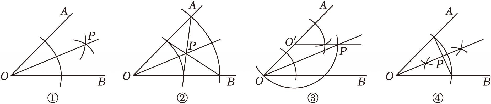

【答案】

①②③④．

【解析】根据角平分线的定义即可得到结论．

## 91. （难度：适中）

如图，是利用尺规作角平分线的示意图，其作图依据为         ．

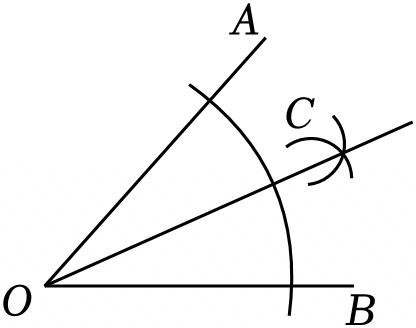

【答案】

<i>SSS</i>．

【解析】证明△OCE≌△OCD，则有∠COE＝∠COD，即可得到答案．

## 92. 单选题（难度：简单）

如图是一个平分角的仪器，其中AB＝AD，BC＝DC．将点A放在角的顶点，AB和AD沿着角的两边放下，沿AC画一条射线AE，AE就是这个角的平分线．此仪器的原理是（　　）

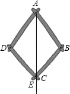

- A. SSS
- B. SAS
- C. ASA
- D. AAS

【答案】A

【解析】证明△ADC≌△ABC（SSS），得∠DAC＝∠BAC，即可得出结论．

## 93. 

如图，在△ABC中，∠A＝20°，∠EBC，∠DCB为△ABC的外角，∠EBC与∠DCB的平分线交于点A₁，∠EBA₁与∠DCA₁的平分线交于点A₂，…，∠EBAn﹣₁与∠DCAn﹣₁的平分线相交于点An．

∠A₁的度数为 　  　 ；

若得到点An后，再依此规律作角平分线，两条角平分线无交点，则n的值为 　 　 ．

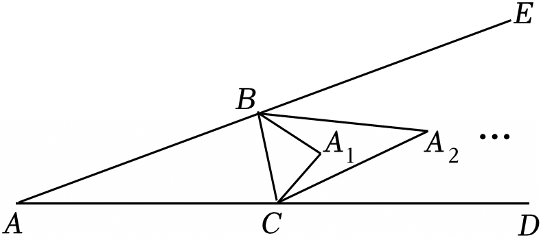

【答案】

80&deg;；

，

3．

【解析】利用整体思想结合三角形的内角和定理即可解决问题．

依次求出∠A₁，∠A₂，…∠An的度数，根据发现的规律即可解决问题．

## 94. 单选题（难度：简单）

下列四种基本尺规作图分别表示，则对应选项中作法错误的是（　　）

- A. 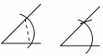
作一个角等于已知角
- B. 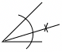
作一个角的平分线
- C. 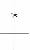
作一条线段的垂直平分线
- D. 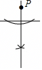
过直线外一点P作已知直线的垂线

【答案】C

【解析】利用作一个角等于已知角；作一个角的平分线；作一条线段的垂直平分线；过直线外一点P作已知直线的垂线的作法进而判断得出答案．
故选C

## 95. （难度：非常简单）

如图，学习尺规作角平分线后，学生作业中出现四种正确作法，没有用到SSS判定的是（　　）
A．
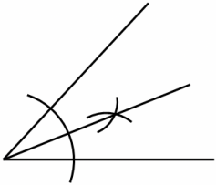
  
B．
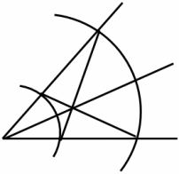
  
C．
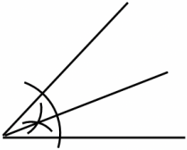
  
D．
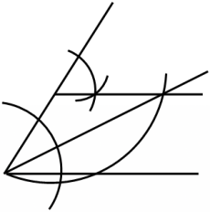

【答案】

<i>D</i>

【解析】根据尺规作图的方法结合三角形全等的判定方法，进行判断即可．
故选D

## 96. 单选题（难度：简单）

下列尺规作图分别表示：①作一个角的平分线；②作一个角等于已知角；③作一条线段的垂直平分线．其中作法正确的是（　　）

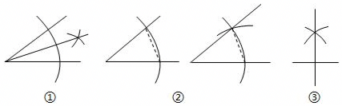

- A. ①②
- B. ①③
- C. ②③
- D. ①②③

【答案】A

【解析】利用作一个角等于已知角；作一个角的平分线；作一条线段的垂直平分线的作法进而判断即可得出答案．

## 97. 单选题（难度：适中）

在△ABC中，∠ABC＝90°，用直尺和圆规在AC上确定点D，使△ABD∽△BCD，如下四个尺规作图，正确的是（　　）

- A. （作一个角的平分线）
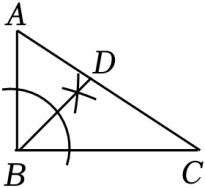
- B. （作线段的垂直平分线）
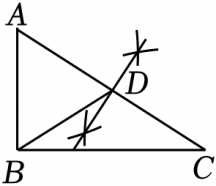
- C. （作高）
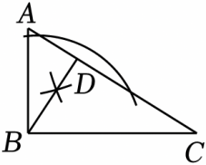
- D. （作等腰三角形）
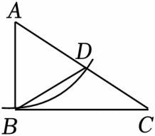

【答案】C

【解析】当BD是AC的垂线时，根据相似三角形的判定定理，即可得出△ABD∽△BCD，据此对选项进行解析，即可得出答案．
故选C

## 98. 单选题

如图1，已知∠ABC，用尺规作它的角平分线．如图2，步骤如下，第一步：以B为圆心，以a为半径画弧，分别交射线BA，BC于点D，E；第二步：分别以D，E为圆心，以b为半径画弧，两弧在∠ABC内部交于点P；第三步：画射线BP．射线BP即为所求．下列正确的是（　　）

【答案】A

## 99. 单选题（难度：简单）

如图，下面是利用尺规作∠AOB的角平分线OC的作法，在用尺规作角平分线时，用到的三角形全等的判定方法是（　　）  作法：以O为圆心，任意长为半径作弧，交OA，OB于点D，E．分别以D，E为圆心，以大于$ \frac{1}{2}$DE的长为半径作弧，两弧在∠AOB内交于点C．作射线OC．则OC就是∠AOB的平分线．

【答案】A

## 100. （难度：适中）

如图，学习尺规作角平分线后，学生作业中出现四种正确作法，没有用到SSS判定的是（　　）A．  B．  C．  D．

## 101. 

如图，矩形ABCD中，AB＝3，BC＝5，点P是BC边上的一个动点（点P与点B，C都不重合），现将△PCD沿直线PD折叠，使点C落到点F处；过点P作∠BPF的角平分线交AB于点E．设BP＝x，BE＝y，则下列图象中，能表示y与x的函数关系的图象大致是（　　）A．  B．  C．  D．

