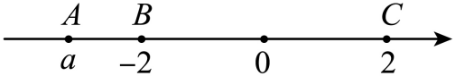
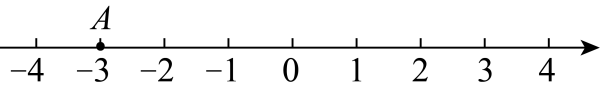
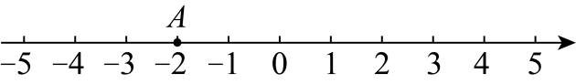

# 知识点·倒数（同步练习）

> 教材：数学·七年级上册·沪科技版2024新教材 ｜ 来源：国家中小学智慧教育平台·在线练习 ｜ 共 51 题

## 1. 单选题（难度：简单）

$ -\frac{1}{2024}$的倒数的相反数是（　　）

【答案】A

## 2. 单选题（难度：非常简单）

2025的倒数是（　　）

- A. 2025
- B. \( -2025\)
- C. \( -\frac{1}{2025}\)
- D. \( \frac{1}{2025}\)

【答案】D

【解析】解：根据倒数的定义得2025的倒数为\( \frac{1}{2025}\)，
故选：D．

## 3. 单选题（难度：简单）

若一个数的倒数是$ \frac{1}{2024}$，则这个数的相反数是（　　）

【答案】A

## 4. 单选题（难度：简单）

$ -\frac{1}{8}$的相反数的倒数是（　　）

【答案】A

## 5. 单选题（难度：简单）

下列各对数中，互为倒数的一对是（　　）

- A. 4和\( -4\)
- B. \( -2\)和\( -\frac{1}{2}\)
- C. \( -3\)和\( \frac{1}{3}\)
- D. 0和0

【答案】B

【解析】解：A、4和\( -4\)不是倒数，故该选项不符合题意；
B、\( -2\times \left(-\frac{1}{2}\right)=1\)，\( -2\)和\( -\frac{1}{2}\)互为倒数，故该选项符合题意；
C、\( -3\times \frac{1}{3}=-1\)，\( -3\)和\( \frac{1}{3}\)不是倒数，故该选项不符合题意；
D、0没有倒数，故该选项不符合题意；
故选：B

## 6. 单选题（难度：简单）

关于0的四种说法，正确的有（　　）个．①0的绝对值是它的本身．②0的相反数是它的本身．③0的倒数是它的本身．④0是最小的整数．

【答案】A

## 7. 单选题（难度：简单）

$ -\frac{1}{2025}$的倒数是（    ）

【答案】A

## 8. 单选题（难度：简单）

关于有理数a，下列说法正确的是（　　）

【答案】A

## 9. 单选题（难度：简单）

下列四个数中，与\( 2025\)的乘积为\( 1\)的数是（　　）

- A. \( -2025\)
- B. \( \frac{1}{2025}\)
- C. 2025
- D. \( -\frac{1}{2025}\)

【答案】B

【解析】解：与\( 2025\)的乘积为\( 1\)的数是\( \frac{1}{2025}\)；
故选：B．

## 10. 单选题（难度：简单）

下列说法正确的是（　　）

【答案】A

## 11. 单选题（难度：非常简单）

有理数$ -\frac{5}{6}$的倒数是（　　）

【答案】A

## 12. 单选题（难度：简单）

$ -1.5$的倒数是（　　）

【答案】A

## 13. 单选题（难度：非常简单）

$ \left|-2025\right|$的倒数是（　　）

【答案】A

## 14. 单选题（难度：简单）

下列四个数中，\( -\frac{1}{3}\)的倒数是（　　）

- A. \( 3\)
- B. \( \frac{1}{3}\)
- C. \( -\frac{1}{3}\)
- D. \( -3\)

【答案】D

【解析】解：∵\( \left(-3\right)\times \left(-\frac{1}{3}\right)=1\)，
∴\( -\frac{1}{3}\)的倒数是\( -3\)，故D正确．
故选：D．

## 15. 单选题（难度：简单）

下列各组数中，互为倒数的是（　　）

- A. \( -2\)与\( 2\)
- B. \( -2\)与\( \left|-2\right|\)
- C. \( -2\)与\( \frac{1}{2}\)
- D. \( -2\)与\( -\frac{1}{2}\)

【答案】D

【解析】解：A. \( -2\)与\( 2\)互为相反数，故该选项不符合题意；
B.\( \because \) \( \left|-2\right|=2\)， 
\( \therefore \) \( -2\)与\( \left|2\right|\)互为相反数，
故该选项不符合题意；
C.\( \because -2\times \frac{1}{2}=-1\)， 故该选项不符合题意；
D.\( \because -2\times \left(-\frac{1}{2}\right)=1\)，
\( \therefore \) \( -2\)与\( -\frac{1}{2}\)互为倒数，
故该选项符合题意；
故选：D ．

## 16. 单选题（难度：非常简单）

$ -4$的倒数是（　　）

【答案】A

## 17. 单选题（难度：简单）

一个数和它的倒数相等，则这个数是（　　）

【答案】A

## 18. 单选题（难度：简单）

若$ \mathrm{a}，\mathrm{b}$互为倒数，则$ \mathrm{a}\mathrm{b}-1$的值为（　　）

【答案】A

## 19. 单选题（难度：简单）

中国古代数学著作《九章算术》最早提到了负数，则\( -\frac{1}{2025}\)的倒数是（　　）

- A. \( \left|-2025\right|\)
- B. \( -2025\)
- C. \( \frac{1}{2025}\)
- D. \( -\frac{1}{2025}\)

【答案】B

【解析】解：\( -\frac{1}{2025}\)的倒数是\( -2025\)．
故选：B．

## 20. 单选题（难度：简单）

$ \left|-2\right|$的倒数是（　　）

【答案】A

## 21. 单选题（难度：简单）

下列对数学符号\( \left|-2023\right|\)描述正确的是（　　）

- A. 2023的相反数
- B. \( -2023\)的绝对值
- C. \( -2023\)的倒数
- D. \( -2023\)的相反数

【答案】B

【解析】解：\( \left|-2023\right|\)表示\( -2023\)的绝对值，
故选： B．

## 22. 单选题（难度：简单）

如图，用数轴上的点表示2的倒数，正确的是（　　）

【答案】A

## 23. 单选题（难度：简单）

如图，数轴上点\( \mathrm{A}\)，\( \mathrm{B}\)，\( \mathrm{C}\)表示的数分别为\( \mathrm{a}\)，\( -2\)，\( 2\)．点\( \mathrm{D}\)表示的数与\( \mathrm{a}\)互为倒数．下列四个点中，点\( \mathrm{D}\)最接近（　　）

- A. 点\( \mathrm{A}\)
- B. 点\( \mathrm{B}\)
- C. 点\( \mathrm{C}\)
- D. 原点

【答案】D

【解析】解：由图可知：\( \mathrm{a}<-2\)，
\( \therefore \mathrm{a}\)的倒数\( -\frac{1}{2}<\frac{1}{\mathrm{a}}<0\)，
\( \therefore \)上述四个点中，点\( \mathrm{D}\)最接近原点，
故选：\( \text{D}\)．

## 24. 单选题（难度：简单）

\( -3\frac{2}{3}\)的倒数是（　　）

- A. \( -3\frac{3}{2}\)
- B. \( 3\frac{2}{3}\)
- C. \( -\frac{3}{11}\)
- D. \( -\frac{9}{2}\)

【答案】C

【解析】解：\( -3\frac{2}{3}=-\frac{11}{3}\)，
∵\( -\frac{11}{3}\times \left(-\frac{3}{11}\right)=1\)，
∴\( -\frac{11}{3}\)的倒数是\( -\frac{3}{11}\)，
即\( -3\frac{2}{3}\)的倒数是\( -\frac{3}{11}\)，
故选：C．

## 25. 单选题（难度：简单）

\( -2025\)表示（　　）

- A. \( 2025\)的相反数
- B. \( 2025\)的倒数
- C. \( 2025\)的绝对值
- D. \( -2025\)的绝对值

【答案】A

【解析】解：\( -2025\)表示\( 2025\)的相反数，
故选：A

## 26. 单选题（难度：简单）

已知$ \mathrm{a}$的倒数是$ -\frac{1}{3}$，则$ \mathrm{a}$的相反数为（　　）

【答案】A

## 27. 单选题（难度：简单）

$ -0.2$的倒数的绝对值是（　　）

【答案】A

## 28. 单选题（难度：简单）

有理数$ \mathrm{a}$的倒数等于本身，那么$ \mathrm{a}$等于（　　）

【答案】A

## 29. 单选题（难度：简单）

若（　　）$ \times \left(-3\right)=1$，则括号内应填的有理数是（　　）

【答案】A

## 30. 单选题（难度：简单）

若数$ \mathrm{m}$的倒数的相反数为$ \frac{2}{3}$，则数$ \mathrm{m}$为（　　）

【答案】A

## 31. 单选题（难度：简单）

若$ \mathrm{a}=-\frac{3}{2}$，a和b互为倒数，则b是（　　）

【答案】A

## 32. 单选题（难度：简单）

下列说法正确的是（　　）

【答案】A

## 33. 单选题（难度：简单）

下列说法中正确的是（　　）

- A. 0既不是整数也不是分数
- B. 0没有相反数
- C. 倒数等于本身的数有0，1
- D. 一个数的绝对值一定是非负数

【答案】D

【解析】A选项：0是整数，故A选项错误；
B选项：0的相反数是0，故B选项错误；
C选项：倒数等于本身的数有\( -1\)，1，故C选项错误；
D选项：一个数的绝对值一定是非负数，故D选项正确．
故选：D．

## 34. 单选题（难度：简单）

1不是$ -1$的（　　）

【答案】A

## 35. 单选题（难度：简单）

关于下列结论：①$ \frac{1}{3}$的倒数是3；②乘积是1的两个数互为倒数；③0的倒数是0． 其中判断全部正确的组合为（　　）

【答案】A

## 36. 单选题（难度：简单）

若$ \mathrm{x}=(-5)\times 2$，则x的倒数是（　　）

【答案】A

## 37. 单选题（难度：简单）

学完《有理数》之后，甲同学对乙同学说：“\( \mathrm{a}\)为最小的正整数，b是最大的负整数，c是倒数等于自身的有理数，你知道\( \mathrm{a}+\mathrm{b}+\mathrm{c}\)等于多少？”乙同学脱口答出正确答案是（　　）

- A. 0
- B. \( -1\)
- C. 1或\( -1\)
- D. 1或2

【答案】C

【解析】解：\( \because \mathrm{a}\)为最小的正整数，
\( \therefore \mathrm{a}=1\)；
\( \because \mathrm{b}\)是最大的负整数，
\( \therefore \mathrm{b}=-1\)；
∵\( \mathrm{c}\)是倒数等于自身的有理数，
∴\( \mathrm{c}=\pm 1\)．
∴当\( \mathrm{c}=1\)时，\( \mathrm{a}+\mathrm{b}+\mathrm{c}=1+\left(-1\right)+1=1\)；
当\( \mathrm{c}=-1\)时，\( \mathrm{a}+\mathrm{b}+\mathrm{c}=1+\left(-1\right)+\left(-1\right)=-1\)．
故选：C．

## 38. 单选题（难度：简单）

若\( \mathrm{m}\)，\( \mathrm{n}\)互为倒数，且满足\( \mathrm{m}+\mathrm{m}\mathrm{n}=3\)，则\( \mathrm{m}\)的值为（　　）

- A. \( \frac{1}{4}\)
- B. \( 2\)
- C. \( \frac{1}{2}\)
- D. \( 4\)

【答案】B

【解析】解：∵\( \mathrm{m}\)，\( \mathrm{n}\)互为倒数，
∴\( \mathrm{m}\mathrm{n}=1\)，
∴\( \mathrm{m}+1=3\)，
∴\( \mathrm{m}=2\)，
故选：\( \text{B}\)．

## 39. 单选题（难度：适中）

\( -1\frac{1}{5}\)的倒数与\( \frac{1}{5}\)的相反数的积为（　　）

- A. \( -\frac{1}{6}\)
- B. \( \frac{1}{6}\)
- C. 6
- D. \( -6\)

【答案】B

【解析】解：\( -1\frac{1}{5}\)的倒数为\( -\frac{5}{6}\)，\( \frac{1}{5}\)的相反数为\( -\frac{1}{5}\)，
∴\( -\frac{5}{6}\times \left(-\frac{1}{5}\right)=\frac{1}{6}\)，
故选：B ．

## 40. 单选题（难度：简单）

以下叙述中，正确的是（　　）

【答案】A

## 41. 单选题（难度：适中）

下列说法正确的个数是（　　）
①\( -2024\)的相反数是2024；    ②\( -2024\)的绝对值是2024；  ③\( -2024\)的倒数是\( \frac{1}{2024}\)．

- A. 3个
- B. 2个
- C. 1个
- D. 0个

【答案】B

【解析】解：①\( -2024\)的相反数是2024，正确，
②\( -2024\)的绝对值是2024，正确，
③\( -2024\)的倒数是\( -\frac{1}{2024}\)，错误．
∴正确的个数是2个．
故选：B

## 42. 单选题（难度：适中）

如果\( \mathrm{x}\cdot \mathrm{y}=1\)，那么实数\( \mathrm{x}\)、\( \mathrm{y}\)的取值一定（　　）

- A. 互为倒数
- B. 相等
- C. 互为相反数
- D. 都为1

【答案】A

【解析】解：如果\( \mathrm{x}\cdot \mathrm{y}=1\)，那么实数\( \mathrm{x}\)、\( \mathrm{y}\)的取值一定互为倒数，
故选：A．

## 43. 单选题（难度：适中）

若两个数a，b的乘积为\( -1\)，则a与b互为负倒数，下面选项中的两数互为负倒数的是（　　）

- A. 4和\( 0.25\)
- B. \( \left|-5\right|\)和\( -\frac{1}{5}\)
- C. \( \frac{1}{2}\)和\( -\frac{3}{2}\)
- D. \( +\left(-1\right)\)和\( -\left(+1\right)\)

【答案】B

【解析】解：\( 4\times 0.25=1\)，故A不符合题意；
\( \left|-5\right|\times \left(-\frac{1}{5}\right)=5\times \left(-\frac{1}{5}\right)=-1\)，故B符合题意；
\( \frac{1}{2}\times \left(-\frac{3}{2}\right)=-\frac{3}{4}\)，故C不符合题意；
\( \left[+\left(-1\right)\right]\times \left[-\left(+1\right)\right]=-1\times \left(-1\right)=1\)，故D不符合题意；
故选：B ．

## 44. 单选题（难度：适中）

下列说法错误的是（　　）

- A. \( -2\)的相反数是2
- B. 3的倒数是\( \frac{1}{3}\)
- C. \( \left(-3\right)-\left(-5\right)=2\)
- D. 0是最小的有理数

【答案】D

【解析】解：A、\( -2\)的相反数是2，故A正确；
B、3的倒数是\( \frac{1}{3}\)，故B正确；
C、\( \left(-3\right)-\left(-5\right)=-3+5=2\)，故C正确；
D、没有最小的有理数，故D错误；
故选：D．

## 45. 单选题（难度：适中）

比2024的倒数小的数是（　　）

- A. 1
- B. 2024
- C. \( \frac{1}{2024}\)
- D. \( -\frac{1}{2024}\)

【答案】D

【解析】解：2024的倒数是\( \frac{1}{2024}\)，
∵\( -\frac{1}{2024}<\frac{1}{2024}<1<2024\)，
∴比2024的倒数小的数是\( -\frac{1}{2024}\)，
故选D

## 46. 单选题（难度：适中）

如果$ \mathrm{a}\mathrm{与}\mathrm{b}$互为倒数，那么（　　）

【答案】A

## 47. 单选题（难度：适中）

下列选项判断正确的是（　　）

- A. \( -\frac{5}{7}<-\frac{5}{8}\)
- B. \( \mathrm{x}-1\)是有理数，它的倒数是\( \frac{1}{\mathrm{x}-1}\)
- C. 若\( \left|\mathrm{a}\right|=\left|\mathrm{b}\right|\)，则\( \mathrm{a}=\mathrm{b}\)
- D. 若\( \left|\mathrm{a}\right|=-\mathrm{a}\)，则\( \mathrm{a}<0\)

【答案】A

【解析】解：A． ∵\( \frac{5}{7}>\frac{5}{8}\)，∴\( -\frac{5}{7}<-\frac{5}{8}\)，故选项Ａ正确，符合题意；
B． 当\( \mathrm{x}-1=0\)时，没有倒数，故选项B错误，不符合题意；
C.若\( \left|\mathrm{a}\right|=\left|\mathrm{b}\right|\)，则\( \mathrm{a}=\mathrm{b}\)或\( \mathrm{a}=-\mathrm{b}\)，故选项C错误，不符合题意；
D. 若\( \left|\mathrm{a}\right|=-\mathrm{a}\)，则\( \mathrm{a}\le 0\)，故选项D错误，不符合题意；
故选：A

## 48. 单选题（难度：适中）

如图，数轴上点A表示的数是（　　）
 

- A. 3
- B. \( -3\)的相反数
- C. 3的绝对值
- D. \( -\frac{1}{3}\)的倒数

【答案】D

【解析】解：观察数轴得：数轴上点A表示的数是\( -3\)，
即为\( -\frac{1}{3}\)的倒数．
故选：D

## 49. 单选题（难度：适中）

已知\( \left|\mathrm{a}\right|=1\)，b是\( -\frac{1}{2}\)的倒数，则\( \mathrm{a}+\mathrm{b}\)的值为（　　）

- A. \( -3\)
- B. \( -1\)
- C. 1或\( -3\)
- D. \( -1\)或\( -3\)

【答案】D

【解析】解：\( \because \left|\mathrm{a}\right|=1\)，\( \mathrm{b}\)是\( -\frac{1}{2}\)的倒数，
\( \therefore \mathrm{a}=\pm 1\)，\( \mathrm{b}=-2\)，
\( \therefore \mathrm{a}+\mathrm{b}\) 
\( =1-2\) 
\( =-1\)，
或\( \mathrm{a}+\mathrm{b}\)
\( =-1-2\) 
\( =-3\)．
\( \therefore \mathrm{a}+\mathrm{b}\)的值为\( -1\)或\( -3\)．
故选：D．

## 50. 单选题（难度：适中）

如图，数轴上点A所表示的数的倒数是（　　）
 

- A. \( -2\)
- B. 2
- C. \( \frac{1}{2}\)
- D. \( -\frac{1}{2}\)

【答案】D

【解析】解：由数轴可知点A表示的数是\( -2\)，
∴它的倒数是\( -\frac{1}{2}\)；
故选D．

## 51. 单选题（难度：简单）

实数a，b，c，d在数轴上的对应点的位置如图所示，则正确的结论是（　　）

【答案】A
