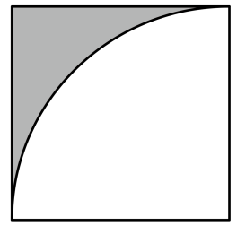
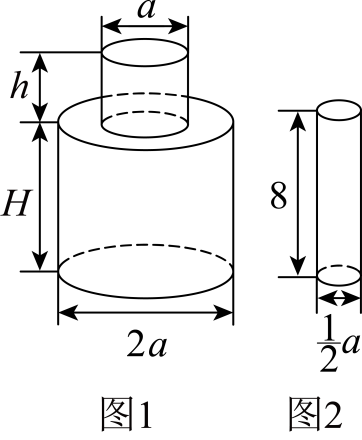
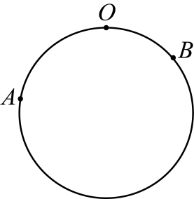
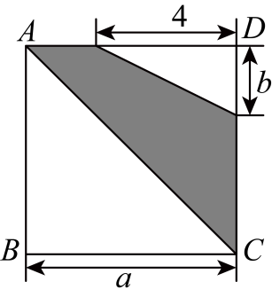

# 知识点·列代数式（同步练习）

> 教材：数学·七年级上册·沪科技版2024新教材 ｜ 来源：国家中小学智慧教育平台·在线练习 ｜ 共 50 题

## 1. 单选题（难度：适中）

下列能够表示比x的\(\frac{1}{2}\)倍多8的代数式为（   ）

- A. \(\frac{1}{2}x+8\)
- B. \(\frac{1}{2}\left( x+8 \right)\)
- C. \(\frac{1}{2}x-8\)
- D. \(\frac{1}{2}\left( x-8 \right)\)

【答案】A

【解析】本题考查的是列代数式，先表示\(x\)的\(\frac{1}{2}\)倍为\(\frac{1}{2}x\)，再表示比其多8即可，理解代数式中的运算顺序是解本题的关键．

## 2. 单选题（难度：适中）

“\(n\)个5相加”可以用代数式表示为（   ）

- A. \(5n\)
- B. \(5+n\)
- C. \(5-n\)
- D. \(n\div 5\)

【答案】A

【解析】本题考查列代数式，根据\(n\)个5相加可以表示为\(5n\)，判断即可．

## 3. 单选题（难度：适中）

“比b的3倍小6的数”用代数式表示是（     ）

【答案】A

## 4. 单选题（难度：适中）

一件商品售价\(x\)元，利润率为\(a%\left( a>0 \right)\)，则这种商品每件的成本是（   ）

- A. \((1+a\% )x\)元
- B. \(\left ( {1-a\% } \right )x\)元
- C. \(\frac{x}{1-a%}\)元
- D. \(\frac{x}{1+a \%}\)元

【答案】D

【解析】此题主要考查了列代数式，正确掌握售价\(=\)（\(1+\)利润率）\(\times \)成本是解题关键. 根据售价\(=\)（\(1+\)利润率）\(\times \)成本求解即可.

## 5. 单选题（难度：适中）

已知买2千克苹果共花费\(m\)元，则苹果每千克是（   ）

- A. \(\frac{m}{2}\)元
- B. \(\left( m+2 \right)\)元
- C. \(\left( m-2 \right)\)元
- D. \({2 m}\)元

【答案】A

【解析】本题考查了列代数式表示实际问题，根据题意列出代数式即可．

## 6. 单选题（难度：适中）

为了彰显我国优秀传统文化与时俱进的光彩与魅力，国庆期间，岳麓书院某文创店以每件40元的价格购进了国风挂件$a$件，以每件$b$元$\left( b>40 \right)$的销售价全部售出，则该文创

【答案】A

## 7. 单选题（难度：适中）

某服装店购买了a件120元的裙子和b件150元的裙子，下列表示总价（单位：元）的代数式正确的是（   ）

【答案】A

## 8. 单选题（难度：适中）

甲工程队完成一项工程需\(n\)天，乙工程队要用\(2n\)天才能完成这项工程，那么两队共同工作一天完成这项工作的（   ）

- A. \(3n\)
- B. \(\frac{1}{3n}\)
- C. \(\frac{n}{3}\)
- D. \(\frac{3}{2n}\)

【答案】D

【解析】本题考查列代数式以及分式的加法，熟练掌握以上知识点是解答本题的关键．
根据题意知：甲工程队的效率为\(\frac{1}{n}\)，乙工程队的效率为\(\frac{1}{2n}\)，再将\(\frac{1}{n}\)与\(\frac{1}{2n}\)相加即可求解．

## 9. 单选题（难度：适中）

“比x的平方大2”，可用代数式表示为（    ）

【答案】A

## 10. 单选题（难度：适中）

随着科技的快速发展，芯片在日常生活和工作中的应用也越来越广泛．已知某芯片厂2023年的产量为a、2024年的产量比2023年增加了$15%$，则2024年的产量为（   ）

【答案】A

## 11. 单选题（难度：适中）

用代数式表示“x的平方的3倍与y的和”正确的是（　　）

- A. \({{\left( 3x \right)}^{2}}+y\)
- B. \(3{{x}^{2}}+y\)
- C. \(3{{\left( x+y \right)}^{2}}\)
- D. \({{\left( 3x+y \right)}^{2}}\)

【答案】B

【解析】本题考查列代数式，根据题意，可以用含x、y的代数式表示出x的平方的3倍与y的和，解答本题的关键是明确题意，列出相应的代数式．

## 12. 单选题（难度：适中）

表示x与$-9$的差的5倍的代数式是（   ）

【答案】A

## 13. 单选题（难度：适中）

某单位组织员工乘车赴香山溶洞游玩，若全部租用7座（不含司机座）的车需要$x$辆，且最后一辆车还差2人未坐满，则此次参加游玩的员工有（   ）

【答案】A

## 14. 单选题（难度：适中）

某超市新进一种砂糖橘很受客户欢迎，现用m元可购买n千克，则该砂糖橘的单价为（   ）

【答案】A

## 15. 单选题（难度：适中）

若$x$与$y$均不为$0$，则表示$y$与$x$成反比例关

【答案】A

## 16. 单选题（难度：适中）

如图，已知正方形的边长为\(a\)，则图中阴影部分的面积可以用代数式表示为（   ）

- A. \(\frac{1}{2}{{a}^{2}}\)
- B. \({{a}^{2}}-\frac{1}{4}\text{ }\!\!\pi\!\!\text{ }{{a}^{2}}\)
- C. \(\frac{1}{4}{{a}^{2}}\)
- D. \({a}^{2} - \frac{1}{2}\pi {a}^{2}\)

【答案】B

【解析】本题考查了列代数式，掌握正方形和圆的面积公式是解题关键．用正方形的面积减去四分之一圆的面积列式即可．

## 17. 单选题（难度：适中）

如图，图1的瓶子中盛满了水，如果将这个瓶子中的水全部倒入图2这样的杯子中，那么一共需要（   ）个这样的杯子．

- A. \(\frac{1}{2}h+2H\)
- B. \(\frac{1}{2}h+H\)
- C. \(h+2H\)
- D. \(h+H\)

【答案】A

【解析】本题考查了整式除法的应用，列代数式，解本题的关键在熟练掌握圆柱的体积公式．圆柱的体积公式\(=\text{ }\!\!\pi\!\!\text{ }{{r}^{2}}\cdot h\)．首先算出图（1）中瓶子的体积，然后再算出图（2）中杯子的体积，即可得出结论．

## 18. 单选题

如图是一个400米长的圆形跑道，从点\(O\)出发，沿跑道顺时针跑出52米的距离记作\(+52\)米，逆时针跑出60米的距离记作\(-60\)米．定义1：跑道上任意两点之间较短圆弧的长度叫做这两点的弧距；定义2：若点\(M\)为跑道上\(A\)，\(B\)两点之间较短圆弧上一点，且到\(A\)，\(B\)两点的弧距满足：其中一个弧距是另一个弧距的3倍，则称\(M\)为\(A\)，\(B\)两点的“友谊点”．已知跑道上两点\(A\)，\(B\)对应的有理数分别为\(-80\)，40，根据上述定义，\(A\)，\(B\)两点的“友谊点”\(M\)在跑道上对应的有理数为（   ）

- A. \(-40\)或0
- B. \(-40+400 k\)或\(400k\)（\(k\)为任意整数）
- C. \(-50\)或10
- D. \(-50+400k\)或\(10+400k\)（\(k\)为任意整数）

【答案】D

【解析】本题考查了列代数式．设M在跑道上对应的有理数为x，则\(AM=x+80\)，\(BM=40-x\)，根据定义可列方程\(3AM=BM\)或\(AM=3BM\)，即可求解．

## 19. 单选题（难度：适中）

如图，正方形\(ABCD\)的边长为a，根据图中数据，用含a，b的代数式表示阴影部分的面积，下列代数式正确的是（   ）．

- A. \(\frac{1}{2}{{a}^{2}}-2b\)
- B. \(\frac{1}{2}{{a}^{2}}-4b\)
- C. \({{a}^{2}}-2b\)
- D. \({{a}^{2}}-4b\)

【答案】A

【解析】本题考查列代数式，利用两个直角三角形的面积差表示出阴影部分的面积即可．

## 20. 单选题（难度：适中）

连江县居民生活用电采用阶梯计价收费：月用电量$0\tilde{\ }230$度，单价$0.5$元/度；月用电量$231\tilde{\ }420$度，单价$\frac{1}{4}\text{t}$的$\frac{3}{5}$是（　　）吨．

【答案】A

## 22. 单选题（难度：适中）

“微信、支付宝、银行卡、云闪付”等移动支付由于快捷便利已成为大家平时生活中非常普遍的支付方式．小明妈妈11月移动支付账单为$a$元，12月领取了政府发放的100元购物消费券，实际支出比上月支出的2倍还多10元，那么12月的支出可表示为（   ）

【答案】A

## 23. 单选题（难度：适中）

一件衣服按原价的九折销售，现价为$a$元，则原价为（   ）

【答案】A

## 24. 单选题（难度：适中）

“a与1的差的2倍”用代数式可以表示为（   ）

【答案】A

## 25. 单选题（难度：适中）

小苍去商店买球类用品，若购买4个篮球，则他所带的钱还缺12元；若购买2个篮球和3个排球，则他所带的钱还缺4元．若购买6个排球，则他所带的钱还剩（   ）

【答案】A

## 26. 单选题（难度：适中）

设甲数是\(a\)，乙数是\(b\)，甲、乙两数平方的差用代数式可以表示为（   ）

- A. \({{a}^{2}}-b\)
- B. \(a-{{b}^{2}}\)
- C. \({{\left( a-b \right)}^{2}}\)
- D. \({{a}^{2}}-{{b}^{2}}\)

【答案】D

【解析】本题考查了列代数式，根据甲、乙两数平方的差，则用代数式可以表示为\({{a}^{2}}-{{b}^{2}}\)，即可作答．

## 27. 单选题（难度：适中）

用代数式表示“$a$与$b$平方和的一半”，正确的是（   ）

【答案】A

## 28. 单选题（难度：适中）

甲、乙两船从同一港口同时出发反向而行，甲船顺水，乙船逆水，两船在静水中的速度都是\(50\text{km/h}\)，水流速度是\(a\text{km/h}\)，\(4\text{h}\)后甲船比乙船多航行（   ）千米．

- A. \(4a\)
- B. \(6a\)
- C. \(8a\)
- D. \(10a\)

【答案】C

【解析】本题考查列代数式解决应用题，整式加减的应用，涉及船在顺水与逆水中的速度、距离\(=\)速度\(\times \)时间、整式运算等知识，根据题意，将甲船顺水和乙船逆水速度用代数式表示出来，再由距离\(=\)速度\(\times \)时间代值求出航行距离，作差即可得到答案．

## 29. 单选题（难度：适中）

把3添放在一个三位数$a$的右边，得到一个四位数，则这个四位数可表示为（   ）

【答案】A

## 30. 单选题（难度：适中）

某学校一位数学老师为在数学探究活动中表现优秀的\(x\)名学生每人买了一份奖品，扫码支付了\(y\)元，则每份奖品的价格可表示为（   ）

- A. \(\left( x+y \right)\)元
- B. \(xy\)元
- C. \(\frac{x}{y}\)元
- D. \(\frac{y}{x}\)元

【答案】D

【解析】本题考查了列代数式，根据单价=钱数÷数量列式即可．

## 31. 单选题（难度：适中）

一个两位数的十位数字为\(a\)，个位数字为\(b\)，若把它的个位数字与十位数字对调将得到一个新的两位数，则新数与原数的和能被整除的数为（   ）

- A. \(7\)
- B. \(9\)
- C. \(11\)
- D. \(13\)

【答案】C

【解析】本题考查了列代数式，整式的加法运算，熟练掌握运算法则是解题的关键．
由题意得这个两位数为\(10a+b\)， 对调后的两位数为\(10b+a\)， 则两个数的和为\(11\left( a+b \right)\)， 从而判断结果．

## 32. 单选题（难度：适中）

用代数式表示比y的2倍少1的数，正确的是（   ）

- A. \(2\left( y-1 \right)\)
- B. \(2y+1\)
- C. \(2y-1\)
- D. \(1-2y\)

【答案】C

【解析】本题考查了列代数式，读懂题意，根据题中的描述正确列出代数式是解题的关键．
根据题意即可直接得出答案．

## 33. 单选题（难度：适中）

某地居民生活用水收费标准：每月用水量不超过20立方米，每立方米$a$元；超过部分每立方米$\left( a+1.5 \right)$元．该地区某用户上月用水量为30立方米，则应缴水费为（   ）

【答案】A

## 34. 单选题（难度：适中）

下列各项中，列出的代数式正确的是（    ）

- A. 一个正方形的边长是\(a\text{cm}\)， 把这个正方形的边长增加\(1\text{cm}\)后所得到的正方形的面积是\(\left( {{a}^{2}}+1 \right)\text{c}{{\text{m}}^{2}}\)
- B. \(x\)与\(y\)平方的和是\({{(x+y)}^{2}}\)
- C. 如果\(a\)表示一个自然数，那么它的后一个自然数是\(a+1\)
- D. 某商品原价是\(x\)元，提价\(10%\)后的价格是\(10\text{ }\!\!%\!\!\text{ }x\)

【答案】C

【解析】此题考查了列代数式，根据列代数式的方法逐项排除即可，弄清题中的等量关系是解题的关键．

## 35. 单选题（难度：适中）

字母a表示一个数，则下列说法正确的是（   ）

- A. \(-a\)表示零
- B. \(-a\)表示负数
- C. \(-a\)表示正数
- D. \(-a\)与a的绝对值相等

【答案】D

【解析】本题考查了代数式、相反数等知识点，掌握代数式与相反数的关系成为解题的关键．
根据代数式的意义、相反数的性质逐项判断即可．

## 36. 单选题（难度：适中）

春节游河南，寻根溯源，品味地道年味！现有游客\(m\)人到河南游玩，需要住宿，共有\(n\)个大小相同的间房，结果还有\(1\)个人无房住，则每间房可住的人数为（    ）

- A. \(\frac{m}{n}+1\)
- B. \(\frac{m}{n}-1\)
- C. \(\frac{m-1}{n}\)
- D. \(\frac{m+1}{n}\)

【答案】C

【解析】本题考查了分式的应用，根据题意列出代数式即可，理解题意是解题的关键．

## 37. 单选题（难度：适中）

如图中表示阴影部分面积错误的代数式是（    ）

【答案】A

## 38. 单选题（难度：适中）

下列说法正确的是（   ）

【答案】A

## 39. 单选题（难度：适中）

下列说法正确的是(    )

- A. 当长方形的周长一定时，相邻两边的长成反比例关系
- B. 某商品的进价为\(x\)元，先按进价的\(1.1\)倍标价，后又降价\(80\)元出售，现在的售价可以表示为\(1.1\left( x-80 \right)\)元
- C. 观察\(-2\)，\(4\)，\(-8\)，\(16\)，\(-32\)，\(64\)，\(\ldots\)，则第\(10\)个数是\(512\)
- D. 代数式\({{x}^{2}}+2x+8\)的意义是\(x\)的平方，\(x\)的\(2\)倍，与\(8\)的和

【答案】D

【解析】本题考查了用字母表示数，数字类规律探究，列代数式以及代数式的意义；根据以上知识逐项解析判断，即可求解．

## 40. 单选题（难度：适中）

某文具店的老板以每个\(a\)元的进价购进笔记本，每本笔记本按\(20%\)的利润率确定它的标价，为尽快售出该批笔记本，决定在标价的基础上降价\(5%\)确定该批笔记本的售价，则这批笔记本的售价为（   ）

- A. ​\(20\% \times 5\% a\)​元
- B. \(\left ( {1-20\% +5\% } \right )a\)元
- C. \((1-20\% )\times \left ( {1+5\% } \right )a\)元
- D. \((1+20\% )\times \left ( {1-5\% } \right )a\)元

【答案】D

【解析】本题考查列代数式，根据售价等于标价乘以折扣计算即可．

## 41. 单选题（难度：适中）

某运输公司计划运输500吨货物，如果用\(t\)表示运输的天数，用\(a\)表示每天运输的吨数，则下列式子可表示\(t\)与\(a\)的关系的是（    ）

- A. \(\frac{t}{a}=500\)
- B. \(t=\frac{500}{a}\)
- C. \(a=500t\)
- D. \(t=500-a\)

【答案】B

【解析】本题主要考查了列代数式，解题的关键是理解题意，根据运输的天数\(=\frac{}{}\)，进行求解即可．

## 42. 单选题（难度：适中）

买一个足球需要a元，买一个篮球需要b元，则买7个足球和3个篮球共需要（    ）

- A. \(21ab\)元
- B. \(\left( 7a+3b \right)\)元
- C. \(\left( 3a+7b \right)\)元
- D. \(10ab\)元

【答案】B

【解析】本题考查列代数式，根据总费用等于单价乘以数量，再用足球的总费用加上篮球的总费用，列出代数式即可．

## 43. 单选题（难度：适中）

学校操场旁边有一块长为20米，宽为10米的长方形空地，计划在这块空地上规划出一个长方形的菜地，作为劳动实践教育基地，如图所示空地四面需留出宽都是\(x\)米的小路，中间余下的长方形部分为菜地，则菜地的面积为（    ）

- A. \(\left( 20-x \right)\left( 10-2x \right)\)平方米
- B. \(\left( 20-2x \right)\left( 10-x \right)\)平方米
- C. \(\left( 20-2x \right)\left( 10-2x \right)\)平方米
- D. \(\left( 20-x \right)\left( 10-x \right)\)平方米

【答案】C

【解析】本题考查了列代数式表达式，根据一块长为20米，宽为10米的长方形空地，且四面需留出宽都是\(x\)米的小路，则菜地的长为\(\left( 20-2x \right)\)米，菜地的宽为\(\left( 10-2x \right)\)米，据此列式计算，即可作答．

## 44. 单选题（难度：适中）

用代数式表示“\(a\)的3倍与\(b\)的差的平方”，正确的是（    ）

- A. \(3{{\left( a-b \right)}^{2}}\)
- B. \({{\left( 3a-b \right)}^{2}}\)
- C. \(3 a-b^{2}\)
- D. \({{\left( a-3b \right)}^{2}}\)

【答案】B

【解析】本题主要考查了列代数式，解题的关键是理解题意，根据\(a\)的3倍与\(b\)的差的平方列出代数式即可．

## 45. 单选题（难度：适中）

如图，池塘边有一块长为a，宽为b的长方形土地，现将其余三面都留出宽是1的小路，中间余下的长方形部分做菜地，则菜地的周长为（   ）

【答案】A

## 46. 单选题（难度：适中）

某校组织师生前往红军山革命烈士陵园进行扫墓活动，若租用$7$座的车$x$辆，那么最后一辆车空$2$个座位，则参加此次扫墓活动的师生人数为（   ）

【答案】A

## 47. 单选题（难度：适中）

如图，用式子表示这把三角尺的面积为（   ）

【答案】A

## 48. 单选题（难度：适中）

已知$a$是两位数，$b$是一位数，把$b$接写在$a$的后面，就成为一个三位数．这个三位数可表示成（    ）

【答案】A

## 49. 单选题（难度：适中）

江岸区某中学组织七年级学生乘车去红色教育基地

二七纪念馆参观，若全部租用\(30\)座的车需要\(x\)辆，且最后一辆车还差\(2\)人未坐满，则该校七年级学生一共有(   )人．

- A. \(30(x-1)+2\)
- B. \(30x+2\)
- C. \(30(x-1)-2\)
- D. \(30x-2\)

【答案】D

【解析】本题主要考查列代数式，正确读懂题意是解题关键．根据关键描述语

若全部租用\(30\)座的车需要\(x\)辆，且最后一辆车还差\(2\)人未坐满

列出代数式即可．

## 50. 单选题（难度：适中）

下列选项叙述错误的是（　　）

【答案】A
