# 知识点·单项式的次数（同步练习）

> 教材：数学·七年级上册·沪科技版2024新教材 ｜ 来源：国家中小学智慧教育平台·在线练习 ｜ 共 50 题

## 1. 单选题（难度：简单）

已知a、b互为倒数，m是单项式﹣3xy2的次数，则ab﹣m的值为（　　）

【答案】A

## 2. 单选题（难度：简单）

单项式3xy²的系数为m，次数为n．则mn的值为（　　）

- A. 3
- B. 6
- C. 9
- D. 12

【答案】C

【解析】解：根据题意可知，m＝3，n＝1+2＝3，
∴mn＝3×3＝9．
故选：C．

## 3. 单选题（难度：简单）

单项式﹣2πxy2z3的系数和次数分别是（　　）

【答案】A

## 4. 单选题（难度：简单）

单项式﹣4a²b的次数是（　　）

- A. 4
- B. 3
- C. 2
- D. 1

【答案】B

【解析】解：根据单项式定义得：﹣4a²b的次数为：2+1＝3．
故选：B．

## 5. 单选题（难度：简单）

单项式﹣9x3y的系数和次数分别是（　　）

【答案】A

## 6. 单选题（难度：简单）

已知一个单项式的系数是3，次数是2，则这个单项式可以是（　　）

【答案】A

## 7. 单选题（难度：简单）

单项式﹣4a²b⁴的次数是（　　）

- A. 2
- B. 4
- C. 6
- D. ﹣4

【答案】C

【解析】解：根据单项式定义得：﹣4a²b⁴的次数为：2+4＝6．
故选：C．

## 8. 单选题（难度：简单）

单项式﹣2mx²y²的系数和次数分别是（　　）

- A. ﹣2，4
- B. ﹣2，5
- C. 2，4
- D. 2，5

【答案】B

【解析】解：根据单项式系数、次数的定义，单项式﹣2mx²y²的系数与次数分别是﹣2，5．
故选：B．

## 9. 单选题（难度：简单）

单项式5xy的次数是（　　）

【答案】A

## 10. 单选题（难度：简单）

单项式﹣2x²yz²的次数是（　　）

- A. 2
- B. 3
- C. 4
- D. 5

【答案】D

【解析】解：单项式﹣2x²yz²的次数是：2+1+2＝5．
故选：D．

## 11. 单选题（难度：简单）

单项式﹣4x⁵y²的次数是（　　）

- A. ﹣4
- B. 2
- C. 5
- D. 7

【答案】D

【解析】解：根据单项式定义得：﹣4x⁵y²的次数为：5+2＝7．
故选：D．

## 12. 单选题（难度：简单）

关于单项式﹣2x2y2z，下列说法正确的是（　　）

【答案】A

## 13. 单选题（难度：适中）

单项式2ab²的次数是（　　）

- A. 2
- B. 3
- C. 4
- D. 5

【答案】B

【解析】解：根据单项式定义得：2ab²的次数为：1+2＝3．
故选：B．

## 14. 单选题（难度：简单）

单项式﹣2x²yz²的系数和次数分别是（　　）

- A. ﹣2，4
- B. ﹣2，5
- C. 2，4
- D. 2，5

【答案】B

【解析】解：单项式﹣2x²yz²的系数是﹣2，次数是：2+1+2＝5，
故选：B．

## 15. 单选题（难度：简单）

单项式ab2的次数是（　　）

【答案】A

## 16. 单选题（难度：简单）

若单项式2πxnyz2的次数是8，则n的值为（　　）

【答案】A

## 17. 单选题（难度：简单）

单项式﹣4mn5的次数是（　　）

【答案】A

## 18. 单选题（难度：简单）

单项式﹣6a²b³的次数是（　　）

- A. 2
- B. 3
- C. 5
- D. ﹣6

【答案】C

【解析】解：根据单项式定义得：﹣6a²b³的次数为：2+3＝5．
故选：C．

## 19. 单选题（难度：简单）

单项式﹣4x2y系数与次数分别是（　　）

【答案】A

## 20. 单选题（难度：简单）

单项式﹣x³y的次数是（　　）

- A. ﹣1
- B. 1
- C. 3
- D. 4

【答案】D

【解析】解：根据单项式定义得：﹣x³y的次数为：3+1＝4．
故选：D．

## 21. 单选题（难度：简单）

单项式﹣4ab2的次数是（　　）

【答案】A

## 22. 单选题（难度：简单）

单项式x4﹣my与3xy2的次数相同，则m的值是（　　）

【答案】A

## 23. 单选题（难度：简单）

单项式﹣4x²y的次数是（　　）

- A. ﹣4
- B. 4
- C. 3
- D. 2

【答案】C

【解析】解：根据单项式定义得：﹣4x²y的次数为：2+1＝3．
故选：C．

## 24. 单选题（难度：简单）

在下列单项式中，次数是3的是（　　）

【答案】A

## 25. 单选题（难度：简单）

单项式﹣2xy的次数是（　　）

- A. ﹣2
- B. 1
- C. 3
- D. 2

【答案】D

【解析】解：根据单项式定义得：﹣2xy的次数为：1+1＝2．
故选：D．

## 26. 单选题（难度：简单）

单项式
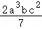
 的次数是（　　）

- A. 5
- B. 6
- C. 7
- D. 8

【答案】B

【解析】解：根据单项式定义得：
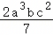
 的次数为：3+1+2＝6．
故选：B．

## 27. 单选题（难度：简单）

已知一个单项式的系数是1，次数是4，则这个单项式可以是（　　）

【答案】A

## 28. 单选题（难度：适中）

单项式 的次数是（　　）

【答案】A

## 29. 单选题（难度：简单）

已知m是有理数，3xm+1y3是关于x、y的五次单项式，则m的值为（　　）

【答案】A

## 30. 单选题（难度：简单）

下列各组单项式中，次数相同的是（　　）

- A. 3ab与﹣5xy²
- B. 8与a
- C. 2x²y²与xy
- D. x³与ab²

【答案】D

【解析】解：A、3ab的次数为2，﹣5xy²的次数为3，不合题意；
B、8的次数为0，a的次数为1，不合题意；
C、2x²y的次数为3，xy的次数为2，不合题意；
D、x³的次数为3，ab²的次数为3，符合题意；
故选：D．

## 31. 单选题（难度：简单）

单项式 的次数是（　　）

【答案】A

## 32. 单选题（难度：简单）

下列各代数式中是五次单项式的是（　　）

【答案】A

## 33. 单选题（难度：简单）

单项式﹣2x²y的系数和次数分别是（　　）

- A. ﹣2，3
- B. ﹣2，2
- C. 2，3
- D. 2，2

【答案】A

【解析】解：单项式﹣2x²y的系数是﹣2，次数是3，
故选：A．

## 34. 单选题（难度：简单）

﹣52π2a4b是单项式，它的系数和次数分别是（　　）

【答案】A

## 35. 单选题（难度：简单）

单项式
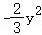
 的次数是（　　）

- A. 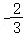
- B. 1
- C. 2
- D. 3

【答案】C

【解析】解：根据单项式定义得：
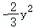
 的次数为2．
故选：C．

## 36. 单选题（难度：简单）

下列关于单项式
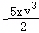
 的说法正确的是（　　）

- A. 系数是
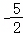
 ，次数是4
- B. 系数是
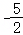
 ，次数是3
- C. 系数是﹣5，次数是4
- D. 系数是﹣5，次数是3

【答案】A

【解析】解：单项式
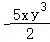
 的次数是4，系数是
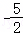
 ，
故选：A．

## 37. 单选题（难度：简单）

单项式
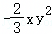
 的次数是（　　）

- A. 3
- B. 2
- C. 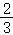
- D. 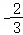

【答案】A

【解析】解：根据单项式定义得：
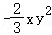
 的次数为：1+2＝3．
故选：A．

## 38. 单选题（难度：简单）

下列关于单项式
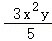
 的说法中，正确的是（　　）

- A. 系数、次数都是3
- B. 系数是﹣3，次数是3
- C. 系数是
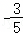
 ，次数是2
- D. 系数是
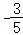
 ，次数是3

【答案】D

【解析】解：根据单项式系数、次数的定义可知：
单项式
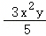
 的系数是
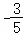
 ，次数是2+1＝3，
只有D正确，
故选：D．

## 39. 单选题（难度：简单）

下列关于单项式 的说法中，正确的是（　　）

【答案】A

## 40. 单选题（难度：简单）

单项式 的系数和次数分别是（　　）

【答案】A

## 41. 单选题（难度：简单）

下列说法中正确的是（　　）

【答案】A

## 42. 单选题（难度：简单）

单项式﹣ 的系数和次数分别是（　　）

【答案】A

## 43. 单选题（难度：简单）

单项式 的系数和次数分别是（　　）

【答案】A

## 44. 单选题（难度：简单）

单项式
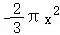
 的系数和次数分别是（　　）

- A. 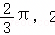
- B. 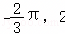
- C. 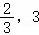
- D. 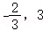

【答案】B

【解析】解：由单项式系数、次数的定义，单项式
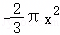
 系数与次数分别是
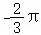
 ，2．
故选：B．

## 45. 单选题（难度：简单）

单项式 的系数与次数分别为（　　）

【答案】A

## 46. 单选题（难度：简单）

单项式
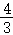
 πr³表示球的体积，其中π表示圆周率，r表示球的半径，下列说法正确的是（　　）

- A. 系数是
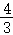
 ，次数是3
- B. 系数是
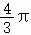
 ，次数是3
- C. 系数是
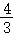
 ，次数是4
- D. 系数是
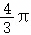
 ，次数是4

【答案】B

【解析】解：
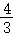
πr³ 的系数是
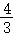
π ，次数是3．
故选：B．

## 47. 单选题（难度：简单）

单项式﹣ 的系数和次数分别为（　　）

【答案】A

## 48. 单选题（难度：适中）

体育课上我们经常练习垫排球，计算球的体积，只要测量出球的半径r，就可以根据公式
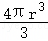
 求出排球的体积，整式
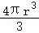
 的系数和次数分别为（　　）

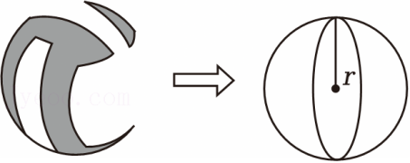

- A. 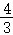
 ，4
- B. 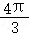
 ，4
- C. 4π，3
- D. 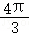
 ，3

【答案】D

【解析】解：整式
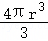
 的系数是：
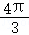
 ，次数是：3．
故选：D．

## 49. 单选题（难度：简单）

单项式﹣
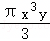
 的系数与次数分别是（　　）

- A. ﹣
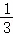
 ，3
- B. ﹣
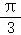
 ，4
- C. ﹣
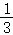
 ，4
- D. ﹣
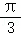
 ，3

【答案】B

【解析】解：单项式﹣
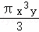
 的系数与次数分别是：﹣
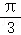
 ，4．
故选：B．

## 50. 单选题（难度：简单）

单项式
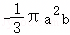
 的系数与次数分别是（　　）

- A. ﹣
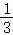
 ，3
- B. 
 ，3
- C. 
 ，3
- D. ﹣

 π，3

【答案】D

【解析】解：单项式

 的系数与次数分别是

 ，3．
故选：D．
