# 知识点·折线统计图（同步练习）

> 教材：数学·七年级上册·沪科技版2024新教材 ｜ 来源：国家中小学智慧教育平台·在线练习 ｜ 共 99 题

## 1. 单选题（难度：简单）

要反应上海市一天内气温的变化情况宜采用 $ \left(  \right)$

【答案】A

## 2. 单选题（难度：简单）

舒青是一名观鸟爱好者，他想要用折线统计图来反映中华秋沙鸭每年秋季到当地避寒越冬的数量变化情况，以下是排乱的统计步骤：
①从折线统计图中分析出中华秋沙鸭每年来当地避寒越冬的变化趋势；
②从当地自然保护区管理部门收集中华秋沙鸭每年来当地避寒越冬的数量记录；
③按统计表的数据绘制折线统计图；
④整理中华秋沙鸭每年来当地避寒越冬的数量并制作统计表．
以上统计步骤的正确顺序是 \( \left(  \right)\)

- A. ② \( \to \) ③ \( \to \) ① \( \to \) ④
- B. ③ \( \to \) ④ \( \to \) ① \( \to \) ②
- C. ① \( \to \) ② \( \to \) ④ \( \to \) ③
- D. ② \( \to \) ④ \( \to \) ③ \( \to \) ①

【答案】D

【解析】思路分析：统计步骤：数据收集、数据整理、数据描述、数据分析。统计步骤的正确顺序是先从当地自然保护区管理部门收集中华秋沙鸭每年来当地避寒越冬的数量记录；再整理中华秋沙鸭每年来当地避寒越冬的数量并制作统计表；
然后按统计表的数据绘制折线统计图；
最后从折线统计图中分析出中华秋沙鸭每年来当地避寒越冬的变化趋势．
故选：D.

## 3. 单选题（难度：简单）

金庸先生笔下的“五岳剑派”就是在以下五大名山中：若想根据表中数据绘制统计图，以便更清楚的比较这五座山的高度，最合适的是 $ \left(  \right)$

【答案】A

## 4. （难度：简单）

某商家对A、B两款学生手表的销售情况进行了为期五个月的调查统计,这两款手表的月销售量统计图如图所示.

## 5. 填空题（难度：简单）

“信阳毛尖”是中国十大名茶之一，其品牌价值逐年提升．近三年信阳毛尖的品牌价值如下：
年份
2021年
2022年
2023年

品牌价值
71.08亿元
75.72亿元
79.84亿元

小明和小聪根据统计表分别制作了如下的统计图：

  
你认为两个统计图给人不一样感觉的原因是 ．

【答案】两个统计图纵轴的单位长度不相同，且第一个统计图的纵轴不都是从0开始的

【解析】本题考查了条形统计图，根据两个统计图的纵轴的区别求解即可．
解：由图可得，两个统计图给人不一样感觉的原因是：两个统计图纵轴的单位长度不相同，且第一个统计图的纵轴不都是从0开始的，
故答案为：两个统计图纵轴的单位长度不相同，且第一个统计图的纵轴不都是从0开始的．

## 6. 单选题（难度：简单）

根据下列条形统计图，下面回答正确的是 $ \left(  \right)$

【答案】A

## 7. （难度：简单）

目标达成度也叫完成率，一般是指个体的实际完成量与目标完成量的比值．树立明确具体的目标，能够帮助我们更好的自我认知，迅速成长．某班级A、B、C、D、E、F、G、H八位同学组成一个互助小组，如图是他们月初制定的目标跑步里程和月末实际完成情况绘制的统计图，有如下四个结论：

①同学E目标达成度是\(100\mathrm{}\)；
②目标完成量与实际完成量相差最多的是同学D；
③有四位同学超额完成了目标跑步量；
④实际跑步里程超过\(30\text{km}\)的有五位同学．
上述结论中，所有正确结论的序号是（）
A．①③  B．①②③  C．①③④  D．①②③④

【答案】

C

【j解析】本题是折线统计图，要通过坐标轴以及横坐标等读懂本图，根据图中所示的数量解决问题．

根据统计图中的数据分别计算即可得出结论．

解：由统计图得：

①同学$E$月初制定的目标是30千米，月末实际完成30千米，$100\mathrm{}$完成了目标任务，正确；

同学$F$月初制定的目标是20千米，月末实际完成大概35千米，相差15千米；

同学$D$月初制定的目标是大概35千米，月末实际完成20千米，相差15千米；

同学$C$月初制定的目标是50千米，月末实际完成30千米，相差20千米；

同学$B$月初制定的目标是大概45千米，月末实际完成60千米，相差15千米；

同学$A$月初制定的目标是大概80千米，月末实际完成83千米，相差3千米；

同学$G$月初制定的目标是大概35千米，月末实际完成40千米，相差5千米；

同学$H$月初制定的目标是60千米，月末实际完成50千米，相差10千米；

②目标完成量与实际完成量相差最多的是同学$C$，故错误；

③有四位同学超额完成了目标跑步量，分别是$F,B,A,G$，正确；

④实际跑步里程超过$30\text{km}$的有五位同学，分别是$A,B,F,G,H$，正确；

故选：C．

## 8. 单选题（难度：简单）

(2022浙江温州乐清期末)某校开展了“爱阅读”活动,七(1)班统计了1月~6月全班同学的课外阅读量(单位:本),绘制了折线统计图(如图所示),则下列说法正确的是(　　)

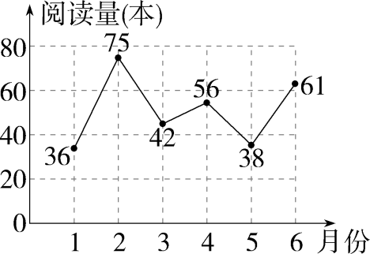

- A. 6月份阅读量最大
- B. 阅读量超过40本的月份共有5个
- C. 相邻的两个月中,1月到2月的月阅读量增长最快
- D. 4月份阅读量为38本

【答案】C

【解析】由题图可知,2月份阅读量最大,故选项A错误;
阅读量超过40本的月份有2、3、4、6月份,共有4个,故选项B错误;
相邻的两个月中,1月到2月的月阅读量增长最快,故选项C正确;
4月份阅读量为56本,故D错误.
故选C.

## 9. （难度：适中）

某超市销售甲、乙两种型号的垃圾桶在1﹣5月间的盈利情况统计图如图所示，下列结论正确的是（    ）A．甲型垃圾桶的利润逐月减少  B．3月份两种型号的垃圾桶利润相同C．乙型垃圾桶的利润逐月增加  D．甲型垃圾桶在6月份的利润必然超过乙超市

## 10. 填空题（难度：适中）

根据如图所示的统计图，回答问题：

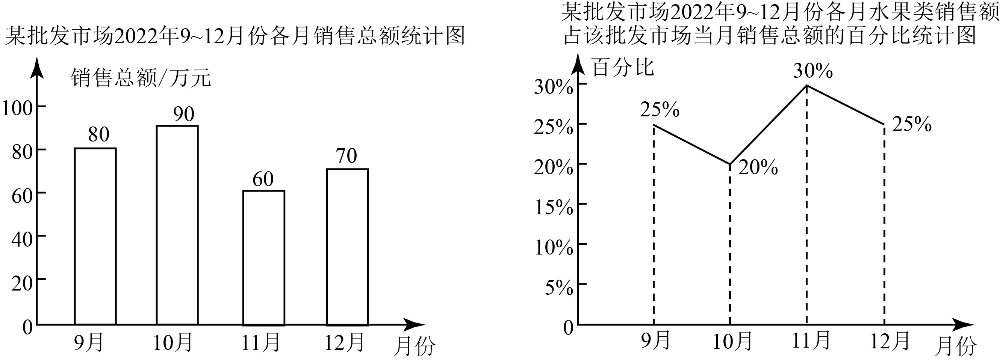

该批发市场2022年9~12月份水果类销售额最多月份的销售额是万元．

【答案】20

【解析】本题主要考查了有理数乘法的实际应用，读懂统计图并正确理解题意列乘法解答是解题的关键．
用每个月的销售总额乘以水果类的百分比，将各个月的水果类销售额比较即可得到答案．
解：9月水果类销售额为\(80\times 25%=20\)万元，
10月水果类销售额为\(90\times 20%=18\)万元，
11月水果类销售额为\(60\times 30%=18\)万元，
12月水果类销售额为\(70\times 25%=17.5\)万元，
∴该批发市场2022年9～12月份水果类销售额最多月份的销售额是20万元，
故答案为：20．

## 11. 填空题（难度：适中）

我市2022年12月份某一周的气温折线统计图如图所示，则这七天中温差最大的一天的最高气温与最低气温相差___摄氏度．

## 12. 单选题（难度：适中）

某商品$1\tilde{\ }4$月份单个的进价和售价如图所示，则售出该商品单个利润最大的是（    ）

【答案】A

## 13. 单选题（难度：适中）

下图是某商品1～4月份单个的进价和售价的折线统计图，则下列说法错误的是（    ）

【答案】A

## 14. 单选题（难度：适中）

下面是A、B两球从不同高度自由下落到地面后反弹高度的统计图，根据图中提供的信息，下列推断不正确的是（　　）

【答案】A

## 15. （难度：适中）

今天，4月20日恰逢24节气中的谷雨．播谷降雨，雨生百谷，这也是春季的最后一个节气．在古代，各地都有着不同的习俗活动来迎接与庆祝，有赏花、品茗、走谷雨（踏春）、洗桃花水（沐浴）、吃椿（香椿）等．为了了解学生最感兴趣的一项活动的人数分布情况，学校从全校学生中随机抽取100名学生进行问卷调查，并绘制了如下两幅统计图．

## 16. （难度：适中）

如图，这是我国某省\(2021\)年\(10\)个地区（\({{F}_{1}}\)，\({{F}_{2}}\)，…，\(F_{10}\)）的环境空气质量综合指数统计图：

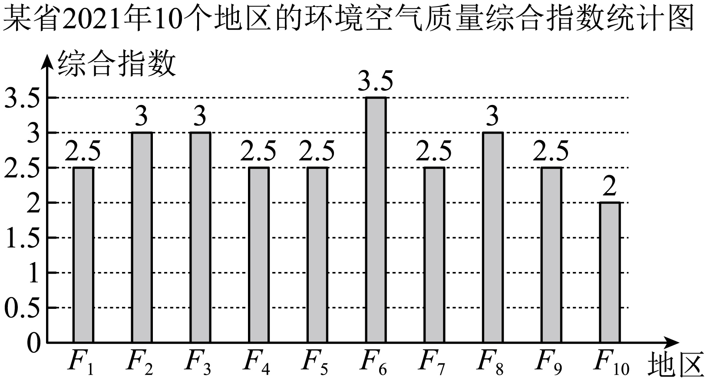

根据统计图提供的信息解答下列问题：

我们知道，综合指数越小，表示环境空气质量越好．依据综合指数，从图中可知环境空气质量最好的地区是，空气质量最差的地区是．

请用折线统计图表示这\(10\)个地区的环境空气质量综合指数的变化情况．

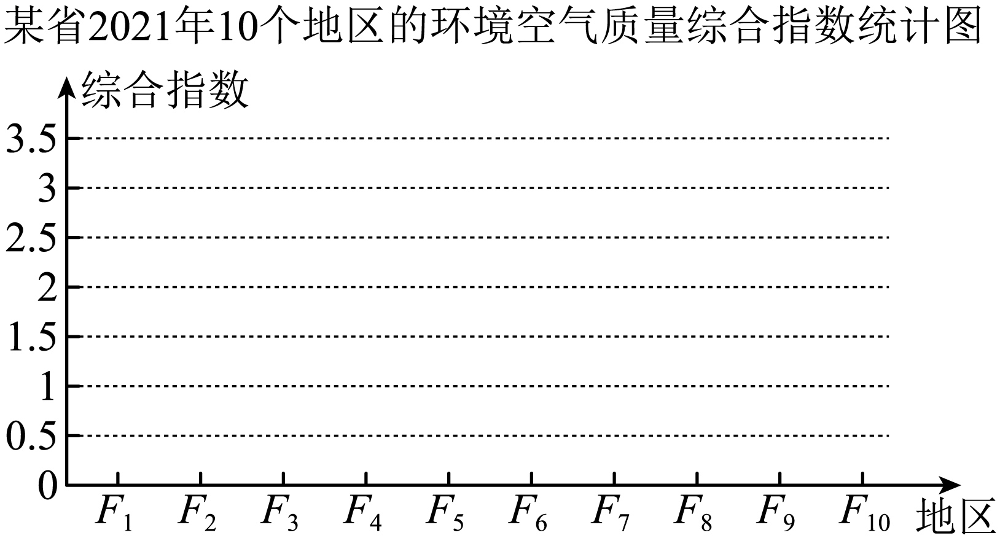

从上述统计图中还可以得出什么结论？请写出一条．

【答案】$F_{10}$/${{F}_{6}}$；，

见解析；

，

大部分地区的综合指数都在$2.5$，答案不唯一．

【解析】依据综合指数越小，表示环境空气质量越好即可解决．最好的地区综合指数最小，最差的地区综合指数最大；

在对应地区上方标出相应数据，顺次连接即可；

根据条形图或折线图数据，写出符合条件的即可，如：大部分地区的综合指数都没超过\(2.5\)．
（1）解：由题意可知综合指数越小，表示环境空气质量越好，
环境空气质量最好的地区是：\(F_{10}\)
空气质量最差的地区是：\({{F}_{6}}\)
故答案为：\(F_{10}\)、\({{F}_{6}}\)；
（2）折现统计图如下：

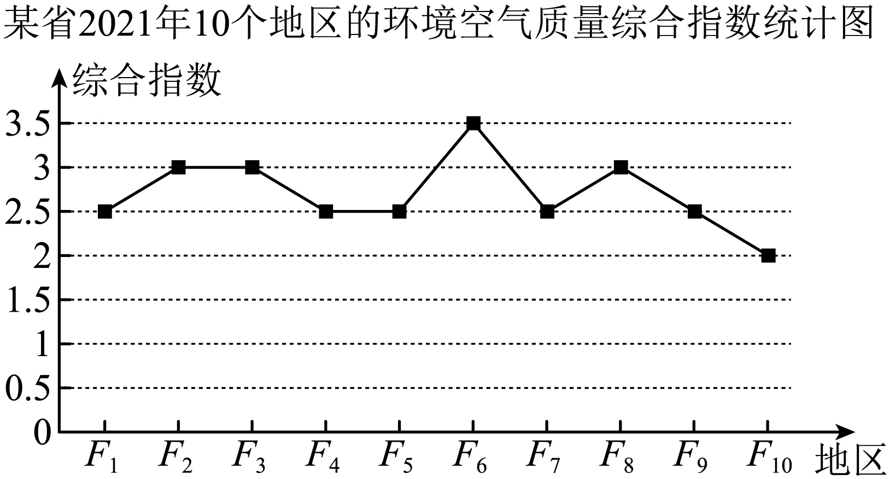

（3）结合图像可知，
大部分地区的综合指数都没超过\(2.5\)，答案不唯一；

## 17. （难度：适中）

淮安市洪泽湖初级中学在倡导学生大课间活动中，随机抽取了部分学生对大课间“我最喜爱课间活动”进行了一次抽样调查，分别从打篮球、踢足球、自由活动、跳绳、其他、等5个方面进行问卷调查（每人只能选一项），根据调查结果绘制了如下的不完整统计图，其中打篮球的人数占被调查人数的$10%$，请你根据图中信息，解答下列问题：

## 18. 单选题（难度：适中）

2022年10月16日上午10时，中国共产党第二十次全国代表大会在北京人民大会堂开幕．十年来，近1亿农村贫困人口实现脱贫，历史性地解决了绝对贫困问题，为全球减贫事业作出了重大贡献如图，是脱贫攻坚战以来中国农村贫困人口变化情况和贫困地区农村居民人均可支配收入情况．根据图提供的信息，下列推断不合理的是（    ）

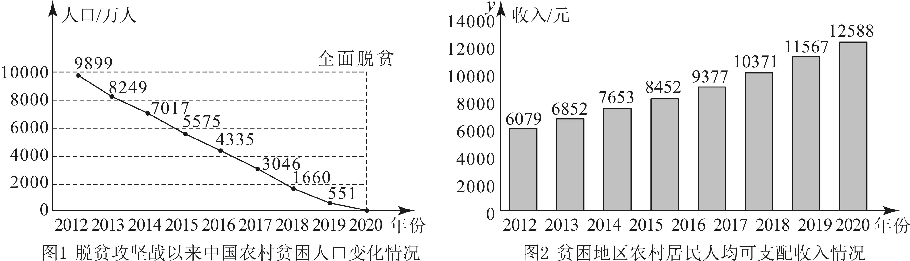

- A. 2012年到2020年，中国农村贫困人口逐年减少
- B. 2013年到2020年，贫困地区农村居民人均可支配收入逐年增长
- C. 2019年的中国农村贫困人口比2012年的中国农村贫困人口减少了9348万人
- D. 2020年的贫困地区农村居民人均可支配收入比2015年的贫困地区农村居民人均可支配收入的2倍还多

【答案】D

【解析】本题主要考查了拆线统计图，正确理解拆线统计图的意义是解答本题的关键．
分别结合脱贫攻坚战以来中国农村贫困人口变化情况和贫困地区农村居民人均可支配收入情况表中的数据分析、计算即可得到正确的结论．
解：A.从脱贫攻坚战以来中国农村贫困人口变化情况中可看出2012年到2020年，中国农村贫困人口逐年减少，故选项A不符合题意；
B.从贫困地区农村居民人均可支配收入情况表中可看出2013年到2020年，贫困地区农村居民人均可支配收入逐年增长，故选项B不符合题意；
C. 2019年的中国农村贫困人口比2012年的中国农村贫困人口减少了\(9899-551=9348\)万人，故选项C不符合题意；
D. 2020年的贫困地区农村居民人均可支配收入比2015年的贫困地区农村居民人均可支配收入的1倍还多，故选项D说法错误，符合题意；
故选：D

## 19. （难度：适中）

今天，4月20日恰逢24节气中的谷雨．播谷降雨，雨生百谷，这也是春季的最后一个节气．在古代，各地都有着不同的习俗活动来迎接与庆祝，有赏花、品茗、走谷雨（踏春）、洗桃花水（沐浴）、吃椿（香椿）等．为了了解学生最感兴趣的一项活动的人数分布情况，学校从全校学生中随机抽取100名学生进行问卷调查，并绘制了如下两幅统计图．

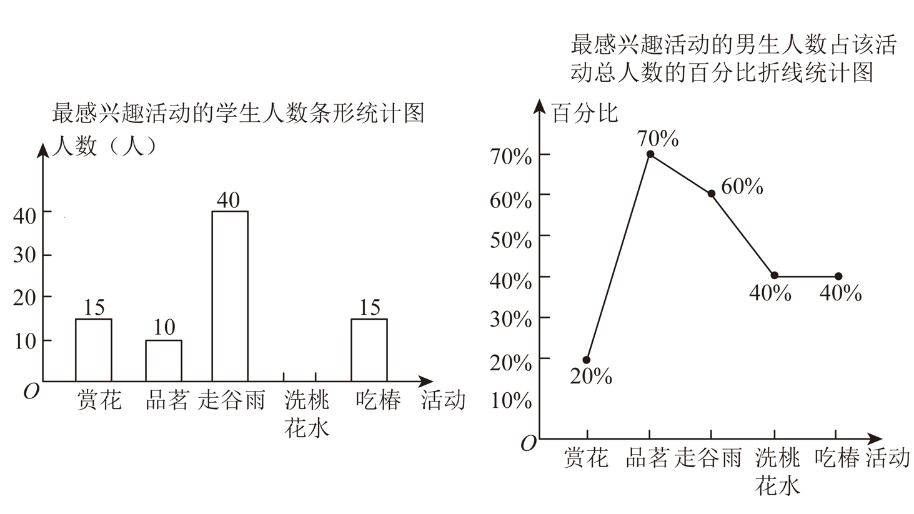

请计算最感兴趣活动为“洗桃花水（沐浴）”的学生总人数，并补全条形统计图．

请计算最感兴趣活动为“走谷雨（踏春）”的女生人数．

男生最感兴趣活动中“洗桃花水（沐浴）”和“吃椿（香椿）”的人数相同吗？为什么？

【答案】

$20$，图见解析

，

$16$

，

不同，理由见解析

【解析】用总人数减去对其它活动最感兴趣的人数，即可求解；

用最感兴趣活动为“走谷雨（踏春）”的总人数乘以最感兴趣活动为“走谷雨（踏春）”的女生人数所占的百分比，即可求解；

分别求出男生最感兴趣活动中“洗桃花水（沐浴）”和“吃椿（香椿）”的人数，即可求解．
（1）解：最感兴趣活动为“洗桃花水（沐浴）”的学生总人数为\(100-15-10-40-15=20\)（人），
补全条形统计图，如下：

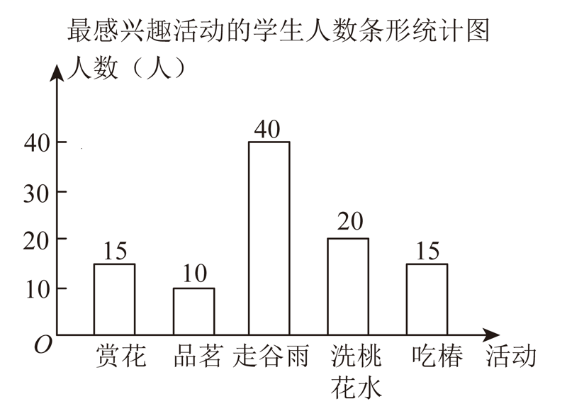

（2）解：最感兴趣活动为“走谷雨（踏春）”的女生人数为\(40\times \left( 1-60% \right)=16\)（人）
（3）解：不同，理由如下：
洗桃花水：\(20\times 40%=8\)（人），
吃椿：\(15\times 40%=6\)（人），
所以男生最感兴趣活动中喜欢“洗桃花水”和“吃椿”的人数不同．

## 20. 单选题（难度：非常简单）

用统计图清楚地反映上周每天的平均气温变化情况，最适合制作的是（   ）

【答案】A

## 21. 单选题（难度：简单）

为反映近十年我国GDP随年份的变化情况，并预测下一年的GDP数值，宜采用的统计图是（   ）

- A. 趋势图
- B. 折线图
- C. 条形图
- D. 直方图

【答案】A

【解析】解：根据题意，要预测下一年的发展趋势，需要制作趋势图，
故选：A．

## 22. 单选题（难度：简单）

一商店为了研究气温对某冷饮销售的影响，对出售的冷饮杯数（杯）和当天最高气温（$ \mathrm{℃}$）的数据进行了统计，得到了如图所示的趋势图．据此预测：最高气温为30$ \mathrm{℃}$时，当天出售的冷饮杯数大约是（    ）

【答案】A

## 23. 单选题（难度：非常简单）

某中学八年级一班和二班各选取了20名学生进行安全教育竞赛答题，得分情况经统计整理为如图所示的折线图．请结合图象分析：哪个班级的成绩更稳定（　　）

【答案】A

## 24. 单选题（难度：简单）

随着新媒体的发展，更好地推动全民阅读，一些学者、作家、文化文艺名人等担任“领读人”，通过直播、短视频以及图文等形式，利用新媒体平台助力大众阅读．某中学七年级一班统计今年\( 1~8\)月“书香校园”读书活动中全班同学的课外阅读数量（单位：本），并绘制了如图所示的折线统计图，下列说法正确的是（   ）

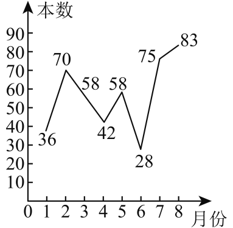

- A. 课外阅读数量比前一个月增加的月份共有4个月
- B. 课外阅读数量最少的月份是1月份
- C. 阅读数量超过45本的月份共有4个月
- D. 以上结论都不对

【答案】A

【解析】解：A、课外阅读数量比前一个月增加的月份分别是\( 2，5，7，8\)，共有\( 4\)个月，选项正确，符合题意；
B、由折线图可得，课外阅读数量最少的月份是\( 6\)月份，为\( 28\)本，选项错误，不符合题意；
C、阅读数量超过\( 45\)本的月份有\( 2\mathrm{、}3\mathrm{、}5\mathrm{、}7\mathrm{、}8\)，共有\( 5\)个月，选项错误，不符合题意；
D、A选项是正确的，选项错误，不符合题意；
故选：A．

## 25. 单选题（难度：非常简单）

从A地到B地有驾车、公交、地铁三种出行方式，为了选择适合的出行方式，对$ 6:00-10:00$时段这三种出行方式不同出发时刻所用时长（从A地到B地）进行调查、记录与整理，数据如图所示．根据统计图提供的信息，下列推断合理的是（   ）

【答案】A

## 26. 单选题（难度：非常简单）

如图是我省某地立夏后连续10天的日平均气温折线图，则这10天中日平均气温最高是（    ）

【答案】A

## 27. 单选题（难度：简单）

小君将自己近几周在立定跳远项目上的训练成绩绘制成如图所示的趋势图，请根据所绘制的趋势图估计小君在第6周的期末考试中立定跳远取得的成绩为（   ）

【答案】A

## 28. 单选题（难度：简单）

嘉嘉与琪琪相约去跑步，两人的手机“微信运动”的步数折线统计图如图所示，则下列结论错误的是（     ）

【答案】A

## 29. 单选题（难度：非常简单）

近年来，我国新能源汽车产业实现高质量发展．上图是2018−2023年我国汽车销量和新能源汽车销量折线统计图，则（    ）

【答案】A

## 30. 单选题（难度：非常简单）

丽丽准备报名参加400米短跑比赛，将她近几周400米短跑的训练情况绘制成如图所示的趋势图，请根据趋势图估计丽丽第6周400米短跑所需时间为（   ）

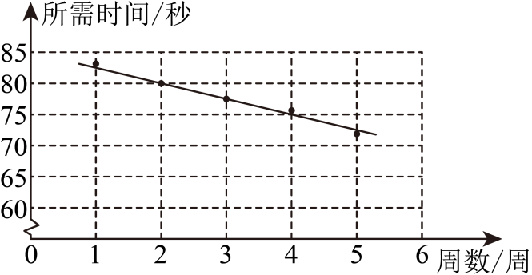

- A. 80秒
- B. 78秒
- C. 75秒
- D. 70秒

【答案】D

【解析】解：根据图象的趋势可预测丽丽第6周400米短跑所需时间为70秒．
故选：D．

## 31. 单选题（难度：非常简单）

我校“美食节”某摊位在四个时段销售情况如图所示，则其中销售数量增长最快的是（    ）

【答案】A

## 32. 单选题（难度：简单）

如图是\( 1-4\)月份某种商品单个进价和售价的折线统计图，则单个商品盈利最大的月份是（   ）

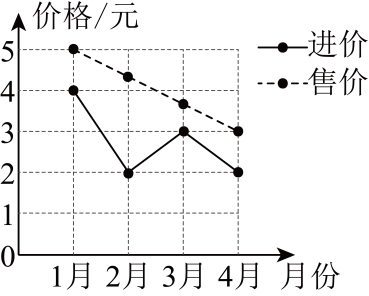

- A. 1月份
- B. 2月份
- C. 3月份
- D. 4月份

【答案】B

【解析】解：由图象中的信息可知，
利润=售价\( -\)进价，利润最大的是2月，
故选：B．

## 33. 单选题（难度：简单）

观察下面的折线统计图，它可能反映了（    ）．

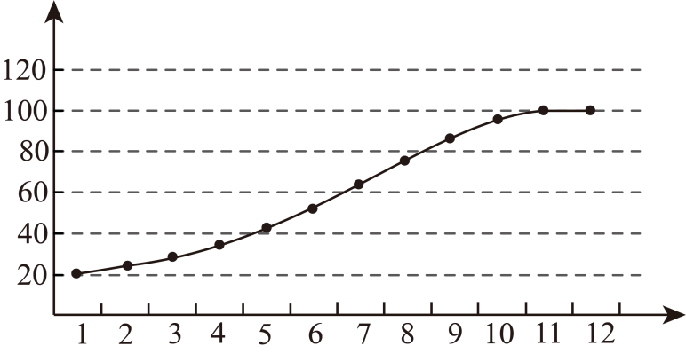

- A. 上海一年的气温变化情况
- B. 某食物放进冰箱后的温度变化情况
- C. 某辆汽车从启动到停止的速度变化情况
- D. 某次烧开水时水温变化情况

【答案】D

【解析】解：A．折线统计图的横轴表示的数值从\( 1\)到\( 12\)，纵轴每个单位长度表示\( 20\)，其中最高数值表示\( 100\)，而气温数值不可能达到\( 100\)，
∴不可能表示上海一年的气温变化情况，故此选项不符合题意；
B．冰箱里的温度比空气中的温度要低，
∴当食物放进冰箱后，整体的温度变化应该呈逐渐下降趋势，图中折线呈现的是逐渐上升趋势，不符合题意；
C．汽车从启动到停止的速度变化应呈现先上升后下降的趋势，与图中折线呈现逐渐上升趋势不相符，故此选项不符合题意；
D．烧开水最高温度可以达到\( 100\)摄氏度，且烧开水时整体水温呈逐渐上升趋势，与图中折线呈现的变化趋势一致，
∴图中的折线统计图可以表示某次烧开水时水温变化情况，故此选项符合题意．
故选：D．

## 34. 单选题（难度：简单）

某公司近年来的销售收入情况如图所示：     请你根据趋势图预测该公司2025年的销售收入为（    ）

【答案】A

## 35. 单选题（难度：非常简单）

2025年春节贺岁电影《哪吒之魔童闹海》自1月29日上映以来受到广泛好评，如图的统计图描述了该电影在某城市1月29日至2月3日期间的单日票房及单日票房占单日总票房的占比情况（单日总票房：在特定的一天内，所有影院放映电影所获得的票房收入总和），根据呈现出来的趋势，下列说法较为合理的是（    ）

【答案】A

## 36. 单选题（难度：简单）

通过查询资料获取数据，绘制了北京2024年日出、日落时刻的散点图和北京2024年二十四节气日的白昼时长的折线图．请结合教材综合实践的探究学习和以下两幅图，判断下列叙述错误的是（   ）

【答案】A

## 37. 单选题（难度：简单）

体育课上，体育老师对（一）班和（二）班每名学生的测试成绩进行评分（评分等级分别为\( A，B，C，D\)），统计评分情况并绘制成如图所示的复合折线统计图，其中（一）班评分为\( A\)的学生数量比（二）班评分为\( A\)的多（　　）

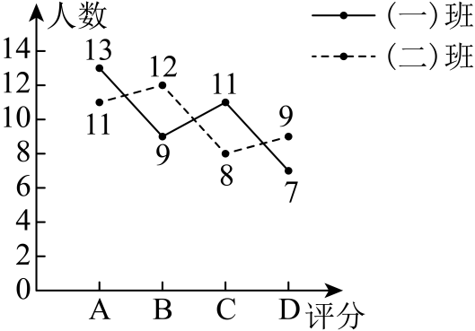

- A. 2人
- B. 3人
- C. 4人
- D. 5人

【答案】A

【解析】解：由统计图得，（一）班评分为\( A\)的学生数量为13人，（二）班评分为\( A\)的学生数量为11人，
∴\( 13-11=2\)人，
故选：A

## 38. 单选题（难度：简单）

某品牌空调今年1—6月份的月销售量折线统计图如图所示，则下列说法正确的是（   ）1—6月份月销售量折线统计图

【答案】A

## 39. 单选题（难度：简单）

从A地到B地有驾车、公交、地铁三种出行方式，为选择合适的出行方式，数学小组的同学对\( 6:00-10:00\)时段这三种出行方式不同出发时刻所用时长（从A地到B地）进行了调查、记录与整理．根据统计图提供的信息，下列推断不正确的是（    ）

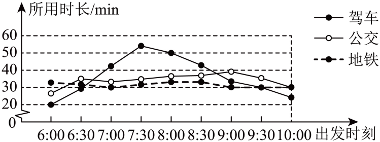

- A. 地铁出行所用时长受出发时刻影响较小
- B. 若在\( 7:30-8:00\)之间出发，且需要40分钟以内到达，可选择公交或地铁出行
- C. 若选择公交出行且需要30分钟以内到达，则\( 7:00\)之前出发即可
- D. 若\( 8:00\)出发，选择地铁出行最节省时间

【答案】C

【解析】解：A．根据统计图可得，地铁出行所用时长受出发时刻影响较小，A选项说法正确,故A不符合题意；
B．根据统计图可得，若在\( 7:30-8:00\)之间出发，且需要40分钟以内到达，可选择公交或地铁出行，所以B选项说法正确，故B不符合题意；
C．根据统计图可得，若选择地铁出行且需要30分钟以内到达，则\( 7:00\)之前出发即可，所以C选项说法不正确，故C符合题意；
D．根据统计图可得，若\( 8:00\)出发，选择地铁出行最节省时间，所以D选项说法正确，故D不符合题意．
故选：C．

## 40. 单选题（难度：简单）

《中国居民膳食指南》建议成年人每天进行累计相当于6000步以上的身体活动．如图是甲、乙两人某周的微信步数统计图，下列描述正确的是（　　）

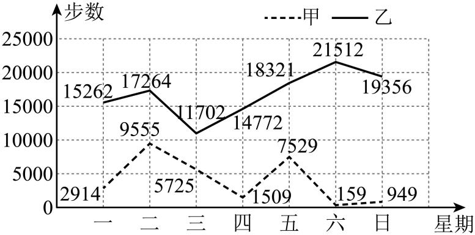

- A. 甲坚持运动．是运动达人
- B. 乙从不运动，喜欢宅在家
- C. 乙偶尔锻炼，三天打鱼两天晒网
- D. 甲偶尔锻炼，三天打鱼两天晒网

【答案】D

【解析】解：观察统计图，甲的步数多数时候较少，偶尔有步数，符合“偶尔锻炼，三天打鱼两天晒网”；乙的步数多数时候较多且稳定，不符合“从不运动”“偶尔锻炼”．
故选：D．

## 41. 单选题（难度：简单）

随着气温越来越高，商店中冰淇淋的销量越来越高，店员小高统计了近几周店内冰淇淋的销量，并绘制出如图所示的趋势图，请你根据所绘制的趋势图估计第7周该店冰淇淋的销量为（   ）

【答案】A

## 42. 单选题（难度：非常简单）

小明家近5个月的用电量如下表： 根据数据可画出趋势图，从趋势图可看出小明家的用电量的变化趋势为（    ）

【答案】A

## 43. 单选题（难度：简单）

2025年1月20日在甘肃省政府工作报告中指出：规模以上工业增加值增长，现代农业扩量提质，金融服务实体经济质效提升．全年经济运行逆势而进、向上向好、质量齐升．下面的统计图反映了\( 2020-2024\)年某市“三产”产值增长率的情况．根据统计图提供的信息，下列结论错误的是（    ）

- A. \( 2020-2024\)年，工业产值增长率先降低后提高
- B. 2024年，“三产”中服务业的产值增长率最高
- C. \( 2020-2024\)年，农业的产值增长率每年持续增加
- D. \( 2020-2024\)年，“三产”中年产值增长率最小的是\( 2.3\mathrm{\%}\)

【答案】C

【解析】解：由统计图可知：
\( 2020-2024\)年，工业产值增长率先降低后提高，说法正确，故选项A不符合题意；
2024年，“三产”中服务业的产值增长率最高，说法正确，故选项B不符合题意；
\( 2020-2024\)年，农业的产值增长率先降低后提高再降低，原说法错误，故选项C符合题意；
\( 2020-2024\)年，“三产”中年产值增长率最小的是\( 2.3\mathrm{\%}\)，说法正确，故选项D不符合题意；
故选：C．

## 44. 单选题（难度：简单）

夏日炎炎，随着气温越来越高，人们对防晒衣的需求也越来越大，如图是某服装店近几周防晒衣销售情况的趋势图，根据趋势图估计第6周该服装店防晒衣的销售量为（   ）

【答案】A

## 45. 单选题（难度：简单）

某公司产品的生产量在1～7月份的增长变化情况如图所示．由图可知，下列结论正确的是（   ）

【答案】A

## 46. 单选题（难度：简单）

下面几种情况中，适合用复式折线统计图描述数据的是（    ）

- A. 某品牌电动车2020－2024年销售情况
- B. 小力家各项支出占总支出百分比情况
- C. 六年级各班人数情况
- D. 北京和上海全年各月平均气温变化情况

【答案】D

【解析】解：A、仅涉及单一品牌销售数据，适合单式折线统计图，故此选项不符合题意；
B、关注各部分占比，适合扇形统计图，故此选项不符合题意；
C、比较不同类别数量，适合条形统计图，故此选项不符合题意；
D、涉及北京和上海两个城市的气温变化，需对比两组数据趋势，适合复式折线统计图，故此选项符合题意．
故选：D．

## 47. 单选题（难度：简单）

如图是辽宁某城市5月一周的天气预报表，下列说法正确的是（   ）

- A. 这一周最高气温是\( 25°\text{C}\)
- B. 从周三开始，最低温度一直呈下降的趋势
- C. 最高气温在\( 21°\text{C}\)以上的有4天
- D. 温差最大的一天是周二

【答案】A

【解析】解：A、这一周最高气温是\( 25°\text{C}\)，说法正确，本选项符合题意；
B、周三至周五最低温度呈下降的趋势，周六至周日最低温度呈上升的趋势，原说法错误，本选项不符合题意；
C、最高气温在\( 21°\text{C}\)以上的有2天，原说法错误，本选项不符合题意；
D、周一温差为\( 21-12=9°\text{C}\)；周二温差为\( 22-13=9°\text{C}\)；周三温差为\( 25-14=11°\text{C}\)；周四温差为\( 21-13=8°\text{C}\)；周五温差为\( 20-12=8°\text{C}\)；周六温差为\( 20-12=8°\text{C}\)；周日温差为\( 20-13=7°\text{C}\)；则温差最大的一天是周三，原说法错误，本选项不符合题意；
故选：A．

## 48. 单选题（难度：简单）

某购物中心对今年7-12月份中顾客使用“支付宝支付”和“微信支付”这两种支付方式的情况进行统计，得到如图所示的折线统计图．根据统计图中的信息，得出以下四个推断，其中说法不合理的是（   ）

【答案】A

## 49. 单选题（难度：简单）

如图是甲、乙两名同学进行五轮定点投篮测试（每轮10球）投中个数折线统计图，由图可知，下列说法错误的是（    ）

【答案】A

## 50. 单选题（难度：简单）

某商场对2024年7月—12月中使用“支付宝支付”和“微信支付”的次数进行统计，得到如图所示的折线统计图，则下列说法不合理的是（   ）

【答案】A

## 51. 单选题（难度：简单）

如图是某厂2005年各季度产值统计图（单位：万元），则下列说法正确的是（    ）

【答案】A

## 52. 单选题（难度：简单）

《国家节水行动方案》由国家发改委、水利部于2019年4月15日印发并实施，方案中提出：到2022年，全国用水总量控制在6700亿$ {m}^{3}$以内．小明根据国家统计局公布的2010﹣2022年全国用水总量（单位：亿$ {\text{m}}^{3}$）的有关数

【答案】A

## 53. 单选题（难度：简单）

如图为北京2024年二十四节气日的白昼时长，从图中可知下列表述是错误的是（   ）

- A. 白昼时长全年呈山形分布，以夏至为顶点
- B. 夏至白昼时长最长
- C. 从小寒至夏至，白昼时长持续减少
- D. 冬至白昼时长最短

【答案】C

【解析】解：由折线图可得：
白昼时长全年呈山形分布，以夏至为顶点．故A选项描述正确；
夏至白昼时长最长．故B选项描述正确；
从小寒至夏至，白昼时长持续增加．故C选项描述错误；
冬至白昼时长最短．故D选项描述正确；
故选C．

## 54. 单选题（难度：简单）

某公司的生产量随时间的变化情况如图所示，则下列结论不正确的是（　　）

【答案】A

## 55. 单选题（难度：简单）

下面的折线图描述了某校七年级（1）班全体同学出生的月份情况，下列结论正确的是（   ）

【答案】A

## 56. 单选题（难度：适中）

甲、乙两家超市1～8月的月利润情况如图所示，下列说法中，不正确的是（    ）

【答案】A

## 57. 单选题（难度：简单）

某校计划举办一场一次不间断踢毽子比赛（即毽子不落地），体育老师将丽丽连续5天一次不间断踢毽子的训练情况绘制成如图所示的趋势图，根据所绘制的趋势图估计丽丽第6天一次不间断可踢毽子（    ）

【答案】A

## 58. 单选题（难度：适中）

下面的统计图反映了我国邮电业务（含邮政业务与电信业务）总量的情况．根据统计图提供的信息，下列有关我国邮电业务总量推断不合理的是（   ）

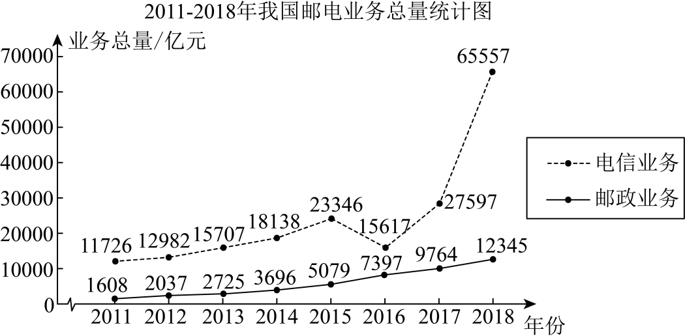

- A. \( 2018\)年，电信业务总量比邮政业务总量的\( 5\)倍还多
- B. \( 2011-2018\)年，邮政业务总量与电信业务总量都是逐年增长的
- C. 与\( 2017\)年相比，\( 2018\)年邮政业务总量的增长率超过\( 20\mathrm{\%}\)
- D. \( 2011-2018\)年，电信业务总量年增长的平均值大于邮政业务总量年增长的平均值

【答案】B

【解析】解：\( \text{A}\)、∵\( 65557÷12345\approx 5.31\)，
∴\( 2018\)年，电信业务总量比邮政业务总量的\( 5\)倍还多，说法正确；
\( \text{B}\)、由折线统计图可得：\( 2011-2018\)年，邮政业务总量是逐年增长的，而电信业务总量在\( 2015-2016\)年是下降的，所以此选项错误，符合题意；
\( \text{C}\)、∵\( \left(12345-9764\right)÷9764\approx 0.264=26.4\mathrm{\%}\)，
∴与\( 2017\)年相比，\( 2018\)年邮政业务总量的增长率超过\( 20\mathrm{\%}\)，推断正确；
\( \text{D}\)、∵电信业务总量年增长的平均值\( \frac{1}{8}\left(11726+12982+15707+18138+23346+15617+27597+65557\right)\approx 23833.75\)（亿元），
邮政业务总量年增长的平均值\( \frac{1}{8}\left(1608+2037+2725+3696+5079+7397+9764+12345\right)\approx 5581.375\)（亿元），
∴\( 2011-2018\)年，电信业务总量年增长的平均值大于邮政业务总量年增长的平均值，推断正确；
故选：\( \text{B}\)．

## 59. 单选题（难度：简单）

某品牌新能源汽车今年1月到5月的销量情况如图所示，下列说法错误的是（    ）

【答案】A

## 60. 单选题（难度：简单）

甲、乙两家公司2019~2023年的利润统计图如图，比较这两家公司的利润增长情况正确的是（   ）

【答案】A

## 61. 单选题（难度：非常简单）

下面四幅统计图是我国四个地区某日早、中、晚气温变化情况，其中最能合理反映“早穿棉袄午穿纱，晚围火炉吃西瓜”的统计图是（    ）

- A. 
- B. 
- C. 
- D. 

【答案】C

【解析】解：由题意可知，该地当天的气温变化为早晚气温低，中午炎热，故选项C符合题意．
故选：C．

## 62. 单选题（难度：简单）

在一次社会活动中，四名同学分别就同一种商品的价格变化情况给出如下四幅折线图．为了更明显地体现该商品的价格增长势头，你认为比较理想的是（   ）

- A. 
- B. 
- C. 
- D. 

【答案】C

【解析】解：绘制折线统计图时，首先要确定好横轴与纵轴的单位长度，然后根据具体数量通过向横轴和纵轴作垂线的方式确定好各点的位置，再顺次连接所描各点即可得到所求折线，
即对比四位同学所画折线统计图可知，符合画折线统计图的规范的，比较理想的是C项，
故选：C．

## 63. 单选题（难度：适中）

小明、小聪参加了100米跑的5期集训，每期集训结束时进行测试，根据测试成绩绘制成如图折线统计图．则下列判断正确的是（   ）

【答案】A

## 64. 单选题（难度：适中）

某数学课外活动小组调查学校附近一家超市的销售情况，发现本学期前五周的销售总额一共是186万元，图1，图2分别是其销售总额统计图和零食类销售额占当周销售总额的百分比统计图．根据图中信息，下列判断中正确的是（   ）     ①超市第四周销售总额为20万元；②对比上一周，第四周零食类销售额下降幅度最大；③第二周和第五周零食类销售总额相同；④第四周零食类销售额比第三周的零食类销售额增加了$ 2~6$月的训练成绩进行记录并绘制成如图所示的趋势图，请你根据趋势图预测小明8月份100m短跑的成绩为（    ）

【答案】A

## 66. 单选题（难度：简单）

小明参加100m短跑训练，今年2~6月的训练成绩及趋势图如下所示：               体育老师夸奖小明是“田径天才”，请你根据趋势图预测小明2个月后100m短跑的成绩为（    ）

【答案】A

## 67. 单选题（难度：适中）

某企业去年1～5月份利润的变化情况如图所示，以下说法与图中反映的信息相符的是（   ）

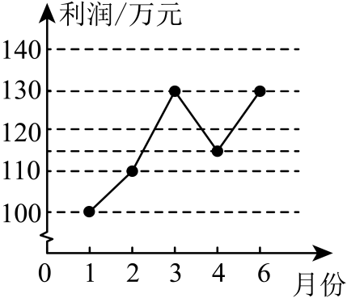

- A. 1～2月份利润的增长快于2～3月份
- B. 1～3月份和4～5月份利润都在增长
- C. 3～4月份该企业亏损
- D. 1～2月份与4～5月份利润增长率相同

【答案】B

【解析】解：A. 1～2月份利润的增长为：\( 110-100=10\)万元；2～3月份增长：\( 130-110=20\)万元，\( 10<20\),故该选项不正确，不符合题意；
B. 1～3月份和4～5月份利润都在增长，故该选项正确，符合题意；
C. 3～4月份该企业盈利，故该选项不正确，不符合题意；
D. 1～2月份的增长率为\( \frac{110-10}{100}\times 100\mathrm{\%}=10\mathrm{\%}\)，4～5月份利润增长率为\( \frac{130-115}{115}\times 100\mathrm{\%}\approx 13\mathrm{\%}\)，\( 10\mathrm{\%}\ne 13\mathrm{\%}\)，故该选项不正确，不符合题意；
故选：B．

## 68. 单选题（难度：适中）

《国家节水行动方案》由国家发改委、水利部于2019年4月15日印发并实施，方案中提出，到2022年，全国用水总量控制在6700亿立方米以内．小丽根据国家统计局公布的$ 2018-2024$年全国用水总量（单位：亿立方米）的有关数据绘制了如下统计图，并添加了一条靠近尽可能多散点的直线来表示用水量的发展趋势．    根据统计图信息，下

【答案】A

## 69. 单选题（难度：适中）

甲、乙两家公司\( 2019~2023\)年的利润统计图如下，比较这两家公司的利润增长情况（   ）

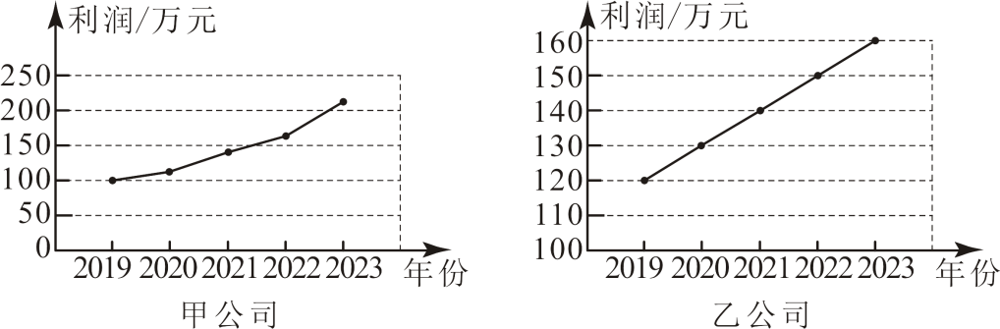

- A. 甲始终比乙快
- B. 甲先比乙慢，后比乙快
- C. 甲始终比乙慢
- D. 甲先比乙快，后比乙慢

【答案】A

【解析】首先注意到甲、乙公司折线图的纵轴单位长度不同（甲纵轴\( 1\)单位代表\( 50\)万元，乙纵轴\( 1\)单位代表\( 20\)万元），不能仅看折线倾斜程度，需定量计算：
甲公司：\( 2019\)年利润约\( 100\)万元，\( 2023\)年约\( 210\)万元，
增长额为\( 210-100=110\)万元，
增长率为\( \frac{110}{100}\times 100\mathrm{\%}=110\mathrm{\%}\)；
乙公司：\( 2019\)年利润约\( 120\)万元，\( 2023\)年约\( 160\)万元，
增长额为\( 160-120=40\)万元，
增长率为\( \frac{40}{120}\times 100\mathrm{\%}\approx 33.3\mathrm{\%}\)．
对比可知，甲公司的利润增长额和增长率始终高于乙公司，因此甲始终比乙快．
选A．

## 70. （难度：简单）

如图是昆明某天气温变化情况的折线图，下列描述正确的是（　　）A．最低温度是9℃                 B．最高温度是22℃  C．从0时到14时温度在持续上升  D．这一天的温差是13℃

## 71. 填空题（难度：简单）

甲、乙两家公司近几年的销售收入情况如图所示，其中销售收入增长较慢的是___．（填“甲公司”或“乙公司”）

## 72. 单选题（难度：简单）

随着网络的飞速发展，网购成为人们日常的主要消费方式，我国快递业已经进入“千亿件”时代．国家统计局2023年2月统计的“2018—2022年快递业务量及其增长速度情况统计图”如图所示．  根据统计图得出如下结论，其中正确的是（    ）

【答案】A

## 73. 单选题（难度：简单）

如图是甲、乙两公司近几年销售收入情况的折线统计图，根据统计图得出下列结论，其中正确的是（  ）

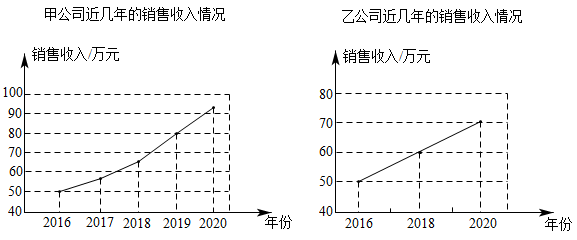

- A. 甲公司近几年的销售收入增长速度比乙公司快
- B. 乙公司近几年的销售收入增长速度比甲公司快
- C. 甲、乙两公司近几年的销售收入增长速度一样快
- D. 不能确定

【答案】A

【解析】本题考查了折线统计图，折线图不但可以表示出数量的多少，而且能够清楚地表示出数量的增减变化情况．读懂统计图，从统计图中得到必要的信息是解决问题的关键．
结合折线统计图，分别求出甲、乙两公司近年销售收入各自的增长量即可求出答案．
解：从折线统计图中可以看出：
甲公司\(2016\)年的销售收入约为\(50\)万元，\(2020\)年约为\(90\)万元，则从\(2016\sim 2020\)年甲公司增长了\(90-50=40\)万元；
乙公司\(2016\)年的销售收入约为\(50\)万元，\(2020\)年约为\(70\)万元，则从\(2016\sim 2020\)年乙公司增长了70-50=20万元．
∴甲公司近年的销售收入增长速度比乙公司快．故选：A．

## 74. 单选题（难度：简单）

小明、小聪参加了$100$米跑的$5$期集训，每期集训结束时进行测试，根据测试成绩绘制成如图折线统计图$.$则下列判断正确的是（   ）

【答案】A

## 75. 单选题（难度：简单）

如图，是甲、乙两家公司在1—8月份盈利情况统计图，据图判断下列结论不正确的是（    ）

【答案】A

## 76. （难度：简单）

在期末体育备考时，共进行了五次测试，从折线统计图来观察，这五次测试，进步比较快的同学是 　  　 ．（填“A”或“B”）

## 77. 单选题（难度：简单）

我国体育健儿在最近五届的奥运会上获得的奖牌如图，则增长最快的一届是（　　）

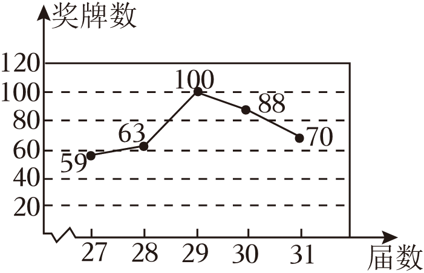

- A. 第28届
- B. 第29届
- C. 第30届
- D. 第31届

【答案】B

【解析】解：根据题意计算增长数量可得：第29届增长最快，
故选：B．

## 78. 单选题（难度：简单）

截止到2023年12月，南京市已经开通了两类地铁线——市区地铁线（1号，2号，3号，4号，7号，10号）和市域地铁线（S1，S3，S6，S7，S8，S9）．下图是某月连续13天两类地铁线日客运量的折线统计图．     关于这13天的描述：①在这13天中，全市两类地铁线日客运量最多的一天总人数是$262.8$万人，最少的一天总人数是

【答案】A

## 79. 单选题（难度：简单）

某公司的生产量在1﹣7月份的增长变化情况如图所示，从图上看，下列结论正确的是（　　）

【答案】A

## 80. 单选题（难度：简单）

如图，这是某市某天$8\mathrm{:}00-20\mathrm{:}00$气温变化的折线统计图，根据图形所给的信息，下列描述正确的是（      ）

【答案】A

## 81. （难度：简单）

A，B两种品牌方便面2019~2023年的销售增长率折线统计图如图所示，下列说法不正确的是（    ）

A．B品牌每年的销售增长率是逐年增加的   B．B品牌每年的销量增长率不低于A品牌
C．B品牌每年的销售量不低于A品牌       D．A品牌2022年的销售量高于2021年的销售量

【答案】

C

【解析】本题考查折线统计图，根据折线统计图逐项分析即可．
解：A. B品牌每年的销售增长率是逐年增加的，故正确，选项不符合题意；
B. B品牌每年的销量增长率不低于A品牌，故正确，选项不符合题意；
C.因为两种品牌方面的基础销量未知，无法判断每年的销量，故不正确，选项符合题意；
D. A品牌2022年的销售量高于2021年的销售量，故正确，选项不符合题意
．故选：C．

## 82. 单选题

从甲地到乙地有驾车、公交、地铁三种出行方式．数学课外小组的同学对6：00～10：00时段不同出发时刻，从甲地到乙地的三种出行方式所用时长进行调查、记录与整理，得到如图所示的数据．根据统计图提供的信息，下列推断不合理的是（　　）

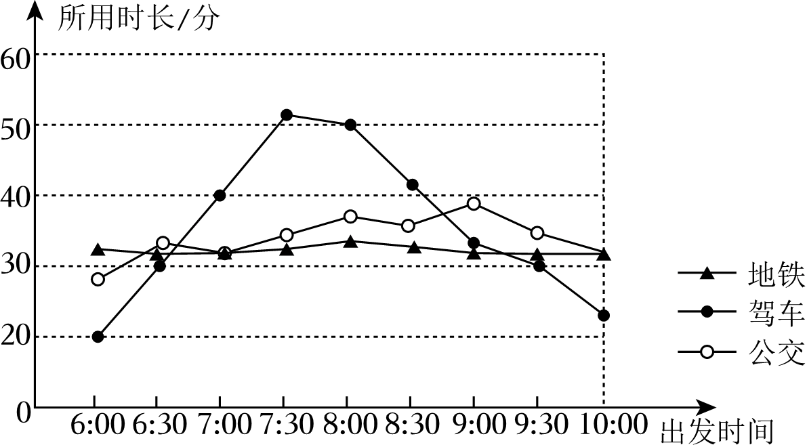

- A. 若6：00出发，地铁是最慢的出行方式
- B. 驾车出行所用时长受出发时刻影响最小
- C. 选择地铁出行，不论何时出发，用时都不超过35分钟
- D. 若7：00出发，地铁和公交所用时长相同

【答案】B

【解析】解：A．根据统计图可得，6：00出行，驾车用时20分钟，公交车用时约28分钟，地铁用时32分钟，所以地铁是最慢的出行方式，A选项说法正确，故A选项不符合题意；
B．根据统计图可得，地铁的出行时间受出发时刻影响比较小，驾车出行所用时长受出发时刻影响最大，所以B选项说法错误，故B符合题意；
C．根据统计图可得，选择地铁出行，不论何时出发，用时都不超过35分钟，所以C选项说法正确，故C不符合题意；
D．根据统计图可得，若7：00出发，地铁和公交所用时长相同，所以D选项说法正确，故D不符合题意．
故选：B．

## 83. 单选题（难度：简单）

某种汽车在\(7\)个月内销售量增长率的变化状况如图所示，从图上看，下列结论不正确的是（    ）

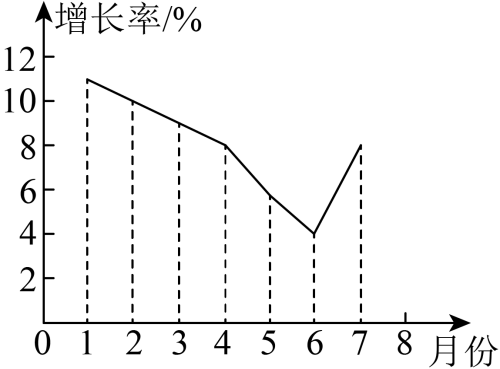

- A. \(2-6\)月汽车的销售量增长率逐渐变小
- B. \(7\)月份汽车的销售量增长率开始回升
- C. 这\(7\)个月中，每月的汽车销售量不断上涨
- D. 这\(7\)个月中，汽车销售量有上涨有下跌

【答案】D

【解析】本题考查了折线统计图，根据折线统计图即可判断求解，看懂折线统计图是解题的关键．
解：由折线统计图，可知：
2-6月汽车的销售量增长率逐渐变小，故选项A正确，不符合题意；
7月份汽车的销售量增长率开始回升，故选项B正确，不符合题意；
这7个月中，每月的汽车销售量不断上涨，故选项C正确，不符合题意；
这7个月中，每月的汽车的增长率有升有降，但汽车销售量一直在上涨，故选项D不正确，符合题意．
故选：D．

## 84. 单选题（难度：简单）

根据教育部通知精神，初中生每天睡眠时间应不少于9个小时．小欣同学记录了她一周的睡眠时间，并将结果绘制成如图所示的折线统计图，则小欣同学这一周睡眠时间不少于9个小时的有（　　）

【答案】A

## 85. （难度：简单）

某调查机构调查了全国青少年儿童的近视情况，部分资料如下：  $2010-2020$年儿童青少年近视率变化及2030年防控要求$2010-2020$年全国小学、初中、高中学生近视总人数（单位：万人）人数2010年2014 年2018年2020 年小学生3107445

## 86. 单选题（难度：简单）

空气质量指数（简称为AQI）是定量描述空气质量状况的指数，它的类别如下表所示．AQI数据0～5051～100101～150151～200201～300301以上AQI类别优良轻度污染中度污染重度污染严重污染某同学查阅资料，制作了近五年1月份北京市AQI各类别天数的统计图如下图所示．  根据以上信息，下列推断不合理的是（       ）

【答案】A

## 87. 单选题（难度：简单）

我校在一次歌唱选拔比赛中，将所有参赛学生的成绩绘制成如图所示的折线统计图，则下列说法错误的是（　　）

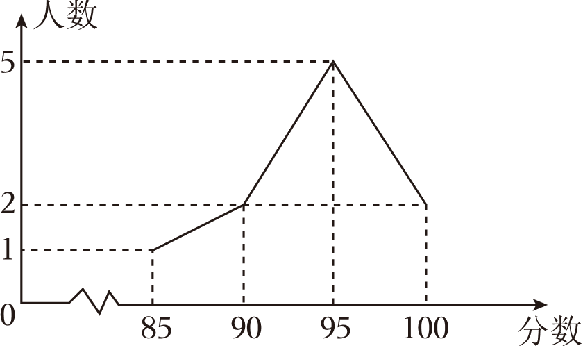

- A. 最高分为100分
- B. 最高分与最低分的差是15分
- C. 参赛学生人数为8人
- D. 参赛学生的满分率为20%

【答案】C

【解析】解：A、从统计图可以得出最高分为100分，故本选项不符合题意；
B、从统计图可以得出最高分为100分，最低分为85分，最高分与最低分差是15分，故本选项不符合题意；
C、从统计图可以得出参赛学生人数共有1+2+5+2＝10人，故本选项符合题意；
D、参赛学生的满分率为
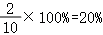
，故本选项不符合题意．
故选：C．
 
．

## 88. （难度：简单）

某自行车厂每周计划至少生产\(700\)辆自行车，计划每天生产自行车\(100\)辆，由于各种原因，实际每天生产量与计划每天生产量相比有出入．下表是某一周的自行车生产情况（单位/辆）：
星期
一
二
三
四
五
六
日

实际生产量
\(92\)
\(96\)
\(100\)
\(106\)
\(116\)
\(116\)
\(106\)

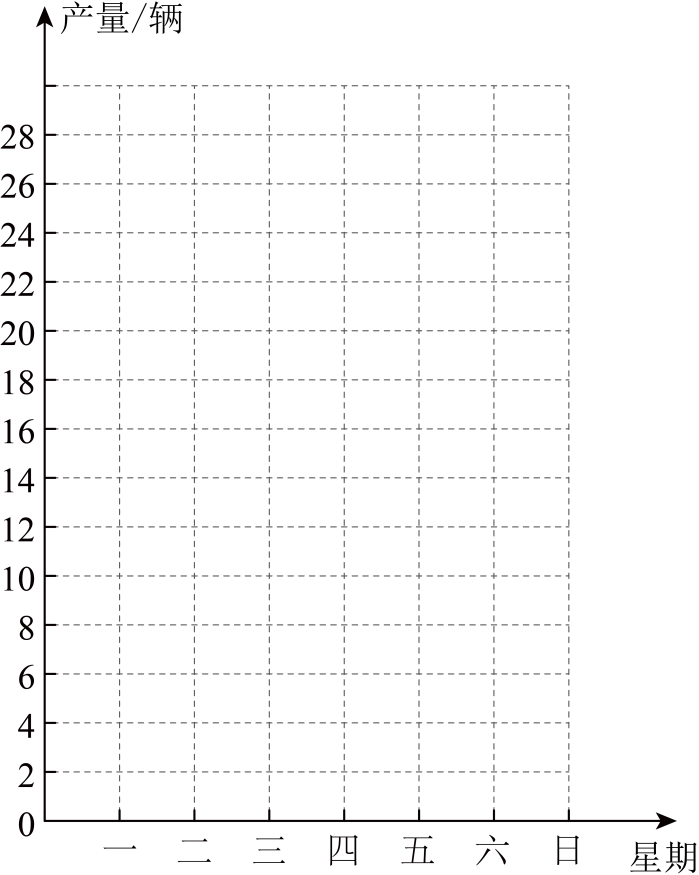

根据记录可知这周共生产自行车辆：(2)以每天自行车的生产量90辆为0点，请在图中用折线统计图表示这一周的自行车生产情况：(3)该厂实行每日计件工资制，即每生产一辆自行车就可以得人民币80元，若每天生产量超过100辆，每超一辆可多得15元：若每天生产量不足100辆，每少生产一辆扣25元，求这一周该厂生产自行车的工人的工资总额是多少？

【答案】

(1)这周共生产自行车辆为$732$辆(2)见解析(3)这一周该厂生产自行车的工人的工资总额是$589$20元

【解析】根据题意，以\(100\)为标准，超过记为正，不足记为负，分别表示出\(7\)天的生产量，相加即可求解；
（2）根据题意，实际生产量分别为\(2\)，6，\(10\)，\(16\)，\(26\)，\(26\)，\(16\)，画出折线统计图，即可求解；
（3）根据题意，列出算式，即可求解．
（1）解：以\(100\)为标准，超过记为正，不足记为负，
则实际生产量分别为\(-\text{8}\)，\(-4\)，\(0\)，\(6\)，\(16\)，\(16\)，\(6\)
∴这周共生产自行车辆为\(100\times 7+\left( -8-4+6+16+16+6 \right)=732\)(辆) 答：这周共生产自行车辆\(732\)辆；
（2）解：以每天自行车的生产量90辆为0点，
则实际生产量分别为\(2\)，6，\(10\)，\(16\)，\(26\)，\(26\)，\(16\)折线统计图如图所示，

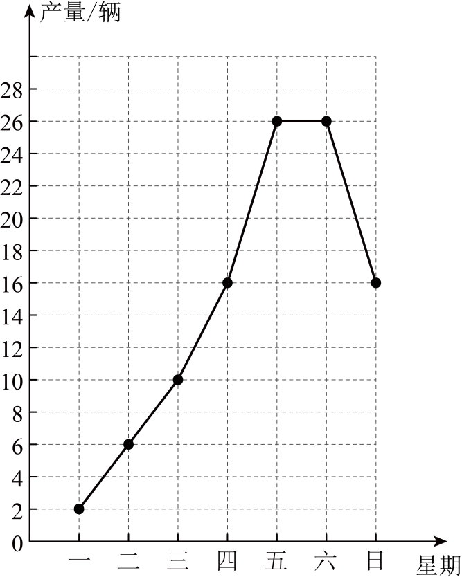
  
（3）解：由（1）可得实际生产量分别为\(-\text{8}\)，\(-4\)，\(0\)，\(6\)，\(16\)，\(16\)，\(6\)
∴\(732\times 80-25\times \left( 8+4 \right)+15\times \left( 6+16+16+6 \right)=58920\)（元）
答：这一周该厂生产自行车的工人的工资总额是\(58920\)元．

## 89. （难度：简单）

某中学组织网络安全知识竞赛活动，其中七年级6个班每班参赛人数相同，学校对该年级的获奖人数进行统计，得到平均每班获奖15人，并制作成如图所示的不完整的折线统计图．

## 90. （难度：简单）

某化工企业响应节能减排倡议，严格控制温室气体二氧化硫的排放量．2024年暑假数学兴趣小组对该工厂2024年二氧化硫排放量进行了调查，根据材料，解决问题．阅读材料：

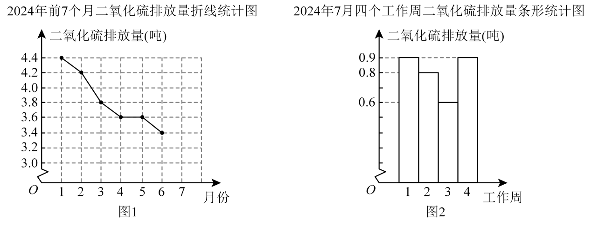

1．该工厂在2024年前7个月的二氧化硫排放情况如图1所示，该工厂7月份排放量可以看作4个工作周的总和，排放情况如图2所示；
2．该工厂提出2024年度减排目标：二氧化硫总排放量不超过42吨．
解决问题：

根据材料计算该工厂2024年7月份二氧化硫排放量，并补全图1；

该工厂计划从2024年8月开始，每个月二氧化硫排放量都比前一个月减少\(0.1\)吨，请你通过计算说明，该工厂能否完成2024年度减排目标？

【答案】

该工厂2024年7月份二氧化硫排放量为$3.2$吨；补全图1见解析

，

能；计算见解析

【解析】解：\(7\)月份二氧化碳排放总量为\(0.9+0.8+0.6+0.9=3.2\)（吨），
补全图\(1\)如图所示：

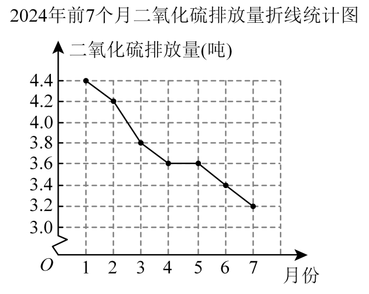

解：二氧化硫排放总量为：
\(4.4+4.2+3.8+3.6+3.6+3.4+3.2+3.1+3.0+2.9+2.8+2.7=40.7\)（吨），
\(\because 40.7<42\)，
∴该工厂能够完成年度减排要求．

## 91. （难度：简单）

随着社会的快速发展，生活用水量不断逐年上升，某地区生活用水量情况统计如下表所示：年份2012201320142015201620172018201920202021用水量（亿${{\text{m}}^{3}}$）58606263656869717375

## 92. （难度：简单）

如表是郑州2024年12月份某一星期最高气温变化情况（正号表示当天最高气温比前一天增加，负号表示当天最高气温比前一天减少，上星期日最高气温为8℃）星期一二三四五六日气温变化/℃+4﹣6+1+20﹣2﹣1

## 93. 单选题（难度：简单）

节约用水，从我做起，小明把自己家1月至6月份的用水量绘制成折线图，从统计图中可以看出小明家这6个月中用水量最少的月份是（　　）

【答案】A

## 94. 单选题（难度：简单）

如图是某地2月18日到23日PM₂.₅浓度和空气质量AQI的统计图（当AQI不大于100时称空气质量为“优良”）．由图可得下列四个关于这六天的说法：①18日的PM₂.₅浓度最低；②21日的PM₂.₅浓度最高；③有3天空气质量为“优良”；④空气质量指数AQI与PM₂.₅浓度有关．其中说法正确的是（　　）

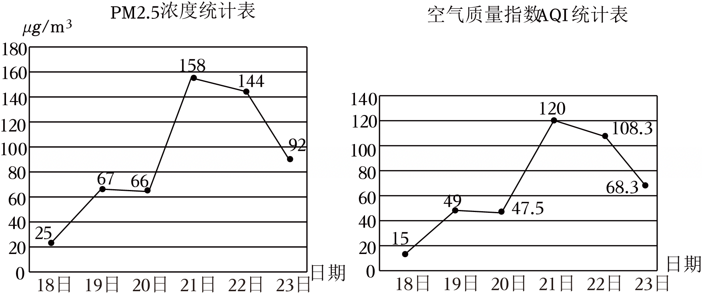

- A. ①③
- B. ②③
- C. ③
- D. ①②④

【答案】D

【解析】解：①18日的PM₂.₅浓度最低，为25，正确；
②21日的PM₂.₅浓度最高，为158，正确；
③有4天空气质量为“优良”，分别为18日、19日、20日、23日，原表述错误；
④空气质量指数AQI与PM₂.₅浓度有关，正确；
故选：D．

## 95. 

如表记录的是某条河流今年某一周内的水位变化情况（正号表示水位比前一天上升，负号表示水位比前一天下降），并且上周末（星期六）的水位达到警戒水位33米．
星期
日
一
二
三
四
五
六

水位变化（米）
+0.2
+0.8
﹣0.4
+0.2
+0.3
﹣0.5
﹣0.6

（1）本周哪一天河流的水位最高？哪一天河流的水位最低？
（2）以警戒水位作为零点，用折线统计图表示本周的水位情况．
（3）根据（1）（2）的分析，假若你是负责巡逻这条河流的工作人员，你会为居住在河流沿岸的居民提供哪些安全信息？假若你是居住在这条河流沿岸的居民，从安全角度你会做哪些准备工作？请你从巡逻工作人员和河流沿崖的居民中选择一种身份并回答对应的问题．

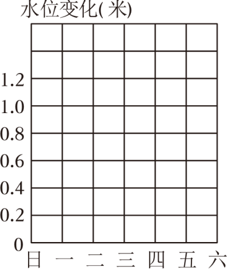

【答案】

具体见解析

【解析】解：（1）解：上周末（星期六）的水位达到警戒水位33米，则：
星期日：33+0.20＝33.2（米），
星期一：33.20+0.8＝34（米），
星期二：34﹣0.4＝33.6（米），
星期三：33.6+0.2＝33.8（米），
星期四：33.8+0.3＝34.1（米），
星期五：34.1﹣0.5＝33.6（米），
星期六：33.6﹣0.6＝33（米），
∴本周星期四的水位最高；星期六河流的水位最低．
（2）用折线统计图表示本周的水位情况如图所示：

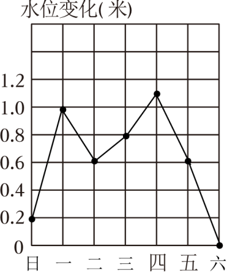

（3）从巡逻工作人员出发为居住在河流沿岸的居民提供信息为：劝导居民暂时搬离到安全区域生活，等水位回落到警戒线下再搬回来；
从河流沿岸的居民出发：互相分享水位信息，共同搬离，保护生命安全为首要任务．
【题干】.25如图是某商品1﹣4月份单个的进价和售价的折线统计图，则售出该商品单个利润最小的是（　　）

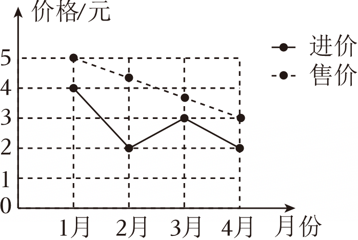

A．1月
B．2月
C．3月
D．4月
【答案】C．
【解析】解：由图可知：
1月，利润是5﹣4＝1；
2月，售价＞4，进价是2，此时利润大于2；
3月，售价小于4，进价是3，此时利润小于1；
4月，利润是3﹣2＝1
综上3月份的利润小于1，最小，
故选：C．

## 96. 单选题（难度：简单）

某校在一次演讲比赛中，将所有参赛学生的成绩绘制成如图所示的折线统计图，则下列说法错误的是（　　）

【答案】A

## 97. 单选题（难度：简单）

某品牌新能源汽车7～12月的月产量情况如图所示，则下列说法错误的是（　　）

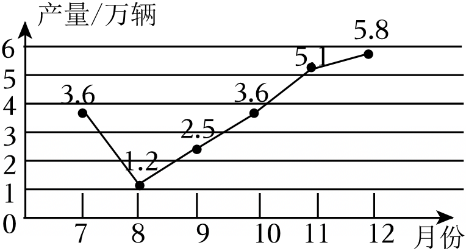

- A. 12月份产量最高
- B. 从9～12月份月产量逐渐增加
- C. 10月份和7月份的产量相同
- D. 从8月到9月的月产量增长最快

【答案】D

【解析】解：由折线图可以看出：12月份产量最高，故选项A正确，不符合题意；
从9～12月份月产量逐渐增加，故选项B正确，不符合题意；
10月份和7月份的产量相同，故选项C正确，不符合题意；
从8月到9月，产量增长了2.5﹣1.2＝1.3（万辆），从10月到11月，产量增长了5.1﹣3.6＝1.5（万辆），所以从10月到11月的月产量增长最快，故选项D错误，符合题意．
故选：D．

## 98. 单选题（难度：简单）

2024年6月～10月，中国某品牌新能源汽车的全球月销量情况如图所示，则下列说法错误的是（　　）

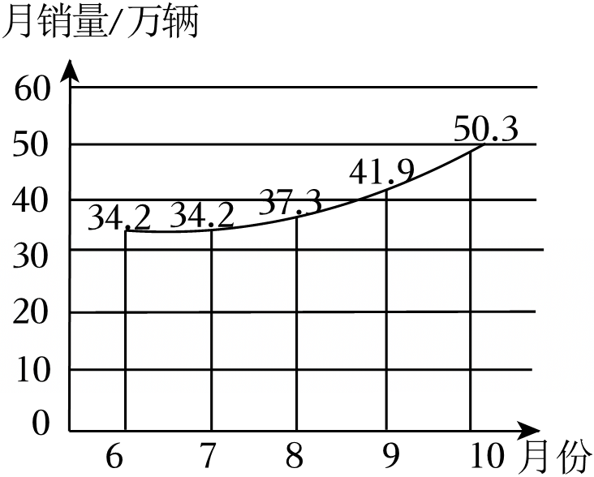

- A. 10月份销量最高
- B. 7月～10月份月销量逐渐增加
- C. 6月份和7月份销量相同
- D. 从8月到9月的月销量增长最快

【答案】D

【解析】解：根据题目中的折线统计图，可以判断各个选项中的结论是否正确如下：
A．10月份产量最高为50.3，故该选项正确，不符合题意；
B．从7～10月份月产量逐渐增加，故该选项正确，不符合题意；
C．6月份和7月份的产量相同都为34.2，故该选项正确，不符合题意；
D．从7月到8月增长3.1，从8月到9月增长4.6，从9月到10月增长8.4，所以从9月到10月的月产量增长最快，故该选项错误，符合题意．
故选：D．

## 99. 单选题（难度：简单）

近年来中国高铁发展迅速，如图是中国高铁营运里增长率折线统计图程增长率折线统计图．依据图中信息，下列说法错误的是（　　）

【答案】A
