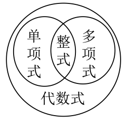
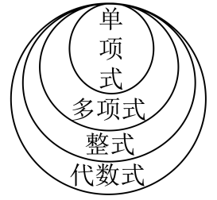
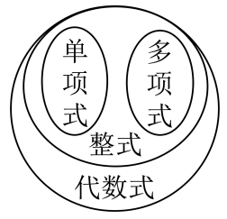
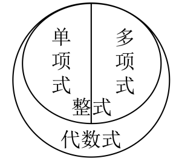

# 知识点·整式（同步练习）

> 教材：数学·七年级上册·沪科技版2024新教材 ｜ 来源：国家中小学智慧教育平台·在线练习 ｜ 共 50 题

## 1. 单选题（难度：简单）

下列代数式\( a+bc\)、\( 5a\)、\( m{x}^{2}-nx+p\)、\( -x\)、\( 1.1xyz\)、9、\( \frac{n+1}{m}\)其中整式有（   ）

- A. 7
- B. 6
- C. 5
- D. 4

【答案】B

【解析】解：代数式中\( a+bc\)、\( 5a\)、\( m{x}^{2}-nx+p\)、\( -x\)、\( 1.1xyz\)、9，\( \frac{n+1}{m}\)，其中整式的个数有\( a+bc\)、\( 5a\)、\( m{x}^{2}-nx+p\)、\( -x\)、\( 1.1xyz\)、9，共6个，
故选：B．

## 2. 单选题（难度：非常简单）

关于整式，下列说法正确的是（    ）

- A. \( 3\mathrm{\pi }\)是多项式
- B. 单项式\( 4{x}^{2}y{z}^{3}\)的次数是5
- C. 单项式\( -\frac{1}{2}xyz\)的系数是\( \frac{1}{2}\)
- D. 多项式\( 2{x}^{3}{y}^{2}-{x}^{2}y+3x{y}^{2}-1\)是五次四项式

【答案】D

【解析】A、单独的一个数或字母是单项式，所以\( 3\mathrm{\pi }\)是单项式，该项不符合题意；
B、单项式\( 4{x}^{2}y{z}^{3}\)的次数是6，该项不符合题意；
C、单项式\( -\frac{1}{2}xyz\)的系数是\( -\frac{1}{2}\)，该项不符合题意；
D、多项式\( 2{x}^{3}{y}^{2}-{x}^{2}y+3x{y}^{2}-1\)是五次四项式，该项符合题意．
故选：D．

## 3. 单选题（难度：简单）

下列式子\( \frac{1}{3}{x}^{2}-y\)，\( abc+6\)，0，\( \frac{2}{x+y}\)，\( \frac{x+1}{\text{π}}\)中，整式有（    ）

- A. 2个
- B. 3个
- C. 4个
- D. 5个

【答案】C

【解析】解：下列式子\( \frac{1}{3}{x}^{2}-y\)，\( abc+6\)，0，\( \frac{2}{x+y}\)，\( \frac{x+1}{\text{π}}\)中，整式有\( \frac{1}{3}{x}^{2}-y\)，\( abc+6\)，0，\( \frac{x+1}{\text{π}}\)，共4个，
故选：C．

## 4. 单选题

已知\( a\)、\( b\)、\( c\)、\( d\)均为常数，\( e\)、\( f\)均为非零常数，若有两个整式\( A={x}^{2}+ex+f\)，\( B=5{x}^{3}-6{x}^{2}+10=a{(x-1)}^{3}+b{(x-1)}^{2}+c(x-1)+d\)，下列结论中，正确个数为（   ）
①当\( A+B\)为关于\( x\)的三次三项式时，则\( f=-10\)；
②当多项式\( A\cdot B\)乘积不含\( {x}^{4}\)时，则\( e=6\)；
③\( a+b+c=19\)；
④当\( A\)能被\( x-2\)整除时，\( 2e+f=-4\)；

- A. 4
- B. 3
- C. 2
- D. 1

【答案】C

【解析】解：\( B=5{x}^{3}-6{x}^{2}+10=a{(x-1)}^{3}+b{(x-1)}^{2}+c(x-1)+d\)
\( =a({x}^{2}-2x+1)(x-1)+b({x}^{2}-2x+1)+cx-c+d\) 
\( =a({x}^{3}-3{x}^{2}+3x-1)+b{x}^{2}-2bx+b+cx-c+d\) 
\( =a{x}^{3}-3a{x}^{2}+3ax-a+b{x}^{2}-2bx+b+cx-c+d\) 
\( =a{x}^{3}-(3a-b){x}^{2}+(3a-2b+c)x+(-a+b-c+d)\)，
\( \therefore \) \( \left\{\begin{array}{c}a=5\\ 3a-b=6\\ 3a-2b+c=0\\ -a+b-c+d=10\end{array}\right. \)，
解得\( a=5\)，\( b=9\)，\( c=3\)，\( d=9\)，
①\( A+B={x}^{2}+ex+f+5{x}^{3}-6{x}^{2}+10=5{x}^{3}-5{x}^{2}+ex+f+10\)，
\( \because A+B\)为关于\( x\)的三次三项式，
∴\( f+10=0\)，即\( f=-10\)，
故结论①正确，符合题意；
②\( A\cdot B=({x}^{2}+ex+f)\cdot (5{x}^{3}-6{x}^{2}+10)\)
\( =5{x}^{5}-6{x}^{4}+10{x}^{2}+5e{x}^{4}-6e{x}^{3}+10ex+5f{x}^{3}-6f{x}^{2}+10f\) 
\( =5{x}^{5}+(5e-6){x}^{4}+(5f-6e){x}^{3}+(10-6f){x}^{2}+10ex+10f\)，
\( \because \)多项式\( A\cdot B\)乘积不含\( {x}^{4}\)时，
\( \therefore 5e-6=0\)，
\( \therefore e=\frac{6}{5}\)，
故结论②错误，不符合题意；
③\( \because a=5\)，\( b=9\)，\( c=3\)，
\( \therefore a+b+c=17\)，
故结论③错误，不符合题意；
④\( \because A={x}^{2}+ex+f\)，\( A\)能被\( x-2\)整除，
\( \therefore x=2\)是方程\( {x}^{2}+ex+f=0\)的一个根，
\( \therefore 4+2e+f=0\)，
即\( 2e+f=-4\)，
故结论④正确，符合题意，
综上所述，有2个结论正确，
故选：C．

## 5. 单选题（难度：非常简单）

下列各式中，不是整式的是（    ）

- A. \( m+n\)
- B. \( x=1\)
- C. \( xy\)
- D. 0

【答案】B

【解析】解：A．\( m+n\)是整式，故此选项不合题意；
B．\( x=1\)是方程，故此选项符合题意；
C．\( xy\)是整式，故此选项不合题意；
D．0是整式，故此选项不合题意．
故选：B．

## 6. 单选题（难度：非常简单）

下列说法正确的是（   ）

- A. 正数与负数统称为有理数
- B. 单项式和多项式统称整式
- C. 经过两点能确定无数条直线
- D. 等式两边同时乘或除以同一个数，所得结果仍是等式

【答案】B

【解析】解：A、正有理数与负有理数和0，统称为有理数，原说法错误，不符合题意；
B、单项式和多项式统称整式，原说法正确，符合题意；
C、经过两点能确定一条直线，原说法错误，不符合题意；
D、等式两边同时乘或除以同一个不为0的数，所得结果仍是等式，原说法错误，不符合题意；
故选B．

## 7. 单选题（难度：简单）

图是嘉淇的作业，她的得分是（   ）
判断题，每题2分
1. \( 2{a}^{2}b\)与\( b{a}^{2}\)是同类项（√）
2. \( \frac{m}{5}\)是整式（×）
3.单项式\( -{x}^{2}y\)的系数是\( -1\)（√）
4.多项式\( {x}^{2}-y+x{y}^{2}\)的次数是2（×）
5.  \( 1.289\times {10}^{5}\)的原数中有5个0（√）

- A. 10分
- B. 8分
- C. 6分
- D. 4分

【答案】C

【解析】解：1. \( 2{a}^{2}b\)与\( b{a}^{2}\)是同类项，嘉淇判断正确；
2.   \( \frac{m}{5}\)是整式，嘉淇判断错误；
3. 单项式\( -{x}^{2}y\)的系数是\( -1\)，嘉淇判断正确；
4. 多项式\( {x}^{2}-y+x{y}^{2}\)的次数是3，嘉淇判断正确；
5.  \( 1.289\times {10}^{5}\)的原数中有2个0，嘉淇判断错误，
所以嘉淇作对3道题，她的得分是\( 3\times 2=6\)（分），
故选：C．

## 8. 单选题

已知关于x的整式M：\( a{x}^{4}+b{x}^{3}+c{x}^{2}+dx+e\)，其中a，b，c，d，e为整数，且\( a<b<c<d<e\)，下列说法：①存在M为四次三项式；②令函数\( y=a{x}^{4}+b{x}^{3}+c{x}^{2}+dx+e\)，当\( x=1\)时，函数值为30，当\( x=0\)函数值为20，则\( a+b+c+d=10\)；③若\( px+q\)（其中p、q为整数）为整式M的因式，则q一定整除e；④若\( a+b+c+d+e=15\)，且a，b，c，d，e均为自然数，则满足条件的M共有7个．其中正确的个数是（   ）

- A. 0
- B. 1
- C. 2
- D. 3

【答案】D

【解析】解：①根据\( a<b<c<d<e\)，且\( a\)，\( b\)，\( c\)，\( d\)，\( e\)为整数，可得当a为0，则\( M\)的项数至少是4项，故不可能为四次三项式，故①错误；
②当\( x=1\)时，\( y=a+b+c+d+e=30\)，当\( x=0\)，\( y=e=20\)，则\( a+b+c+d=30-20=10\)，故②正确；
③由题意得，设\( M=a{x}^{4}+b{x}^{3}+c{x}^{2}+dx+e=\left(px+q\right)\left(m{x}^{3}+n{x}^{2}+fx+g\right)\)（其中\( m,n,f,g\)均为整数），
则常数项\( e=qg\)，
∴\( \frac{e}{q}=g\)为整数，
∴q一定整除e，故③正确；
④∵\( a+b+c+d+e=15\)，\( a<b<c<d<e\)，且a，b，c，d，e均为自然数，
当\( a=0\)时，b=1,c=2,d=3,e=9；
b=1,c=2,d=4,e=8；
b=1,c=2,d=5,e=7；
b=1,c=3,d=4,e=7；
b=1,c=3,d=5,e=6；
b=2,c=3,d=4,e=6；
当\( a=1\)时，\( b=2,c=3,d=4,e=5\)
故④正确，
∴正确的有三个，
故选：D．

## 9. 单选题（难度：适中）

已知\( M={x}^{2}+2xy,N=5{x}^{2}-4xy\)，若\( M+N=4{x}^{2}+P\)，则整式\( P\)为（   ）

- A. \( 2{x}^{2}-2xy\)
- B. \( 6{x}^{2}-2xy\)
- C. \( 3{x}^{2}+xy\)
- D. \( 2{x}^{2}+xy\)

【答案】A

【解析】解：\( M+N=\left({x}^{2}+2xy\right)+\left(5{x}^{2}-4xy\right)=4{x}^{2}+P\)，
则\( P=\left({x}^{2}+2xy\right)+\left(5{x}^{2}-4xy\right)-4{x}^{2}=2{x}^{2}-2xy\)．
故选：A．

## 10. 单选题（难度：适中）

按一定规律排列的整式：1，\( 4\sqrt{2}\)，\( 9\sqrt{3}\)，32，…，则第\( n\)个整式为（

- A. \( n\sqrt{n-1}\)
- B. \( n\sqrt{n+1}\)
- C. \( {n}^{2}\sqrt{n}\)
- D. \( {n}^{2}\sqrt{n+1}\)

【答案】C

【解析】解：\( \because 1={1}^{2}\sqrt{1}\)，\( 4\sqrt{2}={2}^{2}\sqrt{2}\)，\( 9\sqrt{3}={3}^{2}\sqrt{3}\)，\( 32=16\sqrt{4}={4}^{2}\sqrt{4}\)，
\( \therefore \)题中整式可排列为\( {1}^{2}\sqrt{1}\)，\( {2}^{2}\sqrt{2}\)，\( {3}^{2}\sqrt{3}\)，\( {4}^{2}\sqrt{4}\)，…，
\( \therefore \)第\( n\)个整式为\( {n}^{2}\sqrt{n}\)．
故选：C．

## 11. 单选题（难度：非常简单）

关于整式的概念，下列说法正确的是（   ）

- A. \( \frac{6\mathrm{\pi }{x}^{3}{y}^{2}}{7}\)的系数是\( \frac{6}{7}\)
- B. \( {3}^{2}x{y}^{3}\)的次数是6
- C. 0是单项式
- D. \( -x{y}^{2}+xy-7\)是五次三项式

【答案】C

【解析】解：A、\( \frac{6\pi {x}^{3}{y}^{2}}{7}\)的系数是\( \frac{6\pi }{7}\)，此项说法错误；
B、\( {3}^{2}x{y}^{3}\)的次数是\( 1+3=4\)，此项说法错误；
C、0是单项式，此项说法正确；
D、\( -x{y}^{2}+xy-7\)是三次三项式，此项说法错误．
故选：C．

## 12. 单选题（难度：适中）

若\( 3x-4y-7=0\)，则整式\( -9x+12y+12\)的值是（    ）

- A. 9
- B. \( -9\)
- C. 12
- D. -12

【答案】B

【解析】解：∵\( 3x-4y-7=0\)，
\( \therefore 3x-4y=7\)，
\( \therefore -9x+12y+12=-3(3x-4y)+12=-3\times 7+12=-9\)，
故选：B．

## 13. 单选题（难度：简单）

下列说法中，不正确的是（   ）

- A. 多项式\( 2{x}^{2}y-xy\)是五次二项式
- B. \( 6{x}^{2}-3x+1\)的项是\( 6{x}^{2}\)，\( -3x\)，1
- C. \( \frac{x+y}{3}\)是整式
- D. \( -a{b}^{2}c\)的系数是\( -1\)，次数是4

【答案】A

【解析】解：A、多项式\( 2{x}^{2}y-xy\)是三次二项式，故此选项不正确，符合题意；
B、\( 6{x}^{2}-3x+1\)的项是\( 6{x}^{2}\)，\( -3x\)，1，故此选项正确，不符合题意；
C、\( \frac{x+y}{3}\)是整式，故此选项正确，不符合题意；
D、\( -a{b}^{2}c\)的系数是\( -1\)，次数是4，故此选项正确，不符合题意；
故选：A．

## 14. 单选题（难度：非常简单）

下列有关整式的相关概念，说法正确的是（   ）

- A. 1不是单项式
- B. \( 3{a}^{2}-2ab+b\)是2次多项式
- C. \( 3\mathrm{\pi }{r}^{2}\)的系数是2
- D. \( {2}^{2}{a}^{3}{b}^{2}\)的次数是7

【答案】B

【解析】解：A、1是单项式，说法不正确，不符合题意；
B、\( 3{a}^{2}-2ab+b\)是2次多项式，说法正确，符合题意；
C、\( 3\pi {r}^{2}\)的系数是\( 3\pi \)，说法不正确，不符合题意；
D、\( {2}^{2}{a}^{3}{b}^{2}\)的次数是5，说法不正确，不符合题意；
故选：B．

## 15. 单选题（难度：非常简单）

下列式子中，不是整式的是（    ）

- A. \( -\frac{1}{2}m\)
- B. \( \frac{1}{3}\)
- C. \( \frac{3}{y}\)
- D. \( 2m+1\)

【答案】C

【解析】解：A、\( -\frac{1}{2}m\)是整式，不符合题意；
B、\( \frac{1}{3}\)是整式，不符合题意；
C、\( \frac{3}{y}\)，分母中含有字母，不是整式，符合题意；
D、\( 2m+1\)是整式，不符合题意；
故选：C．

## 16. 单选题（难度：简单）

下列整式变形正确的是（   ）

- A. \( a-(b+2c)=a-b+2c\)
- B. \( a+2(b-c)=a+2b+2c\)
- C. \( a-2(b-2c)=a-2b+2c\)
- D. \( a-(4b-c)=a-4b+c\)

【答案】D

【解析】解：A，\( a-(b+2c)=a-b-2c\)，该选项计算错误，不合题意；
B，\( a+2(b-c)=a+2b-2c\)，该选项计算错误，不合题意；
C，\( a-2(b-2c)=a-2b+4c\)，该选项计算错误，不合题意；
D，\( a-(4b-c)=a-4b+c\)，该选项计算正确，符合题意；
故选：D．

## 17. 单选题（难度：非常简单）

某同学在学习整式的概念后，用下列几幅图来表示各部分之间的关系，与其符合的是（   ）

- A. 
- B. 
- C. 
- D. 

【答案】D

【解析】解：∵代数式包含整式，整式是包含单项式和多项式的集合，而单项式和多项式是独立的子类，不互相包含．
故选：D ．

## 18. 单选题（难度：简单）

下列说法中，不正确的是（    ）

【答案】A

## 19. 单选题（难度：简单）

代数式<latex class="math-tex">\( \frac{1}{x}\)</latex>,<latex class="math-tex">\( 2x+y\)</latex>,<latex class="math-tex">\( \frac{1}{3}{a}^{2}b\)</latex>,<latex class="math-tex">\( \frac{x-y}{\text{π}}\)

【答案】A

## 20. 单选题（难度：简单）

代数式\( \frac{x+a}{2}\)，\( \frac{1}{n}\)，\( \frac{4a}{3-b}\)，\( -1\)，\( a\)，\( 3{x}^{2}+2x-1\)中，整式有（    ）

- A. 2个
- B. 3个
- C. 4个
- D. 5个

【答案】C

【解析】解：代数式\( \frac{x+a}{2}\)，\( \frac{1}{n}\)，\( \frac{4a}{3-b}\)，\( -1\)，\( a\)，\( 3{x}^{2}+2x-1\)中，整式有\( \frac{x+a}{2}\)，\( -1\)，\( a\)，\( 3{x}^{2}+2x-1\)，共4个，
故选：C．

## 21. 单选题（难度：简单）

下列叙述正确的是（　　）

- A. \( 1÷a\)是整式
- B. \( {x}^{2}+{x}^{3}y-2y{x}^{2}+1\)是三次四项式
- C. \( \frac{m-n}{3}\)的各项系数都是\( \frac{1}{3}\)
- D. \( -{x}^{3}+2{x}^{2}-1\)的常数项是\( -1\)

【答案】D

【解析】解：A、\( 1÷a\)不是整式，原说法错误，不符合题意；
B、\( {x}^{2}+{x}^{3}y-2y{x}^{2}+1\)是四次四项式，原说法错误，不符合题意；
C、\( \frac{m-n}{3}\)的各项系数是\( \frac{1}{3}\)和\( -\frac{1}{3}\)，原说法错误，不符合题意；
D、\( -{x}^{3}+2{x}^{2}-1\)的常数项是\( -1\)，原说法正确，符合题意．
故选：D．

## 22. 单选题（难度：简单）

下列整式中，不是同类项的是（    ）

【答案】A

## 23. 单选题（难度：适中）

整式\( mx-n\)的值随\( x\)取值的变化而变化，下表是当\( x\)取不同值时对应的整式的值：
\( x\) 
\( -1\) 
\( 0\) 
\( 1\) 
\( 2\) 
\( 3\) 

\( mx-n\) 
\( -4\) 
\( -2\) 
\( 0\) 
\( 2\) 
\( 4\) 

则关于\( x\)的方程\( -mx+n=-6\)的解为（   ）

- A. \( x=-1\)
- B. \( x=0\)
- C. \( x=2\)
- D. \( x=4\)

【答案】D

【解析】解：由表格可得，当\( x=-1\)时，\( mx-n=-4\)，
∴\( -m-n=-4\)，
∴\( m+n=4\)；
当\( x=0\)时，\( mx-n=-2\)，
∴\( -n=-2\)，
∴\( n=2\)，
∴\( m+2=4\)，
∴\( m=2\)，
把\( n=2\)，\( m=2\)代入\( -mx+n=-6\)，
∴\( -2x+2=-6\),
解得：\( x=4\)．
故选：D．

## 24. 单选题（难度：简单）

下列说法中，正确的是（    ）

- A. \( 2\)不是整式
- B. 多项式\( {a}^{2}-5a+2\)是三次三项式
- C. 单项式\( -{a}^{2}{b}^{3}c\)的次数是\( 5\)
- D. 多项式\( 2{x}^{3}y-xy+5\)的常数项是\( 5\)

【答案】D

【解析】解：A．\( 2\)是整式，故不正确，不符合题意；
B．多项式\( {a}^{2}-5a+2\)是二次三项式，故不正确，不符合题意；
C．单项式\( -{a}^{2}{b}^{3}c\)的次数是\( 6\)，故不正确，不符合题意；
D．多项式\( 2{x}^{3}y-xy+5\)的常数项是\( 5\)，正确，符合题意；
故选：D．

## 25. 单选题（难度：简单）

下列各式符合整式书写规范的是（    ）

【答案】A

## 26. 单选题（难度：非常简单）

下列说法不正确的是（   ）

【答案】A

## 27. 单选题（难度：非常简单）

下列说法正确的有（  ）

- A. \( \frac{3}{4}\)是整式
- B. \( \frac{2+b}{2}\)是单项式
- C. \( \sqrt{3}a\)不是整式
- D. \( x+\frac{1}{x}\)是多项式

【答案】A

【解析】解：\( A\)、\( \frac{3}{4}\)是整式，原说法正确，符合题意；
\( \text{B}\)、\( \frac{2+b}{2}\)是多项式，原说法错误，不符合题意；
\( \text{C}\)、\( \sqrt{3}a\)是整式，原说法错误，不符合题意；
\( \text{D}\)、\( x+\frac{1}{x}\)是分式，原说法错误，不符合题意；
故选：A．

## 28. 单选题（难度：非常简单）

下列说法不正确的是（   ）

- A. \( abc\)的系数是\( 1\)
- B. 多项式\( 1-x-3{x}^{2}\)中，二次项是\( -3{x}^{2}\)
- C. \( -a{b}^{3}\)的次数是\( 4\)
- D. \( -\frac{3xy}{4}\)不是整式

【答案】D

【解析】解∶A、\( abc\)的系数是\( 1\)，该项说法正确，故A不符合题意；
B、多项式\( 1-x-3{x}^{2}\)中，二次项是\( -3{x}^{2}\)，该项说法正确，故B不符合题意；
C、单项式\( -a{b}^{3}\)的次数是\( 4\)，该项说法正确，故C不符合题意；
D、\( -\frac{3xy}{4}\)是单项式，单项式属于整式，该项说法错误，故D符合题意．
故选：D．

## 29. 单选题（难度：简单）

下列整式与\( m{n}^{2}\)为同类项的是（    ）

- A. \( {m}^{2}n\)
- B. \( 2m{n}^{2}\)
- C. \(-mn\)
- D. \({\left(mn\right)}^{2}\)

【答案】B

【解析】解：A、\( {m}^{2}n\)与\( m{n}^{2}\)所含的字母相同，但相同字母的指数不相同，不是同类项，则此项不符合题意；
B、\( 2m{n}^{2}\)与\( m{n}^{2}\)是同类项，则此项符合题意；
C、\( -mn\)与\( m{n}^{2}\)所含的字母相同，但相同字母的指数不相同，不是同类项，则此项不符合题意；
D、\( {\left(mn\right)}^{2}={m}^{2}{n}^{2}\)与\( m{n}^{2}\)所含的字母相同，但相同字母的指数不相同，不是同类项，则此项不符合题意；
故选：B．

## 30. 单选题（难度：适中）

已知整式<latex class="math-tex">\( x+2y+1\)</latex>的值是4，那么整式<latex class="math-tex">\( 2x+4y+1\)</latex>的值是（   ）

【答案】A

## 31. 单选题

已知整式<latex class="math-tex">\( {x}^{2}-5x\)</latex>的值为3，则<latex class="math-tex">\( 2{x}^{2}-10x+5\)</latex>的值为（    ）

【答案】A

## 32. 单选题（难度：简单）

用整式<latex class="math-tex">\( x+1\)</latex>，<latex class="math-tex">\( 4\)</latex>，<latex class="math-tex">\( \text{π}\)</latex>组成的代数式有<latex class="math-tex">\( \frac{4}{x+1}\)</latex>，<latex class="

【答案】A

## 33. 单选题（难度：简单）

下列说法中错误的是（    ）

- A. 0是整式
- B. \({2}^{3}{x}^{2}\)是五次单项式
- C. \(-\frac{xy}{5}\)的系数是\(-\frac{1}{5}\)
- D. \(x{y}^{2}-2{x}^{2}+x-1\)是关于\(x\)，\(y\)的三次四项式

【答案】B

【解析】解：A、0是整式，原说法正确，不符合题意；
B、\( {2}^{3}{x}^{2}\)是二次单项式，原说法错误，符合题意；
C、\( -\frac{xy}{5}\)的系数是\( -\frac{1}{5}\)，原说法正确，不符合题意；
D、\( xy{}^{2}-2{x}^{2}+x-1\)是关于\( x\)，\( y\)的三次四项式，原说法正确，不符合题意；
故选：B．

## 34. 单选题（难度：简单）

下列式子中：<latex class="math-tex">\( -2a\)</latex>，<latex class="math-tex">\( \frac{2}{3}abc\)</latex>，<latex class="math-tex">\( x=y\)</latex>，<latex class="math-tex">\( \frac{3}{x}\)</latex>，<latex clas

【答案】A

## 35. 单选题（难度：非常简单）

下列说法正确的是（　　）

- A. \( \text{π}\)是单项式
- B. 整式就是多项式
- C. \( 3{x}^{4}+{x}^{3}\)是七次二项式
- D. \( \frac{2x-1}{5}\)是单项式

【答案】A

【解析】解：A、\( \text{π}\)是单项式，故本选项符合题意；
B、整式就是多项式与单项式的统称，原说法错误，故本选项不符合题意；
C、\( 3{x}^{4}+{x}^{3}\)是四次二项式，原说法错误，故本选项不符合题意；
D、\( \frac{2x-1}{5}\)是多项式，故本选项不符合题意；
故选A．

## 36. 单选题（难度：适中）

解分式方程\( \frac{2}{x-3}=\frac{3}{x}\)时，将方程两边都乘同一个整式，得到一个一元一次方程，这个整式是（　　）

- A. x
- B. \( x-3\)
- C. \(x\left(x-3\right)\)
- D. \(x+\left(x-3\right)\)

【答案】C

【解析】解：\( \because \)分式方程\( \frac{2}{x-3}=\frac{3}{x}\)的最简公分母是\( x\left(x-3\right)\)，
\( \therefore \)方程两边都乘同一个整式去分母是\( x\left(x-3\right)\)，
故选：C．

## 37. 单选题（难度：简单）

嘉淇的作业，她的得分是（   ）
判断题，每题2分
1. \( 2{a}^{2}b\)与\( b{a}^{2}\)是同类项（√）
2. \( \frac{m}{5}\)是整式（×）
3.单项式\( -{x}^{2}y\)的系数是\( -1\)（√）
4.多项式\( {x}^{2}-y+x{y}^{2}\)的次数是2（×）
5.  \( 1.289\times {10}^{5}\)的原数中有5个0（√）

- A. 10分
- B. 8分
- C. 6分
- D. 4分

【答案】C

【解析】解：1. \( 2{a}^{2}b\)与\( b{a}^{2}\)是同类项，嘉淇判断正确；
2.   \( \frac{m}{5}\)是整式，嘉淇判断错误；
3. 单项式\( -{x}^{2}y\)的系数是\( -1\)，嘉淇判断正确；
4. 多项式\( {x}^{2}-y+x{y}^{2}\)的次数是3，嘉淇判断正确；
5.  \( 1.289\times {10}^{5}\)的原数中有2个0，嘉淇判断错误，
所以嘉淇作对3道题，她的得分是\( 3\times 2=6\)（分），
故选：C．

## 38. 单选题（难度：适中）

已知四个整式：<latex class="math-tex">\( A={x}^{2}-2x\)</latex>，<latex class="math-tex">\( B={y}^{2}+2y-1\)</latex>，<latex class="math-tex">\( C=x-y\)</latex>，<latex class="math-tex">\( D=x+y\)</latex>，有以下结论

【答案】A

## 39. 单选题（难度：简单）

下列说法：①<latex class="math-tex">\( \frac{2x}{\text{π}}\)</latex>的系数是2；②多项式<latex class="math-tex">\( 2{x}^{2}+x{y}^{2}+3\)</latex>是二次三项式；③<latex class="math-tex">\( {x}^{2}-x-2\)</latex>的常数项为2；④在<latex

【答案】A

## 40. 单选题（难度：简单）

下列说法正确的是（    ）

【答案】A

## 41. 单选题（难度：简单）

下列判断：①单项式<latex class="math-tex">\( 3x\)</latex>的次数是0；②单项式<latex class="math-tex">\( -\pi y\)</latex>的系数是<latex class="math-tex">\( -1\)</latex>；③<latex class="math-tex">\( \frac{1}{2},-2a\)</latex>都是

【答案】A

## 42. 单选题（难度：非常简单）

下列各式中，符合整式书写规则的是（    ）

【答案】A

## 43. 单选题（难度：简单）

如果使分式<latex class="math-tex">\( \frac{A}{2a+b}\)</latex>有意义的<latex class="math-tex">\( a\)</latex>和<latex class="math-tex">\( b\)</latex>的值都扩大为原来的2倍，则分式的值也扩大为原来的2倍，那么整式<latex class="math-tex">\( A\)</

【答案】A

## 44. 单选题（难度：简单）

下列说法错误的是（   ）

【答案】A

## 45. 单选题

依次排列的两个整式<latex class="math-tex">\( -2a+b\)</latex>，<latex class="math-tex">\( -2a+3b\)</latex>，将第1个整式乘2再加上第2个整式，称为第1次操作，得到第3个整式<latex class="math-tex">\( -6a+5b\)</latex>；将第2个整式乘2再加上第3个整式，称为第2次操作，得到第

【答案】A

## 46. 单选题（难度：非常简单）

下列整式中，是二次单项式的是（   ）

【答案】A

## 47. 单选题（难度：适中）

若<latex class="math-tex">\( A\)</latex>和<latex class="math-tex">\( B\)</latex>都是六次多项式，则<latex class="math-tex">\( A+B\)</latex>一定是（    ）．

【答案】A

## 48. 单选题

把整式<latex class="math-tex">\( 3{x}^{2}-4x+7\)</latex>表示成<latex class="math-tex">\( a{(x+1)}^{2}+b(x+1)+c\)</latex>的形式，则<latex class="math-tex">\( 2a+2b+2c\)</latex>的值为（    ）

【答案】A

## 49. 单选题（难度：适中）

下列赋予整式<latex class="math-tex">\( 7a\)</latex>实际意义的例子，其中错误的是（   ）

【答案】A

## 50. 单选题（难度：适中）

若化简关于x，y的整式<latex class="math-tex">\( {x}^{3}+2a\left({x}^{2}+xy\right)-b{x}^{2}-xy+{y}^{2}\)</latex>得到的结果是一个三次二项式，则<latex class="math-tex">\( {\left(a-b\right)}^{2}\)</latex>的值是（   ）

【答案】A
