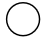
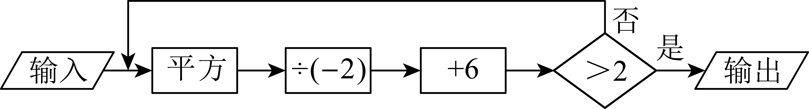

# 知识点·有理数的乘方（同步练习）

> 教材：数学·七年级上册·沪科技版2024新教材 ｜ 来源：国家中小学智慧教育平台·在线练习 ｜ 共 52 题

## 1. 单选题（难度：简单）

当\( \mathrm{a}<0\)时，下列各式不成立的是（　　）

- A. \( {\mathrm{a}}^{2}>0\)
- B. \( {\mathrm{a}}^{2}=-\mathrm{a}\)
- C. \( {\mathrm{a}}^{2}={(-\mathrm{a})}^{2}\)
- D. \( \left|\mathrm{a}\right|=-\mathrm{a}\)

【答案】B

【解析】解：只要\( \mathrm{a}\ne 0\)，恒有\( {\mathrm{a}}^{2}>0\)，故A选项成立；
∵\( {\mathrm{a}}^{2}={\left(-\mathrm{a}\right)}^{2}\)，故B选项不成立，C成立；
∵\( \mathrm{a}<0\)，
∴\( -\mathrm{a}>0\)，
∴\( \left|\mathrm{a}\right|=-\mathrm{a}\)，故D选项成立，
故选：B．

## 2. 单选题（难度：简单）

在\( {\left(-1\right)}^{2021}\)，\( -{2}^{3}\)，\( {\left(-7\right)}^{11}\)，0中，非负数有（　　）

- A. 1个
- B. 2个
- C. 3个
- D. 4个

【答案】A

【解析】解：∵\( {\left(-1\right)}^{2021}=-1<0\)，\( -{2}^{3}<0\)，\( {\left(-7\right)}^{11}=-{7}^{11}<0\)，
∴\( {\left(-1\right)}^{2021}\)，\( -{2}^{3}\)，\( {\left(-7\right)}^{11}\)，0中，只有0是非负数．
故选：A．

## 3. 单选题（难度：简单）

下列各组的两个数中，运算后结果相等的是（　　）

【答案】A

## 4. 单选题（难度：简单）

下列各式中，结果最大的是（　　）

【答案】A

## 5. 单选题（难度：简单）

下列化简错误的是（　　）

- A. \( -\left(-2\right)=2\)
- B. \( {\left(-4\right)}^{2}=16\)
- C. \( -\left(+6\right)=-6\)
- D. \( -\left|-5\right|=5\)

【答案】D

【解析】解：\( \text{A}\)、\( -\left(-2\right)=2\)，结果正确，故本选项不符合题意；
\( \text{B}\)、\( {\left(-4\right)}^{2}=16\)，结果正确，故本选项不符合题意；
\( \text{C}\)、\( -\left(+6\right)=-6\)，结果正确，故本选项不符合题意；
\( \text{D}\)、\( -\left|-5\right|=-5\)，结果不正确，故本选项符合题意；
故选：\( \text{D}\)．

## 6. 单选题（难度：简单）

下列各数中，结果相等的是（　　）

【答案】A

## 7. 单选题（难度：非常简单）

如果<latex class="math-tex">\( {\mathrm{a}}^{2}=16\)</latex>，则<latex class="math-tex">\( \mathrm{a}\)</latex>是（　　）

【答案】A

## 8. 单选题（难度：简单）

四个数<latex class="math-tex">\( \left|-3.14\right|,-\mathrm{a},-{1}^{2},{\left(-2\right)}^{2}\)</latex>中一定为负数的是（　　）

【答案】A

## 9. 单选题（难度：简单）

下列各组数中，数值相等的是（　　）

- A. \( -\left|-2\right|\)与2
- B. \( -{3}^{3}\)与\( {\left(-3\right)}^{3}\)
- C. \( -3\times {2}^{3}\)与\( -{3}^{2}\times 2\)
- D. \( -{\left(-3\right)}^{2}\)与\( -{\left(-2\right)}^{3}\)

【答案】B

【解析】解：A、\( -\left|-2\right|=-2\ne 2\)，故A不符合题意；
B、\( -{3}^{3}=-27\)，\( {\left(-3\right)}^{3}=-27\)，故B符合题意；
C、\( -3\times {2}^{3}=-24\)，\( -{3}^{2}\times 2=-18\)，故C不符合题意；
D、\( -{\left(-3\right)}^{2}=-9\)，\( -{\left(-2\right)}^{3}=8\)，故D不符合题意，
故选：B．

## 10. 单选题（难度：简单）

下列各组数中互为相反数的一组是（　　）

【答案】A

## 11. 单选题（难度：简单）

下列各组数中，互为相反数的是（　　）

【答案】A

## 12. 单选题（难度：简单）

下列各数中，是负整数的是（　　）

- A. \( -\left|-0.3\right|\)
- B. \( {\left(-3\right)}^{2}\)
- C. \( -{2}^{3}\)
- D. \( -\left(-{3}^{2}\right)\)

【答案】C

【解析】解：A. \( -\left|-0.3\right|\) \( =-0.3\)是负分数，不符合题意；    
B. \( {\left(-3\right)}^{2}\) \( =9\)，是正整数，不符合题意；    
C. \( -{2}^{3}\) \( =-8\)，是负整数，符合题意；    
D. \( -\left(-{3}^{2}\right)\) \( =9\)，是正整数，不符合题意；    
故选：C．

## 13. 单选题（难度：简单）

下列各数为负数的是（    ）

- A. \( \left|-2\right|\)
- B. \( -{2}^{2}\)
- C. \( {\left(-2\right)}^{2}\)
- D. \( -\left(-2\right)\)

【答案】B

【解析】解：\( \mathrm{A}\mathrm{、}\)∵\( \left|-2\right|=2\)，故\( \mathrm{A}\)项不符合题意；
\( \mathrm{B}\mathrm{、}\)∵\( -{2}^{2}=-4\)，故\( \mathrm{B}\)项符合题意；
\( \mathrm{C}\mathrm{、}\)∵\( {\left(-2\right)}^{2}=4\)，故\( \mathrm{C}\)不符合题意；
\( \mathrm{D}\mathrm{、}\)∵\( -\left(-2\right)=2\)，故\( \mathrm{D}\)不符合题意．
故选\( \mathrm{B}\)．

## 14. 单选题（难度：简单）

下列说法中，正确的是（　　）

- A. 若\( \mathrm{a}=\mathrm{b}\)，则\( \frac{\mathrm{a}}{\mathrm{c}}=\frac{\mathrm{b}}{\mathrm{c}}\)
- B. 若\( \mathrm{a}=\mathrm{b}\)，则\( \mathrm{a}\mathrm{c}=\mathrm{b}\mathrm{c}\)
- C. 若\( \left|\mathrm{a}\right|=\left|\mathrm{b}\right|\)，则\( \mathrm{a}=\mathrm{b}\)
- D. 若\( {\mathrm{a}}^{2}={\mathrm{b}}^{2}\)，则\( \mathrm{a}=\mathrm{b}\)

【答案】B

【解析】解：A． 若\( \mathrm{a}=\mathrm{b}\)，想要\( \frac{\mathrm{a}}{\mathrm{c}}=\frac{\mathrm{b}}{\mathrm{c}}\)成立，需要\( \mathrm{c}\ne 0\)，故A选项不符合题意；
B． 若\( \mathrm{a}=\mathrm{b}\)，则\( \mathrm{a}\mathrm{c}=\mathrm{b}\mathrm{c}\)，故选项B符合题意；
C． 若\( \left|\mathrm{a}\right|=\left|\mathrm{b}\right|\)，则\( \mathrm{a}=\mathrm{b}\)或\( \mathrm{a}=-\mathrm{b}\)，故选项C不符合题意；
D． 若\( {\mathrm{a}}^{2}={\mathrm{b}}^{2}\)，则\( \mathrm{a}=\mathrm{b}\)或\( \mathrm{a}=-\mathrm{b}\)，故选项D不符合题意．
故选：B．

## 15. 单选题（难度：非常简单）

下列各数中为负数的是（　　）

【答案】A

## 16. 单选题（难度：简单）

下列与1互为相反数的是（    ）

【答案】A

## 17. 单选题（难度：非常简单）

计算：<latex class="math-tex">\( {\left(-1\right)}^{2005}+{\left(-1\right)}^{2006}=\)</latex>（　　）

【答案】A

## 18. 单选题（难度：非常简单）

若<latex class="math-tex">\( \left|\mathrm{x}+3\right|+{\left(\mathrm{y}-2\right)}^{2}=0\)</latex>，则<latex class="math-tex">\( \mathrm{x}+\mathrm{y}\)</latex>的值为（　　）

【答案】A

## 19. 单选题（难度：简单）

如果m的相反数是2，计算<latex class="math-tex">\( {(\mathrm{m}+1)}^{2024}\)</latex>的结果为（　　）

【答案】A

## 20. 单选题（难度：简单）

计算<latex class="math-tex">\( {(-1)}^{2020}\)</latex>的结果是（　　）

【答案】A

## 21. 单选题（难度：简单）

下列计算正确的是（　　）

- A. \( -{5}^{2}=25\)
- B. \( {\left(-5\right)}^{3}=-15\)
- C. \( {5}^{-2}=-25\)
- D. \( {5}^{4}÷{5}^{3}=5\)

【答案】D

【解析】解：A、\( -{5}^{2}=-25\)，原计算错误，不符合题意；
B、\( {\left(-5\right)}^{3}=-125\)，原计算错误，不符合题意；
C、\( {5}^{-2}=\frac{1}{25}\)，原计算错误，不符合题意；
D、\( {5}^{4}÷{5}^{3}=5\)，原计算正确，符合题意；
故选D．

## 22. 单选题（难度：简单）

若\( \left|\mathrm{a}-5\right|+{\left(\mathrm{b}-2\right)}^{2}=0\)，则\( -{\mathrm{a}}^{\mathrm{b}}\)值是（　　）

- A. \( -25\)
- B. \( 25\)
- C. \( 10\)
- D. \( -10\)

【答案】A

【解析】解：∵\( \left|\mathrm{a}-5\right|+{\left(\mathrm{b}-2\right)}^{2}=0\)，\( \left|\mathrm{a}-5\right|\ge 0\)，\( {\left(\mathrm{b}-2\right)}^{2}\ge 0\)，
∴\( \mathrm{a}-5=0\)，\( \mathrm{b}-2=0\)，
∴\( \mathrm{a}=5\)，\( \mathrm{b}=2\)，
∴\( -{\mathrm{a}}^{\mathrm{b}}=-{5}^{2}=-25\)，
故选：A．

## 23. 单选题（难度：简单）

下列各组数中，结果为负数的是（　　）

- A. \( \left(-3\right)\times \left(-2\right)\)
- B. \( \left|-3\times 2\right|\)
- C. \( -{3}^{2}\)
- D. \( {\left(-3\right)}^{2}\)

【答案】C

【解析】解：A、\( \left(-3\right)\times \left(-2\right)=6\)，不是负数，不符合题意；
B、\( \left|-3\times 2\right|=6\)，不是负数，不符合题意；
C、\( -{3}^{2}=-9\)，是负数，符合题意；
D、\( {\left(-3\right)}^{2}=9\)，不是负数，不符合题意．
故选：C．

## 24. 单选题（难度：简单）

若<latex class="math-tex">\( \mathrm{a}=-{2}^{2}\)</latex>，<latex class="math-tex">\( \mathrm{b}={2}^{2}\)</latex>，<latex class="math-tex">\( \mathrm{c}={\left(\frac{1}{2}\right)}^{0}\)</latex>，则（　　）

【答案】A

## 25. 单选题（难度：简单）

乘法运算\( -\frac{1}{3}\times \frac{1}{3}\times \frac{1}{3}\times \frac{1}{3}\)可以表示为（　　）

- A. \( \left(-\frac{1}{3}\right)\times 4\)
- B. \( \left(-4\right)\times \frac{1}{3}\)
- C. \( {\left(-\frac{1}{3}\right)}^{4}\)
- D. \( -{\left(\frac{1}{3}\right)}^{4}\)

【答案】D

【解析】解：依题意，\( -\frac{1}{3}\times \frac{1}{3}\times \frac{1}{3}\times \frac{1}{3}=-\left(\frac{1}{3}\times \frac{1}{3}\times \frac{1}{3}\times \frac{1}{3}\right)=-{\left(\frac{1}{3}\right)}^{4}\)，
故选：D

## 26. 单选题（难度：简单）

<latex class="math-tex">\( -{2}^{3}\)</latex>表示的意义是（　　）

【答案】A

## 27. 单选题（难度：简单）

下列各组数中，计算结果相等的是（　　）

【答案】A

## 28. 单选题（难度：简单）

下列计算正确的是（　　）

- A. \( {\left(-1\right)}^{2025}=1\)
- B. \( -{2}^{2}=4\)
- C. \( {\left(-3\right)}^{2}=9\)
- D. \( {\left(\frac{1}{2}\right)}^{2}=4\)

【答案】C

【解析】解：A． \( {(-1)}^{2025}=-1\)，故本选项不符合题意；
B． \( -{2}^{2}=-4\)，故本选项不符合题意；
C． \( {\left(-3\right)}^{2}=9\)，故本选项符合题意；
D． \( {\left(\frac{1}{2}\right)}^{2}=\frac{1}{4}\)，故本选项不符合题意；
故选：C．

## 29. 单选题（难度：简单）

若<latex class="math-tex">\( {\left(\mathrm{a}+1\right)}^{2}+\left|\mathrm{b}-2\right|=0\)</latex>，则<latex class="math-tex">\( {\left(\mathrm{a}+\mathrm{b}\right)}^{2025}\)</latex>的值是（　　）

【答案】A

## 30. 单选题（难度：简单）

在\( -{3}^{2}\)，\( -\left|-5\right|\)，\( -{\left(-3\right)}^{2}\)，\( -{\left(-3\right)}^{3}\)中，是正数的是（　　）

- A. \( -{3}^{2}\)
- B. \( -\left|-5\right|\)
- C. \( -{\left(-3\right)}^{2}\)
- D. \( -{\left(-3\right)}^{3}\)

【答案】D

【解析】解：\( -{3}^{2}\)，\( -\left|-5\right|=-5\)，\( -{\left(-3\right)}^{2}=-9\)，\( -{\left(-3\right)}^{3}=-\left(-27\right)=27\)，
∴正数是\( -{\left(-3\right)}^{3}\)，
故选：D ．

## 31. 单选题（难度：简单）

下列运算中正确的是（　　）

【答案】A

## 32. 单选题（难度：简单）

下列各组数中，相等的一组是（　　）

【答案】A

## 33. 单选题（难度：简单）

下列四个算式中，有一个算式与其他三个算式的计算结果不同，则该算式是（　　）

【答案】A

## 34. 单选题（难度：简单）

计算：\( {\left(-\frac{1}{3}\right)}^{3}=\)（　　）

- A. \( -1\)
- B. \( -\frac{1}{9}\)
- C. \( -\frac{1}{27}\)
- D. \( \frac{1}{27}\)

【答案】C

【解析】解：\( {\left(-\frac{1}{3}\right)}^{3}=-\frac{1}{27}\)，
故选：C

## 35. 单选题（难度：简单）

下列各数中比\( -3\)小的是（　　）

- A. \( {\left(-2\right)}^{2}\)
- B. \( -\left(-2\right)\)
- C. \( -1\)
- D. \( -\left|-4\right|\)

【答案】D

【解析】解：∵\( {\left(-2\right)}^{2}=4\)，\( -\left|-4\right|=-4\)，\( -\left(-2\right)\text{=2}\)，
\( -4<-1<2<4\) 
∴比\( -3\)小的数是：\( -\left|-4\right|\)；
故选：D．

## 36. 单选题（难度：简单）

已知<latex class="math-tex">\( \left|\mathrm{x}\right|=3\)</latex>，<latex class="math-tex">\( {\mathrm{y}}^{2}=4\)</latex>，且<latex class="math-tex">\( \mathrm{x}\mathrm{y}<0\)</latex>，那么<latex class="ma

【答案】A

## 37. 单选题（难度：简单）

已知\( \mathrm{a},\mathrm{b}\)互为倒数，则代数式\( {(-\mathrm{a}\mathrm{b})}^{2024}\)的值为（　　）

- A. 2024
- B. \( -2024\)
- C. 1
- D. \( -1\)

【答案】C

【解析】解：∵\( \mathrm{a},\mathrm{b}\)互为倒数，
∴\( \mathrm{a}\mathrm{b}=1\)，
∴\( {\left(-\mathrm{a}\mathrm{b}\right)}^{2024}={\left(-1\right)}^{2024}=1\)．
故选：C．

## 38. 单选题（难度：简单）

若\( -1<\mathrm{x}<0\)，则\( \frac{1}{\mathrm{x}}\)，\( -\mathrm{x}\)，\( {\mathrm{x}}^{2}\)按从小到大排列是（　　）

- A. \( {\mathrm{x}}^{2}<-\mathrm{x}<\frac{1}{\mathrm{x}}\)
- B. \( \frac{1}{\mathrm{x}}<{\mathrm{x}}^{2}<-\mathrm{x}\)
- C. \( -\mathrm{x}<\frac{1}{\mathrm{x}}<{\mathrm{x}}^{2}\)
- D. \( \frac{1}{\mathrm{x}}<-\mathrm{x}<{\mathrm{x}}^{2}\)

【答案】B

【解析】解：∵\( -1<\mathrm{x}<0\)，
∴\( \frac{1}{\mathrm{x}}<0\)，\( -\mathrm{x}>0\)，\( {\mathrm{x}}^{2}>0\)
∴不妨设\( \mathrm{x}=-\frac{1}{2}\)，
则\( -\mathrm{x}=\frac{1}{2}\)，\( {\mathrm{x}}^{2}=\frac{1}{4}\)
∵\( \frac{1}{4}<\frac{1}{2}\)，
∴\( \frac{1}{\mathrm{x}}<{\mathrm{x}}^{2}<-\mathrm{x}\)．
故选：B．

## 39. 单选题（难度：简单）

下列关于“\( -1\)”的说法正确的是（　　）

- A. \( -1\)的相反数是\( -1\)
- B. \( -1\)的倒数是\( -1\)
- C. \( -1\)的绝对值是\( -1\)
- D. \( -1\)的平方是\( -1\)

【答案】B

【解析】解：A． \( -1\)的相反数是1，故A错误；
B． \( -1\)的倒数是\( -1\)，故B正确；
C． \( -1\)的绝对值是1，故C错误；
D． \( -1\)的平方是1，故D错误．
故选：B．

## 40. 单选题（难度：简单）

观察下列算式：<latex class="math-tex">\( {2}^{1}=2\)</latex>，<latex class="math-tex">\( {2}^{2}=4\)</latex>，<latex class="math-tex">\( {2}^{3}=8\)</latex>，<latex class="math-tex">\( {2}^{4}=16\)</latex>，<lat

【答案】A

## 41. 单选题（难度：简单）

下列有理数数中，平方最大的数是（　　）

- A. \( -3\)
- B. \( \frac{1}{2}\)
- C. \( -1\)
- D. 2

【答案】A

【解析】解：\( \because {(-3)}^{2}=9,{\left(\frac{1}{2}\right)}^{2}=\frac{1}{4},{(-1)}^{2}=1,{2}^{2}=4\)．
\( 9>4>1>\frac{1}{4}\)，
\( \therefore \)平方最大的数是\( -3\)，
故选：A．

## 42. 单选题（难度：简单）

下列各式中与\( {\left(-2\right)}^{3}\)相等的是（　　）

- A. \( -{3}^{2}\)
- B. \( {\left(-3\right)}^{2}\)
- C. \( -{2}^{3}\)
- D. \( {\left|-2\right|}^{3}\)

【答案】C

【解析】解：\( {\left(-2\right)}^{3}=\left(-2\right)\times \left(-2\right)\times \left(-2\right)=-8\)，
A． 因为\( -{3}^{2}=-9\)，所以此选项中的式子与\( {\left(-2\right)}^{3}\)不相等，故此选项不符合题意；
B． 因为\( {\left(-3\right)}^{2}=9\)，所以此选项中的式子与\( {\left(-2\right)}^{3}\)不相等，故此选项不符合题意；
C． 因为\( -{2}^{3}=-2\times 2\times 2=-8\)，所以此选项中的式子与\( {\left(-2\right)}^{3}\)相等，故此选项符合题意；
D． 因为\( {\left|-2\right|}^{3}={2}^{3}=2\times 2\times 2=8\)，所以此选项中的式子与\( {\left(-2\right)}^{3}\)不相等，故此选项不符合题意．
故选：C．

## 43. 单选题（难度：简单）

下列各数中，与<latex class="math-tex">\( {3}^{2}\)</latex>相等的是（　　）

【答案】A

## 44. 单选题（难度：适中）

已知<latex class="math-tex">\( {8.62}^{2}=74.3044\)</latex>，若<latex class="math-tex">\( {\mathrm{x}}^{2}=0.743044\)</latex>，则<latex class="math-tex">\( \mathrm{x}\)</latex>的值（　　）

【答案】A

## 45. 单选题（难度：简单）

若<latex class="math-tex">\( \mathrm{a}=-{3}^{2}\)</latex>，<latex class="math-tex">\( \mathrm{b}=-\left(-1\right)\)</latex>，<latex class="math-tex">\( \mathrm{c}={\left(-2\right)}^{3}\)</latex>，则a、b、c的

【答案】A

## 46. 单选题（难度：简单）

数轴上任意一点A，表示的数是a，下列各式一定成立的是（　　）

- A. \( {\mathrm{a}}^{2}={(-\mathrm{a})}^{2}\)
- B. \( {\mathrm{a}}^{3}={(-\mathrm{a})}^{3}\)
- C. \( -{\mathrm{a}}^{2}=\left|-{\mathrm{a}}^{2}\right|\)
- D. \( {\mathrm{a}}^{3}=\left|{\mathrm{a}}^{3}\right|\)

【答案】A

【解析】解：由数轴可得：\( \mathrm{a}<0\)，则\( -\mathrm{a}>0,{\mathrm{a}}^{2}>0,{\mathrm{a}}^{3}<0\)，
A、\( {\left(-\mathrm{a}\right)}^{2}={\mathrm{a}}^{2}\)，则\( {\mathrm{a}}^{2}={\left(-\mathrm{a}\right)}^{2}\)，正确，故符合题意；
B、\( {\left(-\mathrm{a}\right)}^{3}=-{\mathrm{a}}^{3}\)，则\( {\mathrm{a}}^{3}\ne {\left(-\mathrm{a}\right)}^{3}\)，错误，故不符合题意；
C、\( \left|-{\mathrm{a}}^{2}\right|={\mathrm{a}}^{2}\)，则\( -{\mathrm{a}}^{2}\ne \left|-{\mathrm{a}}^{2}\right|\)，错误，故不符合题意；
D、\( \left|{\mathrm{a}}^{3}\right|=-{\mathrm{a}}^{3}\)，则\( {\mathrm{a}}^{3}\ne \left|{\mathrm{a}}^{3}\right|\)故选项不符合题意；
故选：A．

## 47. 单选题（难度：简单）

下列各数<latex class="math-tex">\( -(-2)\)</latex>，<latex class="math-tex">\( -{(-2)}^{2}\)</latex>，<latex class="math-tex">\( {(-2)}^{2}\)</latex>，<latex class="math-tex">\( {(-2)}^{3}\)</latex>中，负数的个数为（

【答案】A

## 48. 单选题（难度：简单）

在式子\( {2}^{3}\)

\( {3}^{2}\)中，“

”应填入的符号为（　　）

- A. \( <\)
- B. \( =\)
- C. \( >\)
- D. 以上都不对

【答案】A

【解析】解：∵\( {2}^{3}=8\)，\( {3}^{2}=9\)，\( 8<9\)，
∴\( {2}^{3}<{3}^{2}\)，
故选：A．

## 49. 单选题（难度：适中）

若有理数\( \mathrm{x}，\mathrm{y}\)满足\( {\mathrm{x}}^{2}=9\)，\( \left|\mathrm{y}\right|=4\)，且\( \mathrm{x}<\mathrm{y}\)，则\( \mathrm{x}-\mathrm{y}\)的值为（　　）

- A. \( -7\)或1
- B. 7或1
- C. 7或\( -1\)
- D. \( -7\)或\( -1\)

【答案】D

【解析】解：∵\( {\mathrm{x}}^{2}=9\)，\( \left|\mathrm{y}\right|=4\)，
∴\( \mathrm{x}=\pm 3\)，\( \mathrm{y}=\pm 4\)，
∵\( \mathrm{x}<\mathrm{y}\)，
∴\( \mathrm{x}=-3\)，\( \mathrm{y}=4\)或\( \mathrm{x}=3\)，\( \mathrm{y}=4\)，
∴\( \mathrm{x}-\mathrm{y}=-3-4=-7\)或\( \mathrm{x}-\mathrm{y}=3-4=-1\)．
故选：D．

## 50. 单选题（难度：适中）

当<latex class="math-tex">\( \mathrm{a}<0\)</latex>时，下列各式成立的有（　　）①<latex class="math-tex">\( {\mathrm{a}}^{2}>0\)</latex>；②<latex class="math-tex">\( {\mathrm{a}}^{2}={\left(-\mathrm{a}\right)}^{2}\)</

【答案】A

## 51. 单选题（难度：适中）

若\( {\mathrm{a}}^{\text{2}}\text{=}{\left(\text{-4}\right)}^{\text{2}}\)，那么a等于（　　）

- A. ﹣4
- B. 4
- C. 2或﹣2
- D. 4或﹣4

【答案】D

【解析】解：∵\( {\mathrm{a}}^{\text{2}}\text{=}{\left(\text{-4}\right)}^{\text{2}}\)，\( {\left(\text{-4}\right)}^{\text{2}}\text{=16}\)，
∴\( {\mathrm{a}}^{\text{2}}\text{=16}\)，
∴\( \mathrm{a}=\pm 4\)．
故选：D

## 52. 单选题（难度：简单）

按如图所示的程序输入\( -4\)进行计算，则输出结果为（　　）

- A. \( 4\)
- B. \( 3\)
- C. \( 2\)
- D. \( 1\)

【答案】A

【解析】解：当输入\( -4\)时，
第一次：\( {\left(-4\right)}^{2}÷\left(-2\right)+6\)
\( =16÷\left(-2\right)+6\) 
\( =-8+6\) 
\( =-2<2\)，不输出；
第二次：\( {\left(-2\right)}^{2}÷\left(-2\right)+6\)
\( =4÷\left(-2\right)+6\) 
\( =-2+6\) 
\( =4>2\)，输出；
∴输出结果为\( 4\)，
故选：\( \text{A}\)．
