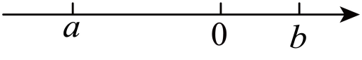
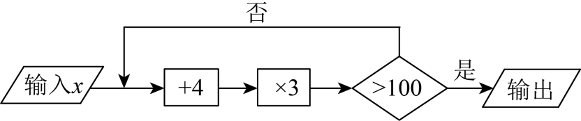
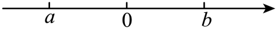
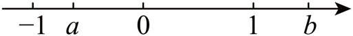

# 知识点·有理数的乘法（同步练习）

> 教材：数学·七年级上册·沪科技版2024新教材 ｜ 来源：国家中小学智慧教育平台·在线练习 ｜ 共 50 题

## 1. 单选题（难度：简单）

计算：$ \frac{2}{5}\times 10=$（　　）

【答案】A

## 2. 单选题（难度：简单）

下列算式中，积为正数的是（　　）

【答案】A

## 3. 单选题（难度：简单）

如果两个数的积是正数，而它们的和是负数，那么这两个数（　　）

【答案】A

## 4. 单选题（难度：简单）

如果\( \left|\mathrm{x}\right|=3\)，\( \left|\mathrm{y}\right|=2\)，且\( \mathrm{x}<\mathrm{y}\)，则\( \mathrm{x}\mathrm{y}\)的值等于（　　）

- A. 6
- B. 6或\( -6\)
- C. \( -5\)或\( -6\)
- D. 6或5

【答案】B

【解析】解：∵\( \left|\mathrm{x}\right|=3\)，\( \left|\mathrm{y}\right|=2\)，且\( \mathrm{x}<\mathrm{y}\)
∴\( \mathrm{x}=-3,\mathrm{x}=-2\)或\( \mathrm{x}=-3,\mathrm{y}=2\)，
∴\( \mathrm{x}\mathrm{y}=6\)或\( -6\)，
故选：B．

## 5. 单选题（难度：简单）

下列各计算题中，结果是零的是（　　）

- A. \( \left(\text{+3}\right)-\left|-3\right|\)
- B. \( \left|\text{+3}\right|\text{+}\left|-3\right|\)
- C. \( -3\times \left[-\left(-3\right)\right]\)
- D. \( \frac{2}{3}+\left(-\frac{3}{2}\right)\)

【答案】A

【解析】解：\( \text{A}\)、\( \left(\text{+3}\right)-\left|-3\right|=3-3=0\)，故本项结果是零，符合题意；
\( \text{B}\)、\( \left|\text{+3}\right|\text{+}\left|-3\right|=3+3=6\)，故本项结果不是零，不合题意；
\( \text{C}\)、\( -3\times \left[-\left(-3\right)\right]=-3\times 3=-9\)，故本项结果不是零，不合题意；
\( \text{D}\)、\( \frac{2}{3}+\left(-\frac{3}{2}\right)=\frac{4}{6}+\left(-\frac{9}{6}\right)=-\frac{5}{6}\)，故本项结果不是零，不合题意；
故选：\( \text{A}\)．

## 6. 单选题（难度：简单）

下列算式中与$ -3\frac{1}{2}$相等的是（　　）

【答案】A

## 7. 单选题（难度：简单）

定义“$ \mathrm{*}$”运算：$ \mathrm{a}\mathrm{*}\mathrm{b}=\mathrm{a}+\mathrm{a}\mathrm{b}$，则$ 6\mathrm{*}\left(-

【答案】A

## 8. 单选题（难度：简单）

从<latex class="math-tex">\( -5，-4$，1，3，5五个数中任取两个数相乘，所得积中的最大值为（　　）

【答案】A

## 9. 单选题（难度：简单）

计算\( -4\times \left(-2\right)\)的结果是（        ）

- A. 6
- B. \( -6\)
- C. 8
- D. \( -8\)

【答案】C

【解析】解：\( -4\times \left(-2\right)=+\left(4\times 2\right)=8\)．
故选C．

## 10. 单选题（难度：简单）

已知\( \left|\mathrm{a}\right|=3\)，\( \left|\mathrm{b}\right|=2\)，且\( \mathrm{a}\mathrm{b}<0\)，则\( \mathrm{a}-\mathrm{b}\)的值为（　　）

- A. 5或 \( -5\)
- B. 1或 \( -1\)
- C. 3或\( -2\)
- D. 5或1

【答案】A

【解析】解：∵\( \left|\mathrm{a}\right|=3\)，\( \left|\mathrm{b}\right|=2\)，
∴\( \mathrm{a}=\pm 3,\mathrm{b}=\pm 2\)．
又∵\( \mathrm{a}\mathrm{b}<0\)，则a、b异号，
∴\( \mathrm{a}=3,\mathrm{b}=-2\)或\( \mathrm{a}=-3,\mathrm{b}=2\)．
当\( \mathrm{a}=3,\mathrm{b}=-2\)时，\( \mathrm{a}-\mathrm{b}=3-\left(-2\right)=5\)；
当\( \mathrm{a}=-3,\mathrm{b}=2\)时，\( \mathrm{a}-\mathrm{b}=-3-2=-5\)．
故选：A．

## 11. 单选题（难度：简单）

计算：\( \left(-6\right)\times \left(-\mathrm{t}\right)=\) （　　）

- A. \( -6\mathrm{t}\)
- B. \( -6\)
- C. \( 6\mathrm{t}\)
- D. 6

【答案】C

【解析】解：\( \left(-6\right)\times \left(-\mathrm{t}\right)=6\mathrm{t}\)，
故选：C．

## 12. 单选题（难度：简单）

计算：$ \left(-4\right)\times \frac{1}{2}=$（　　）

【答案】A

## 13. 单选题（难度：简单）

已知有理数a、b、c、d满足$ \mathrm{a}<\mathrm{b}<\mathrm{c}<\mathrm{d}$，下列说法正确的是（　　）

【答案】A

## 14. 单选题（难度：非常简单）

计算\( 2\times \left(-3\right)\)的结果等于（　　）

- A. 6
- B. \( -6\)
- C. \( -1\)
- D. 5

【答案】B

【解析】解：\( 2\times \left(-3\right)=-6\)，
故选：B．

## 15. 单选题（难度：简单）

已知$ \left|\mathrm{x}\right|=2$，$ \left|\mathrm{y}\right|=4$，若$ \mathrm{x}\mathrm{y}>0$，则<latex cla

【答案】A

## 16. 单选题（难度：简单）

计算：\( 2\times \left(-6\right)=\)（　　）

- A. \( -12\)
- B. 12
- C. \( -4\)
- D. \( -8\)

【答案】A

【解析】解：\( 2\times \left(-6\right)=-12\)，
故选：A．

## 17. 单选题（难度：简单）

有理数\( \mathrm{a}\)，\( \mathrm{b}\)对应的点在数轴上的位置如图所示，则（　　）
 

- A. \( \mathrm{a}>0\)
- B. \( \mathrm{a}+\mathrm{b}>0\)
- C. \( \mathrm{a}-\mathrm{b}<0\)
- D. \( \mathrm{a}\mathrm{b}>0\)

【答案】C

【解析】解：由数轴可知\( \mathrm{a}<0<\mathrm{b}\)，\( \left|\mathrm{a}\right|>\left|\mathrm{b}\right|\)，
\( \text{A}\)、\( \mathrm{a}<0\)，原选项错误，不符合题意；
\( \text{B}\)、\( \mathrm{a}+\mathrm{b}<0\)，原选项错误，不符合题意；
\( \text{C}\)、\( \mathrm{a}-\mathrm{b}<0\)，原选项正确，符合题意；
\( \text{D}\)、\( \mathrm{a}\mathrm{b}<0\)，原选项错误，不符合题意；
故选：\( \text{C}\)．

## 18. 单选题（难度：简单）

根据算式\( 2\times 4=8\)，\( 2\times \left(-4\right)=-8\)，\( \left(-2\right)\times 4=-8\)，\( \left(-2\right)\times \left(-4\right)=-\left(-8\right)=8\)，不能得到的结论是（　　）

- A. 两个有理数相乘时，同号得正，异号得负；
- B. 两个有理数相乘时，交换乘数的位置，积不变；
- C. 两个有理数相乘时，积的绝对值等于各乘数绝对值的积；
- D. 两个有理数相乘时，其中一个乘数换成它的相反数，所得的积是原来积的相反数．

【答案】B

【解析】解：A：观察已知条件中的4个算式可知：两个有理数相乘时，同号得正，异号得负，故此选项不符合题意；
B：观察算式可知：没有两个有理数相乘时交换乘数的位置的算式，故此选项符合题意；
C：观察算式得到两个有理数相乘时，积的绝对值等于各乘数绝对值的积，故此选项不符合题意；
D：观察\( 2\times 4=8\)，\( 2\times \left(-4\right)=-8\)可得两个有理数相乘时，其中一个乘数换成它的相反数，所得的积是原来积的相反数，故此选项不符合题意；
故选：B ．

## 19. 单选题（难度：简单）

计算：\( -2\times \left(-\frac{1}{2}\right)\)，其结果为（　　）

- A. \( -1\)
- B. 1
- C. \( -4\)
- D. \( -\frac{1}{4}\)

【答案】B

【解析】解：\( -2\times \left(-\frac{1}{2}\right)\)
\( =2\times \frac{1}{2}\) 
\( =1\)，
故选：B．

## 20. 单选题（难度：简单）

一台计算机按如图所示的程序工作，若开始输入\( \mathrm{x}\)的值是\( -2\)，则最终输出的结果是（　　）
  

- A. 102
- B. 108
- C. 117
- D. 132

【答案】A

【解析】解：\( \left(-2+4\right)\times 3=6\)，
\( \left(6+4\right)\times 3=30\)，
\( \left(30+4\right)\times 3=102>100\)，输出，
故选A．

## 21. 单选题（难度：非常简单）

有理数\( \mathrm{a}\)、\( \mathrm{b}\)在数轴上对应的位置如图所示，则下列判断正确的是（　　）

- A. \( \mathrm{a}\mathrm{b}<0\)
- B. \( \mathrm{b}<0\)
- C. \( \mathrm{a}>0\)
- D. \( \mathrm{a}-\mathrm{b}>0\)

【答案】A

【解析】解：由题意可得：\( \mathrm{a}<0<\mathrm{b}\)，
∴\( \mathrm{a}\mathrm{b}<0\)，\( \mathrm{a}-\mathrm{b}<0\)，
∴A符合题意，B，C，D不符合题意；
故选：A

## 22. 单选题（难度：简单）

下列运算结果为正数的是（　　）

【答案】A

## 23. 单选题（难度：简单）

已知有理数\( \mathrm{x}，\mathrm{y}\)在数轴上对应点的位置如图所示，那么下列结论正确的是（　　）
 

- A. \( \mathrm{x}>-2\)
- B. \( \left|\mathrm{y}\right|>\left|\mathrm{x}\right|\)
- C. \( \mathrm{x}\mathrm{y}>0\)
- D. \( \mathrm{x}+\mathrm{y}>-3\)

【答案】D

【解析】解：由数轴可知：\( \mathrm{x}<-2<0<\mathrm{y}<1\)，
∴\( \left|\mathrm{x}\right|>\left|\mathrm{y}\right|,\mathrm{x}\mathrm{y}<0,\mathrm{x}+\mathrm{y}>-3\)，
故选：D．

## 24. 单选题（难度：简单）

下列算式中，积为负数的是（　　）

- A. \( 0\times \left(-5\right)\)
- B. \( 4\times \left(-0.5\right)\times \left(-10\right)\)
- C. \( \left(-1.5\right)\times \left(-2\right)\)
- D. \( \left(-2\right)\times \left(-\frac{1}{5}\right)\times \left(-\frac{2}{3}\right)\)

【答案】D

【解析】解：由题意可得，
\( 0\times \left(-5\right)=0\)，选项A不符合题意，
\( 4\times \left(-0.5\right)\times \left(-10\right)=20\)，选项B不符合题意，
\( \left(-1.5\right)\times \left(-2\right)=3\)，选项C不符合题意，
\( \left(-2\right)\times \left(-\frac{1}{5}\right)\times \left(-\frac{2}{3}\right)=-\frac{4}{15}\)，选项D符合题意，
故选：D．

## 25. 单选题（难度：简单）

下列计算正确的是（　　）

【答案】A

## 26. 单选题（难度：简单）

已知a、b是有理数，且$ \mathrm{a}\mathrm{b}>0$，同时$ \mathrm{a}+\mathrm{b}<0$，那么下列正确的是（　　）

【答案】A

## 27. 单选题（难度：简单）

有2025个有理数相乘，结果为0，那么这2025个数（　　）

【答案】A

## 28. 单选题（难度：简单）

下列算式中，积为正数的是（　　）

【答案】A

## 29. 单选题（难度：简单）

对于有理数a，b，定义新运算：\( \mathrm{a}\mathrm{◎}\mathrm{b}=4\mathrm{a}\mathrm{b}\)，则\( 3\mathrm{◎}\left(-4\right)\)的值为（　　）

- A. 12
- B. \( -48\)
- C. \( -12\)
- D. 48

【答案】B

【解析】∵\( \mathrm{a}\mathrm{◎}\mathrm{b}=4\mathrm{a}\mathrm{b}\)， 
∴\( 3\mathrm{◎}\left(-4\right)=4\times 3\times \left(-4\right)=-48\)，
故选：B．

## 30. 单选题（难度：简单）

计算$ 1\times \frac{2}{3}\times \left(-\frac{3}{2}\right)$的结果是（　　）

【答案】A

## 31. 单选题（难度：简单）

如果三个数的积是负数，那么这三个数中负数的个数是（　　）

【答案】A

## 32. 单选题（难度：简单）

在\( +5,+2,-2,-3,-4\)等五个数中，任意三个数的积最小为（　　）

- A. \( -24\)
- B. \( -40\)
- C. \( -30\)
- D. \( -60\)

【答案】B

【解析】解：∵要使三个数的乘积最小，
∴要保证这三个数的乘积为负数，
∴三个数中负数的个数要为奇数，且这三个数的绝对值越大越好，
∴应该选择\( +5,+2,-4\)，即三个数的积最小为\( 5\times 2\times \left(-4\right)=-40\)，
故选：B．

## 33. 单选题（难度：简单）

已知$ \mathrm{a}\mathrm{b}\mathrm{c}>0,\mathrm{a}>0,\mathrm{a}\mathrm{c}<0$，则（　　）

【答案】A

## 34. 单选题（难度：简单）

有$ 2024$个有理数相乘，结果为$ 0$，那么这$ 2024$个数（　　）

【答案】A

## 35. 单选题（难度：简单）

一件风衣，原价1200元，现在八五折出售，现在一件这样的风衣（　　）

【答案】A

## 36. 单选题（难度：简单）

12米增加它的$ \frac{1}{4}$后，再减少$ \frac{1}{4}$米，结果是（　　）

【答案】A

## 37. 单选题（难度：简单）

有理数\( \mathrm{a}\)、\( \mathrm{b}\)，在数轴上的位置如图所示，下列结论不正确的是（　　）
 

- A. \( \left|\mathrm{a}\right|<\left|\mathrm{b}\right|\)
- B. \( \mathrm{b}-\mathrm{a}<0\)
- C. \( \mathrm{a}+\mathrm{b}>0\)
- D. \( \mathrm{a}\mathrm{b}<0\)

【答案】B

【解析】解：由数轴可知，\( \mathrm{a}<0<\mathrm{b}\)，\( \left|\mathrm{a}\right|<\left|\mathrm{b}\right|\)，
\( \therefore \mathrm{b}-\mathrm{a}>0\)，\( \mathrm{a}+\mathrm{b}>0\)，\( \mathrm{a}\mathrm{b}<0\)，
\( \therefore \)结合选项可得，A、C、D选项结论正确，不符合题意；B选项结论不正确，符合题意．
故选：B．

## 38. 单选题（难度：简单）

从山脚起每升高 $ 100\mathrm{m}$，气温降低$ 0.6\mathrm{℃}$ ．已知山脚的温度是$ 26\mathrm{℃}$，在高出山脚 $ \frac{1}{10}$，再降价$ \frac{1}{10}$，现价与原价相比（　　）

【答案】A

## 40. 单选题（难度：简单）

一匹马的平均质量是250千克，4匹马的质量是（　　）

【答案】A

## 41. 单选题（难度：简单）

在弹性范围内，弹簧伸长的长度与所挂物体的质量成正比．若一根弹簧挂上\( \text{1kg}\)物体时长\( 14\mathrm{c}\mathrm{m}\)，挂上\( \text{2kg}\)物体时长\( \text{16cm}\)，则挂上\( \text{4kg}\)物体时长（　　）

- A. \( \text{18cm}\)
- B. \( \text{20cm}\)
- C. \( \text{32cm}\)
- D. \( \text{56cm}\)

【答案】B

【解析】解：由题意得：物体增重\( 1\mathrm{k}\mathrm{g}\)，弹簧长度增加\( 16-14=2\mathrm{c}\mathrm{m}\)，
\( \therefore \)挂上\( \text{4kg}\)物体时长\( 14+2\times \left(4-1\right)=14+6=20\mathrm{c}\mathrm{m}\)，
故选：B．

## 42. 单选题（难度：适中）

若\( \left(-9\right)\times 2024=\mathrm{m}\)，则\( \left(-9\right)\times 2025\)可以表示为（　　）

- A. \( \mathrm{m}+9\)
- B. \( \mathrm{m}-9\)
- C. \( \mathrm{m}+1\)
- D. \( -\mathrm{m}+1\)

【答案】B

【解析】解：\( \left(-9\right)\times 2025\)
\( =\left(-9\right)\times \left(2024+1\right)\) 
\( =\left(-9\right)\times 2024+\left(-9\right)\times 1\)，
代入\( \left(-9\right)\times 2024=\mathrm{m}\)，原式\( =\mathrm{m}-9\)．
\( \therefore \left(-9\right)\times 2025\)可以表示为\( \mathrm{m}-9\)．
故选：B．

## 43. 单选题（难度：适中）

\( -36\times \left(\frac{1}{9}-\frac{1}{4}\right)=-4+9\)的根据是（　　）

- A. 加法交换律
- B. 乘法交换律
- C. 乘法结合律
- D. 乘法对加法的分配律

【答案】D

【解析】解：\( -36\times \left(\frac{1}{9}-\frac{1}{4}\right)\)
\( =-36\times \frac{1}{9}-\left(-36\right)\times \frac{1}{4}\) 
\( =-4+9\)，
故根据是乘法对加法的分配律．
故选D．

## 44. 单选题（难度：适中）

已知某快递公司的收费标准为寄一件物品不超过\( 5\)千克，收费\( 13\)元；超过\( 5\)千克的部分每千克加收\( 2\)元．小明在该快递公司寄一件\( 7\)千克的物品，需要付费（　　）

- A. \( 19\)元
- B. \( 18\)元
- C. \( 17\)元
- D. \( 16\)元

【答案】C

【解析】解：由题意得：\( 13+\left(7-5\right)\times 2=13+4=17\)（元），
∴需要付费\( 17\)元，
故选：\( \text{C}\)．

## 45. 单选题（难度：适中）

算式$ \left(-2\frac{3}{4}\right)\times 8$可以化为（　　）

【答案】A

## 46. 单选题（难度：适中）

若$ 2023\times 2024=\mathrm{m}$，则下列代数式可以表示$ 2023\times 2025$的是（　　）

【答案】A

## 47. 单选题（难度：适中）

若$ 967\times 85=\mathrm{p}$，则$ 967\times 84$的值可表示为（　　）

【答案】A

## 48. 单选题（难度：简单）

若有理数$ \mathrm{a},\mathrm{b},\mathrm{c}$在数轴上的位置如图所示，则下列结论错误的是（　　）

【答案】A

## 49. 单选题（难度：简单）

某商店在“双11”期间所有商品按8折销售，如图，该商品的售价是（　　）

【答案】A

## 50. 单选题（难度：简单）

远古时期人们用结绳来计数，猎人在从右往左依次排列的绳子上打结来表示猎物的数量．如果按照满八进一的方法，如图表示有$ 20$只猎物，如果按照满六进一的方法，图中猎物的只数应该是（　　）

【答案】A
