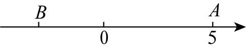
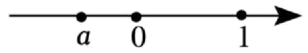

# 知识点·有理数的减法（同步练习）

> 教材：数学·七年级上册·沪科技版2024新教材 ｜ 来源：国家中小学智慧教育平台·在线练习 ｜ 共 52 题

## 1. 单选题（难度：简单）

数轴上的点A到表示$ -3$的点B的距离是5，那么点A表示的数是（　　）

【答案】A

## 2. 单选题（难度：简单）

按照有理数减法法则，\( -4-\left(-\frac{1}{4}\right)\)可以转化为（　　）

- A. \( 4+\frac{1}{4}\)
- B. \( -4+4\)
- C. \( 4+4\)
- D. \( -4+\frac{1}{4}\)

【答案】D

【解析】解：\( -4-(-\frac{1}{4})=-4+\frac{1}{4}\)．
故选：D．

## 3. 单选题（难度：简单）

下列四个数中与\( -1\)的和是2的数是（　　）

- A. \( -2\)
- B. \( -3\)
- C. 3
- D. 2

【答案】C

【解析】解：由题意知，这个数为：\( 2-\left(-1\right)=2+1=3\)，
故选：\( \text{C}\)．

## 4. 单选题（难度：简单）

数轴上点$ \mathrm{A}$表示的数是$ -3$，点$ \mathrm{B}$与点$ \mathrm{A}$在数轴上相距4

【答案】A

## 5. 单选题（难度：简单）

在有理数2，0，$ -1$，$ -3$中，任意取两个数相减，差最大的是（　　）

【答案】A

## 6. 单选题（难度：非常简单）

比$ -1$小2024的数是（　　）

【答案】A

## 7. 单选题（难度：简单）

将\( \left|-5-3\right|\)中的绝对值符号化去后，下列结果正确的是（　　）

- A. \( -5+3\)
- B. \( -5+3\)
- C. \( 5-3\)
- D. \( 5+3\)

【答案】D

【解析】解：\( \left|-5-3\right|=-\left(-5-3\right)=5+3\)，
故选D．

## 8. 单选题（难度：简单）

已知点\( \mathrm{A}\)在数轴上所对应的数为\( -1\)，点\( \mathrm{A}\)、\( \mathrm{B}\)之间的距离为5，则点\( \mathrm{B}\)在数轴上所对应的数是（　　）

- A. \( -6\)
- B. 6
- C. 4
- D. \( -6\)或4

【答案】D

【解析】解：∵点\( \mathrm{A}\)在数轴上所对应的数为\( -1\)，点\( \mathrm{A}\)、\( \mathrm{B}\)之间的距离为5，
∴点\( \mathrm{B}\)在数轴上所对应的数是\( -1-5=-6\)或\( -1+5=4\)．
故选：D

## 9. 单选题（难度：简单）

下列计算结果最小的是（　　）

【答案】A

## 10. 单选题（难度：非常简单）

在数轴上，点$ \mathrm{A}$表示5，从点$ \mathrm{A}$出发，沿数轴移动3个单位长度到达点$ \mathrm{B}$，则点$

【答案】A

## 11. 单选题（难度：简单）

数轴上与<latex class="math-tex">\( -3$的距离等于2的数是（　　）

【答案】A

## 12. 单选题（难度：简单）

数轴上点$ \mathrm{H}$到表示$ -1$的点的距离是3，则点$ \mathrm{H}$表示的数是（　　）

【答案】A

## 13. 单选题（难度：简单）

计算：$ 0-12=$（　　）

【答案】A

## 14. 单选题（难度：简单）

（24-25九年级下·吉林长春·开学考试）1与\( -2024\)的差是（　　）

- A. \( -2025\)
- B. 2023
- C. \( -2023\)
- D. 2025

【答案】D

【解析】解：由题意得，\( 1-\left(-2024\right)=2025\)，
故选：D．

## 15. 单选题（难度：简单）

计算：\( -3-5=\)（　　）

- A. 2
- B. \( -2\)
- C. 8
- D. \( -8\)

【答案】D

【解析】解：\( -3-5=-8\)，
故选：D ．

## 16. 单选题（难度：简单）

计算：$ -5-\left(-2\right)=$（　　）

【答案】A

## 17. 单选题（难度：简单）

若$ \mathrm{a}<0，\mathrm{b}>0$，则$ \mathrm{b}，\mathrm{b}+\mathrm{a}，\mathrm{b}-\mathrm{a}，\mathrm{a}$中最大的一个数是（　　）

【答案】A

## 18. 单选题（难度：简单）

小明有6张分别写有数字$ -3,-8,+1,+4,+\mathrm{5,0}$的卡片，若从中抽出2张卡片，使这两张卡片上数字的差最大，最大值是多少（　　）

【答案】A

## 19. 单选题（难度：非常简单）

计算\( -5-\left(-2\right)\)的结果是（　　）

- A. \( -3\)
- B. \( -7\)
- C. \( 3\)
- D. \( 7\)

【答案】A

【解析】解：\( -5-\left(-2\right)=-5+2=-3\)，
故选：A

## 20. 单选题（难度：简单）

如图，若数轴上A，B两点之间的距离是7，则点\( \mathrm{B}\)表示的数是（　　）
 

- A. 2
- B. \( -2\)
- C. 5
- D. \( -5\)

【答案】B

【解析】解：由图可知，点\( \mathrm{A}\)表示的数为5，
∴点\( \mathrm{B}\)表示的数是\( 5-7=-2\)；
故选B．

## 21. 单选题（难度：简单）

有理数$ \mathrm{a}，\mathrm{b}$在数轴上的对应点的位置如图所示，则下列结论正确的是（　　）

【答案】A

## 22. 单选题（难度：非常简单）

已知有理数a、b在数轴上对应点的位置如图所示，则下列结论正确的是（　　）

【答案】A

## 23. 单选题（难度：简单）

实数$ \mathrm{a}$在数轴上的对应点的位置如图所示，若实数$ \mathrm{b}$满足$ \mathrm{a}-\mathrm{b}>0$，则$ 8\mathrm{℃}$，最低气温是$ -1\mathrm{℃}$，则这一天的温差是（　　）

【答案】A

## 29. 单选题（难度：简单）

一种面粉的质量标识为“$ 25\pm 0.25$千克”，则下列面粉中合格的是（　　）

【答案】A

## 30. 单选题（难度：简单）

把一根绳子剪成两段，第一段长\( 60\mathrm{\%}\)米，第二段占全长的\( 60\mathrm{\%}\)，那么下列说法中正确的是（　　）

- A. 第一段长
- B. 第二段长
- C. 两段一样长
- D. 无法确定哪段更长

【答案】B

【解析】解：\( \because \)第二段占全长的\( 60\mathrm{\%}\)，
∴\( 1-60\mathrm{\%}=40\mathrm{\%}\)，
\( \therefore \)第一段占全长的\( 40\mathrm{\%}\)，
∵\( 60\mathrm{\%}>40\mathrm{\%}\)，
∴第二段长，
故选：B．

## 31. 单选题（难度：简单）

把式子$ +\left(-22\right)-\left(-8\right)-\left(+4\right)+\left(+6\right)$写成省略括号和加号的形式是（　　）

【答案】A

## 32. 单选题（难度：简单）

比\( -2\mathrm{℃}\)低\( 4\mathrm{℃}\)的温度是（　　）

- A. \( -2\mathrm{℃}\)
- B. \( -6\mathrm{℃}\)
- C. \( 2\mathrm{℃}\)
- D. \( 6\mathrm{℃}\)

【答案】B

【解析】解：\( \because \) \( -2-4=\) \( -6\mathrm{℃}\)，
\( \therefore \)比\( -2\mathrm{℃}\)低\( 4\mathrm{℃}\)的温度是\( -6\mathrm{℃}\)．
答案选：B．

## 33. 单选题（难度：简单）

式子\( -2-\left(-3\right)+\left(+1\right)-\left(-4\right)\)可以简写成（　　）的形式．

- A. \( -2+3+1-4\)
- B. \( -2-3+1-4\)
- C. \( -2+3+1+4\)
- D. \( -2-3+1+4\)

【答案】C

【解析】解：\( -2-\left(-3\right)+\left(+1\right)-\left(-4\right)=-2+3+1+4\)，
故选：C

## 34. 单选题（难度：简单）

数轴上一点A向右移动4个单位长度到达点B，若点B再向左移动2个单位长度到达点C，若点C表示的数是$ -3$，则点A表示的数是（　　）

【答案】A

## 35. 单选题（难度：简单）

已知有理数1，\( -7\)，\( +11\)，\( -2\)，通过有理数的加减混合运算，使其运算结果最大，则这个运算结果最大值是（　　）

- A. 23
- B. 22
- C. 21
- D. 3

【答案】C

【解析】解：要使加减混合运算的结果最大，则利用所有的正有理数之和减去所有的负有理数之和．
即\( \left(1+11\right)-\left[\left(-7\right)+\left(-2\right)\right]\)
\( =12-\left(-7-2\right)\) 
\( =12-\left(-9\right)\) 
\( =12+9\) 
\( =21\)，
即这个运算结果最大值是21，
故选：C．

## 36. 单选题（难度：简单）

对式子$ -5-2+3+2-1$的读法正确的是（　　）

【答案】A

## 37. 单选题（难度：简单）

下列算式中，计算结果是负数的是（　　）

- A. \( (-2)+7\)
- B. \( \left|-1-2\right|\)
- C. \( 3+\left(-2\right)\)
- D. \( \left(-3\right)-\left(-2\right)\)

【答案】D

【解析】A． \( (-2)+7=5\)，结果是正数，故该选项不符合题意；
B． \( \left|-1-2\right|=\left|-3\right|=3\)，结果是正数，故该选项不符合题意；
C． \( 3+\left(-2\right)=1\)，结果是正数，故该选项不符合题意；
D． \( \left(-3\right)-\left(-2\right)=-1\)，结果是负数，故该选项符合题意；
故选：D．

## 38. 单选题（难度：简单）

在数轴上，点A表示的数是5，若将点A在数轴上移动3个单位到达点B，则点B所表示的数为（　　）

【答案】A

## 39. 单选题（难度：简单）

把\( -\left(-3\right)-4+\left(-5\right)\)写成省略加号和括号的形式，正确的是（　　）

- A. \( 3-4-5\)
- B. \( -3-4-5\)
- C. \( 3-4+5\)
- D. \( -3-4+5\)

【答案】A

【解析】解：\( -\left(-3\right)-4+\left(-5\right)\)
\( =3-4-5\)．
故选：A

## 40. 单选题（难度：适中）

将式子$ -5+4-8$还原成带加号的和的形式是（　　）

【答案】A

## 41. 单选题（难度：简单）

有理数\( \mathrm{a}\)在数轴上的位置如图所示，下列结论正确的是（　　）
 

- A. \( \mathrm{a}<0<1\)
- B. \( \left|\mathrm{a}\right|=\mathrm{a}\)
- C. \( \mathrm{a}-1>0\)
- D. \( -\mathrm{a}<0<1\)

【答案】A

【解析】解：根据数轴可得：\( \mathrm{a}<0\)，且\( \left|\mathrm{a}\right|<1\)，
∴\( \mathrm{a}<0<1\)，\( \left|\mathrm{a}\right|=-\mathrm{a}\)，\( \mathrm{a}-1<0\)，\( 0<-\mathrm{a}<1\)，
则四个选项，选项A符合题意．
故选：A．

## 42. 单选题（难度：适中）

某公司推出无人驾驶载人飞行器，可搭载乘客或物资．在某次运输模拟测试中，出发时搭载货物重量为$ 400\mathrm{k}\mathrm{g}$，记录装载卸载货物的数据如下：$ +20$，$ -50\)</latex

【答案】A

## 43. 单选题（难度：适中）

100比80大（　　）

【答案】A

## 44. 单选题（难度：适中）

潜水艇停在海平面以下<latex class="math-tex">\( 800\mathrm{m}$处，先上浮$ 150\mathrm{m}$，又下潜$ 200\mathrm{m}$，则此时潜水艇的位置是在（　　）

【答案】A

## 45. 单选题（难度：适中）

生产劳动情境·商贩盈亏某商贩四周的盈亏情况如下：亏损25元，亏损20元，盈利65元，盈利135元，则该商贩四周盈亏总计是（　　）

【答案】A

## 46. 单选题（难度：适中）

下列小木棒的长度中，最接近9厘米的是（　　）．

【答案】A

## 47. 单选题（难度：适中）

$ \mathrm{A}$，$ \mathrm{B}$，$ \mathrm{C}$三个地方的海拔分别是168米、52米、$ -37\)</late

【答案】A

## 48. 单选题（难度：简单）

如图，在一条不完整的数轴上，点A在点B的左边，若点B表示的数是3，<latex class="math-tex">\( \mathrm{A}\mathrm{B}=5$，则点A表示的数是（　　）

【答案】A

## 49. 单选题（难度：适中）

如图，某勘探小组测得E点的海拔高度为\( 20\mathrm{m}\)，F点的海拔高度为\( -30\mathrm{m}\)（以海平面为基准），则点E比点F高（　　）
 

- A. \( \text{50m}\)
- B. \( \text{40m}\)
- C. \( \text{20m}\)
- D. \( \text{10m}\)

【答案】A

【解析】解：根据题意得，\( 20-\left(-30\right)=20+30=50\)（m），
即点E比点F高\( \text{50m}\)，
故选：A．

## 50. 单选题（难度：适中）

学习情境·课堂讨论 比1小2的数是（　　）

- A. 1
- B. \( -1\)
- C. \( -2\)
- D. \( -3\)

【答案】B

【解析】解：\( 1-2=1+\left(-2\right)=-1\)．
故选B．

## 51. 单选题（难度：适中）

微信支付给生活带来便捷，如图是刘老师某日微信账单的收支明细（正数表示收入，负数表示支出，单位：元），刘老师当日微信收支的最终结果是（　　）

【答案】A

## 52. 单选题（难度：适中）

小明在一条东西向的跑道上先向东走了\( 20\)米，又向西走了\( 50\)米，规定向东为正，向西为负．这一过程在数轴上如图所示，则小明现在的位置A表示的数为（　　）
 

- A. \( -50\)
- B. \( -30\)
- C. \( -20\)
- D. \( 30\)

【答案】B

【解析】解：由题意知，\( 0+20+\left(-50\right)=-30\)，
∴A表示的数为\( -30\)，
故选：B．
