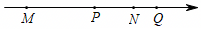
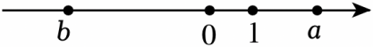
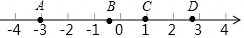
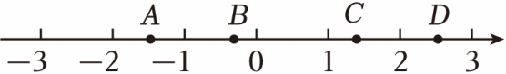
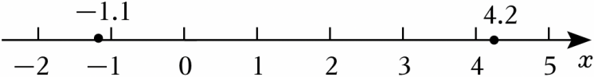
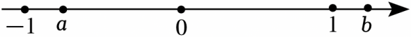
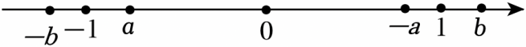
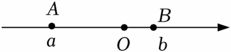

# 知识点·有理数的大小比较（同步练习）

> 教材：数学·七年级上册·沪科技版2024新教材 ｜ 来源：国家中小学智慧教育平台·在线练习 ｜ 共 52 题

## 1. 单选题（难度：非常简单）

下列各数中，比﹣2小的数是（　　）

【答案】A

## 2. 单选题（难度：简单）

下列四个数中，最小的数是（　　）

【答案】A

## 3. 单选题（难度：适中）

下列比较大小正确的是（　　）

- A. ﹣|﹣5|＜+（﹣5）
- B. \( -\frac{1}{5}＞-\frac{1}{4}\)
- C. \( |-\frac{2}{3}|=-\left(\frac{2}{3}\right)\)
- D. \( -(-5)＜\frac{10}{3}\)

【答案】B

【解析】解：A、﹣5＝﹣5，不符合题意；
B、∵\( -\frac{1}{5}\)、\( -\frac{1}{4}\)分子相同，分母不同，且4＜5，∴\( \frac{1}{4}＞\frac{1}{5}\)，∴\( -\frac{1}{5}＞-\frac{1}{4}\)，符合题意；
C、∵\( |-\frac{2}{3}|=\frac{2}{3}\)，\( -\left(\frac{2}{3}\right)=-\frac{2}{3}\)，∴\( \frac{2}{3}＞-\frac{2}{3}\)，不符合题意；
D、∵﹣（﹣5）＝5，∴5\( ＞\frac{10}{3}\)，不符合题意；
故选：B．

## 4. 单选题（难度：非常简单）

在5，﹣8，0，π四个数中，最大的数是（　　）

【答案】A

## 5. 单选题（难度：非常简单）

在有理数3，﹣4，<latex class="math-tex">\( -\frac{1}{2}\)</latex>，0，﹣2中，最小的数是（　　）

【答案】A

## 6. 单选题（难度：简单）

在数轴上﹣3与﹣1之间的有理数有（　　）

- A. 1个
- B. 2个
- C. 3个
- D. 无数个

【答案】D

【解析】解：整数与分数统称有理数，3与﹣1之间有理数有无数个，
故选：D．

## 7. 单选题（难度：适中）

若a＜0，b＞0，则b，b+a，b﹣a，a中最大的一个数是（　　）

- A. b﹣a
- B. b+a
- C. a
- D. ab

【答案】A

【解析】解：∵a＜0＜b，
∴b+a＜b，b﹣a＞b＞0，ab＜0，
∴b、b+a、b﹣a、ab中最大的一个数是b﹣a，
故选：A．

## 8. 单选题（难度：非常简单）

下列实数中，比0小的数是（　　）

- A. ﹣1
- B. 0.4
- C. \(\frac{1}{2}\)
- D. 2

【答案】A

【解析】解：A．﹣1＜0，故符合题意；
B．0.4＞0，故不符合题意；
C．\( \frac{1}{2}＞\)0，故不符合题意；
D．2＞0，故不符合题意；
故选：A．

## 9. 单选题（难度：简单）

几种气体的液化温度（标准大气压）如表：
气体
氦气（He）
氢气（H）
氮气（N）
氧气（O）

液化温度（℃）
﹣269
﹣253
﹣196
﹣183

其中液化温度最低的气体是（　　）

- A. 氦气
- B. 氢气
- C. 氮气
- D. 氧气

【答案】A

【解析】解：∵﹣269℃＜﹣253℃＜﹣196℃＜﹣183℃，
∴液化温度最低的气体是氦气．
故选：A．

## 10. 单选题（难度：简单）

下列各数中，最大的数是（　　）

- A. 0
- B. |﹣2|
- C. ﹣2
- D. \( -\frac{1}{2}\)

【答案】B

【解析】解：|﹣2|＝2，正数＞0＞负数，
故选：B．

## 11. 单选题（难度：简单）

下列各数中，最小的数是（　　）

【答案】A

## 12. 单选题（难度：非常简单）

如表记录了四个地区的最低海拔． 死海吐鲁番乌鲁木齐青岛﹣392米﹣155米918米0米以上四个地区海拔最低的地区是（　　）

【答案】A

## 13. 单选题（难度：简单）

分数\( -\frac{36}{7}\)介于哪两个整数之间（　　）

- A. ﹣5和﹣4
- B. ﹣6和﹣5
- C. ﹣7和﹣6
- D. ﹣8和﹣7

【答案】B

【解析】解：\( -\frac{36}{7}\approx -\)5.14
∴分数介于﹣5和﹣6之间，
故选：B．

## 14. 单选题（难度：简单）

在有理数<latex class="math-tex">\( -2\frac{1}{3}\)</latex>，0，﹣2.5，﹣1.5中，最小的数是（　　）

【答案】A

## 15. 单选题（难度：简单）

下列各组有理数比较大小，正确的是（　　）

【答案】A

## 16. 单选题（难度：简单）

下列各数中，比﹣4小的数是（　　）

- A. 0
- B. ﹣6
- C. 1
- D. |﹣0.6|

【答案】B

【解析】解：A．0＞﹣4，故不符合题意；
B．∵|﹣6|＝6，|﹣4|＝4，6＞4，∴﹣6＜﹣4，故符合题意；
C．1＞﹣4，故不符合题意；
D．∵|﹣0.6|＝0.6，∴|﹣0.6|＞﹣4，故不符合题意；
故选：B．

## 17. 单选题（难度：简单）

若<latex class="math-tex">\( a=-\pi ，b=-3.14，c=3\frac{1}{3}\)</latex>，则下列结论正确的是（　　）

【答案】A

## 18. 单选题（难度：适中）

如图，四个有理数在数轴上的对应点分别为点M，P，N，Q，若点P，Q表示的有理数互为相反数，则图中表示绝对值最大的有理数的点是（　　）

- A. 点M
- B. 点P
- C. 点N
- D. 点Q

【答案】A

【解析】解：∵点P，Q表示的有理数互为相反数，
∴原点在PQ的中点，此时点M距原点最远，
因此点M所表示的数的绝对值最大，
故选：A．

## 19. 单选题（难度：适中）

数a、b在数轴上的对应点如图所示，则a、b、﹣a、﹣b的大小关系是（　　）

- A. ﹣b＜a＜b＜﹣a
- B. a＜﹣b＜b＜﹣a
- C. a＜﹣b＜﹣a＜b
- D. ﹣a＜b＜﹣b＜a

【答案】B

【解析】解：∵a＜0，b＞0，|a|＞|b|，
∴a＜﹣b＜b＜﹣a，
故选：B．

## 20. 单选题（难度：适中）

若有理数a，b在数轴上的对应点的位置如图所示，则下列大小关系正确的是（　　）

- A. |b|＞a
- B. b＞﹣a
- C. a＞﹣b
- D. |a|＞|b|

【答案】A

【解析】解：由数轴得b＜0，a＞0，|b|＞|a|，
∴|b|＞a，b＜﹣a，a＜﹣b，
故选：A．

## 21. 单选题（难度：简单）

如图，数轴上有A、B、C、D四个点，其中绝对值最小的数对应的点是（　　）

- A. 点A
- B. 点B
- C. 点C
- D. 点D

【答案】B

【解析】解：数轴上点A，B，C，D在数轴上表示的数距离原点越近，其绝对值越小，
∴绝对值最小的数对应的点是B，
故选：B．

## 22. 单选题（难度：适中）

已知四个有理数在数轴上的对应点A，B，C，D的位置如图所示，则这四个点表示的数中，绝对值最大的是（　　）

- A. 点A表示的数
- B. 点B表示的数
- C. 点C表示的数
- D. 点D表示的数

【答案】D

【解析】解：设点A、B、C、D对应的数分别是数a、b、c、d，
由实数a、b、c、d在数轴上对应点的位置可知：
1＜|a|＜2，0＜|b|＜1，1＜|c|＜2，2＜|d|＜3，
∴|d|绝对值最大．
故选：D．

## 23. 单选题（难度：适中）

已知\( a=-(-2\frac{1}{3})\)，\( b=|-1\frac{4}{5}|\)，\( c=-|-1\frac{3}{4}|\)，则a，b，c的大小关系是（　　）

- A. c＜b＜a
- B. a＜b＜c
- C. a＜c＜b
- D. b＜a＜c

【答案】A

【解析】解：\( a=-(-2\frac{1}{3})=\)2\( \frac{1}{3}\)，
\( b=|-1\frac{4}{5}|=\)1\( \frac{4}{5}\)，
\( c=-|-1\frac{3}{4}|=-\)1\( \frac{3}{4}\)，
故c＜b＜a．
故选：A．

## 24. 单选题（难度：简单）

凝固点是晶体物质凝固时的温度，标准大气压下，下列选项中凝固点最低的是（　　）

【答案】A

## 25. 单选题（难度：简单）

已知冰箱的冷冻要求为﹣18℃∼﹣4℃，则下列温度符合要求的是（　　）

- A. ﹣20℃
- B. 0℃
- C. ﹣4.1℃
- D. 5℃

【答案】C

【解析】解：∵冰箱的冷冻要求为﹣18℃∼﹣4℃，
∴温度符合要求应高于﹣18℃，且低于﹣4℃；
A．﹣20℃＜﹣18℃，所以﹣20℃低于﹣18℃，不在温度要求范围内，故本选项不符合题意；
B．0℃＞﹣4℃，所以0℃高于不在温度要求范围内，故本选项不符合题意；
C．﹣18℃＜﹣4.1℃＜﹣4℃，所以﹣4.1℃在温度要求范围内，故本选项符合题意；
D．5℃＞﹣4℃，所以5℃高于﹣4℃，不在温度要求范围内，故本选项不符合题意；
故选：C．

## 26. 单选题（难度：简单）

大于﹣2.6且小于3的整数有（　　）

- A. 3个
- B. 4个
- C. 5个
- D. 6个

【答案】C

【解析】解：大于﹣2.6且小于3的整数有﹣2，﹣1，0，1，2，
故选：C．

## 27. 单选题（难度：简单）

下列比较大小正确的是（　　）

- A. \( \frac{5}{6}＜\frac{1}{6}\)
- B. ﹣|﹣3|＞+1
- C. ﹣1＞0
- D. \( -\frac{1}{2}＞-\frac{2}{3}\)

【答案】D

【解析】解：∵\( \frac{5}{6}＞\frac{1}{6}\)，
∴A错误，不符合题意；
∵﹣|﹣3|＝﹣3＜+1，
∴B错误，不符合题意；
∵﹣1＜0，
∴C错误，不符合题意；
\( -\frac{1}{2}=-\frac{3}{6}\)，\( -\frac{2}{3}=-\frac{4}{6}\)，
∵\( \frac{3}{6}＜\frac{4}{6}\)，
∴\( -\frac{3}{6}＞-\frac{4}{6}\)，
∴\( -\frac{1}{2}＞-\frac{2}{3}\)，
∴D正确，符合题意．
故选：D．

## 28. 单选题（难度：简单）

下列四个数中，最大的数是（　　）

【答案】A

## 29. 单选题（难度：非常简单）

下列各数中，最小的数是（　　）

【答案】A

## 30. 单选题（难度：简单）

在有理数<latex class="math-tex">\( -2\frac{1}{3}\)</latex>、<latex class="math-tex">\( +\frac{7}{10}\)</latex>、﹣3.5、2、0、3、6、﹣1.5中，最小的数是（　　）

【答案】A

## 31. 单选题（难度：简单）

在﹣5，﹣0.8，0，|﹣6|四个数中，最小的数是（　　）

- A. ﹣5
- B. ﹣0.8
- C. 0
- D. |﹣6|

【答案】A

【解析】解：﹣5＜﹣0.8＜0＜|﹣6|，
故最小的数是﹣5．
故选：A．

## 32. 单选题（难度：非常简单）

下列各数中，比0小的数是（　　）

【答案】A

## 33. 单选题（难度：简单）

下列大小比较正确的是（　　）

- A. ﹣5＞1
- B. ﹣9.1＞﹣|﹣9.01|
- C. \( -\frac{6}{7}＞-\frac{5}{6}\)
- D. 0＞﹣100

【答案】D

【解析】解：∵﹣5＜1，
∴选项A不正确；
∵﹣|﹣9.01|＝﹣9.01，
∴﹣9.1＜﹣9.01，故﹣9.1＜﹣|﹣9.01|，
∴选项B不正确；
∵\( |-\frac{6}{7}|=\frac{6}{7}\)，\( |-\frac{5}{6}|=\frac{5}{6}\)，\( \frac{6}{7}＞\frac{5}{6}\)，
∴\( -\frac{6}{7}＜-\frac{5}{6}\)，
∴选项C不正确；
∵0＞﹣100，
∴选项D正确．
故选：D．

## 34. 判断题（难度：简单）

比﹣5大的非正整数有4个． （    ）

- YES. √
- NO. ×

【答案】NO

【解析】解：比﹣5大的非正整数有﹣4，﹣3，﹣2，﹣1，0，共5个，
即说比﹣5大的非正整数有4个不对，
故答案为：×．

## 35. 单选题（难度：适中）

下列选项正确的是（　　）

【答案】A

## 36. 判断题（难度：简单）

\( -\frac{2}{3}＜-\frac{3}{4}\)．  （    ）

- YES. √
- NO. ×

【答案】NO

【解析】解：∵|\( -\frac{2}{3}\)|\( =\frac{2}{3}\)，|\( -\frac{3}{4}\)|\( =\frac{3}{4}\)；
又\( \frac{2}{3}＜\frac{3}{4}\)；
∴\( -\frac{2}{3}＞-\frac{3}{4}\)．
故答案为：×．

## 37. 判断题（难度：适中）

小于\( \frac{1}{5}\)大于\( \frac{1}{7}\)的数有无数个．  （    ）

- YES. √
- NO. ×

【答案】YES

【解析】解：大于\( \frac{5}{35}\)而小于\( \frac{7}{35}\)的同分母分数的个数只有一个\( \frac{6}{35}\)，
不同分母的分数的个数：根据分数的基本性质，把分子分母同时扩大2、3、4…倍，
∵35的倍数是无限的，
∴不同分母的分数的个数有无限个．
∴小于\( \frac{1}{5}\)大于\( \frac{1}{7}\)的数有无数个．
故答案为：√．

## 38. 判断题（难度：适中）

如果a＞0，那么a一定大于\( \frac{1}{a}\)． （    ）

- YES. √
- NO. ×

【答案】NO

【解析】解：当a\( =\frac{1}{2}\)时，
则\( \frac{1}{a}=\)2＞a，
故答案为：×．

## 39. 判断题（难度：简单）

在﹣0.26，\( -\frac{1}{4}\)，2.5，25%，0中，最小的数是﹣0.26．  （    ）

- YES. √
- NO. ×

【答案】YES

【解析】解：∵\( -\frac{1}{4}=-\)0.25，25%＝0.25，
且﹣0.26＜﹣0.25＜0＜0.25＜2.5，
∴﹣0.26\( ＜-\frac{1}{4}＜\)0＜25%＜2.5，
∴在﹣0.26，\( -\frac{1}{4}\)，2.5，25%，0中，最小的数是﹣0.26，
故答案为：√．

## 40. 单选题（难度：适中）

在数轴上表示﹣1.1和4.2之间的整数有（　　）

- A. 5个
- B. 6个
- C. 7个
- D. 8个

【答案】B

【解析】解：如图，

  
所以，数轴上表示﹣1.1和4.2两点之间的整数有﹣1，0，1，2，3，4共6个，
故选：B．

## 41. 判断题（难度：简单）

大于\( \frac{3}{7}\)而又小于\( \frac{4}{7}\)的数不存在． （    ）

- YES. √
- NO. ×

【答案】NO

【解析】解：\( \frac{3}{7}=\frac{6}{14}\)，\( \frac{4}{7}=\frac{8}{14}\)，
∴\( \frac{7}{14}\)就是大于\( \frac{3}{7}\)而又小于\( \frac{4}{7}\)的数，
∴大于\( \frac{3}{7}\)而又小于\( \frac{4}{7}\)的数不存在，说法是错误的，
故答案为：×．

## 42. 单选题（难度：适中）

a，b两数在数轴上的对应点的位置如图所示，将a，b，﹣a，﹣b用“＜”连接，其中正确的是（　　）

【答案】A

## 43. 单选题（难度：非常简单）

有理数m，n在数轴上的位置如图所示，则下列大小关系正确的是（　　）

【答案】A

## 44. 单选题（难度：适中）

a、b两数在数轴上位置如图所示，将a、b、﹣a、﹣b用“＜”连接，其中正确的是（　　）

- A. a＜﹣a＜b＜﹣b
- B. ﹣b＜a＜﹣a＜b
- C. ﹣a＜b＜﹣b＜a
- D. ﹣b＜a＜b＜﹣a

【答案】B

【解析】解：由题意作图如下：

  
由图象可得：﹣b＜a＜﹣a＜b，
故选：B．

## 45. 单选题（难度：适中）

古筝是中国独特的民族乐器之一，为了保持音准，弹奏者常使用调音器对每根琴弦进行调音．如图，这是某古筝调音器的界面，指针指向40表示音调偏高，需放松琴弦．下列指针指向的数字中表示需拧紧琴弦，且最接近标准音（指针指在0处为标准音）的是（　　）

【答案】A

## 46. 单选题（难度：适中）

有理数a、b在数轴上的位置如图所示，则下面关系中，错误的个数为（　　）
①a﹣b＞0；
②a+b＞0；
③﹣|b|＞﹣|a|；
④b﹣a＞0．

- A. 1个
- B. 2个
- C. 3个
- D. 4个

【答案】C

【解析】解：根据数轴可得b＜0＜a，|b|＞|a|，
∴a﹣b＞0，故①正确；
a+b＜0，故②是错误的；
﹣|b|＜﹣|a|，故③是错误的；
b﹣a＜0，故④是错误的；
∴错误的个数有3个，
故选：C．

## 47. 单选题（难度：简单）

在下面4个数中，最接近0的数是（　　）

【答案】A

## 48. 单选题（难度：非常简单）

在 <latex class="math-tex">\( -\frac{1}{2024}\)</latex>，﹣1，0，<latex class="math-tex">\( \frac{1}{2024}\)</latex> 这四个数中，最大的数是（　　）

【答案】A

## 49. 单选题（难度：简单）

比较 ﹣2，<latex class="math-tex">\( \frac{1}{2}\)</latex>，0，0.2的大小，正确的是（　　）

【答案】A

## 50. 单选题（难度：非常简单）

下列各数中，最小的数是（　　）

【答案】A

## 51. 单选题（难度：适中）

下列判断正确的是（　　）

【答案】A

## 52. 单选题（难度：适中）

如图，数轴上点A、B所表示的数分别为a，b，则下列各数中，最大的是（　　）

- A. \( \frac{b}{a}\)
- B. ba
- C. b﹣a
- D. b+a

【答案】C

【解析】解：由数轴可以看出，a＜0，b＞0，
∴\( \frac{b}{a}＜\)0，ab＜0．
又∵|a|＞|b|．
∴b﹣a＞0，b+a＜0．
∴b﹣a最大．
故选：C．
