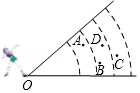
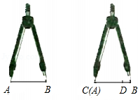

# 知识点·比较线段的大小（同步练习）

> 教材：数学·七年级上册·沪科技版2024新教材 ｜ 来源：国家中小学智慧教育平台·在线练习 ｜ 共 3 题

## 1. 填空题（难度：适中）

通过度量可知，如图所示的三角形\(ABC\)中，\(AB < BC < CA\)，则图中号（填序号）位置是顶点\(A\)。

【答案】②

【解析】​

## 2. 填空题（难度：适中）

体育课上，小明在点\(O\)处进行了四次铅球试投，铅球分别落在图中的点\(A\)，\(B\)，\(C\)，\(D\)处，则四次试投中，成绩最好的是落在图中的点处。

【答案】C

【解析】​

## 3. 填空题（难度：简单）

有不在同一直线上的两条线段\(AB\)和\(CD\)，李明很难判断出他们的长短，因此他借助于圆规，操作如图所示，由此可得出\(AB\)\(CD\)（填“\( > \)”“ \( < \)”或“\( = \)”\()\)。

【答案】$ &gt; $

【解析】​
