# 知识点·比较角的大小（同步练习）

> 教材：数学·七年级上册·沪科技版2024新教材 ｜ 来源：国家中小学智慧教育平台·在线练习 ｜ 共 51 题

## 1. 单选题（难度：简单）

若∠A＝38°15′，∠B＝38.15°，则（　　）

- A. ∠A＞∠B
- B. ∠A＜∠B
- C. ∠A＝∠B
- D. 无法确定

【答案】A

【解析】解：∵∠A＝38°15′，∠B＝38.15°＝38°9′，
∴∠A＞∠B．
故选：A．

## 2. 单选题（难度：简单）

若∠1＝20°18′，∠2＝20°15′30″，∠3＝20.25°，则（　　）

【答案】A

## 3. 单选题（难度：非常简单）

∠A＝40.15°，∠B＝40°15'，关于两个角的大小，下列正确的是（　　）

【答案】A

## 4. 单选题（难度：非常简单）

在∠AOB内取一点C，作射线OC，则一定成立（　　）

- A. ∠AOC＝∠BOC
- B. ∠AOC＞∠BOC
- C. ∠BOC＞∠AOC
- D. ∠AOB＞∠AOC

【答案】D

【解析】解：A、只有OC平分∠AOB时，∠AOC＝∠BOC，故A不符合题意；
B、∠AOC不一定大于∠BOC，故B不符合题意；
C、∠BOC不一定大于∠AOC，故C不符合题意；
D、∠AOB＞∠AOC，正确，故D符合题意．
故选：D．

## 5. 单选题（难度：简单）

在综合与实践课上，将∠A与∠B两个角的关系记为∠A＝n∠B（n＞0），探索n的大小与两个角的类型之间的关系．（　　）

- A. 当n＝2时，若∠A为锐角，则∠B为锐角
- B. 当n＝2时，若∠A为钝角，则∠B为钝角
- C. 当n\( =\frac{1}{2}\)时，若∠A为锐角，则∠B为锐角
- D. 当n\( =\frac{1}{2}\)时，若∠A为锐角，则∠B为钝角

【答案】A

【解析】解：∵∠A＝n∠B，
当n＝2时，
∴∠A＝2∠B，
又∵∠A为锐角，
∴0°＜∠A＜90°，
∴0°＜2∠B＜90°，
∴0°＜∠B＜45°，
∴∠B为锐角，
故选项A正确，
∵∠A为钝角，
∴90°＜∠A＜180°，
∴90°＜2∠B＜180°，
∴45°＜∠B＜90°，
∴∠B是锐角，
故选项B不正确；
当n\( =\frac{1}{2}\)时，
∴∠A\( =\frac{1}{2}\)∠B，
又∵∠A为锐角，
∴0°＜∠A＜90°，
∴0°\( ＜\frac{1}{2}\)∠B＜90°，
∴0°＜∠B＜180°，
∴∠B可能是锐角也可能是钝角，
故选项C，选项D不正确．
故选：A．

## 6. 单选题（难度：简单）

已知∠1＝38°36'，∠2＝38.36°，则∠1与∠2的大小关系是（　　）

【答案】A

## 7. 单选题（难度：简单）

比较∠CAB与∠DAB的大小，把它们的顶点A和边AB重合，把它们的另一边AC和AD放在AB的同一侧，若∠CAB＞∠DAB，则（　　）

【答案】A

## 8. 单选题（难度：简单）

若∠1＝75°24′，∠2＝75.3°，∠3＝75.12°，则下列正确的是（　　）

【答案】A

## 9. 单选题（难度：简单）

已知∠1＝22°20′，∠2＝22.20°，下列结论正确的是（　　）

【答案】A

## 10. 单选题（难度：非常简单）

若∠A＝20°25′，∠B＝20°15′30″，∠C＝20.25°，则有（　　）

【答案】A

## 11. 单选题（难度：简单）

下列说法：①连接两点间的线段叫做这两点间的距离；②建筑工人砌墙时，经常在两个墙脚的位置分别插一根木桩，然后拉一根直的参照线这样做的原理是：两点之间，线段最短；③若AB＝2CB，则点C是AB的中点；④若∠A＝20°15′，∠B＝20°15″，∠C＝20.15°，则有∠A＞∠C＞∠B．其中正确的有（　　）

【答案】A

## 12. 单选题（难度：简单）

若∠1＝30.5°，∠2＝30°30'，则∠1与∠2的大小关系是（　　）

- A. ∠1＝∠2
- B. ∠1＞∠2
- C. ∠1＜∠2
- D. 无法判断

【答案】A

【解析】解：∵∠1＝30.5°＝30°30'，
又∵∠2＝30°30'，
∴∠1＝∠2，
故选：A．

## 13. 单选题（难度：简单）

若∠A＝60°27′25″，∠B＝60.45°，则（　　）

【答案】A

## 14. 单选题（难度：简单）

∠A＝40.4°，∠B＝40°4'，关于两个角的大小，下列正确的是（　　）

- A. ∠A＞∠B
- B. ∠A＜∠B
- C. ∠A＝∠B
- D. 无法确定

【答案】A

【解析】解：∵40.4°＝40°24′，
∴40°24′＞40°4'，
∴∠A＞∠B．
故选：A．

## 15. 单选题（难度：非常简单）

若∠A＝20°20′，∠B＝20°15′30″，∠C＝20.35°，则（　　）

- A. ∠A＞∠B＞∠C
- B. ∠B＞∠A＞∠C
- C. ∠A＞∠C＞∠B
- D. ∠C＞∠A＞∠B

【答案】D

【解析】解：∵∠C＝20.35°＝20°+0.35°，0.35°＝0.35×60′＝21′，
∴∠C＝20°21′，
∵∠A＝20°20′，∠B＝20°15′30″，
∴∠C＞∠A＞∠B．
故选：D．

## 16. 单选题（难度：简单）

已知∠α＝39°18′，∠β＝39.18°，∠γ＝39.3°，下面结论正确的是（　　）

- A. ∠α＜∠γ＜∠β
- B. ∠γ＞∠α＝∠β
- C. ∠α＝∠γ＞∠β
- D. ∠γ＜∠α＜∠β

【答案】C

【解析】解：∵∠α＝39°18′＝39.3°，39.18°＜39.3°，
∴∠α＝∠γ＞∠β．
故选：C．

## 17. 单选题（难度：简单）

如图所示，正方形网格中有∠α和∠β，如果每个小正方形的边长都为1，估测∠α与∠β的大小关系为（　　）

【答案】A

## 18. 单选题（难度：简单）

如图，∠AOC＞∠BOD，则（　　）

【答案】A

## 19. 单选题（难度：简单）

如图，用同样大小的三角板比较∠A和∠B的大小，下列判断正确的是（　　）

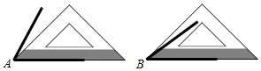

- A. ∠A＞∠B
- B. ∠A＜∠B
- C. ∠A＝∠B
- D. 没有量角器，无法确定

【答案】A

【解析】解：∵图中三角尺为等腰直角三角形，
∴∠A＞45°，∠B＜45°，
∴∠A＞∠B，
故选：A．

## 20. 单选题（难度：简单）

如图，若∠AOB＞∠COD，则∠AOD与∠BOC的大小关系是（　　）

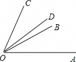

- A. ∠AOD＝∠BOC
- B. ∠AOD＜∠BOC
- C. ∠AOD＞∠BOC
- D. 不能确定

【答案】C

【解析】解：∵∠AOB＞∠COD，
∴∠AOB+∠BOD＞∠COD+∠BOD，
即∠AOD＞∠BOC，
故选：C．

## 21. 单选题（难度：简单）

如图，用三角板比较∠A与∠B的大小，其中正确的是（　　）

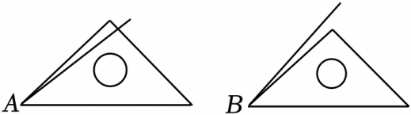

- A. ∠A＞∠B
- B. ∠A＜∠B
- C. ∠A＝∠B
- D. 不能确定

【答案】B

【解析】解：由图可得，∠A＜45°，∠B＞45°，
∴∠A＜∠B，
故选：B．

## 22. 单选题（难度：简单）

如图，已知OB是∠AOC内部的一条射线，下列说法一定正确的是（　　）

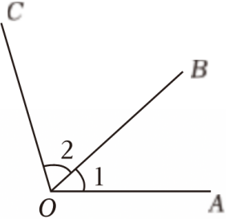

- A. ∠AOC＝2∠BOC
- B. ∠BOC＜∠AOB
- C. ∠AOC可以用∠O表示
- D. ∠1与∠AOB表示同一个角

【答案】D

【解析】解：A．∠AOC≠2∠BOC，故本选项不符合题意；
B．∠BOC可能大于∠AOB，也可能小于∠AOB，也有可能等于∠AOB，故本选项不符合题意；
C．∠AOC不可以用∠O表示，故本选项不符合题意；
D．∠1与∠AOB表示同一个角，故本选项符合题意．
故选：D．

## 23. 单选题（难度：简单）

已知∠1＝22°12′，∠2＝22.20°，∠3＝22°20″，下列结论正确的是（　　）

【答案】A

## 24. 单选题（难度：简单）

若∠A＝12°12′，∠B＝20°15′30″，∠C＝20.25°，则（　　）

【答案】A

## 25. 单选题（难度：简单）

若∠A＝40°18′，∠B＝40°15′30″，∠C＝40.25°，则有（　　）

【答案】A

## 26. 单选题（难度：简单）

在∠AOB内部任取一点C，作射线OC，则一定存在（　　）

【答案】A

## 27. 单选题（难度：简单）

若∠A＝20°19′，∠B＝20°15′30″，∠C＝20.25°，则（　　）

【答案】A

## 28. 单选题（难度：简单）

若∠A＝20°15'，∠B＝20.25°，则（　　）

【答案】A

## 29. 单选题（难度：简单）

下列说法正确的是（　　）

【答案】A

## 30. 单选题（难度：简单）

如图，正方形网格中每个小正方形的边长都为1，则∠1与∠2的大小关系为（　　）

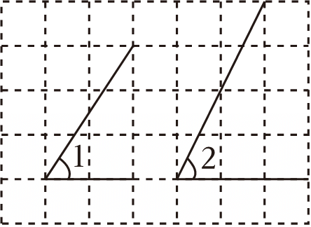

- A. ∠1＜∠2
- B. ∠1＝∠2
- C. ∠1＞∠2
- D. 无法比较

【答案】A

【解析】解：将∠1平移，让∠1与∠2两个角的顶点重合，
如图：

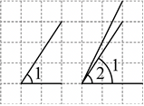
 
可得：∠1在∠2的内部，
所以∠1＜∠2．
故选：A．

## 31. 单选题（难度：适中）

若∠A＝33.3°，∠B＝33°3′，则∠A与∠B的大小关系是（　　）

- A. ∠A＜∠B
- B. ∠A＝∠B
- C. ∠A＞∠B
- D. 无法比较

【答案】C

【解析】解：∵∠A＝33.3°＝30°18′，
∴33°18′＞33°3′．
∴∠A＞∠B，
故选：C．

## 32. 单选题（难度：简单）

若∠A＝99.6°，∠B＝99°35'54″，则∠A与∠B的大小关系是（　　）

- A. ∠A＞∠B
- B. ∠A＝∠B
- C. ∠A＜∠B
- D. 无法判断

【答案】A

【解析】解：∵∠A＝99.6°＝99°36'，而∠B＝99°35'54''，
∴∠A＞∠B．
故选：A．

## 33. 单选题（难度：简单）

如图，射线OC，OD分别在∠AOB的内部、外部，下列结论错误的是（　　）

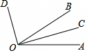

- A. ∠AOB＜∠AOD
- B. ∠BOC＜∠AOB
- C. ∠COD＞∠AOD
- D. ∠AOB＞∠AOC

【答案】C

【解析】解：A．由题可得，∠AOB＜∠AOD，故本选项正确；
B．由题可得，∠BOC＜∠AOB，故本选项正确；
C．由题可得，∠COD＜∠AOD，故本选项错误；
D．由题可得，∠AOB＞∠AOC，故本选项正确；
故选：C．

## 34. 单选题（难度：适中）

下列说法中正确的是（　　）

- A. 射线AB和射线B．A是同一条射线
- B. 延长线段AB和延长线段BA的含义是相同的
- C. 若A，B，C三点在同一直线上，且AB＝2CB，则点C是线段AB的中点
- D. 若∠A＝21°18'，∠B＝21°28″，∠C＝21.25°，则有∠A＞∠C＞∠B

【答案】D

【解析】解：A、射线用两个大写字母表示时，端点字母写在第一个位置，所以射线AB和射线BA不是同一条射线，原说法错误，故此选项不符合题意；
B、延长线段AB是按照从A到B的方向延长的，而延长线段BA是按照从B到A的方向延长的，意义不相同，原说法错误，故此选项不符合题意；
C、若A，B，C三点在同一直线上，点C在线段AB上且AB＝2CB，则点C是线段AB的中点，原说法错误，故此选项不符合题意；
D、若∠A＝21°18'，∠B＝21°28″，∠C＝21.25°＝21°15′，则有∠A＞∠C＞∠B，原说法正确，故此选项符合题意．
故选：D．

## 35. 单选题（难度：简单）

如图，利用一副三角板比较∠AOB与∠CPD的大小，两角顶点均与三角板某一顶点重合．已知图1中射线OB经过60°角的一边，图2中射线PC经过45°角的一边，则下列判断正确的是（　　）

【答案】A

## 36. 单选题（难度：适中）

已知∠1＝38°36′，∠2＝38.36°，∠3＝38.6°，下列说法正确的是（　　）

- A. ∠1＝∠2＜∠3
- B. ∠1＝∠3＞∠2
- C. ∠2＝∠3＞∠1
- D. ∠1＜∠2＜∠3

【答案】B

【解析】解：将∠1转化为度的形式为：\( \angle 1=38°36\text{'}=38°+\left(\frac{36}{60}\right)\text{'}=38.6°\)，
∵38°36′＝38.6°＞38.36°，
∴∠1＝∠3＞∠2，
故选：B．

## 37. 单选题（难度：适中）

已知∠1＝39°18′，∠2＝39.18°，∠3＝39.3°，下面结论正确的是（　　）

【答案】A

## 38. 单选题（难度：适中）

若∠1＝25°12'，∠2＝25.12°，则下列结论正确的是（　　）

【答案】A

## 39. 单选题（难度：简单）

用叠合的方法比较∠AOB和B'两个角的大小，先将∠A'O'B'的顶点O'与∠AOB的顶点O重合，边O'A'与边OA重合，边O'B'落在了∠AOB的内部，则∠AOB和∠A′O′B′'的关系是（　　）

- A. ∠AOB＞∠A′O′B′
- B. ∠AOB＜∠A′O′B′
- C. ∠AOB＝∠A′O′B′
- D. 不确定

【答案】A

【解析】解：如图，

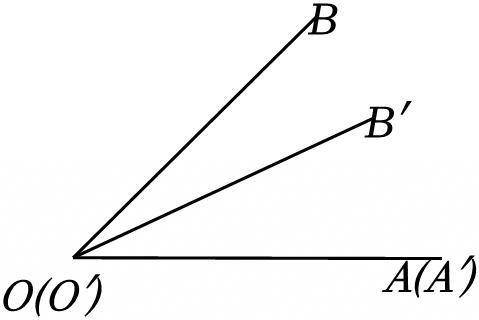
 
∴∠AOB＞∠A′O′B′，
故选：A．

## 40. 单选题（难度：简单）

已知OB是∠AOC内部一条射线，按如图所示的方式作图，得到射线OD，则（　　）

【答案】A

## 41. 单选题（难度：简单）

如图，∠AOB，以OA为边作∠AOC，使∠BOC<latex class="math-tex">\( =\frac{1}{2}\)</latex>∠AOB，则下列结论成立的是（　　）

【答案】A

## 42. 单选题（难度：适中）

用两个含30°的三角尺按照如图所示的方式放在水平桌面上（点B，O，C在一条直线上），则∠AOD和∠AOB+∠CDO的大小关系是（　　）

【答案】A

## 43. 单选题（难度：适中）

如图，方格纸中的∠1和∠2的大小关系是（　　）

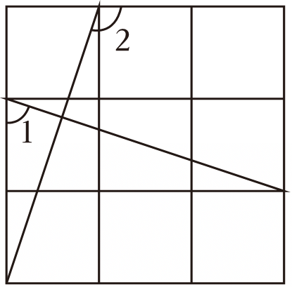

- A. ∠1＝∠2
- B. ∠2＝2∠1
- C. ∠2＝90°+∠1
- D. ∠1+∠2＝180°

【答案】D

【解析】解：如图所示：
由题意可知：∠BAC＝∠DEF＝90°，AB＝DE，AC＝EF，
∴△ABC≌△EDF，
∴∠3＝∠4，
∵∠1+∠3＝90°，
∴∠3＝90°﹣∠1，
∵∠2＝90°+∠4，
∴∠2＝90°+∠3＝90°+90°﹣∠1＝180°﹣∠1，
∴∠1+∠2＝180°，
故选：D．
 

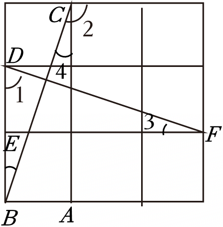

## 44. 单选题（难度：适中）

一副三角板如图摆放，则最大的钝角的度数是（　　）

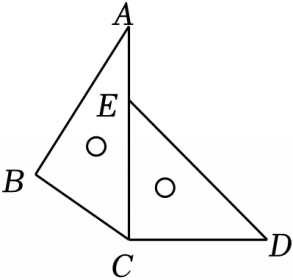

- A. 180°
- B. 150°
- C. 135°
- D. 90°

【答案】B

【解析】解：由题意可知：∠ACB＝60°，∠ACD＝90°，
最大的钝角的度数是∠BCD＝∠BCA+∠ACD＝60°+90°＝150°，
故选：B．

## 45. 单选题（难度：适中）

如图，在4×4的正方形网格中，记∠ABF＝α，∠FCH＝β，∠DGE＝γ，则（　　）

【答案】A

## 46. 单选题（难度：简单）

如图所示，正方形网格中有∠α和∠β，如果每个小正方形的边长都为1，则∠α与∠β的大小关系为（　　）

【答案】A

## 47. 单选题（难度：简单）

如图，一副三角尺按如下四种不同的方式摆放，其中，∠α≠∠β的图形的选项是（　　）

- A. 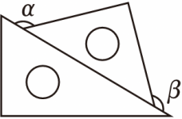
- B. 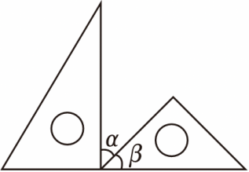
- C. 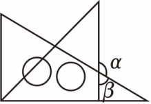
- D. 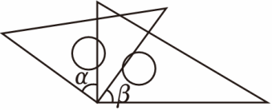

【答案】C

【解析】解：对于选项A，∠α＝180°﹣45°＝135°，∠β＝180°﹣45°＝135°，
∴∠α＝∠β，
故选项A不符合题意；
对于选项B，∠α＝45°，∠β＝45°，
∴∠α＝∠β，
故选项B不符合题意；
对于选项C，∠α＝120°，∠α＝60°，
∴∠α≠∠β
故选项C符合题意；
对于选项D，如图所示：

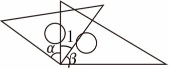
  
∵∠α+∠1＝90°，∠β+∠1＝90°，
∴∠α＝∠β，
故选项D不符合题意．
故选：C．

## 48. 单选题（难度：简单）

如图，有两个直角顶点重合的三角板，判断∠1与∠2的大小关系为（　　）

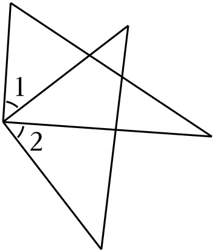

- A. ∠1＜∠2
- B. ∠1＝∠2
- C. ∠1＞∠2
- D. 无法确定

【答案】B

【解析】解：如图：

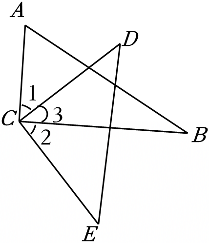
 
由题意得：∠ACB＝∠DCE＝90°，
∴∠ACB﹣∠3＝∠DCE﹣∠3，
即∠1＝∠2，
故选：B．

## 49. 单选题（难度：适中）

如图∠AOB，以OB为边作∠BOC，使∠BOC＝2∠AOB，那么下列说法正确的是（　　）

【答案】A

## 50. 单选题（难度：简单）

下面所标注的四个角中最大的角是（　　）

- A. 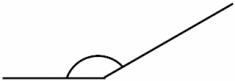
- B. 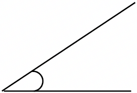
- C. 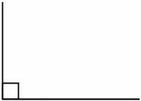
- D. 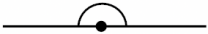

【答案】D

【解析】解：A：图中标注的角为钝角，钝角大于90°；
B：图中标注的角为锐角，锐角大于0°而小于90°；
C：图中标注的角为直角，直角等于90°；
D：图中标注的角为平角，平角等于180°．
∴锐角＜直角＜钝角＜平角．
故选：D．

## 51. 单选题（难度：适中）

用“叠合法”比较∠1与∠2的大小，正确的是（　　）

【答案】A
