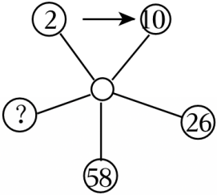
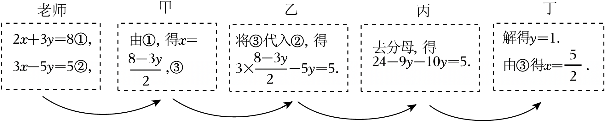
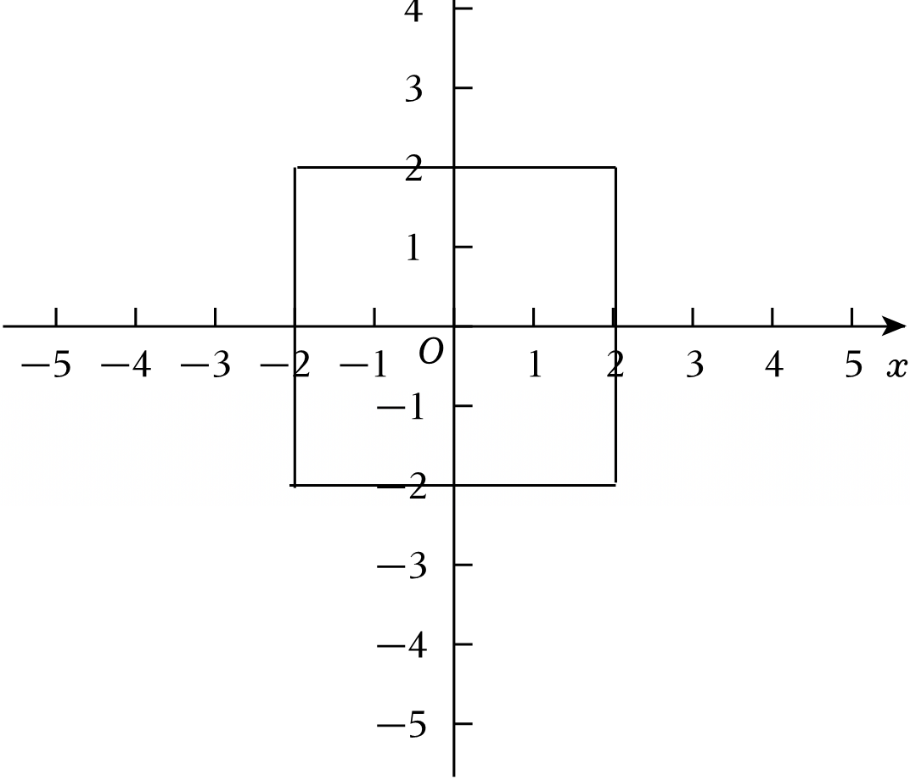
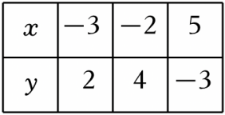
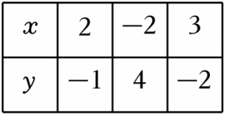

# 知识点·用加减消元法解二元一次方程组（同步练习）

> 教材：数学·七年级上册·沪科技版2024新教材 ｜ 来源：国家中小学智慧教育平台·在线练习 ｜ 共 48 题

## 1. 单选题（难度：简单）

关于x、y的方程组\( \left\{\begin{array}{l}x-y=1\\ 2x+y=0\end{array}\right.\)，则x+2y的值等于（　　）

- A. 1
- B. 0
- C. ﹣1
- D. 2

【答案】C

【解析】解：\( \left\{\begin{array}{l}x-y=1①\\ 2x+y=0②\end{array}\right.\)，
②﹣①，得x+2y＝﹣1，

## 2. 单选题（难度：简单）

解方程组：①\( \left\{\begin{array}{l}x=2y\\ 3x-5y=9\end{array}\right.\)②\( \left\{\begin{array}{l}4x-2y=7\\ 3x+2y=10\end{array}\right.\)③\( \left\{\begin{array}{l}4x+5y=9\\ 2x-3y=7\end{array}\right.\)④\( \left\{\begin{array}{l}x+y=0\\ 3x-4y=1\end{array}\right.\)比较适宜的方法是（　　）

- A. ①②用代入法，③④用加减法
- B. ①③用代入法，②④用加减法
- C. ②③用代入法，①④用加减法
- D. ①④用代入法，②③用加减法

【答案】D

【解析】解：①中的第一个方程为x＝2y，显然可用代入法；
②中的y的系数互为相反数，显然用加减法；
③中的第二个方程可以乘以2得4x﹣6y＝14，即可用加减法进行消元；
④中的第一个方程可以转化为x＝﹣y，即可用代入法进行消元．
①④用代入法，②③用加减法选第二个答案．
故选：D．

## 3. 单选题（难度：非常简单）

已知二元一次方程组\( \left\{\begin{array}{l}2x+3y=4①\\ 2x-5y=7②\end{array}\right.\)，将①﹣②得（　　）

- A. 8y＝﹣3
- B. ﹣2y＝﹣3
- C. ﹣8y＝﹣3
- D. 2y＝﹣3

【答案】A

【解析】解：将①﹣②得：8y＝﹣3．

## 4. 单选题（难度：适中）

在解关于x、y的二元一次方程组\( \left\{\begin{array}{l}6x+\odot y=3①\\ 2x+\otimes y=-1②\end{array}\right.\)时，若①+②可以直接消去未知数y，则⊙和⊗的关系是（　　）

- A. 互为倒数
- B. 互为相反数
- C. 大小相等
- D. 无法确定

【答案】B

【解析】解：\( \left\{\begin{array}{l}6x+\odot y=3①\\ 2x+\otimes y=-1②\end{array}\right.\)，
由①+②得：8x+（⊙+⊗）y＝2，
∵①+②可以直接消去未知数y，
∴⊙+⊗＝0，
则⊙和⊗的关系是互为相反数，
故选：B．

## 5. 单选题

​已知关于x，y的方程组\( \left\{\begin{array}{l}x-2y=ak\\ 2x+y=k+1\end{array}\right.\)，不论k取什么实数，3x+4y的值始终不变，则a的值为（　　）

- A. ﹣1
- B. 0
- C. 1
- D. 2

【答案】D

【解析】解：\( \left\{\begin{array}{l}x-2y=ak①\\ 2x+y=k+1②\end{array}\right.\)，
②×2﹣①得：3x+4y＝（2﹣a）k+2，
∵不论k取什么实数，3x+4y的值始终不变，
∴2﹣a＝0，
解得：a＝2，

## 6. 单选题（难度：适中）

解关于x，y的二元一次方程组\( \left\{\begin{array}{l}3x+ay=4①\\ 2x-by=-3②\end{array}\right.\)，由①﹣②可直接消去未知数y，则a和b满足的条件是（　　）

- A. a＝b
- B. ab＝1
- C. a+b＝1
- D. a+b＝0

【答案】D

【解析】解：由题意可得a＝﹣b，
即a+b＝0，
故选：D．

## 7. 单选题（难度：非常简单）

方程组\( \left\{\begin{array}{l}x+y=3\\ x-y=-1\end{array}\right.\)的解是（　　）

- A. \( \left\{\begin{array}{l}x=1\\ y=2\end{array}\right.\)
- B. \( \left\{\begin{array}{l}x=1\\ y=-2\end{array}\right.\)
- C. \( \left\{\begin{array}{l}x=2\\ y=1\end{array}\right.\)
- D. \( \left\{\begin{array}{l}x=0\\ y=-1\end{array}\right.\)

【答案】A

【解析】解：\( \left\{\begin{array}{l}x+y=3①\\ x-y=-1②\end{array}\right.\)，
①+②得：2x＝2，
解得：x＝1，
把x＝1代入①得：y＝2，
则方程组的解为\( \left\{\begin{array}{l}x=1\\ y=2\end{array}\right.\left\{\begin{array}{l}x=2\\ y=1\end{array}\right.\)，

## 8. 单选题（难度：适中）

​当a，b都是实数，且满足ab＝6，则称点P（a+3，2﹣b）为完美点．已知关于x，y的方程\( \left\{\begin{array}{l}x+y=5\\ x-y=2m+1\end{array}\right.\)，点A（x，y）是完美点，则m的值为（　　）

- A. \( \pm \sqrt{6}\)
- B. \( \pm \sqrt{2}\)
- C. \( \pm \sqrt{3}\)
- D. \( \pm \sqrt{7}\)

【答案】A

【解析】解：\( \left\{\begin{array}{l}x+y=5①\\ x-y=2m+1②\end{array}\right.\)，
解得：\( \left\{\begin{array}{l}x=m+3\\ y=2-m\end{array}\right.\)，
则x﹣3＝m，2﹣y＝m，
那么（x﹣3）（2﹣y）＝m²＝6，
则m＝±\( \sqrt{6}\)，

## 9. 单选题（难度：非常简单）

​解方程组\( \left\{\begin{array}{l}x+2y=9\\ 3x-2y=-1\end{array}\right.\)，比较简单的消元方法是（　　）

- A. 加法消元
- B. 减法消元
- C. 代入法消元
- D. 三种方法一样

【答案】A

【解析】解：∵两方程中y的系数互为相反数，
∴用加法消元法比较简单．
故选：A．

## 10. 单选题（难度：简单）

用加减消元法解方程组\( \left\{\begin{array}{l}3x-2y=3①\\ 4x+y=15②\end{array}\right.\)消去y，最简捷的方法是（　　）

- A. ①×4﹣②×3
- B. ①×4+②×3
- C. ②×2﹣①
- D. ②×2+①

【答案】D

【解析】解：②×2，得8x+2y＝30③．
∴①+③，得11x＝33．
∴消去y，最简便的方法是②×2+①．

## 11. 单选题（难度：简单）

若|x+y﹣3|与（2x+3y﹣8）²互为相反数，则3x+4y＝（　　）

- A. 11
- B. 9
- C. 7
- D. 5

【答案】A

【解析】解：由题意得|x+y﹣3|+（2x+3y﹣8）²＝0，
∴\( \left\{\begin{array}{l}x+y=3\\ 2x+3y=8\end{array}\right.\)，解得\( \left\{\begin{array}{l}x=1\\ y=2\end{array}\right.\)，
∴3x+4y＝3×1+4×2＝11，

## 12. 单选题（难度：适中）

​对于实数x，y定义新运算：x*y＝ax+by+5，其中a，b为常数．已知1*2＝9，（﹣3）*3＝2，则（　　）

- A. a＝2，b＝﹣2
- B. a＝2，b＝1
- C. a＝1，b＝2
- D. a＝1，b＝﹣2

【答案】B

【解析】解：∵x*y＝ax+by+5，1*2＝9，（﹣3）*3＝2，
∴\( \left\{\begin{array}{l}a+2b+5=9\\ -3a+3b+5=2\end{array}\right.\)，化简为：\( \left\{\begin{array}{l}a+2b=4①\\ a-b=1②\end{array}\right.\)，
①﹣②得：b＝1，
把b＝1代入②得：a＝2，
∴a＝2，b＝1，

## 13. 单选题

​解关于x，y的方程组\( \left\{\begin{array}{l}(m+1)x-(3n+2)y=8①\\ (5-n)x+my=11②\end{array}\right.\)可以用①×2+②，消去未知数x，也可以用①+②×5消去未知数y，则m、n的值分别为（　　）

- A. ﹣23，﹣39
- B. ﹣23，﹣40
- C. ﹣25，﹣39
- D. ﹣25，﹣40

【答案】A

【解析】解：根据题意得：\( \left\{\begin{array}{l}2(m+1)+5-n=0\\ -(3n+2)+5m=0\end{array}\right.\)，
整理得：\( \left\{\begin{array}{l}2m-n=-7①\\ 5m-3n=2②\end{array}\right.\)，
①×3﹣②得：m＝﹣23，
把m＝﹣23代入①得：﹣46﹣n＝﹣7，
解得：n＝﹣39．

## 14. 单选题（难度：简单）

解二元一次方程组\( \left\{\begin{array}{c}x+7y=-19\\ x-5y=17\end{array}\right.\)，用代入消元法消去x，得到的方程是（　　）

- A. 2y＝﹣2
- B. 2y＝﹣36
- C. 12y＝﹣2
- D. 12y＝﹣36

【答案】D

【解析】解：将x+7y＝﹣19变形为x＝﹣19﹣7y，
将其代入x﹣5y＝17可得：﹣19﹣7y﹣5y＝17，
即12y＝﹣36．

## 15. 单选题（难度：适中）

若（x﹣2y+1）²+（x+2y﹣3）²＝0，则x、y的值是（　　）

- A. \( \left\{\begin{array}{l}x=-1，\\ y=0\end{array}\right.\)
- B. \( \left\{\begin{array}{l}x=-1，\\ y=2\end{array}\right.\)
- C. \( \left\{\begin{array}{l}x=1，\\ y=1\end{array}\right.\)
- D. \( \left\{\begin{array}{l}x=1，\\ y=2\end{array}\right.\)

【答案】C

【解析】解：∵（x﹣2y+1）²+（x+2y﹣3）²＝0，
∴\( \left\{\begin{array}{l}x-2y+1=0\\ x+2y-3=0\end{array}\right.\)，
整理得：\( \left\{\begin{array}{l}x-2y=-1①\\ x+2y=3②\end{array}\right.\)，
①+②得：2x＝2，
解得：x＝1，
将x＝1代入①得：1﹣2y＝﹣1，
解得：y＝1，
故原方程组的解为\( \left\{\begin{array}{l}x=1\\ y=1\end{array}\right.\)，

## 16. 单选题（难度：非常简单）

​二元一次方程组\( \left\{\begin{array}{l}7x+2y=11\\ x-2y=-3\end{array}\right.\)的解为（　　）

- A. \( \left\{\begin{array}{l}x=-1\\ y=2\end{array}\right.\)
- B. \( \left\{\begin{array}{l}x=1\\ y=-2\end{array}\right.\)
- C. \( \left\{\begin{array}{l}x=-1\\ y=-2\end{array}\right.\)
- D. \( \left\{\begin{array}{l}x=1\\ y=2\end{array}\right.\)

【答案】D

【解析】解：\( \left\{\begin{array}{l}7x+2y=11①\\ x-2y=-3②\end{array}\right.\)，
①+②，得8x＝8，
解得x＝1，
把x＝1代入②，得y＝2，
所以方程组的解是\( \left\{\begin{array}{l}x=1\\ y=2\end{array}\right.\)，

## 17. 单选题（难度：简单）

已知|x+y+2|+（2x﹣3y﹣1）²＝0，则x、y的值分别是（　　）

- A. 1，\( \frac{3}{5}\)
- B. ﹣1，\( -\frac{4}{5}\)
- C. ﹣1，\( -\frac{5}{4}\)
- D. ﹣1，﹣1

【答案】D

【解析】解：∵|x+y+2|+（2x﹣3y﹣1）²＝0，
∴\( \left\{\begin{array}{l}x+y+2=0\\ 2x-3y-1=0\end{array}\right.\)，
解得：\( \left\{\begin{array}{l}x=-1\\ y=-1\end{array}\right.\)，
故选：D．

## 18. 单选题（难度：简单）

两个单项式2xm⁺²n⁺²y²与﹣5x⁷ym﹣²n⁺¹的和是一个单项式，点（m，n）到横轴的距离是（　　）

- A. 1
- B. 3
- C. 7
- D. 2

【答案】A

【解析】解：因为两个单项式2xm⁺²n⁺²y²与﹣5x⁷ym﹣²n⁺¹的和是一个单项式，
所以这两个单项式是同类项，\( \left\{\begin{array}{c}m+2n+2=7\\ m-2n+1=2\end{array}\right.\)，
解得\( \left\{\begin{array}{c}m=3\\ n=1\end{array}\right.\)，
所以点（m，n）到横轴的距离是1，
故选：A．

## 19. 单选题（难度：简单）

若xm﹣²n﹣ym⁺n﹣³＝2024是关于x，y的二元一次方程，则m，n的值分别是（　　）

- A. m＝3，n＝1
- B. m＝0，n＝1
- C. m＝2，n＝1
- D. m＝2，n＝3

【答案】A

【解析】解：∵xm﹣² n﹣ym⁺n﹣³＝2024是关于x，y的二元一次方程，
∴\( \left\{\begin{array}{c}m-2n=1\\ m+n-3=1\end{array}\right.\)，
解得\( \left\{\begin{array}{c}m=3\\ n=1\end{array}\right.\)；
故选：A．

## 20. 单选题（难度：简单）

定义运算“*”，规定x*y＝ax²+by（其中a、b为常数），若已知1*2＝5，2*1＝6，则2*3的值为（　　）

- A. 10
- B. 9
- C. 8
- D. 7

【答案】A

【解析】解：根据题中的新定义化简已知等式得：
\( \left\{\begin{array}{l}a+2b=5\\ 4a+b=6\end{array}\right.\)，
解得：a＝1，b＝2，
则2*3＝4a+3b＝4+6＝10．
故选：A．

## 21. 单选题（难度：适中）

在解二元一次方程组\( \left\{\begin{array}{l}6x+my=3①\\ 2x-ny=-6②\end{array}\right.\)时，若①﹣②可直接消去未知数y，则m和n满足下列条件是（　　）

- A. m＝n
- B. mn＝1
- C. m+n＝0
- D. m+n＝1

【答案】C

【解析】解：①﹣②得（6﹣2）x+（m+n）y＝3+6，
∵①﹣②可直接消去未知数y，
∴m+n＝0，
故选：C．

## 22. 单选题（难度：简单）

解方程组\( \left\{\begin{array}{c}2a+2b=3①\\ 3a+b=4②\end{array}\right.\)时，下列消元方法不正确的是（　　）

- A. ①×3﹣②×2，消去a
- B. 由②得：b＝4﹣3a③，把③代入①中消去b
- C. ①+②×2，消去b
- D. 由②×2﹣①，消去b

【答案】C

【解析】解：A． ①×3﹣②×2，消去a，故该选项正确，不符合题意；
B．由②得：b＝4﹣3a…③，把③代入①中消去b，故该选项正确，不符合题意；
C． ①+②×2，不能消元，故该选项符合题意，
D．由②×2﹣①，消去b，故该选项正确，不符合题意；
故选：C．

## 23. 单选题（难度：简单）

解关于x，y的方程组\( \left\{\begin{array}{l}2ax+3by=3①\\ 5bx-2ay=7②\end{array}\right.\)可以用①×3﹣②，消去未知数x，也可以用①+②×4消去未知数y，则a+b的值为（　　）

- A. ﹣1
- B. 0
- C. 1
- D. 2

【答案】B

【解析】解：\( \left\{\begin{array}{l}2ax+3by=3①\\ 5bx-2ay=7②\end{array}\right.\)，
①×3，得6ax+9by＝9③，
③﹣②，得6ax﹣5bx+9by+2ay＝2，即（6a﹣5b）x+（9b+2a）y＝2，
由题意可知，①×3﹣②，可以消去x，
∴6a﹣5b＝0，
∴\( b=\frac{6a}{5}\)．
②×4，得20bx﹣8ay＝28④，
①+④，得2ax+20bx+3by﹣8ay＝31，即（2a+20b）x+（3b﹣8a）y＝31，
由题意可知，①+②×4，可以消去y，
∴3b﹣8a＝0，
把\( b=\frac{6a}{5}\)代入，得\( 3\times \frac{6a}{5}-8a=0\)，
解得：a＝0，
把a＝0代入\( b=\frac{6a}{5}=0\)，
∴a+b＝0+0＝0．
故选：B．

## 24. 单选题（难度：适中）

已知关于x，y的方程组\( \left\{\begin{array}{l}ax+2(a-1)y=a\\ 2x+2y=3\end{array}\right.\)有下列几种说法：①一定有唯一解；②可能有无数多解；③当a＝2时方程组无解；④若方程组的一个解中y的值为0，则a＝0．其中正确的说法有（　　）

- A. 0种
- B. 1种
- C. 2种
- D. 3种

【答案】C

【解析】解：\( \left\{\begin{array}{c}ax+2(a-1)y=a①\\ 2x+2y②\end{array}\right.\)，
由②得\( x=\frac{3-2y}{2}\)，
把\( x=\frac{3-2y}{2}\)代入①得\( a\left(\frac{3-2y}{2}\right)+2(a-1)y=a\)，
整理得\( (a-2)y=-\frac{1}{2}a\)，
当a＝2时，方程组无解；
当a≠2时，方程组有唯一解；
如果y＝0，则\( (a-2)\times 0=-\frac{1}{2}a\)，解得a＝0，
观察四种说法，①②错误，③④正确，
故选：C．

## 25. 单选题（难度：简单）

若$ \left\{\begin{array}{l}△+\square +\square =11\\ △+△+\square +\square +\square =18\end{array}\right.$，△+△+□＝（　　）

【答案】A

## 26. 单选题（难度：适中）

已知在$ \sqrt{2x+1}=3$和$ \sqrt[3]{-3x+y+1}=-2$前提下，新定义一个新运算：a⊕b＝ax﹣by，下列说法：①x＝4，y＝3；②若m⊕n＝1，m⊕2n＝﹣2，则点P（﹣m，﹣n）在第三象限；③若m≠n，且（km）⊕n＝（kn）⊕m

【答案】A

## 27. 单选题（难度：简单）

已知关于x、y的二元一次方程组\( \left\{\begin{array}{l}3x+5y=7\\ x-2y=3\end{array}\right.\)，求代数式4x+3y的值为（　　）

- A. 8
- B. 9
- C. 10
- D. 12

【答案】C

【解析】解：\( \left\{\begin{array}{l}3x+5y=7①\\ x-2y=3②\end{array}\right.\)，
令①+②得：4x+3y＝10，
故选：C．

## 28. 单选题（难度：简单）

二元一次方程组\( \left\{\begin{array}{c}5x-2y=4\\ 2x+5y=19\end{array}\right.\)的解为（　　）

- A. \( \left\{\begin{array}{l}x=-2\\ y=-3\end{array}\right.\)
- B. \( \left\{\begin{array}{l}x=-2\\ y=3\end{array}\right.\)
- C. \( \left\{\begin{array}{l}x=2\\ y=3\end{array}\right.\)
- D. \( \left\{\begin{array}{l}x=2\\ y=-3\end{array}\right.\)

【答案】C

【解析】解：\( \left\{\begin{array}{l}5x-2y=4①\\ 2x+5y=19②\end{array}\right.\)，
由①得：\( y=\frac{5}{2}x-2③\)，
将③代入②得：\( 2x+5\times (\frac{5}{2}x-2)=19\)，
解得x＝2，
将x＝2代入③解得：y＝3，
∴原二元一次方程组的解为\( \left\{\begin{array}{l}x=2\\ y=3\end{array}\right.\)．
故选：C．

## 29. 单选题（难度：简单）

用加减法解方程组\( \left\{\begin{array}{l}x+y=5\\ x-y=2\end{array}\right.\)中，消x用_____法，消y用_____法．（　　）

- A. 加，加
- B. 加，减
- C. 减，加
- D. 乘，减

【答案】C

【解析】解：用加减法解方程组\( \left\{\begin{array}{l}x+y=5\\ x-y=2\end{array}\right.\)中，消x用减法，消y用加法，
故选：C．

## 30. 单选题（难度：简单）

二元一次方程组$ \left\{\begin{array}{c}2x-y=4\\ x+y=8\end{array}\right.$，最适合用下列哪种消元法求解（　　）

【答案】A

## 31. 单选题（难度：简单）

已知\( \left\{\begin{array}{l}a+2b=4\\ 3a+2b=8\end{array}\right.\)，则a+b等于（　　）

- A. 5
- B. 4
- C. 3
- D. 2

【答案】C

【解析】解：\( \left\{\begin{array}{l}a+2b=4①\\ 3a+2b=8②\end{array}\right.\)，
\( \frac{①+②}{4}\)，得a+b＝3．
故选：C．

## 32. 单选题（难度：简单）

解以下两个方程组：①\( \left\{\begin{array}{l}x=3y-5\\ 2x-4y=2\end{array}\right.\)，②\( \left\{\begin{array}{l}2x+3y=5\\ 5x-3y=9\end{array}\right.\)时，较为简便的方法是（　　）

- A. ①用代入法、②用加减法
- B. ①用加减法、②用代入法
- C. 都用代入法
- D. 都用加减法

【答案】A

【解析】解：①\( \left\{\begin{array}{l}x=3y-5\\ 2x-4y=2\end{array}\right.\)，采用代入消元法简便；
②\( \left\{\begin{array}{l}2x+3y=5\\ 5x-3y=9\end{array}\right.\)，采用加减消元法简便．
故选：A．

## 33. 单选题（难度：简单）

在解方程组\( \left\{\begin{array}{l}x+3y=10①\\ 2x-3y=10②\end{array}\right.\)时，某同学采用消元法将方程组变为3x＝20．则这种消元方式为（　　）

- A. ①×2﹣②
- B. ①﹣②
- C. ①+②
- D. ①×2+②

【答案】C

【解析】解：\( \left\{\begin{array}{l}x+3y=10①\\ 2x-3y=10②\end{array}\right.\)，
∴①+②得：3x＝20；
故选：C．

## 34. 单选题（难度：简单）

设y＝kx+b，当x＝1时，y＝1；当x＝2时，y＝﹣2，则k，b的值分别为（　　）

- A. ﹣1，2
- B. ﹣3，4
- C. 1，0
- D. ﹣5，6

【答案】B

【解析】解：把x＝1，y＝1；x＝2时，y＝﹣2，分别代入y＝kx+b得：
\( \left\{\begin{array}{l}k+b=1①\\ 2k+b=-2②\end{array}\right.\)，
②﹣①得：k＝﹣3，
把k＝﹣3代入①得：b＝4，
∴方程组的解为：\( \left\{\begin{array}{l}k=-3\\ b=4\end{array}\right.\)，
故选：B．

## 35. 单选题（难度：适中）

解方程组\( \left\{\begin{array}{l}ax+by=2\\ cx-7y=8\end{array}\right.\)时，甲同学正确解得\( \left\{\begin{array}{l}x=3\\ y=2\end{array}\right.\)，乙同学因把c写错而得到\( \left\{\begin{array}{l}x=2\\ y=1\end{array}\right.\)，则7a+7b+3c（　　）

- A. ﹣22
- B. \( \frac{22}{3}\)
- C. 22
- D. 29

【答案】C

【解析】解：由题意可得\( \left\{\begin{array}{l}3a+2b=2\\ 2a+b=2\end{array}\right.\)，
解得：\( \left\{\begin{array}{l}a=2\\ b=-2\end{array}\right.\)，
将\( \left\{\begin{array}{l}x=3\\ y=2\end{array}\right.\)代入cx﹣7y＝8可得：3c﹣14＝8，
解得：c\( =\frac{22}{3}\)，
则7a+7b+3c＝14﹣14+22＝22，
故选：C．

## 36. 单选题（难度：适中）

如图，从左上角标注2的圆圈开始，顺时针方向按an+b的规律（n表示前一个圆圈中的数字，a，b是常数）转换后得到下一个圆圈中的数，则标注问号的圆圈中的数应是（　　）

- A. 122
- B. 66
- C. 178
- D. 以上答案都错误

【答案】A

【解析】解：根据题意解方程组\( \left\{\begin{array}{c}2a+b=10\\ 10a+b=26\end{array}\right.\)可得\( \left\{\begin{array}{c}a=2\\ b=6\end{array}\right.\)，
∴顺时针方向按2n+6的规律转换后得到下一个圆圈中的数，
当n＝26时，2n+6＝2×26+6＝58；
当n＝58时，2n+6＝2×58+6＝122，
故圆圈中的数应是122，
故选：A．

## 37. 单选题（难度：简单）

解方程组\( \left\{\begin{array}{c}4x-3y=2\left(1\right)\\ 4x+y=10\left(2\right)\end{array}\right.\)时，由（2）﹣（1）得（　　）

- A. 2y＝8
- B. 4y＝8
- C. ﹣2y＝8
- D. ﹣4y＝8

【答案】B

【解析】解：解方程组\( \left\{\begin{array}{c}4x-3y=2\left(1\right)\\ 4x+y=10\left(2\right)\end{array}\right.\)时，由（2）﹣（1）得：4y＝8．
故选：B．

## 38. 单选题（难度：适中）

数学老师设计了一个解方程组的接力游戏，学习小组4名同学每人完成一步．如图，这是4个人合作完成解方程组的过程，合作中自己负责的一步没有出现错误的同学是（　　）

- A. 甲、乙、丙
- B. 甲、乙、丁
- C. 甲、丙、丁
- D. 乙、丙、丁

【答案】B

【解析】解：\( \left\{\begin{array}{l}2x+3y=8①\\ 3x-5y=5②\end{array}\right.\)，
由①得：x\( =\frac{8-3y}{2}\) ③，
把③代入②得：\( 3\times \frac{8-3y}{2}-5y=5\)，
去分母得：24﹣9y﹣10y＝10，
解得：y\( =\frac{14}{19}\)，
由③得：x\( =\frac{55}{19}\)．
则合作中出现错误的同学为丙．
由24﹣9y﹣10y＝5解得：y＝1，
∴合作中自己负责的一步没有出现错误的同学是：甲、乙、丁，
故选：B．

## 39. 单选题

在平面直角坐标系中，对于任意一点P（x，y），规定：\( f(x，y)=\left\{\begin{array}{l}\left|x\right|\left(\right|x|\ge |y\left|\right)，\\ \left|y\right|\left(\right|x|＜|y\left|\right)，\end{array}\right.\)例如f（﹣4，3）＝4，f（﹣2，﹣3）＝3．当f（x，y）＝2时，所有满足该条件的点P围成的图形的面积为（　　）

- A. 4
- B. 8
- C. 4π
- D. 16

【答案】D

【解析】解：∵f（x，y）＝2，
∴|x|＝2，|y|≤2或|y|＝2，|x|＜2．
①当|x|＝2，|y|≤2时，点P满足x＝2，﹣2≤y≤2或x＝﹣2，﹣2≤y≤2，
在图象上，线段x＝2，﹣2≤y≤2即为图中正方形的右边，线段x＝﹣2，﹣2≤y≤2即为图中正方形的左边；

②当|y|＝2，|x|＜2时，点P满足y＝2，﹣2＜x＜2，或y＝﹣2，﹣2＜x＜2，
在图象上，线段y＝2，﹣2＜x＜2即为图中正方形的上边，线段y＝﹣2，﹣2＜x＜2即为图中正方形的下边．
所以所有满足该条件的点P围成的图形的面积为4×4＝16．
故选：D．

## 40. 单选题（难度：简单）

已知方程组\( \left\{\begin{array}{l}2a-b=6\\ 3a+b=m\end{array}\right.\)中，a，b互为相反数，则m的值是（　　）

- A. 0
- B. 4
- C. 8
- D. 12

【答案】B

【解析】解：∵a，b互为相反数，
∴a＝﹣b．
将a＝﹣b代入\( \left\{\begin{array}{l}2a-b=6\\ 3a+b=m\end{array}\right.\)得：\( \left\{\begin{array}{l}2\times (-b)-b=6\\ 3\times (-b)+b=m\end{array}\right.\)，
解得：\( \left\{\begin{array}{l}b=-2\\ m=4\end{array}\right.\)．
故选：B．

## 41. 单选题（难度：适中）

已知关于x，y的二元一次方程组\( \left\{\begin{array}{l}x+2y=a-3\\ 3x-y=2a\end{array}\right.\)，有下列说法：①当a＝2时，方程的两根互为相反数；②不存在自然数a，使得x，y均为正整数；③x，y满足关系式x﹣5y＝6；④当且仅当a＝﹣5时，解得x为y的2倍．其中正确的是（　　）

- A. ①②③④
- B. ①③④
- C. ②③
- D. ①②④

【答案】B

【解析】解：二元一次方程组\( \left\{\begin{array}{l}x+2y=a-3\\ 3x-y=2a\end{array}\right.\)，
解得，\( \left\{\begin{array}{l}x=\frac{5a-3}{7}\\ y=\frac{a-9}{7}\end{array}\right.\)，
当a＝2时，\( \left\{\begin{array}{l}x=1\\ y=-1\end{array}\right.\)，故当a＝2时，方程两根互为相反数；故①符合题意；
∵x\( =\frac{5a-3}{7}\)，
∴a\( =\frac{7x+3}{5}\)，
代入y\( =\frac{a-9}{7}\)得，x﹣5y＝6，
∴x，y满足关系式x﹣5y＝6，故③符合题意；
当a＝﹣5时，x＝﹣4，y＝﹣2，
∴当且仅当a＝﹣5时解得x为y的2倍，故④符合题意；
当x＞0，y＞0时，则\( \left\{\begin{array}{l}5a-3＞0\\ a-9＞0\end{array}\right.\)，
∴a＞9，
∴当a＝16时，x＝11，y＝1，（x，y均为正整数），
∴存在自然数a使得x，y均为正整数，故②不符合题意．
故选：B．

## 42. 单选题

若关于x，y的方程组\( \left\{\begin{array}{l}x+ay+1=0\\ bx-2y+a=0\end{array}\right.\)没有实数解，则（　　）

- A. ab＝﹣2
- B. ab＝﹣2且a≠1
- C. ab≠﹣2
- D. ab＝﹣2且a≠2

【答案】A

【解析】解：\( \left\{\begin{array}{l}x+ay+1=0①\\ bx-2y+a=0②\end{array}\right.\)，
由①得，x＝﹣1﹣ay，
代入②得，b（﹣1﹣ay）﹣2y+a＝0，
即（﹣ab﹣2）y＝b﹣a，
因为此方程组没有实数根，所以﹣ab﹣2＝0，ab＝﹣2．
故选：A．

## 43. 单选题（难度：简单）

对于有理数x，y，定义新运算x*y＝ax+by，其中a，b是常数，等式右边是通常的加法和乘法运算．如果4*（﹣3）＝3，2*（﹣5）＝﹣6，则2*2的值是（　　）

- A. 9
- B. 12
- C. 16
- D. 23

【答案】A

【解析】解：根据题中的新定义化简4*（﹣3）＝3，2*（﹣5）＝﹣6得：
\( \left\{\begin{array}{l}4a-3b=3\\ 2a-5b=-6\end{array}\right.\)，
解得：\( \left\{\begin{array}{l}a=\frac{33}{14}\\ b=\frac{15}{7}\end{array}\right.\)，
则\( 2*2=2\times \frac{33}{14}+2\times \frac{15}{7}=9\)．
故选：A．

## 44. 单选题（难度：适中）

已知x，y是整数，满足x﹣y+3＝0，ax﹣y﹣a＝0，则整数a的所有可能值有（　　）个．

- A. 4
- B. 5
- C. 6
- D. 8

【答案】C

【解析】解：∵x﹣y+3＝0，
∴y＝x+3
∴ax﹣x﹣3﹣a＝0，
整理，得（a﹣1）x＝a+3
∴x\( =\frac{a+3}{a-1}=\frac{a-1+4}{a-1}\)
＝1\( +\frac{4}{a-1}\)
由于x、a都是整数，
所以a﹣1＝±1或±2或±4
即a所有可能的值有：0、2、3、﹣1、5、﹣3．
故选：C．

## 45. 单选题（难度：简单）

符号■，●各代表一个数字，且满足以下两个等式■﹣●﹣1＝0，4（■﹣●）﹣●＝﹣5，则满足等式$ \frac{k}{6}-\frac{3\cdot ■-k}{●-5}=$1中k的值为（　　）

【答案】A

## 46. 单选题（难度：适中）

已知方程组$ \left\{\begin{array}{l}27x+63y=59\\ 63x+27y=-13\end{array}\right.$的解满足x﹣y＝m﹣1，则m的值为（　　）

【答案】A

## 47. 单选题（难度：适中）

由方程组\( \left\{\begin{array}{l}x-y-1=0\\ (x-1{)}^{2}+(y+1{)}^{2}+4=0\end{array}\right.\)消去y后化简得到的方程是（　　）

- A. 2x²﹣2x﹣6＝0
- B. 2x²+2x+5＝0
- C. 2x²+5＝0
- D. 2x²﹣2x+5＝0

【答案】D

【解析】解：\( \left\{\begin{array}{ll}x-y-1=0& ①\\ (x-1{)}^{2}+(y+1{)}^{2}+4=0& ②\end{array}\right.\)，
由①，得
x＝y+1③，
将③代入②，得
（x﹣1）²+x²+4＝0，
化简，得
2x²﹣2x+5＝0，
故选：D．
声明：试题解析著作权属菁优网所有，未经书面同意，不得复制发布日期：2025/4/30 18:03:59；用户：白玉红；邮箱：18813710158；学号：21640616

## 48. 单选题（难度：适中）

二元一次方程a₁x+b₁y＝c₁的解为

二元一次方程a₂x+b₂y＝c₂的解x为

则方程组\( \left\{\begin{array}{l}{a}_{1}x+{b}_{1}y={c}_{1}\\ {a}_{2}x+{b}_{2}y={c}_{2}\end{array}\right.\)的解为（　　）

- A. \( \left\{\begin{array}{l}x=5\\ y=-3\end{array}\right.\)
- B. \( \left\{\begin{array}{l}x=3\\ y=-2\end{array}\right.\)
- C. \( \left\{\begin{array}{l}x=-3\\ y=-1\end{array}\right.\)
- D. \( \left\{\begin{array}{l}x=-2\\ y=4\end{array}\right.\)

【答案】D

【解析】解：由题意可知，\( \left\{\begin{array}{l}x=-2\\ y=4\end{array}\right.\)既是方程a₁x+b₁y＝c₁的解，
又是方程a₂x+b₂y＝c₂的解，
∴关于x，y的二元一次方程组\( \left\{\begin{array}{l}{a}_{1}x+{b}_{1}y={c}_{1}\\ {a}_{2}x+{b}_{2}y={c}_{2}\end{array}\right.\)的解是\( \left\{\begin{array}{l}x=-2\\ y=4\end{array}\right.\)．
故选：D．
