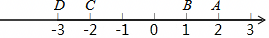

# 知识点·相反数（同步练习）

> 教材：数学·七年级上册·沪科技版2024新教材 ｜ 来源：国家中小学智慧教育平台·在线练习 ｜ 共 50 题

## 1. 单选题（难度：简单）

a的相反数为﹣3，则a等于（　　）

- A. \( -\frac{1}{3}\)
- B. \( \frac{1}{3}\)
- C. ﹣3
- D. 3

【答案】D

【解析】解：∵a和﹣3互为相反数，
∴a+（﹣3）＝0，
∴a＝3．
故选：D．

## 2. 单选题（难度：简单）

﹣（+2）的相反数是（　　）

- A. 2
- B. \( \frac{1}{2}\)
- C. \( -\frac{1}{2}\)
- D. ﹣2

【答案】A

【解析】解：﹣（+2）＝﹣2，﹣2的相反数是2．
故选：A．

## 3. 单选题（难度：非常简单）

农历2025年是乙巳蛇年，数字2025的相反数是（　　）

- A. 2025
- B. ﹣2025
- C. \( \frac{1}{2025}\)
- D. \( -\frac{1}{2025}\)

【答案】B

【解析】解：2025的相反数是﹣2025．
故选：B．

## 4. 单选题（难度：简单）

若一个数的相反数是它本身，则这个数是（　　）

- A. 0
- B. ﹣1
- C. 1
- D. 0或1

【答案】A

【解析】解：一个数的相反数是它本身，则这个数是0；
故选：A．

## 5. 单选题（难度：适中）

一个数的相反数比它的本身大，则这个数是（　　）

- A. 正数
- B. 负数
- C. 0
- D. 负数和0

【答案】B

【解析】解：∵一个数的相反数比它的本身大，
∴这个数是负数．
故选：B．

## 6. 单选题（难度：适中）

下列各组数中，互为相反数的是（　　）

【答案】A

## 7. 单选题（难度：简单）

与8和为0的数是（　　）

- A. 8
- B. ﹣8
- C. \( \frac{1}{8}\)
- D. \( -\frac{1}{8}\)

【答案】B

【解析】解：与8和为0的数是﹣8，
故选：B．

## 8. 单选题（难度：非常简单）

\( -\frac{1}{2}\)的相反数是（　　）

- A. 2
- B. \( \frac{1}{2}\)
- C. \( \frac{1}{2}\)或\( -\frac{1}{2}\)
- D. ﹣2

【答案】B

【解析】解：\( -\frac{1}{2}\)的相反数是\( \frac{1}{2}\)．
故选：B．

## 9. 单选题（难度：非常简单）

\( \frac{1}{2025}\)的相反数是（　　）

- A. 2025
- B. ﹣2025
- C. \( \frac{1}{2025}\)
- D. \( -\frac{1}{2025}\)

【答案】D

【解析】解：\( \frac{1}{2025}\)的相反数是\( -\frac{1}{2025}\)．
故选：D．

## 10. 单选题（难度：非常简单）

下列各对数中，互为相反数的是（　　）

【答案】A

## 11. 单选题（难度：简单）

下列各组数中，互为相反数的是（　　）

- A. 2与\( \frac{1}{2}\)
- B. 2与﹣2
- C. 2与\( -\frac{1}{2}\)
- D. |﹣2|与2

【答案】B

【解析】解：A、2与\( \frac{1}{2}\)不互为相反数，故此选项不符合题意；
B、2与﹣2互为相反数，故此选项符合题意；
C、2与\( -\frac{1}{2}\)不互为相反数，故此选项不符合题意；
D、|﹣2|＝2，故此选项不符合题意；
故选：B．

## 12. 单选题（难度：适中）

下列各组数中，互为相反数的是（　　）

- A. +（+5）与5
- B. +（﹣5）与﹣5
- C. ﹣（+5）与﹣5
- D. ﹣（﹣5）与﹣5

【答案】D

【解析】解：∵+（+5）＝5，
∴选项A不符合题意；
∵+（﹣5）＝﹣5，
∴选项B不符合题意；
∵﹣（+5）＝﹣5，
∴选项C不符合题意；
∵﹣（﹣5）＝5，
∴﹣（﹣5）与5是互为相反数，
∴选项D符合题意，
故选：D．

## 13. 单选题（难度：适中）

下列各对数中，互为相反数的是（　　）

- A. +（﹣5）和﹣（+5）
- B. ﹣|﹣3|和+（﹣3）
- C. （﹣1）²和﹣1²
- D. （﹣1）³和﹣1³

【答案】C

【解析】解：A、+（﹣5）和﹣（+5）相等，不是互为相反数，故本选项错误；
B、﹣|﹣3|和+（﹣3）都等于﹣3，不是互为相反数，故本选项错误；
C、（﹣1）²和﹣1²是互为相反数，故本选项正确；
D、（﹣1）³和﹣1³相等不是互为相反数，故本选项错误．
故选：C．

## 14. 单选题（难度：适中）

若不为0的有理数a与b互为相反数，同学们化简a+b后得出了下列不同的结果：①﹣2b；②﹣2a；③2a；④0．其中结果错误的个数为（　　）

- A. 1
- B. 2
- C. 3
- D. 4

【答案】C

【解析】解：∵不为0的有理数a与b互为相反数，
∴a+b＝0，
∴①②③错误，④正确；
故选：C．

## 15. 单选题（难度：适中）

a+2和b﹣3互为相反数，那么a+b＝（　　）

- A. ﹣5
- B. 1
- C. ﹣1
- D. 5

【答案】B

【解析】解：∵a+2和b﹣3互为相反数，
∴a+2+b﹣3＝0，
∴a+b＝1．
故选：B．

## 16. 单选题（难度：非常简单）

16的相反数是（　　）

- A. 16
- B. ﹣16
- C. \( \frac{1}{16}\)
- D. \( -\frac{1}{16}\)

【答案】B

【解析】解：16的相反数是﹣16．
故选：B．

## 17. 单选题（难度：非常简单）

如果a的相反数是2024，那么a等于（　　）

【答案】A

## 18. 单选题（难度：适中）

下列各数互为相反数的是（　　）

- A. |﹣2|和﹣2
- B. |﹣2|和2
- C. ﹣（﹣2）和2
- D. |﹣2|和﹣（﹣2）

【答案】A

【解析】解：A、|﹣2|＝2，2和﹣2互为相反数，故该选项正确；
B、|﹣2|＝2，2和2不互为相反数，故该选项错误；
C、﹣（﹣2）＝2，2和2不互为相反数，故该选项错误；
D、|﹣2|＝2，﹣（﹣2）＝2，2和2不互为相反数，故该选项错误；
故选：A．

## 19. 单选题（难度：适中）

下列各对数中，互为相反数的是（　　）

- A. +（﹣5）与﹣5
- B. +（+5）与﹣5
- C. ﹣（﹣5）与5
- D. 5与+（+5）

【答案】B

【解析】解：A．+（﹣5）＝﹣5，故本选项不符合题意；
B．+（+5）＝5，5与﹣5互为相反数，故本选项符合题意；
C．﹣（﹣5）＝5，故本选项不符合题意；
D．+（+5）＝5，故本选项不符合题意．
故选：B．

## 20. 单选题（难度：简单）

﹣4是4的（　　）

- A. 绝对值
- B. 相反数
- C. 倒数
- D. 二者无关

【答案】B

【解析】解：因为﹣4+4＝0，所以﹣4与4是相反数．
故选：B．

## 21. 单选题（难度：简单）

下列两数互为相反数的一组是（　　）

- A. +20和﹣（﹣20）
- B. +（﹣0.1）和﹣（+0.1）
- C. ﹣1.3和+3.1
- D. 2.5和﹣2.5

【答案】D

【解析】解：A、﹣（﹣20）＝20，则20与20不是互为相反数，选项说法错误，不符合题意；
B、+（﹣0.1）＝﹣0.1，﹣（+0.1）＝﹣0.1，不是互为相反数，选项说法错误，不符合题意；
C、﹣1.3和+3.1不是互为相反数，选项说法错误，不符合题意；
D、2.5和﹣2.5互为相反数，选项说法正确，符合题意．
故选：D．

## 22. 单选题（难度：简单）

如图，表示互为相反数的两个点是（　　）

- A. 点A和点D
- B. 点B和点C
- C. 点A和点C
- D. 点B和点D

【答案】C

【解析】解：2和﹣2互为相反数，
故选：C．

## 23. 单选题（难度：适中）

下列各对数中，互为相反数的是（　　）

- A. ﹣（+1）和+（﹣1）
- B. ﹣（﹣1）和+（﹣1）
- C. ﹣（+1）和﹣1
- D. +（﹣1）和﹣1

【答案】B

【解析】解：A、﹣（+1）＝﹣1，+（﹣1）＝﹣1，不是相反数，故此选项不符合题意；
B、﹣（﹣1）＝1，+（﹣1）＝﹣1，是相反数，故此选项符合题意；
C、﹣（+1）＝﹣1，不是相反数，故此选项不符合题意；
D、+（﹣1）＝﹣1，不是相反数，故此选项不符合题意；
故选：B．

## 24. 单选题

如果a与b互为相反数，则下列各式不正确的是（　　）

- A. a+b＝0
- B. |a|＝|b|
- C. a﹣b＝0
- D. a＝﹣b

【答案】C

【解析】解：由相反数的性质知：a+b＝0，a＝﹣b；
由于相反数是一对符号相反，但绝对值相等的数，所以|a|＝|b|；
故A、B、D均成立，不符合题意；
C中，a与b互为相反数，只有a＝b＝0时，a﹣b才等于0，故不正确，符合题意．
故选：C．

## 25. 单选题

嘉琪同学做这样一道题“计算■﹣（﹣2）”，其中“■”是被墨水污染看不清的一个数，他翻开后面的答案，得知该题计算结果是3，那么“■”表示的数是（　　）

- A. 1
- B. 5
- C. ﹣5
- D. ﹣1

【答案】A

【解析】解：根据题意可知，■﹣（﹣2）的结果是3，
∴“■”表示的数是：3+（﹣2）＝1．
故选：A．

## 26. 单选题（难度：简单）

下列说法错误的是（　　）

- A. +（﹣2）的相反数是2
- B. ﹣（+4）的相反数是4
- C. ﹣（﹣6）的相反数是﹣6
- D. \( -(+\frac{1}{3})\)的相反数是3

【答案】D

【解析】解：A、+（﹣2）＝﹣2，﹣2的相反数是2，不符合题意，故该选项是错误的；
B、﹣（+4）＝﹣4，﹣4的相反数是4，不符合题意，故该选项是错误的；
C、﹣（﹣6）＝6，6的相反数是﹣6，不符合题意，故该选项是错误的；
D、\( -(+\frac{1}{3})=-\frac{1}{3}，-\frac{1}{3}\)的相反数是\( \frac{1}{3}\)，符合题意，故该选项是正确的；
故选：D．

## 27. 单选题

下列关系式不能说明a与b互为相反数的是（　　）

【答案】A

## 28. 单选题（难度：适中）

在①+（+2）与﹣（﹣2）；②﹣（+2）与+（﹣2）；③+（+2）与﹣（+2）；④+（﹣2）与﹣（﹣2）中，互为相反数的是（　　）

- A. ①②
- B. ②③
- C. ③④
- D. ①④

【答案】C

【解析】解：①+（+2）＝2与﹣（﹣2）＝2相等，不是互为相反数，
②﹣（+2）＝﹣2与+（﹣2）＝﹣2相等，不是互为相反数，
③+（+2）＝2与﹣（+2）＝﹣2，是互为相反数，
④+（﹣2）＝﹣2与﹣（﹣2）＝2，是互为相反数，
综上所述，互为相反数的有③④．
故选：C．

## 29. 单选题

下列说法中，正确的是（　　）

- A. ﹣（﹣3）与|﹣3|互为相反数
- B. 相反数等于它本身的数有无数个
- C. 有理数a一定比﹣a大
- D. ﹣a的相反数就是a

【答案】D

【解析】解：A．﹣（﹣3）＝3，|﹣3|＝3，故A错误，
B．相反数等于它本身的数只有0，故B错误，
C．若a小于0，﹣a则大于a，故C错误，
D．﹣a的相反数就是a，D正确，
故选：D．

## 30. 单选题（难度：适中）

下面说法①π的相反数是﹣3.14；②符号相反的数互为相反数；③﹣（﹣4.2）的相反数是4.2；④一个数和它的相反数不可能相等；⑤正数与负数互为相反数．正确的有（　　）

- A. 0个
- B. 1个
- C. 2个
- D. 3个

【答案】A

【解析】解：①π的相反数是﹣π，故①是错误的；
②符号相反的数互为相反数这个说法是错误的，例如﹣3，2符号不同，但﹣3，2不是互为相反数；
③﹣（﹣4.2）的相反数是﹣4.2，故③是错误的；
④一个数和它的相反数不可能相等这个说法是错误的，例如0的相反数是0，而0＝0，故④是错误的；
⑤正数与负数互为相反数这个说法是错误的，只有符号不同且绝对值相同的两个数互为相反数，故③是错误的．
故选：A．

## 31. 单选题（难度：简单）

+（﹣3）的相反数是（　　）

- A. ±3
- B. 3
- C. \( -\frac{1}{3}\)
- D. ﹣|﹣3|

【答案】B

【解析】解：∵+（﹣3）＝﹣3，
∴﹣3的相反数是3，
∴+（﹣3）的相反数是3．
故选：B．

## 32. 单选题（难度：简单）

若a与1互为相反数，则a+1＝（　　）

- A. ﹣1
- B. 0
- C. 2
- D. 1

【答案】B

【解析】解：∵a与1互为相反数，
∴a＝﹣1，
∴a+1＝﹣1+1＝0．
故选：B．

## 33. 单选题（难度：适中）

﹣2.5与它的相反数之间的整数有（　　）

【答案】A

## 34. 单选题（难度：适中）

如果a与﹣3互为相反数，那么a+4＝（　　）

- A. ﹣7
- B. 1
- C. \( \frac{1}{2}\)
- D. 7

【答案】D

【解析】解：由题意可得：a+（﹣3）＝0，
解得a＝3．
∴a+4＝3+4＝7．
故选：D．

## 35. 单选题（难度：适中）

下面说法：①π的相反数是﹣π；②符号相反的数互为相反数；③﹣（﹣3.8）的相反数是﹣3.8；④一个数和它的相反数可能相等；⑤正数与负数互为相反数．正确的有（　　）

【答案】A

## 36. 单选题（难度：简单）

﹣（+3）＝（　　）

- A. ﹣3
- B. 3
- C. ﹣2
- D. 1

【答案】A

【解析】解：﹣（+3）＝﹣3，
故选：A．

## 37. 单选题（难度：简单）

﹣（﹣9）可以表示一个数的相反数，这个数是（　　）

【答案】A

## 38. 单选题（难度：适中）

已知数轴上A、B表示的数互为相反数，并且两点间的距离是8，点A在点B的左边，则点A、B表示的数分别是（　　）

- A. ﹣4，4
- B. 4，﹣4
- C. 8，﹣8
- D. ﹣8，8

【答案】A

【解析】解：由A、B表示的数互为相反数，并且两点间的距离是8，点A在点B的左边，得
点A、B表示的数是﹣4，4，
故选：A．

## 39. 单选题（难度：非常简单）

下列各组数中的两个数，互为相反数的是（　　）

- A. 3和\( \frac{1}{3}\)
- B. 3和﹣3
- C. ﹣3和\( \frac{1}{3}\)
- D. ﹣3和\( -\frac{1}{3}\)

【答案】B

【解析】解：A、3和\( \frac{1}{3}\)，互为倒数，故A错误；
B、3和﹣3，是互为相反数，故B正确；
C、﹣3和\( \frac{1}{3}\)，绝对值不同，故C错误；
D、﹣3和\( -\frac{1}{3}\)，绝对值不同，不是相反数，故D错误；
故选：B．

## 40. 单选题

下面说法正确的有（　　）①π的相反数是﹣3.14；②符号相反的数是互为相反数；③﹣（﹣3）的相反数是3；④一个数和它的相反数不可能相等；⑤正数和负数互为相反数．

【答案】A

## 41. 单选题（难度：非常简单）

“龙行龘龘，欣欣家国”，2024年是龙年，请问2024的相反数是（　　）

- A. \( \frac{1}{2024}\)
- B. ﹣2024
- C. \(-\frac{1}{2024}\)
- D. 2024

【答案】B

【解析】解：2024的相反数是﹣2024．
故选：B．

## 42. 单选题（难度：适中）

下列各对数中，互为相反数的有（　　）（﹣1）与+1；﹣（﹣2）与+（﹣2）；$ -(-\frac{1}{2})$与$ +(+\frac{1}{2})$；﹣（+1）与+（﹣1）；﹣（+2）与﹣（﹣2）

【答案】A

## 43. 判断题（难度：非常简单）

只有符号不同的两个数，互为相反数．（    ）

【答案】YES

## 44. 单选题（难度：非常简单）

化简﹣（﹣5）等于（　　）

- A. 5
- B. ﹣5
- C. \(\frac{1}{5}\)
- D. \(-\frac{1}{5}\)

【答案】A

【解析】解：﹣（﹣5）＝5，
故选：A．

## 45. 判断题（难度：非常简单）

6是﹣6的相反数． （    ）

- YES. √
- NO. ×

【答案】YES

【解析】解：6是﹣6的相反数．说法正确．
故答案为：√．

## 46. 单选题（难度：简单）

有理数a的相反数可以表示成（　　）

【答案】A

## 47. 单选题（难度：简单）

如图，数轴上有A、B、C、D、E五个点，其中表示互为相反数的点是（　　）

【答案】A

## 48. 判断题（难度：简单）

a的相反数不一定是负数．（    ）

- YES. √
- NO. ×

【答案】YES

【解析】解：a的相反数不一定是负数，例如﹣1的相反数是1，正确．
故答案为：√
声明：试题解析著作权属菁优网所有，未经书面同意，不得复制发布日期：2025/3/31 20:11:30；用户：李老师；邮箱：xzsx2023@xyh.com；学号：47316516

## 49. 单选题（难度：适中）

已知x是整数，并且﹣5＜x＜﹣3，则x的相反数是（　　）

【答案】A

## 50. 单选题（难度：适中）

若m与$ -|-\frac{1}{3}|$互为相反数．则m的值为（　　）

【答案】A
