# 知识点·立体图形与平面图形（同步练习）

> 教材：数学·七年级上册·沪科技版2024新教材 ｜ 来源：国家中小学智慧教育平台·在线练习 ｜ 共 20 题

## 1. 单选题（难度：简单）

四棱柱中，棱的条数是（　　）

【答案】A

## 2. 单选题（难度：适中）

一个长方体的长是7米、宽是5米，棱长之和是60米，那么它的高是（　　）

【答案】A

## 3. 单选题（难度：简单）

用铁皮做一个长22米，宽0.6米，高0.4米的长方体无盖水箱，这个水槽能装水（　　）立方米．

- A. 18.08
- B. 5.28
- C. 31.28
- D. 32

【答案】B

【解析】解：22×0.6×0.4＝5.28（立方米），
答：这个水槽能装水5.28立方米，
故选：B．

## 4. 单选题（难度：适中）

下面几种图形：①三角形，②长方形，③立方体，④圆，⑤圆锥，⑥圆柱．其中属于立体图形的有（　　）

- A. 1个
- B. 2个
- C. 3个
- D. 4个

【答案】C

【解析】解：∵①三角形，②长方形，④圆属于平面图形；③立方体，⑤圆锥，⑥圆柱属于立体图形，
∴属于立体图形的有③⑤⑥，共3个．
故选：C．

## 5. 单选题（难度：适中）

有一个高度为18厘米的圆锥容器，将其装满水，倒入另一个高度相同，但底面积是圆锥容器3倍的圆柱形容器，则此时水面高度与容器顶部的距离为（　　）厘米．

【答案】A

## 6. 单选题（难度：简单）

下列几何体是锥体的有（　　）

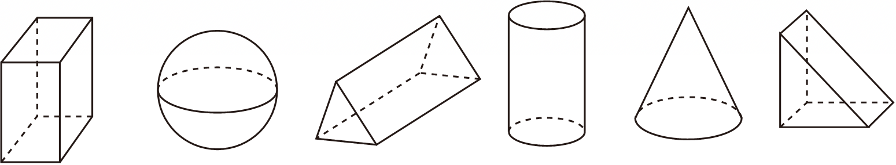

- A. 1个
- B. 2个
- C. 3个
- D. 4个

【答案】A

【解析】解：图中各几何体分别是：长方体、球、三棱柱、圆柱、圆锥、三棱柱；
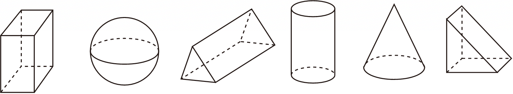
，
只有圆锥是锥体，
故选：A．

## 7. 单选题（难度：简单）

“力旺杯”足球赛在我校顺利进行，九年1班的足球队争得了冠军，如图所示为其获得的冠军奖杯，用数学的眼光观察这个奖杯，其中不包含的立体图形是（　　）

- A. 球体
- B. 圆柱体
- C. 长方体
- D. 四棱锥

【答案】B

【解析】解：如图所示为其获得的冠军奖杯，用数学的眼光观察这个奖杯，其中不包含的立体图形是圆柱体．
故选：B．

## 8. 单选题（难度：适中）

如图，在长方体ABCD﹣EFGH中，如果把面BCGF与面ABFE组成的图形看作直立于面ABCD上的合页型折纸，那么可以说明（　　）

【答案】A

## 9. 单选题（难度：适中）

如图，容量为600cm3的烧杯中倒入420cm3的水后，将5个同样的玻璃球逐个放入水中，发现水未满溢出，但当放入第6个时，发现水满溢出．则一个玻璃球的体积V的取值范围是（　　）

【答案】A

## 10. 单选题（难度：适中）

下列几何体中，属于棱锥的是（　　）

【答案】A

## 11. 单选题（难度：适中）

下面的立体图形按从左到右的顺序依次是（　　）
 

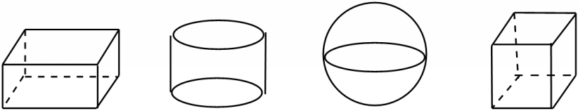

- A. 长方体、圆柱、圆锥、正方体
- B. 长方体、圆柱、球、正方体
- C. 棱柱、棱柱、球、正方体
- D. 长方体、棱柱、圆锥、棱柱

【答案】B

【解析】解：下面的立体图形按从左到右的顺序依次是：长方体、圆柱、球、正方体．
故选：B．

## 12. 单选题（难度：简单）

如图中的长方体是由三个部分拼接而成，每一部分都是由四个同样大小的小正方体组成，其中第三部分所对应的几何体应是（　　）

【答案】A

## 13. 单选题（难度：适中）

下列几何体中，含有曲面的是（　　）

【答案】A

## 14. 单选题（难度：适中）

下面各图中的阴影部分，（　　）是扇形．

- A. 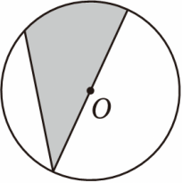
- B. 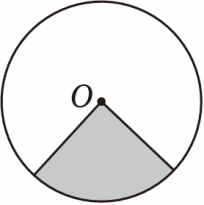
- C. 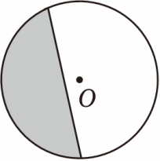
- D. 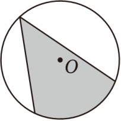

【答案】B

【解析】解：由扇形的定义知：B中的阴影部分是扇形．
故选B．

## 15. 单选题（难度：适中）

下列图形中，属于棱柱的是（　　）

【答案】A

## 16. 单选题（难度：适中）

下列几何体中哪个是圆锥（　　）

- A. 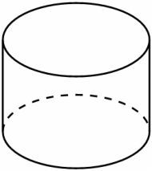
- B. 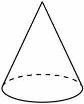
- C. 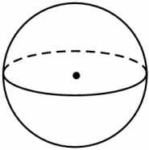
- D. 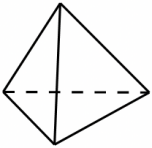

【答案】B

【解析】解：A、原图是圆柱，故此选项不合题意；
B、原图是圆锥，故此选项符合题意；
C、原图是球体，故此选项不合题意；
D、原图是三棱锥，故此选项不合题意；
故选：B．

## 17. 单选题（难度：适中）

如图，有一定厚度的墙面上有一个圆形的通风口，下列几何体不能堵住这个通风口的是（　　）

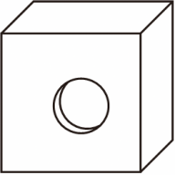

- A. 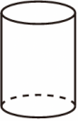
- B. 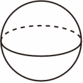
- C. 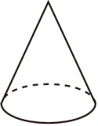
- D. 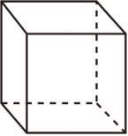

【答案】D

【解析】解：∵墙面上有一个圆形的通风口，
∴只有用具有圆形的几何体才能堵住这个通风口，
∵选项A中的几何体是圆柱体，因此能够堵住通风口，
故选项A不符合题意；
∵选项B中的几何体是球，因此能够堵住通风口，
故选项B不符合题意；
∵选项C中的几何体是圆锥，因此能够堵住通风口，
故选项C不符合题意；
∵选项D中的几何体是长方体，因此不能堵住通风口，
故选项D符合题意，
故选：D．

## 18. 单选题（难度：适中）

下列四个几何体中，是圆柱的为（　　）

【答案】A

## 19. 单选题（难度：适中）

围成下列立体图形的各个面中，只有平的面的是（　　）

【答案】A

## 20. 单选题（难度：适中）

如图几何体中，棱柱是（　　）

【答案】A
