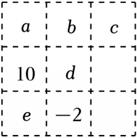
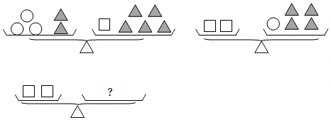
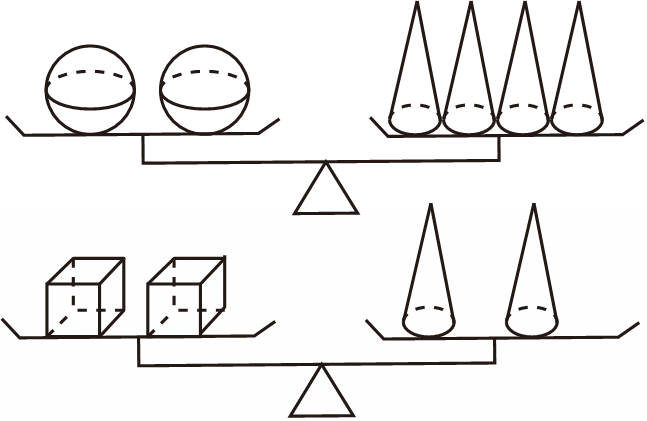

# 知识点·简单的三元一次方程组（同步练习）

> 教材：数学·七年级上册·沪科技版2024新教材 ｜ 来源：国家中小学智慧教育平台·在线练习 ｜ 共 49 题

## 1. 单选题（难度：简单）

某商店将巧克力包装成甲、乙两种礼盒出售．晓雨原先想购买2盒甲种礼盒和5盒乙种礼盒，但他身上的钱还差3元；如果改成购买5盒甲种礼盒和2盒乙种礼盒，他身上的钱会剩下3元．每盒乙种礼盒比甲种礼盒贵（　　）

- A. 1元
- B. 2元
- C. 3元
- D. 7元

【答案】B

【解析】解：设每盒甲种礼盒的价钱为x元，每盒乙种礼盒的价钱为y元，晓雨身上有z元钱，
根据题意得：\( \left\{\begin{array}{l}2x+5y-3=z\\ 5x+2y+3=z\end{array}\right.\)，
（①﹣②）÷3得：
[2x+5y﹣3﹣（5x+2y+3）]÷3＝（z﹣z）÷3，
（3y﹣3x﹣6）÷3＝0，
y﹣x﹣2＝0，
y﹣x＝2，
∴每盒乙种礼盒比甲种礼盒贵2元，
故选：B．

## 2. 单选题（难度：简单）

某校七年级有3个班，已知一班、二班的平均人数与三班人数之和为45，二班、三班的平均人数与一班人数之和为48，一班、三班的平均人数与二班人数之和为47，则三个班的总人数为（　　）

- A. 68
- B. 70
- C. 72
- D. 74

【答案】B

【解析】解：设一班为x人，二班有y人，三班由z人，
则：\( \left\{\begin{array}{l}\frac{1}{2}(x+y)+z=45\\ \frac{1}{2}(y+z)+x=48\\ \frac{1}{2}(x+z)+y=47\end{array}\right.\)，
方程组可化为：
\( \left\{\begin{array}{l}x+y+2z=90①\\ 2x+y+z=96②\\ x+2y+z=94③\end{array}\right.\)，
①+②+③得：4（x+y+z）＝280，
∴x+y+z＝70，
故选：B．

## 3. 单选题（难度：简单）

解三元一次方程组\( \left\{\begin{array}{l}x+y+z=3①\\ 3x+2y+z=10②\\ 2x-y+z=-1③\end{array}\right.\)，如果消掉未知数z，则应对方程组变形为（　　）

- A. ①+③，①×2﹣②
- B. ①+③，③×2+②
- C. ②﹣①，②﹣③
- D. ①﹣②，①×2﹣③

【答案】C

【解析】解：解三元一次方程组\( \left\{\begin{array}{l}x+y+z=3①\\ 3x+2y+z=10②\\ 2x-y+z=-1③\end{array}\right.\)，如果消掉未知数z，
则应对方程组变形为②﹣①，②﹣③．
故选：C．

## 4. 单选题（难度：适中）

有甲、乙、丙三种货物，若购甲3件、乙7件、丙1件，共需64元；若购甲4件、乙10件、丙1件，共需79元；现购甲、乙、丙各一件，共需（　　）元．

- A. 33
- B. 34
- C. 35
- D. 36

【答案】B

【解析】解：设购甲每件x元，购乙每件y元，购丙每件z元．
列方程组得：\( \left\{\begin{array}{l}3x+7y+z=64①\\ 4x+10y+z=79②\end{array}\right.\)，
①×3﹣②×2得：x+y+z＝34．
故选：B．

## 5. 单选题（难度：非常简单）

由方程组\( \left\{\begin{array}{l}x-2y+3z=0\\ 2x-3y+4z=0\end{array}\right.\)，可得x：y：z是（　　）

- A. 1：（﹣2）：1
- B. 1：（﹣2）：（﹣1）
- C. 1：2：1
- D. 1：2：（﹣1）

【答案】C

【解析】解：由题可知：\( \left\{\begin{array}{l}x-2y=-3z①\\ 2x-3y=-4z②\end{array}\right.\)
解得：\( \left\{\begin{array}{l}x=z\\ y=2z\end{array}\right.\)
∴x：y：z＝1：2：1，
故选：C．

## 6. 单选题

用现代高等代数的符号可以将方程组\( \left\{\begin{array}{l}x+y=5\\ 2x-y=4\end{array}\right.\)的系数排成一个表\( \left(\begin{array}{lll}1& 1& 5\\ 2& -1& 4\end{array}\right)\)，这种由数列排成的表叫做矩阵．矩阵\( \left(\begin{array}{llll}1& 1& t& 3\\ 2& -1& m& 2\end{array}\right)\)表示x，y，z三元一次方程组，若4x+y﹣z为定值，则t与m关系（　　）

- A. m﹣2t＝﹣1
- B. m+2t＝1
- C. 2m﹣t＝1
- D. 2t+m＝﹣1

【答案】D

【解析】解：由题意得：\( \left\{\begin{array}{l}x+y+tz=3①\\ 2x-y+mz=2②\end{array}\right.\)，
①×2+②得：4x+y+2tz+mz＝8，
∵4x+y﹣z为定值，
∴2t+m＝﹣1．
故选：D．

## 7. 单选题（难度：适中）

三元一次方程组\( \left\{\begin{array}{l}5x+4y+z=0\\ 3x+y-4z=11\\ x+y+z=-2\end{array}\right.\)消去未知数z后，得到的二元一次方程组是（　　）

- A. \( \left\{\begin{array}{c}4x+3y=2，\\ 7x+5y=3\end{array}\right.\)
- B. \( \left\{\begin{array}{c}4x+3y=2，\\ 23x+17y=10\end{array}\right.\)
- C. \( \left\{\begin{array}{c}3x+4y=2，\\ 7x+5y=3\end{array}\right.\)
- D. \( \left\{\begin{array}{c}3x+4y=2，\\ 23x+17y=11\end{array}\right.\)

【答案】A

【解析】解：\( \left\{\begin{array}{l}5x+4y+z=0①\\ 3x+y-4z=11②\\ x+y+z=-2③\end{array}\right.\)
①﹣③得，4x+3y＝2，
③×4+②得：7x+5y＝3，
∴三元一次方程组\( \left\{\begin{array}{l}5x+4y+z=0\\ 3x+y-4z=11\\ x+y+z=-2\end{array}\right.\)消去未知数z后，得到的二元一次方程组是\( \left\{\begin{array}{l}4x+3y=2\\ 7x+5y=3\end{array}\right.\)，
故选：A．

## 8. 单选题（难度：简单）

下列方程中，属于三元一次方程的是（　　）

- A. π+x+y＝6
- B. xy+y+z＝6
- C. x+2y+3z＝9
- D. 3x+2y﹣4z＝4x+2y﹣2z

【答案】C

【解析】解：A、只含有2个未知数，不是三元一次方程，不符合题意；
B、含未知数的项的最高次幂为2次，不是三元一次方程，不符合题意；
C、是三元一次方程，符合题意；
D、方程化简为：﹣x﹣2z＝0，只含有2个未知数，不是三元一次方程，不符合题意．
故选：C．

## 9. 单选题（难度：适中）

三元一次方程组\( \left\{\begin{array}{l}2a+b-3c=19\\ 4a+2b+c=3\\ a-b+c=0\end{array}\right.\)消去未知数c后，所得二元一次方程组是（　　）

- A. \( \left\{\begin{array}{l}5a-2b=19\\ a+b=1\end{array}\right.\)
- B. \( \left\{\begin{array}{l}2a+b=4\\ 3a+b=3\end{array}\right.\)
- C. \( \left\{\begin{array}{l}a+b=1\\ 3a-2b=19\end{array}\right.\)
- D. \( \left\{\begin{array}{l}3a+b=3\\ 5a-2b=19\end{array}\right.\)

【答案】A

【解析】解：\( \left\{\begin{array}{l}2a+b-3c=19①\\ 4a+2b+c=3②\\ a-b+c=0③\end{array}\right.\)，
②﹣③得：3a+3b＝3即a+b＝1，
③×3+①得：5a﹣2b＝19，
∴\( \left\{\begin{array}{l}5a-2b=19\\ a+b=1\end{array}\right.\)，
故选：A．

## 10. 单选题（难度：简单）

关于x，y的方程组\( \left\{\begin{array}{l}x+2y=3m\\ x-y=9m\end{array}\right.\)的解也是方程3x+2y＝17的解，则m的值为（　　）

- A. 3
- B. 1
- C. ﹣1
- D. 2

【答案】B

【解析】解：由题知，方程组\( \left\{\begin{array}{l}x+2y=3m\\ x-y=9m\end{array}\right.\)，x﹣y＝9m乘以2再与x+2y＝3m相加得，
3x＝21m，
∴x＝7m，
把x＝7m代入方程组求出y＝﹣2m，
∵x，y的方程组\( \left\{\begin{array}{l}x+2y=3m\\ x-y=9m\end{array}\right.\)的解也是方程3x+2y＝17的解，
∴把x＝7m，y＝﹣2m代入方程3x+2y＝17得，
3×7m+2×（﹣2m）＝17，
解得m＝1；
故选：B．

## 11. 单选题（难度：简单）

一个宾馆有二人间、三人间、四人间三种客房供游客租住，某旅行团25人准备同时租用这三种客房共9间，如果每个房间都住满，则租房方案共有（　　）

- A. 4种
- B. 3种
- C. 2种
- D. 1种

【答案】B

【解析】解：设宾馆有客房：二人间x间、三人间y间、四人间z间，根据题意得：
\( \left\{\begin{array}{l}2x+3y+4z=25\\ x+y+z=9\end{array}\right.\)，
解得：y+2z＝7，
y＝7﹣2z，
∵x，y，z都是小于9的正整数，
当z＝1时，y＝5，x＝3；
当z＝2时，y＝3，x＝4；
当z＝3时，y＝1，x＝5
当z＝4时，y＝﹣1（不符合题意，舍去）
∴租房方案有3种．
故选：B．

## 12. 单选题（难度：简单）

已知\( \left\{\begin{array}{l}x=1\\ y=2\\ z=3\end{array}\right.\)是方程组\( \left\{\begin{array}{l}ax+by=2\\ by+cz=3\\ cx+az=7\end{array}\right.\)的解，则a+b+c的值是（　　）

- A. 3
- B. 2
- C. 1
- D. 无法确定

【答案】A

【解析】解：由题意将\( \left\{\begin{array}{l}x=1\\ y=2\\ z=3\end{array}\right.\)代入方程组得：
\( \left\{\begin{array}{l}a+2b=2①\\ 2b+3c=3②\\ c+3a=7③\end{array}\right.\)，
①+②+③得：a+2b+2b+3c+c+3a＝2+3+7，
即4a+4b+4c＝4（a+b+c）＝12，
则a+b+c＝3．
故选：A．

## 13. 单选题（难度：适中）

对于有理数x、y定义一种运算“□”：x□y＝ax+by+c，其中a、b、c为常数，等式右边是通常的加法与乘法运算，已知3□5＝15，4□7＝28，则1□1的值为（　　）

- A. ﹣1
- B. ﹣11
- C. 1
- D. 11

【答案】B

【解析】解：∵3□5＝3a+5b+c＝15，4□7＝4a+7b+c＝28，
∴\( \left\{\begin{array}{l}3a+5b+c=15\\ 4a+7b+c=28\end{array}\right.\)，
解这个方程组，得
\( \left\{\begin{array}{l}a=13-2b\\ c=b-24\end{array}\right.\)，
所以1□1＝a+b+c＝13﹣2b+b+b﹣24＝﹣11．
故选：B．

## 14. 单选题（难度：非常简单）

若方程组\( \left\{\begin{array}{l}2x+3y=7\\ 5x-y=9\end{array}\right.\)的解也是3x﹣ay＝8的一个解，则a的值为（　　）

- A. 1
- B. ﹣2
- C. ﹣3
- D. 4

【答案】B

【解析】解：解出方程组\( \left\{\begin{array}{l}2x+3y=7\\ 5x-y=9\end{array}\right.\)，
得\( \left\{\begin{array}{l}x=2\\ y=1\end{array}\right.\)，
代入3x﹣ay＝8，得6﹣a＝8，
解得a＝﹣2．
故选：B．

## 15. 单选题

幻方是古老的数字问题，我国古代的《洛书》中记载了最早的幻方—九宫格．将9个数填入幻方的空格中，要求每一横行、每一竖列以及两条斜对角线上的3个数之和相等．如图为一个三阶幻方的一部分，则图中右上角空格中c的值为（　　）

- A. ﹣2
- B. 0
- C. 2
- D. 4

【答案】D

【解析】解：根据题意得：\( \left\{\begin{array}{l}e+10=b+c\\ c+e=b-2\end{array}\right.\)，
∴（e+10）﹣（c+e）＝（b+c）﹣（b﹣2），
∴c＝4；
故选：D．

## 16. 单选题（难度：简单）

如图，前两个天平已保持平衡，现要求在第三个天平的右边只放△，要使之保持平衡，则应放△的数量为（　　）

- A. 5个
- B. 6个
- C. 7个
- D. 8个

【答案】B

【解析】解：设球的质量是x，小正方形的质量是y，小三角形的质量是z，
由题意得，\( \left\{\begin{array}{l}3x+2y=z+5y\\ 2z=x+4y\end{array}\right.\)，
解得：z＝3y，
故可得要使保持平衡需要放6个小三角形．
故选：B．

## 17. 单选题（难度：适中）

如图，两个天平都平衡，则与1个“●”质量相等的“□”的个数为（　　）

- A. 4
- B. 3
- C. 2
- D. 1

【答案】C

【解析】解：设1个“●”，“△”，“□”的质量分别为x，y，z，
∴\( \left\{\begin{array}{l}2x=4y\\ 2z=2y\end{array}\right.\)，
∴\( \left\{\begin{array}{l}x=2y\\ z=y\end{array}\right.\)，
∴x＝2z，
即：与1个“●”质量相等的“□”的个数为2；
故选：C．

## 18. 单选题

若方程组\( \left\{\begin{array}{l}ax+(a-1)y=6\\ 4x+3y=14\end{array}\right.\)的解x、y的值相等，则a的值为（　　）

- A. ﹣4
- B. 4
- C. 2
- D. 1

【答案】C

【解析】解：由题意可得方程x＝y，将此方程代入原方程组的第二个方程得：4x+3x＝14，则x＝y＝2；
然后代入第一个方程得：2a+2（a﹣1）＝6；
解得：a＝2．
故选：C．

## 19. 单选题（难度：简单）

实数x，y，z满足2x+y+3z＝5，x+2y﹣z＝﹣4，则x、z之间具有哪个等量关系（　　）

- A. 3x+7z＝14
- B. 3x+5z＝14
- C. 3x+7z＝6
- D. 3x+5z＝6

【答案】A

【解析】解：\( \left\{\begin{array}{l}2x+y+3z=5①\\ x+2y-z=-4②\end{array}\right.\)，
①×2﹣②得，3x+7z＝14．
故选：A．

## 20. 单选题（难度：非常简单）

解方程组\( \left\{\begin{array}{l}3x+z=6\\ 4x-y+2z=11\\ 5x+2y-3z=4\end{array}\right.\)时，要使解法较为简便，应（　　）

- A. 先消去x
- B. 先消去y
- C. 先消去z
- D. 先消去常数

【答案】B

【解析】解：第二个，第三个方程消去y，把三元方程组转化为二元方程组，比较简单．
故选：B．

## 21. 单选题（难度：简单）

已知方程组\( \left\{\begin{array}{l}x+y=4\\ y+z=6\\ z+x=8\end{array}\right.\)，则x+y+z的值是（　　）

- A. 9
- B. 8
- C. 7
- D. 6

【答案】A

【解析】解：\( \left\{\begin{array}{l}x+y=4①\\ y+z=6②\\ z+x=8③\end{array}\right.\)，
①+②+③得：2x+2y+2z＝4+6+8，
解得：x+y+z＝9，
故选：A．

## 22. 单选题（难度：简单）

若二元一次方程组\( \left\{\begin{array}{l}2x+y=3\\ 3x-y=2\end{array}\right.\)的解同时也是方程2x﹣my＝﹣1的解，那么m的值为（　　）

- A. ﹣2
- B. ﹣1
- C. 3
- D. 4

【答案】C

【解析】解：两式相加得：5x＝5，
解得：x＝1，y＝1，
所以2x﹣my＝2﹣m＝﹣1，
m＝3，
故选：C．

## 23. 单选题（难度：简单）

下列是三元一次方程组的是（　　）

- A. \( \left\{\begin{array}{l}2x=5\\ {x}^{2}+y=7\\ x+y+z=6\end{array}\right.\)
- B. \( \left\{\begin{array}{l}\frac{3}{x}-y+z=-2\\ x-2y+z=9\\ y=-3\end{array}\right.\)
- C. \( \left\{\begin{array}{l}x+y-z=7\\ xyz=1\\ x-3y=4\end{array}\right.\)
- D. \( \left\{\begin{array}{l}x+y=2\\ y+z=1\\ x+z=9\end{array}\right.\)

【答案】D

【解析】解：对于A选项，第二个方程中未知数x的次数是2，
故A选项中方程组不是三元一次方程组；
对于B选项，第一个方程中分母含有未知数，
故B选项中方程组不是三元一次方程组；
对于C选项，第二个方程中每个未知数的次数都是1，但对于整个方程而言，次数是3，
故C选项中的方程组不是三元一次方程组；
对于D选项，方程组中含有三个未知数，且含未知数的项的次数都是一次，
故D选项中的方程组是三元一次方程组．
故选D．

## 24. 单选题（难度：适中）

三元一次方程x﹣y+z＝3有无数个解，下列四组值中，不是该方程的解的是（　　）

- A. \( \left\{\begin{array}{l}x=1\\ y=1\\ z=3\end{array}\right.\)
- B. \( \left\{\begin{array}{l}x=2\\ y=1\\ z=2\end{array}\right.\)
- C. \( \left\{\begin{array}{l}x=2\\ y=3\\ z=4\end{array}\right.\)
- D. \( \left\{\begin{array}{l}x=3\\ y=2\\ z=1\end{array}\right.\)

【答案】D

【解析】解：A、把x＝1，y＝1，z＝3代入方程，左边＝1﹣1+3＝右边，所以是方程的解；
B、把x＝2，y＝1，z＝2代入方程，左边＝2﹣1+2＝3＝右边，所以是方程的解；
C、把x＝2，y＝3，z＝4代入方程，左边＝2﹣3+4＝3＝右边，所以是方程的解；
D、把x＝3，y＝2，z＝1代入方程，左边＝3﹣2+1＝2≠右边，所以不是方程的解．
故选：D．

## 25. 单选题（难度：适中）

下列四组数值中，是方程组\( \left\{\begin{array}{l}x+2y+z=0\\ 2x-y-z=1\\ 3x-y-z=2\end{array}\right.\)的解的是（　　）

- A. \( \left\{\begin{array}{l}x=0\\ y=1\\ z=-2\end{array}\right.\)
- B. \( \left\{\begin{array}{l}x=0\\ y=0\\ z=1\end{array}\right.\)
- C. \( \left\{\begin{array}{l}x=0\\ y=-1\\ z=0\end{array}\right.\)
- D. \( \left\{\begin{array}{l}x=1\\ y=-2\\ z=3\end{array}\right.\)

【答案】D

【解析】解：\( \left\{\begin{array}{l}x+2y+z=0①\\ 2x-y-z=1②\\ 3x-y-z=2③\end{array}\right.\)，
①+②得：
3x+y＝1④，
①+③得：
4x+y＝2⑤，
⑤﹣④得：
x＝1，
把x＝1代入④中，
3+y＝1，
解得：y＝﹣2，
把x＝1，y＝﹣2代入①中，
1﹣4+z＝0，
解得：z＝3，
∴原方程组的解为：\( \left\{\begin{array}{l}x=1\\ y=-2\\ z=3\end{array}\right.\)，
故选：D．

## 26. 单选题（难度：非常简单）

某学校体育社团准备采购一批体育用品奖给学生，到了文具店发现广告上写着优惠活动如下：3根跳绳，5个乒乓球和一个羽毛球共16元；2根跳绳，3个乒乓球和一个羽毛球共12元；王老师马上想到：5根跳绳，9个乒乓球和一个羽毛球共需（　　）元．

- A. 28
- B. 24
- C. 20
- D. 18

【答案】B

【解析】解：设每根跳绳x元，每个乒乓球y元，每个羽毛球z元，
由题意可得：\( \left\{\begin{array}{l}3x+5y+z=16①\\ 2x+3y+z=12②\end{array}\right.\)，
①﹣②得：x+2y＝4，
∴4x+8y＝16，
②×2﹣①得：x+y+z＝8，
∴5x+9y+z＝（x+y+z）+4（x+2y）＝8+4×4＝24，
故选：B．

## 27. 单选题（难度：简单）

已知\( \left\{\begin{array}{l}x=1\\ y=2\\ z=3\end{array}\right.\)是三元一次方程组\( \left\{\begin{array}{l}ax+by=6\\ by+cz=4\\ cx+az=8\end{array}\right.\)的解，那么a+b+c的值为（　　）

- A. \( \frac{9}{2}\)
- B. 6
- C. 9
- D. 18

【答案】A

【解析】解：把\( \left\{\begin{array}{l}x=1\\ y=2\\ z=3\end{array}\right.\)代入方程组\( \left\{\begin{array}{l}ax+by=6\\ by+cz=4\\ cx+az=8\end{array}\right.\)中得：\( \left\{\begin{array}{l}a+2b=6①\\ 2b+3c=4②\\ c+3a=8③\end{array}\right.\)，
①+②+③得：4a+4b+4c＝6+4+8，
解得：a+b+c\( =\frac{9}{2}\)，
故选：A．

## 28. 单选题（难度：适中）

若2x+5y+4z＝0，4x+y+2z＝0，则x+y+z的值等于（　　）

- A. 0
- B. 1
- C. 2
- D. 不能求出

【答案】A

【解析】解：2x+5y+4z＝0     ①，
4x+y+2z＝0    ②，
①+②得到：6x+6y+6z＝0，
∴x+y+z＝0，
故选：A．

## 29. 单选题（难度：适中）

若方程组\( \left\{\begin{array}{l}3x+5y=6\\ 6x+15y=15\end{array}\right.\)的解也是方程3x+ky＝10的解，则k的值是（　　）

- A. 6
- B. 10
- C. 9
- D. \( \frac{35}{3}\)

【答案】D

【解析】解：由题意知，\( \left\{\begin{array}{l}3x+5y=6\cdots ①\\ 6x+15y=15\cdot \cdot ②\end{array}\right.\)，
将方程①×2﹣②得，
﹣5y＝﹣3，
∴y\( =\frac{3}{5}\)，
把y代入①得，
3x+3＝6，
∴x＝1，
把\( \left\{\begin{array}{l}x=1\\ y=\frac{3}{5}\end{array}\right.\)代入方程3x+ky＝10，得
3+k\( \times \frac{3}{5}=\)10，
∴k\( =\frac{35}{3}\)；
故选：D．

## 30. 单选题（难度：适中）

在等式y＝ax²+bx+c中，当x＝﹣1时，y＝0；当x＝3时，y＝0；当x＝0时，y＝﹣3．则这个等式为（　　）

- A. y＝x²﹣2x﹣3
- B. y＝x²+2x﹣3
- C. y＝﹣x²+2x﹣3
- D. y＝﹣x²﹣2x﹣3

【答案】A

【解析】解：∵x＝﹣1时y＝0；x＝3时y＝0；x＝0时y＝﹣3
从而得方程组\( \left\{\begin{array}{l}a-b+c=0\\ 9a+3b+c=0\\ c=-3\end{array}\right.\)，
解得a＝1，b＝﹣2，c＝﹣3．
∴y＝x²﹣2x﹣3，
故选：A．

## 31. 单选题（难度：适中）

已知方程组\( \left\{\begin{array}{l}x+y=-4\\ y+z=6\\ z+x=8\end{array}\right.\)，则x+y+z的值是（　　）

- A. 3
- B. 4
- C. 5
- D. 6

【答案】C

【解析】解：\( \left\{\begin{array}{ll}x+y=-4& ①\\ y+z=6& ②\\ z+x=8& ③\end{array}\right.\)，
①+②+③，得：2x+2y+2z＝﹣4+6+8＝10，
∴x+y+z＝5．
故选：C．

## 32. 单选题（难度：简单）

三元一次方程组\( \left\{\begin{array}{c}x+y=3\\ y+z=5\\ x+z=4\end{array}\right.\)的解为（　　）

- A. \( \left\{\begin{array}{c}x=1\\ y=3\\ z=2\end{array}\right.\)
- B. \( \left\{\begin{array}{c}x=2\\ y=1\\ z=3\end{array}\right.\)
- C. \( \left\{\begin{array}{c}x=3\\ y=2\\ z=1\end{array}\right.\)
- D. \( \left\{\begin{array}{c}x=1\\ y=2\\ z=3\end{array}\right.\)

【答案】D

【解析】解：\( \left\{\begin{array}{l}x+y=3①\\ y+z=5②\\ x+z=4③\end{array}\right.\)，
①﹣②得x﹣z＝﹣2④，
③+④得2x＝2，
解得x＝1，
把x＝1代入①得，1+y＝3，
解得y＝2，
把x＝1③得，1+z＝4，
解得z＝3，
方程组的解为\( \left\{\begin{array}{l}x=1\\ y=2\\ z=3\end{array}\right.\)．
故选：D．

## 33. 单选题（难度：简单）

对于实数x，y定义新运算：x⊗y＝ax+by+c，其中a，b，c均为常数，且已知3⊗5＝15，4⊗7＝28，则2⊗3的值为（　　）

- A. 2
- B. 4
- C. 6
- D. 8

【答案】A

【解析】解：∵3⊗5＝15，4⊗7＝28，
∴3a+5b+c＝15①，4a+7b+c＝28②，
②﹣①得：a+2b＝13，
①+②得：7a+12b+2c＝43，
则7（a+2b）﹣2（b﹣c）＝43，
整理得：b﹣c＝24，
∴2⊗3
＝2a+3b+c
＝2（a+2b）﹣（b﹣c）
＝2×13﹣24
＝26﹣24
＝2．
故选：A．

## 34. 单选题（难度：简单）

解三元一次方程组\( \left\{\begin{array}{l}3x-y+z=4①\\ 2x-y-z=12②\\ x+y+2z=6③\end{array}\right.\)，若先消去z，组成关于x、y的方程组，则应对方程组进行的变形是（　　）

- A. ①﹣②，②+③
- B. ①×2+③，②×2+③
- C. ①+②，②×2+③
- D. ①+③，②+③

【答案】C

【解析】解：\( \left\{\begin{array}{l}3x-y+z=4①\\ 2x-y-z=12②\\ x+y+2z=6③\end{array}\right.\)，
①+②得：5x﹣2y＝16，
②×2得：4x﹣2y﹣2z＝24④，
③+④得：5x﹣y＝30，
即\( \left\{\begin{array}{l}5x-2y=16\\ 5x-y=30\end{array}\right.\)，
故选：C．

## 35. 单选题（难度：简单）

设\( \frac{x}{2}=\frac{y}{3}=\frac{z}{4}\)，则\( \frac{x-2y+3z}{x+y+z}\)的值为（　　）

- A. \( \frac{2}{7}\)
- B. \( \frac{2}{3}\)
- C. \( \frac{8}{9}\)
- D. \( \frac{5}{7}\)

【答案】C

【解析】解：设\( \frac{x}{2}=\frac{y}{3}=\frac{z}{4}=\)k，得到x＝2k，y＝3k，z＝4k，
则原式\( =\frac{2k-6k+12k}{2k+3k+4k}=\frac{8}{9}\)．
故选：C．

## 36. 单选题（难度：适中）

方程组\( \left\{\begin{array}{l}x+y-z=8\\ y+z=1\\ x-z=-2\end{array}\right.\)的解是（　　）

- A. \( \left\{\begin{array}{l}x=7\\ y=-8\\ z=9\end{array}\right.\)
- B. \( \left\{\begin{array}{l}x=5\\ y=1\\ z=2\end{array}\right.\)
- C. \( \left\{\begin{array}{l}x=2\\ y=3\\ z=3\end{array}\right.\)
- D. \( \left\{\begin{array}{l}x=-11\\ y=10\\ z=-9\end{array}\right.\)

【答案】D

【解析】解：\( \left\{\begin{array}{l}x+y-z=8①\\ y+z=1②\\ x-z=-2③\end{array}\right.\)，
②+③得：x+y＝﹣1④，
把④代入①得﹣1﹣z＝8，
解得：z＝﹣9，
把z＝﹣9代入②得：y＝10，
把z＝﹣9代入③得：x＝﹣11，
则方程组的解为\( \left\{\begin{array}{l}x=-11\\ y=10\\ z=-9\end{array}\right.\)．
故选：D．

## 37. 单选题（难度：适中）

若a、c、d是整数，b是正整数，且满足a+b＝c，b+c＝d，c+d＝a，那么a+b+c+d的最大值是（　　）

- A. ﹣1
- B. ﹣5
- C. 0
- D. 1

【答案】B

【解析】解：∵a+b＝c，
∴a＝c﹣b，
又∵b+c＝d，c+d＝a，a＝c﹣b，
∴c＝﹣2b，a＝﹣3b，d＝﹣b，
∴a+b+c+d＝﹣5b，
∵b是正整数，其最小值为1，
∴a+b+c+d＝﹣5b的最大值是﹣5．
故选：B．

## 38. 单选题（难度：简单）

甲、乙、丙三种商品，若购买甲3件、乙2件、丙1件，共需130元钱，购甲1件、乙2件、丙3件共需210元钱，那么购甲、乙、丙三种商品各一件共需（　　）

- A. 105元
- B. 95元
- C. 85 元
- D. 88元

【答案】C

【解析】解：设购甲、乙、丙三种商品各一件，分别需要x元、y元、z元，
根据题意有：\( \left\{\begin{array}{l}3x+2y+z=130\\ x+2y+3z=210\end{array}\right.\)，
把这两个方程相加得：4x+4y+4z＝340，
4（x+y+z）＝340，
x+y+z＝85．
即购甲、乙、丙三种商品各一件共需85元钱．
故选：C．

## 39. 单选题（难度：适中）

有理数x、y、z满足\( \left\{\begin{array}{l}x-y+2z=1\\ x+y+4z=3\end{array}\right.\)，则x+2y+5z的值是（　　）

- A. ﹣4
- B. 3
- C. 4
- D. 值不能确定

【答案】C

【解析】解：\( \left\{\begin{array}{l}x-y+2z=1①\\ x+y+4z=3②\end{array}\right.\)，
①+②得：
2x+6z＝4，
x+3z＝2③，
②﹣①得：
2y+2z＝2④，
③+④得：
x+2y+5z＝4，
故选：C．

## 40. 单选题（难度：非常简单）

方程组\( \left\{\begin{array}{l}2x+y=3\\ 3x-z=7\\ x-y+3z=0\end{array}\right.\)的解为（　　）

- A. \( \left\{\begin{array}{l}x=2\\ y=1\\ z=-1\end{array}\right.\)
- B. \( \left\{\begin{array}{l}x=2\\ y=-1\\ z=1\end{array}\right.\)
- C. \( \left\{\begin{array}{l}x=2\\ y=-1\\ z=-1\end{array}\right.\)
- D. \( \left\{\begin{array}{l}x=2\\ y=1\\ z=1\end{array}\right.\)

【答案】C

【解析】解：\( \left\{\begin{array}{ll}2x+y=3& ①\\ 3x-z=7& ②\\ x-y+3z=0& ③\end{array}\right.\)
②×3+③得到：10x﹣y＝21   ④
由①④解得\( \left\{\begin{array}{l}x=2\\ y=-1\end{array}\right.\)代入②得z＝﹣1，
∴\( \left\{\begin{array}{l}x=2\\ y=-1\\ z=-1\end{array}\right.\)，
故选：C．

## 41. 单选题（难度：简单）

三元一次方程组\( \left\{\begin{array}{l}x+y=2\\ y+z=5\\ z+x=3\end{array}\right.\)的解是（　　）

- A. \( \left\{\begin{array}{l}x=1\\ y=2\\ z=3\end{array}\right.\)
- B. \( \left\{\begin{array}{l}x=0\\ y=2\\ z=4\end{array}\right.\)
- C. \( \left\{\begin{array}{l}x=0\\ y=2\\ z=3\end{array}\right.\)
- D. \( \left\{\begin{array}{l}x=-1\\ y=3\\ z=2\end{array}\right.\)

【答案】C

【解析】解：\( \left\{\begin{array}{l}x+y=2①\\ y+z=5②\\ z+x=3③\end{array}\right.\)，
①+②+③得：2x+2y+2z＝10，即x+y+z＝5④，
④﹣①得：z＝3，
④﹣②得：x＝0，
④﹣③得；y＝2．
则原方程组的解为：\( \left\{\begin{array}{l}x=0\\ y=2\\ z=3\end{array}\right.\)．
故选：C．

## 42. 单选题（难度：简单）

有甲，乙，丙三种商品，如果购甲3件，乙2件，丙1件共需315元钱，购甲1件，乙2件，丙3件共需285元钱，那么购甲，乙，丙三种商品各一件共需（　　）

- A. 50
- B. 100
- C. 150
- D. 200

【答案】C

【解析】解：设购甲，乙，丙三种商品各一件需要x元、y元、z元．
根据题意，得
\( \left\{\begin{array}{l}3x+2y+z=315\\ x+2y+3z=285\end{array}\right.\)，
两方程相加，得
4x+4y+4z＝600，
x+y+z＝150．
则购甲，乙，丙三种商品各一件共需150元．
故选：C．

## 43. 单选题（难度：简单）

已知实数x，y，z满足\( \left\{\begin{array}{l}x+y+z=7\\ 4x+y-2z=2\end{array}\right.\)，则代数式3（x﹣z）+1的值是（　　）

- A. ﹣2
- B. ﹣4
- C. ﹣5
- D. ﹣6

【答案】B

【解析】解：方程组\( \left\{\begin{array}{ll}x+y+z=7& ①\\ 4x+y-2z=2& ②\end{array}\right.\)，
②﹣①得：3x﹣3z＝﹣5，
整理得：3（x﹣z）＝﹣5，
把3（x﹣z）＝﹣5代入代数式3（x﹣z）+1得：
﹣5+1＝﹣4，
即代数式3（x﹣z）+1的值是﹣4，
故选：B．

## 44. 单选题（难度：简单）

已知方程4x+3y﹣6z＝0与方程x+3y﹣3z＝0有相同的解．那么x：y：z为（　　）

- A. 3：2：3
- B. 1：2：3
- C. 2：3：2
- D. 3：2：1

【答案】A

【解析】解：∵方程4x+3y﹣6z＝0①与方程x+3y﹣3z＝0②有相同的解，
∴①﹣②得：3x﹣3z＝0，即x＝z，
①﹣②×2得：2x﹣3y＝0，即\( y=\frac{2}{3}x\)，
∴\( x：y：z=x：\frac{2}{3}x：x=\)3：2：3，故A正确．
故选：A．

## 45. 单选题（难度：简单）

某校开学典礼需要购买一、二、三等奖奖品若干，若购买三等奖奖品3件，二等奖奖品5件，一等奖奖品1件，共需62元，若购三等奖奖品4件，二等奖奖品7件，一等奖奖品1件共需77元．现在购买三等奖、二等奖、一等奖奖品各一件，共需（　　）元

- A. 31
- B. 32
- C. 33
- D. 34

【答案】B

【解析】解：设三等奖奖品的单价是x元，二等奖奖品的单价是y元，一等奖奖品的单价是z元，
根据题意得：\( \left\{\begin{array}{l}3x+5y+z=62①\\ 4x+7y+z=77②\end{array}\right.\)，
①×3﹣②×2得：x+y+z＝32，
∴购买三等奖、二等奖、一等奖奖品各一件，共需32元．
故选：B．

## 46. 单选题（难度：简单）

三元一次方程组\( \left\{\begin{array}{l}3x-2y=5\\ x+y+z=2\\ z=2\end{array}\right.\)的解是（　　）

- A. \( \left\{\begin{array}{l}x=1\\ y=1\\ z=2\end{array}\right.\)
- B. \( \left\{\begin{array}{l}x=1\\ y=-1\\ z=2\end{array}\right.\)
- C. \( \left\{\begin{array}{l}x=-1\\ y=1\\ z=2\end{array}\right.\)
- D. \( \left\{\begin{array}{l}x=-1\\ y=-1\\ z=2\end{array}\right.\)

【答案】B

【解析】解：\( \left\{\begin{array}{l}3x-2y=5①\\ x+y+z=2②\\ z=2\end{array}\right.\)，
把z＝2代入②得：x+y＝0③，
①+③×2得：5x＝5，即x＝1，
把x＝1代入③得：y＝﹣1，
则方程组的解为\( \left\{\begin{array}{l}x=1\\ y=-1\\ z=2\end{array}\right.\)，
故选：B．

## 47. 单选题（难度：简单）

若\( \left\{\begin{array}{l}x=3y\\ y+4z=0\end{array}\right.\)（y≠0），则\( \frac{x}{z}=\)（　　）

- A. \( \frac{6}{5}\)
- B. \( -\frac{1}{12}\)
- C. ﹣12
- D. \( \frac{1}{12}\)

【答案】C

【解析】解：①可变形为y\( =\frac{x}{3}\cdots \)③，
把③代入②得，\( \frac{x}{3}+\)4z＝0，
去分母、移项得，x＝﹣12z，
两边同除以12得\( \frac{x}{z}=-\)12．
故选：C．

## 48. 单选题（难度：简单）

三个二元一次方程3x﹣y＝7，2x+3y＝1，y＝kx﹣9有公共解，则k的值是（　　）

- A. 3
- B. \( -\frac{16}{3}\)
- C. ﹣2
- D. 4

【答案】D

【解析】解：\( \left\{\begin{array}{l}3x-y=7①\\ 2x+3y=1②\end{array}\right.\)，
把①式两边乘3，得9x﹣3y＝21③，
②+①得11x＝22，得x＝2，
把x＝2代入①得6﹣y＝7，
解得y＝﹣1，
将\( \left\{\begin{array}{l}x=2\\ y=-1\end{array}\right.\)代入y＝kx﹣9得2k﹣9＝﹣1，
解得k＝4．
故选：D．

## 49. 单选题（难度：简单）

现有1元，5元，10元纸币各10张混在一起，从中任意抽取21张纸币合计100元，则抽取的纸币中10元纸币有（　　）张

- A. 7
- B. 6
- C. 5
- D. 3

【答案】A

【解析】解：设1元、5元、10元的纸币分别为x张、y张、z张，根据题意得：
\( \left\{\begin{array}{l}x+y+z=21①\\ x+5y+10z=100②\end{array}\right.\)，
由①得：x＝21﹣y﹣z，
把x＝21﹣y﹣z代入②得：
21﹣y﹣z+5y+10z＝100，
得：9z+4y＝79，
∵x、y、z都是正整数，
∴把z＝7、6、5、3分别代入等式，
只有当z＝7时，x、y是正整数，
∴选项A符合题意．
故选：A．
声明：试题解析著作权属菁优网所有，未经书面同意，不得复制发布日期：2025/3/17 23:45:41；用户：白玉红；邮箱：18813710158；学号：21640616
