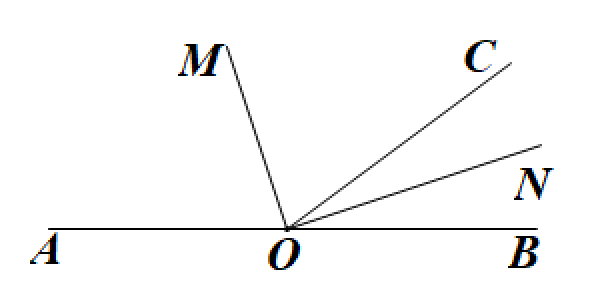
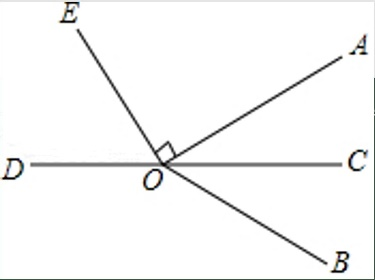
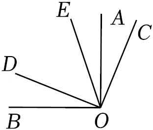
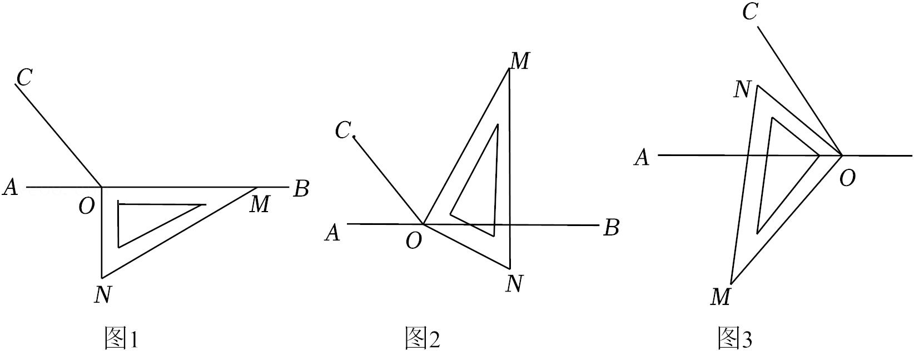

# 知识点·角平分线的定义
余角和补角的定义（同步练习）

> 教材：数学·七年级上册·沪科技版2024新教材 ｜ 来源：国家中小学智慧教育平台·在线练习 ｜ 共 4 题

## 1. 单选题（难度：适中）

如图，点\(O\)在直线\(AB\)上，\(OM\)平分\(\angle AOC\)，\(ON\)平分\(\angle BOC\)。则\(\angle MOC\)和\(\angle CON\)的数量关系是（    ）。

- A. \(\angle MOC\)与\(\angle CON\)互补
- B. \(\angle MOC\)与\(\angle CON\)互余
- C. \(\angle MOC = 2\angle CON\)
- D. 无关系

【答案】B

【解析】​

## 2. （难度：适中）

如图，点\(O\)在直线\(CD\)上，\(OC\)平分\(\angle AOB\)，\(\angle AOE = 90^\circ \)，若\(\angle BOD = 148^\circ \)，求\(\angle DOE\)的度数。

【答案】

$58^\circ $

【解析】​

## 3. 

如图，\(\angle AOB = \angle COD = 90^\circ \)，\(OA\)平分\(\angle COE\)，\(\angle BOD = n^\circ (0 < n < 45)\)。
​

求\(\angle DOE\)的度数（用含\(n\)的代数式表示）；

用等式表示\(\angle AOD\)与\(\angle BOC\)的数量关系。​

【答案】

$\angle DOE = (90 - 2n)^\circ $

，

$\angle AOD + \angle BOC = 180^\circ $

【解析】解析视频请查看最后一题。

​

## 4. 

如图，点\(O\)为直线\(AB\)上一点，过点\(O\)作射线\(OC\)，使\(\angle BOC = 110^\circ \)。将一直角三角板的直角顶点放在点\(O\)处\((\angle OMN = 30^\circ )\)，一边\(OM\)在射线\(OB\)上，另一边\(ON\)在直线\(AB\)的下方。
​

将图1中的三角板绕点\(O\)逆时针旋转至图2，使一边\(OM\)在\(\angle BOC\)的内部，且恰好平分\(\angle BOC\)，则\(\angle BON = \)\(^\circ \)；

将图1中的三角板绕点\(O\)以每秒\(10^\circ \)的速度沿逆时针方向旋转一周，在旋转的过程中，第\(t\)秒时，射线\(ON\)恰好平分锐角\(\angle AOC\)，则\(t\)的值为多少？

【答案】$35^\circ $，

$t = 23.5$

【解析】解析视频请查看最后一题。

​
