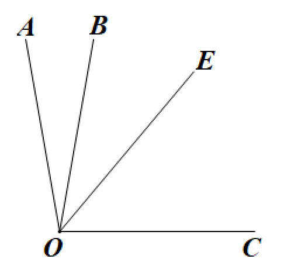
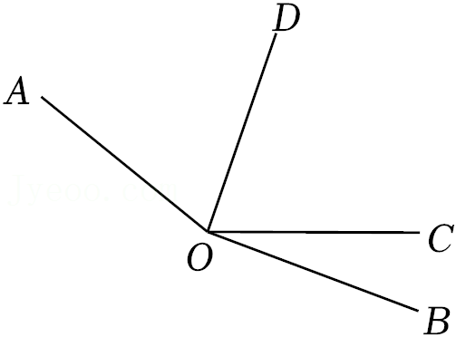
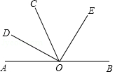

# 知识点·角的和差关系
角平分线的定义（同步练习）

> 教材：数学·七年级上册·沪科技版2024新教材 ｜ 来源：国家中小学智慧教育平台·在线练习 ｜ 共 5 题

## 1. 单选题（难度：简单）

如图，\(\angle AOB = 20^\circ \)，\(\angle BOC = 80^\circ \)，\(OE\)是\(\angle AOC\)的角平分线，则\(\angle COE\)的度数为（      ）。

- A. 50°
- B. 40°
- C. 30°
- D. 20°

【答案】A

【解析】​

## 2. 单选题（难度：简单）

如图，\(\angle AOB = 160^\circ \)，\(\angle BOC = 20^\circ \)。若\(OD\)平分\(\angle AOC\)，则\(\angle AOD\)的大小为（      ）。

- A. \(20^\circ \)
- B. \(70^\circ \)
- C. \(80^\circ \)
- D. \(140^\circ \)

【答案】B

【解析】​

## 3. （难度：适中）

如图，\(O\)为直线\(AB\)上一点，\(\angle DOE = 90^\circ \)，\(OD\)是\(\angle AOC\)的角平分线，求证：\(OE\)平分\(\angle BOC\)。

【答案】

解：∵$OD$是$\angle AOC$的角平分线

∴$\angle COD = \frac{1}{2}\angle AOC$

∵$\angle AOD + \angle BOD = 180^\circ $

$\angle BOD = 180^\circ - \angle AOD$

∵$\angle DOE = 90^\circ $

∴$\angle EOC = \angle EOD - \angle COD = 90^\circ - \frac{1}{2}\angle AOC$

∴$\angle EOC = \frac{1}{2}\angle BOC$

∴$OE$平分$\angle BOC$

【解析】​

## 4. 

如图，\(OB\)是\(\angle AOC\)的角平分线，\(OD\)是\(\angle COE\)的角平分线．
​

若\(\angle AOC = {70^ \circ }\)，\(\angle COE = {50^ \circ }\)，求\(\angle BOD\)的度数；

若\(\angle AOE = \alpha \)，求\(\angle BOD\)的度数（用含\(\alpha \)的代数式表示）；​

【答案】

$60^\circ $

，

$\frac{1}{2}\alpha $

【解析】解析视频请查看最后一题。

​

## 5. 

已知\(\angle AOB = 50^\circ \)，\(\angle BOC = 30^\circ \)，\(OD\)平分\(\angle AOC\)。

请你画出示意图；

求\(\angle AOD\)的度数。

【答案】

   

，

$\angle AOD = 40^\circ $或$10^\circ $

【解析】解析视频请查看最后一题。

​
