# 零散题目汇编（每知识点 ≤2 题）

> 教材：数学·七年级上册·沪科技版2024新教材 ｜ 由 48 个小知识点文件合并，便于检索。

## 知识点·两点之间，线段最短

## 1. 单选题（难度：简单）

小华认为从\(A\)点到\(B\)点的三条路线中，②是路程最短的，他做这个判断所依据的是\((\)　　\()\)。

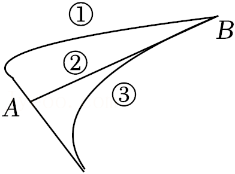

- A. 线动成面
- B. 两点之间，线段最短
- C. 两点确定一条直线
- D. 连接两点之间的线段的长度叫做两点间的距离

【答案】B

【解析】​

## 2. 单选题（难度：简单）

把弯曲的河道改直，就能缩短河道长度，可以解释这一做法的数学原理是\((\)　　\()\)。

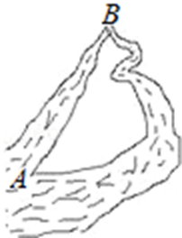

- A. 直线比曲线短
- B. 两点确定一条直线
- C. 两点之间，线段最短
- D. 两点之间，直线最短

【答案】C

【解析】​

## 知识点·两点之间，线段最短，立体图形的平面展开图

## 1. （难度：适中）

如图，一只蚂蚁要从正方体的一个顶点\(A\)沿表面爬行到顶点\(B\)，怎样爬行路线最短？如果要爬行到顶点\(C\)呢？ 

​​

​

【答案】

解：如图所示，

    

如图所示，连接$AB$，线段$AB$的即为点$A$到点$B$的最短爬行路线；

如图所示，线段$AC$即为$A$、$C$两点的最短爬行路线。

【解析】​

## 知识点·从不同方向看圆柱得到的平面图形

## 1. （难度：适中）

分别从正面、左面、上面观察圆柱，各能得到什么平面图形？

【答案】

    

【解析】​

## 知识点·从不同方向看基本几何体的简单组合体得到的平面图形

## 1. 单选题（难度：简单）

如图是由5个相同的小正方体组成的立体图形，从左面看到的几何体的形状图是\((\)　　\()\)。

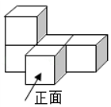

- A. 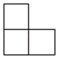
- B. 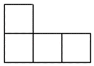
- C. 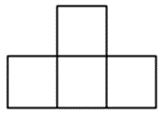
- D. 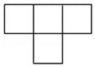

【答案】A

【解析】​

## 知识点·从实物抽象立体图形

## 1. 单选题（难度：简单）

观察下列实物模型，其形状是球的是\((\)　　\()\)。

- A. 
- B. 
- C. 
- D. 

【答案】A

【解析】​

## 知识点·余角和补角的定义

## 1. 单选题（难度：简单）

如图，点\(O\)在直线\(AB\)上，\(\angle COB = \angle EOD = 90^\circ \)，那么下列说法错误的是（    ）。

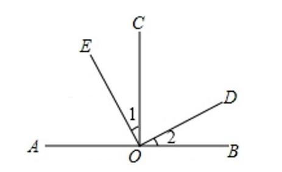

- A. \(\angle AOE\)与\(\angle COD\)互余
- B. \(\angle AOE\)与\(\angle 2\)互余
- C. \(\angle AOD\)与\(\angle 1\)互补
- D. \(\angle 1\)与\(\angle 2\)相等

【答案】A

【解析】​

## 知识点·余角的性质

## 1. 单选题（难度：适中）

如图所示，将一副直角三角板的顶点重合后放置，则\(\angle 1\)与\(\angle 2\)的大小关系是（    ）。

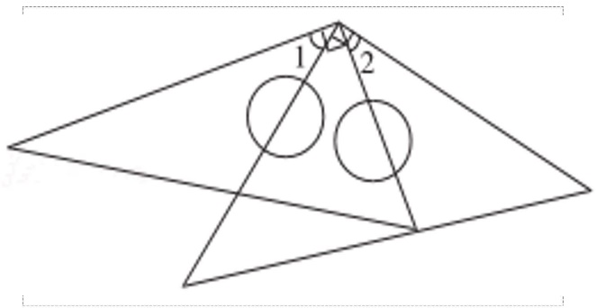

- A. \(\angle 1 > \angle 2\)
- B. \(\angle 1 = \angle 2\)
- C. \(\angle 1 < \angle 2\)
- D. 不能确定

【答案】B

【解析】​

## 知识点·作图，两点之间，线段最短

## 1. （难度：适中）

如图所示，工厂\(A\)与工厂\(B\)想在公路\(m\)旁修建一座共用的仓库\(O\)，并且要求\(O\)到\(A\)与\(O\)到\(B\)的距离之和最短，请你在\(m\)上确定仓库应修建的\(O\)点位置，同时说明你选择该点的理由。

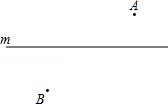

【答案】

解：如图，连接$AB$交直线$m$于点$O$，

则$O$点即为所求的点．

理由如下：根据连接两点的所有线中，线段最短，

$\therefore OA + OB$最短。

    

【解析】​

## 知识点·列式计算

## 1. 单选题（难度：适中）

白兔的只数200只，灰兔有多少只？符合列式\(200 \times (1 + \frac{1}{{10}})\)的条件是\((\)　　\()\)

- A. 灰兔的只数是白兔的只数\(\frac{1}{{10}}\)
- B. 白兔的只数是灰兔的只数\(\frac{1}{{10}}\)
- C. 白兔的只数比灰兔的只数多\(\frac{1}{{10}}\)
- D. 灰兔的只数比白兔的只数多\(\frac{1}{{10}}\)

【答案】D

【解析】​

## 知识点·基本几何体的表面展开图

## 1. 单选题（难度：简单）

围成下列立体图形的各个面中，每个面都是平面的是\((\)　　\()\)。

- A. 
圆柱体
- B. 
圆锥体
- C. 
长方体
- D. 
球体

【答案】C

【解析】​

## 知识点·度分秒的乘法运算

## 1. （难度：简单）

计算：\(27^\circ 38'11'' \times 5\)．

【答案】

$138^\circ 10'55''$

【解析】​

## 知识点·度分秒的减法运算

## 1. （难度：适中）

计算：\(27^\circ 38' - 18^\circ 51'\)．

【答案】

${8}^{\circ }47'$

【解析】​

## 知识点·度分秒的加法运算

## 1. （难度：简单）

计算：\(2{3}^{\circ }16'28''+2{4}^{\circ }46'37''\)。

【答案】

$4{8}^{\circ }3'5''$

【解析】​

## 知识点·度分秒的除法运算

## 1. 

计算：\(107^\circ 45' \div 5\).

【答案】

$21^\circ 33'$

【解析】​

## 知识点·整式的乘法

## 1. （难度：简单）

卫星绕地球运动的速度（即第一宇宙速度）约是\( 7.9\times 1{0}^{3}\)米/秒，求卫星绕地球1小时所经过的路程约是多少？卫星脱离地球进入太阳系的速度是\( 1.12\times 1{0}^{4}\)米/秒，求卫星进入太阳系后经过1小时卫星行走了多少米？（结果用科学记数法表示）

【答案】

$ 2.844\times 1{0}^{7}$米，$ 4.032\times 1{0}^{7}$米

【解析】​

## 知识点·整式的加减-化简求值

## 1. 单选题（难度：简单）

如果\(a\)和\(1 - 4b\)互为相反数，那么多项式\(2(b - 2a + 10) + 7(a - 2b - 3)\)的值是\((\)　　\()\)。

- A. \( - 4\)
- B. \( - 2\)
- C. 2
- D. 4

【答案】A

【解析】​

## 知识点·整式的加减

## 1. （难度：简单）

已知\(A = 3x - 2y - 3\)，\(B = - 4x + 3y + 2\)

求\(3A + 2B\)；

将英文26个字母按以下顺序排列：\(a\)、\(b\)、\(c\)、\(d\)、\(e\)、\(f\)、\(g\)、\(h\)、\(i\)、\(j\)、\(k\)、\(l\)、\(m\)、\(n\)、\(o\)、\(p\)、\(q\)、\(r\)、\(s\)、\(t\)、\(u\)、\(v\)、\(w\)、\(x\)、\(y\)、\(z\)。规定\(a\)接在\(z\)后面，使26个字母排成圈，设计一个密码：若\(x\)代表其中一个字母，则\(x - 3\)代表“把一个字母换成字母表中从它向前3位的字母”。如\(x\)表示字母\(m\)时，则\(x - 3\)表示字母\(j\)。若（1）中求得的式子恰好是一个密码，请直接解读下列密文“\(Nqtajrfymx\)”的意思，并翻译成中文为。

【答案】

$ x-5$ 

，我爱数学

【解析】解析视频请查看最后一题。

​

## 知识点·新定义、有理数的运算

## 1. 

观察等式\(2 - \frac{1}{3} = 2 \times \frac{1}{3} + 1\)，\(5 - \frac{2}{3} = 5 \times \frac{2}{3} + 1\)，给出如下定义：我们称使等式\(a - b = a \cdot b + 1\)成立的一对有理数\(a\)，\(b\)为“共生有理数对”，记为\((a,b)\)，如：数对\((2,\frac{1}{3})\)，\((5,\frac{2}{3})\)都是“共生有理数对”．

数对\(( - 2,1)\)，\((3, - \frac{1}{2})\)中是“共生有理数对”的是．

若\((a,3)\)是“共生有理数对”，求\(a\)的值.

【答案】无；，

由题意得：

$a - 3 = 3a + 1$

解得$a =  - 2$．

【解析】解析视频请查看最后一题。

\( - 2 - 1 = - 3\)，\( - 2 \times 1 + 1 = - 1\)
\(\therefore - 2 - 1 \ne - 2 \times 1 + 1\)
\(\therefore ( - 2,1)\)不是“共生有理数对”
\(\because 3 - ( - \frac{1}{2}) = \frac{7}{2}\)，\(3 \times ( - \frac{1}{2}) + 1 = - \frac{1}{2}\)
\(\therefore 3 - ( - \frac{1}{2}) \ne 3 \times ( - \frac{1}{2}) + 1\)
\(\therefore (3, - \frac{1}{2})\)不是“共生有理数对”

​

## 2. 填空题

我们把\(\left| {\begin{array}{*{20}{l}} a&c \\ b&d \end{array}} \right|\)称为二阶行列式，且\(\left| {\begin{array}{*{20}{l}} a&c \\ b&d \end{array}} \right| = ad - bc\)
如：\(\left| {\begin{array}{*{20}{l}} 1&2 \\ 3&{ - 4} \end{array}} \right| = 1 \times ( - 4) - 3 \times 2 = - 10\)．
（1）计算：\(\left| {\begin{array}{*{20}{l}} 2&6 \\ { - 3}&5 \end{array}} \right| = \)；
（2）若\(\left| {\begin{array}{*{20}{l}} { - 4}&7 \\ 2&m \end{array}} \right| = 6\)，则\(m\)的值为．

【答案】28，$ - 5$．

【解析】​

解：（1）\(\left| {\begin{array}{*{20}{l}}
 2&6 \\ 
 { - 3}&5 
\end{array}} \right|\)
\( = 2 \times 5 - ( - 3) \times 6\)
\( = 10 - ( - 18)\)
\( = 28\)
（2）\(\because \)\(\left| {\begin{array}{*{20}{l}}
 { - 4}&7 \\ 
 2&m 
\end{array}} \right| = 6\)
\(\therefore - 4m - 2 \times 7 = 6\)
\(\therefore - 4m - 14 = 6\)
\(\therefore m = - 5\)．

## 知识点·方向角_余角的性质

余角的性质（同步练习）

## 1. 单选题（难度：简单）

如图所示，若\(\angle AOB = 90^\circ \)，射线\(OA\)与东西方向的夹角为\(35^\circ \)，则点\(B\)相对于点\(O\)的方向为（    ）。

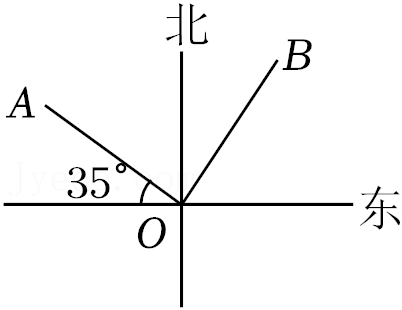

- A. 北偏东\(35^\circ \)
- B. 东偏北\(35^\circ \)
- C. 北偏东\(55^\circ \)
- D. 北偏西\(55^\circ \)

【答案】A

【解析】​

## 知识点·方程的恒等变形

## 1. 单选题（难度：简单）

把\(x\)的系数化为1，正确的是（    ）

- A. \(\frac{1}{5}x = 3\)得\(x = \frac{3}{5}\)
- B. \(3x = 1\)得\(x = 3\)
- C. \(0.2x = 3\)得\(x = \frac{3}{2}\)
- D. \(\frac{4}{3}x = 4\)得\(x = 3\)

【答案】D

【解析】​

## 2. 单选题（难度：适中）

下列方程变形中，正确的是（    ）

- A. 方程\(\frac{{x - 1}}{2} = \frac{x}{5}\)去分母，得\(5(x - 1) = 2x\)
- B. 方程\(3 - x = 2 - 5(x - 1)\)去括号，得\(3 - x = 2 - 5x - 1\)
- C. 方程\(3x - 2 = 2x + 1\)移项，得\(3x - 2x = - 1 + 2\)
- D. 方程\(\frac{2}{3}t = \frac{3}{2}\)系数化为1，得\(t = 1\)

【答案】A

【解析】​

## 知识点·方程的恒等变形及其依据

## 1. 填空题（难度：适中）

如图的框图表示解方程\(3x + 20 = 4x - 25\)的流程，第3步变形叫做，变形的依据是．

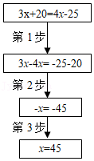

【答案】系数化1，等式的基本性质2  等式两边乘同一个数，或除以同一个不为0的数，等式仍然成立

【解析】​

## 知识点·有理数乘法、乘法交换律、乘法结合律

## 1. （难度：简单）

\(( - 8) \times ( - \frac{4}{3}) \times ( - 1.25) \times \frac{5}{4}\)．

【答案】

解：原式$ =  - 8 \times 1.25 \times \frac{4}{3} \times \frac{5}{4} =  - \frac{{50}}{3}$．

【解析】​

## 知识点·有理数乘法法则

## 1. 单选题（难度：适中）

已知\(|x| = 4\)，\(|y| = 5\)，且\(xy < 0\)，则\(x + y\)的值等于\((\)　　\()\)

- A. 9或\( - 9\)
- B. 9或\( - 1\)
- C. 1或\( - 1\)
- D. \( - 9\)或\( - 1\)

【答案】C

【解析】​

## 2. 单选题

如图，\(a\)，\(b\)，\(c\)在数轴上的位置如图所示，则下列结论正确的是\((\)　　\()\)

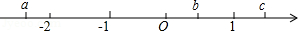

- A. \(abc > 0\)
- B. \(a(b - c) > 0\)
- C. \((a + b)c > 0\)
- D. \((a - b)c > 0\)

【答案】B

【解析】​

## 知识点·有理数乘法法则、数轴

## 1. 填空题（难度：适中）

在数\( - 5\)，1，\( - 3\)，5，\(2\)中任取三个数相乘，其中最大的积是，最小的积是．

【答案】75，$ - 50$

【解析】​

解：在数\( - 5\)，1，\( - 3\)，5，\(2\)中任取三个数相乘，
其中最大的积必须为正数，即\(( - 5) \times ( - 3) \times 5 = 75\)，
最小的积为负数，即\(( - 5) \times 5 \times 2 = - 50\)．
故答案为：75；\( - 50\)．

## 知识点·有理数减法、加法运算律

## 1. 填空题（难度：简单）

计算：\(1 - 2 + 3 - 4 + 5 - 6 + \ldots + 2021 - 2022\)的值是．

【答案】$ - 1011$

【解析】​

解：原式\( = (1 - 2) + (3 - 4) + (5 - 6) + \ldots + (2021 - 2022)\)
\( = - 1 - 1 - 1 - \ldots - 1\)
\( = - 1011\)，
故答案是：\( - 1011\)．

## 知识点·有理数减法、绝对值

## 1. 单选题（难度：适中）

已知数轴上表示\( - 2\)和\( - 101\)的两个点分别为\(A\)，\(B\)，那么\(A\)，\(B\)两点间的距离等于\((\)　　\()\)

- A. 99
- B. 100
- C. 102
- D. 103

【答案】A

【解析】​

## 知识点·有理数减法、绝对值及分类讨论

## 1. 填空题（难度：适中）

已知\(|a| = 1\)，\(|b| = 2\)，\(|c| = 3\)，且\(a > b > c\)，那么\(a + b - c = \)．

【答案】2或0

【解析】​

解：\(\because |a| = 1\)，\(|b| = 2\)，\(|c| = 3\)，
\(\therefore a = \pm 1\)，\(b = \pm 2\)，\(c = \pm 3\)，
\(\because a > b > c\)，
\(\therefore a = - 1\)，\(b = - 2\)，\(c = - 3\)或\(a = 1\)，\(b = - 2\)，\(c = - 3\)，
则\(a + b - c = 2\)或0．
故答案为：2或0.

## 知识点·有理数定义

## 1. 单选题（难度：简单）

在0，\(\frac{\pi }{2}\)，\(1.333\)\(\ldots\)，\(\frac{{22}}{7}\)，3.14中，有理数的个数有\((\)　　\()\)。

- A. 1个
- B. 2个
- C. 3个
- D. 4个

【答案】D

【解析】​

## 知识点·有理数的混合运算

## 1. 单选题（难度：简单）

下列计算正确的是\((\)　　\()\)。

- A. \(2 \div ( - \frac{1}{3}) = - 6\)
- B. \( - 1\frac{1}{2} - \frac{1}{2} = - 1\)
- C. \({( - 2)^3} = - 6\)
- D. \( - 1 + 2 = - 3\)

【答案】A

【解析】​

## 知识点·有理数；_有理数的加减混合运算

## 1. 单选题（难度：简单）

设\(a\)是最小的自然数，\(b\)是最大的负整数，\(c\)是绝对值最小的有理数，则\(a - b + c = (\)　　\()\)。

- A. \( - 1\)
- B. 0
- C. 1
- D. 2

【答案】C

【解析】​

## 知识点·点、线、面、体

## 1. （难度：适中）

下列生活现象中，可以反映“面动成体”的是（    ）A．粉笔写字  B．流星划过夜空  C．硬币在桌上旋转  D．汽车雨刷转动

## 2. （难度：适中）

笑笑用一张长方形纸通过下面的（    ）方式旋转，能得到一个底面直径是8厘米，高是20厘米的圆柱．A．  B．  C．  D．

## 知识点·点与直线、直线与直线的位置关系

## 1. （难度：适中）

用适当的语句描述图中点与直线、直线与直线的位置关系。

【答案】

解：直线$a$经过点<latex class="math-tex">\(A\)</latex>​、点$B$，不经过点$C$；直线$b$经过点<latex class="math-tex">\(A\)</latex>​、点$C$，不经过点$B$；直线$c$经过点$B$、点$C$，不经过点$A$。

【解析】​

## 知识点·点动成线

## 1. 单选题（难度：简单）

在朱自清的《春》中描写春雨“像牛毛、像花针、像细丝，密密麻麻地斜织着”的语句，这里把雨看成了线，这说明了\((\)　　\()\)。

- A. 点动成线
- B. 线动成面
- C. 面动成体
- D. 以上都不对

【答案】A

【解析】​

## 知识点·用恰当的统计图描述数据

## 1. 

据统计​​​\(A，B\)​两省人口总数基本相同，2021年A省的城镇在校中学生人数为156万，农村在校中学生人数为72万；​​​\(B\)​省的城镇在校中学生人数为84万，农村在校中学生人数为103万。李军同学根据数据画出下面两个复合条形统计图。

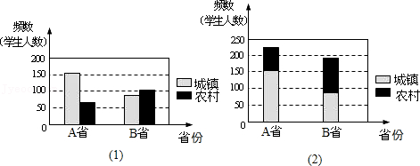

图更好地反映两省在校中学生总数；

图更好地比较\(A\left ( {B} \right )\)​省城镇和农村在校中学生人数；

说说两种图的特点。

【答案】（2），（1），

图（1）更直观地反映本省城镇与农村在校中学生人数的差别；图（2）更好反映两省在校中学生总数的差别

【解析】解析视频请查看最后一题。

解析视频请查看最后一题。

​

## 知识点·用样本估计总体

## 1. 

为丰富学生的课余生活，培养学生的爱好，陶冶学生的情操，某校开展学生拓展课，为了解学生各社团活动的参与人数，该校对参与社团活动的学生进行了抽样调查，制作出如下的统计图。根据该统计图，完成以下问题：
​
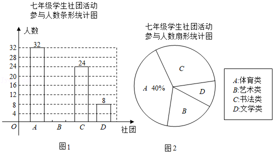

这次共调查了名学生；

请把统计图1补充完整；

已知该校七年级共有680名学生参加社团活动，请根据样本估算该校七年级学生参加艺术类社团的人数。​

【答案】80，

<em><em><latex class="math-tex">\(B\)</latex>​</em></em>社团的人数有16名，补全统计图如下：

，

136名

【解析】解析视频请查看最后一题。

解析视频请查看最后一题。

​

## 知识点·直线、射线、线段的概念

## 1. 单选题（难度：适中）

如图，下列说法正确的是\((\)　　\()\)。

- A. 线段\(AB\)与线段\(BA\)是不同的两条线段
- B. 射线\(BC\)与射线\(BA\)是同一条射线
- C. 射线\(AB\)与射线\(AC\)是两条不同的射线
- D. 直线\(AB\)与直线\(BC\)是同一条直线

【答案】D

【解析】​

## 2. 

如图，平面上有\(A\)，\(B\)，\(C\)，\(D，4\)个点，根据下列语句画图。
​
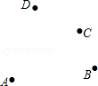

画线段\(AC\)，\(BD\)交于点\(F\)；

连接\(AD\)，并将其反向延长；

作直线\(AB\)，直线\(CD\)，两直线相交于\(P\)点。​

【答案】

连接$AC$，$BD$，交于点$P$，如图所示；

​

，

连接$AD$，反向延长$AD$，如图所示；

​

，

作直线$AB$，直线$CD$，交于点$P$。

   

【解析】解析视频请查看最后一题。

解析视频请查看最后一题。

​

## 知识点·科学计数法

## 1. 单选题（难度：简单）

2020年7月23日，中国首颗火星探测器“天问一号”成功发射\(.2021\)年2月10日，在经过长达七个月，475000000公里的漫长飞行之后，“天问一号”成功进入火星轨道．将475000000用科学记数法表示应为\((\)　　\()\).

- A. \(4.75 \times {10^7}\)
- B. \(4.75 \times {10^8}\)
- C. \(4.75 \times {10^9}\)
- D. \(475 \times {10^6}\)

【答案】B

【解析】​

## 知识点·科学记数法—表示较大的数

## 1. 单选题（难度：简单）

随着北京冬奥会的成功举办，“双奥之城”将进一步提升北京的国际影响力和城市竞争力．冬奥会的举办也带动了群众冰雪运动的迅速普及，据悉，仅春节假日期间，北京冰雪场所就共接待74万人次．其中“74万”用科学记数法可以表示为\((\)　　\()\)。

- A. \(7.4 \times {10^5}\)
- B. \(7.4 \times {10^6}\)
- C. \(74 \times {10^4}\)
- D. \(74 \times {10^5}\)

【答案】A

【解析】​

## 知识点·等腰三角形性质

## 1. （难度：适中）

如图，在\(△ABC\)​中，AB=AC，AD是BC边上的中线，BE⊥AC于点E。求证：∠CBE=∠BAD。

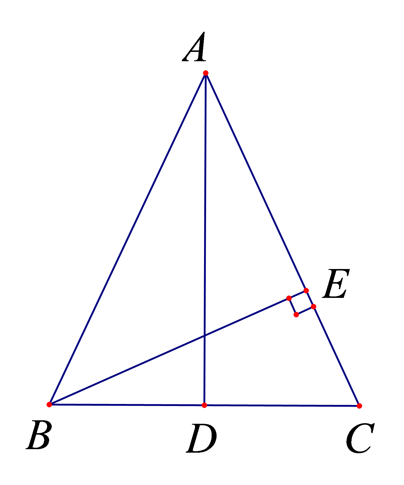

【答案】

利用等腰三角形三线合一的性质，再利用同角的余角相等即可证得。

【解析】​

## 知识点·补角的定义

## 1. 填空题（难度：适中）

一个角的补角是它的3倍，则这个角的度数是。

【答案】$45^\circ $

【解析】​

## 知识点·角平分线的定义

## 1. 单选题（难度：简单）

如图，\(OC\)平分\(\angle AOB\)，\(OD\)平分\(\angle AOC\)，且\(\angle COD = 20^\circ \)，则\(\angle AOB\)的度数为（      ）。　　

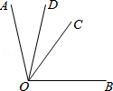

- A. \(40^\circ \)
- B. \(50^\circ \)
- C. \(90^\circ \)
- D. \(80^\circ \)

【答案】D

【解析】​

## 2. 填空题（难度：适中）

点\(P\)在\(\angle MON\)内部，则四个等式：①\(\angle POM = \angle NOP\)；②\(\angle PON + \angle POM = \angle MON\)；③\(\angle MOP = \frac{1}{2}\angle MON\)，④\(\angle MON = 2\angle NOP\)，其中能表示\(OP\)是\(\angle MON\)平分线的式子有（填写所有正确的序号）。

【答案】①③④

【解析】​

## 知识点·角的和差关系_余角和补角的定义

余角和补角的定义（同步练习）

## 1. 单选题（难度：简单）

如图，点\(O\)在直线\(AB\)上，\(\angle COD = 90^\circ \)，\(\angle AOC = 130^\circ \)，则\(\angle BOD\)的大小为（    ）。

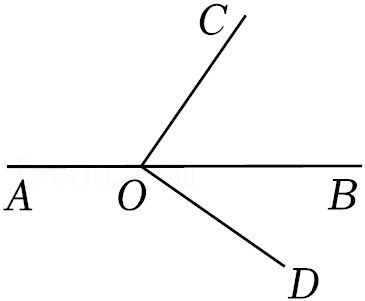

- A. \(30^\circ \)
- B. \(40^\circ \)
- C. \(50^\circ \)
- D. \(60^\circ \)

【答案】B

【解析】​

## 2. 

如图，\(\angle AOC\)和\(\angle AOB\)分别是\(\angle AOD\)的余角和补角，且\(OD\)是\(\angle BOC\)的平分线，求\(\angle AOD\)的度数。

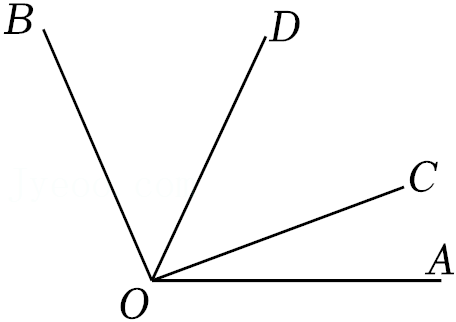

【答案】

$67.5^\circ $

【解析】​

## 知识点·角的和差关系_余角的定义

余角的定义（同步练习）

## 1. 

已知\(\angle AOB = 60^\circ \)，\(\angle BOC\)与\(\angle AOB\)互余，求\(\angle AOC\)的度数.

【答案】

$\angle AOC = 90^\circ $或$30^\circ $

【解析】​

## 知识点·角的和差及倍数关系

## 1. （难度：简单）

如图，已知\(\angle AOB = {90^ \circ }\),\(\angle AOC:\angle COD:\angle BOD = 1:3:5\)，求\(\angle AOC\)，\(\angle COD\)，\(\angle BOD\)的度数．

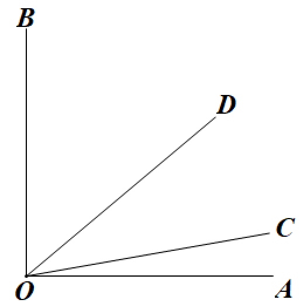

【答案】

$\angle AOC = {10^ \circ }$

$\angle COD = {30^ \circ }$

$\angle BOD = {50^ \circ }$

【解析】​

## 知识点·角的和差及倍数关系_角平分线的定义

角平分线的定义（同步练习）

## 1. 单选题（难度：适中）

如图，已知\(OE\)为\(\angle AOD\)的角平分线，\(\angle COD = 16^\circ \)，\(\angle EOC = 4\angle COD\)，则\(\angle AOD\)的度数是（    ）。

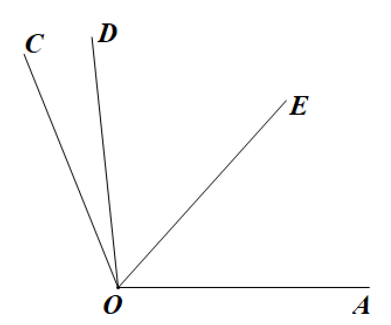

- A. \(32^\circ \)
- B. \(48^\circ \)
- C. \(64^\circ \)
- D. \(96^\circ \)

【答案】D

【解析】​

## 知识点·角的大小的比较

## 1. 单选题（难度：适中）

若\(\angle 1 = 30.5^\circ \)，\(\angle 2 = 30^\circ 50'\)，则\(\angle 1\)与\(\angle 2\)的大小关系是（    ）。

- A. \(\angle 1 = \angle 2\)
- B. \(\angle 1 > \angle 2\)
- C. \(\angle 1 < \angle 2\)
- D. 无法判断

【答案】C

【解析】​

## 2. 单选题（难度：简单）

在学习完角的大小比较后，小明用同一块三角板比较\(\angle A\)与\(\angle B\)的大小，两次操作如图所示，那么\(\angle A\)与\(\angle B\)的大小关系是（    ）。

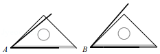

- A. \(\angle A > \angle B\)
- B. \(\angle A = \angle B\)
- C. \(\angle A < \angle B\)
- D. 没有量角器，无法确定

【答案】C

【解析】​

## 知识点·角的表示方法

## 1. 填空题（难度：简单）

如图，已知\(\Delta ABC\)中，点\(O\)在边\(AB\)上，下列说法正确的有（填写正确的序号）。

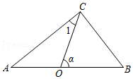

①\(\angle BCA\)可以用\(\angle C\)表示
②\(\angle \alpha \)可以用\(\angle O\)表示
③\(\angle CBA\)可以用\(\angle B\)表示
④\(\angle ACO\)可以\(\angle 1\)用表示

【答案】③④

【解析】​

## 知识点·解方程中的恒等变形

## 1. 填空题（难度：适中）

下面的框图表示了小明解方程\(3(x + 5) + x = - 5\)的流程：

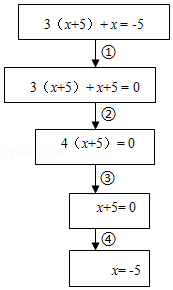
   
其中，步骤“③”的依据是．

【答案】等式的基本性质2：等式两边乘同一个数，或除以同一个不为0的数，等式仍然成立

【解析】​
