# 4.1 几何图形（同步练习）

> 教材：数学·七年级上册·沪科技版2024新教材 ｜ 来源：国家中小学智慧教育平台·在线练习 ｜ 共 83 题

## 1. 填空题（难度：简单）

雨滴滴下来形成雨丝属于以下哪项几何知识的实际应用，汽车的雨刷把玻璃上的雨雪刷干净属于以下哪项几何知识的实际应用。
A．点动成线  
B.线动成面  
C．面动成体  
D．以上都不对

【答案】A，B

【解析】​

## 2. 单选题（难度：适中）

如图的图形，是由\((\)　　\()\)旋转形成的。

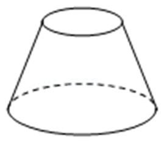

- A. 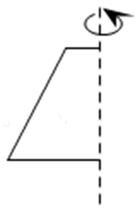
- B. 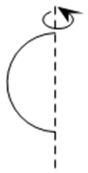
- C. 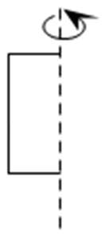
- D. 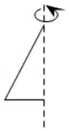

【答案】A

【解析】​

## 3. 单选题（难度：简单）

做最好的自己!将这六个字写在如图的一个盒子的展开图上，然后将它折成正方体盒子，当上面的字是“己”时，下面的字是（　　）

【答案】A

## 4. 单选题（难度：简单）

圆柱、圆锥、棱柱、球这四个几何体的截面形状不可能是长方形的有（　　）个．

- A. 1
- B. 2
- C. 3
- D. 4

【答案】B

【解析】解：圆柱的截面可能是圆形、长方形、梯形、椭圆形；
圆锥的截面可能是圆形、椭圆形、三角形和曲边形，不可能是长方形；
棱柱的截面可能是三角形、四边形等，因此可能是长方形；
球的截面形状是圆，不可能是长方形；
所以截面形状不可能是长方形的有2个．
故选：B．

## 5. 单选题（难度：简单）

长方体作为直棱柱，不具有以下（　　）特征．

- A. 六个面都是长方形
- B. 相对面形状大小相同
- C. 侧棱等长且垂直底面
- D. 底面可能是五边形

【答案】D

【解析】解：A．长方体的六个面都是长方形，因此A选项不符合题意；
B．长方体的6个面中，相对面形状大小相同，因此选项B不符合题意；
C．长方体六侧棱等长且垂直底面，因此选项C不符合题意；
D．长方体底面是长方形，不能是五边形的，因此选项D符合题意；
故选：D．

## 6. 单选题（难度：简单）

某圆柱体积是300cm³，则与它同底等高的圆锥体积为（　　）cm³．

- A. 900
- B. 300
- C. 100
- D. 30

【答案】C

【解析】解：300\( \times \frac{1}{3}=\)100（cm³）．
故选：C．

## 7. 单选题（难度：简单）

有下列四个说法：①长方体与正方体都是四棱柱；②三棱锥的侧面都是三角形；③十棱柱有10个面，每个侧面都是长方形；④棱柱的每条棱长可以相等，其中正确的个数有（　　）

- A. 1个
- B. 2个
- C. 3个
- D. 4个

【答案】C

【解析】解：①正确；②正确；③错误，十棱柱有2个底面，10个侧面；④正确，
∴正确有3个，
故选：C．

## 8. 单选题（难度：适中）

一个圆锥的体积是57cm3，与它等底、等高的圆柱的体积是（　　）cm3．

【答案】A

## 9. 单选题（难度：简单）

下列说法不正确的是（　　）

【答案】A

## 10. 单选题（难度：简单）

六棱柱有（　　）条棱．

- A. 6
- B. 12
- C. 18
- D. 36

【答案】C

【解析】解：∵六棱柱有6条侧棱，上下底面各有6条棱，
∴六棱柱一共有6+6+6＝18条棱．
故选：C．

## 11. 单选题（难度：简单）

2024年巴黎奥运会顺利闭幕．如图，这是此届奥运会的金牌，用数学的眼光观察这个金牌，它的形状类似于（　　）

【答案】A

## 12. 单选题（难度：适中）

一个长方体和正方体的棱长总和相等，它们的体积（　　）

- A. 一样大
- B. 长方体体积大
- C. 正方体体积大
- D. 无法确定

【答案】C

【解析】解：一个长方体和正方体的棱长总和相等，则正方体体积大，因为长方体的长、宽、高的差越小（越接近正方体），则体积越大．
故选：C．

## 13. 单选题（难度：简单）

下列几何体中，属于棱柱的有（　　）

【答案】A

## 14. 单选题（难度：适中）

一个圆锥的体积是314cm3，底面积是62.8cm2，高是（　　）cm．

【答案】A

## 15. 单选题（难度：适中）

圆柱体的底面半径扩大3倍，高不变，体积扩大（　　）

【答案】A

## 16. 单选题（难度：适中）

信阳茶叶名满天下．如图茶叶罐对应的几何体名称为（　　）

【答案】A

## 17. 单选题（难度：适中）

不透明袋子中装有一个几何体模型，两位同学摸该模型并描述它的特征，甲同学：它有4个面是三角形；乙同学，它有6条棱，则该模型对应的立体图形可能是（　　）

【答案】A

## 18. 单选题（难度：适中）

用代数式表示“一个圆柱的高为5，体积为V．求它的底面半径r”正确的是（　　）

【答案】A

## 19. 单选题（难度：适中）

如图所示的长方体中，用符号表示两棱的位置关系正确的是（　　）

【答案】A

## 20. 单选题（难度：适中）

对于几种图形：①三角形；②长方形；③圆；④圆锥；⑤圆柱，其中属于立体图形的是（　　）

【答案】A

## 21. 单选题（难度：适中）

如图是一个正方体积木，它的每个面上都有一个数字，其中1的对面是6，2的对面是5，3的对面是4，现将积木沿着地面标志翻转，最后朝上的面的数字是（　　）

【答案】A

## 22. 单选题（难度：简单）

下面几何体中，是圆锥的为（　　）

- A. 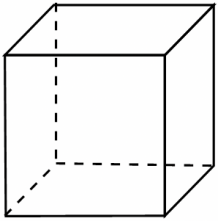
- B. 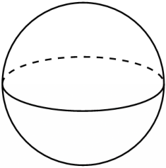
- C. 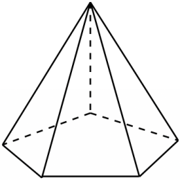
- D. 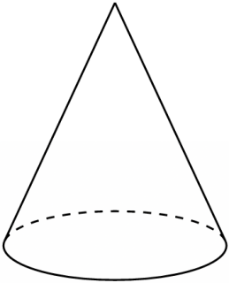

【答案】D

【解析】解：A选项为四棱柱，不符合题意；
B选项为球，不符合题意；
C选项为五棱锥，不符合题意；
D选项为圆锥，符合题意．
故选：D．

## 23. 单选题（难度：简单）

下列学习或生活中的物品，它的形状可以近似地看作圆柱体的是（　　）

- A. 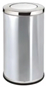
- B. 
- C. 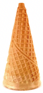
- D. 

【答案】A

【解析】解：A、形状类似圆柱，故符合题意；
B、形状类似长方体，故不符合题意；
C、形状类似圆锥，故不符合题意；
D、形状类似球，故不符合题意．
故选：A．

## 24. 单选题（难度：简单）

下列几何体中，是棱柱的是（　　）

【答案】A

## 25. 单选题（难度：简单）

几何体是由曲面或平面围成的．下列几何体面数最少的是（　　）

- A. 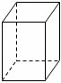
- B. 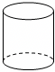
- C. 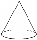
- D. 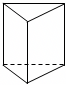

【答案】C

【解析】解：长方体是由6个平面围成的，圆柱是一个曲面和两个平面围成的，圆锥是一个曲面和一个平面围成的，三棱柱是由5个平面围成的，
∴面数最少的是圆锥．
故选：C．

## 26. 单选题（难度：简单）

下列几何体中，没有曲面的是（　　）

【答案】A

## 27. 单选题（难度：适中）

下列说法中，正确的是（　　）

【答案】A

## 28. 单选题（难度：适中）

王老师做了一个圆柱体容器和几个圆锥体容器，尺寸如图所示（单位：cm），将圆柱体内的水倒入（　　）圆锥体内，正好倒满．

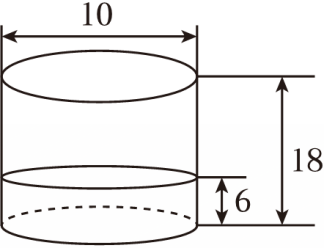

- A. 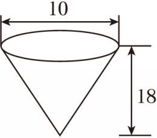
- B. 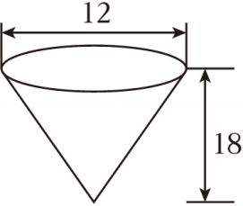
- C. 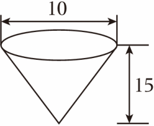

【答案】A

【解析】解：根据题干分析可得，圆柱内水的体积是3.14×（10÷2）²×6＝471（cm³），
选项A中圆锥的容积是3.14×（10÷2）²×18÷3＝471（cm³），符合题意；
选项B中圆锥的容积是3.14×（12÷2）²×18÷3＝678.24（cm³），不符合题意；
选项C中圆锥的容积是3.14×（10÷2）²×15÷3＝392.5（cm³），不符合题意．
故选：A．

## 29. 单选题（难度：适中）

观察下列实物，抽象出的几何图形为长方体的是（　　）

- A. 
- B. 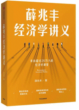
- C. 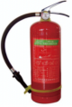
- D. 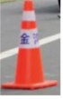

【答案】B

【解析】解：选项A中的实物抽象出的几何图形为球，
故选项A不符合题意；
选项A中的实物抽象出的几何图形为长方体，
故选项B符合题意；
选项C中的实物抽象出的几何图形为圆柱，
故选项C不符合题意；
选项D中的实物抽象出的几何图形为圆台，
故选项D不符合题意，
故选：B．

## 30. 单选题（难度：适中）

如图，是由5个大小相同的正方形接成的网格，共有12个格点，从中任取4个格点为顶点，共可以组成正方形的个数为（　　）

【答案】A

## 31. 单选题（难度：适中）

下面几何体中，是长方体的为（　　）

【答案】A

## 32. 单选题（难度：适中）

下列物体的形状类似于圆柱的是（　　）

【答案】A

## 33. 单选题（难度：简单）

下面的四个几何图形中，表示平面图形的是（　　）

- A. 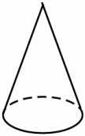
- B. 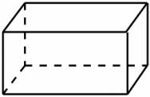
- C. 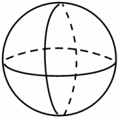
- D. 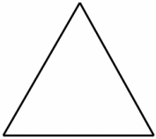

【答案】D

【解析】解：A． 
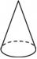
 是几何体，不符合题意；
B． 
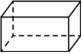
 是几何体，不符合题意；
C． 
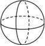
 是几何体，不符合题意；
D． 
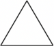
 是平面图形，符合题意；
故选：D．

## 34. 单选题（难度：适中）

观察下列实物模型，其形状可以抽象为圆锥的是（　　）

- A. 
- B. 
- C. 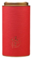
- D. 

【答案】B

【解析】解：A．形状是球体，选项说法错误，不符合题意；
B．形状是圆锥，选项说法正确，符合题意；
C．形状是圆柱，选项说法错误，不符合题意；
D．形状是长方体，选项说法错误，不符合题意．
故选：B．

## 35. 单选题（难度：适中）

下列立体图形，其中圆柱体是（　　）

【答案】A

## 36. 单选题（难度：适中）

下列几何体中是三棱锥的是（　　）

- A. 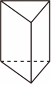
- B. 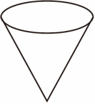
- C. 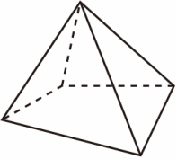
- D. 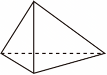

【答案】D

【解析】解：根据三棱锥的定义，选项D中几何体由四个三角形组成，是三棱锥．
故选：D．
声明：试题解析著作权属菁优网所有，未经书面同意，不得复制发布日期：2025/4/2 21:08:00；用户：周星；邮箱：ssxxyy37@xyh.com；学号：22078707

## 37. 单选题（难度：适中）

下列说法不正确的是（   ）

【答案】A

## 38. （难度：简单）

朱自清的《春》一文里，在描写春雨“像牛毛，像细丝，密密地斜织着”的语句中，可以看作哪项几何知识的实际应用？（　　）A．点动成线  B．线动成面  C．面动成体  D．以上答案都不正确

## 39. （难度：简单）

汽车雨刷器在挡风玻璃上来回摆动，雨刷器扫过的区域形成了一个扇形，这体现了（  ）原理．A．点动成线  B．线动成面  C．面动成体  D．体动成体

## 40. （难度：适中）

下列生活现象中，可以反映“面动成体”的是（   ）A．打开折扇  B．流星划过夜空  C．旋转门旋转  D．汽车雨刷转动

## 41. （难度：适中）

李白的《望庐山瀑布》中描写瀑布“飞流直下三千尺，疑是银河落九天”，瀑布从山崖顶端倾泻而下形成水流的过程，蕴含以下哪个道理（    ）
A．两点之间，线段最短  
B．点动成线
C．线动成面  
D．面动成体

【答案】

B

【解析】解：∵ 诗句描述瀑布水流从顶端倾泻而下，是由水滴（点）的运动形成的连续线条，
∴ 蕴含了“点动成线”的道理，
故选：B．

## 42. 单选题（难度：简单）

下列叙述错误的选项是（   ）

【答案】A

## 43. （难度：简单）

把笔尖看作一个点，当笔尖在纸上移动时，形成一条线；时钟的秒针旋转时，形成一个圆面，从数学的角度解释为（   ）A．点动成线，线动成面  B．线动成面，面动成体C．点动成线，面动成体  D．点动成面，面动成线

## 44. （难度：适中）

几何图形由点、线、面组成，“点动成线、线动成面、面动成体”．下列现象中能反映“线动成面”的是（   ）A．流星划过夜空  B．笔尖在纸上快速滑动C．打开折扇  D．直角三角尺绕直角边旋转一周

## 45. 单选题（难度：简单）

下列对生活现象的解释错误的是（    ）

- A. 汽车雨刷将前挡风玻璃上的水擦除――线动成面
- B. 笔尖在纸上滑动写字――点动成线
- C. 将一个三角形纸片剪去一个角，剩余图形周长比原图形周长小――两点之间，线段最短
- D. 小狗看到远处的食物，总是径直奔向食物――两点确定一条直线

【答案】D

【解析】解：小狗看到远处的食物，总是径直奔向食物，依据是：两点之间，线段最短；
∴选项D解释错误．
选项A、B、C解释均正确．
故选：D．

## 46. （难度：适中）

硬币在桌面上快速地转动时看上去像球，这种生活现象可以反映的数学原理是（   ）
A．点动成线  
B．线动成面  
C．面动成体  
D．面面相交得到线

【答案】

C

【难度】0.85

【解析】解：硬币是圆面（面），快速转动时该面的运动形成球体（体），这种现象反映的数学原理是面动成体，
故选：C．

## 47. （难度：适中）

朱自清的《春》一文里，在描写春雨时有“像牛毛，像细丝，密密地斜织着”的语句，这里用数学的眼光来看其实是把雨看成线，说明（    ）
A．点动成线  
B．线动成面
C．面动成体  
D．面面相交成线

【答案】

A

【解析】解：由题意可得，这里用数学的眼光来看其实是把雨滴看成了点，把雨看成线，说明点动成线，
故选：A．

## 48. （难度：适中）

在足球训练中，运动员踢出一次强烈的“香蕉球”，足球在空中绕过人墙后飞入球门．若将足球的运动轨迹抽象为几何现象，用数学语言解释这一现象为（     ）A．点动成线  B．线动成面  C．面动成体  D．点动成面

## 49. （难度：简单）

中国武术有“枪扎一条线，横扫一大片”的说法，这句话用数学知识诠释相对最科学的是（   ）A．两点确定一条直线  B．两点之间线段最短C．旋转成圆  D．点动成线，线动成面

## 50. 单选题（难度：简单）

下列说法中正确的是（   ）

【答案】A

## 51. （难度：适中）

在飘着墨香的书院门，书法家写毛笔字时，笔尖（可看作一个点）在纸上移动形成笔画．这一现象符合哪一个数学原理（   ）
A．点动成线  
B．线动成面  
C．面动成体  
D．面面相交成线

【答案】

A

【解析】解：∵笔尖是一个点，在移动过程中形成轨迹（笔画），
∴这一现象符合点动成线的原理，
故选：A．

## 52. （难度：适中）

画家在画布上用画笔作画，用数学知识可解释为（    ）A．点动成线  B．线动成面  C．面动成体  D．以上都不对

## 53. （难度：简单）

点、线、面、体这些基本图形可帮助人们有效地刻画错综复杂的现实世界．下列现象中可以反映“面动成体”的是（   ）
A．流星划过夜空  
B．打开折扇  
C．汽车雨刷的转动  
D．旋转门的旋转

【答案】

D

【解析】解： A、流星划过夜空是点动成线，故本选项不符合题意；
B、打开折扇是线动成面，故本选项不符合题意；
C、汽车雨刷的转动是线动成面，故本选项不符合题意；
D、旋转门的旋转是面动成体，故本选项符合题意．
故选：D．

## 54. （难度：适中）

“大漠孤烟直，长河落日圆”是唐代诗人王维的作品《使至塞上》中的诗句，描绘了浩瀚沙漠中孤烟直冲云霄，黄河边上落日浑圆的景象．诗中描写孤烟（可看作细长的柱体）直冲云霄形成线，用数学语言解释这一现象为（    ）A．点动成线  B．线动成面C．面动成体  D．面面相交成线

## 55. 单选题（难度：适中）

下列现象能说明“面动成体”的是（   ）

【答案】A

## 56. 单选题（难度：适中）

下列现象中，能说明“线动成面”的是（   ）

【答案】A

## 57. （难度：适中）

打开折扇时，随着扇骨的移动渐渐形成一个扇面（如图），这种现象可以用数学原理解释为（    ）

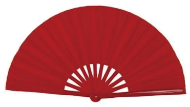

A．点动成线  
B．线动成面
C．面动成体  
D．面与面相交成体

【答案】

B

【解析】解：这种现象可以用数学原理解释为线动成面．
故选：B．

## 58. （难度：简单）

非遗传承人在展示“糖画”技艺时，会将熔化的糖汁（可视为“流动的点”）在石板上快速勾勒，糖汁冷却后形成“龙”的轮廓线条．这一过程中，“流动的糖汁”到“轮廓线条”的转化，体现的数学原理是（   ）A．点动成线  B．线动成面  C．面动成体  D．以上都不对

## 59. （难度：简单）

如图，打开折扇时，随着扇骨的移动一个扇面便形成了，这种现象可以用数学原理解释为（   ）A．点动成线  B．线动成面  C．面动成体  D．线动成体

## 60. （难度：适中）

给我们以点动成线的印象的是（    ）A．汽车挡风玻璃上转运的雨刷  B．转动的电扇C．表演用飞机后面喷出的彩烟  D．转动的自行车辐条

## 61. （难度：适中）

朱自清的《春》中描写春雨“像牛毛，像花针，像细丝，密密地斜织着<latex class="math-tex">\( \cdot \cdot \cdot \)</latex>”，春雨的下落过程蕴含以下哪个道理（   ）A．两点之间，线段最短  B．点动成线C．线动成面  D．面动成体

## 62. 单选题（难度：简单）

下列现象，说明“点动成线”的是（   ）

- A. 汽车雨刷在挡风玻璃上刷出的痕迹
- B. 流星划过夜空留下的痕迹
- C. 酒店旋转门运动的痕迹
- D. 在桌面上快速转动一个硬币形成的痕迹

【答案】B

【解析】解：A．汽车雨刷在挡风玻璃上刷出的痕迹，说明“线动成面”，不合题意；
B．流星划过夜空留下的痕迹，说明“点动成线”，符合题意；
C．酒店旋转门运动的痕迹，说明“面动成体”，不合题意；
D．在桌面上快速转动一个硬币形成的痕迹，说明“面动成体”，不合题意．
故选：B．

## 63. （难度：简单）

中国武术有“枪扎一条线，横扫一大片”说法，这句话用数学知识诠释相对最科学的是（   ）
A．两点确定一条直线  
B．点的平移  
C．旋转成圆  
D．点动成线，线动成面

【答案】

D

【解析】解：依题意，中国武术有“枪扎一条线，横扫一大片”说法，这句话用数学知识诠释相对最科学的是点动成线，线动成面．
故选：D

## 64. （难度：适中）

嘉嘉在旋转硬币时发现：当硬币在地面某位置快速旋转时，形成了一个几何体，这个几何体是（    ）
A．圆锥  
B．圆柱  
C．球  
D．正方体

【答案】

C

【解析】解：∵ 硬币旋转时，边缘每一点都绕轴做圆周运动，所有圆周轨迹的集合构成一个球面．
∴ 形成的几何体是球．
故选C．

## 65. 单选题（难度：简单）

下列选项中，说法正确的是（   ）

【答案】A

## 66. （难度：适中）

如图，一个长方形长为4，宽为2，分别以长为轴、宽为轴旋转，产生了两个圆柱甲、乙．判断甲、乙两个圆柱侧面积的大小关系（    ）．A．甲<latex class="math-tex">\( >\)</latex>乙  B．甲<latex class="math-tex">\( <\)</latex>乙  C．甲<latex class="math-tex">\( =\)</latex>乙  D．无法

## 67. 单选题（难度：简单）

如图，以直角三角形ABC的直角边AB为轴旋转一周后得到的圆锥的底面直径是（    ）cm．

【答案】A

## 68. （难度：简单）

将下列图形绕虚线旋转一周能得到如图几何体的是（   ）A．  B．  C．  D．

## 69. （难度：适中）

绕虚线旋转一周可得到如图所示的图形的是（   ）A．  B．  C．  D．

## 70. （难度：适中）

将如图所示的平面图形绕虚线旋转一周，得到的立体图形大致是（   ）A．  B．  C．  D．

## 71. （难度：简单）

如图，将下列的平面图形绕轴旋转一周，能围成的几何体是（    ）A．  B．C．  D．

## 72. （难度：简单）

将下列图形绕虚线旋转一周能得到如图几何体的是（   ）A．  B．  C．  D．

## 73. （难度：简单）

随着人工智能技术的快速发展，利用<latex class="math-tex">\( AI\)</latex>画图可快速生成多样图像，输入文字描述即可得到符合需求的画面，相关技术被广泛应用于设计、创意等领域如图是利用某国产<latex class="math-tex">\( AI\)</latex>软件生成的一个创意花瓶，下列平面图形绕虚线旋转一周可以得到该花瓶的是（   ）A．  B．  C．

## 74. （难度：简单）

如图所示，以\( AB\)为轴，将三角形\( ABC\)旋转一周后可得一个几何体，从正面看该几何体，所看到的形状图是（    ）

A．

  
B．

  
C．

  
D．

【答案】

A

【解析】解：绕斜边\( AB\)旋转一周，所得到的几何体是两个圆锥的组合体，从正面看该几何体，所看到的形状图是由两个有公共底边的等腰三角形组成的四边形．
故选：A．

## 75. （难度：简单）

如图所示：将平面图形绕轴旋转一周，得到的几何体是（   ）A．  B．  C．  D．

## 76. （难度：简单）

将下列平面图形绕轴旋转一周，可得到图中所示的立体图形的是（   ）A．  B．  C．  D．

## 77. （难度：简单）

如图是开封博物馆的藏品：乾隆松石绿粉彩朵花瓶，下列平面图形绕虚线旋转一周，能大致形成这个花瓶形状的是（   ）A．  B．  C．  D．

## 78. （难度：简单）

如图所示的平面图形绕直线<latex class="math-tex">\( l\)</latex>旋转一周，得到的立体图形是（    ）A．  B．C．  D．

## 79. （难度：适中）

下面图形旋转就会形成圆锥（   ）．A．  B．  C．  D．

## 80. （难度：适中）

把下列平面几何图形旋转一周后，得到如图所示的圆柱体的是（    ）

A．

  
B．

  
C．

  
D．

【答案】

C

【解析】解：
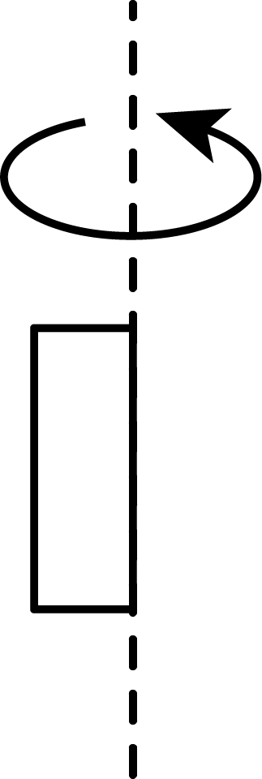
旋转以后得到圆柱体
故选：C．

## 81. （难度：简单）

在下面图形中，以木棒为轴旋转，可以得到圆柱的是（    ）．A．  B．  C．  D．

## 82. （难度：适中）

以图中的虚线为轴进行旋转，旋转后会得到图（    ）．A．  B．C．  D．

## 83. （难度：简单）

如图，该图形旋转一周后形成的立体图形是（    ）

A．
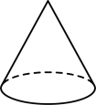
  
B．

  
C．
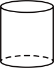
  
D．

【答案】

D

【解析】解：根据旋转的定义可判断只有选项D符合题意，
故选：D．
