# 4.2 线段、射线、直线（同步练习）

> 教材：数学·七年级上册·沪科技版2024新教材 ｜ 来源：国家中小学智慧教育平台·在线练习 ｜ 共 65 题

## 1. 单选题

能断定\(A\)、\(B\)、\(C\)三点共线的是\((\)　　\()\)。

- A. \(AB = 2\)，\(BC = 3\)，\(AC = 4\)
- B. \(AB = 6\)，\(BC = 6\)，\(AC = 6\)
- C. \(AB = 8\)，\(BC = 6\)，\(AC = 2\)
- D. \(AB = 12\)，\(BC = 13\)，\(AC = 15\)

【答案】C

【解析】​

## 2. 填空题（难度：适中）

如图，在直线\(l\)上有\(A\)，\(B\)，\(C\)三点，则图中的线段共有条。

【答案】3

【解析】​

## 3. （难度：适中）

写出图中的所有直线、线段和以\(A\)​为端点的射线。

【答案】

解：直线$CE$（也可以写成直线$AE$或直线$AC$）；

线段$AB$、线段$AC、$线段$AD、$线段$AE、$线段$CE、$线段$BD$； 

射线$AB、$射线$AC、$射线$AE$。

【解析】​

## 4. 单选题（难度：简单）

如图，能表示射线\(AB\)的图形是\((\)　　\()\)。

- A. 
- B. 
- C. 
- D. 

【答案】C

【解析】​

## 5. 

解答下列问题：

读语句，并画出图形：三条直线\(AB\)，\(BC\)，\(AC\)两两相交，在射线\(AB\)上取一点\(D\)（不与点\(A\)重合），使得\(BD = AB\)，连接\(CD\)。

在（1）的条件下，回答问题：
①用适当的语句表述点\(D\)与直线\(BC\)的关系：；
②若\(AB = 3\)，则\(AD = \)。

【答案】

如图所示；

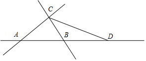   

，①点$D$在直线$BC$外；/②6。

【解析】解析视频请查看最后一题。

​

## 6. （难度：适中）

如图所示，已知平面上四个点\(A\)、\(B\)、\(C\)、\(D\)，用尺规按下列要求作图：

①画直线\(DC\)；

②画射线\(AC\)；

③画线段\(AB\)；

④延长线段\(AB\)到\(E\)使\(BE = AB\)。

（不写作法）

​
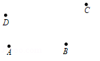
​​

【答案】
​​解：如图，①直线$DC$即为所求；

②射线$AC$即为所求；

③线段$AB$即为所求；

④延长线段$AB$到$E$使$BE = AB$。

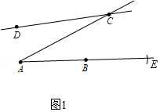   

【解析】​

## 7. （难度：适中）

按要求作图，并保留作图痕迹。
如图，已知线段\(a\)、\(b\)、\(c\)，用圆规和直尺作线段\(AD\)，使\(AD = a + 2b - c\)。

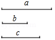

【答案】

解：如图所示：$AE$即为所求。

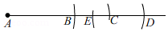    

【解析】​

## 8. （难度：适中）

尺规作图：如图，已知线段\(a\)、\(b\)，作一条线段，使它等于\(2a - b\)（保留作图痕迹）。

【答案】

解：如图，线段$AD$即为所求。

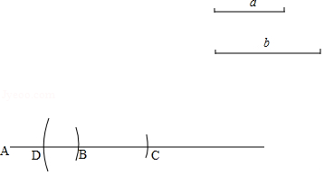    

【解析】​

## 9. 单选题（难度：非常简单）

木工师傅在锯木板时，往往先在木板两端用墨盒弹一根墨线然后再锯，这样做的数学道理是（　　）

- A. 两点确定一条直线
- B. 两点之间线段最短
- C. 在同一平面内，过直线外或直线上一点，有且只有一条直线垂直于已知直线
- D. 经过已知直线外一点，有且只有一条直线与已知直线平行

【答案】A

【解析】解：在木板两端用墨盒弹一根墨线然后再锯，这样做的数学道理是两点确定一条直线．
故选：A．

## 10. 单选题（难度：非常简单）

在墙壁上固定一根横放的木条，则至少需要钉子的枚数是（　　）

- A. 1枚
- B. 2枚
- C. 3枚
- D. 任意枚

【答案】B

【解析】解：∵两点确定一条直线，
∴至少需要2枚钉子．
故选：B．

## 11. 单选题

在墙壁上固定一根横放的木条，则至少需要（　　）枚钉子．

【答案】A

## 12. 单选题（难度：非常简单）

要在墙上固定一根木条，小明说只需要两根钉子，这其中用到的数学道理是（　　）

【答案】A

## 13. 单选题（难度：非常简单）

小红家分了一套住房，她想在自己的房间的墙上钉一根细木条，挂上自己喜欢的装饰物，那么小红至少需要几根钉子使细木条固定（　　）

【答案】A

## 14. 单选题（难度：非常简单）

如图，建筑工人砌墙时，经常在两个墙脚的位置分别插一根木桩，然后拉一条直的参照线，这种做法用几何知识解释应是（　　）

【答案】A

## 15. 单选题（难度：非常简单）

如图，工人砌墙时，先在两个墙脚的位置分别插一根木桩，再拉一条直的参照线，就能使砌的砖在一条直线上．这样做应用的数学知识是（　　）

【答案】A

## 16. 单选题（难度：非常简单）

如图，经过刨平的木板上的A，B两个点，能弹出一条笔直的墨线，而且只能弹出一条墨线，能解释这一实际应用的数学知识是（　　）

【答案】A

## 17. 单选题（难度：非常简单）

在下列现象中，体现了基本事实“两点确定一条直线”的有（　　）

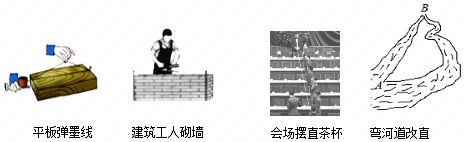

- A. 1个
- B. 2个
- C. 3个
- D. 4个

【答案】C

【解析】解：第一、二、三幅图中的生活、生产现象可以用基本事实“两点确定一条直线”来解释，第四幅图中利用的是“两点之间，线段最短”的知识．
故选：C．

## 18. 单选题（难度：非常简单）

如图，经过刨平的木板上的两个点，能弹出一条笔直的墨线，而且只能弹出一条墨线，能解释这一实际应用的数学知识是（　　）

【答案】A

## 19. 单选题（难度：非常简单）

用两个钉子把直木条钉在墙上，木条就固定了，这说明（　　）

【答案】A

## 20. 单选题（难度：非常简单）

植树时，为了使同一行树坑在一条直线上，只需定出两个树坑的位置，其中的数学道理是（　　）

- A. 两点之间线段最短
- B. 两点之间直线最短
- C. 两点确定一条射线
- D. 两点确定一条直线

【答案】D

【解析】解：只要定出两个树坑的位置，这条直线就确定了，即两点确定一条直线．
故选：D．

## 21. 单选题（难度：非常简单）

在墙壁上固定一根横放的木条，至少需要（　　）

【答案】A

## 22. 单选题（难度：非常简单）

已知点A在直线l上，点B，点C在直线l外，过A，B，C三点中两点画一条直线，那么直线的条数有（　　）

【答案】A

## 23. 单选题（难度：非常简单）

只需用两个钉子就可以把木条固定在墙上，其中蕴含的数学道理是（　　）

【答案】A

## 24. 单选题（难度：非常简单）

下列说法正确的是（　　）

- A. 延长射线AB到C
- B. 过三点能作且只能做一条直线
- C. 两点确定一条直线
- D. 若AC＝BC，则C是线段AB的中点

【答案】C

【解析】解：A、射线本身是无限延伸的，不能延长，故本选项错误；
B、只有三点共线时才能做一条直线，故本选项错误；
C、两点确定一条直线，故本选项正确；
D、若AC＝BC，此时点C在线段AB的垂直平分线上，故本选项错误；
故选：C．

## 25. 单选题（难度：非常简单）

下列四个生活、生产现象：①用两个钉子就可以把木条固定在墙上；②植树时，只要定出两棵树的位置，就能确定同一行树所在的直线；③从A地到B地架设电线，总是尽可能沿着线段AB架设；④把弯曲的公路改直，就能缩短路程．其中可用“两点确定一条直线”来解释的现象有（　　）

【答案】A

## 26. 单选题（难度：非常简单）

在墙壁上固定一根横放的木条，则至少需要钉子的枚数是（　　）

【答案】A

## 27. 单选题（难度：非常简单）

小明想在墙上钉一根细木条，要使细木条固定，至少需钉的钉子个数是（　　）

【答案】A

## 28. 单选题（难度：非常简单）

下列说法正确的是（　　）

【答案】A

## 29. 单选题（难度：非常简单）

如果你想将一根细木条固定在墙上，至少需要几个钉子（　　）

【答案】A

## 30. 单选题（难度：非常简单）

如图，林林的爸爸只用两枚钉子就把一根木条固定在墙上，下列语句能解释这个原理的是（　　）

- A. 木条是直的
- B. 两点确定一条直线
- C. 过一点可以画无数条直线
- D. 一个点不能确定一条直线

【答案】B

【解析】解：根据两点确定一条直线，故选B．

## 31. 单选题（难度：非常简单）

已知A、B、C三点，过其中任意两点画直线，一共可以画多少条直线（　　）

- A. 1
- B. 3
- C. 3或1
- D. 无数条

【答案】C

【解析】解：如图最多可以画3条直线，最少可以画1条直线；

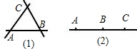
．
故选：C．

## 32. 单选题（难度：非常简单）

如图，在墙上固定一根木条，至少要固定两个点，能解释这一实际应用的数学知识是（　　）

- A. 两点确定一条直线
- B. 两点之间，线段最短
- C. 直线上有无数个点
- D. 点动成线

【答案】A

【解析】解：在墙上固定一根木条，至少要固定两个点，能解释这一实际应用的数学知识是两点确定一条直线，
故选：A．

## 33. 单选题（难度：非常简单）

平面上有A、B、C三点，经过任意两点画一条直线，可以画出直线的数量为（　　）

- A. 1条
- B. 3条
- C. 1条或3条
- D. 无数条

【答案】C

【解析】解：①如果三点共线，过其中两点画直线，共可以画1条；

②如果任意三点不共线，过其中两点画直线，共可以画3条．

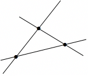

故选：C．

## 34. 单选题（难度：非常简单）

在下列生活，生产现象中，不可以用基本事实“两点确定一条直线”来解释的有（　　）

【答案】A

## 35. 单选题（难度：非常简单）

下列说法中：①射线MN与射线NM是同一条射线；②连接两点间的线段的长度叫做这两点的距离；③两点之间直线最短；④把一个角分成两个角的射线叫做这个角的角平分线．正确的有（　　）个．

【答案】A

## 36. 单选题（难度：简单）

如图，OC是∠AOB的角平分线，∠BOD\( =\frac{1}{3}\)∠COD，∠BOD＝20°，则∠AOD的度数等于（　　）

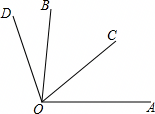

- A. 130°
- B. 120°
- C. 110°
- D. 100°

【答案】D

【解析】解：∵∠BOD\( =\frac{1}{3}\)∠COD，∠BOD＝20°，
∴∠COD＝3∠BOD＝60°，
∴∠BOC＝∠COD﹣∠BOD＝40°，
∵OC是∠AOB的角平分线，
∴∠AOB＝2∠BOC＝80°，
∴∠AOD＝∠AOB+∠BOD＝80°+20°＝100°．
故选：D．

## 37. 单选题（难度：简单）

如图，点O在直线AB上，OC平分∠BOD，若∠COD＝20°，则∠AOD的度数是（　　）

【答案】A

## 38. 单选题（难度：简单）

如图，∠ABC＝∠DCE＝90°，∠A＝45°，∠EDC＝60°，若DC平分∠BDE，则∠BCE的度数为（　　）

【答案】A

## 39. 单选题（难度：简单）

如图，∠AOC为直角，OC是∠BOD的平分线，且∠AOB＝78°，则∠AOD的度数是（　　）

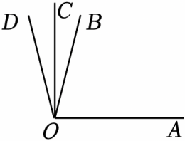

- A. 102°
- B. 108°
- C. 110°
- D. 112°

【答案】A

【解析】解：∵∠AOC为直角，
∴∠AOC＝90°，
∵∠AOB＝78°，
∴∠BOC＝∠AOC﹣∠AOB＝90°﹣78°＝12°，
∵OC是∠BOD的平分线，
∴∠COD＝12°，
∴∠AOD＝102°，
故选：A．

## 40. 单选题（难度：非常简单）

如图，OA方向是北偏西40°方向，OB平分∠AOC，则∠BOC的度数为（　　）

【答案】A

## 41. 单选题（难度：简单）

如图，射线OC平分∠AOB．若∠AOB＝58°，则∠COB的度数为（　　）

【答案】A

## 42. 单选题（难度：简单）

∠AOC为直角，OC是∠BOD的平分线，且∠AOB＝57.65°，则∠AOD的度数是（　　）

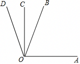

- A. 122°20′
- B. 122°21′
- C. 122°22′
- D. 122°23′

【答案】B

【解析】解：∵∠AOC为直角，∠AOB＝57.65°，
∴∠BOC＝90°﹣57.65°＝32.35°，
∵OC是∠BOD的平分线，
∴∠DOC＝∠COB＝32.35°，
∴∠AOD＝90°+32.35°＝122.35°＝122°21′．
故选：B．

## 43. 单选题（难度：非常简单）

如图，∠AOC为直角，OC是∠BOD的平分线，且∠AOB＝34°，则∠AOD的度数为（　　）

【答案】A

## 44. 单选题（难度：简单）

如图，OB，OC是∠AOD的任意两条射线，OM平分∠AOB，ON平分∠COD，若∠MON＝α，∠BOC＝β，则表示∠AOD的代数式为（　　）

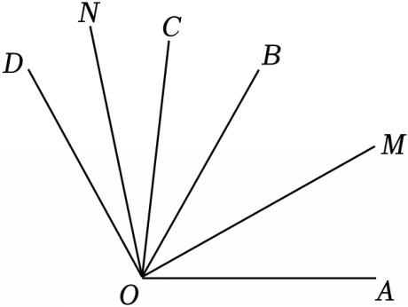

- A. 2α﹣β
- B. α﹣β
- C. α+β
- D. 2α

【答案】A

【解析】解：∵∠MON＝α，∠BOC＝β
∴∠MON﹣∠BOC＝∠CON+∠BOM＝α﹣β
又∵OM平分∠AOB，ON平分∠COD
∴∠CON＝∠DON，∠AOM＝∠BOM
由题意得∠AOD＝∠MON+∠DON+∠AOM＝∠MON+∠CON+∠BOM＝α+（α﹣β）＝2α﹣β．
故选：A．

## 45. 单选题（难度：简单）

如图，点C，D在直线AB上，点E，F在直线AB的同侧，连接DF．若∠ACE＝140°，CF平分∠ECB，则图中大小为20°的角是（　　）

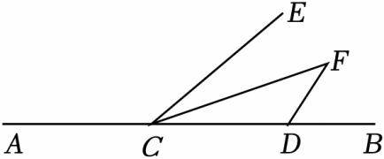

- A. ∠ECB
- B. ∠F
- C. ∠FDB
- D. ∠ECF

【答案】D

【解析】解：∵∠ACE＝140°，
∴∠BCE＝180°﹣∠ACE＝40°，
∵CF平分∠ECB，
∴\( \angle ECF=\angle FCB=\frac{1}{2}\angle BCE=20°\)，
由∠FDC的度数未知，所以不能确定∠F，∠FDB的度数，
故选：D．

## 46. 单选题（难度：适中）

已知线段<latex class="math-tex">\( AB\)</latex>和线段<latex class="math-tex">\( CD\)</latex>，以下方法一定能说明线段<latex class="math-tex">\( AB\)</latex>比线段<latex class="math-tex">\( CD\)</latex>短的是（    ）

【答案】A

## 47. 单选题（难度：简单）

平面内三点可确定的直线的条数为（    ）．

【答案】A

## 48. 单选题（难度：简单）

下列说法：①过两点只能画一条直线；②过两点只能画一条射线；③过两点只能画一条线段；④过两点只能画两条射线．其中正确的有（   ）

【答案】A

## 49. 单选题（难度：简单）

经过同一平面内任意四点中，两点共可画（　　）条直线

【答案】A

## 50. 单选题（难度：适中）

以下说法正确的是（    ）

【答案】A

## 51. 单选题（难度：适中）

由曹县站始发，终点到达济南站的某一班次列车，运行途中停靠的车站依次是：菏泽——嘉祥——济宁——兖州——泰山．那么要为这一班次列车制作的单程车票为（   ）

【答案】A

## 52. （难度：简单）

下列说法中，正确的有（    ）
A．过一点有且只有一条直线  
B．连接两点的线段叫做两点的距离
C．两点之间，线段最短  
D．\( AB=BC\)，则点B是线段\( AC\)的中点

【答案】

C

【解析】解：过一点有无数条直线，
∴ A错误；
连接两点的线段的长度叫做两点的距离，
∴ B错误；
两点之间，线段最短，
∴ C正确；
\( AB=BC\)时，点B不一定在线段\( AC\)上，也不一定是线段\( AC\)的中点，
∴ D错误．
故选：C．

## 53. 单选题（难度：适中）

往返<latex class="math-tex">\( A\)</latex>，<latex class="math-tex">\( B\)</latex>两地的客车，中途停靠两个站，客运站根据两站之间的距离确定票价（距离不相等，票价就不同）．若任意两站之间的距离都不相等，则不同的票价共有（  ）

【答案】A

## 54. 单选题（难度：简单）

平面上有五个点，其中只有三点在一条直线上，此外无其他三点共线，经过这些点可以作直线的条数是（   ）

【答案】A

## 55. （难度：简单）

如图，下列说法正确的是（   ）A．图中有2条线段  B．图中有3条直线C．图中有6条射线  D．以上说法都不对

## 56. 单选题（难度：简单）

图中以<latex class="math-tex">\( C\)</latex>为端点的线段有（    ）

【答案】A

## 57. 单选题（难度：适中）

如图，点A、B、C是直线<latex class="math-tex">\( l\)</latex>上的三个点，则图中共有线段、射线条数分别是（   ）

【答案】A

## 58. 单选题（难度：简单）

如图，共有线段（　　）

【答案】A

## 59. 单选题（难度：适中）

如图，图中线段条数为（    ）

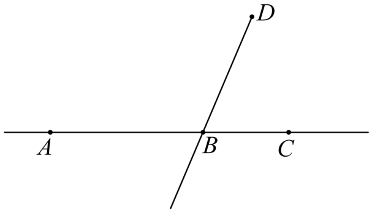

- A. 4
- B. 5
- C. 6
- D. 8

【答案】A

【解析】解：以\( A\)为端点的线段：\( AB\)、\( AC\)；
以\( B\)为端点的线段\( BD\)、\( BC\)；
\( \therefore \)图中线段条数为\( 4\)条，
故选：A．

## 60. 单选题（难度：适中）

如图，在一条公路上有五个车站，依次为A，M，C，N，B，车站要准备车票，一共要准备（    ）种车票．

【答案】A

## 61. （难度：适中）

图是某同学在体育课上投掷四次铅球的成绩示意图，则该同学投掷铅球最好的成绩是（　　）A．<latex class="math-tex">\( OF\)</latex>的长  B．<latex class="math-tex">\( OE\)</latex>的长  C．<latex class="math-tex">\( OD\)</latex>的长  D．<latex class="math-tex

## 62. 单选题（难度：适中）

棋盘上有黑、白两色棋子若干，若把颜色相同的三颗棋子在同一条直线上看作一条直线．请你根据图示，判断满足这种条件的直线共有（    ）

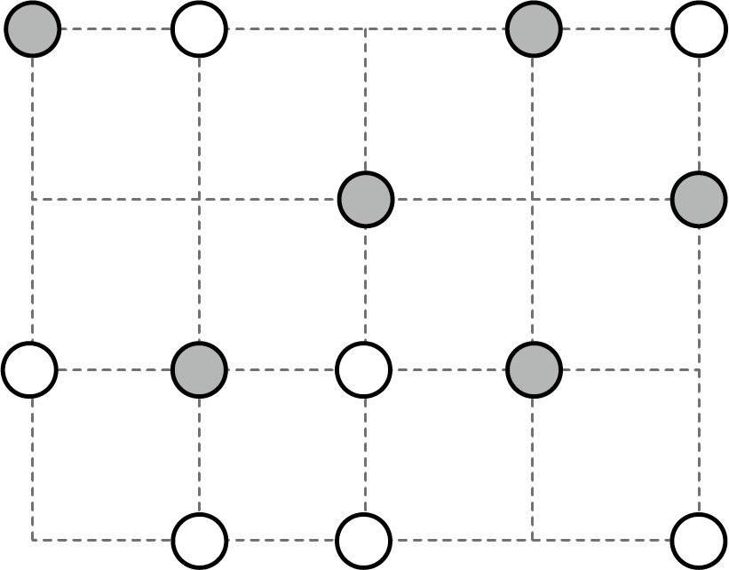

- A. 5条
- B. 4条
- C. 3条
- D. 2条

【答案】C

【解析】解：如图所示：

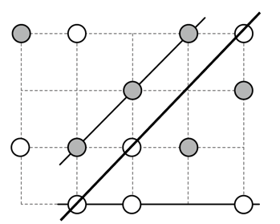

满足条件的直线共有3条．
故选：C

## 63. 单选题（难度：适中）

如图中射线的条数为（   ）

【答案】A

## 64. （难度：简单）

如图所示，直线、射线、线段能相交的是（   ）
A．
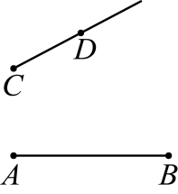
  
B．
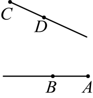
  
C．
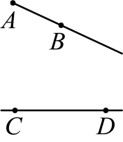
  
D．
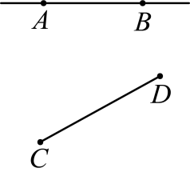

【答案】

C

【解析】解：A、射线\( CD\)延伸后不能与线段\( AB\)相交，故本选项不符合题意；
B、射线\( CD\)和\( AB\)延伸后不能相交，故本选项不符合题意；
C、射线\( AB\)和直线\( CD\)延伸后能相交，故本选项符合题意；
D、直线\( AB\)延伸后不能与线段\( CD\)相交，故本选项不符合题意；
故选：C．

## 65. 单选题（难度：简单）

下列几何图形与相应语言描述相符的是（　　）

【答案】A
