# 4.3 线段的长短（同步练习）

> 教材：数学·七年级上册·沪科技版2024新教材 ｜ 来源：国家中小学智慧教育平台·在线练习 ｜ 共 78 题

## 1. 填空题（难度：简单）

如图，点\(C\)是线段\(AB\)的中点，若\(AC = 2{\rm{cm}}\)，则\(AB = \)\({\rm{cm}}\)。

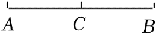

【答案】4

【解析】​

## 2. 单选题（难度：适中）

下列说法中正确的是\((\)　　\()\)。

- A. 若\(AP = \frac{1}{2}AB\)，则\(P\)是\(AB\)的中点
- B. 若\(AB = 2PB\)，则\(P\)是\(AB\)的中点
- C. 若\(AP = PB\)，则\(P\)是\(AB\)的中点
- D. 若\(AP = PB = \frac{1}{2}AB\)，则\(P\)是\(AB\)的中点

【答案】D

【解析】​

## 3. 单选题（难度：简单）

如图，小林利用圆规在线段\(CE\)上截取线段\(CD\)，使\(CD = AB\)．若点\(D\)恰好为\(CE\)的中点，则下列结论中错误的是\((\)　　\()\)。

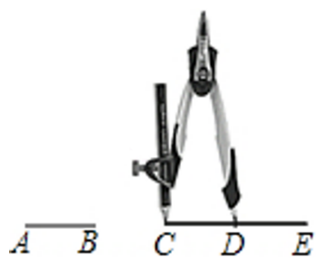

- A. \(CD = DE\)
- B. \(AB = DE\)
- C. \(CE = \frac{1}{2}CD\)
- D. \(CE = 2AB\)

【答案】C

【解析】​

## 4. 填空题（难度：适中）

如图，点\(D\)是\(AB\)的中点，\(AC = 8\)，\(BC = 4\)，线段\(CD\)的长度为 。

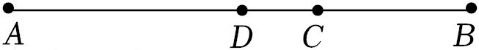

【答案】2

【解析】​

## 5. 填空题（难度：适中）

如图，线段\(AB = 8{\rm{cm}}\)，\(C\)是\(AB\)上一点，\(M\)是\(AC\)的中点，\(N\)是\(BC\)的中点，则\(MN = \)\({\rm{cm}}\)。

【答案】$4{\rm{cm}}$

【解析】​

## 6. 填空题（难度：适中）

如图，线段\(AB = 10{\rm{cm}}\)，点\(C\)为线段\(AB\)上一点，\(BC = 3{\rm{cm}}\)，点\(D\)，\(E\)分别为\(AC\)和\(AB\)的中点，则线段\(DE\)的长为\({\rm{cm}}\)。

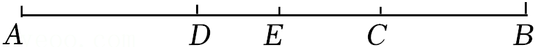

【答案】$1.5{\rm{cm}}$

【解析】​

## 7. （难度：适中）

如图，点\(C\)是线段\(AB\)的中点，点\(D\)是线段\(BC\)的一个三等分点。若\(AB = 18\)，求线段\(CD\)的长。

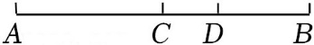

【答案】

解：$\because C$为线段$AB$的中点，$AB = 18$，

$\therefore CB = \frac{1}{2}AB = 9$，

$\because $点$D$是线段$BC$的一个三等分点，

$\therefore DB = \frac{1}{3}AB = 6$，

$\therefore CD = CB - DB = 3$。

【解析】​

## 8. 单选题（难度：非常简单）

A，B两点间的距离是（　　）

- A. 联结A，B两点的线段
- B. 联结A，B两点的线段的长度
- C. 过A，B两点的直线
- D. 过A，B两点的线段

【答案】B

【解析】解：A、B两点间的距离是联结A、B两点的线段的长度．
故选：B．

## 9. 单选题（难度：非常简单）

在下列现象中，不可以用基本事实“两点确定一条直线”来解释的有（　　）
①木匠弹墨线；
②打靶瞄准；
③弯曲公路改直；
④拉绳插秧．

- A. 1个
- B. 2个
- C. 3个
- D. 4个

【答案】A

【解析】解：①木匠弹墨线，可以用基本事实“两点确定一条直线”来解释；
②打靶瞄准，可以用基本事实“两点确定一条直线”来解释；
③弯曲公路改直，不可以用基本事实“两点确定一条直线”来解释；
④拉绳插秧，可以用基本事实“两点确定一条直线”来解释．
故选：A．

## 10. 单选题（难度：非常简单）

在开会前，工作人员进行会场布置，在主席台上由两人拉着一条绳子，然后以“准绳”摆放整齐的茶杯，这样做的理由是（　　）

【答案】A

## 11. 单选题（难度：非常简单）

如图，点C在线段AB上，点E、F分别是线段AB、AC的中点，若EF＝3，则BC的长为（　　）

【答案】A

## 12. 单选题（难度：非常简单）

已知C是线段AB的中点，则 <latex class="math-tex">\( \frac{BC}{AB}\)</latex>的值为（　　）

【答案】A

## 13. 单选题（难度：非常简单）

如图，点A，B，C在同一直线上，H为AC的中点，M为AB的中点，N为BC的中点．下列结论中错误的是（　　）

【答案】A

## 14. 单选题（难度：非常简单）

把一条弯曲的公路改成直道，可以缩短路程．用几何知识解释其中的道理，正确的是（　　）

- A. 经过两点有一条直线，并且只有一条直线
- B. 两点之间的所有连线中，线段最短
- C. 线段有两个端点
- D. 线段比曲线短

【答案】B

【解析】解：一条弯曲的公路改成直道，可以缩短路程．用几何知识解释其中的道理是：两点之间的所有连线中，线段最短．
故选：B．

## 15. 单选题（难度：非常简单）

如图，把三角形剪去一个角，所得四边形的周长比原三角形的周长小，能正确解释这一现象的数学知识是（　　）

【答案】A

## 16. 单选题（难度：非常简单）

把一条弯曲的公路改成直道，可以缩短路程，用几何知识解释其道理，正确的是（　　）

- A. 两点之间，线段最短
- B. 两点之间线段的长度叫做这两点之间的距离
- C. 经过一点有无数条直线
- D. 两点确定一条直线

【答案】A

【解析】解：其道理是两点之间线段最短．
故选：A．

## 17. 单选题（难度：非常简单）

毛泽东主席在《水调歌头•游泳》中写道“一桥飞架南北，天堑变通途”．例如山西临猗黄河大桥是山西省西南部通往陕西省渭南、铜川等地的重要运输通道．建成后，运城市至陕西省铜川市的通车时间从4小时缩短至2.5小时，极大地缩短了两地之间的交通时间．用所学数学知识解释这一现象恰当的是（　　）

- A. 过一点可以画多条直线
- B. 两点确定一条直线
- C. 两点之间线段最短
- D. 连接两点间线段的长度是两点间的距离

【答案】C

【解析】解：用所学数学知识解释这一现象恰当的是：两点之间线段最短．
故选：C．

## 18. （难度：简单）

如图，已知A，B（B在A的左侧）是数轴上的两点，点A对应的数为12，且<latex class="math-tex">\( AB=18\)</latex>，动点P从点A出发，以每秒2个单位长度的速度沿数轴向左运动，点P在向左的运动过程中，M，N始终为<latex class="math-tex">\( AP，PB\)</latex>的中点，设运动时间为<latex class="math-tex"

## 19. 单选题（难度：适中）

下列说法中错误的有（   ）①用两个钉子把木条固定在墙上，数学原理是“两点确定一条直线”；②如果线段<latex class="math-tex">\( AB\)</latex>等于线段<latex class="math-tex">\( BC\)</latex>，则点<latex class="math-tex">\( B\)</latex>是线段<latex class="math-tex">

【答案】A

## 20. （难度：适中）

如图，已知数轴上点A、B、C所对应的数a、b、c都不为0，且C是<latex class="math-tex">\( AB\)</latex>的中点，如果<latex class="math-tex">\( |a+b|-|a-2c|+|b-2c|-|a+b-2c|=0\)</latex>，则原点O的大致位置在（    ）A．A的左边  B．A与C之间C．C与B之间  D．B的右边

## 21. （难度：适中）

如图，点<latex class="math-tex">\( B\)</latex>在线段<latex class="math-tex">\( AC\)</latex>上，且<latex class="math-tex">\( BC=3AB\)</latex>，点<latex class="math-tex">\( D\)</latex>是线段<latex class="math-tex">\(

## 22. （难度：适中）

小明进行了如下操作，下列说法中错误的是（   ）①作射线<latex class="math-tex">\( AM\)</latex>；②在射线<latex class="math-tex">\( AM\)</latex>上依次截取<latex class="math-tex">\( AC=CD=a\)</latex>；③在线段<latex class="math-tex">\( DA\)</la

## 23. 单选题（难度：简单）

已知点<latex class="math-tex">\( A\)</latex>，<latex class="math-tex">\( B\)</latex>，<latex class="math-tex">\( C\)</latex>在同一条直线上，如果<latex class="math-tex">\( AB=9\)</latex>，线段<latex class="math-tex">\(

【答案】A

## 24. 单选题

如图，线段<latex class="math-tex">\( AB\)</latex>上有C，D两点，且<latex class="math-tex">\( AD=\frac{1}{3}AB=5\)</latex>，C是<latex class="math-tex">\( AD\)</latex>的中点，则线段<latex class="math-tex">\( BC\)</latex>的长为（

【答案】A

## 25. 单选题

有两根木条，一根<latex class="math-tex">\( AB\)</latex>长为<latex class="math-tex">\( 80\text{cm}\)</latex>，另一根<latex class="math-tex">\( CD\)</latex>长为<latex class="math-tex">\( 130\text{cm}\)</latex>，在它们的中点处各

【答案】A

## 26. 单选题

如图，点<latex class="math-tex">\( P\)</latex>在线段<latex class="math-tex">\( AB\)</latex>的延长线上，<latex class="math-tex">\( BP=64\)</latex>，记线段<latex class="math-tex">\( AP\)</latex>和<latex class="math-tex">

【答案】A

## 27. 单选题

如图，已知线段<latex class="math-tex">\( AB=10\text{cm}\)</latex>，<latex class="math-tex">\( M\)</latex>是<latex class="math-tex">\( AB\)</latex>中点，点<latex class="math-tex">\( N\)</latex>在<latex class="math-t

【答案】A

## 28. 

已知有理数<latex class="math-tex">\( a，b\)</latex>满足：<latex class="math-tex">\( {\left|a-4\right|}^{2}+{\left(2-b\right)}^{2}=0\)</latex>．如图，线段<latex class="math-tex">\( BC\)</latex>在直线<latex class="math-t

## 29. 单选题（难度：简单）

线段<latex class="math-tex">\( AB=12\text{cm}\)</latex>，M是线段<latex class="math-tex">\( AB\)</latex>的中点，C为线段<latex class="math-tex">\( MB\)</latex>上一点，且<latex class="math-tex">\( MC:MB=1:3\)</latex>，则线段<

【答案】A

## 30. 单选题（难度：简单）

下列说法中，正确的是（    ）

【答案】A

## 31. 单选题（难度：简单）

直线上有三个点A、B、C，C在线段<latex class="math-tex">\( AB\)</latex>的延长线上，且<latex class="math-tex">\( AB=10\text{cm},BC=4\text{cm},P\mathrm{、}Q\)</latex>分别是<latex class="math-tex">\( AC\mathrm{、}BC\)</latex>的中点，则

【答案】A

## 32. 单选题（难度：简单）

下列说法中正确的是（   ）

【答案】A

## 33. 单选题（难度：简单）

下列说法中，正确的是（    ）<latex class="math-tex">\( \mathrm{①}\)</latex>射线<latex class="math-tex">\( AB\)</latex>和射线<latex class="math-tex">\( BA\)</latex>是同一条射线；<latex class="math-tex">\( \mathrm{②}\)</latex>

【答案】A

## 34. 单选题（难度：简单）

下列说法正确的是（    ）

【答案】A

## 35. 单选题（难度：简单）

下列说法正确的是（   ）

【答案】A

## 36. 单选题（难度：简单）

有下列说法正确的是（   ）

【答案】A

## 37. 单选题（难度：非常简单）

如图，点C是线段<latex class="math-tex">\( AB\)</latex>上的点，点D是线段<latex class="math-tex">\( AB\)</latex>的中点，若<latex class="math-tex">\( AB=16\)</latex>，<latex class="math-tex">\( AC=10\)</latex>，则<latex class=

【答案】A

## 38. 单选题（难度：简单）

如图，线段<latex class="math-tex">\( AB\)</latex>上有C，D两点，且<latex class="math-tex">\( AD=\frac{1}{3}AB=5\)</latex>，C是<latex class="math-tex">\( AD\)</latex>的中点，则线段<latex class="math-tex">\( BC\)</latex>的长为（

【答案】A

## 39. 单选题（难度：非常简单）

如图，点D为线段<latex class="math-tex">\( AB\)</latex>上一点，点C为<latex class="math-tex">\( BD\)</latex>的中点，<latex class="math-tex">\( AD=2\text{cm}，AB=7\text{cm}\)</latex>，则<latex class="math-tex">\( CD\)</late

【答案】A

## 40. 单选题（难度：简单）

如图，点<latex class="math-tex">\( C\)</latex>是线段<latex class="math-tex">\( AB\)</latex>的中点，点<latex class="math-tex">\( D\)</latex>在线段<latex class="math-tex">\( AC\)</latex>上，且<latex class="math-tex">\( A

【答案】A

## 41. 单选题（难度：简单）

如图，线段<latex class="math-tex">\( AC=6\text{cm}\)</latex>，线段<latex class="math-tex">\( BC=15\text{cm}\)</latex>，点<latex class="math-tex">\( M\)</latex>是<latex class="math-tex">\( AC\)</latex>的中点，在<latex

【答案】A

## 42. 单选题（难度：简单）

如图，<latex class="math-tex">\( C\)</latex>为线段<latex class="math-tex">\( AB\)</latex>上的一点，<latex class="math-tex">\( AC=3\text{cm}\)</latex>，<latex class="math-tex">\( D,E\)</latex>分别为<latex class="math

【答案】A

## 43. 单选题（难度：简单）

如图，\( AB=12\)，\( C\)为\( AB\)的中点，点\( D\)在线段\( AC\)上，且\( AD:CB=1:3\)，则\( DB\)长度为（   ）

- A. 4
- B. 6
- C. 8
- D. 10

【答案】D

【解析】解：∵\( AB=12\)，\( C\)为\( AB\)的中点，
∴\( CB=\frac{1}{2}AB=6\)，
∵\( AD:CB=1:3\)，
∴\( AD=\frac{1}{3}CB=2\)，
∵\( DB=AB-AD\)，
∴\( DB=12-2=10\)，
故选：D．

## 44. 单选题（难度：简单）

如图，点P是线段<latex class="math-tex">\( AB\)</latex>的中点，点Q是线段<latex class="math-tex">\( AP\)</latex>的中点，如果<latex class="math-tex">\( PQ=2\text{cm}\)</latex>，则<latex class="math-tex">\( BQ\)</latex>的长为（

【答案】A

## 45. 单选题（难度：简单）

如图，\( BC=8\text{cm}\)，\( BD=14\text{cm}\)，若D为线段\( AC\)的中点，则线段\( AD\)的长为（    ）

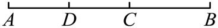

- A. \( 6\text{cm}\)
- B. \( 8\text{cm}\)
- C. \( 10\text{cm}\)
- D. \( 12\text{cm}\)

【答案】A

【解析】解：∵\( D\)是\( AC\)的中点，
∴\( AD=CD\)．
∵\( BC=8\text{cm}\)，\( BD=14\text{cm}\)，
∴\( AD=CD=DB-CB\) \( =14-8=6\text{cm}\)．
故选：A．

## 46. 单选题（难度：非常简单）

如图，<latex class="math-tex">\( A,B,C,\)</latex>三点共线，<latex class="math-tex">\( M,N\)</latex>分别是<latex class="math-tex">\( AB\)</latex>、<latex class="math-tex">\( BC\)</latex>的中点，若<latex class="math-tex

【答案】A

## 47. 单选题（难度：非常简单）

如图，点D是线段\( AC\)上一点，点C是线段\( AB\)的中点，则下列等式不成立的是（   ）

- A. \( AD+BD=AB\)
- B. \( BD-CD=CB\)
- C. \( AB=2AC\)
- D. \( AD=\frac{1}{2}AC\)

【答案】D

【解析】解： \( \because \)点D是线段\( AC\)上一点
\( \therefore AD+BD=AB\)、\( BD-CD=CB\)
因此A、B不符合题意；
\( \because \)点C是线段\( AB\)的中点
\( \therefore AC=BC\) 
\( \therefore AB=2AC\) 
因此C不符合题意；
\( \because \)点D不一定是线段\( AC\)的中点
\( \therefore AD=\frac{1}{2}AC\)不一定成立
因此D符合题意．
故选：D．

## 48. 单选题（难度：非常简单）

如图，点B在直线\( AP\)上，点M、N分别是线段\( AB\mathrm{、}BP\)的中点，点B在线段\( AP\)上，\( AP=15\)，则线段\( MN\)的长度为（   ）

- A. 5
- B. \( 7.5\)
- C. \( 15\)
- D. \( 30\)

【答案】B

【解析】解：由题意得：\( MB=\frac{1}{2}AB,NB=\frac{1}{2}BP\)，
∴\( MN=MB+NB=\frac{1}{2}\left(AB+BP\right)=\frac{1}{2}AP=7.5\)，
故选：B

## 49. 单选题（难度：简单）

如图，点C在线段<latex class="math-tex">\( AB\)</latex>的延长线上，<latex class="math-tex">\( BC=2AB\)</latex>，点D是线段<latex class="math-tex">\( AC\)</latex>的中点，<latex class="math-tex">\( AB=2\text{cm}\)</latex>，则<la

【答案】A

## 50. 单选题（难度：简单）

如图，点<latex class="math-tex">\( A\)</latex>、<latex class="math-tex">\( C\)</latex>、<latex class="math-tex">\( D\)</latex>在同一直线上，<latex class="math-tex">\( AC=6\text{cm}\)</latex>，<latex class="math-tex

【答案】A

## 51. 单选题（难度：非常简单）

如图，点C在线段<latex class="math-tex">\( AB\)</latex>上，<latex class="math-tex">\( AC=4\text{cm},CB=6\text{cm}\)</latex>，点M、N分别是<latex class="math-tex">\( AC\mathrm{、}BC\)</latex>的中点，则<latex class="math-tex"

【答案】A

## 52. 单选题（难度：简单）

如图，点<latex class="math-tex">\( A\)</latex>、<latex class="math-tex">\( C\)</latex>、<latex class="math-tex">\( D\)</latex>在同一直线上，<latex class="math-tex">\( AC=7\text{cm}\)</latex>，<latex class="math-tex

【答案】A

## 53. 单选题（难度：简单）

点<latex class="math-tex">\( C\)</latex>是线段<latex class="math-tex">\( AB\)</latex>的中点，点<latex class="math-tex">\( D\)</latex>是直线<latex class="math-tex">\( AB\)</latex>上的一点，且<latex class="math-tex">\( B

【答案】A

## 54. 单选题（难度：简单）

在射线\( OP\)上截取\( OC=5\text{cm}\)，在射线\( CO\)上截取\( CD=3\text{cm}\)，点\( A\)、\( B\)分别是线段\( OC\)、\( CD\)的中点，那么线段\( AB\)的长等于（    ）

- A. \( 2.5\text{cm}\)
- B. \( 1.5\text{cm}\)
- C. \( 4\text{cm}\)
- D. \( 1\text{cm}\)

【答案】D

【解析】解∶如图，

   
∵\( OC=5\text{cm}\)，点A是线段\( OC\)的中点，
∴\( AC=\frac{1}{2}OC=2.5\text{cm}\)，
∵\( CD=3\text{cm}\)，点\( B\)是线段\( CD\)的中点，
∴\( BC=\frac{1}{2}CD=1.5\text{cm}\)，
∴\( AB=CA-CB=1\text{cm}\)
故选：D．

## 55. 单选题（难度：简单）

若点<latex class="math-tex">\( C\)</latex>是线段<latex class="math-tex">\( AB\)</latex>中点，点<latex class="math-tex">\( D\)</latex>、点<latex class="math-tex">\( E\)</latex>是线段<latex class="math-tex">\( CB\)</

【答案】A

## 56. 单选题（难度：简单）

如图所示，点C在线段\( AB\)上，\( AB=30\)，\( AC=12\)，点M，N分别是\( AB\)，\( BC\)的中点．则\( MN\)的长度是（   ）

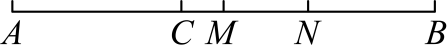

- A. 2
- B. 4
- C. 6
- D. 8

【答案】C

【解析】解：\( \because AB=30\)，\( AC=12\)，
\( \therefore BC=AB-AC=30-12=18\)，
\( \because \)点M，N分别是\( AB\)，\( BC\)的中点，
\( \therefore BM=\frac{1}{2}AB=\frac{1}{2}\times 30=15\)，
\( BN=\frac{1}{2}BC=\frac{1}{2}\times 18=9\)，
\( \therefore MN=BM-BN=15-9=6\)，
故选：C．

## 57. 单选题（难度：适中）

已知线段<latex class="math-tex">\( AB=10\text{cm}\)</latex>，点C是直线<latex class="math-tex">\( AB\)</latex>上一点，<latex class="math-tex">\( BC=4\text{cm}\)</latex>，若M是<latex class="math-tex">\( AC\)</latex>的中点

【答案】A

## 58. 单选题（难度：适中）

下列说法中错误的有（   ）①用两个钉子把木条固定在墙上，数学原理是“两点确定一条直线”；②如果线段<latex class="math-tex">\( AB\)</latex>等于线段<latex class="math-tex">\( BC\)</latex>，则点<latex class="math-tex">\( B\)</latex>是线段<latex class="math-tex">

【答案】A

## 59. 单选题（难度：简单）

如图，点C是线段<latex class="math-tex">\( AB\)</latex>的中点，<latex class="math-tex">\( AC=8\)</latex>，点D在线段<latex class="math-tex">\( CB\)</latex>上，且<latex class="math-tex">\( DB=3\)</latex>，则线段<latex class="m

【答案】A

## 60. 单选题（难度：简单）

规定：如果折线<latex class="math-tex">\( A-O-C\left(OA<OC\right)\)</latex>上有个点<latex class="math-tex">\( P\)</latex>，且满足<latex class="math-tex">\( AO+OP=CP\)</latex>，那么<latex class="math-tex">\( P\)</latex>就

【答案】A

## 61. 单选题（难度：简单）

如图，点D是线段<latex class="math-tex">\( AB\)</latex>的中点，若<latex class="math-tex">\( AB=20\)</latex>，<latex class="math-tex">\( AC=12\)</latex>，则<latex class="math-tex">\( CD\)</latex>的长度为（   ）

【答案】A

## 62. 单选题（难度：简单）

如图，已知线段<latex class="math-tex">\( AB=16\text{cm}\)</latex>，点M在<latex class="math-tex">\( AB\)</latex>上，<latex class="math-tex">\( AM:BM=1:3\)</latex>，P，Q分别为<latex class="math-tex">\( AM\)</latex>，<lat

【答案】A

## 63. 单选题（难度：适中）

如图，C是线段<latex class="math-tex">\( AB\)</latex>上任意一点，M，N分别是<latex class="math-tex">\( AC，BC\)</latex>的三等分点且<latex class="math-tex">\( AM=\frac{1}{3}AC\)</latex>，<latex class="math-tex">\( BN=\frac{1}{3

【答案】A

## 64. 单选题（难度：适中）

如图，点<latex class="math-tex">\( P\)</latex>在线段<latex class="math-tex">\( AB\)</latex>的延长线上，<latex class="math-tex">\( BP=64\)</latex>，记线段<latex class="math-tex">\( AP\)</latex>和<latex class="math-tex">

【答案】A

## 65. 单选题（难度：适中）

如图所示，\( C\)是线段\( AB\)上的点，\( M\mathrm{、}N\)分别是\( AC\mathrm{、}BC\)的中点，若\( CB=3\text{cm}\)，\( MN=4.5\text{cm}\)，则线段\( MB\)的长度是（　　）

- A. \( 6\text{cm}\)
- B. \( 6.5\text{cm}\)
- C. \( 7\text{cm}\)
- D. \( 7.5\text{cm}\)

【答案】A

【解析】解：∵\( N\)是\( BC\)的中点，
∴\( NB=\frac{1}{2}CB=1.5\text{cm}\)，
∴\( MB=MN+NB=4.5+1.5=6\left(\text{cm}\right)\)，
故选：\( \text{A}\)．

## 66. 单选题（难度：适中）

如图，点<latex class="math-tex">\( C\)</latex>是线段<latex class="math-tex">\( AB\)</latex>的中点，点<latex class="math-tex">\( D\)</latex>是线段<latex class="math-tex">\( CB\)</latex>的中点，下列说法错误的是（    ）

【答案】A

## 67. 单选题（难度：适中）

已知点<latex class="math-tex">\( C\)</latex>在直线<latex class="math-tex">\( AB\)</latex>上，线段<latex class="math-tex">\( AB=6\)</latex>，点<latex class="math-tex">\( D\)</latex>是<latex class="math-tex">\( AC\)

【答案】A

## 68. 单选题（难度：适中）

如图，点C在线段<latex class="math-tex">\( AB\)</latex>上，点M是线段<latex class="math-tex">\( AB\)</latex>的中点，点N是线段<latex class="math-tex">\( CB\)</latex>的中点，<latex class="math-tex">\( MN=1\)</latex>，<latex class=

【答案】A

## 69. 单选题（难度：适中）

已知点\( A\)，\( B\)，\( C\)在同一条直线上，如果\( AB=9\)，线段\( AC=12\)，点\( D\)为线段\( AC\)的中点，则\( BD\)的长为（   ）

- A. 6或15
- B. 3或15
- C. 6或\( 10.5\)
- D. 3或\( 10.5\)

【答案】B

【解析】解：∵\( AC=12\)，D为\( AC\)中点，
∴\( AD=DC=6\)．
情况1：当B在线段AC上时，

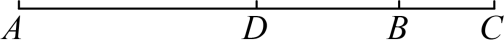
    
\( BD=AB-AD=9-6=3\)；
情况2：当A在线段\( BC\)上时，

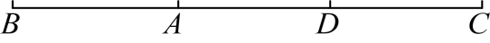
      
\( BD=AB+AD=9+6=15\)；
综上，\( BD\)的长为3或15．
故选：B．

## 70. 单选题（难度：适中）

如图，已知C为线段<latex class="math-tex">\( AB\)</latex>的中点，D为<latex class="math-tex">\( CB\)</latex>的中点，下列结论：①<latex class="math-tex">\( CD=AC-DB\)</latex>，②<latex class="math-tex">\( CD=\frac{1}{4}AB\)</lat

【答案】A

## 71. 单选题（难度：适中）

已知线段<latex class="math-tex">\( AB=16\text{cm}\)</latex>，直线<latex class="math-tex">\( AB\)</latex>上有一点<latex class="math-tex">\( C\)</latex>，并且<latex class="math-tex">\( BC=6\text{cm}\)</latex>，点<latex

【答案】A

## 72. 单选题（难度：适中）

若A，B，C三点在同一直线上，线段\( AB=12\text{cm}\)，\( BC=4\text{cm}\)，点E，F分别是线段\( AB\)，\( BC\)的中点，则线段\( EF\)的长为（ ）\( \text{cm}\)．

- A. 8
- B. 4
- C. 8或2
- D. 8或4

【答案】D

【解析】解：∵E是\( AB\)的中点，\( AB=12\text{cm}\)，
∴\( AE=EB=6\text{cm}\)，
∵F是\( BC\)的中点，\( BC=4\text{cm}\)，
∴\( BF=FC=2\text{cm}\)，
情况1：点B在点A和点C之间，

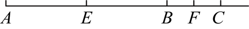
   
∴\( EF=EB+BF=6+2=8\text{cm}\)，
情况2：点C在点A和点B之间，

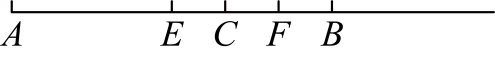
    
∴\( EF=EB-BF=6-2=4\text{cm}\)，
综上，\( EF\)的长为\( 8\text{cm}\)或\( 4\text{cm}\)．
故选：D．

## 73. 单选题（难度：适中）

已知线段<latex class="math-tex">\( AB=3\text{cm}\)</latex>，延长线段<latex class="math-tex">\( AB\)</latex>到点C，使<latex class="math-tex">\( BC=\frac{5}{3}AB\)</latex>，M为线段<latex class="math-tex">\( AC\)</latex>

【答案】A

## 74. 单选题（难度：适中）

如图所示，线段\( AB=50\text{cm}\)，线段\( CD=40\text{cm}\)，现将线段\( AB\)和\( CD\)放在同一直线上，使点\( A\)与点\( C\)重合，此时两条线段中点之间的距离是（   ）

- A. \( 5\mathrm{c}\mathrm{m}\)
- B. \( 10\mathrm{c}\mathrm{m}\)
- C. \( 5\mathrm{c}\mathrm{m}\)或\( 10\mathrm{c}\mathrm{m}\)
- D. \( 5\mathrm{c}\mathrm{m}\)或\( 45\mathrm{c}\mathrm{m}\)

【答案】D

【解析】解：\( \because AB=50\text{cm}\)， \( CD=40\text{cm}\)，N、M分别是\( AB\)和\( CD\)的中点，
\( \therefore AM=\frac{1}{2}CD=20\text{cm}\)，\( AN=\frac{1}{2}AB=25\text{cm}\)，
当点D在线段\( AB\)上，

    
\( \therefore MN=AN-AM=25-20=5\text{cm}\)，
当点D在线段\( BA\)的延长线上，

      
\( \therefore MN=AN+AM=25+20=45\text{cm}\)，
综上两条线段中点之间的距离是\( 5\mathrm{c}\mathrm{m}\)或\( 45\mathrm{c}\mathrm{m}\)．
故选：D．

## 75. 单选题（难度：适中）

题目：“如图，有公共端点\( P\)的两条线段\( PM\)，\( PN\)组成一条折线\( M-P-N\)，若该折线\( M-P-N\)上一点\( Q\)把这条折线分成长度相等的两部分，我们把这个点\( Q\)叫做这条折线的“折中点”．若已知\( D\)是折线\( A-C-B\)的“折中点”，\( E\)为线段\( AC\)的中点，\( CD=2\)，\( CE=5\)，求线段\( BC\)的长．”甲答\( BC=6\)，乙答\( BC=12\)，丙答\( BC=14\)，下列判断正确的是（    ）

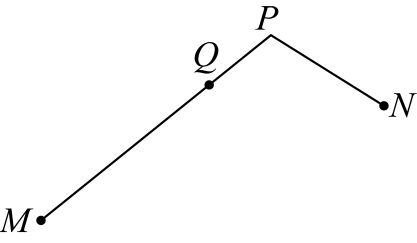

- A. 只有甲的答案正确
- B. 甲、乙的答案合在一起才正确
- C. 甲、丙的答案合在一起才正确
- D. 三人的答案合在一起才正确

【答案】C

【解析】解：∵点\( E\)为线段\( AC\)的中点，\( CE=5\)，
∴\( AE=EC=\frac{1}{2}AC=5\)，
∴\( AC=10\)，
①如图，当“折中点”\( D\)在\( AC\)上时，

    
∵点\( D\)是折线\( A-C-B\)的“折中点”， 
∴\( AD=DC+CB\)，
∵\( CD=2\)，
∴\( AD=AC-DC=10-2=8\)，
∴\( DC+CB=8\)，
∴\( BC=8-2=6\)；
②如图，当“折中点”\( D\)在\( BC\)上时，

    
∵点\( D\)是折线\( A-C-B\)的“折中点”，
∴\( BD=DC+CA\)，
∵\( CD=2\)，
∴\( BD=AC+DC=10+2=12\)，
∴\( BC=BD+DC=12+2=14\)；
综上所述， \( BC\)的长为6或14，
即甲、丙的答案合在一起才正确，
故选：C

## 76. 单选题

如图，把一根绳子对折成线段\( AB\)，从点\( P\)处把绳子剪断后，得到\( AP=\frac{2}{5}AB\)．若剪断后的各段绳子中最长的一段为\( 60\mathrm{c}\mathrm{m}\)，则绳子的原长为（   ）

- A. \( 50\mathrm{c}\mathrm{m}\)
- B. \( 100\mathrm{c}\mathrm{m}\)
- C. \( 150\mathrm{c}\mathrm{m}\)
- D. \( 100\mathrm{c}\mathrm{m}\)或\( 150\mathrm{c}\mathrm{m}\)

【答案】D

【解析】解：（1）当点A是绳子的对折点时，将绳子展开如图：

   
∵\( AP=\frac{2}{5}AB\)，剪断后的各段绳子中最长的一段为\( 60\text{cm}\)，
∴\( 2AP=60\text{cm}\)，\( AP=30\text{cm}\)，
∴\( AB=30÷\frac{2}{5}=75\left(\text{cm}\right)\)，
∴绳子的原长\( 75\times 2=150\left(\text{cm}\right)\)；
（2）当点B是绳子的对折点时，将绳子展开如图：

    
∵\( AP=\frac{2}{5}AB\)，剪断后的各段绳子中最长的一段为\( 60\text{cm}\)，
∴\( 2BP=60\text{cm}\)，\( BP=30\text{cm}\)，
∴\( AB=30÷\left(1-\frac{2}{5}\right)=50\left(\text{cm}\right)\)，
∴绳子的原长\( 50\times 2=100\left(\text{cm}\right)\)．
综上，绳子的原长为\( 100\text{cm}\)或\( 150\text{cm}\)．
故选：D．

## 77. 单选题

有两根木条，一根<latex class="math-tex">\( AB\)</latex>长为<latex class="math-tex">\( 80\text{cm}\)</latex>，另一根<latex class="math-tex">\( CD\)</latex>长为<latex class="math-tex">\( 130\text{cm}\)</latex>，在它们的中点处各

【答案】A

## 78. 单选题（难度：适中）

有两根木条，一根<latex class="math-tex">\( AB\)</latex>长为<latex class="math-tex">\( 60\mathrm{c}\mathrm{m}\)</latex>，另一根<latex class="math-tex">\( CD\)</latex>长为<latex class="math-tex">\( 90\mathrm{c}\mathrm{

【答案】A
