# 4.5 角的比较与补（余）角（同步练习）

> 教材：数学·七年级上册·沪科技版2024新教材 ｜ 来源：国家中小学智慧教育平台·在线练习 ｜ 共 116 题

## 1. 填空题（难度：简单）

下列的四个角中，是图中角的补角的有（填写正确的序号）。

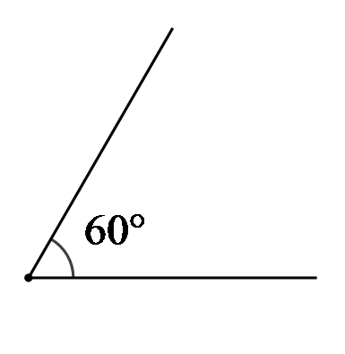
   
①
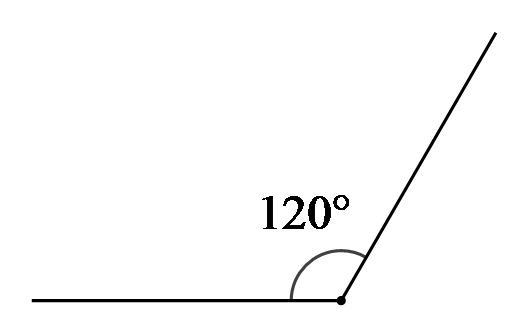
     
②
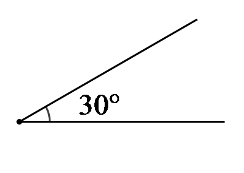
   
③

               
④

【答案】①③

【解析】​

## 2. 单选题（难度：适中）

已知<latex class="math-tex">\( \angle A\)</latex>与<latex class="math-tex">\( \angle B\)</latex>互为余角，<latex class="math-tex">\( \angle B\)</latex>与<latex class="math-tex">\( \angle C\)</latex>互为补角，<latex

【答案】A

## 3. 单选题（难度：适中）

若<latex class="math-tex">\( \angle A=55°\)</latex>，则<latex class="math-tex">\( \angle A\)</latex>的补角等于（    ）

【答案】A

## 4. 单选题（难度：适中）

如果一个角的余角是<latex class="math-tex">\( 38°{24}^{\text{'}}\)</latex>，那么这个角的补角度数是（    ）

【答案】A

## 5. 单选题（难度：适中）

一个角的余角是<latex class="math-tex">\( 30°\)</latex>，则这个角的补角是（  ）

【答案】A

## 6. 单选题（难度：适中）

已知一个角的余角是<latex class="math-tex">\( 65°\)</latex>，那么这个角的补角为（   ）

【答案】A

## 7. 单选题（难度：简单）

如果一个角的余角是<latex class="math-tex">\( 38.4°\)</latex>，那么这个角的补角度数是（　　）

【答案】A

## 8. 单选题（难度：适中）

已知<latex class="math-tex">\( \angle A={35}^{°}2{4}^{\text{'}}\)</latex>，则<latex class="math-tex">\( \angle A\)</latex>的余角等于（     ）

【答案】A

## 9. （难度：适中）

若\( \angle A\)的余角为\( 69°3{5}^{\text{'}}\)，\( \angle B\)的补角为\( 159°4{4}^{\text{'}}3{0}^{″}\)，\( \angle C=20.25°\)，则有（     ）
A．\( \angle A>\angle B>\angle C\)  
B．\( \angle B>\angle A>\angle C\)
C．\( \angle A>\angle C>\angle B\)  
D．\( \angle C>\angle A>\angle B\)

【答案】

A

【解析】解：∵\( \angle A\)的余角为\( 69°3{5}^{\text{'}}\)，
∴\( \angle A=90°-69°3{5}^{\text{'}}=20°2{5}^{\text{'}}\)，
∵\( \angle B\)的补角为\( 159°4{4}^{\text{'}}3{0}^{″}\)，
∴\( \angle B=180°-159°4{4}^{\text{'}}3{0}^{″}=20°1{5}^{\text{'}}3{0}^{″}\)，
则\( \angle C=20.25°=20°1{5}^{\text{'}}\)，
∵\( 20°2{5}^{\text{'}}>20°1{5}^{\text{'}}3{0}^{″}>20°1{5}^{\text{'}}\)，
∴\( \angle A>\angle B>\angle C\)，
故选：A．

## 10. （难度：简单）

下列关于\( \angle A\)的结论中，正确的有（　　）
①若\( \angle A=53°\)，则\( \angle A\)的余角数为\( 47°\)；
②若\( \angle A=105°3{2}^{\text{'}}\)，则\( \angle A\)的补角度数为\( 74°2{8}^{\text{'}}\)；
③若\( \angle A\)与\( \angle B\)互余，\( \angle B\)与\( \angle C\)互补，则\( \angle A=\angle C-90°\)．
A．①②  
B．②③  
C．①③  
D．①②③

【答案】

B

【解析】①若∵\( \angle A=53°\)，则\( \angle A\)的余角为\( 90°-53°=37°\)，该选项不正确；
②若\( \angle A=105°3{2}^{\text{'}}\)，则\( \angle A\)的补角为\( 180°-105°{32}^{\text{'}}=179°{60}^{\text{'}}-105°{32}^{\text{'}}=74°{28}^{\text{'}}\)，正确；
③若\( \angle A\)与\( \angle B\)互余，
∴\( \angle A+\angle B=90°\)；
∵\( \angle B\)与\( \angle C\)互补，
∴\( \angle B+\angle C=180°\)；
∴\( \angle B=180°-\angle C\)，代入得：\( \angle A+\left(180°-\angle C\right)=90°\)，
∴\( \angle A=\angle C-90°\)，正确．
故选：B．

## 11. 单选题（难度：适中）

已知<latex class="math-tex">\( \angle 1\)</latex>和<latex class="math-tex">\( \angle 2\)</latex>互余，若<latex class="math-tex">\( \angle 1=40°5{0}^{\text{'}}\)</latex>，则<latex class="math-tex">\( \angle 2=\

【答案】A

## 12. 单选题（难度：简单）

已知<latex class="math-tex">\( \angle \beta =47°5{6}^{\text{'}}\)</latex>，则<latex class="math-tex">\( \angle \beta \)</latex>的补角是（   ）

【答案】A

## 13. 单选题（难度：简单）

如果<latex class="math-tex">\( \angle \alpha =46°\)</latex>，那么它的余角是（   ）

【答案】A

## 14. 单选题（难度：简单）

若一个角是<latex class="math-tex">\( 36°3{5}^{\text{'}}\)</latex>，则这个角的补角是（　　）

【答案】A

## 15. 单选题（难度：适中）

若一个角的补角是它的余角的2倍多<latex class="math-tex">\( 15°\)</latex>，则这个角是（    ）

【答案】A

## 16. 单选题（难度：适中）

已知<latex class="math-tex">\( \angle \alpha =35°\)</latex>，则<latex class="math-tex">\( \angle \alpha \)</latex>的余角的度数是（    ）

【答案】A

## 17. 单选题（难度：适中）

如果\( \angle 1\)和\( \angle 2\)互补，且\( \angle 1>\angle 2\)，则下列表示\( \angle 2\)的余角的式子中：①\( 90°-\angle 2\)；②\( \angle 2-90°\)；③\( \frac{1}{2}\left(\angle 1+\angle 2\right)\)；④\( \frac{1}{2}\left(\angle 2-\angle 1\right)\)，能正确表示\( \angle 1\)的余角的有（    ）

- A. 1个
- B. 2个
- C. 3个
- D. 4个

【答案】B

【解析】解：∵\( \angle 1\)和\( \angle 2\)互补，
∴\( \angle 1+\angle 2=180°\)．
\( \angle 1\)的余角为\( 90°-\angle 1\)，
①：\( \angle 1\ne \angle 2\)，即\( 90°-\angle 2\ne 90°-\angle 1\)，故错误；
②：\( \angle 2-90°=\left(180°-\angle 1\right)-90°=90°-\angle 1\)，故正确；
③：\( \frac{1}{2}\left(\angle 1+\angle 2\right)=\frac{1}{2}\times 180°=90°\ne 90°-\angle 1\)，故错误；
④：\( \frac{1}{2}\left(\angle 2-\angle 1\right)=\frac{1}{2}\left(180°-\angle 1-\angle 1\right)=\frac{1}{2}\left(180°-2\angle 1\right)=90°-\angle 1\)，故正确．
∴②和④正确，共2个．
故选：B．

## 18. 单选题（难度：简单）

已知\( \angle A=37°\)，则\( \angle A\)的余角是（   ）

- A. \( 53°\)
- B. \( 63°\)
- C. \( 143°\)
- D. \( 153°\)

【答案】A

【解析】解：∵\( \angle A=37°\)，
∴\( 90°-\angle A=90°-37°=53°\)，
即\( \angle A\)的余角是\( 53°\)，
故选：\( \text{A}\)．

## 19. 单选题（难度：简单）

下列说法中正确的有（   ）①互为余角的两个角不可能相等；②一个角的补角一定小于这个角；③如果两个角是同一个角的补角，那么它们相等；④互余的两个角一定都是锐角；⑤一个锐角的余角比这个角的补角小<latex class="math-tex">\( 90°\)</latex>．

【答案】A

## 20. 单选题（难度：简单）

已知\( \angle 1=130°\)，\( \angle 2\)与\( \angle 1\)互补，则\( \angle 2\)的余角为（　　）

- A. \( 50°\)
- B. \( 40°\)
- C. \( 30°\)
- D. \( 20°\)

【答案】B

【解析】解：∵\( \angle 1=130°\)，\( \angle 2\)与\( \angle 1\)互补，
∴\( \angle 2=180°-\angle 1=50°\)，
∴\( \angle 2\)的余角为\( 90°-50°=40°\)．
故选：B．

## 21. （难度：适中）

下列说法中正确的是（    ）A．一个角的补角一定比这个角大  B．一个角的补角一定是钝角C．一个直角的补角是直角  D．一个锐角和一个钝角一定互为补角

## 22. 单选题（难度：适中）

一个角的余角和这个角的补角也互为补角，这个角的度数等于（    ）

【答案】A

## 23. 单选题（难度：简单）

若<latex class="math-tex">\( \angle A=40°\)</latex>，则<latex class="math-tex">\( \angle A\)</latex>的余角是（    ）

【答案】A

## 24. 单选题（难度：简单）

若<latex class="math-tex">\( \angle A\)</latex>与<latex class="math-tex">\( \angle B\)</latex>互余，<latex class="math-tex">\( \angle D\)</latex>与<latex class="math-tex">\( \angle C\)</latex>互余，<latex clas

【答案】A

## 25. 单选题（难度：简单）

若<latex class="math-tex">\( \angle \alpha \)</latex>与<latex class="math-tex">\( \angle \beta \)</latex>互为补角，<latex class="math-tex">\( \angle \beta \)</latex>比<latex class="math-tex">\( \angle \alpha

【答案】A

## 26. 单选题（难度：简单）

如果一个角的余角的度数比它补角的一半少<latex class="math-tex">\( 10°\)</latex>，那么这个角的度数是（   ）

【答案】A

## 27. 单选题（难度：简单）

已知<latex class="math-tex">\( \angle A\)</latex>与<latex class="math-tex">\( \angle B\)</latex>互余，<latex class="math-tex">\( \angle B\)</latex>与<latex class="math-tex">\( \angle C\)</latex>互补．若<latex cl

【答案】A

## 28. 单选题（难度：简单）

已知\( \angle 1\)与\( \angle 2\)互余，若\( \angle 1=70°\)，则\( \angle 2=\)（   ）

- A. \( 10°\)
- B. \( 20°\)
- C. \( 30°\)
- D. \( 110°\)

【答案】B

【解析】解：\( \because \) \( \angle 1\)与\( \angle 2\)互余，
\( \therefore \) \( \angle 1+\angle 2=90°\)，
\( \because \) \( \angle 1=70°\)，
\( \therefore \) \( \angle 2=90°-70°=20°\)，
故选：B．

## 29. 单选题（难度：适中）

如图，<latex class="math-tex">\( O\)</latex>是直线<latex class="math-tex">\( AB\)</latex>上一点，<latex class="math-tex">\( \angle AOE=\angle COD=90°\)</latex>，则图中互余的角、互补的角分别有（   ）

【答案】A

## 30. 单选题（难度：简单）

如果两个角互为补角，而其中一个角比另一个角的4倍少<latex class="math-tex">\( 30°\)</latex>，那么这两个角的度数是（    ）

【答案】A

## 31. 单选题（难度：简单）

如图所示，若<latex class="math-tex">\( \mathrm{\angle }AOC=\mathrm{\angle }BOD=78°,\mathrm{\angle }BOC=35°\)</latex>，则<latex class="math-tex">\( \mathrm{\angle }AOD\)</latex>的度数是（    ）

【答案】A

## 32. 单选题（难度：简单）

下列式子中错误的是（    ）

【答案】A

## 33. 单选题（难度：简单）

如图，直线<latex class="math-tex">\( AB\)</latex>，<latex class="math-tex">\( CD\)</latex>相交于点O，射线<latex class="math-tex">\( OM\)</latex>平分<latex class="math-tex">\( \mathrm{\angle }AOC\)</latex>，<latex cla

【答案】A

## 34. 单选题（难度：简单）

已知<latex class="math-tex">\( \mathrm{\angle }1+\mathrm{\angle }2=90°\)</latex>，若<latex class="math-tex">\( \mathrm{\angle }1=27°3{2}^{\mathrm{\text{'}}}\)</latex>，则<latex class="math-tex">\( \mathrm{\

【答案】A

## 35. 单选题（难度：简单）

将一副三角板按如图所示平放在一平面上（点B在<latex class="math-tex">\( AD\)</latex>上），则<latex class="math-tex">\( \mathrm{\angle }CAE\)</latex>的度数为（　　）

【答案】A

## 36. 单选题（难度：简单）

在同一平面上，若<latex class="math-tex">\( \mathrm{\angle }\alpha =60.3°\)</latex>，<latex class="math-tex">\( \mathrm{\angle }\beta =20°3{0}^{\mathrm{\text{'}}}\)</latex>，则<latex class="math-tex">\( \mathrm{\

【答案】A

## 37. 单选题（难度：简单）

如图，<latex class="math-tex">\( \mathrm{\angle }AOB=15°\)</latex>，<latex class="math-tex">\( \mathrm{\angle }AOC=90°\)</latex>，点B，O， D在同一条直线上，则<latex class="math-tex">\( \mathrm{\angle }COD\)</latex>的度数

【答案】A

## 38. 单选题（难度：非常简单）

某轮船在O处，测得灯塔A在北偏东<latex class="math-tex">\( 35°\)</latex>的方向上，测得灯塔<latex class="math-tex">\( B\)</latex>在南偏东<latex class="math-tex">\( 60°\)</latex>的方向上，则<latex class="math-tex">\( \mathrm{\angle }AOB=

【答案】A

## 39. 单选题（难度：简单）

如图，已知<latex class="math-tex">\( \mathrm{\angle }AOB=90°\)</latex>，在<latex class="math-tex">\( \mathrm{\angle }AOB\)</latex>内部引一条射线<latex class="math-tex">\( OC\)</latex>，若<latex class="math-tex">\( \m

【答案】A

## 40. 单选题（难度：非常简单）

如图，将一个三角板的<latex class="math-tex">\( 60°\)</latex>角的顶点，与另一个三角板的直角顶点重合，已知<latex class="math-tex">\( \mathrm{\angle }1=28°4{0}^{\mathrm{\text{'}}}\)</latex>，则<latex class="math-tex">\( \mathrm{\angle }2

【答案】A

## 41. 单选题（难度：简单）

将一副三角板按如图所示放置，若<latex class="math-tex">\( \mathrm{\angle }ACB=90°\)</latex>，<latex class="math-tex">\( \mathrm{\angle }DCE=90°，\mathrm{\angle }DCA=28°\)</latex>，则<latex class="math-tex">\( \mathrm{\an

【答案】A

## 42. 单选题（难度：简单）

如图，将一块三角尺的60°角的顶点与另一块三角尺的直角顶点重合．若<latex class="math-tex">\( \mathrm{\angle }1=27°\)</latex>，则<latex class="math-tex">\( \mathrm{\angle }2\)</latex>的度数为（　　）

【答案】A

## 43. 单选题（难度：非常简单）

把一副三角尺按如图所示的方式拼在一起，则<latex class="math-tex">\( \mathrm{\angle }ABC=\)</latex>（　　）

【答案】A

## 44. 单选题（难度：简单）

如图，已知点<latex class="math-tex">\( O\)</latex>在直线<latex class="math-tex">\( AB\)</latex>上，<latex class="math-tex">\( \mathrm{\angle }1=65°1{5}^{\mathrm{\text{'}}}\)</latex>，<latex class="math-tex">\( \m

【答案】A

## 45. 单选题（难度：简单）

如图，已知轮船A在灯塔P的北偏东<latex class="math-tex">\( 30°3{0}^{\mathrm{\text{'}}}\)</latex>方向，轮船B在灯塔P的南偏东<latex class="math-tex">\( 70°2{0}^{\mathrm{\text{'}}}\)</latex>方向，则<latex class="math-tex">\( \mathrm{\an

【答案】A

## 46. 单选题（难度：简单）

将两块直角三角尺的直角顶点重合为如图所示的形状，若<latex class="math-tex">\( \mathrm{\angle }AOD=127°\)</latex>，则<latex class="math-tex">\( \mathrm{\angle }BOC=\)</latex>（   ）

【答案】A

## 47. 单选题（难度：简单）

如图是由一副三角板拼凑得到的，图中的<latex class="math-tex">\( \mathrm{\angle }ABC\)</latex>的度数为（    ）

【答案】A

## 48. 单选题（难度：简单）

如图，一副三角板（直角顶点重合）摆放在桌面上，若<latex class="math-tex">\( \mathrm{\angle }AOD=143°\)</latex>，则<latex class="math-tex">\( \mathrm{\angle }BOC\)</latex>等于（   ）

【答案】A

## 49. 单选题（难度：简单）

如图，将一副三角板重叠放在一起，<latex class="math-tex">\( \mathrm{\angle }AOB=\mathrm{\angle }COD=90°\)</latex>，直角顶点重合于点O．若<latex class="math-tex">\( \mathrm{\angle }BOD=140°\)</latex>，则<latex class="math-tex">\( \m

【答案】A

## 50. 单选题（难度：简单）

如图，某海域有三个小岛A、B、O，在小岛O处观测到小岛A在它北偏东\( 60°\)的方向上，观测到小岛B在它南偏东\( 38°\)的方向上，则\( \mathrm{\angle }AOB\)的度数是（   ）

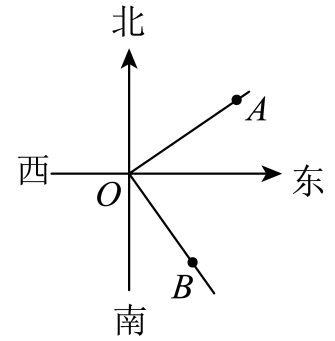

- A. \( 92°\)
- B. \( 98°\)
- C. \( 68°\)
- D. \( 82°\)

【答案】D

【解析】解：\( \because OA\)表示北偏东\( 60°\)方向的一条射线，\( OB\)表示南偏东\( 38°\)方向的一条射线，
\( \therefore \mathrm{\angle }AOB=180°-60°-38°=82°\)．
故选：D．

## 51. 单选题（难度：简单）

甲从A点出发向北偏东<latex class="math-tex">\( 70°\)</latex>方向走<latex class="math-tex">\( 50\text{m}\)</latex>至点B，乙从A出发向南偏西<latex class="math-tex">\( 15°\)</latex>方向走<latex class="math-tex">\( 80\text{m}\)</lat

【答案】A

## 52. 单选题（难度：简单）

轮船C在航行过程中，灯塔A在轮船的北偏东<latex class="math-tex">\( 40°\)</latex>方向上，此时灯塔B在轮船的东南方向上，则<latex class="math-tex">\( \mathrm{\angle }ACB=\)</latex>（   ）．

【答案】A

## 53. 单选题（难度：适中）

钟面上3点20分时，时针与分针的夹角度数是（    ）

【答案】A

## 54. 单选题（难度：简单）

如图，一艘轮船在海上由西往东行驶，在\( A\)处测得灯塔\( C\)位于北偏东\( 75°\)方向，在\( B\)处测得灯塔\( C\)位于北偏东\( 35°\)方向，则\( \mathrm{\angle }ACB\)的度数是（   ）

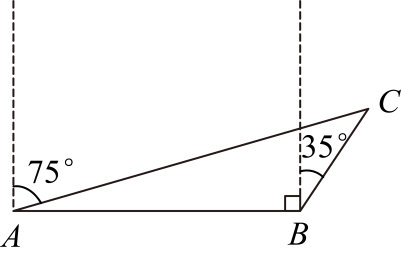

- A. \( 30°\)
- B. \( 40°\)
- C. \( 50°\)
- D. \( 60°\)

【答案】B

【解析】解：由方向角的定义可知，\( \mathrm{\angle }CAB=90°-75°=15°\)，\( \mathrm{\angle }ABC=90°+35°=125°\)，
\( \therefore \mathrm{\angle }ACB=180°-\mathrm{\angle }ABC-\mathrm{\angle }CAB\) 
\( =180°-15°-125°\) 
\( =40°\)．
故选：B．

## 55. 单选题（难度：简单）

如图，把一块三角板<latex class="math-tex">\( ABC\)</latex>的直角顶点<latex class="math-tex">\( B\)</latex>放在直线<latex class="math-tex">\( EF\)</latex>上．若<latex class="math-tex">\( \mathrm{\angle }1=55°{15}^{\mathrm{

【答案】A

## 56. 单选题（难度：适中）

在同一平面内有\( \mathrm{\angle }AOB={70}^{\circ }5{2}^{\mathrm{\text{'}}}，\mathrm{\angle }BOC={35}^{\circ }2{0}^{\mathrm{\text{'}}}\)，则\( \mathrm{\angle }AOC\)的度数是（）

- A. \( {106}^{\circ }1{2}^{\mathrm{\text{'}}}\)
- B. \( {35}^{\circ }3{2}^{\mathrm{\text{'}}}\)
- C. \( {106}^{\circ }1{2}^{\mathrm{\text{'}}}\)或\( {35}^{\circ }3{2}^{\mathrm{\text{'}}}\)
- D. \( {105}^{\circ }{32}^{\mathrm{\text{'}}}\)或\( {35}^{\circ }3{2}^{\mathrm{\text{'}}}\)

【答案】C

【解析】解：当\( OC\)在\( \mathrm{\angle }AOB\)内时，\( \mathrm{\angle }AOC=\mathrm{\angle }AOB-\mathrm{\angle }BOC=70°{52}^{\mathrm{\text{'}}}-35°{20}^{\mathrm{\text{'}}}=35°{32}^{\mathrm{\text{'}}}\)；
当\( OC\)在\( \mathrm{\angle }AOB\)外时，\( \mathrm{\angle }AOC=\mathrm{\angle }AOB+\mathrm{\angle }BOC=70°{52}^{\mathrm{\text{'}}}+35°{20}^{\mathrm{\text{'}}}=105°{72}^{\mathrm{\text{'}}}\)，
∵\( {72}^{\mathrm{\text{'}}}=1°{12}^{\mathrm{\text{'}}}\)，
∴\( 105°{72}^{\mathrm{\text{'}}}=106°{12}^{\mathrm{\text{'}}}\)．
∴\( \mathrm{\angle }AOC\)的度数为\( 35°{32}^{\mathrm{\text{'}}}\)或\( 106°{12}^{\mathrm{\text{'}}}\)．
故选：C．

## 57. 单选题（难度：简单）

在灯塔 O处观测到轮船A位于北偏西 <latex class="math-tex">\( 54°\)</latex>的方向，同时轮船B在南偏东<latex class="math-tex">\( 15°\)</latex>的方向，则<latex class="math-tex">\( \mathrm{\angle }AOB\)</latex>的大小为（   ）

【答案】A

## 58. 单选题（难度：简单）

如图，学校A在点P的北偏东<latex class="math-tex">\( 31°\)</latex>方向上，图书馆B在点P的南偏东<latex class="math-tex">\( 47°\)</latex>方向上，则<latex class="math-tex">\( \mathrm{\angle }APB\)</latex>的度数为（    ）

【答案】A

## 59. 单选题（难度：简单）

如图，在灯塔O处观测到轮船A位于北偏东\(24°\)的方向，同时轮船B在南偏西\(40°\)的方向，则\(\mathrm{\angle }AOB\)的大小为（   ）

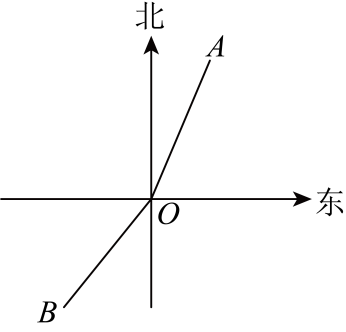

- A. \( 64°\)
- B. \( 106°\)
- C. \( 154°\)
- D. \( 164°\)

【答案】D

【解析】解：根据题意可知：\( \mathrm{\angle }COA=24°\)，\( \mathrm{\angle }BOE=40°\)，
∴\( \mathrm{\angle }BOD=90°-\mathrm{\angle }BOE=50°\)，
∴\( \mathrm{\angle }AOB=\mathrm{\angle }COA+\mathrm{\angle }COD+\mathrm{\angle }BOD=24°+90°+50°=164°\)

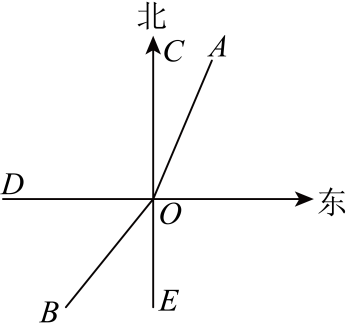
  
故选：D

## 60. 单选题（难度：简单）

如图，学校A在点O的北偏西<latex class="math-tex">\( 64°\)</latex>方向上，小明家B在点O的南偏东<latex class="math-tex">\( 30°\)</latex>方向上，则<latex class="math-tex">\( \mathrm{\angle }AOB\)</latex>的度数为（    ）

【答案】A

## 61. 单选题（难度：适中）

如图，小明从A处沿南偏西<latex class="math-tex">\( {65}^{\circ }3{0}^{\mathrm{\text{'}}}\)</latex>方向行走至点B处，又从点B处沿北偏西<latex class="math-tex">\( {72}^{\circ }3{0}^{\mathrm{\text{'}}}\)</latex>方向行走至点E处，则∠ABE＝（　　）

【答案】A

## 62. 单选题（难度：简单）

如图，若射线<latex class="math-tex">\( OB\)</latex>的方向是南偏东<latex class="math-tex">\( 50°\)</latex>，<latex class="math-tex">\( \mathrm{\angle }AOB=90°\)</latex>，则射线<latex class="math-tex">\( OA\)</latex>的方向是

【答案】A

## 63. 单选题（难度：简单）

如图，<latex class="math-tex">\( OA\)</latex>是北偏东<latex class="math-tex">\( 30°\)</latex>方向的一条射线，若<latex class="math-tex">\( \mathrm{\angle }AOB=90°\)</latex>，则<latex class="math-tex">\( OB\)</latex>的方向角

【答案】A

## 64. 单选题（难度：简单）

如图，点A、B的位置如图所示，其中<latex class="math-tex">\( \alpha ={50}^{°}\)</latex>，则下述描述中正确的是（   ）

【答案】A

## 65. 单选题（难度：适中）

如图，点A、O、B在同一直线上，<latex class="math-tex">\( OC\)</latex>平分<latex class="math-tex">\( \mathrm{\angle }AOD\)</latex>，<latex class="math-tex">\( \mathrm{\angle }BOD=120°\)</latex>，则<latex class="math-tex"

【答案】A

## 66. 单选题（难度：适中）

若<latex class="math-tex">\( \mathrm{\angle }ABC={60}^{\circ }，\mathrm{\angle }DBC=\frac{1}{2}\mathrm{\angle }ABC\)</latex>，则<latex class="math-tex">\( \mathrm{\angle }ABD=\)</latex>（　　）

【答案】A

## 67. 单选题（难度：非常简单）

尺规作角时，圆规的主要作用是（        ）．

【答案】A

## 68. 单选题（难度：非常简单）

墨墨想在纸上作<latex class="math-tex">\( \mathrm{\angle }{A}_{1}{O}_{1}{B}_{1}\)</latex>等于已知的<latex class="math-tex">\( \mathrm{\angle }AOB\)</latex>，步骤有：①画射线<latex class="math-tex">\( {O}_{1}M\)</latex>；②以点

【答案】A

## 69. 单选题（难度：简单）

如图，小庆用尺规过点B作\( OA\)的平行线\( BC\)，观察作图痕迹，其中弧\( HI\)是（    ）

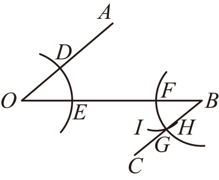

- A. 以点E为圆心，\( DE\)长为半径的弧
- B. 以点G为圆心，\( OE\)长为半径的弧
- C. 以点B为圆心，\( DE\)长为半径的弧
- D. 以点F为圆心，\( DE\)长为半径的弧

【答案】D

【解析】解：弧\( HI\)是以点\( F\)为圆心\( DE\)为半径画的弧．
故选：D．

## 70. 单选题（难度：非常简单）

尺规作角时，直尺的作用是（   ）．

【答案】A

## 71. 单选题（难度：非常简单）

数学课上，老师提出一个问题：经过已知角一边上的点，做一个角等于已知角．如图，用尺规过\( \mathrm{\angle }AOB\)的边\( OB\)上一点\( C\)（图①）作\( \mathrm{\angle }DCB=\mathrm{\angle }AOB\)（图②）．我们可以通过以下步骤作图：
①作射线\( CQ\)；
②以点\( O\)为圆心，小于\( OC\)的长为半径作弧，分别交\( OA\)，\( OB\)于点\( N\)，\( M\)；
③以点\( P\)为圆心，\( MN\)的长为半径作弧，交上一段弧于点\( Q\)；
④以点\( C\)为圆心，\( OM\)的长为半径作弧，交\( OB\)于点\( P\)．

   
下列排序正确的是（   ）

- A. ④③②①
- B. ④③①②
- C. ②③④①
- D. ②④③①

【答案】D

【解析】解：正确的排序为：②以点\( O\)为圆心，小于\( OC\)的长为半径作弧，分别交\( OA\)，\( OB\)于点\( N\)，\( M\)；
④以点\( C\)为圆心，\( OM\)的长为半径作弧，交\( OB\)于点\( P\)；
③以点\( P\)为圆心，\( MN\)的长为半径作弧，交上一段弧于点\( Q\)．
①作射线\( CQ\)；
故选：D．

## 72. 单选题（难度：非常简单）

如图，在用尺规作一个角等于已知角时，小明进行了以下5个步骤，将这5个步骤按正确的顺序排列为（　　）

【答案】A

## 73. 单选题（难度：简单）

如图，点C在<latex class="math-tex">\( \mathrm{\angle }AOB\)</latex>的<latex class="math-tex">\( OB\)</latex>边上，用尺规作出了<latex class="math-tex">\( \mathrm{\angle }BCD=\mathrm{\angle }AOB\)</latex>．以下是排乱的作图过程：则

【答案】A

## 74. 单选题（难度：非常简单）

如图，用尺规作图作出\( \mathrm{\angle }OBF=\mathrm{\angle }AOB\)，则作图痕迹的弧\( MN\)是（   ）

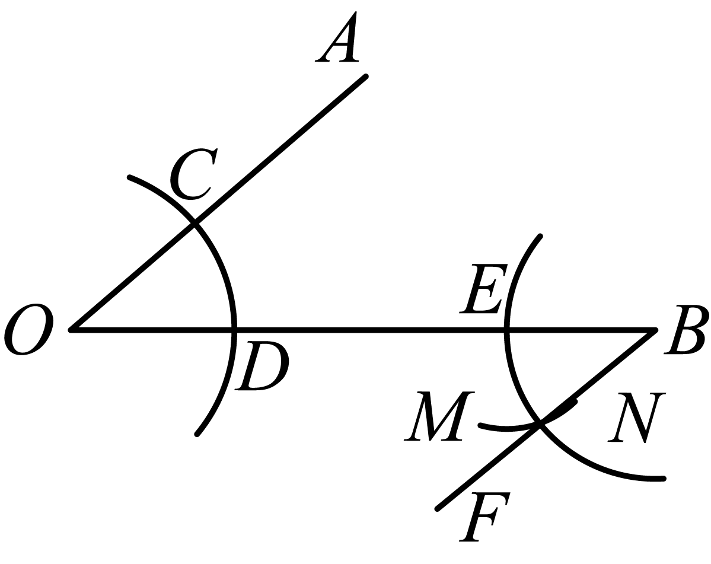

- A. 以点B为圆心，以\( OD\)长为半径的弧
- B. 以点B为圆心，以\( DC\)长为半径的弧
- C. 以点E为圆心，以\( OD\)长为半径的弧
- D. 以点E为圆心，以\( DC\)长为半径的弧

【答案】D

【解析】解：由题意得，作图痕迹弧\( MN\)是以点E为圆心，以\( DC\)长为半径的弧，
故选：D．

## 75. 单选题（难度：简单）

如图，已知<latex class="math-tex">\( \mathrm{\angle }AOB\)</latex>，以点<latex class="math-tex">\( O\)</latex>为圆心，以任意长为半径画弧①，分别交<latex class="math-tex">\( OA,OB\)</latex>于点<latex class="math-tex">\( E，F\)</la

【答案】A

## 76. 单选题（难度：非常简单）

下面是“作一个角等于已知角”的尺规作图过程．已知：<latex class="math-tex">\( \mathrm{\angle }AOB\)</latex>．求作：一个角，使它等于<latex class="math-tex">\( \mathrm{\angle }AOB\)</latex>．作法：如图所示．  （1）画射线<latex class="math-tex">\( {O}^{\m

【答案】A

## 77. 单选题（难度：非常简单）

尺规作图：作\( \mathrm{\angle }{A}^{\mathrm{\text{'}}}{O}^{\mathrm{\text{'}}}{B}^{\mathrm{\text{'}}}=\mathrm{\angle }AOB\)，如图，下列作图过程中，错误的是（    ）

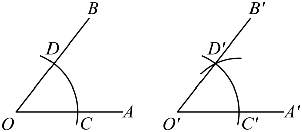

- A. 作射线\( {O}^{\mathrm{\text{'}}}{A}^{\mathrm{\text{'}}}\)
- B. 以点\( O\)为圆心，以任意长为半径作弧，交\( OA\)于点\( C\)，交\( OB\)于点\( D\)
- C. 以点\( {O}^{\mathrm{\text{'}}}\)为圆心，以\( OC\)的长为半径作弧，交\( {O}^{\mathrm{\text{'}}}{A}^{\mathrm{\text{'}}}\)于点\( {C}^{\mathrm{\text{'}}}\)
- D. 以点\( {C}^{\mathrm{\text{'}}}\)为圆心，以任意长为半径作弧，与已知的弧交于点\( {D}^{\mathrm{\text{'}}}\)

【答案】D

【解析】解：\( \text{D}\)选项错误，应该以点\( {C}^{\mathrm{\text{'}}}\)为圆心，以\( CD\)的长为半径作弧，与已知的弧交于点\( {D}^{\mathrm{\text{'}}}\)，
故选：\( \text{D}\)．

## 78. 单选题（难度：简单）

用直尺和圆规作<latex class="math-tex">\( \mathrm{\angle }MPN=\mathrm{\angle }AOB\)</latex>的过程中，弧③是（   ）

【答案】A

## 79. 单选题（难度：简单）

如图，已知<latex class="math-tex">\( \mathrm{\angle }AOB\)</latex>，以点<latex class="math-tex">\( O\)</latex>为圆心，任意长度为半径画弧①，分别交<latex class="math-tex">\( OA,OB\)</latex>于点<latex class="math-tex">\( E,F\)</la

【答案】A

## 80. 单选题（难度：非常简单）

如图，作一个角等于已知角（尺规作图）的正确顺序是（   ）

【答案】A

## 81. 单选题（难度：非常简单）

下面是黑板上出示的尺规作图题，下列各符号代表的内容正确的是（    ）如图所示，已知<latex class="math-tex">\( \mathrm{\angle }AOB\)</latex>，求作：<latex class="math-tex">\( \mathrm{\angle }DEF\)</latex>，使<latex class="math-tex">\( \mathrm{\angl

【答案】A

## 82. 单选题（难度：简单）

用尺规作一个角等于已知角． 已知． \( \mathrm{\angle }AOB\)． 求作：\( \mathrm{\angle }DEF\)， 使 \( \mathrm{\angle }DEF=\mathrm{\angle }AOB\)．
作法如下：
（1）作射线\( EG\)；
（2）以①为圆心，任意长为半径画弧， 交\( OA\)于点 P、交 \( OB\) 于点 Q；
（3）以点 E为圆心， 以②为半径画弧交 \( EG\)于点 D；
（4）以点 D为圆心，以③为半径画弧交前面的弧于点 F；
（5）过点F作④， \( \mathrm{\angle }DEF\)即为所求作的角．
以上作图步骤中，序号代表的内容错误的是（   ）

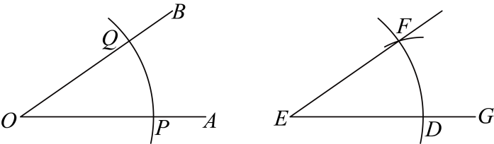

- A. ①表示点O
- B. ②表示\( OP\)
- C. ③表示OQ
- D. ④表示射线\( EF\)

【答案】C

【解析】解：作法：（1）作射线\( EG\)；
（2）以\( O\)为圆心，任意长为半径画弧，交\( OA\)于点\( P\)、交\( OB\)于点\( Q\)；
（3）以点\( E\)为圆心，以\( OP\)为半径画弧交\( EG\)于点\( D\)；
（4）以点\( D\)为圆心，以\( PQ\)为半径画弧交前面的弧于点\( F\)；
（5）过点\( F\)作\( EF\)，\( \mathrm{\angle }DEF\)即为所求作的角．
\( \therefore \)内容错误的是“③”．
故选：C

## 83. 单选题（难度：非常简单）

如图，已知<latex class="math-tex">\( \mathrm{\angle }AOB\)</latex>，用尺规以<latex class="math-tex">\( OB\)</latex>为一边在<latex class="math-tex">\( \mathrm{\angle }AOB\)</latex>的外部作<latex class="math-tex">\( \mat

【答案】A

## 84. 单选题（难度：非常简单）

小红在利用尺规作一个角等于已知角时，作了如下操作：
作射线\( {O}^{\mathrm{\text{'}}}{B}^{\mathrm{\text{'}}}\)；以点\( O\)为圆心，\( a\)的长为半径作弧，交\( OB\)，\( OA\)于\( C\)，\( D\)两点；以点\( {O}^{\mathrm{\text{'}}}\)为圆心，以\( a\)的长为半径作弧，交\( {O}^{\mathrm{\text{'}}}{B}^{\mathrm{\text{'}}}\)于点\( {C}^{\mathrm{\text{'}}}\)；以点\( {C}^{\mathrm{\text{'}}}\)为圆心，\( b\)的长为半径作弧，交前面的弧于点\( {D}^{\mathrm{\text{'}}}\)，过点\( {D}^{\mathrm{\text{'}}}\)作射线\( {O}^{\mathrm{\text{'}}}{A}^{\mathrm{\text{'}}}\)，则\( \mathrm{\angle }{A}^{\mathrm{\text{'}}}{O}^{\mathrm{\text{'}}}{B}^{\mathrm{\text{'}}}=\mathrm{\angle }AOB\)．
根据以上作法，判断下列说法正确的是（   ）

- A. a，b均无限制
- B. \( a>0\)，b无限制
- C. \( a>0\)，b等于线段CD的长
- D. \( a>0\)，\( b>\frac{1}{2}a\)

【答案】C

【解析】解：作射线\( {O}^{\mathrm{\text{'}}}{B}^{\mathrm{\text{'}}}\)；以点\( O\)为圆心，\( a\)的长为半径作弧，交\( OB\)，\( OA\)于\( C\)，\( D\)两点；以点\( {O}^{\mathrm{\text{'}}}\)为圆心，以\( a\)的长为半径作弧，交\( {O}^{\mathrm{\text{'}}}{B}^{\mathrm{\text{'}}}\)于点\( {C}^{\mathrm{\text{'}}}\)；以点\( {C}^{\mathrm{\text{'}}}\)为圆心，\( CD\)的长为半径作弧，交前面的弧于点\( D\mathrm{\text{'}}\)，过点\( {D}^{\mathrm{\text{'}}}\)作射线\( {O}^{\mathrm{\text{'}}}{A}^{\mathrm{\text{'}}}\)，则\( \mathrm{\angle }{A}^{\mathrm{\text{'}}}{O}^{\mathrm{\text{'}}}{B}^{\mathrm{\text{'}}}=\mathrm{\angle }AOB\)．
即\( a>0\)，b等于线段CD的长．
故选：C．

## 85. 单选题（难度：非常简单）

数学课上，老师提出一个问题：经过已知角一边上的点，做一个角等于已知角.如图，用尺规过\( \mathrm{\angle }AOB\)的边\( OB\)上一点C（图①）作\( \mathrm{\angle }DCB=\mathrm{\angle }AOB\)（图②）.我们可以通过以下步骤作图：
①作射线\( CD\)；
②以点O为圆心，小于\( OC\)的长为半径作弧，分别交\( OA\)，\( OB\)于点N，M；
③以点P为圆心，\( MN\)的长为半径作弧，交上一段弧于点Q；
④以点C为圆心，\( OM\)的长为半径作弧，交\( OB\)于点P.下列排序正确的是（    ）

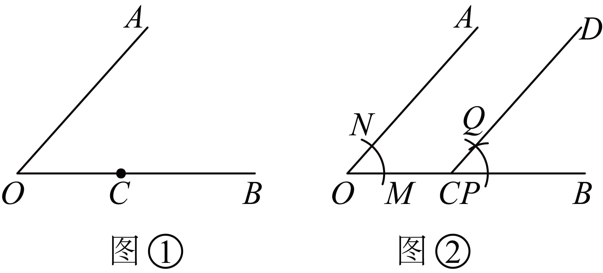

- A. ①②③④
- B. ②④③①
- C. ③②④①
- D. ④③①②

【答案】B

【解析】解：正确的排序是：②以点O为圆心，小于\( OC\)的长为半径作弧，分别交\( OA\)，\( OB\)于点N，M；④以点C为圆心，\( OM\)的长为半径作弧，交\( OB\)于点P；③以点P为圆心，\( MN\)的长为半径作弧，交上一段弧于点Q；①作射线\( CD\).
故选：B.

## 86. 单选题（难度：简单）

老师设置了一个问题，让同学们体验“经过已知角一边上的点，做一个角等于已知角”的作法．问题：如图，用尺规过<latex class="math-tex">\( \mathrm{\angle }AOB\)</latex>的边<latex class="math-tex">\( OB\)</latex>上一点<latex class="math-tex">\( C\)</latex>（图1）作<late

【答案】A

## 87. 单选题（难度：非常简单）

如图，小明在学习用尺规作一个角等于已知角时，作了<latex class="math-tex">\( \mathrm{\angle }{A}^{\mathrm{\text{'}}}O\mathrm{\text{'}}{B}^{\mathrm{\text{'}}}=\mathrm{\angle }AOB\)</latex>，在作图痕迹中弧<latex class="math-tex">\( EF\)

【答案】A

## 88. 单选题（难度：非常简单）

下面是课本中“作一个角等于已知角”的尺规作图过程．已知：<latex class="math-tex">\( \mathrm{\angle }AOB\)</latex>求作：一个角，使它等于<latex class="math-tex">\( \mathrm{\angle }AOB\)</latex>作法：如图（1）作射线<latex class="math-tex">\( {O}^{\mathr

【答案】A

## 89. 单选题（难度：简单）

用尺规作一个角等于已知角：如图，已知<latex class="math-tex">\( \mathrm{\angle }AOB\)</latex>，求作<latex class="math-tex">\( \mathrm{\angle }DEF\)</latex>，使<latex class="math-tex">\( \mathrm{\angle }DEF=\mathrm{\angle }AO

【答案】A

## 90. 单选题（难度：非常简单）

下面是黑板上出示的尺规作图题，需要回答符号代表的内容，下列回答不正确的是（   ）

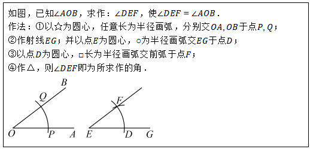

- A. ☆表示点\( O\)
- B. ○表示任意长
- C. □表示\( PQ\)
- D. △表示射线\( EF\)

【答案】B

【解析】解：①以点O为圆心，任意长为半径画弧，分别交\( OA,OB\)于点\( P,Q\)；
②作射线\( EG\)；并以点\( E\)为圆心，\( OP\)长为半径画弧交\( EG\)于点\( D\)；
③以点\( D\)为圆心，\( PQ\)长为半径画弧交前弧于点\( F\)；
④作射线\( EF\)，则\( \mathrm{\angle }DEF\)即为所求作的角．

   
由作图可知，☆表示点\( O\)，○表示\( OP\)长，□表示\( PQ\)，△表示射线\( EF\)，
故选项B不正确，
故选：B

## 91. 单选题（难度：简单）

用尺规过<latex class="math-tex">\( \mathrm{\angle }AOB\)</latex>的边<latex class="math-tex">\( OB\)</latex>上一点C（图①）作<latex class="math-tex">\( \mathrm{\angle }DCB=\mathrm{\angle }AOB\)</latex>（图②）．作图步骤如下：①作

【答案】A

## 92. 单选题（难度：非常简单）

用尺规作一个角等于已知角的2倍，这实质上是作了（   ）．

- A. 角的平分线
- B. 角的和
- C. 角的差
- D. 角的补角

【答案】B

【解析】解：∵作已知角的2倍时，需先作一个角等于已知角，再以该角的一边为边，在第一个角的外部作另一个角等于已知角，
∴两个角相加即为已知角的2倍，
∴用尺规作一个角等于已知角的2倍，实质上是作了角的和．
故选：B．

## 93. 单选题（难度：简单）

如图，在直线\( AB\)上取一点\( O\)，过点\( O\)作射线\( OC\)，使\( \mathrm{\angle }BOC=41°\)，以点\( O\)为圆心，任意长度为半径画弧，分别交边\( OB\)、\( OC\)于点\( D\)、\( E\)，再以点\( E\)为圆心，\( DE\)的长为半径画弧，交前弧于点\( F\)，再画射线\( OF\)．则\( \mathrm{\angle }AOF\)的度数为（   ）

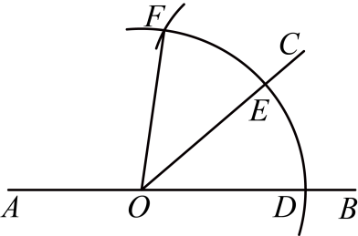

- A. \( 41°\)
- B. \( 82°\)
- C. \( 98°\)
- D. \( 139°\)

【答案】C

【解析】解：由作图可知，\( \mathrm{\angle }COF=\mathrm{\angle }BOC=41°\)，
∴\( \mathrm{\angle }AOF=180°-\mathrm{\angle }COF-\mathrm{\angle }BOC=98°\)，
故选：C

## 94. 单选题（难度：适中）

用一副三角板不能画出的角是（    ）．

【答案】A

## 95. 单选题（难度：简单）

如图，过<latex class="math-tex">\( \mathrm{\angle }AOB\)</latex>的边<latex class="math-tex">\( OB\)</latex>上的一点<latex class="math-tex">\( C(\)</latex>图<latex class="math-tex">\( 1)\)</latex>，用尺规作<latex clas

【答案】A

## 96. 单选题（难度：简单）

尺规作图：作一个角等于已知角．如图1，已知：<latex class="math-tex">\( \mathrm{\angle }AOB\)</latex>．求作：<latex class="math-tex">\( \mathrm{\angle }{A}^{\mathrm{\text{'}}}{O}^{\mathrm{\text{'}}}{B}^{\mathrm{\text{'}}}\)</la

【答案】A

## 97. 单选题（难度：简单）

如图，用尺规作图作出\( OA\parallel BF\)，则作图痕迹弧\( MN\)是（   ）

- A. 以点B为圆心，\( OD\)长为半径作的弧
- B. 以点B为圆心，\( DC\)长为半径作的弧
- C. 以点E为圆心，\( OD\)长为半径作的弧
- D. 以点E为圆心，\( DC\)长为半径作的弧

【答案】D

【解析】解：根据题意，得以点E为圆心，\( DC\)长为半径作的弧．
故选：D．

## 98. 单选题（难度：简单）

小郑在用尺规作\( \mathrm{\angle }{A}^{\mathrm{\text{'}}}{O}^{\mathrm{\text{'}}}{B}^{\mathrm{\text{'}}}=\mathrm{\angle }AOB\)时，具体的操作步骤是：
（1）作射线\( {O}^{\mathrm{\text{'}}}{A}^{\mathrm{\text{'}}}\)；
（2）以点\( O\)为圆心，以◆为半径作弧，交\( OA\)于点\( C\)，交\( OB\)于点\( D\)；
（3）以点\( {O}^{\mathrm{\text{'}}}\)为圆心，以★的长为半径作弧，交\( {O}^{\mathrm{\text{'}}}{A}^{\mathrm{\text{'}}}\)于点\( {C}^{\mathrm{\text{'}}}\)；
（4）以点\( {C}^{\mathrm{\text{'}}}\)为圆心，以▲的长为半径作弧，交前面的弧于点\( {D}^{\mathrm{\text{'}}}\)；
（5）过点\( {D}^{\mathrm{\text{'}}}\)作射线\( {O}^{\mathrm{\text{'}}}{B}^{\mathrm{\text{'}}}\)，则\( \mathrm{\angle }{A}^{\mathrm{\text{'}}}{O}^{\mathrm{\text{'}}}{B}^{\mathrm{\text{'}}}\)就是所要作的角．下列说法不正确的是（    ）

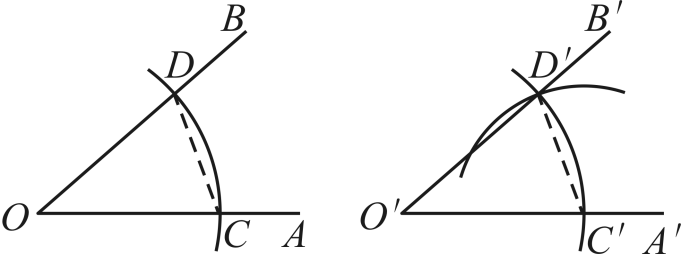

- A. ◆表示任意长
- B. ★与◆的长相等
- C. ▲与线段\( CD\)的长相等
- D. ▲与★的长相等

【答案】D

【解析】解：（1）作射线\( {O}^{\mathrm{\text{'}}}{A}^{\mathrm{\text{'}}}\)；
（2）以点\( O\)为圆心，以\( a\)的长为半径作弧，交\( OA\)于点\( C\)，交\( OB\)于点\( D\)；
（3）以点\( {O}^{\mathrm{\text{'}}}\)为圆心，以\( a\)的长为半径作弧，交\( {O}^{\mathrm{\text{'}}}{A}^{\mathrm{\text{'}}}\)于点\( {C}^{\mathrm{\text{'}}}\)；
（4）以点\( {C}^{\mathrm{\text{'}}}\)为圆心，以\( b\)的长为半径作弧，交前面的弧于点\( {D}^{\mathrm{\text{'}}}\)；
（5）过点\( {D}^{\mathrm{\text{'}}}\)作射线\( {O}^{\mathrm{\text{'}}}{B}^{\mathrm{\text{'}}}\)，则\( \mathrm{\angle }{A}^{\mathrm{\text{'}}}{O}^{\mathrm{\text{'}}}{B}^{\mathrm{\text{'}}}\)就是所要作的角．
其中\( a\)为任意长度，\( b\)与线段\( CD\)的长相等，
故选：D．

## 99. 单选题（难度：简单）

如图，尺规作<latex class="math-tex">\( \mathrm{\angle }HFG=\mathrm{\angle }ABC\)</latex>，作图痕迹中弧<latex class="math-tex">\( MN\)</latex>是（    ）

【答案】A

## 100. 单选题（难度：简单）

尺规作图：作一个角等于已知角．如图①，已知：<latex class="math-tex">\( \mathrm{\angle }AOB\)</latex>．求作：<latex class="math-tex">\( \mathrm{\angle }{A}^{\mathrm{\text{'}}}{O}^{\mathrm{\text{'}}}{B}^{\mathrm{\text{'}}}\)</la

【答案】A

## 101. 单选题（难度：简单）

如图，用尺规作射线<latex class="math-tex">\( AN\)</latex>平行<latex class="math-tex">\( OM\)</latex>，关于<latex class="math-tex">\( \stackrel{⌢}{BC}\)</latex>作法正确的描述是（   ）

【答案】A

## 102. 单选题（难度：简单）

如图，<latex class="math-tex">\( \mathrm{\angle }AOB=35°\)</latex>，以<latex class="math-tex">\( O\)</latex>为圆心，任意长为半径画弧，分别交<latex class="math-tex">\( OA\)</latex>、<latex class="math-tex">\( OB\)</latex>于点

【答案】A

## 103. 单选题（难度：简单）

如图，用尺规作出了\( \mathrm{\angle }NCB=\mathrm{\angle }AOD\)，作图痕迹中弧\( FG\)是（   ）

- A. 以点C为圆心，\( OD\)为半径的弧
- B. 以点C为圆心，\( DM\)为半径的弧
- C. 以点E为圆心，\( OD\)为半径的弧
- D. 以点E为圆心，\( DM\)为半径的弧

【答案】D

【解析】解：根据作一个角等于已知角的方法步骤可知，\( \stackrel{⌢}{FG}\)是以点E为圆心，\( DM\)为半径的弧，
故选：D．

## 104. 单选题（难度：简单）

如图，光线<latex class="math-tex">\( CO\)</latex>射到镜面<latex class="math-tex">\( AB\)</latex>上的点<latex class="math-tex">\( O\)</latex>处，入射光线与镜面<latex class="math-tex">\( AB\)</latex>的夹角为<latex class="math-t

【答案】A

## 105. 单选题（难度：简单）

如图，已知<latex class="math-tex">\( \mathrm{\angle }AOB\)</latex>与<latex class="math-tex">\( \mathrm{\angle }E{O}^{\mathrm{\text{'}}}F\)</latex>，分别以O，<latex class="math-tex">\( {O}^{\mathrm{\text{'}}}\)</

【答案】A

## 106. 单选题（难度：简单）

如图，点C在\( \mathrm{\angle }AOB\)的\( OB\)边上，用尺规作出了\( \mathrm{\angle }BCD=\mathrm{\angle }AOB\)．以下是排乱的作图过程：
①作射线\( CD\)，则\( \mathrm{\angle }BCD=\mathrm{\angle }AOB\)．
②以C为圆心，\( OE\)长为半径画弧\( MN\)，交\( OB\)于点M．
③以M为圆心，\( EF\)长为半径画弧，交弧\( MN\)于点D．
④以O为圆心，任意长为半径画弧\( EF\)，分别交\( OA\)，\( OB\)于点E，F．

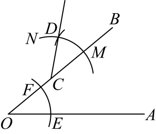
      
则正确的作图顺序是（　　）

- A. \( \mathrm{①}-\mathrm{②}-\mathrm{③}-\mathrm{④}\)
- B. \( \mathrm{②}-\mathrm{④}-\mathrm{①}-\mathrm{③}\)
- C. \( \mathrm{④}-\mathrm{②}-\mathrm{③}-\mathrm{①}\)
- D. \( \mathrm{④}-\mathrm{③}-\mathrm{②}-\mathrm{①}\)

【答案】C

【解析】解：根据作一个角等于已知角的过程可知：
④以\( O\)为圆心，任意长为半径画弧\( EF\)，分别交\( OA,OB\)于点\( E,F\)．
②以\( C\)为圆心，\( OE\)长为半径画弧\( MN\)，交\( OB\)于点\( M\)．
③以\( M\)为圆心，\( EF\)长为半径画弧，交弧\( MN\)于点\( D\)．
①作射线\( CD\)，则\( \mathrm{\angle }BCD=\mathrm{\angle }AOB\)．
故选：C．

## 107. 单选题（难度：适中）

如图，在<latex class="math-tex">\( △ABC\)</latex>中，<latex class="math-tex">\( \mathrm{\angle }B=42°\)</latex>，<latex class="math-tex">\( \mathrm{\angle }A=78°\)</latex>，点<latex class="math-tex">\( D\)</la

【答案】A

## 108. 单选题（难度：简单）

嘉淇用直尺和圆规作一个角等于已知角的步骤如下：
已知：\( \mathrm{\angle }AOB\)．
求作：\( \mathrm{\angle }{A}^{\mathrm{\text{'}}}{O}^{\mathrm{\text{'}}}{B}^{\mathrm{\text{'}}}\)，使\( \mathrm{\angle }{A}^{\mathrm{\text{'}}}{O}^{\mathrm{\text{'}}}{B}^{\mathrm{\text{'}}}=\mathrm{\angle }AOB\)．
作法：
（1）如图，以点\( O\)为圆心，__☆__为半径画弧，分别交\( OA\)，\( OB\)于点\( C\)，\( D\)．
（2）画一条射线\( {O}^{\mathrm{\text{'}}}{A}^{\mathrm{\text{'}}}\)，以点\( {O}^{\mathrm{\text{'}}}\)为圆心，\( n\)为半径画弧，交\( {O}^{\mathrm{\text{'}}}{A}^{\mathrm{\text{'}}}\)于点\( {C}^{\mathrm{\text{'}}}\)．
（3）以点\( {C}^{\mathrm{\text{'}}}\)为圆心，__○___为半径画弧，与上步中所画的弧相交于点\( {D}^{\mathrm{\text{'}}}\)．
（4）过点\( {D}^{\mathrm{\text{'}}}\)画射线\( {O}^{\mathrm{\text{'}}}{B}^{\mathrm{\text{'}}}\)，则\( \mathrm{\angle }{A}^{\mathrm{\text{'}}}{O}^{\mathrm{\text{'}}}{B}^{\mathrm{\text{'}}}\)即为所求作的角．

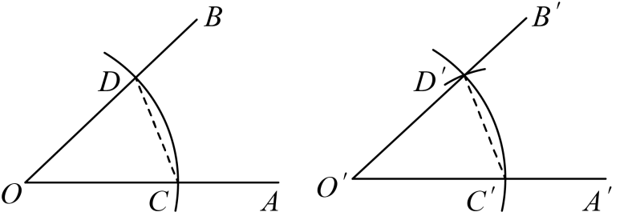
    
下列说法不正确的是（　　）

- A. ☆表示任意长
- B. n与☆的长相等
- C. ○与☆的长度相等
- D. ○与\( CD\)的长度相等

【答案】C

【解析】解：由作一个角等于已知角的作图方法可知，
☆表示任意长，\( n\)与☆的长相等，○与\( CD\)的长度相等，
所以A，B，D选项正确，C选项不正确．
故选：C．

## 109. 单选题（难度：简单）

如图，已知\( \mathrm{\angle }AOB\)与\( \mathrm{\angle }E{O}^{\mathrm{\text{'}}}F\)，分别以\( O\)和\( {O}^{\mathrm{\text{'}}}\)为圆心，以同样长为半径画弧，交\( OA\)，\( OB\)于点\( {A}^{\mathrm{\text{'}}}\)，\( {B}^{\mathrm{\text{'}}}\)，交\( {O}^{\mathrm{\text{'}}}E\)，\( {O}^{\mathrm{\text{'}}}F\)于点\( {E}^{\mathrm{\text{'}}}\)，\( {F}^{\mathrm{\text{'}}}\)．以\( {B}^{\mathrm{\text{'}}}\)为圆心，以\( {E}^{\mathrm{\text{'}}}{F}^{\mathrm{\text{'}}}\)长为半径画弧，交弧\( {A}^{\mathrm{\text{'}}}{B}^{\mathrm{\text{'}}}\)于点H，作射线\( OH\)．下列结论不正确的是（    ）

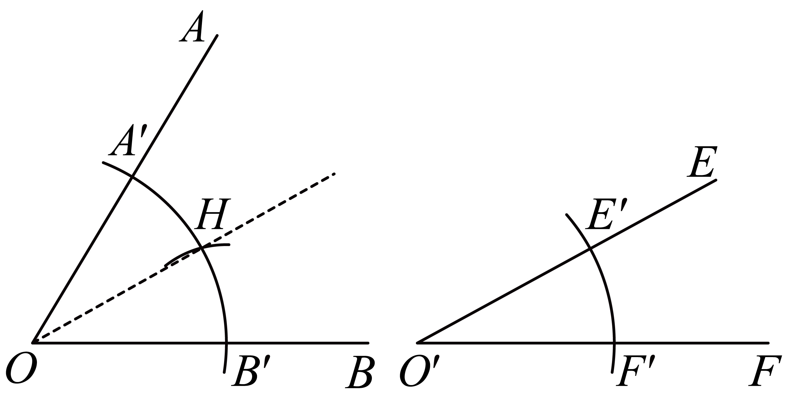

- A. \( \mathrm{\angle }E{O}^{\mathrm{\text{'}}}F=\frac{1}{2}\mathrm{\angle }AOB\)
- B. \( \mathrm{\angle }AOB>\mathrm{\angle }E{O}^{\mathrm{\text{'}}}F\)
- C. \( \mathrm{\angle }HOB=\mathrm{\angle }E{O}^{\mathrm{\text{'}}}F\)
- D. \( \mathrm{\angle }E{O}^{\mathrm{\text{'}}}F+\mathrm{\angle }AOH=\mathrm{\angle }AOB\)

【答案】A

【解析】解：由题意可知，\( \mathrm{\angle }HOB=\mathrm{\angle }E{O}^{\mathrm{\text{'}}}F\)，则选项C正确，不符合题意；
∵\( \mathrm{\angle }AOB=\mathrm{\angle }HOB+\mathrm{\angle }AOH\)，
∴\( \mathrm{\angle }AOB=\mathrm{\angle }E{O}^{\mathrm{\text{'}}}F+\mathrm{\angle }AOH\)，则选项D正确，不符合题意；
∵\( \mathrm{\angle }AOB>\mathrm{\angle }HOB\)，\( \mathrm{\angle }HOB=\mathrm{\angle }E{O}^{\mathrm{\text{'}}}F\)，
∴\( \mathrm{\angle }AOB>\mathrm{\angle }E{O}^{\mathrm{\text{'}}}F\)，则选项B正确，不符合题意；
假设\( \mathrm{\angle }E{O}^{\mathrm{\text{'}}}F=\frac{1}{2}\mathrm{\angle }AOB\)正确，则\( \mathrm{\angle }E{O}^{\mathrm{\text{'}}}F=\frac{1}{2}\left(\mathrm{\angle }E{O}^{\mathrm{\text{'}}}F+\mathrm{\angle }AOH\right)\)，
∴\( \mathrm{\angle }E{O}^{\mathrm{\text{'}}}F=\mathrm{\angle }AOH\)，
又∵\( \mathrm{\angle }HOB=\mathrm{\angle }E{O}^{\mathrm{\text{'}}}F\)，
∴\( \mathrm{\angle }HOB=\mathrm{\angle }AOH\)，但根据已知条件不能得出这个结论，
∴假设不成立，即选项A错误，符合题意．
故选：A．

## 110. 单选题（难度：适中）

如图，在用尺规作\( \mathrm{\angle }EFG=\mathrm{\angle }AOB\)的过程中，对于图2中弧\( MN\)、弧\( PQ\)的作法，下列选项正确的是（    ）

- A. 以点\( M\)为圆心，以任意长为半径画弧\( PQ\)
- B. 以点\( F\)为圆心，以任意长为半径画弧\( MN\)
- C. 以点\( M\)为圆心，以大于\( \frac{1}{2}CD\)长为半径画弧\( PQ\)
- D. 以点\( F\)为圆心，以\( OD\)长为半径画弧\( MN\)

【答案】D

【解析】解：由图可得：
以点\( F\)为圆心，以\( OD\)长为半径画弧\( MN\)；以点\( M\)为圆心，以\( CD\)长为半径画弧\( PQ\)，
A.以点\( M\)为圆心，以\( CD\)长为半径画弧\( PQ\)，故A选项错误，不符合题意；
B.以点\( F\)为圆心，以\( OD\)长为半径画弧\( MN\)，故B选项错误，不符合题意；
C.以点\( M\)为圆心，以\( CD\)长为半径画弧\( PQ\)，故C选项错误，不符合题意；
D.以点\( F\)为圆心，以\( OD\)长为半径画弧\( MN\)，故D选项错误，符合题意；
故选：D．

## 111. 单选题（难度：适中）

如图所示，是一副三角尺，上边三角尺的三个角分别为\( 45°\)，\( 45°\)，\( 90°\)，下边三角尺的三个角分别为\( 30°\)，\( 60°\)，\( 90°\)，那么，在①\( 15°\)；②\( 55°\)；③\( 75°\)；④\( 105°\)中，可以用这副三角尺画出来的是（      ）

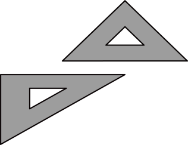

- A. ①③
- B. ①④
- C. ②③④
- D. ①③④

【答案】D

【解析】解：∵\( 15°=45°-30°\)，\( 75°=45°+30°\)，\( 105°=45°+60°\)，
∴可以用这副三角尺画出来的是①③④，
故选：D．

## 112. 单选题（难度：非常简单）

画一个钝角<latex class="math-tex">\( \mathrm{\angle }AOB\)</latex>，然后以<latex class="math-tex">\( O\)</latex>为顶点，以<latex class="math-tex">\( OA\)</latex>为一边，在角的内部画一条射线<latex class="math-tex">\( OC\)</latex>

【答案】A

## 113. 单选题（难度：适中）

如图，<latex class="math-tex">\( \mathrm{\angle }AOB=35°\)</latex>，以O为圆心，任意长为半径画弧，分别交<latex class="math-tex">\( OA\)</latex>、<latex class="math-tex">\( OB\)</latex>于点C、D，画射线<latex class="math-tex">\( {O}

【答案】A

## 114. 单选题（难度：适中）

如图，点<latex class="math-tex">\( C\)</latex>在<latex class="math-tex">\( \mathrm{\angle }AOB\)</latex>的<latex class="math-tex">\( OA\)</latex>边上，用尺规作出了<latex class="math-tex">\( \mathrm{\angle }ACD=\math

【答案】A

## 115. 单选题（难度：适中）

如图，已知<latex class="math-tex">\( \mathrm{\angle }AOB=90°\)</latex>，<latex class="math-tex">\( \mathrm{\angle }AOC=56°\)</latex>，以点<latex class="math-tex">\( O\)</latex>为圆心，以任意长为半径画弧①，分别交<latex class="m

【答案】A

## 116. 单选题

如图，已知<latex class="math-tex">\( \mathrm{\angle }AOB\)</latex>与<latex class="math-tex">\( \mathrm{\angle }E{O}^{\mathrm{\text{'}}}F\)</latex>，分别以O，<latex class="math-tex">\( {O}^{\mathrm{\text{'}}}\)</

【答案】A
