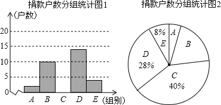
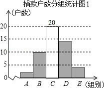
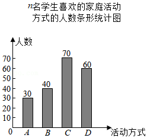

# 5.1 数据的收集（同步练习）

> 教材：数学·七年级上册·沪科技版2024新教材 ｜ 来源：国家中小学智慧教育平台·在线练习 ｜ 共 38 题

## 1. （难度：适中）

为了让地震受灾的儿童得到救助，海淀某社区组织“献爱心手拉手”捐款活动，对社区部分捐款户数进行调查和分组统计后，将数据整理成如图所示的统计表和统计图（图中信息不完整）。已知\(A\)、\(B\)两组捐款户数的比为\(1:5\)。
组别
捐款额\((x)\)元
户数

\(A\)
\(1⩽x < 100\)
\(a\)

\(B\)
\(100⩽x < 200\)
10

\(C\)
\(200⩽x < 300\)
 

\(D\)
\(300⩽x < 400\)
 

\(E\)
\(x⩾400\)
 

请结合以上信息解答下列问题。
​

\(a = \)，本次调查样本的容量是；

补全“捐款户数分组统计表和捐款户数统计图1”；

若该社区共有1000户住户参与捐款，请根据以上信息估计，全社区捐款不少于300元的户数是户。​

【答案】2/50，20   14    4；，360

【解析】解析视频请查看最后一题。

解析视频请查看最后一题。

​

## 2. 单选题（难度：简单）

为了解本地区老年人的健康状况，下列选取的调查对象最合适的是（　　）

- A. 在公园里调查100名老人
- B. 在广场舞队伍里调查100名老人
- C. 在医院调查100名老人
- D. 在派出所的户籍网随机调查100名老人

【答案】D

【解析】​

## 3. 单选题（难度：简单）

下列调查中，适合用全面调查的方式收集数据的是（　　）

- A. 对某市中小学生每天完成作业时间的调查
- B. 对全国中学生节水意识的调查
- C. 对某班全体学生新冠疫苗接种情况的调查
- D. 对某批次灯泡使用寿命的调查

【答案】C

【解析】​

## 4. 单选题（难度：适中）

某市有9个区，为了解该市初中生的体重情况，有人设计了四种调查方案，你认为比较合理的是（　　）

- A. 测试该市某一所中学初中生的体重
- B. 测试该市某个区所有初中生的体重
- C. 测试全市所有初中生的体重
- D. 每区随机抽取5所初中，测试所抽学校初中生的体重

【答案】D

【解析】​

## 5. 单选题（难度：适中）

为了解游客在云台山、神农山和青天河这三个风景区旅游的满意率，数学小组的同学商议了几个收集数据的方案：方案一：在云台山景区调查300名游客；方案二：在神农山景区调查300名游客；方案三：在青天河调查300名游客；方案四：在三个景区各调查100名游客。其中最合理的方案是（　　）

- A. 方案一
- B. 方案二
- C. 方案三
- D. 方案四

【答案】D

【解析】​

## 6. 填空题（难度：适中）

七年级一班的小明根据本学期“从数据谈节水”的课题学习，知道了统计调查活动要经历5个重要步骤：（1）收集数据；（2）设计调查问卷；（3）用样本估计总体；（4）整理数据；（5）分析数据。但他对这5个步骤的排序不对，请你帮他正确排序为。（填序号）

【答案】（2）（1）（4）（5）（3）

【解析】​

## 7. 填空题（难度：简单）

七年级（2）班有56名同学，要了解全班同学数学作业所需时间，需要收集个数据。

【答案】56

【解析】​

## 8. 填空题（难度：简单）

某节能灯生产厂家为了解一批产品（灯泡）的使用寿命，应该采用的调查方式是（选填“全面调查”或“抽样调查”）。

【答案】抽样调查

【解析】​

## 9. 填空题（难度：简单）

请你写出一个生活中运用全面调查的例子。

【答案】调查全班学生新冠疫苗接种情况的调查（不唯一）

【解析】​

## 10. 填空题（难度：简单）

第七次全国人口普查属于（填“全面”或“抽样”）调查。

【答案】全面

【解析】​

## 11. 填空题（难度：简单）

某部门要了解当代中学生的主要娱乐方式，常用的调查方式是调查。（填“全面”或“抽样”）

【答案】抽样

【解析】​

## 12. 填空题（难度：简单）

端午节期间，食品药品监督管理局对市场上的粽子质量进行了调查。你认为适合采用的调查方式是调查。

【答案】抽样

【解析】​

## 13. 填空题（难度：适中）

下面三项调查：（1）检测北京市空气质量；（2）防疫期间检测某校学生体温；（3）调查某款手机抗摔能力，其中适宜抽样调查的是。（填写序号即可）

【答案】（1）（3）

【解析】​

## 14. 

今年学校招收了首批高一年级住宿生200名，到新学期开学时，学校就有了200名住宿生和1300名走读生。学校准备在暑假期间修建一座餐厅，满足师生的就餐问题．学校需建一个多大面积的餐厅？招收多少餐厅工作人员才能满足需要？欲作出决策，请回答以下问题：

解决上面的问题，需要哪些数据？

采用什么方式进行调查可以获得这些数据？

【答案】

需要了解多少走读生和教师中午在学校餐厅吃饭，再加上200名住宿生，就是下学期要在餐厅就餐的最多人数；

明年、后年计划招收的住宿生人数也要了解，这样得到三年后全校在餐厅就餐的人数；

每张餐桌、每把椅子的占地面积，留出的间隙、排队买饭时的占地面积，以及卖饭区域的占地面积；

调查同样规模的餐厅需要的餐厅工作人员人数。

，

通过问卷调查的方式统计在学校中午就餐的学生和教师人数；

到学校领导处询问明年、后年计划招收的住宿生人数；

实际测量和估算，确定每张餐桌、每把椅子的占地面积，留出的间隙、排队买饭时的占地面积，以及卖饭区域的占地面积，从而确定餐厅的使用面积；

去已有餐厅的学校或餐饮行业询问，了解如此规模的餐厅需要的餐厅工作人员人数．

【解析】解析视频请查看最后一题。

​

## 15. （难度：适中）

七（1）班班主任为了安排座位，需要了解班上每个人的视力情况，你认采用哪种调查方式比较合适？为什么？

【答案】

全面调查，因为要了解全班同学的视力情况范围较小、难度不大，所以应采取全面调查的方法比较合适。

【解析】​

## 16. 

某电视台播放一则新闻“现在市场上牛奶的合格率为80%”，请据此回答下列问题：

这则新闻是否一定能说明市场上所有的牛奶恰好有80%为合格？

你认为这则新闻来源于全面调查还是抽样调查？为什么？

【答案】

不能说明市场上牛奶的合格率为80%，

因为不可能做到全面调查，只是抽样调查得到的数据，有一定偏差；

，

抽样调查，因为总体数目太大，且调查具有破坏性，不适合全面调查。

【解析】解析视频请查看最后一题。

​

## 17. 单选题（难度：简单）

为了解某校初一年级1200名学生每天花费在数学学习上的时间，抽取了100名学生进行调查，以下说法正确的是（　　）

- A. 1200名学生每天花费在数学学习上的时间是总体
- B. 每名学生是个体
- C. 从中抽取的100名学生是样本
- D. 样本容量是100名

【答案】A

【解析】​

## 18. 单选题（难度：简单）

为了了解我市七年级学生每天用于学习的时间，对其中500名学生进行了调查，则下列说法错误的是（　　）

- A. 总体是我市七年级学生每天用于学习的时间
- B. 其中500名学生每天用于学习的时间是总体的一个样本
- C. 样本容量是500名
- D. 个体是其中每名学生每天用于学习的时间

【答案】C

【解析】​

## 19. 单选题（难度：简单）

下列调查中，样本具有代表性的是（　　）

- A. 了解观众对所看电影的评价情况，对座位号是奇数的观众进行调查
- B. 了解全校同学对课程的喜欢情况，对某班男同学进行调查
- C. 了解商场的平均日营业额，选在周末进行调查
- D. 了解某小区居民的防火意识，对你们班同学进行调查

【答案】A

【解析】​

## 20. 单选题（难度：简单）

为进一步巩固“双减”落实效果，了解某校七年级学生完成作业的时间情况，从中随机抽取了100名七年级学生进行调查，下列说法错误的是（　　）

- A. 总体是某校七年级学生完成作业的时间
- B. 样本是抽取的100名七年级学生
- C. 个体是某校七年级每个学生完成作业的时间
- D. 样本容量是100

【答案】B

【解析】​

## 21. 单选题（难度：适中）

在一个有15万人的小镇，随机调查了3000人，其中有300人看中央电视台的早间新闻．据此，估计该镇看中央电视台早间新闻的约有（　　）

- A. 2.5万人
- B. 2万人
- C. 1.5万人
- D. 1万人

【答案】C

【解析】​

## 22. 单选题（难度：简单）

为了了解我市60岁以上老年人参与新冠疫苗接种的情况，抽样合理的是（　　）

- A. 随机抽取10名60岁以上老年人进行调查
- B. 在各医院随机抽取1000名60岁以上老年人进行调查
- C. 在公园随机抽取1000名60岁以上老年人进行调查
- D. 在户籍网中随机抽取10%的60岁以上老年人进行调查

【答案】D

【解析】​

## 23. 填空题（难度：简单）

抽样调查为了获得较为准确的调查结果，抽样时要注意样本的和。

【答案】代表性，广泛性

【解析】​

## 24. 填空题（难度：简单）

某市今年共有12万名考生参加中考，为了了解这12万名考生的数学成绩，从中抽取了1500名考生的数学成绩进行统计分析．在这次调查中，被抽取的1500名考生的数学成绩是。（填“总体”，“样本”或“个体”）

【答案】样本

【解析】​

## 25. 填空题（难度：简单）

某中学要了解初二学生的视力情况，在全校初二年级中抽取了25名学生进行检测，在这个问题中，总体是，样本是。

【答案】某中学初二学生的视力情况的全体，25名学生的视力情况

【解析】​

## 26. 填空题（难度：简单）

某校为了了解初二年级1000名学生的身体健康情况，从该年级随机抽取了100名学生，样本容量为。

【答案】100

【解析】​

## 27. 填空题（难度：适中）

某商场在“十一”长假期间平均每天的营业额是15万元，由此推算10月份的总营业额约为15×31＝465（万元），你认为这样推断是否合理？答：。

【答案】不合理，因为抽样不具有代表性

【解析】​

## 28. 填空题（难度：适中）

H县进行教学质量抽测，有2千多名学生参加考试，为了解这些学生的抽测学科成绩，便于质量分析，从中抽取了200名考生的抽测学科成绩进行统计分析。这个问题中，有下列说法：
（1）这2千多名学生的抽测成绩的全体是总体； （2）每个学生是个体；
（3）200名考生是总体的一个样本；（4）样本容量是200。
请你写出正确说法的序号。

【答案】（1）（4）

【解析】​

## 29. 填空题（难度：适中）

质检部门从1500件电子产品中随机抽取了100件进行检测，其中有3件是次品，据此可估计这批电子产品中大约有件次品。

【答案】45

【解析】​

## 30. 填空题（难度：适中）

为了解六年级学生掌握游泳技能的情况，在全区六年级7200名学生中，随机抽取了600名学生，结果有240名学生会游泳，那么估计该区会游泳的六年级学生数约为人。

【答案】2880

【解析】​

## 31. 填空题

为了估计池塘里有多少条鱼，从池塘里捕捞了200条鱼做上标记，然后放回池塘里，经过一段时间，等有标记的鱼完全混合于鱼群中以后再捕捞100条，若其中有标记的鱼有10条，则估计池塘里共有鱼条。

【答案】2000

【解析】​

## 32. 填空题（难度：适中）

下表是某户人家四月初连续8天每天早上7：00的读数：
日期
1
2
3
4
5
6
7
8

电表读数
98
102
107
112
116
120
123
126

请你估计这户人家四月的用电量是。

【答案】120

【解析】​

## 33. （难度：适中）

一个总体中有编号为1、2、3、4、5的5个个体，用简单随机抽样的方法从中抽取1个容量为2的样本，这样的样本共有多少个？写出所有可能的样本。

【答案】

容量为2的样本可以是：1和2、1和3、1和4、1和5、2和3、2和4、2和5、3和4、3和5、4和5，一共有10个。

【解析】​

## 34. （难度：适中）

如果整个地区的观众中，青少年、成年人、老年人的人数比3：4：3，要抽取容量为500的样本，则各年龄段分别抽取多少人合适？

【答案】

青少年的人数为150人；

成年人人数为200人；

老年人人数为150人

【解析】​

## 35. 

某报纸上刊登了一则新闻，“某种品牌的节能灯的合格率为95%”，请据此回答下列问题。

这则新闻是否说明市面上所有这种品牌的节能灯恰有5%为不合格？

你认为这则消息来源于全面调查，还是抽样调查？为什么？

如果已知在这次检查中合格产品有76个，则共有多少个节能灯接受检查？

【答案】

不能说明

，

消息来源于抽样调查．因为各种节能灯太多，很难实现普查

，

80个

【解析】解析视频请查看最后一题。

解析视频请查看最后一题。

​

## 36. （难度：适中）

某学校在开展“节约每一滴水”的活动中，从七年级的180名同学中任选出10名同学汇报了各自家庭一个月的节水情况，将有关数据整理如下表：

 
 
 
 节水量/\(\text{t}\)​

 
 
 0.5

 
 
 1

 
 
 1.5

 
 
 2

 
 

 
 
 同学数

 
 
 2

 
 
 3

 
 
 4

 
 
 1

 
 

 

请你估计这180名同学的家庭一个月节约用水的总量是多少？

【答案】

$216\text{t}$​

【解析】​

## 37. （难度：适中）

为了解在“爱护地球，绿化祖国”植树活动，全校600名学生的植树情况，随机调查了30名学生的植树情况，统计数据如表所示：
植树数量（棵）
4
5
6
8
10

人数
5
8
10
5
2

这30名同学平均每人植树棵；

根据这30名学生植树棵数的情况，估计该校600名学生在本次活动中共植树多少棵。

【答案】6，

6

【解析】解析视频请查看最后一题。

​

## 38. 

某校团委随机抽取了\(n\)​名本校学生，对“世界家庭日”当天所喜欢的家庭活动方式进行问卷调查，问卷中的家庭活动方式包括：
\(A\)​．在家里聚餐；\(B\)​．去影院看电影；\(C\)​．到公园游玩；\(D\)​．进行其他活动。
每位学生在问卷调查时都按要求只选择了其中一种喜欢的活动方式，该校团委收回全部调查问卷后，将收集到的数据整理并绘制成统计图．根据统计图提供的信息，解答下列问题：
​

\(n=\)​；

四种方式中最受学生喜欢的方式为（用​​​\(A，B，C，D\)​作答）；选择该种方式的学生人数占被调查的学生人数的百分比为；

根据统计结果，估计该校1200名学生中喜欢\(C\)​方式的学生比喜欢B方式的学生多的人数。​

【答案】200，<em><em>$C$</em></em>/35%，

180人

【解析】​提示：解析视频请查看最后一题。

解析视频请查看最后一题。

​
