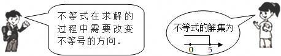
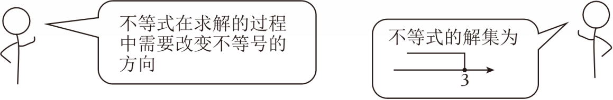

# 知识点·一元一次不等式的概念（同步练习）

> 教材：数学·七年级下册·沪科技版2024新教材 ｜ 来源：国家中小学智慧教育平台·在线练习 ｜ 共 50 题

## 1. 单选题（难度：简单）

已知\( 5{x}^{2m+3}+\frac{1}{2}＞1\)是关于x的一元一次不等式，则m的值为（　　）

- A. \( \frac{3}{2}\)
- B. \( -\frac{3}{2}\)
- C. 1
- D. ﹣1

【答案】D

【解析】解：∵\( {x}^{2m+3}+\frac{1}{2}＞1\)是关于x的一元一次不等式，
∴2m+3＝1，
解得：m＝﹣1．
故选：D．

## 2. 单选题（难度：简单）

下列各式中，是一元一次不等式的是（　　）

【答案】A

## 3. 单选题（难度：简单）

若（m+1）x|m⁺²|+4＜0是关于x的一元一次不等式，则m的值为（　　）

- A. ﹣1
- B. ﹣3
- C. ﹣2
- D. ﹣3或﹣1

【答案】B

【解析】解：根据题意得：m+1≠0且|m+2|＝1，
解得：m＝﹣3．
故选：B．

## 4. 单选题（难度：简单）

下列不等式中，属于一元一次不等式的是（　　）

【答案】A

## 5. 单选题（难度：简单）

若（m+1）x|m|﹣5＞0是关于x的一元一次不等式，则m的值为（　　）

- A. 0
- B. ±1
- C. ﹣1
- D. 1

【答案】D

【解析】解：∵（m+1）x|m|﹣5＞0是关于x的一元一次不等式，
∴|m|＝1且m+1≠0，
∴m＝1．
故选：D．

## 6. 单选题（难度：简单）

下列式子中是一元一次不等式的是（　　）

- A. 4x+5＞0
- B. x+2≥x+1
- C. x＝3
- D. x²+x＜0

【答案】A

【解析】解：A、4x+5＞0是一元一次不等式，符合题意；
B、x+2≥x+1变形得：2≥1，不符合题意；
C、x＝3是一元一次方程，不符合题意；
D、x²+x＜0是一元二次不等式，不符合题意．
故选：A．

## 7. 单选题（难度：简单）

下列式子是一元一次不等式的是（　　）

【答案】A

## 8. 单选题（难度：简单）

下列不等式是一元一次不等式的是（　　）

- A. 3＜5
- B. x＜y+2
- C. 2x﹣1＞3
- D. x²﹣2x+5≥0

【答案】C

【解析】解：根据一元一次不等式的定义可知，
A选项没有未知数，不符合题意；
B选项含有两个未知数，不符合题意；
D选项是一元二次不等式，不符合题意；
只有C选项中的不等式是一元一次不等式，符合题意，
故选：C．

## 9. 单选题（难度：简单）

下列不等式中属于一元一次不等式的是（　　）

- A. x≤0
- B. 8x⁵﹣1≥7x
- C. 4xy＞5﹣3y
- D. 5+2＜9

【答案】A

【解析】解：A、含有一个未知数，次数为1，不等式两边是整式，属于一元一次不等式，故本选项符合题意；
B、8x⁵﹣1≥7x，含有一个未知数，但未知数的最高次数是5，不属于一元一次不等式，故本选项不符合题意；
C、4xy＞5﹣3y，含有两个未知数，不属于一元一次不等式，故本选项不符合题意；
D、5+2＜9，没有未知数，不属于一元一次不等式，故本选项不符合题意；
故选：A．

## 10. 单选题（难度：简单）

已知关于x的不等式（m﹣1）x|m|≥0是一元一次不等式，则m的值是（　　）

- A. 1
- B. ±1
- C. ﹣1
- D. 不能确定

【答案】C

【解析】解：根据一元一次不等式的定义，未知数的次数是1且系数不为0可得：
|m|＝1且m﹣1≠0，
∴m＝﹣1，
故选：C．

## 11. 单选题（难度：简单）

下列不等式，属于一元一次不等式的是（　　）

- A. 4＞1
- B. 3x﹣2⁴＜4
- C. x²＜2
- D. 4x﹣3＜2y﹣1

【答案】B

【解析】解：由题意知，A中4＞1，没有未知数，不属于一元一次不等式，故不符合要求；
B中3x﹣2⁴＜4，属于一元一次不等式，故不符合要求；
C中x²＜2，次数为2，不属于一元一次不等式，故不符合要求；
D中4x﹣3＜2y﹣1，有2个未知数，不属于一元一次不等式，故不符合要求；
故选：B．

## 12. 单选题（难度：简单）

下列不等式是一元一次不等式的是（　　）

- A. x＞3
- B. x\( +\frac{1}{x}＜\)0
- C. x+y＞0
- D. x²+x+9≥0

【答案】A

【解析】解：A、x＞3是一元一次不等式，故符合题意；
B、x\( +\frac{1}{x}＜\)0分母中含有未知数，不是一元一次不等式，故不符合题意；
C、x+y＞0中含有两个未知数，是二元一次不等式，故不符合题意；
D、x²+x+9≥0中未知数x的最高次数是2，不是一元一次不等式，故不符合题意．
故选：A．

## 13. 单选题（难度：简单）

下列不等式是一元一次不等式的是（　　）

- A. 3x﹣2＜4
- B. x﹣1＝2
- C. 1＜3
- D. 4x﹣3＜2y﹣7

【答案】A

【解析】解：A、3x﹣2＜4是一元一次不等式，符合题意；
B、x﹣1＝2是一元一次方程，不符合题意；
C、1＜3没有未知数，不是一元一次不等式，不符合题意；
D、4x﹣3＜2y﹣7含有两个未知数，不是一元一次不等式，不符合题意；
故选：A．

## 14. 单选题（难度：简单）

下列各式中，是一元一次不等式的是（　　）

- A. x²＞0
- B. 2x﹣1
- C. 2y＜8
- D. \( \frac{1}{x}-3x＞0\)

【答案】C

【解析】解：A、x²＞0，未知数的次数是2，不是一元一次不等式，故此选项不符合题意；
B、2x﹣1，不是不等式，故此选项不符合题意；
C、2y＜8，是一元一次不等式，故此选项符合题意；
D、\( \frac{1}{x}-3x＞0\)，不等式左边不是整式，不是一元一次不等式，故此选项不符合题意；
故选：C．

## 15. 单选题（难度：简单）

以下是一元一次不等式的是（　　）

- A. x²﹣1＞0
- B. x﹣1＞2
- C. x²≠3
- D. 3＞1

【答案】B

【解析】解：A、x²−1＞0未知数的最高次数是2，不是一元一次不等式，不符合题意；
B、x−1＞2是一元一次不等式，符合题意；
C、x²≠3未知数的最高次数是2，不是一元一次不等式，不符合题意；
D、3＞1没有未知数，不是一元一次不等式，不符合题意，
故选：B．

## 16. 单选题（难度：简单）

下列不等式中，属于一元一次不等式的是（　　）

- A. 4＞1
- B. x＜y
- C. 3x﹣3＜2
- D. \( \frac{1}{x}＞1\)

【答案】C

【解析】解：A．4＞1没有含未知数，不是一元一次不等式，故本选项不符合题意；
B．x＜y含有两个未知数，不是一元一次不等式，故本选项不符合题意；
C．3x﹣3＜2是一元一次不等式，故本选项符合题意；
D．\( \frac{1}{x}＞1\)不是整式的不等式，不是一元一次不等式，故本选项不符合题意．
故选：C．

## 17. 单选题（难度：简单）

已知（k+3）x|k|﹣²+5＜k﹣4是关于x的一元一次不等式，则k的值是（　　）

- A. 3
- B. ﹣3
- C. ±3
- D. 无法确定

【答案】A

【解析】解：∵（k+3）x|k|﹣²+5＜k﹣4是关于x的一元一次不等式，
∴|k|﹣2＝1且k+3≠0，
解得：k＝3，
故选：A．

## 18. 单选题（难度：简单）

下列不等式中，是一元一次不等式的是（　　）

【答案】A

## 19. 单选题（难度：简单）

下面是两位同学在讨论一个一元一次不等式．
根据上面对话提供的信息，他们讨论的不等式是（　　）

- A. 2x≤10
- B. 2x＜10
- C. ﹣2x≥﹣10
- D. ﹣2x≤﹣10

【答案】C

【解析】解：A、2x≤10，解得x≤5，不符合题意；
B、2x＜10，解得x＜5，不符合题意；
C、﹣2x≥﹣10，解得x≤5，符合题意；
D、﹣2x≤﹣10，解得x≥5，不符合题意．
故选：C．

## 20. 单选题（难度：简单）

如图是两位同学在讨论一个一元一次不等式，根据对话中提供的信息，判断他们讨论的不等式可能是（　　）

- A. 2x＜6
- B. ﹣2x＞﹣6
- C. ﹣x≤3
- D. ﹣2x≥﹣6

【答案】D

【解析】解：A．2x＜6，解得：x≤3，系数为正数，不改变不等式的符号，故该选项不符合题意；
B．﹣2x＞﹣6，解得：x＜3，解集不符合，故该选项不符合题意；
C．﹣x≤3，解得：x≥﹣3，解集不符合，故该选项不符合题意；
D．﹣2x≥﹣6，解得：x≤3，系数为负数，改变不等式的符号，故该选项符合题意；
故选：D．

## 21. 单选题（难度：简单）

下列各式中，是一元一次不等式的是（　　）

- A. x²+3x＞1
- B. x\( -\frac{y}{3}＜\)0
- C. \( \frac{x}{2}+\frac{1}{3}＞\frac{x-1}{3}\)
- D. \( \frac{1}{x}-\frac{1}{5}\le \)5

【答案】C

【解析】解：A．x²+3x＞1中x²的次数为2，不是一元一次不等式；
B．x\( -\frac{y}{3}＜\)0含有2个未知数x、y，不是一元一次不等式；
C．\( \frac{x}{2}+\frac{1}{3}＞\frac{x-1}{3}\)是一元一次不等式；
D．\( \frac{1}{x}-\frac{1}{5}\le \)5中\( \frac{1}{x}\)是分式，不是一元一次不等式；
故选：C．

## 22. 单选题（难度：简单）

下列各式中，是一元一次不等式的有（　　）
①x＜5；②x（x﹣5）＜5；③\( \frac{1}{x}＜5\)；④2x+y＜5+y；⑤a﹣2＜5，⑥\( x\le \frac{y}{3}\)．

- A. 2个
- B. 3个
- C. 4个
- D. 5个

【答案】B

【解析】解：①x＜5满足“未知数的次数是1”的条件，所以是一元一次不等式，故选项符合题意；
②x（x﹣5）＜5不是一元一次不等式，故B选项不符合题意；
③\( \frac{1}{x}＜5\)不满足“不等号左右两边为整式”的条件，所以不是一元一次不等式，故C选项不符合题意；
④2x+y＜5+y化简后2x＜5满足“只含有一个未知数”的条件，所以是一元一次不等式，故选项符合题意．
⑤a﹣2＜5满足“未知数的次数是1”的条件，所以是一元一次不等式，故选项符合题意；
⑥x\( \le \frac{y}{3}\)不满足“只含有一个未知数”的条件，所以不是一元一次不等式，故选项不符合题意．
故选：B．

## 23. 单选题（难度：简单）

下列式子中，是一元一次不等式的是（　　）

- A. 2x﹣3
- B. 3﹣x＞0
- C. x﹣y＝3
- D. x²＞2

【答案】B

【解析】解：A、2x﹣3不是不等式，故不符合题意；
B、3﹣x＞0是一元一次不等式，故符合题意；
C、x﹣y＝3是二元一次方程，故不符合题意；
D、x²＞2是一元二次不等式，故不符合题意；
故选：B．

## 24. 单选题（难度：简单）

在数学表达式：﹣3＜0，4x+3y＞0，x＝3，x2+2xy+y2，x≠5，x+2＞y+3中，是一元一次不等式的有（　　）

【答案】A

## 25. 单选题（难度：简单）

下列是一元一次不等式的有（　　）
x＞0，\( \frac{1}{x}＜-1\)，2x＜﹣2+x，x+y＞﹣3，x＝﹣1，x²＞3

- A. 1个
- B. 2个
- C. 3个
- D. 4个

【答案】B

【解析】解：x＞0，是一元一次不等式；
\( \frac{1}{x}＜-1\)，未知数的次数是﹣1次，不是一元一次不等式；
2x＜﹣2+x，是一元一次不等式；
x+y＞﹣3，含有两个未知数，不是一元一次不等式；
x＝﹣1，是等式，不是一元一次不等式；
x²＞3，未知数的次数是2次，不是一元一次不等式；
所以是一元一次不等式的有2个．
故选：B．

## 26. 单选题（难度：简单）

下列各式中是一元一次不等式的是（　　）

【答案】A

## 27. 单选题（难度：简单）

下列各式中，是一元一次不等式的是（　　）

【答案】A

## 28. 单选题（难度：简单）

下列各式：①x2+2＞5；②a+b；③$ \frac{x}{3}\ge \frac{2x-1}{5}$；④x﹣1；⑤x+2≤3．其中是一元一次不等式的有（　　）

【答案】A

## 29. 单选题（难度：简单）

下列关系式中，哪些是一元一次不等式．（　　）
①x＞0，②2x＜﹣2+x，③x﹣y＞﹣3，④4x＝﹣1，⑤\( \sqrt{a+1}\ge 0\)，⑥x²＞2．

- A. ①②③
- B. ①②
- C. ②④⑤
- D. ①②⑥

【答案】B

【解析】解：①x＞0是一元一次不等式；
②2x＜﹣2+x是一元一次不等式；
③x﹣y＞﹣3中含有两个未知数，不是一元一次不等式；
④4x＝﹣1是等式，不是一元一次不等式；
⑤\( \sqrt{a+1}\ge 0\)中\( \sqrt{a+1}\)不是整式，因此\( \sqrt{a+1}\ge 0\)不是一元一次不等式；
⑥x²＞2中未知数的指数是2，不是1，所以不是一元一次不等式；
综上分析可知，一元一次不等式有①②，故B正确．
故选：B．

## 30. 单选题（难度：简单）

下列各式中，是一元一次不等式的是（　　）

- A. 2x﹣3＞0
- B. 2x﹣1＞3y+4
- C. 2＞﹣3
- D. \( 3y+2＜\frac{1}{y}\)

【答案】A

【解析】解：∵一元一次不等式是含有一个未知数，且未知数的次数为1的不等式，
∴只有A符合题意．
故选：A．

## 31. 单选题（难度：简单）

下列式子中，一元一次不等式有（　　）
①x+2x²＞1；②2x﹣y＞0；③\( \frac{1}{x-1}-\)1＞0；④2x﹣3＞5；⑤\( \frac{x-2}{3}＞\)1；⑥3x\( -\frac{x}{2}＞\)2﹣x．

- A. 2个
- B. 3个
- C. 4个
- D. 5个

【答案】B

【解析】解：一元一次不等式有：④2x﹣3＞5；⑤\( \frac{x-2}{3}＞\)1；⑥3x\( -\frac{x}{2}＞\)2﹣x．
一元一次不等式有3个．
故选：B．

## 32. 单选题（难度：简单）

若3m﹣5x3+m＞4是关于x的一元一次不等式，则该不等式的解集是（　　）

【答案】A

## 33. 单选题（难度：简单）

下列各式：①x²+2＞5；②4x+3y＞0；③\( \frac{x}{3}\ge \frac{2x-1}{5}\)；④x﹣1；⑤x+2≤3．其中是一元一次不等式的有（　　）

- A. 2个
- B. 3个
- C. 4个
- D. 5个

【答案】A

【解析】解：①x²+2＞5中含有x²，不是一元一次不等式，不符合题意；
②4x+3y＞0含有x，y，不是一元一次不等式，不符合题意；
③\( \frac{x}{3}\ge \frac{2x-1}{5}\)符合定义，是一元一次不等式，符合题意；
④x﹣1是代数式，不是一元一次不等式，不符合题意；
⑤x+2≤3，是一元一次不等式，符合题意．
故选：A．

## 34. 单选题（难度：简单）

下列不等式中，是一元一次不等式的是（　　）

- A. x＞5﹣y
- B. 2x﹣3＜0
- C. 4＞2
- D. x＜x²

【答案】B

【解析】解：A、x＞5﹣y含有两个未知数，不是一元一次不等式，不符合题意；
B、2x﹣3＜0是一元一次不等式，符合题意；
C、4＞2不含未知数，是不等关系，不是一元一次不等式，不符合题意；
D、x＜x²未知数的最高次数为2，不是一元一次不等式，不符合题意；
故选：B．

## 35. 单选题（难度：简单）

下列是一元一次不等式的是（　　）

【答案】A

## 36. 单选题（难度：简单）

下列不等式中是一元一次不等式的是（　　）

- A. y+3≥x
- B. 3﹣4＜0
- C. 2x²﹣4≥1
- D. 2﹣x≤4

【答案】D

【解析】解：下列不等式中是一元一次不等式的是2﹣x≤4，
故选：D．

## 37. 单选题（难度：简单）

下列不等式中，是一元一次不等式的是（　　）

- A. \( \frac{1}{x}+1＞0\)
- B. x²≥4
- C. 2x+y＜﹣3
- D. \( \frac{x+5}{2}\le 1\)

【答案】D

【解析】解：A．不等式的左边是分式，不是整式，不是一元一次不等式，故本选项不符合题意；
B．不等式是一元二次不等式，不是一元一次不等式，故本选项不符合题意；
C．不等式是二元一次不等式，不是一元一次不等式，故本选项不符合题意；
D．不等式是一元一次不等式，故本选项符合题意；
故选：D．

## 38. 单选题（难度：简单）

下列式子：①7＞4；②3x≥2x+1；③x+y＞1；④x²+3≤2x中，是一元一次不等式的有（　　）

- A. 1个
- B. 2个
- C. 3个
- D. 4个

【答案】A

【解析】解：①7＞4，不含未知数，不是一元一次不等式；
②3x≥2x+1，是一元一次不等式；
③x+y＞1，含有两个未知数，不是一元一次不等式；
④x²+3≤2x，未知数的最高次数为2，不是一元一次不等式；
∴一元一次不等式有1个，
故选：A．

## 39. 单选题（难度：简单）

下列是一元一次不等式的是（　　）

【答案】A

## 40. 单选题（难度：简单）

下列各式：（1）﹣x≥5；（2）y﹣3x＜0；（3）\( \frac{x}{\pi }+5＜0\)；（4）x²+x≠3；中是一元一次不等式的有（　　）

- A. 2个
- B. 3个
- C. 4个
- D. 0个

【答案】A

【解析】解：（1）﹣x≥5，是一元一次不等式；
（2）y﹣3x＜0，含有两个未知数，不是一元一次不等式；
（3）\( \frac{x}{\pi }+5＜0\)，是一元一次不等式；
（4）x²+x≠3，未知数的最高次数为2，不是一元一次不等式；
一元一次不等式共2个，
故选：A．

## 41. 单选题（难度：简单）

下列是一元一次不等式的是（　　）

- A. 4x+3
- B. 5x²﹣3＞1
- C. x﹣3y＞1
- D. 5﹣x≤1

【答案】D

【解析】解：A、4x+3为整式，不是一元一次不等式，此选项不符合题意；
B、5x²﹣3＞1中未知数的次数是2，不是一元一次不等式，此选项不符合题意；
C、x﹣3y＞1中含有2个未知数，不是一元一次不等式，此选项不符合题意；
D、5﹣x≤1中含有1个未知数，未知数的次数是1，是一元一次不等式，此选项符合题意；
故选：D．

## 42. 单选题（难度：简单）

下列不等式中，属于一元一次不等式的是（　　）

- A. 8＞3
- B. 2x≥y
- C. 6x＜2x﹣3
- D. 3x²+4≤10

【答案】C

【解析】解：A、没有未知数，故本选项不符合题意；
B、含有两个未知数，故本选项不符合题意；
C、含有一个未知数，次数为1，不等式两边是整式，故本选项符合题意；
D、含有一个未知数，但未知数的次数是2，故本选项不符合题意；
故选：C．

## 43. 单选题（难度：简单）

在下列不等式中，是一元一次不等式的为（　　）

- A. 8＞6
- B. x²＞9
- C. 2x+y≤5
- D. \( \frac{1}{2}(x-3)＜0\)

【答案】D

【解析】解：A．不含未知数，是不等关系，不是一元一次不等式，不符合题意；
B．不等式是一元二次不等式，不是一元一次不等式，故本选项不符合题意；
C．不等式是二元一次不等式，不是一元一次不等式，故本选项不符合题意；
D．不等式是一元一次不等式，故本选项符合题意；
故选：D．

## 44. 单选题（难度：简单）

下列各式中，是一元一次不等式的是（　　）

- A. \( \frac{1}{2}{x}^{2}\ge \frac{1}{2}\)
- B. ﹣5＞x
- C. \( \frac{4}{x}+\)3≥1
- D. 3x+y＜0

【答案】B

【解析】解：∵\( \frac{1}{2}\)x²\( \ge \frac{1}{2}\)不是一元一次不等式，
∴选项A不符合题意；
∵﹣5＞x是一元一次不等式，
∴选项B符合题意；
∵\( \frac{4}{x}+\)3≥不是一元一次不等式，
∴选项C符合题意；
∵3x+y＜0不是一元一次不等式，
∴选项D不符合题意，
故选：B．

## 45. 单选题（难度：简单）

下列各式中是一元一次不等式的是（　　）

- A. 3x﹣2＞0
- B. 2＞﹣5
- C. 3x﹣2＞y+1
- D. 3y+5\( ＜\frac{1}{y}\)

【答案】A

【解析】解：A、是一元一次不等式；
B、不含未知数，不符合定义；
C、D、有两个未知数，不符合定义；
故选：A．

## 46. 单选题（难度：简单）

以下是一元一次不等式的是（　　）

- A. x+y＞0
- B. \( \frac{x}{2}＞\)0
- C. x²≠3
- D. 3＞1

【答案】B

【解析】解：A．x+y＞0是二元一次不等式，不是一元一次不等式，故本选项不符合题意；
B．\( \frac{x}{2}＞\)0是一元一次不等式，故本选项符合题意；
C．x²≠3是一元二次不等式，不是一元一次不等式，故本选项不符合题意；
D．3＞1不是一元一次不等式，故本选项不符合题意；
故选：B．

## 47. 单选题（难度：简单）

在数学表达式：﹣3＜0，a+b，x＝3，x²+2y+y²，x≠5，x+2＞y+3中，是一元一次不等式的有（　　）

- A. 1个
- B. 2个
- C. 3个
- D. 4个

【答案】A

【解析】解：根据不等式的定义，依次分析可得：﹣3＜0，a+b，x＝3，x²+2y+y²，x≠5，x+2＞y+3，这些不等式中只有1个式子x≠5符合一元一次不等式定义，而x＝3是等式，x²+2xy+y²是代数式，
故选：A．

## 48. 单选题（难度：简单）

下列式子是一元一次不等式的是（　　）

- A. \( \frac{2}{x}-2＜3\)
- B. \( \frac{1}{3}(x-6)＜0\)
- C. 2x﹣y＞4
- D. x²﹣1＞0

【答案】B

【解析】解：A、此不等式中\( \frac{2}{x}\)不是整式，不是一元一次不等式，故此选项不符合题意；
B、此不等式是一元一次不等式，故此选项符合题意；
C、此不等式含有2个未知数，不是一元一次不等式，故此选项不符合题意；
D、此不等式最高次数是2次，不是一元一次不等式，故此选项不符合题意．
故选：B．

## 49. 单选题（难度：简单）

下列不等式中，是一元一次不等式的是（　　）

- A. 2x﹣1＞0
- B. ﹣1＜2
- C. x﹣2y≤﹣1
- D. y²+3＞5

【答案】A

【解析】解：A、该不等式符合一元一次不等式的定义，故此选项符合题意；
B、不含未知数，不是一元一次不等式，故此选项不符合题意；
C、该不等式中含有2个未知数，不是一元一次不等式，故此选项不符合题意；
D、未知数的次数是2，不是一元一次不等式，故此选项不符合题意；
故选：A．

## 50. 单选题（难度：简单）

下列不等式中，属于一元一次不等式的是（　　）

- A. 4＞1
- B. 3x﹣16＜4
- C. \( \frac{1}{x}＜2\)
- D. 4x﹣3＜2y﹣7

【答案】B

【解析】解：A．不含未知数，不合题意；
B．符合一元一次不等式的定义，符合题意；
C．分母含未知数，不合题意；
D．含有两个未知数，不合题意．
故选：B．
声明：试题解析著作权属菁优网所有，未经书面同意，不得复制发布日期：2025/3/19 23:17:17；用户：白玉红；邮箱：18813710158；学号：21640616
