# 知识点·一元一次不等式组的解法（同步练习）

> 教材：数学·七年级下册·沪科技版2024新教材 ｜ 来源：国家中小学智慧教育平台·在线练习 ｜ 共 47 题

## 1. （难度：适中）

解不等式组\(\left\{ {\begin{array}{*{20}{l}}
 {\frac{x}{2} \geqslant \frac{{x - 1}}{3}} \\ 
 {3(x + 1) > 4x + 2} 
\end{array}} \right.\)，并写出不等式组的所有整数解。

【答案】

不等式组的解集是$ - 2⩽x &lt; 1$，不等式组的整数解是$ - 2$，$ - 1$，0

【解析】​

## 2. （难度：简单）

解不等式组\(\left\{ {\begin{array}{*{20}{l}}
 {x - 5 < 1 + 2x} \\ 
 {3x + 2 < 4x} 
\end{array}} \right.\)，并把解集在数轴上表示出来。

【答案】

$x &gt; 2$，将不等式组的解集表示在数轴上如下：

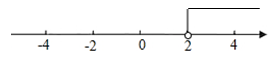   

【解析】​

## 3. 填空题（难度：适中）

不等式\(2\leq 3x-7<8\)​的整数解为。

【答案】3,4

【解析】​

## 4. 单选题（难度：适中）

若点P（a﹣3，1﹣a）在第四象限，则a的取值范围是（　　）

- A. 1＜a＜3
- B. a＜1
- C. a＞3
- D. 无解

【答案】C

【解析】解：根据题意得a﹣3＞0、1﹣a＜0，
所以a＞3．
故选：C．

## 5. 单选题（难度：适中）

点P（a，3﹣a）在第二象限，则a的取值范围是（　　）

- A. a＜0
- B. a＜3
- C. 0＜a＜3
- D. ﹣3＜a＜0

【答案】A

【解析】解：∵点M（a，3﹣a）是第二象限的点，
∴a＜0，3﹣a＞0，
解得：a＜0，
故选：A．

## 6. 单选题（难度：适中）

已知平面直角坐标系上有一点P（m+2，5+m）位于第二象限，则m的值可能为（　　）

- A. ﹣3
- B. 1  ​
- C. ﹣5
- D. ﹣6

【答案】A

【解析】解：由条件可知\( \left\{\begin{array}{l}m+2＜0\\ 5+m＞0\end{array}\right.\)，
解得：﹣5＜m＜﹣2，
则m的值可能为﹣3．
故选：A．

## 7. 单选题（难度：适中）

若点P（a﹣4，2﹣a）在第四象限，则a的取值范围是（　　）

- A. 2＜a＜4
- B. a＜2
- C. a＞4
- D. 无解

【答案】C

【解析】解：∵点P（a﹣4，2﹣a）在第四象限，
∴\( \left\{\begin{array}{l}a-4＞0\\ 2-a＜0\end{array}\right.\)，
解得a＞4．
故选：C．

## 8. 单选题（难度：适中）

若不等式组\( \left\{\begin{array}{l}x＜a\\ x＜b\end{array}\right.\)的解为x＜a，则下列各式正确的是（　　）

- A. a＜b
- B. a≤b
- C. a＞b
- D. a≥b

【答案】B

【解析】解：若不等式组\( \left\{\begin{array}{l}x＜a\\ x＜b\end{array}\right.\)的解为x＜a，则a≤b，
故选：B．

## 9. 单选题（难度：适中）

不等式组的解集在数轴上如图所示，则该不等式组是（　　）

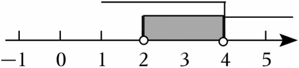

- A. \( \left\{\begin{array}{l}x-1＜3\\ x+1＜3\end{array}\right.\)
- B. \( \left\{\begin{array}{l}x-1＜3\\ x+1＞3\end{array}\right.\)
- C. \( \left\{\begin{array}{l}x-1＞3\\ x+1＞3\end{array}\right.\)
- D. \( \left\{\begin{array}{l}x-1＞3\\ x+1＜3\end{array}\right.\)

【答案】B

【解析】解：A、此不等式组的解集为x＜2，不符合题意；
B、此不等式组的解集为2＜x＜4，符合题意；
C、此不等式组的解集为x＞4，不符合题意；
D、此不等式组的无解，不符合题意；
故选：B．

## 10. 单选题（难度：适中）

已知点P（2a+6，4+a）在第一象限，则a的取值范围是（　　）

- A. ﹣4＜a＜﹣3
- B. a＜﹣3
- C. a＞﹣3
- D. a＞﹣4

【答案】C

【解析】解：∵点P（2a+6，4+a）在第一象限，
∴\( \left\{\begin{array}{l}2a+6＞0\\ 4+a＞0\end{array}\right.\)，
解得a＞﹣3．
故选：C．

## 11. 单选题

定义一种新运算：\( a▹b=\left\{\begin{array}{c}a-b(ab\ge 0)\\ a+b(ab＜0)\end{array}\right.\)
①若x▹2＝3，则x＝1或x＝5；
②若|x﹣1|▹2≥3，则x≥6；
③若（x﹣1）（x﹣3）＜0，则|（x﹣4）▹（3x﹣2）|+|4x+8|的最小值为14；
④若关于m，n的二元一次方程组\( \left\{\begin{array}{c}4m-4n=a\\ 2m-3n=b\end{array}\right.\)的解为\( \left\{\begin{array}{l}m=3\\ n=2\end{array}\right.\)，则关于x，y的方程组
\( \left\{\begin{array}{c}\left[\right({x}^{2}+2x+1)▹({x}^{2}-2x+7\left)\right]+\left[\right(4{y}^{2}-4y+5)▹(-4{y}^{2}-1\left)\right]=a\\ [{x}^{2}▹({x}^{2}-2x+3\left)\right]+\left[\right(-{y}^{2}-6)▹({y}^{2}-3y+9\left)\right]=b\end{array}\right.\)的解x、y满足：x▹y＝x+y．
以上说法正确的有（　　）

- A. 1个
- B. 2个
- C. 3个
- D. 4个

【答案】A

【解析】解：①当x≥0时，即2x≥0，
∴x▹2＝x﹣2＝3，
解得：x＝5；
当x＜0时，即2x＜0，
∴x▹2＝x+2＝3，
解得：x＝1，不符合题意，
综上可知若x▹2＝3，则x＝5，故①错误；
②∵|x﹣1|≥0，
∴2|x﹣1|≥0，
∴|x﹣1|▹2＝|x﹣1|﹣2≥3．
当x≥1时，x﹣1≥0，
∴x﹣1﹣2≥3，
解得：x≥6；
当x＜1时，x﹣1＜0，
∴﹣x+1﹣2≥3，
解得：x≤﹣4，
综上可知若|x﹣1|▹2≥3，则x≥6或x≤﹣4，故②错误；
③∵（x﹣1）（x﹣3）＜0，
∴x﹣1＜0，x﹣3＞0或x﹣1＞0，x﹣3＜0，
解得：1＜x＜3．
∴x﹣4＜0，3x﹣2＞0，4x+8＞0，
∴（x﹣4）（3x﹣2）＜0，
∴（x﹣4）▹（3x﹣2）＝x﹣4+3x﹣2＝4x﹣6．
当4x﹣6≥0时，即\( \frac{3}{2}\le x＜3\)时，|（x﹣4）▹（3x﹣2）|+|4x+8|＝4x﹣6+4x+8＝8x+2，
∴此时当\( x=\frac{3}{2}\)时有最小值，为\( 8\times \frac{3}{2}+2=14\)；
当4x﹣6＜0时，即\( 1＜x＜\frac{3}{2}\)时，|（x﹣4）▹（3x﹣2）|+|4x+8|＝6﹣4x+4x+8＝14．
综上可知若（x﹣1）（x﹣3）＜0，则|（x﹣4）▹（3x﹣2）|+|4x+8|的最小值为14，故③正确；
④将\( \left\{\begin{array}{l}m=3\\ n=2\end{array}\right.\)代入\( \left\{\begin{array}{c}4m-4n=a\\ 2m-3n=b\end{array}\right.\)，得：\( \left\{\begin{array}{c}a=4\\ b=0\end{array}\right.\)，
∴代入a，b的值，将原方程组化为：
\( \left\{\begin{array}{c}[{(x+1)}^{2}▹{(x-1)}^{2}+6]+[{(2y-1)}^{2}+4▹(-4{y}^{2}-1\left)\right]=4\\ [{x}^{2}▹{(x-1)}^{2}+2]+\left[\right(-{y}^{2}-6)▹{(y-\frac{3}{2})}^{2}+\frac{27}{4}]=0\end{array}\right.\)．
∵（x+1）²≥0，（x﹣1）²+6≥6，（2y﹣1）²+4≥4，（﹣4y²﹣1）＜0，（x﹣1）²+2≥2，﹣y²﹣6≤0，\( {(y-\frac{3}{2})}^{2}+\frac{27}{4}\ge \frac{27}{4}\)，
∴[（x+1）²▹（x﹣1）²+6]＝（x+1）²﹣（x﹣1）²﹣6＝4x﹣6，
4▹（﹣4y²﹣1）＝4﹣4y²﹣1，
[x²▹（x﹣1）²+2]＝x²﹣（x﹣1）²﹣2＝2x﹣3，
\( \left[\right(-{y}^{2}-6)▹{(y-\frac{3}{2})}^{2}+\frac{27}{4}]=-{y}^{2}-6+{(y-\frac{3}{2})}^{2}+\frac{27}{4}=3-3y\)，
∴原方程为\( \left\{\begin{array}{c}4x-6+[{(2y-1)}^{2}+4-4{y}^{2}-1]=4\\ 2x-3+3-3y=0\end{array}\right.\)，
解得：\( \left\{\begin{array}{l}x=\frac{9}{2}\\ y=4\end{array}\right.\)，
∴x▹y＝x﹣y，故④错误．
综上可知正确的只有③．
故选：A．

## 12. 单选题（难度：适中）

实数m对应的点在数轴上的位置如图所示，则不等式组\( \left\{\begin{array}{l}x+2＞0\\ x-m\le 0\end{array}\right.\)的解集为（　　）

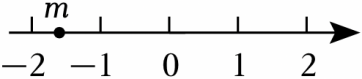

- A. x＞﹣2
- B. x≤m
- C. ﹣2＜x≤m
- D. ﹣2＜x＜m

【答案】C

【解析】解：由题意可得：数轴的性质可得﹣2＜m＜﹣1，
\( \left\{\begin{array}{l}x+2＞0①\\ x-m\le 0②\end{array}\right.\)，
分别求出两个不等式的解集可得：
解不等式①得：x＞﹣2，
解不等式②得：x≤m，
∴﹣2＜x≤m．
故选：C．

## 13. 单选题

高斯函数[x]，也称为取整函数，即[x]表示不超过x的最大整数．
例如：[2.3]＝2，[﹣1.5]＝﹣2．则下列结论：①[﹣2.1]+[﹣1]＝﹣3；②[x]+[﹣x]＝0；③若[x﹣1]＝1，则x的取值范围是2≤x＜3；④当﹣1≤x＜1时，[x+1]+[﹣x+1]的值为0，1，2．其中正确结论的个数是（　　）

- A. 1
- B. 2
- C. 3
- D. 4

【答案】A

【解析】解：①[﹣2.1]+[﹣1]＝﹣3+（﹣1）＝﹣4，故①错误；
②[x]+[﹣x]＝0，错误，例如：[2.5]＝2，[﹣2.5]＝﹣3，2+（﹣3）≠0，故②错误；
③若[x﹣1]＝1，则x的取值范围是2≤x＜3，故③正确；
④当﹣1≤x＜1时，0≤x+1＜2，0＜﹣x+1≤2，
∴[x+1]＝0或1，[﹣x+1]＝0或1或2，
当[x+1]＝0时，0≤x+1＜1，即﹣1≤x＜0，此时0＜﹣x≤1，
那么1＜﹣x+1≤2，[﹣x+1]＝1或2，
故[x+1]+[﹣x+1]＝1或2；
当[x+1]＝1时，1≤x+1＜2，即0≤x＜1，此时﹣1＜﹣x≤0，
那么0＜﹣x+1≤1，[﹣x+1]＝0或1，
故[x+1]+[﹣x+1]＝1或2；
综上所述，[x+1]+[﹣x+1]＝1或2，故④错误．
所以正确的有③，共1个．
故选：A．

## 14. 单选题（难度：适中）

若2m﹣1，m，4﹣m这三个实数在数轴上所对应的点从左到右依次排列，则m的取值范围是（　　）

- A. m＜2
- B. m＜1
- C. 1＜m＜2
- D. 1＜m\( ＜\frac{5}{3}\)

【答案】B

【解析】解：由题意可得2m﹣1＜m＜4﹣m，
即\( \left\{\begin{array}{l}2m-1＜m\\ m＜4-m\end{array}\right.\)，
解得：m＜1，
故选：B．

## 15. 单选题（难度：适中）

若关于x的不等式组\( \left\{\begin{array}{l}x+1＞-2\\ x＜a\end{array}\right.\)无解，则a的取值范围是（　　）

- A. a≥﹣3
- B. a≤﹣3
- C. a＜﹣3
- D. a＞﹣3

【答案】B

【解析】解：解不等式x+1＞﹣2，得x＞﹣3，
∵关于x的不等式组\( \left\{\begin{array}{l}x+1＞-2\\ x＜a\end{array}\right.\)无解，
∴a≤﹣3．
故选：B．

## 16. 单选题（难度：适中）

若不等式组\( \left\{\begin{array}{l}2x-2a＞0\\ 4-x\ge 0\end{array}\right.\)无解，则a的取值范围为（　　）

- A. a＞4
- B. a≤4
- C. 0＜a＜4
- D. a≥4

【答案】D

【解析】解：不等式组整理得：\( \left\{\begin{array}{l}x＞a\\ x\le 4\end{array}\right.\)，
由不等式组无解，得到a≥4．
故选：D．

## 17. 单选题

在平面直角坐标系xOy中，对于点P（x，y），若x，y均为整数，则称点P为“整点”，特别地，当\( \frac{y}{x}\)（其中xy≠0）的值为整数时，称“整点”P为“超整点”．已知点P（2a﹣4，a+3）在第二象限，下列说法正确的有（　　）
①a＜﹣3；
②若点P为“整点”，则点P的个数为4个；
③若点P为“超整点”，则点P的个数为1个；
④若点P为“超整点”，则点P到两坐标轴的距离之和大于10．

- A. 1个
- B. 2个
- C. 3个
- D. 4个

【答案】B

【解析】解：∵点P（2a﹣4，a+3）在第二象限，
∴\( \left\{\begin{array}{l}2a-4＜0\\ a+3＞0\end{array}\right.\)，
∴﹣3＜a＜2，故①错误，不符合题意；
∵点P（2a﹣4，a+3）为“整点”，﹣3＜a＜2，
∴整数a为﹣2，﹣1，0，1，
∴点P的个数为4个，故②正确，符合题意；
∴“整点”P为（﹣8，1），（﹣6，2），（﹣4，3），（﹣2，4），
∵\( \frac{1}{-8}=-\frac{1}{8}\)，\( \frac{2}{-6}=-\frac{1}{3}\)，\( \frac{3}{-4}=-\frac{3}{4}\)，\( \frac{4}{-2}=-2\)
∴“超整点”P为（﹣2，4），故③正确，符合题意；
∵点P（2a﹣4，a+3）为“超整点”，
∴点P坐标为（﹣2，4），
∴点P到两坐标轴的距离之和2+4＝6，故④错误，不符合题意；
故选：B．

## 18. 单选题

定义[x]表示不少于实数x的最小整数，例如：[3.7]＝4．给出下列结论：
①[﹣1.2]＝﹣1；
②若[x]＝3，则2≤x＜3；
③若1.2≤x≤2，则[x]＝2；
④若[x]＝2，[y]＝4，则4＜[x+y]≤6．
其中正确的个数是（　　）

- A. 1个
- B. 2个
- C. 3个
- D. 4个

【答案】C

【解析】解：根据题意可得①结论正确，符合题意；
若[x]＝3，根据[x]的意义，得2＜x≤3，故结论②错误，不符合题意；
若1.2≤x≤2，则[x]＝2，所以结论③正确，符合题意；
当[x]＝2，[y]＝4时，
有：1＜x≤2，3＜y≤4，
∴4＜x+y≤6，
∴[x+y]＝5或6，即4＜[x+y]≤6，所以结论④是正确，符合题意．
故选：C．

## 19. 单选题（难度：适中）

不等式组\( \left\{\begin{array}{l}\frac{x-1}{2}＞0\\ 7-3x\ge 1\end{array}\right.\)的解集在数轴上表示正确的是（　　）

- A. 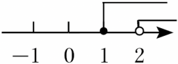
- B. 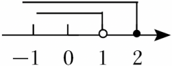
- C. 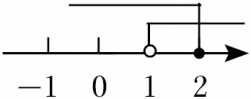
- D. 
​

【答案】C

【解析】解：由\( \frac{x-1}{2}＞\)0，得：x＞1，

由7﹣3x≥1，得：x≤2，

则不等式组的解集为1＜x≤2，

故选：C．​

## 20. 单选题（难度：适中）

如果不等式组\( \left\{\begin{array}{l}2x+7\ge 5x-8\\ x＜n\end{array}\right.\)的解集是x≤5，那么n的取值范围是（　　）

- A. n≤5
- B. n＜5
- C. n＞5
- D. n≥5

【答案】C

【解析】解：由2x+7≥5x﹣8得，x≤5，
根据已知条件，不等式组解集是x≤5．
根据“同小取小”原则得n＞5．
故选：C．

## 21. 单选题（难度：适中）

若关于x的不等式组\( \left\{\begin{array}{l}2x-1＜5\\ x＜m+1\end{array}\right.\)的解集为x＜3，则m的取值范围是（　　）

- A. m＞2
- B. m≥2
- C. m＜2
- D. m≤2

【答案】B

【解析】解：解不等式2x﹣1＜5，得：x＜3，
∵关于x的不等式组\( \left\{\begin{array}{l}2x-1＜5\\ x＜m+1\end{array}\right.\)的解集为x＜3，
∴m+1≥3，
∴m≥2．
故选：B．

## 22. 单选题（难度：适中）

如果关于x的不等式组\( \left\{\begin{array}{c}x+13＜5x+1\\ x＞m+1\end{array}\right.\)的解集是x＞3，则m的取值范围是（　　）

- A. m≤2
- B. m≥2
- C. m＜2
- D. m＞2

【答案】A

【解析】解：∵\( \left\{\begin{array}{c}x+13＜5x+1\\ x＞m+1\end{array}\right.\)，
∴由x+13＜5x+1，则13﹣1＜5x﹣x，解得x＞3，
∵解集是x＞3，x＞m+1，
∴m+1≤3，
解得m≤2，
故选：A．

## 23. 单选题（难度：适中）

不等式组\( \left\{\begin{array}{c}x-1＜0\\ x+3\ge 2x\end{array}\right.\)的解集是（　　）

- A. 无解
- B. x＜1
- C. x≥3
- D. 1＜x≤3

【答案】B

【解析】解：解x﹣1＜0得x＜1，
解x+3≥2x得x≤3，
∴不等式组\( \left\{\begin{array}{l}x-1＜0\\ x+3\ge 2x\end{array}\right.\)的解集是x＜1，
故选：B．

## 24. 单选题（难度：适中）

一个不等式组的解集在数轴上表示如图，则这个不等式组可能是（　　）

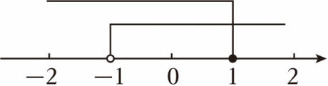

- A. \( \left\{\begin{array}{l}-x＞1\\ x\le 1\end{array}\right.\)
- B. \( \left\{\begin{array}{l}-x＞1\\ x\ge 1\end{array}\right.\)
- C. \( \left\{\begin{array}{l}-x＜1\\ x\le 1\end{array}\right.\)
- D. \( \left\{\begin{array}{l}-x＜1\\ x\ge 1\end{array}\right.\)

【答案】C

【解析】解：由数轴上不等式组的解集可得，﹣1＜x≤1，
解不等式﹣x＞1得，x＜﹣1，
解不等式﹣x＜1得，x＞﹣1，
∴则这个不等式组可能是\( \left\{\begin{array}{l}-x＜1\\ x\le 1\end{array}\right.\)，
故选：C．

## 25. 单选题（难度：适中）

不等式组\( \left\{\begin{array}{l}x-2＜0\\ x+1\ge 0\end{array}\right.\)的解集在数轴上表示正确的是（　　）

- A. 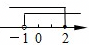
- B. 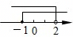
- C. 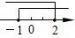
- D. 
​

【答案】B

【解析】解：在\( \left\{\begin{array}{l}x-2＜0\\ x+1\ge 0\end{array}\right.\)中，
由x﹣2＜0得：x＜2
由x+1≥0得：x≥﹣1
则不等式组的解集为2＞x≥﹣1．
故选：B．

## 26. 单选题（难度：适中）

若点P（m﹣1，m+1）在第二象限，则m的值可以是（　　）

- A. ﹣2
- B. ﹣1
- C. 0
- D. 1

【答案】C

【解析】解：∵点P（m﹣1，m+1）在第二象限，
∴\( \left\{\begin{array}{l}m-1＜0\\ m+1＞0\end{array}\right.\)，
解得﹣1＜m＜1，
所以m可以取0．
故选：C．

## 27. 单选题（难度：适中）

若关于x的不等式组\( \left\{\begin{array}{l}x-2a＞0\\ 2(x+1)＞14-x\end{array}\right.\)的解集是x＞2a，则a的取值范围是（　　）

- A. a＞4
- B. a＞2
- C. a＝2
- D. a≥2

【答案】D

【解析】解：\( \left\{\begin{array}{l}x-2a＞0①\\ 2(x+1)＞14-x②\end{array}\right.\)
解不等式①得：x＞2a，
解不等式②得：x＞4，
∵关于x的不等式组\( \left\{\begin{array}{l}x-2a＞0\\ 2(x+1)＞14-x\end{array}\right.\)的解集是x＞2a，
∴2a≥4，
a≥2，
即a的取值范围是a≥2，
故选：D．

## 28. 单选题（难度：适中）

不等式组\( \left\{\begin{array}{l}3x-2\ge 4\\ 2x＜x+6\end{array}\right.\)的解集在数轴上表示为（　　）

- A. 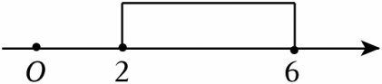
- B. 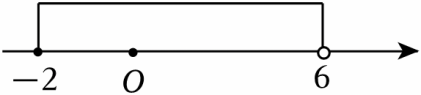
- C. 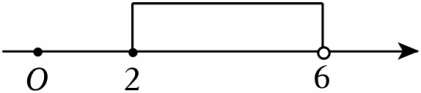
- D. 
​

【答案】C

【解析】解：解不等式3x﹣2≥4，得：x≥2，
解不等式2x＜x+6，得：x＜6，
则不等式组的解集为2≤x＜6，
将不等式组的解集表示在数轴上如下：

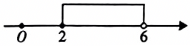

故选：C．

## 29. 单选题（难度：适中）

对于实数a，b，定义一种运算“⊕”：a⊕b＝a²+2ab，那么不等式组\( \left\{\begin{array}{l}3\oplus x＞3\\ (-2)\oplus x\ge 0\end{array}\right.\)的解在数轴上表示为（　　）

- A. 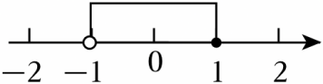
- B. 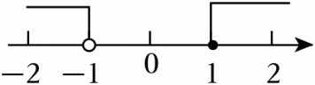
- C. 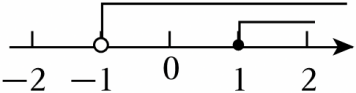
- D. 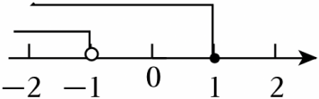

【答案】A

【解析】解：由题意得：\( \left\{\begin{array}{l}9+6x＞3①\\ 4-4x\ge 0②\end{array}\right.\)，
解不等式①得：x＞﹣1，
解不等式②得：x≤1，
∴原不等式组的解集为﹣1＜x≤1，
∴原不等式组的解集在数轴上表示如图所示：

故选：A．

## 30. 单选题（难度：适中）

不等式组\( \left\{\begin{array}{l}3x＞-6\\ \frac{x+1}{3}\le 1\end{array}\right.\)的解集，在数轴上表示正确的是（　　）

- A. 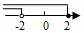
- B. 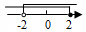
- C. 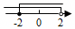
- D. 
​

【答案】B

【解析】解：解不等式3x＞﹣6，得：x＞﹣2，
解不等式\( \frac{x+1}{3}\le \)1，得：x≤2，
故不等式组的解集为﹣2＜x≤2．
故选：B．

## 31. 单选题（难度：适中）

不等式组\( \left\{\begin{array}{l}1-2x＜3\\ 3(x-1)\le 2x-1\end{array}\right.\)的解集在数轴上的表示正确的是（　　）

- A. 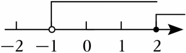
- B. 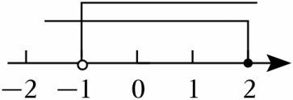
- C. 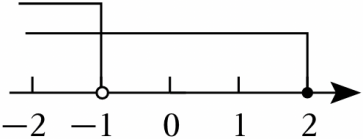
- D. 
​

【答案】B

【解析】解：由1﹣2x＜3，得：x＞﹣1，
由3（x﹣1）≤2x﹣1，得：x≤2，
则不等式组的解集为﹣1＜x≤2，
将解集表示在数轴上如下：

故选：B．

## 32. 单选题（难度：适中）

不等式组\( \left\{\begin{array}{l}x-1\le 1\\ 2x+3＞1\end{array}\right.\)的解集在数轴上表示正确的是（　　）

- A. 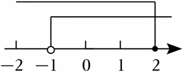
- B. 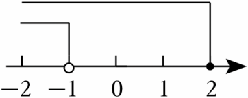
- C. 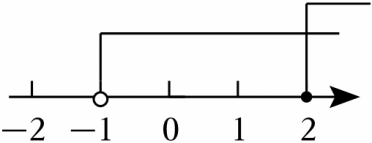
- D. 
​

【答案】A

【解析】解：\( \left\{\begin{array}{l}x-1\le 1①\\ 2x+3＞1②\end{array}\right.\)，
解不等式①，得x≤2，
解不等式②，得x＞﹣1，
∴不等式组的解集为﹣1＜x≤2，
故选：A．

## 33. 单选题（难度：适中）

已知点P（2a+1，a﹣1）在第四象限，则a的取值范围在数轴上表示正确的是（　　）

- A. 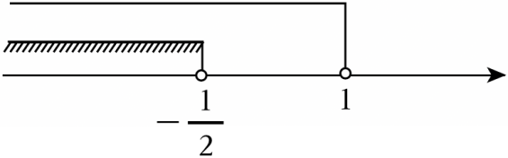
- B. 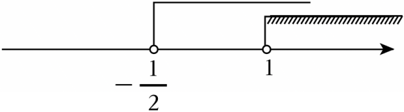
- C. 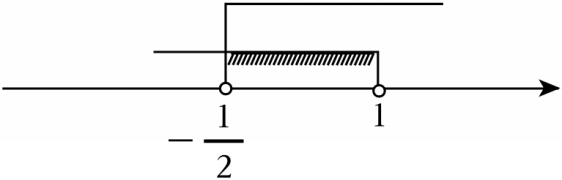
- D. 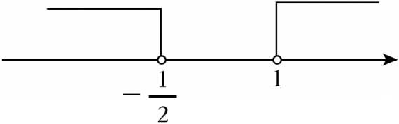

【答案】C

【解析】解：∵点P（2a+1，a﹣1）在第四象限，
∴\( \left\{\begin{array}{l}2a+1＞0\\ a-1＜0\end{array}\right.\)，
解得：\( -\frac{1}{2}＜a＜1\)，
在数轴上表示为：

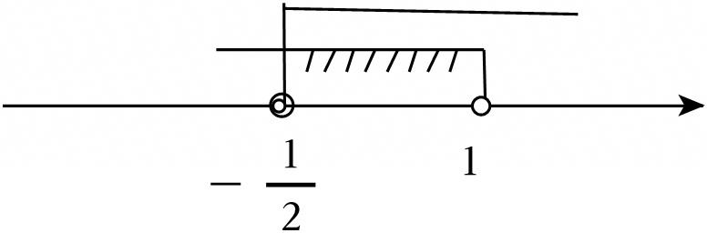

故选：C．

## 34. 单选题（难度：适中）

一元一次不等式组\( \left\{\begin{array}{l}x＜2\\ -x＞-3\end{array}\right.\)的解集在数轴上表示正确的是（　　）

- A. 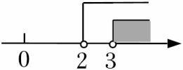
- B. 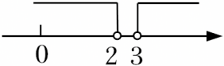
- C. 
- D. 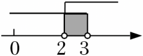

【答案】C

【解析】解：不等式组\( \left\{\begin{array}{l}x＜2\\ -x＞-3\end{array}\right.\)，
整理得：\( \left\{\begin{array}{l}x＜2\\ x＜3\end{array}\right.\)，
解得：x＜2，
解集表示在数轴上，如图所示：
．
故选：C．

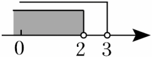

## 35. 单选题（难度：适中）

将不等式组\( \left\{\begin{array}{l}x+4＜3\\ 1-2x＞-2\end{array}\right.\)的解集表示在数轴上，下面表示正确的是（　　）

- A. 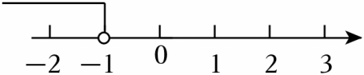
- B. 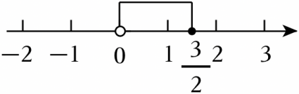
- C. 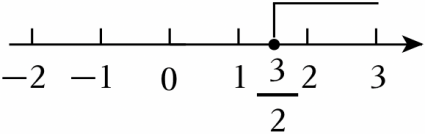
- D. 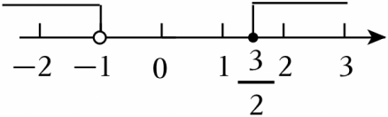

【答案】A

【解析】解：由题知，
\( \left\{\begin{array}{l}x+4＜3①\\ 1-2x＞-2②\end{array}\right.\)，
解不等式①得，x＜﹣1；
解不等式②得，\( x＜\frac{3}{2}\)，
所以不等式组的解集为：x＜﹣1．
用数轴表示如下：

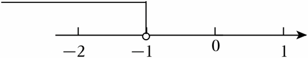
，
显然只有A选项符合题意．
故选：A．

## 36. 单选题（难度：适中）

不等式组\( \left\{\begin{array}{l}x-2＞0\\ 2x-6\ge 0\end{array}\right.\)，的解集在数轴上表示为（　　）

- A. 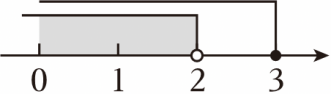
- B. 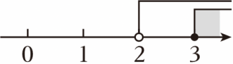
- C. 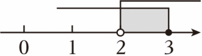
- D. 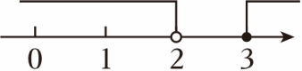

【答案】B

【解析】解：
解不等式x﹣2＞0得：x＞2，
解不等式2x﹣6≥0得：x≥3，
在数轴上表示如图：

，
故选：B．

## 37. 单选题（难度：适中）

将不等式组\( \left\{\begin{array}{c}2x-4＜0\\ -x+2\le 3\end{array}\right.\)的解集表示在数轴上，下面表示正确的是（　　）

- A. 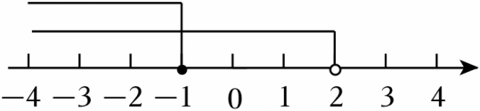
- B. 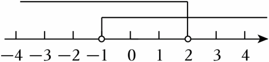
- C. 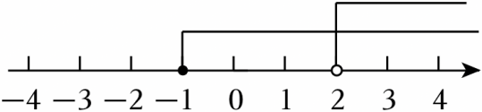
- D. 
​

【答案】D

【解析】解：\( \left\{\begin{array}{c}2x-4＜0①\\ -x+2\le 3②\end{array}\right.\)，

解①式得：x＜2，

解②式得：x≥﹣1，

∴不等式的解集为：﹣1≤x＜2，

故选：D．

## 38. 单选题（难度：适中）

若不等式组的解集为﹣2≤x＜2，则以下数轴表示中正确的是（　　）

- A. 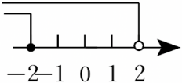
- B. 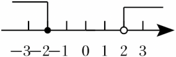
- C. 
- D. 
​

【答案】C

【解析】解：若不等式组的解集为﹣2≤x＜2，则以下数轴表示中正确的是：
 
故选：C．

## 39. 单选题（难度：适中）

不等式组\( \left\{\begin{array}{l}x+1＞2\\ 3x-4\le 2\end{array}\right.\)的解集在数轴上表示正确的是（　　）

- A. 
- B. 
- C. 
- D. 
​

【答案】C

【解析】解：\( \left\{\begin{array}{l}x+1＞2①\\ 3x-4\le 2②\end{array}\right.\)，
解不等式①得，x＞1，
解不等式②得，x≤2，
则不等式组的解集为：1＜x≤2，
∴将解集表示在数轴上为：

，
故选：C．

## 40. 单选题（难度：适中）

不等式组\( \left\{\begin{array}{l}x+1＞2\\ 2x-1\le 3，\end{array}\right.\)的解集在数轴上可表示为（　　）

- A. 
- B. 
- C. 
- D. 
​

【答案】C

【解析】解：\( \left\{\begin{array}{l}x+1＞2①\\ 2x-1\le 3②\end{array}\right.\)，
解不等式①得：x＞1，
解不等式②得：x≤2，
∴原不等式组的解集为：1＜x≤2，
∴该不等式组的解集在数轴上表示如图所示：

故选：C．

## 41. 单选题（难度：适中）

不等式组\( \left\{\begin{array}{c}3x-1\ge 2\\ 6-x＞x\end{array}\right.\)的解集在数轴上表示正确的是（　　）

- A. 
- B. 
- C. 
- D. 
​

【答案】C

【解析】解：解不等式3x﹣1≥2，得：x≥1，
解不等式6﹣x＞x，得：x＜3，
则不等式组的解集为1≤x＜3，
在数轴上表示如下：

．
故选：C．

## 42. 单选题（难度：适中）

不等式组\( \left\{\begin{array}{l}3x-4\le 5\\ 6-3x＜0\end{array}\right.\)的解集在数轴上表示为（　　）

- A. 
- B. 
- C. 
- D. 
​

【答案】B

【解析】解：\( \left\{\begin{array}{l}3x-4\le 5①\\ 6-3x＜0②\end{array}\right.\)，
解不等式3x﹣4≤5得，x≤3；
解不等式6﹣3x＜0得，x＞2；
∴2＜x≤3，
∴在数轴上表示为：

故选：B．

## 43. 单选题（难度：适中）

不等式组\( \left\{\begin{array}{l}x-1＞0\\ x+8\ge 4x+2\end{array}\right.\)的解集在数轴上表示正确的是（　　）

- A. 
- B. 
- C. 
- D. 
​

【答案】A

【解析】解：\( \left\{\begin{array}{l}x-1＞0①\\ x+8\ge 4x+2②\end{array}\right.\)，
解①得x＞1，
解②得x≤2，
利用数轴表示为：

．
故选：A．

## 44. 单选题（难度：适中）

不等式组\( \left\{\begin{array}{l}2x\ge -2\\ x+3＜4\end{array}\right.\)的解集在数轴上表示为（　　）

- A. 
- B. 
- C. 
- D. 
​

【答案】B

【解析】解：\( \left\{\begin{array}{l}2x\ge -2①\\ x+3＜4②\end{array}\right.\)，
解不等式①，得x≥﹣1，
解不等式②，得x＜1，
所以不等式组的解集是﹣1≤x＜1，
在数轴上表示为：

故选：B．

## 45. 单选题（难度：适中）

不等式组\( \left\{\begin{array}{c}1-3x\le 7\\ 3x＜-15\end{array}\right.\)的解集在数轴上表示正确的是（　　）

- A. 
- B. 
- C. 
- D. 

【答案】D

【解析】解：\( \left\{\begin{array}{c}1-3x\le 7①\\ 3x＜-15②\end{array}\right.\)，

解①得，x≥﹣2，

解②得，x＜﹣5，

∴不等式组无解，

∴不等式组的解集在数轴上为

故选：D．

## 46. 单选题（难度：适中）

已知点P（m﹣3，m﹣1）在第三象限，则m的取值范围在数轴上表示正确的是（　　）

- A. 
- B. 
- C. 
- D. 
​

【答案】B

【解析】解：∵点P（m﹣3，m﹣1）在第三象限，
∴\( \left\{\begin{array}{l}m-3＜0\\ m-1＜0\end{array}\right.\)，
解不等式组得m＜1，
在数轴上表示为：

故选：B．

## 47. 单选题（难度：适中）

不等式组\( \left\{\begin{array}{c}x+5＞2\\ 3-x\ge 1\end{array}\right.\)的解集表示在数轴上，正确的是（　　）

- A. 
- B. 
- C. 
- D. 
​

【答案】A

【解析】解：∵\( \left\{\begin{array}{c}x+5＞2\\ 3-x\ge 1\end{array}\right.\)；
∴﹣3＜x≤2，
解集在数轴上表示为：

故选：A．
声明：试题解析著作权属菁优网所有，未经书面同意，不得复制发布日期：2025/3/18 11:04:09；用户：陈晓君；邮箱：18826003166；学号：48220579
