# 知识点·一元一次不等式组的解集（同步练习）

> 教材：数学·七年级下册·沪科技版2024新教材 ｜ 来源：国家中小学智慧教育平台·在线练习 ｜ 共 35 题

## 1. 单选题（难度：简单）

不等式组\( \left\{\begin{array}{c}x>a\\ x\ge b\end{array}\right. \)的解集在数轴上表示如图，则不等式组的解集是（   ）

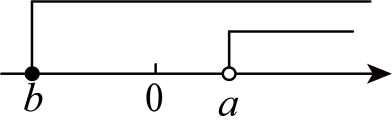

- A. \( x>a\)
- B. \( x\ge b\)
- C. \( b\le x<a\)
- D. \( -b\le x<a\)

【答案】A

【解析】解：由数轴可知，该不等式组的解集是\( x>a\)．
故选：A．

## 2. 单选题（难度：适中）

若代数式\( -2x+6\)的值是一个小于12的非负数，则\( x\)的取值范围为（    ）

- A. \( -3<x\le 2\)
- B. \( -2<x\le 3\)
- C. \( -3\le x<3\)
- D. \( -3<x\le 3\)

【答案】D

【解析】解：∵代数式\( -2x+6\)的值是一个小于12的非负数，
∴\( -2x+6\ge 0\)且\( -2x+6<10\)，
解\( -2x+6\ge 0\)得\( x\le 3\)，
解\( -2x+6<12\)得\( x>-3\)，
解得\( -3<x\le 3\)．
故选：D．

## 3. 单选题（难度：非常简单）

不等式组\( \left\{\begin{array}{c}x>2\\ x-6\le 0\end{array}\right. \)的解集在数轴上表示为（   ）

- A. 
- B. 
​
- C. 
- D. 
​

【答案】C

【解析】解：解不等式\( x-6\le 0\)得\( x\le 6\)，
∴不等式组的解集为\( 2<x\le 6\)，
∴解集在数轴上表示如图：

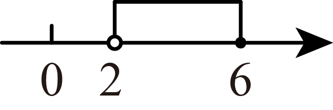

故选：C．

## 4. 单选题（难度：简单）

不等式组\( \left\{\begin{array}{c}2x+5\ge 9\\ -3x+7>-2\end{array}\right. \)的解集在数轴上表示正确的是（   ）

- A. 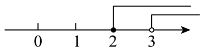
- B. 
​
- C. 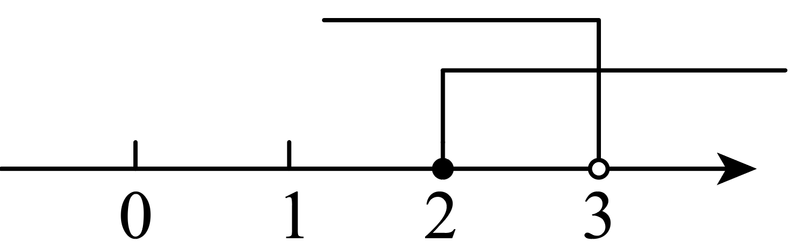
- D. 
​

【答案】C

【解析】解：\( \left\{\begin{array}{c}2x+5\ge 9\\ -3x+7>-2\end{array}\right. \)，
解不等式\( \text{2}x+5\ge 9\)得\( x\ge 2\)；
解不等式\( -3x+7>-2\)得\( x<3\)
\( \therefore \)不等式组的解集为\( 2\le x<3\)，
\( \therefore \)不等式组\( \left\{\begin{array}{c}2x+5\ge 9\\ -3x+7>-2\end{array}\right. \)的解集在数轴上表示为

，
故选： C．

## 5. 单选题（难度：适中）

如图，一个运算程序，若需要经过两次运算才能输出结果，则x的取值范围为（   ）

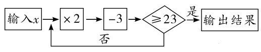

- A. \( x>8\)
- B. \( 8<x\le 13\)
- C. \( 8\le x\le 13\)
- D. \( 8\le x<13\)

【答案】D

【解析】根据题意，得\( \left\{\begin{array}{c}2x-3<23①\\ 2\left(2x-3\right)-3\ge 23②\end{array}\right. \)
解不等式①得，\( x<13\)
解不等式②得，\( x\ge 8\)
∴不等式组的解集为：\( 8\le x<13\)，
则\( x\)的取值范围为\( 8\le x<13\)．
故选D．

## 6. 单选题（难度：简单）

不等式组\( \left\{\begin{array}{c}4m-3\le 5\\ 4-m<5\end{array}\right. \)的解集在同一条数轴上表示正确的是（   ）

- A. 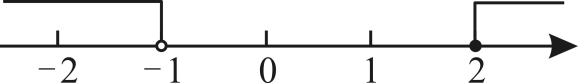
- B. 
​
- C. 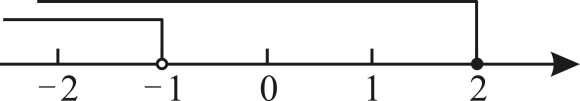
- D. 
​

【答案】B

【解析】解：解不等式\( 4m-3\le 5\)，得：\( m\le 2\)，
解不等式\( 4-m<5\)，得：\( m>-1\)，
可得该不等式组的解集为\( -1<m\le 2\)，
在数轴上表示为：

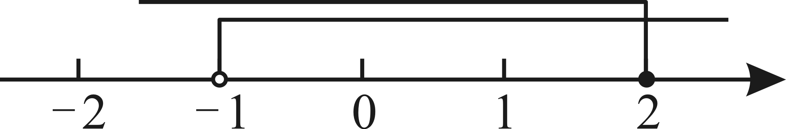
，
故选B．

## 7. 单选题（难度：非常简单）

不等式组\( \left\{\begin{array}{c}-2x+1\le -x\\ 4x-2>2x+8\end{array}\right. \)的解集为（   ）

- A. \( x\le 1\)
- B. \( x>5\)
- C. \( 1\le x\le 5\)
- D. \( 1\le x<5\)

【答案】B

【解析】解：\( \left\{\begin{array}{c}-2x+1\le -x①\\ 4x-2>2x+8②\end{array}\right. \)
解不等式①，得\( x\ge 1\)．
解不等式②，得\( x>5\)，
∴不等式组的解集为\( x>5\)．
故选：B．

## 8. 单选题（难度：简单）

某品牌的八宝粥，外包装标明：净含量为\( 330\text{g}\pm 10\text{g}\)，表明了这罐八宝粥的净含量的变化范围是（    ）

- A. \( x\ge 340\)
- B. \( x\le 320\)
- C. \( 320\le x\le 340\)
- D. \( 320<x<340\)

【答案】C

【解析】解：由题意，得：\( 330-10\le x\le 330+10\)，
∴\( 320\le x\le 340\)；
故选C．

## 9. 单选题（难度：简单）

不等式组\( \left\{\begin{array}{c}x-1<0\\ 3x+2>0\end{array}\right. \)的解集为（    ）

- A. \( x>1\)
- B. \( -\frac{2}{3}<x<1\)
- C. \( x<-\frac{2}{3}\)
- D. 无解

【答案】B

【解析】解：\( \left\{\begin{array}{c}x-1<0①\\ 3x+2>0②\end{array}\right. \)，
解不等式①得：\( x<1\)，
解不等式②得：\( x>-\frac{2}{3}\)，
∴不等式组的解集为：\( -\frac{2}{3}<x<1\)，
故选：B．

## 10. 单选题（难度：适中）

定义新运算“※”如下：当\( a>b\)时，\( a\text{※}b=b-ab\)；当\( a<b\)时，\( a\text{※}b=b+ab\)．例如，\( 4\text{※}3=3-4\times 3=-9\)，\( 2\text{※}3=3+2\times 3=9\)，若\( 3\text{※}\left(x+2\right)<0\)则x的取值范围是（    ）

- A. \( x>1\)
- B. \( x<-2\)或\( x>1\)
- C. \( -2<x<1\)
- D. \( x<-2\)

【答案】C

【解析】解：当\( 3>x+2\)时，\( x+2-3\left(x+2\right)<0\)，
解不等式\( 3>x+2\)得：\( x<1\)，
解不等式\( x+2-3\left(x+2\right)<0\)得：\( x>-2\)
∴\( -2<x<1\)；
当\( 3<x+2\)时，\( x+2+3\left(x+2\right)<0\)，
解不等式\( 3<x+2\)得：\( x>1\)，
解不等式\( x+2+3\left(x+2\right)<0\)得：\( x<-2\)，
∴此时无解；
综上分析可知：x的取值范围是\( -2<x<1\)．
故选：C．

## 11. 单选题（难度：简单）

不等式组\( \left\{\begin{array}{c}x+2<3\\ -2x\le 1\end{array}\right. \)的解集为（   ）

- A. \( x\le -\frac{1}{2}\)
- B. \( -\frac{1}{2}\le x<1\)
- C. \( x<1\)
- D. 无解

【答案】B

【解析】解：\( \left\{\begin{array}{c}x+2<3①\\ -2x\le 1②\end{array}\right. \)，
解①得\( x<1\)，
解②得\( x\ge -\frac{1}{2}\)，
∴\( -\frac{1}{2}\le x<1\)．
故选B．

## 12. 单选题（难度：简单）

若\( 4-m\)，\( m\)，\( 2m-1\)这三个实数在数轴上所对应的点从左到右依次排列，则\( m\)的取值范围是（   ）

- A. \( m<2\)
- B. \( m>1\)
- C. \( 1<m<2\)
- D. \( m>2\)

【答案】D

【解析】解：∵\( 4-m\)，\( m\)，\( 2m-1\)这三个实数在数轴上所对应的点从左到右依次排列，
∴\( \left\{\begin{array}{c}4-m<m\\ m<2m-1\end{array}\right. \)，
解得\( m>2\)，
故选：D．

## 13. 单选题（难度：非常简单）

若\( 2m-1\)，\( m+1\)，\( 9-m\)这三个实数在数轴上所对应的点从左到右依次排列，则\( m\)的取值范围是（    ）

- A. \( 2<m<4\)
- B. \( m<2\)
- C. \( m<4\)
- D. \( 1<m<2\)

【答案】B

【解析】由题意得：\( \left\{\begin{array}{c}2m-1<m+1①\\ m+1<9-m②\end{array}\right. \)，
解不等式①得\( m<2\)，
解不等式②得\( m<4\)，
不等式组的解集为\( m<2\)．
故选：B．

## 14. 单选题（难度：适中）

点\( P\left(a,3-a\right)\)在第二象限，则\( a\)的取值范围是（   ）

- A. \( a<0\)
- B. \( a<3\)
- C. \( 0<a<3\)
- D. \( -3<a<0\)

【答案】A

【解析】解：∵点\( P\left(a,3-a\right)\)在第二象限，
∴\( \left\{\begin{array}{c}a<0\\ 3-a>0\end{array}\right. \)，
解得：\( a<0\)，
故选：A．

## 15. 单选题（难度：简单）

不等式组\( \left\{\begin{array}{c}8-4x<0\\ \frac{2x-1}{5}-1\ge 0\end{array}\right. \)的解集在数轴上表示为（　　）

- A. 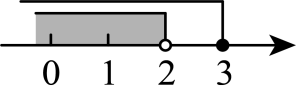
- B. 
​
- C. 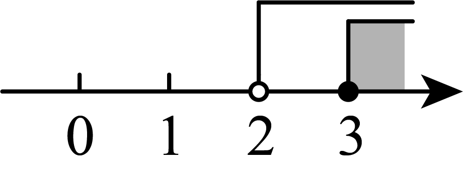
- D. 
​

【答案】C

【解析】解：不等式组整理得：\( \left\{\begin{array}{c}x＞2\\ x\ge 3\end{array}\right. \)，
解得：\( x\ge 3\)，
数轴上表示，如图所示：
．

故选：C．

## 16. 单选题（难度：简单）

已知点\( P\left(2a+6\text{，}4+a\right)\)在第一象限，则a的取值范围是（    ）

- A. \( -4<a<-3\)
- B. \( a<-3\)
- C. \( a>-3\)
- D. \( a>-4\)

【答案】C

【解析】解：∵点\( P\left(2a+6\text{，}4+a\right)\)在第一象限，
∴\( \left\{\begin{array}{c}2a+6>0\\ 4+a>0\end{array}\right. \)，解得：\( a>-3\)．
故选C．

## 17. 单选题（难度：适中）

若关于x的不等式组\( \left\{\begin{array}{c}a-\frac{x-1}{3}\ge 0\\ 3-2\left(x-1\right)\le 3x\end{array}\right. \)在实数范围内有解，则a的取值范围为（    ）

- A. \( a\le 0\)
- B. \( a\ge 0\)
- C. \( a<0\)
- D. \( a>0\)

【答案】B

【解析】解\( \left\{\begin{array}{c}a-\frac{x-1}{3}\ge 0①\\ 3-2\left(x-1\right)\le 3x②\end{array}\right. \)，
解不等式①得：\( x\le 3a+1\)，
解不等式②得：\( x\ge 1\)．
因为关于x的不等式组在实数范围内有解，
∴\( 3a+1\ge 1\)，解得：\( a\ge 0\)．
故选：B．

## 18. 单选题（难度：非常简单）

解不等式组\( \left\{\begin{array}{c}x<2①\\ x\ge 1②\end{array}\right. \)时，不等式①，②的解集在数轴上表示正确的是（   ）

- A. 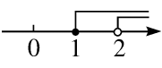
- B. 
​
- C. 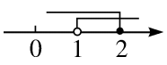
- D. 
​

【答案】D

【解析】解：解不等式组\( \left\{\begin{array}{c}x<2①\\ x\ge 1②\end{array}\right. \)时，不等式①，②的解集在数轴上表示正确的是

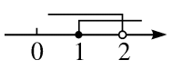

故选：D．

## 19. 单选题（难度：简单）

若点\( P\left(-3-2a,-a\right)\)在第二象限，则\( a\)的取值范围是（      ）

- A. \( a<0\)
- B. \( a>-\frac{3}{2}\)
- C. \( a>0\)或\( a<-\frac{3}{2}\)
- D. \( -\frac{3}{2}<a<0\)

【答案】D

【解析】解：∵点\( P\left(-3-2a,-a\right)\)在第二象限，
∴\( \left\{\begin{array}{c}-3-2a<0\\ -a>0\end{array}\right. \)
解得：\( -\frac{3}{2}<a<0\)，
故选：D．

## 20. 单选题（难度：简单）

不等式组\( \left\{\begin{array}{c}x-4\le 2\left(x-1\right)\\ \frac{x+3}{2}>x+1\end{array}\right. \)的解集在数轴上表示正确的是（   ）

- A. 
- B. 
​
- C. 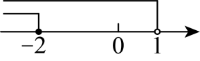
- D. 
​

【答案】A

【解析】解：\( \left\{\begin{array}{c}x-4\le 2\left(x-1\right)①\\ \frac{x+3}{2}>x+1②\end{array}\right. \)，
解不等式①得：\( x\ge -2\)，
解不等式②得：\( x<1\)，
\( \therefore \)不等式组的解集为\( -2\le x<1\)，
在数轴上表示如下图：

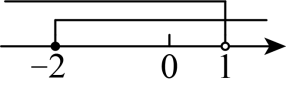
，
故选：A．

## 21. 单选题（难度：简单）

不等式组\( \left\{\begin{array}{c}3-x\ge 1\\ -2x-6<-4\end{array}\right. \)的解集表示在数轴上，正确的是（   ）

- A. 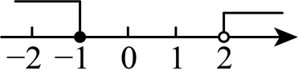
- B. 
​
- C. 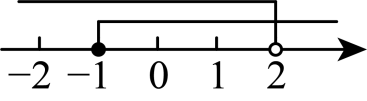
- D. 
​

【答案】D

【解析】解：\( \left\{\begin{array}{c}3-x\ge 1①\\ -2x-6<-4②\end{array}\right. \)
解①式得：\( x\le 2\)，
解②式得：\( x>-1\)，
∴不等式组的解集为：\( -1<x\le 2\)，
解集表示在数轴上如下：
，
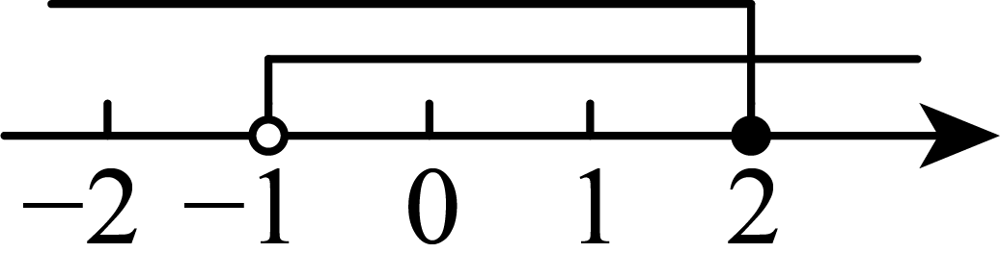

故选：D

## 22. 单选题（难度：适中）

已知关于\( x\)的不等式组\( \left\{\begin{array}{c}x-2<3x-6\\ x<m\end{array}\right. \)无解，那么\( m\)的取值范围是（   ）

- A. \( m<2\)
- B. \( m>2\)
- C. \( m\le 2\)
- D. \( m\ge 2\)

【答案】C

【解析】解：解不等式\( x-2<3x-6\)，得\( x>2\)，
\( \because x<m\)且不等式组无解，
\( \therefore m\le 2\)，
故选：\( \mathrm{C}\)．

## 23. 单选题（难度：适中）

若点\( P\left(2x+6,x-4\right)\)在平面直角坐标系的第四象限内，则x的取值范围在数轴上可表示为（   ）

- A. 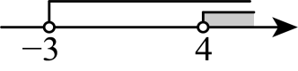
- B. 
​
- C. 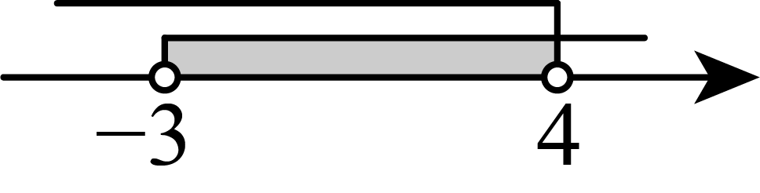
- D. 
​

【答案】C

【解析】解：∵点\( P\left(2x+6,x-4\right)\)在第四象限内，
∴\( \left\{\begin{array}{c}2x+6>0\\ x-4<0\end{array}\right. \)，
解得\( -3<x<4\)，
∴\( x\)的取值范围在数轴上可表示为：

故选：\( \text{C}\)．

## 24. 单选题（难度：简单）

不等式组\( \left\{\begin{array}{c}x>1\\ x>2\end{array}\right. \)的解是（   ）

- A. \( x>1\)
- B. \( x>2\)
- C. \( x<1\)
- D. \( x<2\)

【答案】B

【解析】解：等式组\( \left\{\begin{array}{c}x>1\\ x>2\end{array}\right. \)的解是\( x>2\)．
故选：B．

## 25. 单选题（难度：非常简单）

不等式组\( \left\{\begin{array}{c}x-2>0\\ 2x-6\ge 0\end{array}\right. \)，的解集在数轴上表示为（   ）

- A. 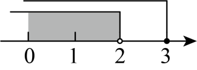
- B. 
​
- C. 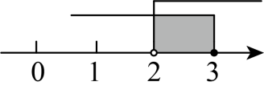
- D. 
​

【答案】B

【解析】解：解不等式\( x-2>0\)得：\( x>2\)，
解不等式\( 2x-6\ge 0\)得：\( x\ge 3\)，
在数轴上表示如图：

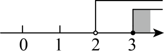
，
故选：B．

## 26. 单选题（难度：非常简单）

已知不等式组\( \left\{\begin{array}{c}-x\ge -1\\ 2x-1>-5\end{array}\right. \)其解集在数轴上表示正确的是（    ）

- A. 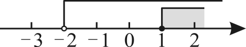
- B. 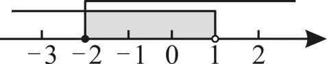
- C. 
- D. 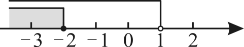

【答案】C

【解析】解：\( \left\{\begin{array}{c}-x\ge -1\text{①}\\ 2x-1>-5②\end{array}\right. \)
解不等式①得，\( x\le 1\)，
解不等式②得，\( x>-2\)，
∴原不等式组的解集为\( -2<x\le 1\)，
∴表示在数轴上为
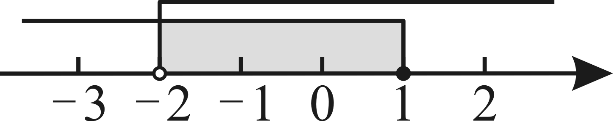

故选：C．

## 27. 单选题（难度：简单）

若不等式组的解集为\( -1<x\le 3\)，则在数轴上表示为（   ）

- A. 
​
- B. 
​
- C. 
- D. 
​

【答案】C

【解析】解：不等式组的解集为\( -1＜x\le 3\)在数轴上表示为\( -1\)和3之间的部分且不等于\( -1\)

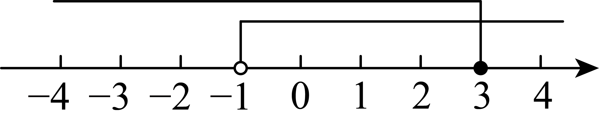

  故选：C ．

## 28. 单选题（难度：适中）

不等式组\( \left\{\begin{array}{c}x-1\le 0\\ x-1<2\end{array}\right. \)的解集在数轴上的表示正确的是（    ）

- A. 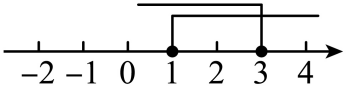
- B. 
​
- C. 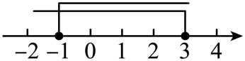
- D. 
​

【答案】D

【解析】解：\( \left\{\begin{array}{c}x-1\le 0①\\ x-1<2②\end{array}\right. \)，
解不等式①得：\( x\le 1\)，
解不等式②得：\( x<3\)，
在数轴上表示不等式组的解集如下：

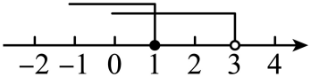

故选：D．

## 29. 单选题（难度：适中）

实数m对应的点在数轴上的位置如图所示，则不等式组\( \left\{\begin{array}{l}x+2＞0\\ x-m\le 0\end{array}\right.\)的解集为（　　）

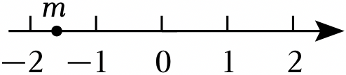

- A. x＞﹣2
- B. x≤m
- C. ﹣2＜x≤m
- D. ﹣2＜x＜m

【答案】C

【解析】解：由题意可得：数轴的性质可得﹣2＜m＜﹣1，
\( \left\{\begin{array}{l}x+2＞0①\\ x-m\le 0②\end{array}\right.\)，
分别求出两个不等式的解集可得：
解不等式①得：x＞﹣2，
解不等式②得：x≤m，
∴﹣2＜x≤m．
故选：C．

## 30. 单选题（难度：简单）

不等式组\( \left\{\begin{array}{c}2x+5\ge 3\\ 3x+2>4x\end{array}\right. \)的解集在数轴上表示正确的是（    ）

- A. 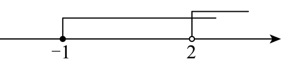
- B. 
​
- C. 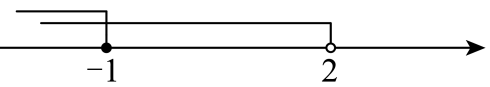
- D. 
​

【答案】B

【解析】解：解不等式\( 2x+5\ge 3\)，得\( x\ge -1\)，
解不等式\( 3x+2>4x\)，得\( x<2\)，
将解集表示在数轴上为：
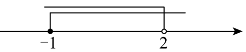

故选：B

## 31. 单选题（难度：简单）

不等式组\( \left\{\begin{array}{c}3x-1>2\\ 8-4x\le 0\end{array}\right. \)的解集在数轴上表示为（   ）

- A. 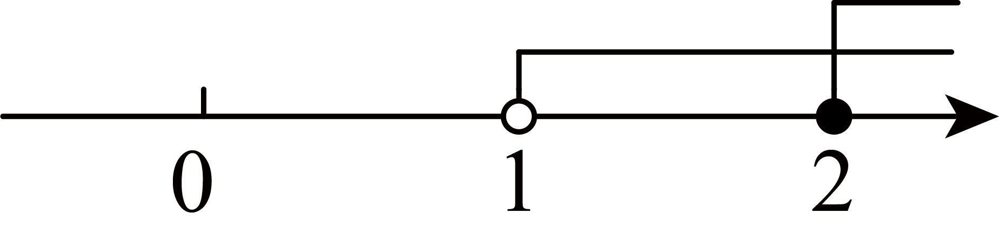
- B. 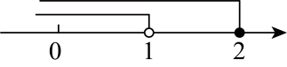
- C. 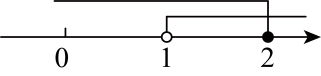
- D. 

【答案】A

【解析】解：解\( 3x-1>2\)得\( x>1\)，
解\( 8-4x\le 0\)得\( x\ge 2\)，
将解集表示在数轴上：

∴不等式组的解集为\( x\ge 2\)，
故选：A．

## 32. 单选题（难度：简单）

不等式组\( \left\{\begin{array}{l}x-2＜0\\ x+1\ge 0\end{array}\right.\)的解集在数轴上表示正确的是（　　）

- A. 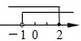
- B. 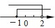
- C. 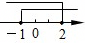
- D. 
​

【答案】B

【解析】解：在\( \left\{\begin{array}{l}x-2＜0\\ x+1\ge 0\end{array}\right.\)中，
由x﹣2＜0得：x＜2
由x+1≥0得：x≥﹣1
则不等式组的解集为2＞x≥﹣1．
故选：B．

## 33. 单选题（难度：非常简单）

将一个关于<latex class="math-tex">\( \mathrm{x}\)</latex>的一元一次不等式组的解集表示在数轴上如图所示，则该不等式组的解集是（    ）

【答案】A

## 34. （难度：非常简单）

解一元一次不等式组<latex class="math-tex">\( \left\{\begin{array}{l}2(x-1)\ge 3x-5\\ \frac{x+3}{2}＜2x\end{array}\right.\)</latex>，并把解表示在数轴上．

## 35. （难度：非常简单）

解一元一次不等式组：<latex class="math-tex">\( \left\{\begin{array}{l}2x-2＜0\\ 2x+1＞\frac{x-1}{2}\end{array}\right.\)</latex>，并在数轴上表示不等式组的解集．

