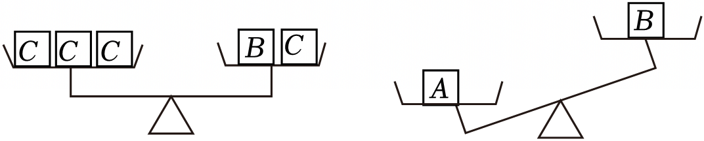
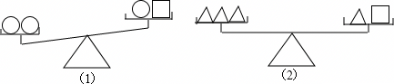
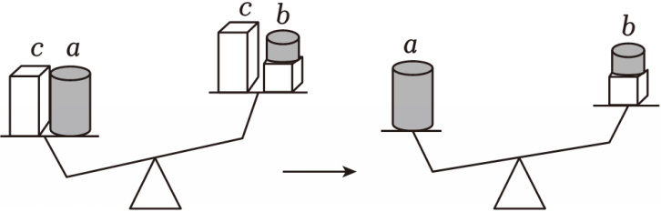

# 知识点·不等式的基本性质（同步练习）

> 教材：数学·七年级下册·沪科技版2024新教材 ｜ 来源：国家中小学智慧教育平台·在线练习 ｜ 共 52 题

## 1. 单选题（难度：简单）

若m＜n，则下列变形正确的是（　　）

- A. m﹣2＞n﹣2
- B. m²＜n²
- C. ﹣2m＜﹣2n
- D. m+3＜n+3

【答案】D

【解析】解：A．若m＜n，则m﹣2＜n﹣2，故选项A不正确；
B．若m＜n，如﹣3＜﹣1，则（﹣3）²＞（﹣1）²，则m²＜n²错误，故选项B不正确；
C．若m＜n，则﹣2m＞﹣2n，故选项C不正确；
D．若m＜n，则m+3＜n+3，故选项D正确．
故选：D．

## 2. 单选题（难度：简单）

由x＜y得到ax≥ay的条件是（　　）

- A. a＞0
- B. a≥0
- C. a＜0
- D. a≤0

【答案】D

【解析】解：根据不等式的性质3，由x＜y得到ax≥ay的条件是a≤0．
故选：D．

## 3. 单选题（难度：简单）

若a＜b，则下列结论一定成立的是（　　）

- A. ﹣2a＜﹣2b
- B. a﹣1＜b﹣1
- C. \( -\frac{a}{3}＜-\frac{b}{3}\)
- D. ﹣2a+1＜﹣2b+1

【答案】B

【解析】解：∵a＜b，
根据在不等式两边加或减同一个数或式子，不等号的方向不变，
可得a﹣1＜b﹣1，故B正确；
根据在不等式两边乘或除以同一个负数，不等号的方向改变，
可得﹣2a＞﹣2b，\( -\frac{a}{3}＞-\frac{b}{3}\)，﹣2a+1＞﹣2b+1，
故A、C、D错误；
故选：B．

## 4. 单选题（难度：适中）

已知三个实数a，b，c，满足a+b+c＞0，b+c＝a，a+b＝c，则（　　）

- A. a＞0，b＞0，c＞0
- B. a＞0，b＝0，c＞0
- C. a＜0，b＝0，c＜0
- D. a＜0，b＞0，c＜0

【答案】B

【解析】解：由条件可知b+c+b＝c，
∴b＝0，c＝a，
∵a+b+c＞0，
∴2a＞0，
∴a＞0，c＞0，
故选：B．

## 5. 单选题（难度：简单）

若a＜b，下列运用不等式基本性质变形正确的是（　　）

- A. ﹣5a＜﹣5b
- B. 4﹣3a＜4﹣3b
- C. 4a＞4b
- D. a﹣3＜b﹣3

【答案】D

【解析】解：A．∵若a＜b，则﹣5a＞﹣5b，∴此选项不等式的变形错误，故此选项不符合题意；
B．∵若a＜b，则﹣3a＞﹣3b，4﹣3a＞4﹣3b，∴此选项不等式的变形错误，故此选项不符合题意；
C．∵若a＜b，则4a＜4b，∴此选项不等式的变形错误，故此选项不符合题意；
D．∵若a＜b，则a﹣3＜b﹣3，∴此选项不等式的变形正确，故此选项符合题意；
故选：D．

## 6. 单选题（难度：简单）

若m＞1，则下列各式中错误的是（　　）

- A. 2m＞2
- B. m﹣1＞0
- C. ﹣m＞﹣1  ​​
- D. \( \frac{m}{2}＞\frac{1}{2}\)

【答案】C

【解析】解：A．若m＞1，则2m＞2，故选项A正切；
B．若m＞1，则m﹣1＞0，故选项B正确；
C．若m＞1，则﹣m＜﹣1，故选项C错误；
D．若m＞1，则\( \frac{m}{2}＞\frac{1}{2}\)，故选项D正确．
故选：C．

## 7. 单选题（难度：简单）

若a＞b，且c是任意实数，则下列不等式总成立的是（　　）

- A. ac＞bc
- B. ac²＞bc²
- C. a﹣c＞b﹣c
- D. ﹣ac＜﹣bc

【答案】C

【解析】解：A、∵a＞b，c＞0，
∴ac＞bc，
故A不符合题意；
B、∵a＞b，c≠0，
∴ac²＞bc²，
故B不符合题意；
C、∵a＞b，
∴a﹣c＞b﹣c，
故C符合题意；
D、∵a＞b，c＞0，
∴﹣ac＜﹣bc，
故D不符合题意；
故选：C．

## 8. 单选题（难度：简单）

若a＜b，则下列各式中一定成立的是（　　）

- A. a+3＞b+3
- B. a﹣3＞b﹣3
- C. \( \frac{a}{3}＜\frac{b}{3}\)
- D. ﹣3a＜﹣3b

【答案】C

【解析】解：A．∵a＜b，
∴a+3＜b+3，故本选项不符合题意；
B．∵a＜b，
∴a﹣3＜b﹣3，故本选项不符合题意；
C．∵a＜b，
∴\( \frac{a}{3}＜\frac{b}{3}\)，故本选项符合题意；
D．∵a＜b，
∴﹣3a＞﹣3b，故本选项不符合题意．
故选：C．

## 9. 单选题（难度：简单）

若x+2＞0，则下列不等式成立的是（　　）

- A. x﹣1＜0
- B. x+1＞0
- C. x+3＞0  ​
- D. \( \frac{x}{2}＞\)1

【答案】C

【解析】解：∵x+2＞0，
∴x+3＞0．
故选：C．

## 10. 单选题（难度：简单）

已知a＜b，下列不等式一定成立的是（　　）

- A. ac＜bc
- B. ac²＜bc²
- C. \( \frac{a}{c}＜\frac{b}{c}\)
- D. 2a＜2b

【答案】D

【解析】解：已知a＜b，
当c＞0时，ac＜bc，则A不符合题意；
当c＝0时，ac²＝bc²，则B不符合题意；
当c＞0时，\( \frac{a}{c}＜\frac{b}{c}＜\)bc，则C不符合题意；
两边同乘2得2a＜2b，则D符合题意；
故选：D．

## 11. 单选题（难度：简单）

若a＞b，且c为实数，则下列不等式正确的是（　　）

- A. a²＞b²
- B. c﹣a＞c﹣b
- C. ac＞bc
- D. a（c²+1）＞b（c²+1）

【答案】D

【解析】解：A、∵a＞b，
∴a²＞b²或a²＜b²或a²＝b²，原选项不符合题意；
B、∵a＞b，
∴c﹣a＜c﹣b，原选项不符合题意；
C、∵a＞b，
∴ac＞bc或ac＝bc或ac＜bc，原选项不符合题意；
D、∵a＞b，c²+1＞0，
∴a（c²+1）＞b（c²+1），原选项符合题意；
故选：D．

## 12. 单选题（难度：简单）

如果a＞b，那么下列各式中正确的是（　　）

- A. a﹣3＜b﹣3
- B. \( \frac{a}{3}＜\frac{b}{3}\)
- C. ﹣a＞﹣b
- D. ﹣2a＜﹣2b

【答案】D

【解析】解：A、两边都加或减同一个数或减同一个整式，不等号的方向不变，故A错误；
B、不等式的两边都乘以或除以同一个正数，不等号的方向不变，故B错误；
C、不等式的两边都乘以或除以同一个负数，不等号的方向改变，故C错误；
D、不等式的两边都乘以或除以同一个负数，不等号的方向改变，故D正确；
故选：D．

## 13. 单选题（难度：简单）

若a+1＞b，则下列结论一定正确的是（　　）

- A. a＞b
- B. 2a+1＞2b
- C. ﹣a+1＜﹣b
- D. \( \frac{a}{2}+1＞\frac{b}{2}\)

【答案】D

【解析】解：A．若a+1＞b，则a＞b﹣1，故选项A错误；
B．若a+1＞b，则2a+1＞a+b，故选项B错误；
C．若a+1＞b，则﹣a﹣1＜﹣b，故选项C错误；
D．若a+1＞b，则\( \frac{a}{2}+\frac{1}{2}＞\frac{b}{2}\)，所以\( \frac{a}{2}+1＞\frac{b}{2}+\frac{1}{2}＞\frac{b}{2}\)，故选项D正确．
故选：D．

## 14. 单选题（难度：适中）

有下列结论：
（1）若a＝b，则3a+m＝3b+m；
（2）若a＝b，则\( \frac{a}{c}=\frac{b}{c}\)；
（3）若am²＜bm²，则a＜b；
（4）若m＞n，则5﹣2m＞5﹣2n；
（5）若x＞y，则ax＞ay．其中一定成立的个数有（　　）

- A. 1个
- B. 2个
- C. 3个
- D. 4个

【答案】B

【解析】解：（1）若a＝b，则3a+m＝3b+m，故（1）正确；
（2）若a＝b，且c≠0，则\( \frac{a}{c}=\frac{b}{c}\)，故（2）不正确；
（3）若am²＜bm²，则a＜b，故（3）正确；
（4）若m＞n，则5﹣2m＜5﹣2n，故（4）不正确；
（5）若x＞y，且a＞0，则ax＞ay，故（5）不正确．
故选：B．

## 15. 单选题（难度：简单）

若x＜y，且ax＜ay，则a的值可能是（　　）

- A. 0
- B. 1
- C. ﹣1
- D. ﹣2

【答案】B

【解析】解：∵x＜y，且ax＜ay，
∴a＞0，
故选：B．

## 16. 单选题（难度：简单）

已知﹣x＞﹣1，则下列不等式一定成立的是（　　）

- A. x＞1
- B. x＜1
- C. x＞﹣1
- D. x＜﹣1

【答案】B

【解析】解：∵﹣x＞﹣1，
∴x＜1，
∴选项A不符合题意；
∵﹣x＞﹣1，
∴x＜1
∴选项B符合题意；
∵﹣x＞﹣1，
∴x＜1，但是x＞﹣1不一定成立，
∴选项C不符合题意；
∵﹣x＞﹣1，
∴x＜1，
∴选项D不符合题意．
故选：B．

## 17. 单选题（难度：简单）

若a＜b，则下列不等式一定成立的是（　　）

- A. a+2＞b+2
- B. 2a＞2b
- C. 2﹣a＞2﹣b  ​​
- D. \( \frac{a}{2}＞\frac{b}{2}\)

【答案】C

【解析】解：∵a＜b，
∴a+2＜b+2，故A不正确；
∵a＜b，
∴2a＜2b，故B不正确；
∵a＜b，
∴﹣a＞﹣b，
∴2﹣a＞2﹣b，故C正确；
∵a＜b，
∴\( \frac{a}{2}＜\frac{b}{2}\)，故D不正确．
故选：C．

## 18. 单选题（难度：简单）

若x＞y，则下列各式正确的是（　　）

- A. 2﹣x＞2﹣y
- B. x÷1＞y÷1
- C. 3x＞2y
- D. x²＞y²

【答案】B

【解析】解：A、∵x＞y，
∴﹣x＜﹣y，
∴2﹣x＜2﹣y，
故A不符合题意；
B、∵x＞y，
∴x÷1＞y÷1，
故B符合题意；
C、∵x＞y，
∴3x＞3y，
故C不符合题意；
D、∵x＞y＞0，
∴x²＞y²，
故D不符合题意；
故选：B．

## 19. 单选题（难度：简单）

若x＞y，则下列式子错误的是（　　）

- A. x﹣9＞y﹣9
- B. \( \frac{x}{9}＞\frac{y}{9}\)
- C. 3﹣x＞3﹣y
- D. ﹣2x＜﹣2y

【答案】C

【解析】解：A．∵x＞y，
∴x﹣9＞y﹣9，
故该选项正确，不符合题意；
B．∵x＞y，
∴\( \frac{x}{9}＞\frac{y}{9}\)，
故该选项正确，不符合题意；
C．∵x＞y，
∴3﹣x＜3﹣y，
故该选项错误，符合题意；
D．∵x＞y，
∴﹣2x＜﹣2y，
故该选项正确，不符合题意．
故选：C．

## 20. 单选题（难度：简单）

已知a＞b，则下列不等式错误的是（　　）

- A. a+2＞b+2
- B. am²＞bm²
- C. a﹣2＞b﹣3  ​​
- D. \( \frac{a}{{n}^{2}+1}＞\frac{b}{{n}^{2}+1}\)

【答案】B

【解析】解：当a＞b时，a+2＞b+2，则A不符合题意；
当m＝0时，am²＝bm²，则B符合题意；
当a＞b时，a﹣2＞b﹣2，故a﹣2＞b﹣3，则C不符合题意；
当a＞b，n²+1＞0时，\( \frac{a}{{n}^{2}+1}＞\frac{b}{{n}^{2}+1}\)，则D不符合题意；
故选：B．

## 21. 单选题（难度：简单）

下列不等式变形正确的是（　　）

- A. 由a＞b，得am＞bm
- B. 由a＞b，得a﹣2024＜b﹣2024
- C. 由ab＞ac，得b＜c
- D. 由\( \frac{b}{{a}^{2}+1}＞\frac{c}{{a}^{2}+1}\)，得b＞c

【答案】D

【解析】解：A．由a＞b，若m＞0，则可得am＞bm，故本选项变形错误，不符合题意；
B．由a＞b，得a﹣2024＞b﹣2024，故本选项变形错误，不符合题意；
C．由ab＞ac，若a＜0，则可得b＜c，故本选项变形错误，不符合题意；
D． \( \frac{b}{{a}^{2}+1}＞\frac{c}{{a}^{2}+1}\)，因为a²+1＞0，所以可得b＞c，故本选项变形正确，符合题意．
故选：D．

## 22. 单选题（难度：简单）

设A，B，C表示三种不同的物体，先后用天平称了两次，情况如图所示，则这三个物体按质量从大到小应为（　　）

- A. A＞B＞C
- B. C＞B＞A
- C. B＞A＞C
- D. A＞C＞B

【答案】A

【解析】解：由题意得：A＞B，3C＝B+C，
∴2C＝B，
∴B＞C，
∴A＞B＞C，
故选：A．

## 23. 单选题（难度：简单）

若a＞b，x＜1，则下列不等式成立的是（　　）

- A. ax＞bx
- B. a+1＞b+x
- C. a﹣2＞b﹣1
- D. a＞b+1

【答案】B

【解析】解：A、若a＞b，x＜1，当x＜0时，则ax＜bx，不符合题意；
B、若a＞b，x＜1，则a+1＞b+x，符合题意；
C、若a＞b，则a﹣2不一定大于b﹣1，不符合题意；
D、若a＞b，则a不一定大于b+1，不符合题意；
故选：B．

## 24. 单选题（难度：简单）

已知a＜b＜0，则下列各式中，正确的是（　　）

- A. 3a＞3b
- B. a²＜b²
- C. ﹣4a+1＞﹣4b+1  ​​
- D. \( \frac{a}{-5}＜\frac{b}{-5}\)

【答案】C

【解析】解：∵a＜b＜0，
∴a＜b，
∴根据不等式的性质2，得3a＜3b；
根据不等式的性质3，得a²＞ab＞b²，即a²＞b²；
根据不等式的性质1和3，得﹣4a+1＞﹣4b+1；
根据不等式的性质3，得\( \frac{a}{-5}＞\frac{b}{-5}\)，
∴选项C符合题意，选项A，B，D不符合题意，
故选：C．

## 25. 单选题（难度：简单）

已知a＜b，下列四个不等式中正确的是（　　）

- A. 3a＞3b
- B. ﹣a＜﹣b
- C. a+3＜b+3
- D. a﹣6＞b﹣6

【答案】C

【解析】解：A、不等式a＜b的两边同时乘以3，不等号的方向不变，即3a＜3b．故A选项错误；
B、不等式a＜b的两边同时乘以﹣1，不等号的方向改变，即﹣a＞﹣b．故B选项错误；
C、不等式a＜b的两边同时加3，不等号的方向不变，即a+3＜b+3．故C选项正确；
D、不等式a＜b的两边同时加﹣6，不等号的方向不变，即a﹣6＜b﹣6．故D选项错误．
故选：C．

## 26. 单选题（难度：简单）

下列说法中不正确的是（　　）

- A. 如果am²＞bm²，那么a＞b
- B. 如果﹣5＜﹣3，那么﹣5a＜﹣3a
- C. 如果a＞0，那么b﹣a＜b
- D. 如果a＞0，b＜0，c＞0，那么a（b﹣c）＜0

【答案】B

【解析】解：A、如果am²＞bm²，说明m²＞0，那么a＞b，该选项是正确的；故不符合题意；
B、如果﹣5＜﹣3，当a≤0，那么﹣5a＜﹣3a是错误的，该选项是错误的，故符合题意；
C、如果a＞0，则﹣a＜0，那么b﹣a＜b，该选项是正确的；故不符合题意；
D、如果a＞0，b＜0，c＞0，那么a（b﹣c）＜0，该选项是正确的；故不符合题意；
故选：B．

## 27. 单选题（难度：简单）

下列四个不等式中，一定可以推出a＞b的是（　　）

- A. ac＞bc
- B. a﹣b＞0
- C. a+c＞b﹣c  ​​
- D. \( \frac{a}{b}＞1\)

【答案】B

【解析】解：A．ac＞bc，当c＜0时，a＜b，故本选项不符合题意；
B．由a﹣b＞0可得a＞b，故本选项符合题意；
C．a+c＞b﹣c不能推出a＞b，故本选项不符合题意；
D．当a＜b＜0时，\( \frac{a}{b}＞1\)，故本选项不符合题意．
故选：B．

## 28. 单选题（难度：简单）

下列说法不正确的是（　　）

- A. 若a＞b，则a+2＞b+2
- B. 若a＞b，则\( -\frac{1}{2}a＜-\frac{1}{2}b\)
- C. 若a＞b，则ac²＞bc²
- D. 若2a＞2b，则a＞b

【答案】C

【解析】解：由a＞b得，a+2＞b+2，说法正确，故A不符合题意；
由a＞b得，\( -\frac{1}{2}a＜-\frac{1}{2}b\)，说法正确，故B不符合题意；
由a＞b得，当c＝0时，ac²＝bc²，原说法错误，故本选项符合题意；
若2a＞2b，则a＞b，说法正确，故D不符合题意．
故选：C．

## 29. 单选题（难度：简单）

已知a＜b，下列不等式变形中正确的是（　　）

- A. a﹣1＞b﹣1
- B. 2a+5＞2b+5
- C. 2﹣3a＞2﹣3b  
D．\( \frac{a}{3}＞\frac{b}{3}\)

【答案】C

【解析】解：∵a＜b，
∴a﹣1＜b﹣1，A选项错误；
∵a＜b，
∴2a+5＜2b+5，B选项错误；
∵a＜b，
∴﹣3a＞﹣3b，则2﹣3a＞2﹣3b，C选项正确；
∵a＜b，
∴\( \frac{a}{3}＜\frac{b}{3}\)，D选项错误．
故选：C．

## 30. 单选题（难度：简单）

下列各式中正确的是（　　）

- A. 若a＞b，则a﹣2＜b﹣2
- B. 若a＞b，则a²＞b²
- C. 若a＞b，且c≠0，则2ac＞2bc
- D. 若\( \frac{a}{\left|c\right|}＞\frac{b}{\left|c\right|}\)，则a＞b

【答案】D

【解析】解：A．若a＞b，则a﹣2＞b﹣2，故该选项不正确，不符合题意；
B．若a＞b＞0，则a²＞b²，故该选项不正确，不符合题意；
C．若a＞b，且c＞0，则2ac＞2bc，故该选项不正确，不符合题意；
D．若\( \frac{a}{\left|c\right|}＞\frac{b}{\left|c\right|}\)，则a＞b，故该选项正确，符合题意；
故选：D．

## 31. 单选题（难度：简单）

已知m+3＜0，则下列结论正确的是（　　）

- A. ﹣3＜m＜﹣m＜3
- B. m＜﹣3＜﹣m＜3
- C. ﹣3＜m＜3＜﹣m
- D. m＜﹣3＜3＜﹣m

【答案】D

【解析】解：∵m+3＜0，
∴m+3﹣m＜0﹣m，即3＜﹣m，故选项A、B不符合题意；
∵m+3＜0，
∴m＜﹣3
∴m＜﹣3＜3＜﹣m，故选项C不符合题意，选项D符合题意．
故选：D．

## 32. 单选题（难度：简单）

已知a＞﹣2b则下列结论错误的是（　　）

- A. a+2b＞0
- B. a+1＞﹣2b+1
- C. \( \frac{a}{b}＞-2\)
- D. ﹣a＜2b

【答案】C

【解析】解：A、不等式的两边都加2b，不等号的方向不变，得到a+2b＞0，故此选项正确，不符合题意；
B、不等式的两边都加1，不等号的方向不变，得到a+1＞﹣2b+1，故此选项正确，不符合题意；
C、不等式的两边都除以b，不知道b的符号，无法判定\( \frac{a}{b}\)与﹣2的大小，故此选项错误，符合题意；
D、不等式的两边都先乘以﹣1，不等号的方向改变，得到﹣a＜2b，故此选项正确，不符合题意．
故选：C．

## 33. 单选题（难度：简单）

已知实数a，b，c满足a+2b＝3c，则下列结论不正确的是（　　）

- A. a﹣b＝3（c﹣b）
- B. a﹣c＝2（c﹣b）
- C. 若a＞b，则a＞c＞b
- D. 若a＞c，则2（b﹣a）＞c﹣a

【答案】D

【解析】解：∵a+2b＝3c，∴a+2b﹣3b＝3c﹣3b，
即a﹣b＝3（c﹣b），故选项A正确，不符合题意；
∵a+2b＝3c，
∴a+2b﹣（2b+c）＝3c﹣（2b+c），
即a﹣c＝2（c﹣b），故选项B正确，不符合题意；
若a＞b，
∵a+2b＝3c，
∴a﹣（a+2b）＞b﹣3c，
即﹣2b＞b﹣3c，
∴﹣3b＞﹣3c，
∴b＜c，
∵a＞b，
∴2a＞2b，
∵3c＝a+2b，
∴2a﹣3c＞2b﹣（a+2b），
整理得a＞c，
∴a＞c＞b，故选项C正确，不符合题意；
由B知，a﹣c＝2（c﹣b），
∴c﹣a＝2（b﹣c），
若a＞c，则c﹣a＜0，
∴b﹣c＜0，
由A知，a﹣b＝3（c﹣b），
∴b﹣a＝3（b﹣c），
∴2（b﹣a）＝6（b﹣c），
∴2（b﹣a）﹣（c﹣a）＝6（b﹣c）﹣2（b﹣c）＝4（b﹣c）＜0，
∴2（b﹣a）＜c﹣a，故D不正确，符合题意；
故选：D．

## 34. 单选题（难度：简单）

如果由不等式ax＞b可以得\( x＜\frac{b}{a}\)，那么a的范围是（　　）

- A. a≥0
- B. a≤0
- C. a＞0
- D. a＜0

【答案】D

【解析】解：∵由不等式ax＞b可以得\( x＜\frac{b}{a}\)，
∴a＜0．
故选：D．

## 35. 单选题（难度：简单）

下列说法不正确的是（　　）

- A. 若a＝b，则a﹣1＝b﹣1
- B. 若m＝n，则km＝kn
- C. 若a＜b，则a﹣m＜b﹣m
- D. 若m＞n，则km＞kn

【答案】D

【解析】解：A、若a＝b，则a﹣1＝b﹣1，此选项正确；
B、若m＝n，则km＝kn，此选项正确；
C、若a＜b，则a﹣m＞b﹣m，此选项正确；
D、若m＞n，则当k＞0时，km＞kn；k＜0时，km＜kn；k＝0时，km＝kn．此选项不正确．
以上只有D选项符合题意，
故选：D．

## 36. 单选题（难度：简单）

下列关系不正确的是（　　）

- A. 若a＞b，则﹣b＞﹣a
- B. 若a＞b，b＞c，则a＞c
- C. 若a＞b，c＞d，则a+c＞b+d
- D. 若a＞b，c＞d，则a﹣c＞b﹣d

【答案】D

【解析】解：A、若a＞b，则﹣b＞﹣a，正确，不符合题意；
B、若a＞b，b＞c，则a＞c，正确，不符合题意；
C、若a＞b，c＞d，则a+c＞b+d，正确，不符合题意；
D、若a＞b，c＞d，则a﹣d＞b﹣c，a﹣c，b﹣d的关系不定，原选项错误，符合题意；
故选：D．

## 37. 单选题（难度：简单）

无论a取何值，下列不等式一定成立的是（　　）

- A. 4a≥3a
- B. ﹣2a＜﹣a
- C. a²＞0
- D. ﹣2﹣4a＜﹣1﹣4a

【答案】D

【解析】解：A．a≤0时，4a＜3a，故A不符合题意；
B．a＜0时，﹣2a＞﹣a，故B不符合题意；
C．a＝0时，a²＝0，故C不符合题意；
D．因为﹣2＜﹣1，所以﹣2﹣4a＜﹣1﹣4a，故D不符合题意．
故选：D．

## 38. 单选题（难度：简单）

已知x＞y，则下列不等式一定成立的是（　　）

- A. x﹣10＜y﹣10
- B. a²x＞a²y
- C. ﹣5x＜﹣5y  ​​
- D. \( \frac{x}{3}＜\frac{y}{3}\)

【答案】C

【解析】解：A．∵x＞y，
∴x﹣10＞y﹣10，故本选项不合题意；
B．当a＝0时，a²x＝a²y，故本选项不合题意；
C．∵x＞y，
∴﹣5x＜﹣5y，故本选项符合题意；
D．∵x＞y，
∴\( \frac{x}{3}＞\frac{y}{3}\)，故本选项不合题意．
故选：C．

## 39. 单选题（难度：简单）

已知a＞b，则下列各式中一定成立的是（　　）

- A. a﹣b＜0
- B. \( \frac{a}{3}＞\frac{b}{3}\)
- C. ac²＞bc²
- D. 2a﹣1＜2b﹣1

【答案】B

【解析】解：∵a＞b，
∴a﹣b＞0，
故A不符合题意；
∵a＞b，
∴\( \frac{a}{3}＞\frac{b}{3}\)，
故B符合题意；
当c＝0时，ac²＝bc²，
故C不符合题意；
∵a＞b，
∴2a＞2b，
∴2a﹣1＞2b﹣1，
故D不符合题意，
故选：B．

## 40. 单选题（难度：简单）

无论x取什么实数，下列不等式总成立的是（　　）

- A. x²＞0
- B. ﹣x³≤0
- C. ﹣（x+5）²＜0
- D. （x+5）²≥0

【答案】D

【解析】解：A．x²≥0，不符合题意；
B．当x＝﹣1时，﹣x³＝1＞0可得选项不成立，不符合题意；
C．当x＝﹣5时，﹣（x+5）²＝0可得选项不成立，不符合题意；
D．不论x取何值，由平方定义可得，选项一定成立，符合题意；
故选：D．

## 41. 单选题（难度：简单）

已知a＜b，则一定有﹣4a□﹣4b，“□”中应填的符号是（　　）

- A. ＞
- B. ＜
- C. ≥
- D. ＝

【答案】A

【解析】解：∵a＜b，
∴﹣4a＞﹣4b．
故选：A．

## 42. 单选题（难度：简单）

若a＜b，那么下列各式中不正确的是（　　）

- A. a﹣1＜b﹣1
- B. ﹣a＜﹣b
- C. 2024a＜2024b  ​​
- D. \( \frac{a}{2024}＜\frac{b}{2024}\)

【答案】B

【解析】解：A、不等式的两边都减1，不等号的方向不变，故A正确，不符合题意；
B、不等式的两边都乘以﹣1，不等号的方向改变，故B错误，符合题意；
C、不等式两边同乘以2024，不等号方向不变，故C正确，不符合题意；
D、不等式的两边都除以2024，不等号的方向不变，故D正确，不符合题意．
故选：B．

## 43. 单选题（难度：简单）

下列四个不等式：（1）ac＞bc；（2）﹣ma＜﹣mb；（3）ac²＞bc²；（4）﹣ac²≤﹣bc²中，能推出a＞b的有（　　）

- A. 1个
- B. 2个
- C. 3个
- D. 4个

【答案】A

【解析】解：（1）因为ac＞bc，所以c≠0，但c大于0还是小于0，不能确定，即不能确定c为正数，故不能得出a＞b，故错误；
（2）因为﹣ma＜﹣mb，所以m≠0，但m大于0还是小于0，不能确定，即：不能确定出﹣m为负数，故不能得出a＞b，故错误；
（3）因为ac²＞bc²，所以c²≠0，即：c²必为正数，故可得出a＞b，故正确；
（4）﹣ac²≤﹣bc²中，不能得出﹣c²为负数，故不能得出a＞b，故错误；
综上可得（3）正确．
故选：A．

## 44. 单选题

已知实数a，b，c满足a+2b＝3c，则下列结论不正确的是（　　）

- A. a﹣b＝3（c﹣b）
- B. \( \frac{a-c}{2}=c-b\)
- C. 若a＞b，则a＞c＞b
- D. 若a＞c，则\( b-a＞\frac{c-a}{2}\)

【答案】D

【解析】解：∵a+2b＝3c，
∴a+2b﹣3b＝3c﹣3b，即a﹣b＝3（c﹣b），故选项A正确，不符合题意；
∵a+2b＝3c，
∴a+2b﹣（2b+c）＝3c﹣（2b+c），即a﹣c＝2（c﹣b），
∴\( \frac{a-c}{2}=c-b\)，故选项B正确，不符合题意；
若a＞b，
∵a+2b＝3c，
∴a﹣（a+2b）＞b﹣3c，即﹣2b＞b﹣3c，
∴﹣3b＞﹣3c，
∴b＜c，
∵a＞b，
∴2a＞2b，
∵3c＝a+2b，
∴2a﹣3c＞2b﹣（a+2b），
整理得a＞c，
∴a＞c＞b，故选项C正确，不符合题意；
由B知\( \frac{a-c}{2}=c-b\)，
∵a＞c，
∴\( \frac{a-c}{2}＞0\)，c﹣a＜0，
∴c﹣b＞0，
∴b＜c，
由A知a﹣b＝3（c﹣b），
∴a﹣b＞0，即b﹣a＜0，
∵a+2b＝3c，即2b＝3c﹣a，
∴\( b-a-\frac{c-a}{2}=\frac{2b-2a-c+a}{2}=\frac{3c-a-2a-c+a}{2}=c-a＜0\)，
∴\( b-a＜\frac{c-a}{2}\)，故选项D错误，符合题意；
故选：D．

## 45. 单选题

已知a，b，c为非零实数，且满足a+b+c＝0，4a+2b+c＜2，则下列结论一定正确的是（　　）

- A. 2a﹣c＞2
- B. 3a﹣b﹣3c＜4
- C. 3a＜2
- D. a+3b+4c＞0

【答案】B

【解析】解：∵非零实数a，b，c满足a+b+c＝0，
∴b＝﹣a﹣c，代入4a+2b+c＜2得4a+2（﹣a﹣c）+c＜2，
即2a﹣c＜2，故选项A不正确；
∵非零实数a，b，c满足a+b+c＝0，
∴a＝﹣b﹣c，代入4a+2b+c＜2得4（﹣b﹣c）+2b+c＜2，
∴8a+4b+2c＜4，
∴3a+5（﹣b﹣c）+4b+2c＜4，
∴3a﹣b﹣c＜4，故选项B正确；
∵a+b+c＝0，
∴b+c＝﹣a，代入4a+2b+c＜2得4a+b﹣a＜2即3a＜2﹣b，
∵b为非零实数，当b＜0时，2﹣b＞2，
∴3a＜2，故选项C不正确；
∵a+b+c＝0得5a+5b+5c＝0，
∵4a+2b+c＜2得﹣4a﹣2b﹣c＞﹣2，
即a+3b+4c＞﹣2，故选项D不正确，
故选：B．

## 46. 单选题（难度：简单）

若a＞b﹣1，则下列结论一定正确的是（　　）

- A. a+1＜b
- B. a﹣1＜b
- C. a＞b
- D. a+1＞b

【答案】D

【解析】解：若a＞b﹣1，不等式两边加1可得a+1＞b，故A不合题意，D符合题意，
根据a＞b﹣1，得不到a﹣1＜b，a＞b，故B、C不符合题意．
故选：D．

## 47. 单选题（难度：简单）

若a＜﹣a，则（　　）

- A. a≥0
- B. a＞0
- C. a＜0
- D. a≠0

【答案】C

【解析】解：若a＜﹣a，则a+a＜0，
∴2a＜0，
∴a＜0．
故选：C．

## 48. 单选题（难度：简单）

若m表示正整数，且\( -\frac{3}{m}＞-\frac{3}{7}\)，则m的值可以是（　　）

- A. ﹣9
- B. 8
- C. ﹣5
- D. 3

【答案】B

【解析】解：∵\( -\frac{3}{m}＞-\frac{3}{7}\)，
∴m＞7，
故选：B．

## 49. 单选题（难度：简单）

无论a取何值，代数式a+1的值总是（　　）

- A. 比1大
- B. 比1小
- C. 比a大
- D. 比a小

【答案】C

【解析】解：无论a取何值时，a+1的值总比a大．
故选：C．

## 50. 单选题（难度：简单）

设“〇”、“□”、“△”分别表示三种不同的物体，用天平比较它们质量的大小，两次情况如图所示，那么每个“〇”、“□”、“△”这样的物体，按质量从小到大的顺序排列为（　　）

- A. 〇□△
- B. 〇△□
- C. □〇△
- D. △□〇

【答案】D

【解析】解：由图（1）可知，1个〇的质量大于1个□的质量，
由图（2）可知，1个□的质量等于2个△的质量，
∴1个□质量大于1个△质量．
故按质量从小到大的顺序排列为△□〇．
故选：D．

## 51. 单选题（难度：简单）

在一节数学课上，张老师带领同学们探究完不等式的性质后，让同学们完成一道有4个小题的填空题，小华同学很快完成，并在黑板上进行展示：
设a＞b，用“＞”或“＜”号填空：
（1）a+2______b+2；（2）a﹣3______b﹣3；（3）﹣4a______﹣4b；（4）\( \frac{a}{2}\)_____\( \frac{b}{2}\)
小华展示的答案：（1）a+2＞b+2；（2）a﹣3＞b﹣3；（3）﹣4a＜﹣4b；（4）\( \frac{a}{2}＞\frac{b}{2}\)

 
如果每道小题完成正确的得25分，那么小华的得分为（　　）

- A. 25分
- B. 50分
- C. 75分
- D. 100分

【答案】D

【解析】解：（1）根据不等式的基本性质1，将a＞b的两边同时加2，得a+2＞b+2，
∴小华的答案正确；
（2）根据不等式的基本性质1，将a＞b的两边同时减3，得a﹣3＞b﹣3，
∴小华的答案正确；
（3）根据不等式的基本性质3，将a＞b的两边同时乘﹣4，得﹣4a＜﹣4b，
∴小华的答案正确；
（4）根据不等式的基本性质2，将a＞b的两边同时除2，得\( \frac{a}{2}＞\frac{b}{2}\)，
∴小华的答案正确．
∴小华4个小题的答案全部正确，
25×4＝100（分），
∴那么小华的得分为100分．
故选：D．
声明：试题解析著作权属菁优网所有，未经书面同意，不得复制发布日期：2025/3/18 15:17:13；用户：白玉红；邮箱：18813710158；学号：21640616

## 52. 单选题（难度：简单）

用不等式的性质说明图从左至右的变化中所体现的数学事实，正确的是（　　）

- A. 如果a+c＞b+c，那么a＞b
- B. 如果a＜b，那么a+c＜b+c
- C. 如果a﹣c＞b﹣c，那么a＞b
- D. 如果ab＞bc，那么a＞b

【答案】A

【解析】解：由如图可得a+c＞b+c，由如图可得a＞b，
那么如果a+c＞b+c，那么a＞b，
故选：A．
