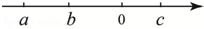

# 知识点·不等式的性质1，2，3（同步练习）

> 教材：数学·七年级下册·沪科技版2024新教材 ｜ 来源：国家中小学智慧教育平台·在线练习 ｜ 共 4 题

## 1. 填空题（难度：适中）

设\(a > b\)，用“\( > \) ”或“\( < \) ”填空：
（1）\( 3a-6\)\( 3b-6\)；（2）\( -\frac{1}{2}a-7\)\( -\frac{1}{2}b-7\)。

【答案】$ &gt; $，$ &lt; $

【解析】​

## 2. 单选题

下列不等式变形中，一定正确的是\((\)　　\()\)

- A. 若\(ac > bc\)，则\(a > b\)
- B. 若\(a > b\)，则\(a{c^2} > b{c^2}\)
- C. 若\(a{c^2} > b{c^2}\)，则\(a > b\)
- D. 若\(a > 0\)，\(b > 0\)，且\(\frac{1}{a} > \frac{1}{b}\)，则\(a > b\)

【答案】C

【解析】​

## 3. 单选题（难度：适中）

已知\(a - b < 0\)，则下列不等式一定成立的是\((\)　　\()\)

- A. \(a - 1 < b - 1\)
- B. \( - a < - b\)
- C. \(a > b\)
- D. \(3a - b > 0\)

【答案】A

【解析】​

## 4. 单选题

若实数\(a\)，\(b\)，\(c\)在数轴上对应点的位置如图所示，则下列不等式成立的是\((\)　　\()\)

- A. \(a - c > b - c\)
- B. \(a + c < b + c\)
- C. \(ac > bc\)
- D. \(\frac{a}{b} < \frac{c}{b}\)

【答案】B

【解析】​
