# 知识点·分式方程（同步练习）

> 教材：数学·七年级下册·沪科技版2024新教材 ｜ 来源：国家中小学智慧教育平台·在线练习 ｜ 共 46 题

## 1. 单选题（难度：简单）

下列方程中，属于分式方程的是（    ）

【答案】A

## 2. 单选题（难度：简单）

下列方程中，不是分式方程的是（    ）

【答案】A

## 3. 单选题（难度：简单）

在下列方程中，分式方程是（   ）

- A. \(\frac{x\text{+}1}{3}=2\)
- B. \(\frac{\sqrt{x\text{+}1}}{3}=2\)
- C. \(\frac{3}{x\text{+}1}=2\)
- D. \(\frac{3}{\sqrt{x\text{+}1}}=2\)

【答案】C

【解析】解：A、它不是分式方程；
B、它不是分式方程；
C、它是分式方程；
D、它不是分式方程．
故选：C

## 4. 单选题（难度：简单）

下列关于x的方程是分式方程的是（   ）

【答案】A

## 5. 单选题（难度：简单）

下列关于\(x\)的方程：\(\frac{2x}{{{a}^{2}}+1}-\frac{1}{3}=7\)，\(\frac{2x}{x}+\frac{1}{2}={{x}^{2}}\)，\(\frac{1}{x+3}+\frac{x}{\sqrt{2}-x}=\sqrt{3}\)，\(\frac{4}{{{x}^{5}}}+\sqrt{x+1}=2\)中，是分式方程的有（   ）个．

- A. 1个
- B. 2个
- C. 3个
- D. 4个

【答案】C

【解析】本题考查了分式方程的定义，熟练掌握分式方程的定义是解题的关键．分母中含有未知数的方程叫做分式方程，根据定义逐项分析即可．
解：关于\(x\)的方程\(\frac{2x}{{{a}^{2}}+1}-\frac{1}{3}=7\)中，分母不含未知数，不是分式方程；
关于\(x\)的方程\(\frac{2x}{x}+\frac{1}{2}={{x}^{2}}\)中，分母中含未知数，是分式方程；
关于\(x\)的方程\(\frac{1}{x+3}+\frac{x}{\sqrt{2-x}}=\sqrt{3}\)中，分母中含未知数，是分式方程；
关于\(x\)的方程\(\frac{4}{{{x}^{5}}}+\sqrt{x+1}\)中，分母中含未知数，是分式方程；
故选：C．

## 6. 单选题（难度：简单）

下列各式中，是分式方程的是（   ）

【答案】A

## 7. 单选题（难度：简单）

已知方程：①\(\dfrac{x}{5}=2\)；②\(\frac{5}{x}=2\)；③\(y=\frac{2}{3}x\)；④\(\frac{1+x}{5+x}=\frac{1}{2}\)；⑤\(y+1=\frac{2}{y}\)；⑥\(1+3(x-2)=7-x\)，是分式方程的是（    ）

- A. ①②③④⑤
- B. ②③④
- C. ②④⑤
- D. ②④

【答案】C

【解析】本题考查了分式方程的概念：分母中含有字母的方程，根据此概念进行判断即可．
解：②④⑤是分式方程，①⑥是一元一次方程，③是二元一次方程；
故选：C．

## 8. 单选题（难度：简单）

下面是分式方程的是（    ）

- A. \(\frac{1}{2x-3}+\frac{4}{x+9}\)
- B. \(\frac{2x+1}{7}=\frac{5x-6}{3}\)
- C. \(\frac{1}{2}x+5=\frac{2}{3}(x-6)\)
- D. \(\frac{3}{x-1}+\frac{2}{2x+1}=1\)

【答案】D

【解析】本题考查的是分式方程的定义，熟知“判断一个方程是否为分式方程主要是看这个方程的分母中是否含有未知数”是解答此题的关键．
根据分式方程的定义分析判断即可求解．
A、不是方程，故本选项错误；
B、分母中不含有未知数，是整式方程，故本选项错误；
C、分母中不含有未知数，是整式方程，故本选项错误；
D、分母中含有未知数，是分式方程，故本选项正确．
故选：D．

## 9. 单选题（难度：简单）

下列方程：①＝1；②，③，④＝5，是分式方程的有（　　）

【答案】A

## 10. 单选题（难度：简单）

下列式子中，是分式方程的是（　　）

- B. 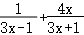

【答案】C

【解析】本题考查的是分式方程的定义，熟知判断一个方程是否为分式方程主要是看这个方程的分母中是否含有未知数，这是解答此题的关键．
根据分式方程的定义对各选项进行逐一分析即可．
解：A、方程中各式的分母不含未知数，故不是分式方程，故本选项错误；
B、不是方程，故不是分式方程，故本选项错误；
C、方程中各式的分母含有未知数，故是分式方程，故本选项正确；
D、方程中各式的分母不含未知数，故不是分式方程，故本选项错误．
故选：C．

## 11. 单选题（难度：简单）

下列各式中，是分式方程的是（　　）

- A. 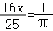
- B. 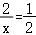
- C. 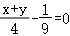
- D. 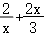

【答案】B

【解析】分母里含有未知数的方程叫做分式方程，注意：仅仅是字母不行，必须是表示未知数的字母．
据此解答即可解：A．

是一元一次方程，不符合题意；
B．

是分式方程，符合题意；
C．

是二元一次方程，不符合题意；
D．

是代数式，不符合题意．
故选：B．

## 12. （难度：简单）

下列方程：①＝2，②＝3，③﹣＝，④+＝5，⑤+1＝0中，关于x的分式方程有（填写序号）：　  　 ．

## 13. 单选题（难度：简单）

下面是分式方程的是（    ）

- A. \(\frac{1}{2x-3}+\frac{4}{x+9}\)
- B. \(\frac{2x+1}{7}=\frac{5x-6}{3}\)
- C. \(\frac{1}{2}x+5=\frac{2}{3}(x-6)\)
- D. \(\frac{3}{x-1}+\frac{2}{2x+1}=1\)

【答案】D

【解析】本题考查的是分式方程的定义，熟知“判断一个方程是否为分式方程主要是看这个方程的分母中是否含有未知数”是解答此题的关键．
根据分式方程的定义分析判断即可求解．
A、不是方程，故本选项错误；
B、分母中不含有未知数，是整式方程，故本选项错误；
C、分母中不含有未知数，是整式方程，故本选项错误；
D、分母中含有未知数，是分式方程，故本选项正确．
故选：D．

## 14. 单选题（难度：简单）

在下列方程中，关于x的分式方程的个数有(    ).①$\frac{1}{2}{{x}^{2}}-\frac{2}{3}x+4=0$    ②.$\frac{x}{a}=4$  ③$\frac{a}{x}=4;\)

【答案】A

## 15. 填空题（难度：简单）

观察下列分式方程：①\(\frac{2}{x}+1=3\)；②\(\frac{6}{x}+1=5\)；③\(\frac{12}{x}+1=7\)；…．根据他们所蕴含的规律，写出这一组分式方程中的第⑥个方程：．

【答案】$\frac{42}{x}+1=13$

【解析】本题考查了分式方程，代数式规律的探索；探索出方程的规律是解题的关键；分式方程的规律是：方程左边是分式与1的和，其中分式的分母为未知数x，分子为从1开始的相邻两个自然数的积，方程右边是从3开始的奇数；根据此规律即可写出第⑥个方程．
详细解答如下：解：根据规律知，第⑥个方程为：\(\frac{6\times 7}{x}+1=2\times 6+1\)，
即\(\frac{42}{x}+1=13\)，
故答案为：\(\frac{42}{x}+1=13\)．

## 16. 单选题（难度：简单）

给出下列关于x的方程：①\(\frac{x-1}{3}=5\)，②\(\frac{1}{x}=\frac{4}{x-1}\)，③\(\frac{3-x}{\pi }=x-1\)，④\(\frac{x}{a}=\)\(\frac{1}{b-1}\)．其中，分式方程有（　　）

- A. 1个
- B. 2个
- C. 3个
- D. 4个

【答案】A

【解析】本题考查分式方程的概念，根据分式方程概念对上述方程进行判断，即可解题．
详细解答如下：
解：①\(\frac{x-1}{3}=5\)，③\(\frac{3-x}{\pi }=x-1\)，④\(\frac{x}{a}=\)\(\frac{1}{b-1}\)是整式方程；②\(\frac{1}{x}=\frac{4}{x-1}\)的分母中含有未知数x，是关于x的分式方程．
故分式方程有1个，
故选：A．

## 17. 单选题（难度：简单）

下列关于x的方程是分式方程的是（　　）

【答案】A

## 18. 单选题（难度：简单）

（2023七年级下·浙江·专题练习）下列方程：①<latex class="math-tex">\(\frac{1}{x-2}=2$；②$\frac{x}{2}-1=\frac{x}{3}$；③$\frac{x-8}{x-7}-\frac{1}{7-x}=8\)<

【答案】A

## 19. 单选题（难度：简单）

在①<latex class="math-tex">\(x^{2}-x+\frac{1}{x}$，②$\frac{1}{a}-3=a+4$，③$\frac{x}{2}+5x=6$，④$\frac{

【答案】A

## 20. （难度：简单）

下列哪些是分式方程？哪些是可化为一元二次方程的分式方程？（1）\(\frac{2}{x+1}=3\)（2）\(\frac{1}{x}=\frac{3}{x-1}\)

\(\frac{x}{2}+\frac{2}{x}\)（4）\(\frac{x}{x-1}=\frac{2}{{{x}^{2}}-1}\)。答：

【答案】（1）、（2）、（4）是分式方程，（4）是可化为一元二次方程的分式方程．

【解析】\(\frac{x}{2}+\frac{2}{x}\)是分式，不是分式方程，
（4）\(\frac{x}{x-1}=\frac{2}{{{x}^{2}}-1}\)是分式方程，去分母可转化为x2+x=2，是可化为一元二次方程的分式方程，
∴（1）、（2）、（4）是分式方程，（4）是可化为一元二次方程的分式方程．

## 21. （难度：简单）

下列关于x的方程①<latex class="math-tex">\(\frac{x-1}{3}=5$，②$\frac{1}{x}=\frac{4}{x-1}$，③$\frac{3-x}{3}=x-$1，④$\frac{x+1}{2}-\frac{x-3}{3}=1$，②$\frac{x+1}{x}-2=5$，③$\frac{x}{m-2}=-6$（$\frac{1}{x}\text{=}2$；②$\frac{x-1}{a}\text{=}\frac{x}{2}$；③$\frac{x}{5}+x\text

【答案】A

## 28. 单选题（难度：简单）

下列关于x的方程中（1）<latex class="math-tex">\(\frac{1}{x}=1$；（2）$\frac{2x+1}{3}=1+\frac{1-3x}{4}$；（3）$\frac{x}{b}+\frac{x}{b}=1$；（4

【答案】A

## 29. 单选题（难度：简单）

下列方程：①$\frac{1}{x-2}=2$；②$\frac{x}{2}-1=\frac{x}{3}$；③$\frac{x-8}{x-7}-\frac{1}{7-x}=8$；④<latex cl

【答案】A

## 30. 单选题（难度：简单）

下列各式中，属于分式方程的是（　　）

【答案】A

## 31. （难度：简单）

在下列方程：①\(\frac{2}{3}{{x}^{2}}=1\)、②\(\frac{2}{\pi }-{{x}^{2}}=1\)、③\(\frac{2}{3x}=x\)、④\(\frac{1}{x-2}+3=\frac{x-1}{x-2}\)、⑤\(\frac{1}{x}=0\)⑥\(\frac{x-1}{3}=5\)，⑦\(\frac{1}{x}=\frac{4}{x-1}\)，⑧\(\frac{x}{a}=\frac{1}{b-1}\)，⑨\(\frac{x-1}{\sqrt{x+1}}+\frac{1}{2 x+3}=-2\)中，哪些是分式方程，并说明理由．

【答案】

③④⑤⑦,详见解析

【解析】本题考查了分式方程的定义．判断一个方程是否为分式方程，主要是依据分式方程的定义，也就是看分母中是否含有未知数（注意：仅仅是字母不行，必须是表示未知数的字母）．
根据分式方程的定义：分母里含有字母的方程叫做分式方程进行判断．
详细解答如下：解：方程①②⑥⑧分母中不含未知数，故①②⑥⑧不是分式方程；
方程③④⑤⑦分母中含表示未知数的字母，故是分式方程；
方程⑨属于无理方程．

## 32. 单选题（难度：简单）

在下列方程组中，（　　）是分式方程．

【答案】A

## 33. 单选题（难度：适中）

（2024上·山东聊城·八年级校考阶段练习）下列关于x的方程中（1）$\frac{1}{x}=1$；（2）$\frac{2x+1}{3}=1+\frac{1-3x}{4}$；（3）$\frac{x}{b}+\fra

【答案】A

## 34. 单选题（难度：适中）

给出下列关于x的方程：①\(\frac{x-1}{3}=5\)，②\(\frac{1}{x}=\frac{4}{x-1}\)，③\(\frac{3-x}{\pi }=x-1\)，④\(\frac{x}{a}=\)\(\frac{1}{b-1}\)．其中，分式方程有（　　）

- A. 1个
- B. 2个
- C. 3个
- D. 4个

【答案】A

【解析】本题考查分式方程的概念，根据分式方程概念对上述方程进行判断，即可解题．
详细解答如下：解：①\(\frac{x-1}{3}=5\)，③\(\frac{3-x}{\pi }=x-1\)，④\(\frac{x}{a}=\)\(\frac{1}{b-1}\)是整式方程；②\(\frac{1}{x}=\frac{4}{x-1}\)的分母中含有未知数x，是关于x的分式方程．
故分式方程有1个，
故选：A．

## 35. 单选题（难度：简单）

下列式子中，是分式方程的是（　　）

【答案】A

## 36. 单选题（难度：简单）

下列方程：①x²﹣2x＝

；②
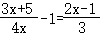
；③x⁴﹣2x²＝0；④

x²﹣1＝0．其中分式方程是（　　）

- A. ①②③
- B. ①②
- C. ①③
- D. ①②④

【答案】B

【解析】根据分式方程的定义对各方程进行逐一分析即可．
解：方程①是分式方程，符合题意；
方程②分母中含有未知数，符合题意；
方程③整式方程，不符合题意；
方程④是整式方程，不符合题意；
故选：B．

## 37. 单选题（难度：简单）

下列各式中，是分式方程的是（　　）

【答案】B

【解析】分母里含有未知数的方程叫做分式方程，注意：仅仅是字母不行，必须是表示未知数的字母．据此解答即可
解：A．
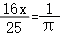
是一元一次方程，不符合题意；
B．
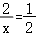
是分式方程，符合题意；
C．

是二元一次方程，不符合题意；
D．

是代数式，不符合题意．
故选：B．

## 38. 单选题（难度：简单）

下列是分式方程的是（　　）

- A. 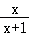
+
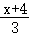
- B. 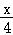
+
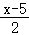
＝0
- C. 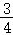
（x﹣2）＝
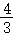
x
- D. 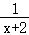
+1＝0

【答案】D

【解析】根据分母中含有未知数的方程叫做分式方程，对每个选项进行判断，找出是等式，且分母含有未知数方程，即可得解．
解：A、是一个代数式，不是方程，所以A不是分式方程；
B、是一元一次方程，是整式方程，所以B不是分式方程；
C、是一元一次方程，是整式方程，所以C不是分式方程；
D、分母含有未知数x，所以D是分式方程．
故选：D．

## 39. 单选题（难度：简单）

下列方程：①＝1；②，③，④＝5，是分式方程的有（　　）

【答案】A

## 40. （难度：简单）

下列方程：①＝2，②＝3，③﹣＝，④+＝5，⑤+1＝0中，关于x的分式方程有（填写序号）：　⑤　 ．

## 41. 单选题（难度：简单）

给出下列关于x的方程：①\(\frac{x-1}{3}=5\)，②\(\frac{1}{x}=\frac{4}{x-1}\)，③\(\frac{3-x}{\pi }=x-1\)，④\(\frac{x}{a}=\)\(\frac{1}{b-1}\)．其中，分式方程有（　　）

- A. 1个
- B. 2个
- C. 3个
- D. 4个

【答案】A

【解析】本题考查分式方程的概念，根据分式方程概念对上述方程进行判断，即可解题．
解：①\(\frac{x-1}{3}=5\)，③\(\frac{3-x}{\pi }=x-1\)，④\(\frac{x}{a}=\)\(\frac{1}{b-1}\)是整式方程；②\(\frac{1}{x}=\frac{4}{x-1}\)的分母中含有未知数x，是关于x的分式方程．
故分式方程有1个，
故选：A．

## 42. 单选题（难度：简单）

下面是分式方程的是（    ）

【答案】A

## 43. 单选题（难度：简单）

（2024上·山东聊城·八年级校考阶段练习）下列关于x的方程中（1）<latex class="math-tex">\(\frac{1}{x}=1$；（2）$\frac{2x+1}{3}=1+\frac{1-3x}{4}$；（3）$\frac{x}{b}+\fra

【答案】A

## 44. 单选题（难度：简单）

列方程：①<latex class="math-tex">\(\frac{1}{x}\text{=}2$；②$\frac{x-1}{a}\text{=}\frac{x}{2}$；③$\frac{x}{5}+x\text{=}1$；④$\frac{1}{2}{{x}^{2}}-\frac{2}{3}x+4=0$    ②.$\frac{x}{a}=4$  ③<latex class="math-tex">\(\frac{a}{x}=4;\)

【答案】A

## 46. 单选题（难度：简单）

下列方程中是分式方程的是（）

【答案】A
