# 知识点·分式的基本性质（同步练习）

> 教材：数学·七年级下册·沪科技版2024新教材 ｜ 来源：国家中小学智慧教育平台·在线练习 ｜ 共 81 题

## 1. （难度：适中）

不改变分式的值,使下列各式的分子,分母的系数都化为整数。

\( \frac{\frac{1}{2}x+\frac{2}{3}y}{\frac{1}{2}x-\frac{2}{3}y}\)

\( \frac{0.3a+0.5b}{0.2a-b}\)

【答案】

$ \frac{3x+4y}{3x-4y}$ 

，

$ \frac{3a+5b}{2a-10b}$ 

【解析】​

## 2. （难度：适中）

下列各组中的两个分式是否相等？为什么？

\( \frac{2x}{y}\)与\( \frac{6xy}{3{y}^{2}}\)

\( \frac{6ac}{9{a}^{2}b}\)与\( \frac{2c}{3ab}\)

【答案】

相等，分式$ \frac{2x}{y}$的分子分母同时乘以$ 3y$,即$ \frac{2x}{y}$=$ \frac{2x\cdot 3y}{y\cdot 3y}$分式值不变，即$\frac{{2x}}{y} = $$ \frac{6xy}{3{y}^{2}}$

，

相等，分式$ \frac{6ac}{9{a}^{2}b}$的分子分母同时除以$ 3a$,即$ \frac{6ac}{9{a}^{2}b}=\frac{6ac÷3a}{9{a}^{2}b÷3a}=\frac{2c}{3ab}$分式值不变，即$ \frac{6ac}{9{a}^{2}b}=\frac{2c}{3ab}$。

【解析】​

## 3. （难度：简单）

不改变分式的值,使下列分式的分子,分母都不含“\( -\)”号。

\( \frac{-5b}{-6a}\)

\( \frac{-x}{3y}\)

\( -\frac{2m}{-n}\)

【答案】

$ \frac{5b}{6a}$      

，

$ -\frac{x}{3y}$     

，

$ \frac{2m}{n}$ 

【解析】​

## 4. （难度：简单）

填空：

\( \frac{{x}^{2}}{{x}^{2}y}=\frac{(\hspace{0.33em}\hspace{0.33em}\hspace{0.33em}\hspace{0.33em}\hspace{0.33em}\hspace{0.33em}\hspace{0.33em})}{y}\)

\( \frac{3ab+3{b}^{2}}{6{b}^{2}}=\frac{a+b}{(\hspace{0.33em}\hspace{0.33em}\hspace{0.33em}\hspace{0.33em}\hspace{0.33em})}\)

【答案】

1         

，

2<i>b</i>

【解析】​

## 5. 

下列各式对不对？如果不对，写出正确答案。

\( \frac{1-a}{{a}^{2}-2a+1}=\frac{1}{1-a}\)

\( \frac{xy-{x}^{2}}{(x-y{)}^{2}}=\frac{x}{x-y}\)

- YES. 正确
- NO. 错误

【答案】YES，

错误，正确答案为$ \frac{x}{y-x}$

【解析】​

## 6. 

当\( m\)取何值时，等式\( \frac{x+3}{2x-1}=\frac{\left(x+3\right)\left(3m+2\right)}{\left(2x-1\right)\left(7-2m\right)}\)成立？

【答案】

当$ 3m+2=7-2m\ne 0$时，等式成立，解得$ m=1$。

【解析】​

## 7. 单选题（难度：适中）

下列式子的变形正确的是（　　）

- A. \( \frac{b}{a}=\frac{{b}^{2}}{{a}^{2}}\)
- B. \( \frac{{a}^{2}+{b}^{2}}{a+b}=\)a+b
- C. \( \frac{2x-4y}{2x}=\frac{x-2y}{x}\)
- D. \( \frac{m-2n}{m}=-\)2n

【答案】C

【解析】解：A、\( \frac{b}{a}\ne \frac{{b}^{2}}{{a}^{2}}\)，原变形错误，故此选项不符合题意；
B、分式的分子分母没有公因式，不能约分，原变形错误，故此选项不符合题意；
C、\( \frac{2x-4y}{2x}=\frac{2(x-2y)}{2x}=\frac{x-2y}{x}\)，原变形正确，故此选项符合题意；
D、分式的分子分母没有公因式，不能约分，原变形错误，故此选项不符合题意；
故选：C．

## 8. 单选题（难度：简单）

根据分式的基本性质，分式\( \frac{A}{B}\)可变形为（　　）

- A. \( -\frac{A}{B}\)
- B. \( \frac{-A}{-B}\)
- C. \( \frac{A}{-B}\)
- D. \( -\frac{-A}{-B}\)

【答案】B

【解析】解：\( \frac{A}{B}=\frac{-A}{-B}\)．
故选：B．

## 9. 单选题（难度：非常简单）

下列各式中，运算正确的是（　　）

- A. \( \frac{{m}^{6}}{{m}^{2}}=\)m³
- B. \( \frac{a-2}{2{a}^{2}-4a}=\frac{1}{2a}\)
- C. \( \frac{-a+b}{b-a}=-\)1
- D. \( \frac{m+a}{n+a}=\frac{m}{n}\)

【答案】B

【解析】解：A．\( \frac{{m}^{6}}{{m}^{2}}=\)m⁴，故本选项不符合题意；
B．\( \frac{a-2}{2{a}^{2}-4a}=\frac{a-2}{2a(a-2)}=\frac{1}{2a}\)，故本选项符合题意；
C．\( \frac{-a+b}{b-a}=\frac{b-a}{b-a}=\)1，故本选项不符合题意；
D．\( \frac{m+a}{n+a}\ne \frac{m}{n}\)，故本选项不符合题意；
故选：B．

## 10. 单选题（难度：适中）

如果分式\( \frac{xy}{2x-3y}\)中的x，y都扩大为原来的2倍，那么分式的值（　　）

- A. 不变
- B. 扩大为原来的2倍
- C. 缩小为原来的4倍
- D. 缩小为原来的 \( \frac{1}{2}\)倍

【答案】B

【解析】解：根据分式的基本性质可得：
\( \frac{\left(2x\right)\left(2y\right)}{2\left(2x\right)-3\left(2y\right)}=\frac{4xy}{4x-6y}=\frac{4xy}{2(2x-3y)}=2\cdot \frac{xy}{2x-3y}\)，
分子扩大为原来的4倍，分母扩大为原来的2倍，因此分式的值整体扩大2倍；
故选：B．

## 11. 单选题（难度：简单）

下列各式中，与分式\( -\frac{1}{1-x}\)的值相等的是（　　）

- A. \( -\frac{1}{x-1}\)
- B. \( \frac{1}{1+x}\)
- C. \( -\frac{1}{1+x}\)
- D. \( \frac{1}{x-1}\)

【答案】D

【解析】解：与分式\( -\frac{1}{1-x}\)的值相等的是\( \frac{1}{x-1}\)．
故选：D．

## 12. 单选题（难度：适中）

把分式\( \frac{{x}^{2}+{y}^{2}}{xy}\)中的x，y的值都扩大为原来的3倍，则分式的值（　　）

- A. 缩小为原来的 \( \frac{1}{3}\)
- B. 不变
- C. 扩大为原来的6倍
- D. 扩大为原来的3倍

【答案】B

【解析】解：由题意得：\( \frac{(3x{)}^{2}+(3y{)}^{2}}{3x\cdot 3y}=\frac{9{x}^{2}+9{y}^{2}}{9xy}=\frac{{x}^{2}+{y}^{2}}{xy}\)，
∴把分式\( \frac{{x}^{2}+{y}^{2}}{xy}\)中的x，y的值都扩大为原来的3倍，则分式的值不变，
故选：B．

## 13. 单选题（难度：简单）

根据分式的基本性质，下列各式从左到右的变形正确的是（　　）

- A. \( \frac{x}{y}=\frac{x+1}{y+1}\)
- B. \( \frac{x}{x+y}=\frac{1}{1+y}\)
- C. \( \frac{x}{-x+y}=-\frac{x}{x+y}\)
- D. \( \frac{-x+y}{x-y}=-1\)

【答案】D

【解析】解：A．分子分母同时加上同一个数，分式不一定成立，故原选项错误，不符合题意；
B．\( \frac{x}{x+y}=\frac{1}{1+\frac{y}{x}}\)，故原选项错误，不符合题意；
C．\( \frac{x}{-x+y}=-\frac{x}{x-y}\)，故原选项错误，不符合题意；
D．\( \frac{-x+y}{x-y}=\frac{-(x-y)}{x-y}=-\)1，故原选项正确，符合题意；
故选：D．

## 14. 单选题（难度：适中）

将分式\( \frac{xy}{x-y}\)中的x，y的值同时扩大到原来的3倍，则分式的值（　　）

- A. 扩大到原来的6倍
- B. 扩大到原来的9倍
- C. 不变
- D. 扩大到原来的3倍

【答案】D

【解析】解：x，y的值同时扩大到原来的3倍，
原式\( =\frac{9\cdot xy}{3(x-y)}=3\cdot \frac{xy}{x-y}\)，
故选：D．

## 15. 单选题（难度：适中）

如果把分式\( \frac{2x}{x+y}\)中的x和y都扩大3倍，那么分式的值（　　）

- A. 扩大3倍
- B. 缩小3倍
- C. 缩小6倍
- D. 不变

【答案】D

【解析】解：由题意，得\( \frac{2\times 3x}{3x+3y}=\frac{3\times 2x}{3(x+y)}=\frac{2x}{x+y}\)，
∴分式的值不变．
故选：D．

## 16. 单选题（难度：适中）

分式<latex class="math-tex">\( \frac{2mn}{m+n}\)</latex>中的m、n的值同时扩大到原来的5倍，则此分式的值（　　）

【答案】A

## 17. 单选题（难度：简单）

如果把分式\( \frac{2x}{{x}^{2}-{y}^{2}}\)中的x和y都扩大2倍，那么分式的值（　　）

- A. 缩小到原来的 \( \frac{1}{2}\)
- B. 扩大2倍
- C. 不变
- D. 缩小到原来的 \( \frac{1}{4}\)

【答案】A

【解析】解：根据题意可知，\( \frac{2\cdot 2x}{{\left(2x\right)}^{2}-{\left(2y\right)}^{2}}=\frac{4x}{4{x}^{2}-4{y}^{2}}=\frac{x}{{x}^{2}-{y}^{2}}\)，
∴分式的值缩小到原来的\( \frac{1}{2}\)．
故选：A．

## 18. 单选题（难度：简单）

将分式\( \frac{x}{x+y}\)中的x、y的值同时扩大为原来的2倍，则分式的值（　　）

- A. 缩小为原来一半
- B. 扩大为原来的2倍
- C. 无法确定
- D. 保持不变

【答案】D

【解析】解：将分式\( \frac{x}{x+y}\)中的x、y的值同时扩大为原来的2倍得\( \frac{2x}{2(x+y)}=\frac{x}{x+y}\)，
即分式的值保持不变，
故选：D．

## 19. 单选题（难度：适中）

如果分式\( \frac{xy}{3x+2y}\)中的x，y都扩大为原来的2倍，那么分式的值（　　）

- A. 扩大为原来的2倍
- B. 扩大为原来的4倍
- C. 不变
- D. 不能确定

【答案】A

【解析】解：\( \frac{2x\cdot 2y}{3\times 2x+2\times 2y}=\frac{4xy}{2(3x+2y)}=\frac{2xy}{3x+2y}\)，
所以将分式\( \frac{xy}{3x+2y}\)中的x，y都扩大为原来的2倍，则分式的值扩大为原来的2倍，
故选：A．

## 20. 单选题（难度：简单）

下列式子变形正确的是（　　）

- A. \( \frac{a}{b}=\frac{a+1}{b+1}\)
- B. \( \frac{{a}^{6}}{{a}^{3}}={a}^{2}\)
- C. \( \frac{am}{bm}=\frac{a}{b}\)
- D. \( \frac{0.2a}{b}=\frac{2a}{b}\)

【答案】C

【解析】解：A．变形不符合分式的基本性质，故本选项不符合题意；
B．\( \frac{{a}^{6}}{{a}^{3}}=\)a³，故本选项不符合题意；
C．\( \frac{am}{bm}=\frac{a}{b}\)，故本选项符合题意；
D．\( \frac{0.2a}{b}=\frac{2a}{10b}\)，故本选项不符合题意；
故选：C．

## 21. 单选题（难度：适中）

如果把分式\( \frac{x}{x+y}\)中的x和y都扩大3倍，那么分式的值（　　）

- A. 不变
- B. 缩小3倍
- C. 扩大3倍
- D. 扩大9倍

【答案】A

【解析】解：把分式\( \frac{x}{x+y}\)中的x和y都扩大3倍，那么分式的值不变，
故选：A．

## 22. 单选题（难度：适中）

将分式\( \frac{x+y}{xy}\)中的x、y的值同时扩大为原来的2倍，则分式的值（　　）

- A. 缩小为原来一半
- B. 扩大为原来的2倍
- C. 无法确定
- D. 保持不变

【答案】A

【解析】解：将分式\( \frac{x+y}{xy}\)中的x、y的值同时扩大为原来的2倍，则分式的值为：\( \frac{2x+2y}{2x\cdot 2y}=\frac{2(x+y)}{4xy}=\frac{x+y}{2xy}\)，
即分式的值缩小为原来一半．
故选：A．

## 23. 单选题

对于分式\( \frac{3ab}{3a-b}\)，当a，b都扩大到原来的2倍时，分式的值是（　　）

- A. 不变
- B. 扩大2倍
- C. 扩大6倍
- D. 扩大12倍

【答案】B

【解析】解：\( \frac{3\cdot 2a\cdot 2b}{3\cdot 2a-2b}\)
\( =\frac{12ab}{2(3a-b)}\) 
＝2•\( \frac{3ab}{3a-b}\)，
故分式的值扩大到原来的2倍．
故选：B．

## 24. 单选题（难度：适中）

如果把分式\( \frac{2x}{x+y}\)中的x和y都扩大2倍，那么分式的值（　　）

- A. 不变
- B. 扩大2倍
- C. 扩大4倍
- D. 缩小2倍

【答案】A

【解析】解：分式\( \frac{2x}{x+y}\)中的x和y都扩大2倍，得
\( \frac{2\times 2x}{2x+2y}=\frac{2x}{x+y}\)，
故选：A．

## 25. 单选题（难度：适中）

如果把分式\( \frac{x}{x-2y}\)中的x、y同时扩大为原来的2倍，那么分式的值（　　）

- A. 缩小为原来的 \( \frac{1}{2}\)
- B. 扩大为原来的2倍
- C. 扩大为原来的4倍
- D. 不变

【答案】D

【解析】解：∵分式\( \frac{x}{x-2y}\)中的x、y同时扩大为原来的2倍后变为\( \frac{2x}{2x-4y}=\frac{x}{x-2y}\)，
∴分式的值不变．
故选：D．

## 26. 单选题（难度：适中）

下列各式成立的是（　　）

【答案】A

## 27. 单选题（难度：适中）

下列分式中，化简结果等于<latex class="math-tex">\( \frac{b}{a}\)</latex>的是（　　）

【答案】A

## 28. 单选题（难度：适中）

如果把分式\( \frac{x+y}{2xy}\)中的x和y都扩大2倍，那么分式的值（　　）

- A. 不变
- B. 扩大2倍
- C. 扩大4倍
- D. 缩小2倍

【答案】D

【解析】解：因为分式\( \frac{x+y}{2xy}\)中，x、y都扩大2得，
\( \frac{2x+2y}{2x\cdot 2y}=\frac{2(x+y)}{4xy}=\frac{1}{2}\times \frac{x+y}{2xy}\)，
所以x、y都扩大2倍，分式的值缩小为原来的\( \frac{1}{2}\)．
故选：D．

## 29. 单选题

若将\( \frac{mn}{m+n}\)（m、n均为正数）中的字母m、n的值分别扩大为原来的2倍，则分式的值（　　）

- A. 扩大为原来的2倍
- B. 不变
- C. 缩小为原来的 \( \frac{1}{2}\)
- D. 扩大为原来的4倍

【答案】A

【解析】解：将\( \frac{mn}{m+n}\)（m、n均为正数）中的字母m、n的值分别扩大为原来的2倍，则分式的值扩大为原来的2倍，
故选：A．

## 30. 多选题（难度：适中）

不改变分式的值，下列各式中变形正确的是（　　）

- A. \( \frac{n}{m}=\frac{n+1}{m+1}\)
- B. \( \frac{n}{m}=\frac{{n}^{2}}{{m}^{2}}\)
- C. \( \frac{{a}^{2}-{b}^{2}}{a-b}=a-b\)
- D. \( \frac{-a-b}{a+b}=-1\)

【答案】A/B/C/D

## 31. 单选题（难度：适中）

下列代数式变形正确的是（　　）

- A. \( \frac{-x+y}{4}=-\frac{x+y}{4}\)
- B. \( \frac{x}{y}=\frac{xz}{yz}\)
- C. \( \frac{{x}^{2}-{y}^{2}}{{(x-y)}^{2}}=\frac{x+y}{x-y}\)
- D. \( \frac{0.2x+y}{0.2}=\frac{2x+y}{2}\)

【答案】C

【解析】解：\( \frac{-x+y}{4}=-\frac{x-y}{4}\)，A选项错误；
\( \frac{x}{y}=\frac{xz}{yz}\)（z≠0），B选项错误；
\( \frac{{x}^{2}-{y}^{2}}{(x-y{)}^{2}}=\frac{x+y}{x-y}\)，C选项正确；
\( \frac{0.2x+y}{0.2}=\frac{2x+10y}{2}\)，D选项错误．
故选：C．

## 32. 单选题（难度：简单）

下列等式一定成立的是（　　）

- A. \( \frac{a}{b}=\frac{a+1}{b+1}\)
- B. \( \frac{a}{b}=\frac{{a}^{3}}{{b}^{3}}\)
- C. \( \frac{a}{b}=\frac{ab}{{b}^{2}}\)
- D. \( \frac{a}{b}=\frac{ac}{bc}\)

【答案】C

【解析】解：根据分式的性质即可一一判定如下：
\( \frac{a}{b}\ne \frac{a+1}{b+1}\)，\( \frac{a}{b}\ne \frac{{a}^{3}}{{b}^{3}}\)，\( \frac{a}{b}=\frac{ab}{{b}^{2}}\)，当c＝0时，\( \frac{a}{b}=\frac{ac}{bc}\)不成立，
故选：C．

## 33. 单选题（难度：适中）

把分式\( \frac{xy}{2x+2y}\)中的x、y的值同时扩大为原来的3倍，则分式的值（　　）

- A. 不变
- B. 原来的3倍
- C. 原来的 \( \frac{3}{2}\)倍
- D. 原来的 \( \frac{1}{3}\)

【答案】B

【解析】解：把分式\( \frac{xy}{2x+2y}\)中的x、y的值同时扩大为原来的3倍可得\( \frac{9xy}{3(2x+2y)}=\frac{3xy}{2x+2y}\)，
即分式的值为原来的3倍，
故选：B．

## 34. 单选题（难度：适中）

若把分式\( \frac{a+b}{3ab}\)中的a，b都扩大为原来的3倍，则分式的值（　　）

- A. 扩大为原来的3倍
- B. 扩大为原来的9倍
- C. 缩小为原来的 \( \frac{1}{3}\)
- D. 不变

【答案】C

【解析】解：由题意得：
\( \frac{3a+3b}{3\cdot 3a\cdot 3b}=\frac{a+b}{9ab}\)，
∴若把分式\( \frac{a+b}{3ab}\)中的a，b都扩大为原来的3倍，则分式的值缩小为原来的\( \frac{1}{3}\)，
故选：C．

## 35. 单选题（难度：适中）

下列各式从左到右的变形正确的是（　　）

- A. \( \frac{n}{m}=\frac{n-a}{m-a}\)
- B. \( \frac{y}{x}=\frac{{y}^{2}}{{x}^{2}}\)
- C. \( \frac{-a-b}{-a+b}=\frac{a-b}{a+b}\)
- D. \( \frac{n}{m}=\frac{na}{ma}(a\ne 0)\)

【答案】D

【解析】解：A．分子、分母同时减a，不符合分式的性质，故A错误，不符合题意；
B．分子乘了y，分母乘了x，不符合分式的性质，故B错误，不符合题意；
C．\( \frac{-a-b}{-a+b}=\frac{(-a-b)\times (-1)}{(-a+b)\times (-1)}=\frac{a+b}{a-b}\)，故C错误，不符合题意；
D．分子、分母同时乘了一个不为零的数a，分式的值不变，故D正确，符合题意．
故选：D．

## 36. 单选题

下列各式从左到右的变形，一定正确的是（　　）

- A. \( \frac{b}{a}=\frac{{b}^{2}}{{a}^{2}}\)
- B. \( \frac{b}{a}=\frac{b+1}{a+1}\)
- C. \( \frac{b}{a}=\frac{ab}{{a}^{2}}\)
- D. \( \frac{-b+1}{a}=-\frac{b+1}{a}\)

【答案】C

【解析】解：A．∵分子与分母应同乘以一个不为0的整式，分式的值不变，
∴原式变形错误，故此选项不符合题意；
B．不符合分式的基本性质，原变形错误，故此选项不符合题意；
C．原变形正确，故此选项符合题意；
D．不符合分式的基本性质，原变形错误，故此选项不符合题意；
故选：C．

## 37. 单选题（难度：适中）

下列对分式\( -\frac{1}{1-x}\)的变形，正确的是（　　）

- A. \( \frac{1}{x-1}\)
- B. \( -\frac{1}{x-1}\)
- C. \( -\frac{1}{x+1}\)
- D. \( \frac{1}{x+1}\)

【答案】A

【解析】解：\( -\frac{1}{1-x}=\frac{1}{x-1}\)．
故选：A．

## 38. 单选题（难度：适中）

把分式\( \frac{ab}{2a-3b}\)的分子分母中的a，b都扩大到原来的2倍，则分式的值（　　）

- A. 扩大为原来的2倍
- B. 扩大为原来的4倍
- C. 缩小为原来的 \( \frac{1}{2}\)
- D. 保持不变

【答案】A

【解析】解：根据题目可知，分子分母中的a，b都扩大到原来的2倍，
即\( \frac{2a\cdot 2b}{2\cdot 2a-3\cdot 2b}=2\cdot \frac{ab}{2a-3b}\)，
∴分式的值扩大为原来的2倍．
故选：A．

## 39. 单选题（难度：适中）

下列各式中从左到右变形正确的是（　　）

- A. \( \frac{1-a}{{a}^{2}-2a+1}=\frac{1}{a-1}\)
- B. \( \frac{x+2y}{x}=2y\)
- C. \( \frac{y+z}{x+z}=\frac{y}{x}\)
- D. \( \frac{{a}^{2}-1}{{a}^{2}-2a+1}=\frac{a+1}{a-1}\)

【答案】D

【解析】解：\( \frac{1-a}{{a}^{2}-2a+1}=\frac{1-a}{(1-a{)}^{2}}=\frac{1}{1-a}\)，则A不符合题意，
\( \frac{x+2y}{x}=1+\frac{2y}{x}\)，则B不符合题意，
\( \frac{y+z}{x+z}\)无法约分，则C不符合题意，
\( \frac{{a}^{2}-1}{{a}^{2}-2a+1}=\frac{(a+1)(a-1)}{(a-1{)}^{2}}=\frac{a+1}{a-1}\)，则D符合题意，
故选：D．

## 40. 单选题

若x，y的值均扩大为原来的3倍，则下列分式的值保持不变的是（　　）

- A. \( \frac{2+x}{x-y}\)
- B. \( \frac{2x}{x-y}\)
- C. \( \frac{2+x}{xy}\)
- D. \(  \frac{{x}^{2}}{x-y}\)

【答案】B

【解析】解：∵x、y的值均扩大为原来的3倍，
A、\( \frac{2+3x}{3x-3y}\ne \frac{2+x}{x-y}\)，分式的值发生了变化，故本选项不符合题意；
B、\( \frac{2\times 3x}{3x-3y}=\frac{2x}{x-y}\)，分式的值不变，故本选项符合题意；
C、\( \frac{2+3x}{3x\times 3y}\ne \frac{2+x}{xy}\)，分式的值发生了变化，故本选项不符合题意；
D、\( \frac{{\left(3x\right)}^{2}}{3x-3y}=\frac{3{x}^{2}}{x-y}\ne \frac{{x}^{2}}{x-y}\)分式的值发生了变化，故本选项不符合题意；
故选：B．

## 41. 单选题（难度：简单）

下列式子从左边至右边变形错误的是（　　）

- A. \( \frac{4}{2a}=\frac{2}{a}\)
- B. \( \frac{-a}{3}=-\frac{a}{3}\)
- C. \( \frac{{x}^{2}-x}{xy}=\frac{x-1}{y}\)
- D. \( \frac{3}{2}=\frac{3a}{2a}\)

【答案】D

【解析】解：A． \( \frac{4}{2a}=\frac{2}{a}\)，正确，不符合题意；
B． \( \frac{-a}{3}=-\frac{a}{3}\)，正确，不符合题意；
C． \( \frac{{x}^{2}-x}{xy}=\frac{x-1}{y}\)，正确，不符合题意；
D． \( \frac{3}{2}=\frac{3a}{2a}(a\ne 0)\)，故符合题意．
故选：D．

## 42. 单选题（难度：适中）

不改变分式\( \frac{0.2x-1}{0.4x+3}\)的值，把它的分子和分母中各项系数都化为整数，则所得结果是（　　）

- A. \( \frac{2x-1}{4x+30}\)
- B. \( \frac{x-5}{2x+15}\)
- C. \( \frac{2x-1}{4x+3}\)
- D. \( \frac{2x-10}{4x+3}\)

【答案】B

【解析】解：∵（0.2x﹣1）×5＝x﹣5，（0.4x+3）×5＝2x＝15，
∴把它的分子和分母中各项系数都化为整数\( \frac{x-5}{2x+15}\)，
故选：B．

## 43. 单选题（难度：适中）

若x、y的值均扩大为原来的3倍，则下列分式的值保持不变的是（　　）

- A. \( \frac{2+x}{x-y}\)
- B. \( \frac{2y}{{x}^{2}}\)
- C. \( \frac{2{y}^{3}}{3{x}^{2}}\)
- D. \( \frac{2{y}^{2}}{(x-y{)}^{2}}\)

【答案】D

【解析】解：若x、y的值均扩大为原来的3倍，则
A、\( \frac{2+3x}{3x-3y}=\frac{2+x+2x}{3(x-y)}\ne \frac{2+x}{x-y}\)，故此选项不符合题意；
B、\( \frac{2\times 3y}{(3x{)}^{2}}=\frac{6y}{9{x}^{2}}=\frac{2y}{3{x}^{2}}\ne \frac{2y}{{x}^{2}}\)，故此选项不符合题意；
C、\( \frac{2\times (3y{)}^{3}}{3\times (3x{)}^{2}}=\frac{2\times 27{y}^{3}}{3\times 9{x}^{2}}=\frac{2{y}^{3}}{{x}^{2}}\ne \frac{2{y}^{3}}{3{x}^{2}}\)，故此选项不符合题意；
D、\( \frac{2\times (3y{)}^{2}}{(3x-3y{)}^{2}}=\frac{2\times 9{y}^{2}}{9(x-y{)}^{2}}=\frac{2{y}^{2}}{(x-y{)}^{2}}\)，故此选项符合题意；
故选：D．

## 44. 单选题

若分式\( \frac{x+y}{xy}\)中的x、y的值都变为原来的3倍，则此分式的值（　　）

- A. 不变
- B. 是原来的三倍
- C. 是原来的三分之一
- D. 是原来的一半

【答案】C

【解析】解：由题意得\( \frac{3x+3y}{3x\cdot 3y}=\frac{3(x+y)}{9xy}=\frac{x+y}{3xy}=\frac{1}{3}\times \frac{x+y}{xy}\)，
∴如果分式\( \frac{x+y}{xy}\)中x、y的值都变为原来的3倍，则分式的值变为原来的\( \frac{1}{3}\)．
故选：C．

## 45. 单选题

分式\( \frac{-x}{x-y}\)可变形为（　　）

- A. \( \frac{x}{-x-y}\)
- B. \( \frac{x}{x+y}\)
- C. \( -\frac{x}{x+y}\)
- D. \( -\frac{x}{x-y}\)

【答案】D

【解析】解：由分式的基本性质可得：
\( \frac{-x}{x-y}=-\frac{x}{x-y}\)，
故选：D．

## 46. 单选题

将分式\( \frac{xy}{x+y}\)中的x，y的值同时扩大5倍，则分式的值（　　）

- A. 扩大25倍
- B. 扩大5倍
- C. 不变
- D. 缩小为原来的 \(  \frac{1}{10}\)

【答案】B

【解析】解：将分式\( \frac{xy}{x+y}\)中的x，y的值同时扩大5倍后的分式为\( \frac{5x\times 5y}{5x+5y}=\frac{25xy}{5(x+y)}=\frac{5xy}{x+y}\)，
则分式的值扩大5倍．
故选：B．

## 47. 单选题

根据分式的基本性质，分式\( \frac{2x-3}{4-x}\)可变形为（　　）

- A. \( -\frac{2x-3}{x-4}\)
- B. \(  -\frac{2x-3}{4-x}\)
- C. \( \frac{3-2x}{4-x}\)
- D. \( -\frac{3-2x}{x-4}\)

【答案】A

【解析】解：A、同时改变了两个符号，分式的值不变，故本选项正确；
B、只改变了其中一个符号，故本选项错误；
C、只改变了分子的符号，故本选项错误；
D、改变了三个符号，故本选项错误．
故选：A．

## 48. 单选题

如果分式\( \frac{xy}{3x-2y}\)中的x、y都扩大到原来的3倍，那么分式的值（　　）

- A. 不变
- B. 扩大到原来的2倍
- C. 扩大为到原来的3倍
- D. 扩大到原来的4倍

【答案】C

【解析】解：根据分式的基本性质进行计算可得：
\( \frac{3x\times 3y}{3\times 3x-2\times 3y}=\frac{3xy}{3x-2y}=3\times \frac{xy}{3x-2y}\)，
∴分式的值扩大到原来的3倍．
故选：C．
声明：试题解析

## 49. 单选题（难度：非常简单）

根据分式的基本性质，分式\( \frac{-a}{a-b}\)可变形为（　　）

- A. \( \frac{a}{-a-b}\)
- B. \( \frac{a}{b-a}\)
- C. \( \frac{a}{a-b}\)
- D. \( \frac{a}{a+b}\)

【答案】B

【解析】解：\( \frac{-a}{a-b}=\frac{a}{b-a}=-\frac{a}{a-b}\)，
故选：B．

## 50. 单选题（难度：简单）

若把分式\( \frac{{x}^{2}+{y}^{2}}{xy}\)中x和y的都扩大2倍，那么分式的值（　　）

- A. 扩大2倍
- B. 缩小2倍
- C. 不变
- D. 缩小4倍

【答案】C

【解析】解：原式\( =\frac{4{x}^{2}+{4y}^{2}}{2x\cdot 2y}=\frac{{4(x}^{2}+{y}^{2})}{4xy}=\frac{{x}^{2}+{y}^{2}}{xy}\)，
所以分式的值不变
故选：C．

## 51. 单选题（难度：简单）

在分式 \( \frac{2x-3y}{xy}\)中，x、y的值都扩大到原来的2倍，则分式的值（　　）

- A. 扩大到原来2倍
- B. 扩大到原来的4倍
- C. 不变
- D. 缩小为原来的 \( \frac{1}{2}\)

【答案】D

【解析】解：把x，y都扩大到原来的2倍代入原式得，\( \frac{2x-3y}{xy}=\frac{4x-6y}{4xy}=\frac{2(2x-3y)}{4xy}=\frac{1}{2}\cdot \frac{2x-3y}{xy}\)，
∴把分式\( \frac{2x-3y}{xy}\)中的x、y的值都扩大到原来的2倍，则分式的值为原来的\( \frac{1}{2}\)．
故选：D．
声明：试题解析著作权属菁优网所有，未经书面同意，不得复制发布日期：2025/5/17 9:42:58；用户：372402749；邮箱：372402749@qq.com；学号：19764376

## 52. 单选题（难度：非常简单）

下列等式成立的是（　　）

【答案】A

## 53. 单选题（难度：简单）

如果把<latex class="math-tex">\( \frac{2x}{x-y}\)</latex>中的x与y都扩大为原来的5倍，那么这个代数式的值（　　）

【答案】A

## 54. 单选题（难度：简单）

根据分式的基本性质对分式变形，下列正确的是（　　）

- A. \( \frac{a}{b}=\frac{a+2}{b+2}\)
- B. \( \frac{-a+2}{b}=-\frac{a+2}{b}\)
- C. \( \frac{a}{b}=\frac{3a}{3b}\)
- D. \( \frac{a}{b}=\frac{{a}^{2}}{{b}^{2}}\)

【答案】C

【解析】解：A．分子分母同时加上同一个数，分式不一定成立，故原选项错误，不符合题意；
B．\( \frac{-a+2}{b}=\frac{-a-2}{b}\)，故原选项错误，不符合题意；
C．分式的分子与分母都乘以同一个不等于零的整式，分式的值不变，故原选项正确，符合题意；
D．\( \frac{a}{b}=\frac{ab}{{b}^{2}}\)，故原选项错误，不符合题意．
故选：C．

## 55. 单选题（难度：非常简单）

下列各式中最简分式是（　　）

【答案】A

## 56. 单选题（难度：非常简单）

下列分式是最简分式的是（　　）

【答案】A

## 57. 单选题（难度：非常简单）

若分式<latex class="math-tex">\( \frac{{x}^{2}}{x-y}\)</latex>中，x、y都扩大到原来的10倍，则该分式的值（　　）

【答案】A

## 58. 单选题（难度：简单）

如果把分式 <latex class="math-tex">\( \frac{2xy}{5x-3y}\)</latex>中的x和y都扩大为原来的3倍，那么分式的值（　　）

【答案】A

## 59. 单选题（难度：非常简单）

下列运算中，正确的是（　　）

【答案】A

## 60. 单选题（难度：非常简单）

下列分式变形从左到右一定成立的是（　　）

【答案】A

## 61. 填空题（难度：非常简单）

分式变形
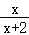
＝
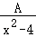
中的整式A＝，变形的依据是．

【答案】<i><u>x</u></i><u>2</u><u>﹣2</u><i><u>x</u></i>，<u>分式的分子与分母同乘（或除以）一个不等于0的整式，分式的值不变</u>

【解析】本题主要考查了分式的基本性质，分式的分子与分母同乘（或除以）一个不等于0的整式，分式的值不变．
依据x²﹣4＝（x+2）（x﹣2），即可得到分式变形
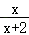
＝

中的整式A＝x（x﹣2）＝x²﹣2x．
解：∵x²﹣4＝（x+2）（x﹣2），
∴分式变形

＝
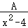
中的整式A＝x（x﹣2）＝x²﹣2x，
依据是分式的分子与分母同乘（或除以）一个不等于0的整式，分式的值不变．
故答案为：x²﹣2x，分式的分子与分母同乘（或除以）一个不等于0的整式，分式的值不变．

## 62. 单选题（难度：非常简单）

不改变分式的值，把它的分子和分母中各项系数都化为整数，则所得结果为（　　）

【答案】A

## 63. 单选题（难度：非常简单）

下列式子从左到右变形一定正确的是（　　）

【答案】A

## 64. （难度：非常简单）

下列等式中，从左向右的变形正确的是（　　）
A．
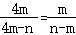
 
 B．
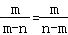

 C．
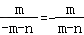
 
  D．
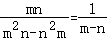

【答案】

<i>D</i>．

【解析】本题主要考查了分式的基本性质，分式的分子或分母同时乘以或除以一个相同的不为0的数或式子，分式的值不变．
根据分式的基本性质进行解题即可．
解：A、
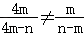
，原式变形错误，不符合题意；
B、
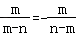
，原式变形错误，不符合题意；
C、
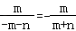
，原式变形错误，不符合题意；
D、
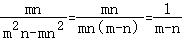
，原式变形正确，符合题意；
故选：D．

## 65. （难度：非常简单）

不改变分式的值，将分式
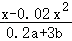
中各项系数均化为整数，结果为（　　）
A．
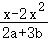

 B．
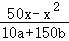
 
 C．
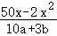

 D．
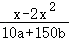

【答案】

<i>B</i>．

【解析】本题主要考查分式的基本性质的应用，是一个基础题．
不改变分式的值，是依据分式的基本性质进行变化，分子分母同时乘以或除以同一个非0的数或式子，分式的值不变．
解：对于分式

，把分子和分母同时乘以50，就可以把分式各项系数化为整数，
故选：B．

## 66. 单选题（难度：简单）

如果把分式\(\frac{2x+y}{2x-y}\)中的x和y都扩大为原来的3倍，那么分式的值（　　）

- A. 缩小到原来的 \(\frac{1}{3}\)
- B. 不变
- C. 扩大到原来的6倍
- D. 扩大到原来的3倍

【答案】B

【解析】本题考查了分式的基本性质：分式的分子与分母同乘(或除以)一个不等于0的整式，分式的值不变．分别用\(3x\)和\(3y\)去代换原分式中的x和y，利用分式的基本性质化简即可．
解：∵\(\frac{2\times 3x+3y}{2\times 3x-3y}=\frac{3\left( 2x+y \right)}{3\left( 2x-y \right)}=\frac{2x+y}{2x-y}\)
∴分式的值不变
故选B．

## 67. 单选题（难度：简单）

下列运算正确的是（    ）

- A. \(\frac{-x-y}{-x+y}\)＝\(\frac{x-y}{x+y}\)
- B. \(\frac{{{a}^{2}}-{{b}^{2}}}{{{(a-b)}^{2}}}\)＝\(a+b\)
- C. \(\frac{{{a}^{2}}-{{b}^{2}}}{{{(a-b)}^{2}}}\)＝\(a-b\)
- D. \(\frac{x-1}{1-{{x}^{2}}}\)＝\(-\frac{1}{x+1}\)

【答案】D

【解析】本题考查了分式的基本性质，约分化简，因式分解，熟练掌握分式的基本性质，约分的技能，因式分解的能力是解题的关键．
根据分式的性质，因式分解，约分化简判断即可．
因为\(\frac{-x-y}{-x+y}=\frac{-(x+y)}{-(x-y)}=\frac{x+y}{x-y}\)，
所以A错误；
因为\(\frac{{{a}^{2}}-{{b}^{2}}}{{{(a-b)}^{2}}}=\frac{(a+b)(a-b)}{{{(a-b)}^{2}}}=\frac{a+b}{a-b}\)，
所以B、C都错误；
因为\(\frac{x-1}{1-{{x}^{2}}}=\frac{x-1}{(1-x)(1+x)}=\frac{-(1-x)}{(1-x)(1+x)}=-\frac{1}{1+x}\)，
所以D正确；
故选D．

## 68. 单选题（难度：简单）

将分式\( \frac{{x}^{2}+{y}^{2}}{xy}\)中的\( x\)，\( y\)都扩大2倍，则分式的值（　　）

- A. 不变
- B. 扩大2倍
- C. 扩大4倍
- D. 扩大6倍

【答案】A

【解析】解：将分式\( \frac{{x}^{2}+{y}^{2}}{xy}\)中的x，y都扩大2倍，则分式变为\( \frac{4{x}^{2}+4{y}^{2}}{4xy}=\frac{4({x}^{2}+{y}^{2})}{4xy}=\frac{{x}^{2}+{y}^{2}}{xy}\)
故答案为：A.

## 69. 填空题（难度：简单）

不改变分式的值，把下列各式的分子与分母中各项的系数化为整数：
\( \frac{0.2x+y}{0.2x-\frac{1}{2}y}\)=.

【答案】$ \frac{2x+10y}{2x-5y}$ 

【解析】根据分式的基本性质，分式的分子分母都乘10，分式的值不变，可得答案；
解：（1）\( \frac{0.2x+y}{0.2x-0.5y}=\frac{（0.2x+y）\times 10}{（0.2x-0.5y）\times 10}=\frac{2x+10y}{2x-5y}\) ；
故答案为：\( \frac{2x+10y}{2x-5y}\)；

## 70. 单选题（难度：简单）

当\(\frac{3x-3}{2xy}=\frac{3k}{2{{x}^{2}}{{y}^{2}}}\)时，\(k\)代表的代数式是(    )

- A. \(x-1\)
- B. \({{x}^{2}}y-xy\)
- C. \(xy-y\)
- D. \(x{{y}^{2}}-x\)

【答案】B

【解析】本题考查了分式的性质，熟练掌握分式的性质是解题的关键．
根据分式的性质，分子分母同时乘以\(xy\)，即可求解．
解：∵\(\frac{3x-3}{2xy}=\frac{\left( 3x-3 \right)xy}{2{{x}^{2}}{{y}^{2}}}=\frac{3\left( {{x}^{2}}y-xy \right)}{2{{x}^{2}}{{y}^{2}}}=\frac{3k}{2{{x}^{2}}{{y}^{2}}}\)
∴\(k={{x}^{2}}y-xy\)，
故选：B．

## 71. 单选题（难度：简单）

下列式子从左到右变形正确的是（　　）

- A. \( \frac{\mathrm{m}}{\mathrm{n}}=\frac{{\mathrm{m}}^{2}}{{\mathrm{n}}^{2}}\)
- B. \( \frac{\mathrm{a}-2}{\mathrm{b}-2}=\frac{\mathrm{a}}{\mathrm{b}}\)
- C. \( \frac{\mathrm{n}+5}{\mathrm{n}+1}=5\)
- D. \( \frac{5\mathrm{x}}{5\mathrm{y}}=\frac{\mathrm{x}}{\mathrm{y}}\)

【答案】D

【解析】根据分式的基本性质，分子、分母都除以5，即可得到答案D

## 72. 单选题（难度：简单）

下列等式中成立的是（　　）

- A. \( \frac{-\left(\mathrm{a}-\mathrm{b}\right)}{\mathrm{c}}=\frac{-\mathrm{a}-\mathrm{b}}{-\mathrm{c}}\)
- B. \( \frac{-\mathrm{a}-\mathrm{b}}{\mathrm{c}}=\frac{\mathrm{a}-\mathrm{b}}{\mathrm{c}}\)
- C. \( \frac{-\mathrm{a}+\mathrm{b}}{\mathrm{c}}=-\frac{\mathrm{a}+\mathrm{b}}{\mathrm{c}}\)
- D. \( \frac{-\mathrm{a}+\mathrm{b}}{-\mathrm{c}}=\frac{\mathrm{a}-\mathrm{b}}{\mathrm{c}}\)

【答案】D

【解析】根据分式的基本性质，分子、分母都乘以-1，即可得到答案D。

## 73. 填空题（难度：简单）

不改变分式的值，把下列各式的分子与分母中各项的系数化为整数：\( \frac{\frac{1}{3}x+\frac{1}{4}y}{\frac{1}{2}x-\frac{1}{3}y}\)=.

【答案】$ \frac{4x+3y}{6x-4y}$ 

【解析】根据分式的基本性质，分式的分子分母都乘12，分式的值不变，可得答案；
解：\( \frac{\frac{1}{3}x+\frac{1}{4}y}{\frac{1}{2}x-\frac{1}{3}y}=\frac{（\frac{1}{3}x+\frac{1}{4}y）\times 12}{（\frac{1}{2}x-\frac{1}{3}y）\times 12}=\frac{4x+3y}{6x-4y}\)．
故答案为：\( \frac{4x+3y}{6x-4y}\)．

## 74. 单选题（难度：简单）

下列分式变形正确的是（    ）．

- A. \(\frac{m}{n}=\frac{m\left( {{x}^{2}}+1 \right)}{n\left( {{x}^{2}}+1 \right)}\)
- B. \(\frac{2}{5+y}=\frac{2x}{5x+y}\)
- C. \(\frac{-x}{x-y}=\frac{x}{x+y}\)
- D. \(\frac{-x}{x-y}=\frac{x}{-x-y}\)

【答案】A

【解析】本题主要考查了分式的基本性质，分式的分子和分母同时乘以或除以一个不为0的数或式子，分式的值不变，据此逐一判断即可．
解：A、\(\frac{m}{n}=\frac{m\left( {{x}^{2}}+1 \right)}{n\left( {{x}^{2}}+1 \right)}\)，原式变形正确，符合题意；
B、\(\frac{2}{5+y}\ne \frac{2x}{5x+y}\)，原式变形错误，不符合题意；
C、\(\frac{-x}{x-y}=\frac{x}{-x+y}\)，原式变形错误，不符合题意；
D、\(\frac{-x}{x-y}=\frac{x}{-x+y}\)，原式变形错误，不符合题意；
故选：A．

## 75. 单选题（难度：简单）

有下列各式：<latex class="math-tex">\( ①\frac{1}{2}\left(\mathrm{x}-1\right)，②\frac{\mathrm{a}+1}{\mathrm{a}}，③\mathrm{a}{\mathrm{b}}^{-2}，④\frac{3}{\mathrm{\pi }}，⑤{\mathrm{x}}^{2}-\frac{2}{3}.\)</latex>其中

【答案】A

## 76. 单选题（难度：简单）

不改变分式的值，把分式\( \frac{3\mathrm{a}+0.5\mathrm{b}}{0.2\mathrm{a}-\mathrm{b}}\)的分子、分母中各项的系数都化为整数，正确的是（　　）

- A. \( \frac{30\mathrm{a}+5\mathrm{b}}{2\mathrm{a}-10\mathrm{b}}\)
- B. \( \frac{3\mathrm{a}+5\mathrm{b}}{2\mathrm{a}-\mathrm{b}}\)
- C. \( \frac{3\mathrm{a}+5\mathrm{b}}{2\mathrm{a}-10\mathrm{b}}\)
- D. \( \frac{3\mathrm{a}+5\mathrm{b}}{2\mathrm{a}-\mathrm{b}}\)

【答案】A

【解析】根据分式的基本性质，分子、分母都乘以10，即可得到答案。

## 77. 单选题（难度：简单）

使得等式<latex class="math-tex">\(\frac{4}{7}=\frac{4\times m}{7\times m}\)</latex>成立的m的取值范围为（   ）

【答案】A

## 78. 填空题（难度：简单）

\(\frac{m+n}{m-n}=\frac{{{(m+n)}^{2}}}{(\ \ \ )}\left( m+n\ne 0 \right)\)；括号中填．

【答案】${{m}^{2}}-{{n}^{2}}$

【解析】本题考查分式的性质：分式的分子分母同时乘以或除以同一个不为0的数分式值不变，熟练掌握分式的性质是解题关键．
根据分式的性质：分式的分子分母同时乘以或除以同一个不为0的数分式值不变直接求解得到答案；
解：由题意可得，\(\frac{m+n}{m-n}=\frac{(m+n)(m+n)}{(m-n)(m+n)}=\frac{{{(m+n)}^{2}}}{({{m}^{2}}-{{n}^{2}})}\left( m+n\ne 0 \right)\)，
故答案为：\({{m}^{2}}-{{n}^{2}}\)，

## 79. 单选题（难度：简单）

把分式\(\frac{x}{2 x+y}\)中的\(x\)和\(y\)均扩大\(3\)倍，分式的值（    ）

- A. 不变
- B. 扩大\(3\)倍
- C. 缩小\(3\)倍
- D. 扩大\(9\)倍

【答案】A

【解析】本题考查分式的基本性质，掌握“把分式的分子和分母都乘以或除以同一个不为\(0\)的数或整式，分式的值不变”是正确判断的关键．根据分式的基本性质进行判断即可．
解：把分式\(\frac{x}{2x+y}\)中的\(x\)和\(y\)均扩大\(3\)倍为\(\frac{3x}{6x+3y}=\frac{3x}{3\left( 2x+y \right)}=\frac{x}{2x+y}\)，
所以分式的值不变，
故选：\(\operatorname{A}\)．

## 80. 填空题（难度：简单）

填空：（1）\(\frac{3c}{2ab}=\frac{15ac}{(\ \ \ )}\)；括号中填．

【答案】$10{{a}^{2}}b$

【解析】本题考查分式的性质：分式的分子分母同时乘以或除以同一个不为0的数分式值不变，熟练掌握分式的性质是解题关键．
根据分式的性质：分式的分子分母同时乘以或除以同一个不为0的数分式值不变直接求解得到答案；
解：由题意可得，\(\frac{3c}{2ab}=\frac{3c\times 5a}{2ab\times 5a}=\frac{15ac}{(10{{a}^{2}}b)}\)，故答案为：\(10{{a}^{2}}b\)，

## 81. 填空题（难度：简单）

<latex class="math-tex">\(\frac{xy+x}{{{x}^{2}}}=\frac{y+1}{(\ \ \ )}\)</latex>．括号中填___．

