# 知识点·同一平面内过一点有且只有一条直线与已知直线垂直（同步练习）

> 教材：数学·七年级下册·沪科技版2024新教材 ｜ 来源：国家中小学智慧教育平台·在线练习 ｜ 共 54 题

## 1. 单选题（难度：适中）

下列说法中，错误的是（　　）

【答案】A

## 2. 单选题（难度：适中）

下列说法中：①两个有理数相加，和一定大于每一个加数；②在同一平面内，过一点有且只有一条直线与已知直线垂直；③相等的角是对顶角；④两点确定一条直线．其中正确的有（　　）

【答案】A

## 3. 单选题（难度：简单）

下列说法中正确的是（　　）

- A. 相等的角是对顶角
- B. 两点之间直线最短
- C. 两条平行直线被第三条直线所截，同位角相等
- D. 过一点有且只有一条直线与已知直线垂直

【答案】C

【解析】解：A、相等的角是不一定是对顶角，说法错误，不符合题意；
B、两点之间，线段最短，说法错误，不符合题意；
C、两条平行直线被第三条直线所截，同位角相等，说法正确，符合题意；
D、在同一平面内，过一点有且只有一条直线与已知直线垂直，说法错误，不符合题意；
故选：C．

## 4. 单选题（难度：适中）

下列语句中，正确的是（　　）

- A. 相等的角是对顶角
- B. 三个锐角的和一定大于直角
- C. 过一点，有且只有一条直线与已知直线垂直
- D. 如果∠1与∠2互余，∠1与∠3互余，那么一定有∠2＝∠3

【答案】D

【解析】解：A、相等的角不一定是对顶角，原说法错误，故此选项不符合题意；
B、三个锐角的和不一定大于直角，如三个锐角分别是10°、20°、30°，它们的和就不大于直角，原说法错误，故此选项不符合题意；
C、在平面内，过一点有且只有一条直线与已知直线垂直，原说法错误，故此选项不符合题意；
D、如果∠1与∠2互余，∠1与∠3互余，那么一定有∠2＝∠3，根据是同角的余角相等，原说法正确，故此选项符合题意．
故选：D．

## 5. 单选题（难度：适中）

下列语句正确的有（　　）①射线AB与射线BA是同一条射线；②两点之间的所有连线中，线段最短；③相等的角是对顶角；④欲将一根木条固定在墙上，至少需要2个钉子；⑤在同一平面内，过一点有且只有一条直线垂直于已知直线．

【答案】A

## 6. 单选题（难度：简单）

下列说法正确的个数是（　　）①射线MN与射线NM是同一条射线；②点A到点B的距离是线段AB；③画一条长为3cm的直线；④在同一平面内，过一点有且只有一条直线垂直于已知直线．

【答案】A

## 7. 单选题（难度：非常简单）

平面内，过一点，有几条直线和已知直线垂直？（　　）

- A. 0条
- B. 1条
- C. 2条
- D. 3条

【答案】B

【解析】解：平面内，过一点有且只有一条直线和已知直线垂直，
故选：B．

## 8. 单选题

下列说法正确的个数是（　　）
①对顶角相等；
②等角的补角相等；
③两直线平行，同旁内角相等；
④在同一平面内，过一点有且只有一条直线与已知直线垂直

- A. 1
- B. 2
- C. 3
- D. 4

【答案】C

【解析】解：①对顶角相等，正确；
②等角的补角相等，正确；
③两直线平行，同旁内角互补，故③错误；
④在同一平面内，过一点有且只有一条直线与已知直线垂直，正确．
综上，正确的选项有3个．
故选：C．

## 9. 单选题（难度：简单）

在同一平面内，已知点P在直线l上，过点P画直线l的垂线，可以画出多少条（　　）

【答案】A

## 10. 单选题

小明与小刚在讨论数学问题时，有如下对话：
小明：在同一平面内，过一点A有且只有一条直线与已知直线m平行．
小刚：在同一平面内，过一点A有且只有一条直线与已知直线m垂直．
对于两个人的说法，正确的是（　　）

- A. 小明对
- B. 小刚对
- C. 两人均对
- D. 两人均不对

【答案】B

【解析】解：∵在同一平面内，过直线外一点有且只有一条直线与已知直线平行；过一点有且只有一条直线与已知直线垂直，
∴小明错，小刚对，
故选：B．

## 11. 单选题（难度：适中）

下列说法正确的是（　　）

【答案】A

## 12. 单选题（难度：非常简单）

在同一平面内，已知点P在直线l上，过点P画直线l的垂线，可以画出多少条（　　）

- A. 1条
- B. 2条
- C. 3条
- D. 无数条

【答案】A

【解析】解：∵在同一平面时，经过一点有且只有一条直线垂直于已知直线，
∴过点P画直线l的垂线，画1条．
故选：A．

## 13. 单选题（难度：适中）

如图，在同一平面内，OA⊥l，OB⊥l，垂足为O，则OA与OB重合的理由是（　　）

【答案】A

## 14. 单选题（难度：适中）

如图，直线l代表一条河流，在河边O处修建一水闸，再过点O修建两条引水渠OA和OB，使得OA⊥l，OB⊥l，垂足为O，则OA与OB重合的理由是（　　）

【答案】A

## 15. 单选题（难度：非常简单）

如图，在同一平面内，经过直线l外一点A画l的垂线，能画出（　　）

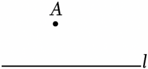

- A. 0条
- B. 1条
- C. 2条
- D. 无数条

【答案】B

【解析】解：在同一平面内，经过直线l外一点A画l的垂线，能画出1条．
故选：B．

## 16. 单选题（难度：适中）

如图，点M，N是直线a外两点，点O是直线a上一点，已知ON⊥a，OM⊥a，所以OM与ON重合的理由是（　　）

【答案】A

## 17. 单选题（难度：适中）

如果直线ON⊥直线a，直线OM⊥直线a，那么OM与ON重合（即O，M，N三点共线），其理由是（　　）

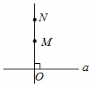

- A. 两点确定一条直线
- B. 在同一平面内，过两点有且只有一条直线与已知直线垂直
- C. 在同一平面内，过一点有且只有一条直线与已知直线垂直
- D. 两点之间，线段最短

【答案】C

【解析】解：如果直线ON⊥直线a，直线OM⊥直线a，那么OM与ON重合（即O，M，N三点共线），其理由是在同一平面内，过一点有且只有一条直线与已知直线垂直，
故选：C．

## 18. 单选题（难度：非常简单）

在同一平面内，过直线上一点作已知直线的垂线，能作（　　）

【答案】A

## 19. 单选题（难度：适中）

下列说法中不正确的是（　　）

【答案】A

## 20. 单选题（难度：适中）

下列叙述不正确的是（　　）

【答案】A

## 21. 单选题（难度：适中）

\( P\)为直线\( l\)上的一点，\( Q\)为\( l\)外一点，下列说法不正确的是（   ）

- A. 过\( P\)可画直线垂直于\( l\)
- B. 过\( Q\)可画直线\( l\)的垂线
- C. 连结\( PQ\)使\( PQ\perp l\)
- D. 过\( Q\)只能画1条直线与\( l\)垂直

【答案】C

【解析】解：A、\( \because P\)为直线\( l\)上的一点，Q为\( l\)外一点，\( \therefore \)过P可画直线垂直于\( l\)，正确，不合题意；
B、\( \because P\)为直线\( l\)上的一点，Q为\( l\)外一点，\( \therefore \)过Q可画直线\( l\)的垂线，正确，不合题意；
C、连接\( PQ\)不能保证\( PQ\perp l\)，故错误，符合题意；
D、\( \because Q\)为\( l\)外一点，\( \therefore \)可以过Q可画直线与\( l\)垂直，正确，不合题意；
故选∶C．

## 22. 单选题（难度：简单）

下列说法中正确的有（　　）

【答案】A

## 23. 单选题

下列说法：①连接一点与直线上各点的线段中，垂线段最短；②直线\( AB\)，\( CD\)相交于点O，若\( \angle AOC=90°\)，则\( AB\perp CD\)；③相等的角是对顶角；④过直线l外一点P作\( PQ\perp l\)于点Q，则线段\( PQ\)的长度是点P到直线l的距离，正确的有（   ）

- A. 1个
- B. 2个
- C. 3个
- D. 4个

【答案】B

【解析】解：连接直线外一点与直线上各点的线段中，垂线段最短，①说法错误；
当两条直线相交所构成的四个角中有一个角为\( 90°\)时，这两条直线互相垂直，②说法正确；
对顶角相等，但相等的角不一定是对顶角，③说法错误；
直线外一点到这条直线的垂线段的长度，叫作点到直线的距离，④说法正确．
综上分析可知：说法正确的有2个．
故选B

## 24. 单选题（难度：简单）

下列说法中正确的是（    ）

- A. 过一点有且只有一条直线垂直于已知直线
- B. 直线外一点到这条直线的垂线段，叫做这点到这条直线距离
- C. 经过直线外一点，有且仅有一条直线与已知直线平行
- D. 两条直线被第三条直线所截，同旁内角互补

【答案】C

【解析】解：A、在同一平面内，过一点有且只有一条直线垂直于已知直线，故本选项错误，不符合题意；
B、从直线外一点到这条直线的垂线段的长度，叫做这点到这条直线距离，故本选项错误，不符合题意；
C、过直线外一点有且只有一条直线与已知直线平行，故本选项正确，符合题意；
D、两条平行直线被第三条直线所截，同旁内角互补，故错误，不符合题意；
故选：C．

## 25. 单选题

下列命题中，真命题有（   ）
①过直线外一点有且只有一条直线与已知直线平行；
②在同一平面内，不重合的两条直线的位置关系有平行、相交、垂直三种；
③在同一平面内，过一点有且只有一条直线与已知直线垂直；
④相等的角是对顶角；
⑤两条直线被第三条直线所截，内错角相等．

- A. 2个
- B. 3个
- C. 4个
- D. 5个

【答案】A

【解析】解：①过直线外一点有且只有一条直线与已知直线平行，正确，是真命题；
②在同一平面内，不重合的两条直线的位置关系有平行、相交两种，故原命题错误，是假命题；
③在同一平面内，过一点有且只有一条直线与已知直线垂直，正确，是真命题；
④相等的角不一定是对顶角，故原命题错误，是假命题；
⑤两条平行直线被第三条直线所截，内错角相等，故原命题错误，是假命题；
真命题有2个，
故选：A

## 26. 单选题（难度：适中）

下列说法错误的是（    ）

【答案】A

## 27. 单选题（难度：适中）

下列说法正确的是（）

【答案】A

## 28. 单选题（难度：适中）

下列语句中：
①有公共顶点且相等的角是对顶角；
②直线外一点到这条直线的垂线段，叫做点到直线的距离；
③两点之间直线最短；
④同一平面内，经过一点有且只有一条直线与已知直线垂直．
其中正确的个数有（　　）

- A. 1个
- B. 2个
- C. 3个
- D. 4个

【答案】A

【解析】解：①有公共顶点且两边互为反向延长线的两个角是对顶角，故原说法错误，不符合题意；
②直线外一点到这条直线的垂线段的长度，叫做点到直线的距离，故原说法错误，不符合题意；
③两点之间线段最短，故原说法错误，不符合题意；
④同一平面内，经过一点有且只有一条直线与已知直线垂直，正确，符合题意．
∴语句中，正确的个数有1个，
故选：A．

## 29. 单选题（难度：简单）

下列说法中，正确的是（    ）

【答案】A

## 30. 单选题（难度：简单）

下列说法正确的是（    ）

【答案】A

## 31. 单选题（难度：适中）

下列说法正确的是（    ）

【答案】A

## 32. 单选题

下列说法正确的是（    ）

- A. 相等的两个角是对顶角．
- B. 在同一平面内，过一点有且只有一条直线与已知直线垂直．
- C. 直线外一点到这条直线的垂线段，叫做点到直线的距离．
- D. 两直线平行，同旁内角相等．

【答案】B

【解析】解：A、相等的两个角不一定是对顶角，本选项说法错误；
B、在同一平面内，过一点有且只有一条直线与已知直线垂直，本选项说法正确；
C、从直线外一点到这条直线的垂线段的长度，叫做该点到直线的距离，本选项说法错误；
D、两直线平行，同旁内角互补，本选项说法错误；
故选：B．

## 33. 单选题（难度：适中）

下列说法错误的是（    ）

【答案】A

## 34. 单选题（难度：简单）

下列命题中，假命题是（    ）

- A. 对顶角相等
- B. 同一平面内，过一点有且只有一条直线与已知直线垂直
- C. 两条直线被第三条直线所截，同旁内角互补
- D. 两直线平行，同位角相等

【答案】C

【解析】解：A、对顶角相等，该选项为真命题，不符合题意；
B、同一平面内，过一点有且只有一条直线与已知直线垂直，该选项为真命题，不符合题意；
C、只有平行的两条直线被第三条直线所截，同旁内角互补，故该选项是假命题，符合题意；
D、两直线平行，同位角相等，该选项为真命题，不符合题意；
故选C．

## 35. 单选题（难度：适中）

下列说法错误的是（  ）

【答案】A

## 36. 单选题

如图，因为直线AB⊥l于点B，BC⊥l于点B，所以直线AB和BC重合，则其中蕴含的数学原理是（　　）

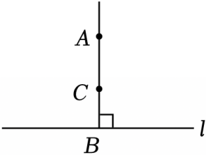

- A. 平面内，过一点有且只有一条直线与已知直线垂直
- B. 垂线段最短
- C. 过一点只能作一条垂线
- D. 两点确定一条直线

【答案】A

【解析】解：因为直线AB⊥l于点B，BC⊥l于点B，
所以直线AB和BC重合（在平面内，过一点有且只有一条直线与已知直线垂直），
故选：A．

## 37. 单选题（难度：适中）

下列说法中，不正确的是(   )

【答案】A

## 38. 单选题

如图是一张长方形纸片，纸片的一边为\( AB\)，小亮在纸片内部任取一点\( P\)，并通过折叠折出过点\( P\)且与\( AB\)垂直的折痕，他发现这样的折痕只能折出一条，理由是（   ）

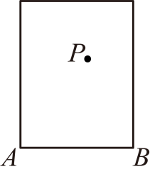

- A. 两点之间，线段最短
- B. 两点确定一条直线
- C. 在同一平面内，过一点有且只有一条直线与已知直线垂直
- D. 直线外一点与直线上各点连接的所有线段中，垂线段最短

【答案】C

【解析】解：由题意知，过点\( P\)有且只有一条直线与\( AB\)垂直，即
在同一平面内，过一点有且只有一条直线与已知直线垂直．
  故选：C ．

## 39. 单选题（难度：适中）

下列命题中：①三角形的高必交于一点；②两条直线被第三条直线所截，内错角相等；③如果一个数的平方根是这个数本身，那么这个数是0；④过一点有且只有一条直线与已知直线垂直．是真命题的个数是（    ）

【答案】A

## 40. 单选题

如图，已知A为直线l外一定点，B为直线l上一动点．则下列说法正确的是（    ）．

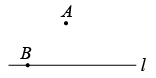

- A. 当点B自左向右移动时，A，B两点间的距离越来越小
- B. 连接AB，则线段AB的长度即为点A到直线l的距离
- C. 过点A有且只有一条直线与直线l平行
- D. 同一平面内，过点A有两条直线与直线l垂直

【答案】C

【解析】解：A、当点B自左向右移动时，A，B两点间的距离先变小后变大，选项错误；
B、当AB⊥l时，线段AB的长度即为点A到直线l的距离，选项错误；
C、过点A有且只有一条直线与直线l平行，选项正确；
D、同一平面内，过点A有一条直线与直线l垂直，选项错误；
故选：C．

## 41. 单选题（难度：适中）

如图，<latex class="math-tex">\( CO\perp AB,DO\perp AB\)</latex>，O为垂足，那么C、D、O三点在同一条直线上，其理由是（    ）

【答案】A

## 42. 单选题（难度：适中）

下列说法正确的个数是（　　）①在同一平面内，经过一点能且只能画这条直线的一条垂线；②过直线l上一点A和直线l外一点B作直线，使它与直线l垂直；③从直线外一点作这条直线的垂线段，叫做这个点到这条直线的距离；④过直线外一点画这条直线的垂线，垂线的长度叫做这点到这条直线的距离．

【答案】A

## 43. 单选题（难度：适中）

下列说法中，正确的有（　　）个．①两直线相交，对顶角相等；②同一平面内，过一点有且只有一条直线与已知直线垂直；③直线外一点与直线上各点连接的所有线段中，垂线段最短；④如果AM＝MB，那么点M是AB的中点．

【答案】A

## 44. 单选题（难度：简单）

从货场B到铁道怎样走最近？小明的做法是：过点B向铁道作垂线，这样做距离最短，其数学道理是（　　）

【答案】A

## 45. 单选题（难度：简单）

如图，斑马线的作用是为了引导行人安全地通过马路．小丽站在点A处，她觉得沿AP走过斑马线到达马路边BC更节省时间，这一想法体现的数学依据是（　　）

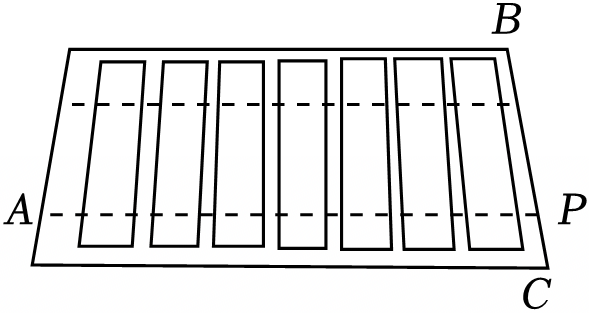

- A. 两点之间，线段最短
- B. 两点确定一条直线
- C. 过一点有且只有一条直线与已知直线垂直
- D. 垂线段最短

【答案】D

【解析】解：行人沿垂直马路的方向走过斑马线，体现的数学依据是垂线段最短，
故选：D．

## 46. 单选题（难度：简单）

如图，要在河堤两岸搭建一座桥，搭建方式中最短的是线段PN，理由是（　　）

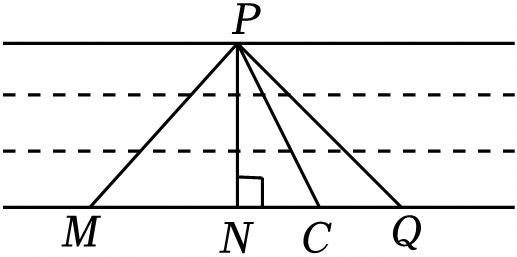

- A. 两点确定一条直线
- B. 两点之间，线段最短
- C. 连接直线外一点与直线上各点的所有线段中，垂线段最短
- D. 在同一平面内，过一点有且只有一条直线与已知直线垂直

【答案】B

【解析】解：要在河堤两岸搭建一座桥，图中搭建方式中，线段PN最短，理由是垂线段最短．
故选：B．

## 47. 单选题（难度：简单）

如图，某运水厂要从点P修建一条管道通向河边，为了节约材料，修建了管道PM，其原理是（　　）

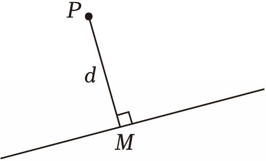

- A. 两点之间线段最短
- B. 两点确定一条直线
- C. 过一点可以作无数条直线
- D. 垂线段最短

【答案】D

【解析】解：修建了管道PM的原理是垂线段最短．
故选：D．

## 48. 单选题（难度：适中）

如图，MN⊥NP，ON⊥NP，所以MN与ON重合，推理的理由是（　　）

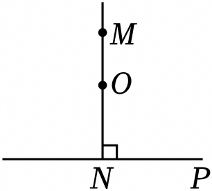

- A. 两点确定一条直线
- B. 过一点只能作一条直线
- C. 在同一平面内，过一点有且只有一条直线与已知直线垂直
- D. 垂线段最短

【答案】C

【解析】解：MN⊥NP，ON⊥NP，则MN与ON重合，推理的理由在同一平面内，过一点有且只有一条直线与已知直线垂直，
故选：C．

## 49. 单选题（难度：适中）

如图，在正方形网格中画有一段笔直的铁路及道口A、B和村庄M、N．小强从道口A到公路BN，他选择的路线为公路AN，其理由为（　　）

【答案】A

## 50. 单选题（难度：简单）

如图，要把河中的水引到水池A中，应在河岸B（AB⊥CD于点B）处开始挖渠才能使水渠的长度最短，这样做依据的几何学原理是（　　）

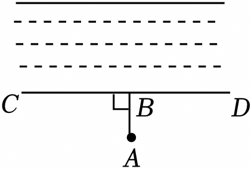

- A. 两点确定一条直线
- B. 两点之间，线段最短
- C. 在同一平面内，过一点有且只有一条直线与已知直线垂直
- D. 垂线段最短

【答案】D

【解析】解：根据垂线段定理，连接直线外一点与直线上所有点的连线中，垂线段最短，因此，沿AB开渠，能使所开的渠道最短．
故选：D．

## 51. 单选题（难度：适中）

如图，小华同学的家在点P处，他想尽快到公路边，所以选择沿线段PC去公路边，那么他的选择体现的数学基本事实是（　　）

【答案】A

## 52. 单选题（难度：适中）

如图，生活中，有以下两个现象，对于这两个现象的解释，正确的是（　　）

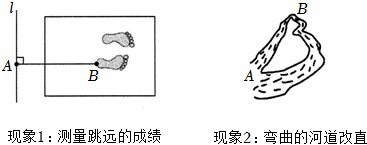

- A. 两个现象均可用两点之间线段最短来解释
- B. 现象1用垂线段最短来解释，现象2用经过两点有且只有一条直线来解释
- C. 现象1用垂线段最短来解释，现象2用两点之间线段最短来解释
- D. 现象1用经过两点有且只有一条直线来解释，现象2用垂线段最短来解释

【答案】C

【解析】解：现象1用垂线段最短来解释，现象2用两点之间线段最短来解释，
故选：C．

## 53. 单选题（难度：适中）

有甲，乙，丙，丁四位同学准备从斑马线上的点P处过马路，四人所走路线如图所示，假设四人速度相等，则最先通过马路的是乙，理由是（　　）

【答案】A

## 54. 单选题（难度：简单）

宇树科技UnitreeB2﹣W轮足机器人正在水中的点A处工作，当它收到需尽快上岸的指令后，选择路线AB到达岸边．其中蕴含的数学原理是（　　）

【答案】A
