# 知识点·同位角、内错角、同旁内角（同步练习）

> 教材：数学·七年级下册·沪科技版2024新教材 ｜ 来源：国家中小学智慧教育平台·在线练习 ｜ 共 94 题

## 1. 单选题（难度：非常简单）

∠1 的同位角是（　　）

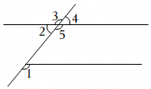

- A. ∠2
- B. ∠3
- C. ∠4
- D. ∠5

【答案】D

【解析】解：∠1的同位角是∠5，
故选：D．

## 2. 单选题（难度：适中）

如图所示，下列说法一定正确的是（　　）

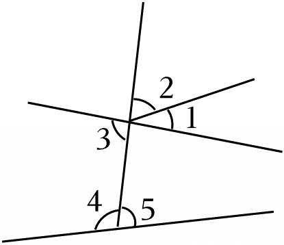

- A. ∠1和∠2互为余角
- B. ∠1和∠4是内错角
- C. ∠3和∠4互为补角
- D. ∠2和∠5是同位角

【答案】D

【解析】解：A．由于∠1与∠2的和不一定是90°，所以∠1和∠2不一定是互为余角，因此选项A不符合题意；
B．∠1和∠4不是两条直线被第三条直线所截得的角，不符合内错角的定义，因此选项B不符合题意；
C．∠3和∠4是一组同旁内角，但∠3和∠4不一定互补，因此选项C不符合题意；
D．∠2和∠5是两条直线被第三条直线所截的同位角，因此选项D符合题意．
故选：D．

## 3. 单选题（难度：适中）

如图，下列说法错误的是（　　）

- A. ∠A与∠3是同位角
- B. ∠A与∠2是同旁内角
- C. ∠4与∠5是对顶角
- D. ∠4与∠C是内错角

【答案】C

【解析】解：A、∠A与∠3是同位角，原说法正确，不符合题意；
B、∠A与∠2是同旁内角，原说法正确，不符合题意；
C、∠4与∠5不是对顶角，原说法错误，符合题意；
D、∠4与∠C是内错角，原说法正确，不符合题意．
故选：C．

## 4. 单选题（难度：简单）

关于如图中各角的说法不正确的是（　　）

- A. ∠1与∠2是同旁内角
- B. ∠1与∠4是内错角
- C. ∠3与∠5是对顶角
- D. ∠2与∠3是邻补角

【答案】B

【解析】解：A、∠1与∠2是同旁内角，原说法正确，故此选项不符合题意；
B、∠1与∠4不是内错角，原说法错误，故此选项符合题意；
C、∠3与∠5是对顶角，原说法正确，故此选项不符合题意；
D、∠2与∠3是邻补角，原说法正确，故此选项不符合题意．
故选：B．

## 5. 单选题（难度：简单）

如图，∠A，∠B之间的位置关系是（　　）

- A. 互为同位角
- B. 互为内错角
- C. 互为同旁内角
- D. 互为对顶角

【答案】C

【解析】解：∠A，∠B之间的位置关系是互为同旁内角．
故选：C．

## 6. 单选题（难度：非常简单）

如图，直线a、b被直线c所截，与∠2是同旁内角的是（　　）

- A. ∠1
- B. ∠3
- C. ∠4
- D. ∠5

【答案】B

【解析】解：图中∠3与∠2是同旁内角．
故选：B．

## 7. 单选题（难度：适中）

下列判断错误的是（　　）

- A. ∠2与∠4是同旁内角
- B. ∠3与∠4是内错角
- C. ∠5与∠6是同旁内角
- D. ∠1与∠5是同位角

【答案】C

【解析】解：A、∠2与∠4是同旁内角，原说法正确，故此选项不符合题意；
B、∠3与∠4是内错角，原说法正确，故此选项不符合题意；
C、∠5与∠6不是同旁内角，原说法错误，故此选项符合题意；
D、∠1与∠5是同位角，原说法正确，故此选项不符合题意．
故选：C．

## 8. 单选题（难度：非常简单）

如图，直线a截直线b，c，下列说法正确的是（　　）

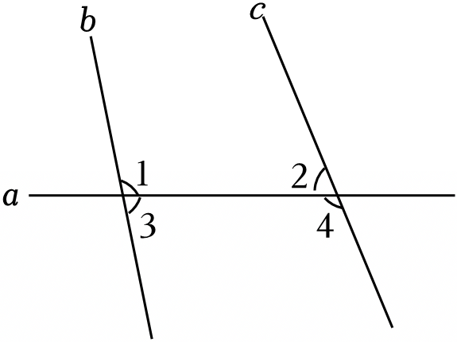

- A. ∠1与∠2是同旁内角
- B. ∠1与∠3是同旁内角
- C. ∠2与∠3是同位角
- D. ∠3与∠4是内错角

【答案】A

【解析】解：A、∠1与∠2是同旁内角，故原说法正确，符合题意；
B、∠1与∠3是邻补角，故原说法错误，不符合题意；
C、∠2与∠3是内错角，故原说法错误，不符合题意；
D、∠3与∠4是同旁内角，故原说法错误，不符合题意．
故选：A．

## 9. 单选题（难度：简单）

下列图中∠1，∠2不是同位角的是（　　）

- A. 
- B. 
- C. 
- D. 
​

【答案】D

【解析】解：A．由图可知，∠1，∠2是同位角，故A不符合题意．
B．由图可知，∠1，∠2是同位角，故B不符合题意．
C．由图可知，∠1，∠2是同位角，故C不符合题意．
D．由图可知，∠1，∠2不是同位角，故D符合题意．
故选：D．

## 10. 单选题（难度：非常简单）

∠1和∠2是同位角的是（　　）

- A. 
- B. 
- C. 
- D. 
​

【答案】B

【解析】解：根据同位角的概念进行逐项分析如下：
A、∠1和∠2不符合同位角概念，故该选项不符合题意；
B、∠1和∠2符合同位角概念，故该选项符合题意；
C、∠1和∠2不符合同位角概念，故该选项不符合题意；
D、∠1和∠2不符合同位角概念，故该选项不符合题意；
故选：B．

## 11. 单选题（难度：简单）

如图，下列说法正确的是（　　）

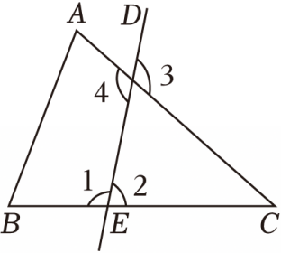

- A. ∠2与∠B是同位角
- B. ∠1与∠4是内错角
- C. ∠2与∠3是同旁内角
- D. ∠4与∠A是内错角

【答案】A

【解析】解：A．∠2与∠B是同位角，该说法正确，故该选项符合题意；
B．∠1与∠4是同旁内角，原说法错误，故该选项不符合题意；
C．∠2与∠3是同位角，原说法错误，故该选项不符合题意；
D．∠4与∠A是同旁内角，原说法错误，故该选项不符合题意；
故选：A．

## 12. 单选题（难度：简单）

下列图形中，∠1与∠2是同位角的是（　　）

- A. 
- B. 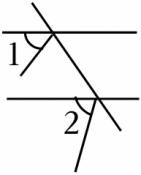
- C. 

【答案】C

【解析】解：A、∠1与∠2的是内错角，故本选项不符合题意．
B、∠1与∠2不是同位角，故本选项不符合题意．
C、∠1与∠2是同位角，故本选项符合题意．
D、∠1与∠2不是同位角，故本选项不符合题意．
故选：C．

## 13. 单选题（难度：适中）

如图，按各组角的位置判断错误的是（　　）

- A. ∠1与∠4是同旁内角
- B. ∠3与∠4是内错角
- C. ∠5与∠6是同旁内角
- D. ∠2与∠5是同位角

【答案】C

【解析】解：A、∠1和∠A是同旁内角，说法正确；
B、∠3和∠4是内错角，说法正确；
C、∠5和∠6不是两条直线被第三条直线截成的角，说法错误；
D、∠2和∠5是同位角，说法正确．
故选：C．

## 14. 单选题（难度：非常简单）

如图，∠1和∠5是一对（　　）

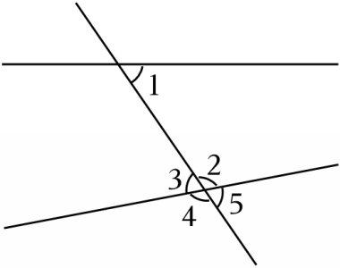

- A. 内错角
- B. 同旁内角
- C. 同位角
- D. 对顶角

【答案】C

【解析】解：如图，∠1和∠5是一对同位角．
故选：C．

## 15. 单选题（难度：简单）

如图，a，b，c三条直线两两相交，下列说法错误的是（　　）

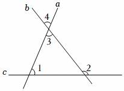

- A. ∠1与∠2是同位角
- B. ∠2与∠4是内错角
- C. ∠3与∠4是对顶角
- D. ∠1与∠3是同旁内角

【答案】B

【解析】解：A．∠1与∠2是直线a、直线b被直线c所截，所得到的同位角，因此选项A不符合题意；
B．∠2与∠4是直线a、直线c被直线b所截，所得到的同位角，因此选项B符合题意；
C．∠3与∠4是对顶角，因此选项C不符合题意；
D．∠1与∠3是直线b、直线c被直线a所截，所得到的同旁内角，因此选项D不符合题意；
故选：B．

## 16. 单选题（难度：简单）

如图，∠CDB与∠DBE是同旁内角，它们是由（　　）

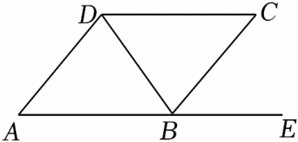

- A. 直线CD，AB被直线BD所截形成的
- B. 直线AD，BC被直线AE所截形成的
- C. 直线DC，AB被直线AD所截形成的
- D. 直线DC，AB被直线BC所截形成的

【答案】A

【解析】解：由图可得，∠CDB与∠DBE是同旁内角，它们是由直线CD、AB被直线BD所截形成的，
故选：A．

## 17. 单选题（难度：适中）

如图，下列判断：①∠A与∠1是同位角；②∠A与∠B是同旁内角；③∠4与∠1是内错角；④∠1与∠3是同位角．其中正确的是（　　）

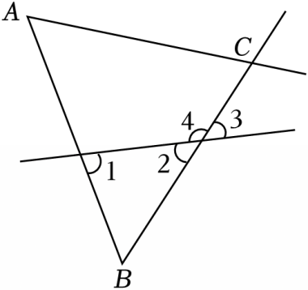

- A. ①②③
- B. ①②④
- C. ②③④
- D. ①②③④

【答案】A

【解析】解：①②③中的判断正确，故①②③符合题意；
④、∠1与∠3不是同位角，故④不符合题意．
故选：A．

## 18. 单选题（难度：简单）

如图，下列说法不正确的是（　　）

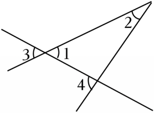

- A. ∠1和∠4是内错角
- B. ∠1和∠2是同旁内角
- C. ∠3和∠4是同位角
- D. ∠2和∠4是同旁内角

【答案】D

【解析】解：根据同位角、内错角、同旁内角的定义进行判断，
A．∠1和∠4是内错角，故不符合题意；
B．∠1和∠2是同旁内角，故不符合题意；
C．∠3和∠4是同位角，故不符合题意；
D．∠2和∠4是同位角，故符合题意．
故选：D．

## 19. 单选题（难度：简单）

如图，∠2与∠4的位置关系是（　　）

- A. 同位角
- B. 内错角
- C. 对顶角
- D. 同旁内角

【答案】A

【解析】解：如图所示，∠2和∠4两个角都在两条直线的同侧，并且在第三条直线（截线）的同旁，所以∠2和∠4是同位角．
故选：A．

## 20. 单选题（难度：非常简单）

下列图形中，∠1与∠2不是同位角的是（　　）

- A. 
- B. 
- C. 
- D. 
​

【答案】C

【解析】解：根据同位角的概念可知，∠1和∠2不是同位角．
故选：C．

## 21. 单选题（难度：适中）

如图，直线AD，BE被直线BF和AC所截，则下列说法错误的是（　　）

- A. ∠1与∠2是同位角
- B. ∠3与∠4是内错角
- C. ∠4与∠5是同旁内角
- D. ∠1，∠5，∠3互为邻补角

【答案】D

【解析】解：A．∠1与∠2是同位角，选项正确，不符合题意；
B．∠3与∠4是内错角，选项正确，不符合题意；
C．∠4与∠5是同旁内角，选项正确，不符合题意；
D．∠1，∠5，∠3不互为邻补角，选项错误，符合题意．
故选：D．

## 22. 单选题（难度：非常简单）

下列四幅图中，∠1和∠2是同位角的是（　　）

- A. 
- B. 
- C. 
- D. 
​

【答案】B

【解析】解：上列四幅图中，∠1和∠2是同位角的是，
    
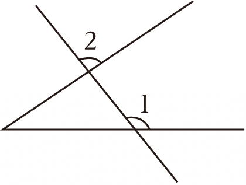
 
故选：B．

## 23. 单选题（难度：简单）

如图，直线AD、BE被直线BF和AC所截，下列说法正确的是（　　）

- A. ∠3与∠4是同旁内角
- B. ∠2与∠5是同位角
- C. ∠6与∠1是内错角
- D. ∠2与∠6是同旁内角

【答案】D

【解析】解：A、∠3与∠4是内错角，故选项A错误；
B、∠2与∠5不是同位角，故选项B错误；
C、∠1与∠6不是同旁内角，故选项C错误；
D、∠2与∠6是同旁内角，正确；
故选：D．

## 24. 单选题（难度：适中）

如图，四个图形中的∠1和∠2，不是同位角的是（　　）

- A. 
- B. 
- C. 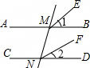
- D. 
​

【答案】C

【解析】解：∵C中∠1和∠2是由四条直线组成，
∴∠1和∠2不是同位角．
故选：C．

## 25. 单选题（难度：简单）

两条直线被第三条直线所截，形成了“三线八角”，为了便于记忆，同学们可用双手表示“三线八角”（两大拇指代表被截直线，食指代表截线）下列三幅图依次表示（　　）

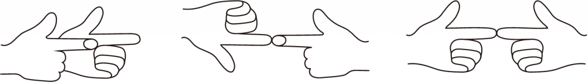

- A. 同位角、内错角、同旁内角
- B. 内错角、同旁内角、同位角
- C. 同位角、对顶角、同旁内角
- D. 同位角、内错角、对顶角

【答案】A

【解析】解：两条直线被第三条直线所截，形成了“三线八角”，为了便于记忆，同学们可仿照图用双手表示“三线八角”（两大拇指代表被截直线，食指代表截线）上列三幅图依次表示同位角、内错角、同旁内角，
故选：A．

## 26. 单选题（难度：适中）

风筝是中国古代劳动人民发明于春秋时期的产物，其材质在不断改进之后，坊间开始用纸做风筝，称为“纸鸢”．如图所示的纸骨架中，与∠1构成同位角的是（　　）

- A. ∠2
- B. ∠3
- C. ∠4
- D. ∠5

【答案】A

【解析】解：A、∠2与∠1构成同位角，故A符合题意；
B、D中的角与∠1构成同旁内角，故BD不符合题意；
C、∠4与∠1构成内错角，故C不符合题意．
故选：A．

## 27. 单选题（难度：非常简单）

电子屏幕上显示的数字“9”形状如图所示，其中∠2的同位角是（　　）

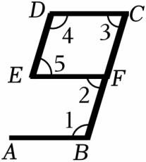

- A. ∠1
- B. ∠3
- C. ∠4
- D. ∠5

【答案】B

【解析】解：A、∠2与∠1是同旁内角，故A不符合题意；
B、∠2与∠3是同位角，故B符合题意；
C、∠2与∠4不是同位角，故C不符合题意；
D、∠2与∠5是内错角，故D不符合题意．
故选：B．

## 28. 单选题（难度：非常简单）

下列四幅图中，∠1和∠2是同旁内角的是（　　）

- A. 
- B. 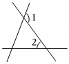
- C. 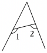
- D. 
​

【答案】C

【解析】解：A．∠1和∠2是对顶角，不合题意，
B．∠1和∠2是内错角，不合题意，
C．∠1和∠2是同旁内角，符合题意，
D．∠1和∠2不是同旁内角，不合题意，
故选：C．

## 29. 单选题（难度：适中）

下列所示的四个图形中，∠1和∠2不是同位角的是（　　）

- A. 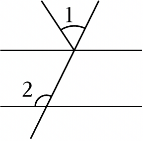
- B. 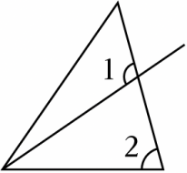
- C. 
- D. 
​

【答案】C

【解析】解：选项A、B、D中，∠1与∠2在截线的同侧，并且在被截线的同一方，是同位角；
选项C中，∠1与∠2的两条边都不在同一条直线上，不是同位角．
故选：C．

## 30. 判断题（难度：简单）

如图，∠9和∠7是内错角． （    ）

- YES. √
- NO. ×

【答案】YES

【解析】解：根据内错角的概念可知，∠9和∠7是内错角．
故答案为：√．
声明：试题解析著作权属菁优网所有，未经书面同意，不得复制发布日期：2025/3/17 15:46:41；用户：李老师；邮箱：xzsx2023@xyh.com；学号：47316516

## 31. 判断题（难度：简单）

如图，∠9和∠10是同旁内角． （    ）

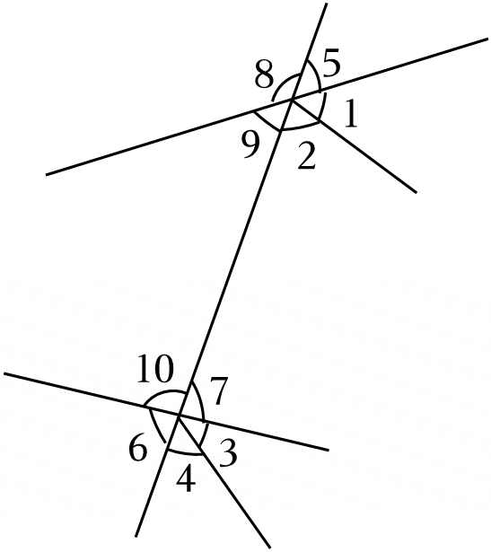

- YES. √
- NO. ×

【答案】YES

【解析】解：如图，∠9和∠10是直线a、直线b被直线c所截的同旁内角，
故答案为：√．

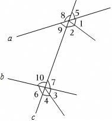

## 32. 单选题（难度：简单）

如图，∠A，∠B之间的位置关系是（　　）

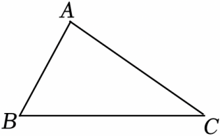

- A. 互为同位角
- B. 互为内错角
- C. 互为同旁内角
- D. 互为对顶角

【答案】C

【解析】解：∠A，∠B之间的位置关系是互为同旁内角．
故选：C．

## 33. 单选题（难度：适中）

如图，有下列判断：①∠A与∠1是同位角；②∠A与∠B是同旁内角；③∠3与∠1是内错角；④∠1与∠2是同位角．其中正确的是（　　）

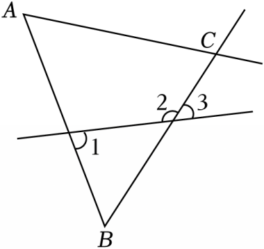

- A. ①②
- B. ①②④
- C. ②③④
- D. ①③④

【答案】A

【解析】解：①∠A与∠1是同位角，正确；
②∠A与∠B是同旁内角，正确；
③∠3与∠1不是内错角，故原说法错误；
④∠1与∠2是内错角，故原说法错误．
综上所述，正确的有①②，
故选：A．

## 34. 单选题（难度：适中）

如图，∠1的内错角是（　　）

- A. ∠2
- B. ∠3
- C. ∠4
- D. ∠5

【答案】B

【解析】解：如图：根据内错角、同旁内角、同位角的定义可得：∠1的内错角是∠3，∠1的同旁内角是∠2，∠1的同位角是∠5．
故选：B．

## 35. 单选题（难度：非常简单）

∠1 的同位角是（　　）

- A. ∠2
- B. ∠3
- C. ∠4
- D. ∠5

【答案】D

【解析】解：∠1的同位角是∠5，
故选：D．

## 36. 单选题（难度：简单）

如图，∠2与∠5是一对（　　）

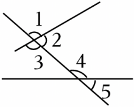

- A. 同位角
- B. 内错角
- C. 同旁内角
- D. 对顶角

【答案】A

【解析】解：观察图形可知：∠2和∠5是一对同位角，
故选：A．

## 37. 单选题（难度：非常简单）

如图，直线a截直线b，c，下列说法正确的是（　　）

- A. ∠1与∠2是同旁内角
- B. ∠1与∠3是同旁内角
- C. ∠2与∠3是同位角
- D. ∠3与∠4是内错角

【答案】A

【解析】解：A、∠1与∠2是同旁内角，故原说法正确，符合题意；
B、∠1与∠3是邻补角，故原说法错误，不符合题意；
C、∠2与∠3是内错角，故原说法错误，不符合题意；
D、∠3与∠4是同旁内角，故原说法错误，不符合题意．
故选：A．

## 38. 单选题（难度：适中）

下列判断错误的是（　　）

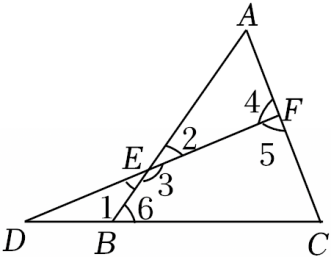

- A. ∠2与∠4是同旁内角
- B. ∠3与∠4是内错角
- C. ∠5与∠6是同旁内角
- D. ∠1与∠5是同位角

【答案】C

【解析】解：A、∠2与∠4是同旁内角，原说法正确，故此选项不符合题意；
B、∠3与∠4是内错角，原说法正确，故此选项不符合题意；
C、∠5与∠6不是同旁内角，原说法错误，故此选项符合题意；
D、∠1与∠5是同位角，原说法正确，故此选项不符合题意．
故选：C．

## 39. 单选题（难度：简单）

如图，∠1与∠2是（　　）

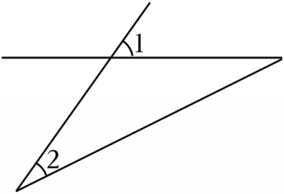

- A. 同位角
- B. 内错角
- C. 同旁内角
- D. 对顶角

【答案】A

【解析】解：根据图象，∠1与∠2是两直线被第三条直线所截得到的两角，且在被截直线的上方，在截线的同一侧，因而∠1与∠2是同位角，
故选：A．

## 40. 单选题（难度：非常简单）

如图，直线a、b被直线c所截，与∠2是同旁内角的是（　　）

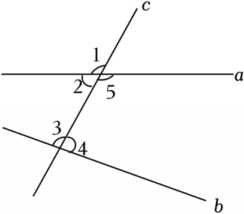

- A. ∠1
- B. ∠3
- C. ∠4
- D. ∠5

【答案】B

【解析】解：图中∠3与∠2是同旁内角．
故选：B．

## 41. 单选题（难度：简单）

关于如图中各角的说法不正确的是（　　）

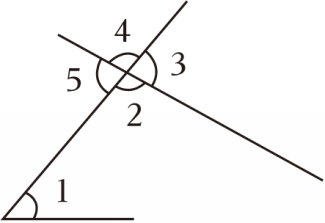

- A. ∠1与∠2是同旁内角
- B. ∠1与∠4是内错角
- C. ∠3与∠5是对顶角
- D. ∠2与∠3是邻补角

【答案】B

【解析】解：A、∠1与∠2是同旁内角，原说法正确，故此选项不符合题意；
B、∠1与∠4不是内错角，原说法错误，故此选项符合题意；
C、∠3与∠5是对顶角，原说法正确，故此选项不符合题意；
D、∠2与∠3是邻补角，原说法正确，故此选项不符合题意．
故选：B．

## 42. 单选题（难度：简单）

如图，下面说法错误的是（　　）

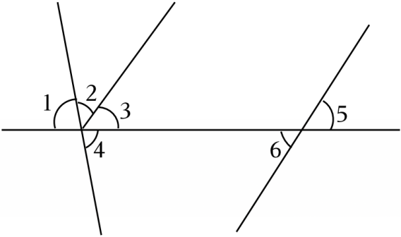

- A. ∠1和∠4是对顶角
- B. ∠3和∠6是内错角
- C. ∠2和∠5是同位角
- D. ∠4和∠6是同旁内角

【答案】C

【解析】解：A、B、D中的说法正确，故A、B、D不符合题意；
C、∠2和∠5不是同位角，故C符合题意．
故选：C．

## 43. 单选题（难度：适中）

如图所示，下列说法一定正确的是（　　）

- A. ∠1和∠2互为余角
- B. ∠1和∠4是内错角
- C. ∠3和∠4互为补角
- D. ∠2和∠5是同位角

【答案】D

【解析】解：A．由于∠1与∠2的和不一定是90°，所以∠1和∠2不一定是互为余角，因此选项A不符合题意；
B．∠1和∠4不是两条直线被第三条直线所截得的角，不符合内错角的定义，因此选项B不符合题意；
C．∠3和∠4是一组同旁内角，但∠3和∠4不一定互补，因此选项C不符合题意；
D．∠2和∠5是两条直线被第三条直线所截的同位角，因此选项D符合题意．
故选：D．

## 44. 单选题（难度：适中）

如图，下列说法错误的是（　　）

- A. ∠A与∠3是同位角
- B. ∠A与∠2是同旁内角
- C. ∠4与∠5是对顶角
- D. ∠4与∠C是内错角

【答案】C

【解析】解：A、∠A与∠3是同位角，原说法正确，不符合题意；
B、∠A与∠2是同旁内角，原说法正确，不符合题意；
C、∠4与∠5不是对顶角，原说法错误，符合题意；
D、∠4与∠C是内错角，原说法正确，不符合题意．
故选：C．

## 45. 单选题（难度：简单）

下列图中∠1，∠2不是同位角的是（　　）

- A. 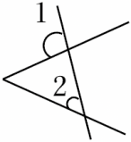
- B. 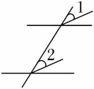
- C. 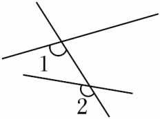
- D. 
​

【答案】D

【解析】解：A．由图可知，∠1，∠2是同位角，故A不符合题意．
B．由图可知，∠1，∠2是同位角，故B不符合题意．
C．由图可知，∠1，∠2是同位角，故C不符合题意．
D．由图可知，∠1，∠2不是同位角，故D符合题意．
故选：D．

## 46. 单选题（难度：非常简单）

∠1和∠2是同位角的是（　　）

- A. 
- B. 
- C. 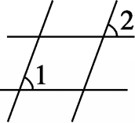
- D. 
​

【答案】B

【解析】解：根据同位角的概念进行逐项分析如下：
A、∠1和∠2不符合同位角概念，故该选项不符合题意；
B、∠1和∠2符合同位角概念，故该选项符合题意；
C、∠1和∠2不符合同位角概念，故该选项不符合题意；
D、∠1和∠2不符合同位角概念，故该选项不符合题意；
故选：B．

## 47. 单选题（难度：适中）

如图，按各组角的位置判断错误的是（　　）

- A. ∠1与∠4是同旁内角
- B. ∠3与∠4是内错角
- C. ∠5与∠6是同旁内角
- D. ∠2与∠5是同位角

【答案】C

【解析】解：A、∠1和∠A是同旁内角，说法正确；
B、∠3和∠4是内错角，说法正确；
C、∠5和∠6不是两条直线被第三条直线截成的角，说法错误；
D、∠2和∠5是同位角，说法正确．
故选：C．

## 48. 单选题（难度：简单）

如图，∠1的同位角有（　　）

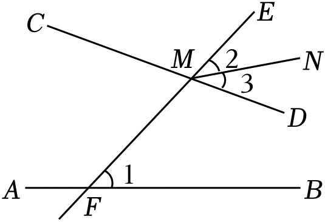

- A. ∠2
- B. ∠2或∠DME
- C. ∠2或∠3
- D. ∠2或∠3或∠DME

【答案】B

【解析】解：∠2是∠1的同位角，∠3不是∠1的同位角，∠DME是∠1的同位角．
故选：B．

## 49. 单选题（难度：非常简单）

下列图形中，∠1与∠2不是同位角的是（　　）

- A. 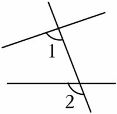
- B. 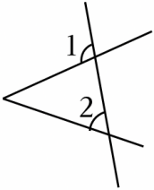
- C. 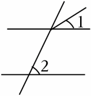
- D. 
​

【答案】C

【解析】解：根据同位角的概念可知，∠1和∠2不是同位角．
故选：C．

## 50. 单选题（难度：简单）

如图，下列说法不正确的是（　　）

- A. ∠1和∠4是内错角
- B. ∠1和∠2是同旁内角
- C. ∠3和∠4是同位角
- D. ∠2和∠4是同旁内角

【答案】D

【解析】解：根据同位角、内错角、同旁内角的定义进行判断，
A．∠1和∠4是内错角，故不符合题意；
B．∠1和∠2是同旁内角，故不符合题意；
C．∠3和∠4是同位角，故不符合题意；
D．∠2和∠4是同位角，故符合题意．
故选：D．

## 51. 单选题（难度：简单）

如图，下列说法正确的是（　　）

- A. ∠2与∠B是同位角
- B. ∠1与∠4是内错角
- C. ∠2与∠3是同旁内角
- D. ∠4与∠A是内错角

【答案】A

【解析】解：A．∠2与∠B是同位角，该说法正确，故该选项符合题意；
B．∠1与∠4是同旁内角，原说法错误，故该选项不符合题意；
C．∠2与∠3是同位角，原说法错误，故该选项不符合题意；
D．∠4与∠A是同旁内角，原说法错误，故该选项不符合题意；
故选：A．

## 52. 单选题（难度：非常简单）

如图，∠1和∠5是一对（　　）

- A. 内错角
- B. 同旁内角
- C. 同位角
- D. 对顶角

【答案】C

【解析】解：如图，∠1和∠5是一对同位角．
故选：C．

## 53. 单选题（难度：简单）

如图，∠CDB与∠DBE是同旁内角，它们是由（　　）

- A. 直线CD，AB被直线BD所截形成的
- B. 直线AD，BC被直线AE所截形成的
- C. 直线DC，AB被直线AD所截形成的
- D. 直线DC，AB被直线BC所截形成的

【答案】A

【解析】解：由图可得，∠CDB与∠DBE是同旁内角，它们是由直线CD、AB被直线BD所截形成的，
故选：A．

## 54. 单选题（难度：适中）

如图，下列判断：①∠A与∠1是同位角；②∠A与∠B是同旁内角；③∠4与∠1是内错角；④∠1与∠3是同位角．其中正确的是（　　）

- A. ①②③
- B. ①②④
- C. ②③④
- D. ①②③④

【答案】A

【解析】解：①②③中的判断正确，故①②③符合题意；
④、∠1与∠3不是同位角，故④不符合题意．
故选：A．

## 55. 单选题（难度：适中）

风筝是中国古代劳动人民发明于春秋时期的产物，其材质在不断改进之后，坊间开始用纸做风筝，称为“纸鸢”．如图所示的纸骨架中，与∠1构成同位角的是（　　）

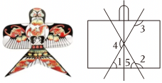

- A. ∠2
- B. ∠3
- C. ∠4
- D. ∠5

【答案】A

【解析】解：A、∠2与∠1构成同位角，故A符合题意；
B、D中的角与∠1构成同旁内角，故BD不符合题意；
C、∠4与∠1构成内错角，故C不符合题意．
故选：A．

## 56. 单选题（难度：简单）

如图，直线AD、BE被直线BF和AC所截，下列说法正确的是（　　）

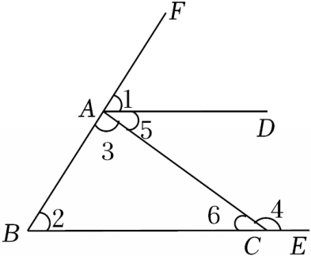

- A. ∠3与∠4是同旁内角
- B. ∠2与∠5是同位角
- C. ∠6与∠1是内错角
- D. ∠2与∠6是同旁内角

【答案】D

【解析】解：A、∠3与∠4是内错角，故选项A错误；
B、∠2与∠5不是同位角，故选项B错误；
C、∠1与∠6不是同旁内角，故选项C错误；
D、∠2与∠6是同旁内角，正确；
故选：D．

## 57. 单选题（难度：简单）

下列图形中，∠1与∠2是同位角的是（　　）

- A. 
- B. 
- C. 

【答案】C

【解析】解：A、∠1与∠2的是内错角，故本选项不符合题意．
B、∠1与∠2不是同位角，故本选项不符合题意．
C、∠1与∠2是同位角，故本选项符合题意．
D、∠1与∠2不是同位角，故本选项不符合题意．
故选：C．

## 58. 单选题（难度：适中）

下列所示的四个图形中，∠1和∠2不是同位角的是（　　）

- A. 
- B. 
- C. 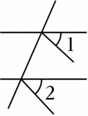
- D. 
​

【答案】C

【解析】解：选项A、B、D中，∠1与∠2在截线的同侧，并且在被截线的同一方，是同位角；
选项C中，∠1与∠2的两条边都不在同一条直线上，不是同位角．
故选：C．

## 59. 单选题（难度：非常简单）

下列四幅图中，∠1和∠2是同位角的是（　　）

- A. 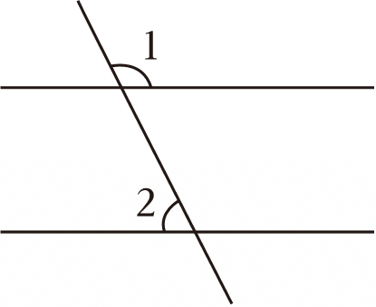
- B. 
- C. 
- D. 
​

【答案】B

【解析】解：上列四幅图中，∠1和∠2是同位角的是，
    

 
故选：B．

## 60. 单选题（难度：适中）

如图，直线AD，BE被直线BF和AC所截，则下列说法错误的是（　　）

- A. ∠1与∠2是同位角
- B. ∠3与∠4是内错角
- C. ∠4与∠5是同旁内角
- D. ∠1，∠5，∠3互为邻补角

【答案】D

【解析】解：A．∠1与∠2是同位角，选项正确，不符合题意；
B．∠3与∠4是内错角，选项正确，不符合题意；
C．∠4与∠5是同旁内角，选项正确，不符合题意；
D．∠1，∠5，∠3不互为邻补角，选项错误，符合题意．
故选：D．

## 61. 单选题（难度：适中）

下列图形中，∠1与∠2是同旁内角的是（　　）

- A. 
- B. 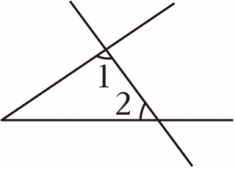
- C. 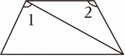
- D. 
​

【答案】B

【解析】解：A、∠1与∠2是同位角，不是同旁内角，故A不符合题意；
B、∠1与∠2是同旁内角，故B符合题意；
C、∠1与∠2不是同旁内角，故C不符合题意；
D、1与∠2是内错角，不是同旁内角，故D不符合题意．
故选：B．

## 62. 单选题（难度：非常简单）

电子屏幕上显示的数字“9”形状如图所示，其中∠2的同位角是（　　）

- A. ∠1
- B. ∠3
- C. ∠4
- D. ∠5

【答案】B

【解析】解：A、∠2与∠1是同旁内角，故A不符合题意；
B、∠2与∠3是同位角，故B符合题意；
C、∠2与∠4不是同位角，故C不符合题意；
D、∠2与∠5是内错角，故D不符合题意．
故选：B．

## 63. 判断题（难度：简单）

如图，∠9和∠7是内错角． （    ）

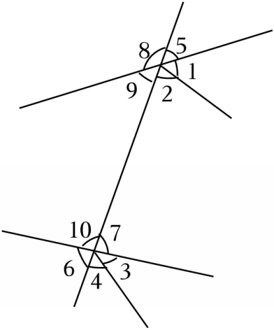

- YES. √
- NO. ×

【答案】YES

【解析】解：根据内错角的概念可知，∠9和∠7是内错角．
故答案为：√．
声明：试题解析著作权属菁优网所有，未经书面同意，不得复制发布日期：2025/3/17 15:46:41；用户：李老师；邮箱：xzsx2023@xyh.com；学号：47316516

## 64. 单选题（难度：适中）

如图，四个图形中的∠1和∠2，不是同位角的是（　　）

- A. 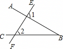
- B. 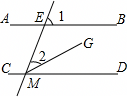
- C. 
- D. 
​

【答案】C

【解析】解：∵C中∠1和∠2是由四条直线组成，
∴∠1和∠2不是同位角．
故选：C．

## 65. 单选题（难度：简单）

如图中，∠1和∠2是同位角的是（　　）

- A. 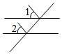
- B. 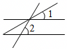
- C. 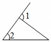
- D. 
​

【答案】C

【解析】解：A．不是“F”型，故A不符合题意；
B．不是“F”型，故B不符合题意；
C．是“F”型，故C符合题意；
D．不是“F”型，故D不符合题意；
故选：C．

## 66. 单选题（难度：简单）

如图，下面说法错误的是（　　）

【答案】A

## 67. 单选题（难度：非常简单）

∠1 的同位角是（　　）

- A. ∠2
- B. ∠3
- C. ∠4
- D. ∠5

【答案】D

【解析】解：∠1的同位角是∠5，
故选：D．

## 68. 单选题

如图所示，有下列5中说法：
①∠1和∠4是同位角；
②∠3和∠5是内错角；
③∠2和∠6是同旁内角；
④∠2和∠5是同位角；
⑤∠1和∠3是同旁内角．
其中正确的是（　　）

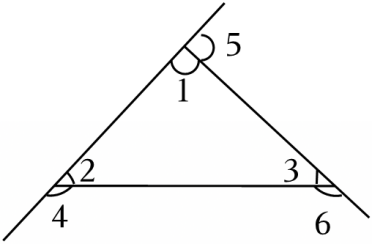

- A. ①②④⑤
- B. ①②③④
- C. ①②③④⑤
- D. ①②③

【答案】A

【解析】解：①∠1和∠4是同位角，正确；
②∠3和∠5是内错角，正确；
③∠2和∠6是内错角，故错误；
④∠2和∠5是同位角，正确，
⑤∠1和∠3是同旁内角，正确；
所以正确的是①②④⑤．
故选：A．

## 69. 单选题（难度：适中）

如图，下列说法错误的是（　　）

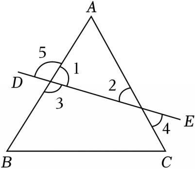

- A. ∠A与∠3是同位角
- B. ∠A与∠2是同旁内角
- C. ∠4与∠5是对顶角
- D. ∠4与∠C是内错角

【答案】C

【解析】解：A、∠A与∠3是同位角，原说法正确，不符合题意；
B、∠A与∠2是同旁内角，原说法正确，不符合题意；
C、∠4与∠5不是对顶角，原说法错误，符合题意；
D、∠4与∠C是内错角，原说法正确，不符合题意．
故选：C．

## 70. 单选题（难度：适中）

如图所示，下列说法一定正确的是（　　）

- A. ∠1和∠2互为余角
- B. ∠1和∠4是内错角
- C. ∠3和∠4互为补角
- D. ∠2和∠5是同位角

【答案】D

【解析】解：A．由于∠1与∠2的和不一定是90°，所以∠1和∠2不一定是互为余角，因此选项A不符合题意；
B．∠1和∠4不是两条直线被第三条直线所截得的角，不符合内错角的定义，因此选项B不符合题意；
C．∠3和∠4是一组同旁内角，但∠3和∠4不一定互补，因此选项C不符合题意；
D．∠2和∠5是两条直线被第三条直线所截的同位角，因此选项D符合题意．
故选：D．

## 71. 单选题（难度：适中）

如图，∠1的内错角是（　　）

- A. ∠2
- B. ∠3
- C. ∠4
- D. ∠5

【答案】B

【解析】解：如图：根据内错角、同旁内角、同位角的定义可得：∠1的内错角是∠3，∠1的同旁内角是∠2，∠1的同位角是∠5．
故选：B．

## 72. 单选题（难度：适中）

如图，有下列判断：①∠A与∠1是同位角；②∠A与∠B是同旁内角；③∠3与∠1是内错角；④∠1与∠2是同位角．其中正确的是（　　）

【答案】A

## 73. 单选题（难度：适中）

如图，下列结论错误的是（　　）

【答案】A

## 74. 单选题（难度：非常简单）

如图，直线a、b被直线c所截，与∠2是同旁内角的是（　　）

【答案】A

## 75. 单选题（难度：简单）

如图，∠2与∠5是一对（　　）

【答案】A

## 76. 单选题（难度：简单）

如图中，∠1的同位角是（　　）

- A. ∠2
- B. ∠3
- C. ∠4
- D. ∠5

【答案】C

【解析】解：由同位角的定义可知，∠1的同位角是∠4．
故选：C．

## 77. 单选题（难度：简单）

如图，a，b，c三条直线两两相交，下列说法错误的是（　　）

- A. ∠1与∠2是同位角
- B. ∠2与∠4是内错角
- C. ∠3与∠4是对顶角
- D. ∠1与∠3是同旁内角

【答案】B

【解析】解：A．∠1与∠2是直线a、直线b被直线c所截，所得到的同位角，因此选项A不符合题意；
B．∠2与∠4是直线a、直线c被直线b所截，所得到的同位角，因此选项B符合题意；
C．∠3与∠4是对顶角，因此选项C不符合题意；
D．∠1与∠3是直线b、直线c被直线a所截，所得到的同旁内角，因此选项D不符合题意；
故选：B．

## 78. 单选题（难度：适中）

下列说法中正确的有（　　）①相等的角是对顶角；②有公共顶点和一条公共边，且和为180°的两个角互为邻补角；③同一平面内过一点有且只有一条直线与已知直线垂直；④直线外一点到这条直线的垂线段，叫做点到直线的距离；⑤如图，∠1和∠2是同旁内角．

【答案】A

## 79. 单选题（难度：非常简单）

如图，∠1和∠5是一对（　　）

【答案】A

## 80. 单选题（难度：适中）

如图，下列判断：①∠A与∠1是同位角；②∠A与∠B是同旁内角；③∠4与∠1是内错角；④∠1与∠3是同位角．其中正确的是（　　）

【答案】A

## 81. 单选题（难度：简单）

如图，∠2与∠4的位置关系是（　　）

- A. 同位角
- B. 内错角
- C. 对顶角
- D. 同旁内角

【答案】A

【解析】解：如图所示，∠2和∠4两个角都在两条直线的同侧，并且在第三条直线（截线）的同旁，所以∠2和∠4是同位角．
故选：A．

## 82. 单选题（难度：适中）

如图，按各组角的位置判断错误的是（　　）

- A. ∠1与∠4是同旁内角
- B. ∠3与∠4是内错角
- C. ∠5与∠6是同旁内角
- D. ∠2与∠5是同位角

【答案】C

【解析】解：A、∠1和∠A是同旁内角，说法正确；
B、∠3和∠4是内错角，说法正确；
C、∠5和∠6不是两条直线被第三条直线截成的角，说法错误；
D、∠2和∠5是同位角，说法正确．
故选：C．

## 83. 单选题（难度：简单）

下列图中∠1，∠2不是同位角的是（　　）

【答案】A

## 84. 单选题（难度：非常简单）

∠1和∠2是同位角的是（　　）

- A. 
- B. 
- C. 
- D. 

【答案】B

【解析】解：根据同位角的概念进行逐项分析如下：
A、∠1和∠2不符合同位角概念，故该选项不符合题意；
B、∠1和∠2符合同位角概念，故该选项符合题意；
C、∠1和∠2不符合同位角概念，故该选项不符合题意；
D、∠1和∠2不符合同位角概念，故该选项不符合题意；
故选：B．

## 85. 单选题（难度：简单）

如图，下列说法正确的是（　　）

- A. ∠2与∠B是同位角
- B. ∠1与∠4是内错角
- C. ∠2与∠3是同旁内角
- D. ∠4与∠A是内错角

【答案】A

【解析】解：A．∠2与∠B是同位角，该说法正确，故该选项符合题意；
B．∠1与∠4是同旁内角，原说法错误，故该选项不符合题意；
C．∠2与∠3是同位角，原说法错误，故该选项不符合题意；
D．∠4与∠A是同旁内角，原说法错误，故该选项不符合题意；
故选：A．

## 86. 单选题（难度：非常简单）

下列四幅图中，∠1和∠2是同位角的是（　　）

- A. 
- B. 
- C. 
- D. 

【答案】B

【解析】解：上列四幅图中，∠1和∠2是同位角的是，
    

  
故选：B．

## 87. 单选题（难度：简单）

如图，直线AD、BE被直线BF和AC所截，下列说法正确的是（　　）

- A. ∠3与∠4是同旁内角
- B. ∠2与∠5是同位角
- C. ∠6与∠1是内错角
- D. ∠2与∠6是同旁内角

【答案】D

【解析】解：A、∠3与∠4是内错角，故选项A错误；
B、∠2与∠5不是同位角，故选项B错误；
C、∠1与∠6不是同旁内角，故选项C错误；
D、∠2与∠6是同旁内角，正确；
故选：D．

## 88. 单选题（难度：非常简单）

电子屏幕上显示的数字“9”形状如图所示，其中∠2的同位角是（　　）

- A. ∠1
- B. ∠3
- C. ∠4
- D. ∠5

【答案】B

【解析】解：A、∠2与∠1是同旁内角，故A不符合题意；
B、∠2与∠3是同位角，故B符合题意；
C、∠2与∠4不是同位角，故C不符合题意；
D、∠2与∠5是内错角，故D不符合题意．
故选：B．

## 89. 单选题（难度：简单）

下列图形中，∠1与∠2是同位角的是（　　）

- A. 
- B. 
- C. 
- D. 

【答案】C

【解析】解：A、∠1与∠2的是内错角，故本选项不符合题意．
B、∠1与∠2不是同位角，故本选项不符合题意．
C、∠1与∠2是同位角，故本选项符合题意．
D、∠1与∠2不是同位角，故本选项不符合题意．
故选：C．

## 90. 单选题（难度：适中）

如图，直线AD，BE被直线BF和AC所截，则下列说法错误的是（　　）

- A. ∠1与∠2是同位角
- B. ∠3与∠4是内错角
- C. ∠4与∠5是同旁内角
- D. ∠1，∠5，∠3互为邻补角

【答案】D

【解析】解：A．∠1与∠2是同位角，选项正确，不符合题意；
B．∠3与∠4是内错角，选项正确，不符合题意；
C．∠4与∠5是同旁内角，选项正确，不符合题意；
D．∠1，∠5，∠3不互为邻补角，选项错误，符合题意．
故选：D．

## 91. 单选题（难度：非常简单）

下列图形中，∠1与∠2不是同位角的是（　　）

- A. 
- B. 
- C. 
- D. 

【答案】C

【解析】解：根据同位角的概念可知，∠1和∠2不是同位角．
故选：C．

## 92. 单选题（难度：非常简单）

下列四幅图中，∠1和∠2是同旁内角的是（　　）

- A. 
- B. 
- C. 
- D. 

【答案】C

【解析】解：A．∠1和∠2是对顶角，不合题意，
B．∠1和∠2是内错角，不合题意，
C．∠1和∠2是同旁内角，符合题意，
D．∠1和∠2不是同旁内角，不合题意，
故选：C．

## 93. 单选题（难度：适中）

下列图形中，∠1与∠2是同旁内角的是（　　）

- A. 
- B. 
- C. 
- D. 

【答案】B

【解析】解：A、∠1与∠2是同位角，不是同旁内角，故A不符合题意；
B、∠1与∠2是同旁内角，故B符合题意；
C、∠1与∠2不是同旁内角，故C不符合题意；
D、1与∠2是内错角，不是同旁内角，故D不符合题意．
故选：B．

## 94. 单选题（难度：简单）

如图中，∠1和∠2是同位角的是（　　）

【答案】A
